# Astrophysics 2 - Cosmology

**How to read these notes.**

- Conventions: $\varepsilon$ is energy density (J m$^{-3}$), $P$ is pressure, and $P = w\varepsilon$. The metric signature is $(-,+,+,+)$ with $x^0 = ct$. The scale factor is normalised to $a(t_0) = 1$ today. $\kappa \in \{-1, 0, +1\}$ is the sign of the spatial curvature and $R_0$ is today's radius of curvature. A subscript $0$ always means "today". In some GR asides we set $c = 1$, and the section on the physics of inflation uses natural units, $\hbar = c = k = 1$; we say so where it happens.
- Passages set off between horizontal rules and starting with **Aside** go deeper. Skip them on a first read; nothing in the main text depends on them. Passages starting with **Note** are short questions worth pausing on, with their answers.
- Numbers come from the [Planck 2018 analysis of the cosmic microwave background](https://arxiv.org/abs/1807.06209) unless stated otherwise: $H_0 = 67.4\ \mathrm{km\,s^{-1}\,Mpc^{-1}}$, so the Hubble time is $H_0^{-1} = 14.5$ Gyr and the Hubble distance is $c/H_0 = 4450$ Mpc.

---

## Fundamental Observations

Cosmology is the study of the universe as a whole: what it contains, how it is arranged, how it began and how it changes. Its raw material is a small number of observational facts, each simple to state and each with large consequences. This chapter collects five of them. The rest of the course is, in a sense, an attempt to explain them.

1. **The night sky is dark.** So the universe cannot be infinitely old, static and uniformly filled with stars that shine forever.
2. **On large scales the universe looks the same in every direction and from every place.** It is isotropic and homogeneous, and that symmetry is what makes cosmology possible at all.
3. **Galaxies recede from us at speeds proportional to their distance.** The universe is expanding, and running the expansion backwards gives it a finite age, of order $1/H_0 \approx 14$ billion years.
4. **The universe contains a few distinct kinds of particles, in proportions we can measure.** Most of its matter is not made of atoms at all.
5. **The universe is filled with radiation with a nearly perfect blackbody spectrum at 2.7 K.** So it was once hot and dense.

**Units.** Cosmology mixes astronomers' units with physicists'. These are the ones used throughout the notes.

| Unit | Value |
| --- | --- |
| parsec (pc) | $3.086\times10^{16}$ m $= 3.26$ light-years |
| megaparsec (Mpc) | $10^6$ pc $= 3.086\times10^{22}$ m |
| solar mass ($M_\odot$) | $1.989\times10^{30}$ kg |
| solar luminosity ($L_\odot$) | $3.828\times10^{26}$ W |
| gigayear (Gyr) | $10^9$ yr $= 3.156\times10^{16}$ s |
| electronvolt (eV) | $1.602\times10^{-19}$ J |
| $1\ \mathrm{km\,s^{-1}\,Mpc^{-1}}$ | $3.241\times10^{-20}\ \mathrm{s^{-1}}$ |

A typical galaxy holds $10^{10}$ to $10^{11}$ stars and is tens of kiloparsecs across; galaxies are typically a megaparsec or so apart.

---

### The night sky is dark

Why is the sky dark at night? The question sounds childish, but in the 1820s Heinrich Olbers showed that it is anything but. (Kepler and Halley had worried about it before him.) Suppose the universe is infinite in space and time, static, and uniformly filled with stars that shine forever. Then the sky should be as bright as the surface of a star.

Here is the argument. Let stars have number density $n_\star$ and radius $R_\star$. Look along any line of sight, and draw a cylinder of radius $R_\star$ and length $\lambda$ around it. A star whose centre lies inside the cylinder blocks the line of sight, and the average number of such stars is

$$
N = n_\star \lambda\,\pi R_\star^2 .
$$

The line of sight is blocked once $N \approx 1$, so the typical distance you can see before hitting a star, the **mean free path**, is

$$
\lambda = \frac{1}{n_\star\pi R_\star^2}.
$$

Averaged over the universe, $n_\star \sim 10^9\ \mathrm{Mpc^{-3}}$, and a Sun-like star has $\pi R_\star^2 \sim 10^{-27}\ \mathrm{Mpc^2}$. So $\lambda \sim 10^{18}$ Mpc. That is huge, but in an infinite universe it is finite, and *every* line of sight ends on a star.

Now, how bright is each piece of sky? A star of luminosity $L_\star$ at distance $r$ delivers a flux $f = L_\star/(4\pi r^2)$ and covers a solid angle $\Omega = \pi R_\star^2/r^2$. Its surface brightness, the flux per unit solid angle, is

$$
\Sigma_\star = \frac{f}{\Omega} = \frac{L_\star}{4\pi^2R_\star^2},
$$

independent of distance. A distant star is fainter, but it is also smaller on the sky, by exactly the same factor. So if every line of sight ends on a star, the whole sky has the surface brightness of a stellar surface. For the Sun, that is about $2\times10^7\ \mathrm{W\,m^{-2}\,sr^{-1}}$: the night sky would be as bright as standing on the surface of the Sun. The measured brightness of all the starlight in the universe, added up from deep galaxy counts, is about $5\times10^{-8}\ \mathrm{W\,m^{-2}\,sr^{-1}}$ ([Driver et al. 2016](https://arxiv.org/abs/1605.01523)), some $10^{15}$ times fainter.

So at least one assumption is wrong, and the dark sky is our first cosmological measurement. The main culprit is the **finite age** of the universe. If galaxies have existed only for a time $t_0$, we can see light only from within a distance of order $ct_0$, a few thousand megaparsecs, far short of the $10^{18}$ Mpc needed to fill the sky. Even in an infinitely old universe, stars don't shine forever: covering the sky needs light from $10^{18}$ Mpc away, which takes about $3\times10^{24}$ years to arrive, roughly $10^{14}$ stellar lifetimes. The expansion of the universe also helps, by redshifting distant light and so diluting its energy, but this turns out to be the smaller effect. Edward Harrison's book *Darkness at Night* (1987) tells the story of the paradox and its resolution.

> **In short.** Olbers was more right than he knew. Every line of sight *does* end on a glowing surface: the hot gas that filled the young universe, as hot as the surface of a cool star. But that light has been stretched by a factor of about 1100 on its way to us. The sky is not dark at all. It glows uniformly at microwave frequencies, as we'll see at the end of this chapter.

---

### The universe is isotropic and homogeneous

The universe is **isotropic** about a point if it looks the same in every direction from that point. It is **homogeneous** if it looks the same from every point. On small scales, our universe is neither. Within a few metres of you, the floor is down and the ceiling is up. Our galaxy, the Milky Way, is a flattened disc about 30 kpc across, sitting in a small group of galaxies, the **Local Group**, about two megaparsecs across. The Local Group lies on the outskirts of a supercluster, about 16.5 Mpc from the **Virgo cluster** at its heart. Clusters gather into superclusters tens of megaparsecs long, separated by nearly empty **voids** of similar size. The whole arrangement looks like a sponge, or a spider's web: the **cosmic web**.

But on large enough scales the lumps average out. Count the galaxies in a sphere of radius $r$ around any point: on small scales the count fluctuates wildly from sphere to sphere, but above about $70\,h^{-1}$ Mpc (roughly 100 Mpc) it grows as $r^3$ to within 1%, the same everywhere ([Scrimgeour et al. 2012](https://arxiv.org/abs/1205.6812)). Think of a sandy beach. Up close it is individual grains of different sizes and colours; from a clifftop it is a uniform, featureless surface. The universe is homogeneous in the clifftop sense.

The two properties are logically independent, as Figure 1 shows. A pattern of parallel stripes is homogeneous (every point is like every other) but not isotropic (directions along and across the stripes differ). A set of concentric rings is isotropic about its centre but not homogeneous (the centre is special). There are two useful connections, though:

- If a space is isotropic about *every* point, it is homogeneous.
- If it is isotropic about *one* point, and that point is not special (the **Copernican principle**), then it is isotropic about every point, and therefore homogeneous.

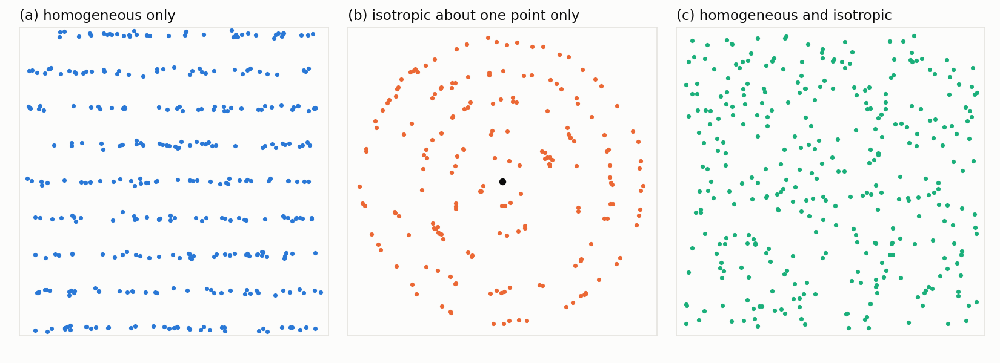

*Figure 1. Homogeneity and isotropy are different. (a) Parallel stripes are homogeneous but not isotropic. (b) Concentric rings are isotropic about their centre but not homogeneous. (c) A uniform random scatter is both, on scales larger than the gaps between points.*

The strongest evidence for isotropy is the cosmic microwave background, which has the same temperature in every direction to about one part in $10^5$, once our own motion has been accounted for ([Smoot et al. 1992](https://doi.org/10.1086/186504)). Counts of distant radio galaxies and galaxy surveys tell the same story. The assumption that the universe is homogeneous and isotropic on large scales is the **cosmological principle**. It is the foundation of everything that follows, because it reduces the description of the whole universe to a handful of numbers.

**An open question.** One test of isotropy is still unsettled. If the CMB dipole comes only from our motion, the same motion should make distant galaxies and quasars slightly more numerous in the direction we are heading, through aberration and the Doppler effect (the Ellis–Baldwin test). Counts of about 1.4 million quasars from the WISE satellite show a dipole in roughly the expected direction but more than twice the expected size, a $4.9\sigma$ discrepancy, rising to $5.1\sigma$ when radio galaxies are added ([Secrest et al. 2021](https://arxiv.org/abs/2009.14826), [2022](https://arxiv.org/abs/2206.05624); review in [Secrest et al. 2025](https://arxiv.org/abs/2505.23526)). Another quasar catalogue agrees with the CMB dipole ([Mittal et al. 2024](https://arxiv.org/abs/2311.14938)), and how much of the excess survives a careful treatment of galaxy clustering is still being argued. If it is real, then on gigaparsec scales the rest frame of matter is not the rest frame of the CMB, and the cosmological principle would need refining.

The **perfect cosmological principle** goes further: it says the universe is also unchanging in time. It is the basis of the Steady State model (see the chapter on Newton versus Einstein), and it fails. Distant galaxies, which we see as they were long ago, look systematically different from nearby ones: quasars, for instance, were far more common when the universe was a few billion years old than they are today.

---

### Redshift is proportional to distance

Light from distant galaxies arrives shifted to longer wavelengths, by a **redshift** $z \equiv (\lambda_{\rm ob} - \lambda_{\rm em})/\lambda_{\rm em}$. Apart from a few very nearby galaxies (the Andromeda galaxy approaches us at about 300 km/s), every galaxy is redshifted, and in 1929 Edwin Hubble found that the redshift is proportional to distance: $v = cz = H_0r$ for $z \ll 1$ ([Hubble 1929](https://doi.org/10.1073/pnas.15.3.168)). This is **Hubble's law**. It is what a uniformly expanding universe looks like from *any* galaxy, so it puts nobody at the centre: if every distance between galaxies grows in proportion to a common **scale factor** $a(t)$, normalised to $a(t_0) = 1$ today, then every galaxy sees the others receding at $v = (\dot a/a)\,r$. Its slope, the Hubble constant $H_0 \approx 67$ to $73\ \mathrm{km\,s^{-1}\,Mpc^{-1}}$, sets the time scale of cosmology: run the expansion backwards at constant speed and everything was together a Hubble time, $H_0^{-1} \approx 14.5$ Gyr, ago. The chapter on Newton versus Einstein derives Hubble's law from the geometry of an expanding universe, and discusses its history, the value of $H_0$ and what the Hubble time means.

---

### Different types of particles

The universe is made of a small number of kinds of particle, which play very different roles in cosmology:

| Particle | Rest energy | Charge |
| --- | --- | --- |
| proton | $938.272$ MeV | $+1$ |
| neutron | $939.565$ MeV | $0$ |
| electron | $0.511$ MeV | $-1$ |
| neutrinos (three types) | each below $0.45$ eV; sum at least $0.059$ eV, below $0.064$ eV | $0$ |
| photon | $0$ | $0$ |
| dark matter | unknown | $0$ |

**Baryons.** Protons and neutrons are **baryons**, made of three quarks each. A free neutron is unstable: it decays into a proton, an electron and an antineutrino with a mean lifetime of about 15 minutes. Bound in an atomic nucleus, a neutron can be stable. Astronomers use the phrase "baryonic matter" loosely for everything made of atoms, electrons included; the electrons contribute only about one part in 2000 of the mass.

**Leptons.** Electrons and neutrinos are **leptons**. Neutrinos come in three types, or flavours: electron, muon and tau neutrinos. They interact only through the weak force (and gravity), so they pass through almost anything. For decades they were thought to be massless, but neutrinos change flavour as they travel, and that is only possible if they have mass (aside below). Oscillation experiments measure differences of squared masses, $\Delta m^2_{21} = 7.5\times10^{-5}\ \mathrm{eV^2}$ and $|\Delta m^2_{31}| = 2.5\times10^{-3}\ \mathrm{eV^2}$ ([Esteban et al. 2024](https://arxiv.org/abs/2410.05380)). These imply that at least one neutrino has $mc^2 \geq 0.05$ eV, another at least $0.009$ eV, and that the three masses add up to at least $0.059$ eV ($0.10$ eV if the heaviest pair is the one that is nearly degenerate, the so-called inverted ordering). The best direct laboratory limit comes from the KATRIN experiment, which measures the energy spectrum of electrons from tritium beta decay: the electron antineutrino mass is below 0.45 eV ([KATRIN Collaboration 2025](https://arxiv.org/abs/2406.13516)). Cosmology gives the tightest upper limit: combining the cosmic microwave background with the DESI galaxy survey gives $\sum m_\nu < 0.064$ eV ([Elbers et al. 2025](https://arxiv.org/abs/2503.14744)), just above the oscillation minimum.

**Photons.** Photons are massless, carry energy $E = hf$, and in the early universe were in thermal equilibrium with matter. Radiation in thermal equilibrium at temperature $T$ has the **blackbody** spectrum. Its energy density in the frequency range $f$ to $f + df$ is

$$
\varepsilon(f)\,df = \frac{8\pi h}{c^3}\,\frac{f^3\,df}{\exp(hf/kT) - 1},
$$

and integrating over all frequencies gives the total energy density

$$
\varepsilon_\gamma = \alpha T^4, \qquad \alpha = \frac{\pi^2}{15}\frac{k^4}{\hbar^3c^3} = 7.566\times10^{-16}\ \mathrm{J\,m^{-3}\,K^{-4}} .
$$

Dividing by the energy per photon, the number density of photons in the range $f$ to $f + df$ is

$$
n(f)\,df = \frac{\varepsilon(f)\,df}{hf} = \frac{8\pi}{c^3}\,\frac{f^2\,df}{\exp(hf/kT) - 1},
$$

and in total

$$
n_\gamma = \beta T^3, \qquad \beta = \frac{2\zeta(3)}{\pi^2}\frac{k^3}{\hbar^3c^3} = 2.029\times10^7\ \mathrm{m^{-3}\,K^{-3}},
$$

where $2\zeta(3) = 2.4041$. The mean photon energy is $\varepsilon_\gamma/n_\gamma = 2.70\,kT$.

---

**Aside: the blackbody integrals.**

Photons are bosons with two polarisation states. In a box, the number of modes with wave vector in $d^3k$ is $2\,V\,d^3k/(2\pi)^3$, and each mode of frequency $\omega = ck$ has mean occupation number $1/(e^{\hbar\omega/kT} - 1)$ (Bose–Einstein, zero chemical potential). So the energy density is

$$
\varepsilon = 2\int\frac{d^3k}{(2\pi)^3}\,\frac{\hbar ck}{e^{\hbar ck/kT} - 1} = \frac{(kT)^4}{\pi^2(\hbar c)^3}\int_0^\infty\frac{x^3\,dx}{e^x - 1},
$$

with $x = \hbar ck/kT$. Expanding $1/(e^x - 1) = \sum_{n\ge1}e^{-nx}$ gives $\int_0^\infty x^{s-1}/(e^x - 1)\,dx = \Gamma(s)\zeta(s)$. For $s = 4$ that is $6\zeta(4) = 6\cdot\pi^4/90 = \pi^4/15$, which gives $\alpha$. For the number density the integrand has $x^2$, giving $\Gamma(3)\zeta(3) = 2\zeta(3)$, which gives $\beta$. The ratio of the two is the mean energy, $\frac{\pi^4/15}{2\zeta(3)}kT = 2.70\,kT$.

---

---

**Aside: neutrino oscillations are a precessing qubit.**

If you have done quantum information, you already understand neutrino oscillations. Take two flavours for simplicity. The states with definite flavour, $|\nu_e\rangle$ and $|\nu_\mu\rangle$, the ones produced and detected by weak interactions, are not the states with definite mass, $|\nu_1\rangle$ and $|\nu_2\rangle$. The two bases are related by a rotation through the **mixing angle** $\theta$:

$$
|\nu_e\rangle = \cos\theta\,|\nu_1\rangle + \sin\theta\,|\nu_2\rangle, \qquad
|\nu_\mu\rangle = -\sin\theta\,|\nu_1\rangle + \cos\theta\,|\nu_2\rangle .
$$

A neutrino of momentum $p$ travels with the two mass components having slightly different energies. Since $pc \gg mc^2$,

$$
E_i = \sqrt{p^2c^2 + m_i^2c^4} \approx pc + \frac{m_i^2c^4}{2E}, \qquad \Delta E = \frac{\Delta m^2c^4}{2E}, \quad \Delta m^2 \equiv m_2^2 - m_1^2 .
$$

In the mass basis the Hamiltonian is, up to a constant, $\frac{1}{2}\Delta E\,\sigma_z$. On the Bloch sphere of this two-level system, the mass states are the poles, and $|\nu_e\rangle$ is a point at polar angle $2\theta$ from the north pole. As the neutrino travels, its state precesses about the $z$ axis at angular frequency $\Delta E/\hbar$, exactly like a spin in a magnetic field. After a distance $L$ (time $L/c$), the probability that a detector measuring in the flavour basis finds a muon neutrino is

$$
P(\nu_e \to \nu_\mu) = \sin^2(2\theta)\,\sin^2\!\left(\frac{\Delta m^2c^3L}{4\hbar E}\right) \approx \sin^2(2\theta)\,\sin^2\!\left(1.27\,\frac{\Delta m^2\,[\mathrm{eV^2}]\;L\,[\mathrm{km}]}{E\,[\mathrm{GeV}]}\right).
$$

Two things follow. Oscillations need $\Delta m^2 \neq 0$, so at least one neutrino has mass. And they measure only *differences* of squared masses, never the masses themselves: that is why oscillation experiments give lower limits on the masses, and cosmology and beta decay give upper limits.

---

**Dark matter.** Most of the matter in the universe emits no light at all. We detect it only by its gravity: in the orbits of stars and gas in galaxies, the motions of galaxies in clusters, the bending of light, and the pattern of fluctuations in the cosmic microwave background. There is about five times as much of this **dark matter** as there is baryonic matter, and it is not made of any particle we know. The chapter on dark matter is devoted to it.

---

### The cosmic microwave background

In 1948 Ralph Alpher and Robert Herman, working out how the chemical elements might have been made in a hot early universe, predicted that the universe should still be filled with radiation left over from that time, cooled to about 5 K ([Alpher & Herman 1948](https://doi.org/10.1038/162774b0)). The prediction was largely forgotten. In 1965 Arno Penzias and Robert Wilson, testing a sensitive microwave antenna, found an unexplained, perfectly uniform noise coming from every direction, equivalent to a temperature of about 3 K ([Penzias & Wilson 1965](https://doi.org/10.1086/148307)). A group at Princeton led by Robert Dicke, who were building an antenna to look for exactly this radiation, explained what it was ([Dicke et al. 1965](https://doi.org/10.1086/148306)). It is the **cosmic microwave background** (CMB).

The COBE satellite's FIRAS instrument showed that the CMB has the spectrum of a blackbody, more perfect than any blackbody made in a laboratory. FIRAS on its own gives a temperature of $2.7260 \pm 0.0013$ K, and combining it with all the other measurements gives

$$
T_0 = 2.72548 \pm 0.00057\ \mathrm{K}
$$

([Fixsen 2009](https://arxiv.org/abs/0911.1955)). Figure 2 shows the FIRAS measurement. The rms deviation from a blackbody is less than 50 parts per million of the peak intensity, and the standard measures of distortion from a blackbody shape, called $\mu$ and $y$, are limited to $|\mu| < 9\times10^{-5}$ and $|y| < 1.5\times10^{-5}$ ([Fixsen et al. 1996](https://arxiv.org/abs/astro-ph/9605054)).

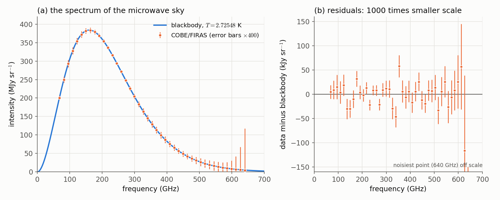

*Figure 2. (a) The spectrum of the cosmic microwave background measured by the FIRAS instrument on COBE, with a blackbody curve at 2.72548 K. The error bars have been multiplied by 400 to make them visible. (b) The difference between the data and a 2.725 K blackbody, the reference spectrum of the FIRAS residual table, on a scale 1000 times finer: no deviation is detected. The residuals test the shape of the spectrum; the absolute temperature comes from the calibration. Data from NASA's LAMBDA archive.*

From the blackbody formulas, the CMB today has energy density

$$
\varepsilon_{\gamma,0} = \alpha T_0^4 = 4.175\times10^{-14}\ \mathrm{J\,m^{-3}} = 0.2606\ \mathrm{MeV\,m^{-3}},
$$

photon number density

$$
n_{\gamma,0} = \beta T_0^3 = 4.107\times10^8\ \mathrm{m^{-3}} \approx 411\ \mathrm{cm^{-3}},
$$

and mean photon energy

$$
E_{\rm mean} = 2.70\,kT_0 = 6.34\times10^{-4}\ \mathrm{eV}.
$$

Its intensity peaks at a frequency of 160 GHz, a wavelength of about 2 mm: microwaves. Compared with the energy density needed to make the universe flat (the critical density, defined in the chapter on cosmic dynamics), the CMB contributes only about one part in 18,000. But it wins easily by number. There are about $1.6\times10^9$ CMB photons for every baryon in the universe: the **baryon-to-photon ratio** is $\eta = n_b/n_\gamma \approx 6.1\times10^{-10}$ ([Planck 2018](https://arxiv.org/abs/1807.06209)). The amount of deuterium made in the first few minutes gives the same number independently, $\eta = (6.04 \pm 0.12)\times10^{-10}$ ([Particle Data Group 2026](https://pdg.lbl.gov/2026/reviews/rpp2026-rev-bbang-nucleosynthesis.pdf)), as we'll see in the chapter on nucleosynthesis.

**Why it is there.** Today the universe is transparent: CMB photons travel freely across it. But the CMB's temperature falls as the universe expands (we show this below), so in the past it was hotter. When the universe was about 1100 times smaller than today, the temperature was about 3000 K, hot enough to ionise hydrogen. Before that, the universe was filled with a plasma of nuclei and free electrons, and photons scattered off the electrons constantly, just as they do in the interior of a star. The universe was opaque. The CMB is the light released when the plasma combined into neutral atoms and the universe became transparent. We see it coming from a "last-scattering surface" all around us, and it carries a snapshot of the universe at that moment. The chapter on the cosmic microwave background tells the story in detail.

**Why it cools as $1/a$.** Treat the CMB in a comoving volume $V \propto a^3$ as a photon gas expanding adiabatically. In a homogeneous universe there is nowhere for heat to flow, so $dQ = 0$ and the first law of thermodynamics gives

$$
\frac{dE}{dt} = -P\,\frac{dV}{dt}.
$$

For blackbody radiation $E = \alpha T^4V$ and $P = \frac{1}{3}\alpha T^4$, so

$$
\alpha\left(4T^3\frac{dT}{dt}V + T^4\frac{dV}{dt}\right) = -\frac{1}{3}\alpha T^4\frac{dV}{dt}
\quad\Longrightarrow\quad
\frac{1}{T}\frac{dT}{dt} = -\frac{1}{3V}\frac{dV}{dt} = -\frac{1}{a}\frac{da}{dt},
$$

i.e. $\frac{d}{dt}\ln T = -\frac{d}{dt}\ln a$, and $T \propto a^{-1}$.

There is a more vivid way to see it, which also explains why the spectrum stays a perfect blackbody. Every photon's frequency is redshifted as $f \propto 1/a$, and the number of photons in a comoving volume is fixed, so their number density falls as $a^{-3}$. Start with a blackbody at temperature $T$ and let the universe grow by a factor $s$. A photon now at frequency $f'$ had frequency $sf'$, and the number per unit volume in $df'$ is

$$
n'(f')\,df' = \frac{1}{s^3}\,n(sf')\,s\,df' = \frac{8\pi}{c^3}\,\frac{f'^2\,df'}{\exp\!\left(hf'/k(T/s)\right) - 1}.
$$

That is exactly a blackbody at temperature $T/s$. Expansion doesn't distort the spectrum; it just relabels the temperature.

**Not quite uniform.** Look closely and the CMB is not exactly the same everywhere. It is about 3.4 mK hotter than average in the direction we are moving and 3.4 mK colder in the opposite direction, because we are moving at 370 km/s relative to it (see the chapter on Newton versus Einstein). Remove that, and there are tiny fluctuations, about one part in $10^5$, from place to place on the sky. They are the imprint of the small density variations from which all galaxies eventually grew.

---

**Note: how many CMB photons are in this room?** At 411 per cubic centimetre, a room of 50 cubic metres holds about $2\times10^{10}$ CMB photons at any moment, each with about $6\times10^{-4}$ eV. Their energy density is only about $4\times10^{-14}$ joules per cubic metre, far too little to feel, yet they outnumber all the photons ever emitted by stars by more than a hundred to one.

---

### Summary

**Five observations and what they tell us.**

| Observation | Lesson |
| --- | --- |
| The night sky is dark | The universe is not infinitely old and uniformly full of eternal stars |
| The universe is isotropic and homogeneous on scales above $\sim 100$ Mpc | The cosmological principle: one set of numbers describes the whole universe |
| Redshift is proportional to distance, $v = H_0r$ | The universe is expanding uniformly; its age is of order $H_0^{-1} = 14.5$ Gyr |
| The universe contains baryons, leptons, photons and dark matter | Most matter is dark; photons outnumber baryons $1.6\times10^9$ to 1 |
| A 2.7255 K blackbody fills the universe | The universe was once hot, dense and opaque, and has cooled as $T \propto 1/a$ |

**Key numbers.**

| Quantity | Value |
| --- | --- |
| Hubble constant | $H_0 = 67.4\ \mathrm{km\,s^{-1}\,Mpc^{-1}}$ (CMB); about 73 from local distances |
| Hubble time, Hubble distance | $H_0^{-1} = 14.5$ Gyr, $c/H_0 = 4.45$ Gpc |
| CMB temperature | $T_0 = 2.72548$ K |
| CMB energy density | $0.2606\ \mathrm{MeV\,m^{-3}}$ |
| CMB photon density, mean energy | $411\ \mathrm{cm^{-3}}$, $6.34\times10^{-4}$ eV |
| Baryon-to-photon ratio | $\eta \approx 6.1\times10^{-10}$ |

---

## Newton versus Einstein

Before cosmology can say anything about the universe as a whole, it needs two things: a theory of gravity, and a way to describe the geometry of space and time on the largest scales. You already know both theories we will use. Newton's gravity is the simpler one, and it gets surprisingly far: the chapter on cosmic dynamics derives the equation for the expansion of the universe almost entirely from it. Einstein's general relativity is what we need as soon as we ask geometric questions. What does "distance" mean when everything is moving apart? How does light cross an expanding universe? Why does its wavelength stretch on the way?

This chapter does three things. It reviews what Newton, special relativity and general relativity tell us, slanted towards what cosmology needs. It builds a vocabulary for curved spaces, and shows that a space which looks the same everywhere and in every direction can be curved in only three ways. And it assembles these into the Robertson–Walker metric, the spacetime of a homogeneous, isotropic universe, from which Hubble's law and the cosmological redshift follow in a few lines.

Three pictures to carry away:

1. A space that looks the same everywhere and in every direction can be flat, positively curved like a sphere, or negatively curved like a saddle. You can tell which from the inside by measuring circles: is the circumference of a circle of radius $r$ equal to, less than, or more than $2\pi r$?
2. In such a universe every distance between galaxies is multiplied by the same factor $a(t)$ as time goes on. So every galaxy sees every other one receding at a speed proportional to its distance, and nobody is at the centre.
3. Light that set out when the universe was a fraction $a$ of its present size arrives with its wavelength stretched by $1/a$, and every clock at the source appears slowed by the same factor.

The first three sections are a quick tour of physics you already know. The new material starts with describing curvature.

---

### The way of Newton

Newton's law of gravity says that two spherical masses attract each other with a force

$$
F = -\frac{G M_g m_g}{r^2},
$$

and his second law says that a force produces an acceleration $F = m_i a$. The subscripts matter. The *gravitational* mass $m_g$ measures how strongly a body feels gravity; the *inertial* mass $m_i$ measures how hard it is to accelerate. A body falling towards a mass $M_g$ accelerates at

$$
a = -\frac{G M_g}{r^2}\left(\frac{m_g}{m_i}\right).
$$

Every body falls the same way if and only if $m_g/m_i$ is the same for all materials, and then we may choose units so that $m_g = m_i$. This is the **equivalence principle** in its weak form. Galileo checked it with falling and swinging bodies; the best test today is the MICROSCOPE satellite, which compared titanium and platinum masses in orbit and found them to fall alike to within a few parts in $10^{15}$ ([Touboul et al. 2022](https://arxiv.org/abs/2209.15487)). Newton had no explanation for this remarkable equality. Einstein made it the foundation of general relativity.

In field form, the gravitational acceleration is $\vec g = -\nabla\Phi$, and the potential obeys **Poisson's equation**

$$
\nabla^2\Phi = 4\pi G\rho,
$$

whose solution, for a known density distribution, is

$$
\Phi(\vec r) = -G\int \frac{\rho(\vec x)}{|\vec x - \vec r|}\,d^3x .
$$

#### Newtonian gravity in an infinite universe

Newton imagined an infinite, static universe, uniformly filled with stars, because he saw that a finite one would fall together towards its centre. Let's see what Newtonian gravity actually says about a uniform, infinite distribution of matter.

Try computing the potential. With $\rho$ constant everywhere, the integral above diverges. Try computing the force on a test particle instead, by adding up the pulls of all the matter in the universe. The answer depends on the order in which you add. Group the matter into spherical shells centred on the particle, and every shell pulls equally in all directions: the total is zero. Group it into shells centred on some other point $\vec x_0$, and the shells that enclose the particle cancel, while the solid ball between $\vec x_0$ and the particle pulls it towards $\vec x_0$. This puzzle bothered Neumann and Seeliger in the 1890s.

Poisson's equation says the same thing more cleanly. With $\rho$ constant there is no constant (homogeneous) solution, because $\nabla^2\Phi = 4\pi G\rho \neq 0$. Instead,

$$
\Phi = \frac{2\pi}{3}G\rho\,|\vec x - \vec x_0|^2
$$

works for *any* choice of centre $\vec x_0$, and different choices differ by a uniform gravitational field. The absolute acceleration of a particle in a homogeneous universe is simply not defined.

What *is* well defined is the relative acceleration of two nearby particles. By homogeneity and isotropy, the tidal tensor $\partial_i g_j$ can single out no direction, so it must be proportional to $\delta_{ij}$. Its trace is $\nabla\cdot\vec g = -4\pi G\rho$ by Poisson's equation. So

$$
\partial_i g_j = -\frac{4\pi G\rho}{3}\,\delta_{ij}
\qquad\Longrightarrow\qquad
\Delta\vec g = -\frac{4\pi G\rho}{3}\,\Delta\vec r .
$$

Every particle sees every other particle accelerating towards it, in proportion to their separation. Two lessons follow. First, a static, uniform universe is impossible: it has to be expanding or contracting. Newton could, in principle, have predicted that the universe is not static. Second, only relative accelerations are physical in a homogeneous universe. That is exactly the content of the equivalence principle, and of general relativity, where the physical part of gravity is the tidal field, i.e. curvature. In the chapter on cosmic dynamics this relative acceleration becomes the Friedmann equation.

---

**Note: when is Newton good enough?** Newtonian gravity is the weak-field, slow-motion limit of general relativity, valid when $|\Phi|/c^2 \ll 1$ and $v \ll c$. For a region of size $L$ in a universe near the critical density $\rho_c = 3H_0^2/(8\pi G)$, the potential across the region is $|\Phi| \sim G\rho L^2 \sim (H_0L)^2$, so $|\Phi|/c^2 \sim (L\,H_0/c)^2$. Newtonian cosmology is therefore fine for regions much smaller than the Hubble distance $c/H_0 \approx 4.4$ Gpc. Anything involving light from very far away, or the geometry of the whole universe, needs general relativity.

---

### The special way of Einstein

Newton's laws hold in **inertial frames**, frames in which a body with no forces on it moves in a straight line at constant speed. Two inertial frames in relative motion at speed $v$ along $x$ are related, in Newton's world, by the Galilean transformation $x' = x - vt$, $t' = t$.

Einstein's starting point was that the speed of light $c$ is the same in every inertial frame. Send out a flash of light from the origin at $t = 0$. In one frame its wavefront is the sphere $c^2t^2 = x^2 + y^2 + z^2$; in the other it must be $c^2t'^2 = x'^2 + y'^2 + z'^2$. The Galilean transformation can't satisfy both. The transformation that does is the **Lorentz transformation**,

$$
x' = \gamma(x - vt), \qquad y' = y, \qquad z' = z, \qquad t' = \gamma\left(t - \frac{vx}{c^2}\right), \qquad \gamma \equiv \frac{1}{\sqrt{1 - v^2/c^2}} .
$$

Distances and time intervals separately depend on the frame, but the **spacetime interval** between two events,

$$
(\Delta s)^2 = -c^2(\Delta t)^2 + (\Delta x)^2 + (\Delta y)^2 + (\Delta z)^2,
$$

does not. To check, the $(t, x)$ part transforms as $-c^2\Delta t'^2 + \Delta x'^2 = \gamma^2\left[-(c\Delta t - v\Delta x/c)^2 + (\Delta x - v\Delta t)^2\right] = \gamma^2(1 - v^2/c^2)(-c^2\Delta t^2 + \Delta x^2)$, and $\gamma^2(1 - v^2/c^2) = 1$.

There is a geometric way to say all this, which you'll recognise from projective geometry. The Lorentz transformations are exactly the linear maps of spacetime that preserve the quadratic form $Q = -c^2t^2 + x^2 + y^2 + z^2$, i.e. the orthogonal group $O(3,1)$ of a form of signature $(3,1)$. The light cone $Q = 0$ is the set of isotropic vectors of that form. A boost is a hyperbolic rotation. Writing $v = c\tanh\phi$, where $\phi$ is the **rapidity**,

$$
ct' = ct\cosh\phi - x\sinh\phi, \qquad x' = -ct\sinh\phi + x\cosh\phi ,
$$

and successive boosts along the same direction add their rapidities, just as successive rotations add their angles. We will meet rapidity again when the empty universe turns out to be a piece of Minkowski space.

In spherical coordinates the interval between neighbouring events is the **Minkowski metric**,

$$
ds^2 = -c^2dt^2 + dr^2 + r^2d\Omega^2, \qquad d\Omega^2 \equiv d\theta^2 + \sin^2\theta\,d\phi^2 .
$$

Light travels on **null geodesics**, $ds = 0$; moving radially ($\theta, \phi$ fixed) this gives $dr/dt = \pm c$. Minkowski spacetime is flat and static. It is the stage for physics when gravity can be ignored, and it cannot describe an expanding universe full of matter.

---

### The general way of Einstein

Einstein turned the equality $m_g = m_i$ into a principle about spacetime. A physicist sealed in a small, freely falling laboratory can do no local experiment that detects gravity: everything in the lab falls together. Conversely, a lab accelerating at $g$ in empty space is indistinguishable, locally, from a lab at rest on the surface of a planet. One consequence is that gravity must bend light: a light beam crossing an accelerating lab follows a curved path in that lab, so it must do the same in a gravitational field. The bending of starlight by the Sun was measured during the 1919 eclipse ([Dyson, Eddington & Davidson 1920](https://doi.org/10.1098/rsta.1920.0009)). And since energy and mass are equivalent, $E = mc^2$, anything with energy both feels and produces gravity, including massless photons.

In [general relativity (Einstein 1916)](https://doi.org/10.1002/andp.19163540702), gravity is the curvature of spacetime. Freely falling bodies follow geodesics of a curved spacetime metric $g_{\mu\nu}$, and Einstein's field equation relates the curvature to the energy and momentum present. In John Wheeler's phrase, spacetime tells matter how to move, and matter tells spacetime how to curve.

For cosmology this sets out a two-step programme:

1. Find the metric of a homogeneous, isotropic universe. Remarkably, symmetry alone almost fixes it, leaving one unknown function of time and two constants. That is the rest of this chapter.
2. Use Einstein's field equation to find how that function of time evolves, given what the universe contains. That is the subject of the chapter on cosmic dynamics.

To carry out the first step we need to describe curved spaces.

---

### Describing curvature

#### Curvature in two dimensions

Start with surfaces, which we can picture. On a **flat plane**, the shortest paths (geodesics) are straight lines, and the angles of any triangle add up to

$$
\alpha + \beta + \gamma = \pi .
$$

Distances are given by the **metric**, the rule for the distance $d\ell$ between neighbouring points. In Cartesian or in polar coordinates,

$$
d\ell^2 = dx^2 + dy^2 = dr^2 + r^2d\theta^2 .
$$

These describe the same geometry (substitute $x = r\cos\theta$, $y = r\sin\theta$). Saying that the first form holds everywhere is equivalent to saying the surface is a plane.

On a **sphere** of radius $R$, geodesics are arcs of great circles, and the angles of a geodesic triangle of area $A$ add up to *more* than $\pi$:

$$
\alpha + \beta + \gamma = \pi + \frac{A}{R^2} .
$$

Try it with the triangle that has one corner at the North Pole and two on the equator, a quarter of the way round from each other. All three angles are right angles, so the sum is $3\pi/2$. The triangle covers one eighth of the sphere, $A = \pi R^2/2$, and indeed $\pi + A/R^2 = 3\pi/2$. Use as coordinates the distance $r$ from the pole, measured along the surface, and the longitude $\theta$. The metric is

$$
d\ell^2 = dr^2 + R^2\sin^2(r/R)\,d\theta^2 .
$$

The sphere is finite: its area is $4\pi R^2$, and no two points are more than $\pi R$ apart.

The third possibility is a surface of uniform **negative** curvature, the **hyperbolic plane**. Its triangles have angle sums *less* than $\pi$,

$$
\alpha + \beta + \gamma = \pi - \frac{A}{R^2},
$$

and its metric is

$$
d\ell^2 = dr^2 + R^2\sinh^2(r/R)\,d\theta^2 .
$$

It has infinite area, and distances on it are unbounded. It is harder to picture, because it cannot be built in ordinary three-dimensional space. Hilbert proved in 1901 that no complete smooth surface in $\mathbb R^3$ has constant negative curvature. A saddle (or a Pringle) is negatively curved everywhere, but not uniformly: the curvature is strongest at its centre and fades away from it. The pseudosphere, which has constant negative curvature, ends in a sharp rim. But the hyperbolic plane sits perfectly naturally in *Minkowski* space. Take the upper sheet of the hyperboloid $w^2 - x^2 - y^2 = R^2$, with the distance rule $d\ell^2 = -dw^2 + dx^2 + dy^2$ (note the minus sign). Parametrise it as $w = R\cosh(r/R)$, $x = R\sinh(r/R)\cos\theta$, $y = R\sinh(r/R)\sin\theta$. Then

$$
-dw^2 + dx^2 + dy^2 = -\sinh^2(r/R)\,dr^2 + \cosh^2(r/R)\,dr^2 + R^2\sinh^2(r/R)\,d\theta^2 = dr^2 + R^2\sinh^2(r/R)\,d\theta^2 ,
$$

which is exactly the hyperbolic metric. Compare the sphere, $w = R\cos(r/R)$, $x = R\sin(r/R)\cos\theta$, $y = R\sin(r/R)\sin\theta$ in ordinary Euclidean space. A hyperbolic plane is "a sphere in Minkowski space", or a sphere of imaginary radius: replacing $R$ by $iR$ turns $\sin$ into $\sinh$. Figure 3 shows a geodesic triangle on each.

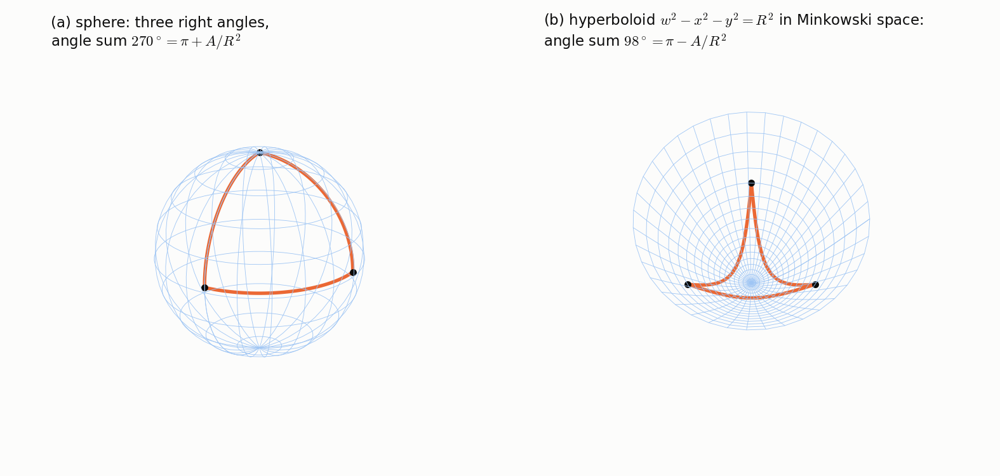

*Figure 3. (a) A geodesic triangle with three right angles on a sphere. (b) An equilateral geodesic triangle on the hyperboloid model of the hyperbolic plane, with its sides bowing inwards. Each angle is $32.7^\circ$, so the sum is $98.0^\circ$ and the deficit $\pi - (\alpha+\beta+\gamma) = A/R^2 = 1.43$. The hyperboloid is drawn in ordinary Euclidean 3D, so its angles and lengths look distorted; its true geometry uses the Minkowski distance rule.*

A surface whose curvature is the same everywhere and in every direction is said to be **uniformly curved**: it is homogeneous and isotropic. In two dimensions the curvature at a point is a single number, the Gaussian curvature $K$, and the three uniform cases are $K = +1/R^2$, $0$ and $-1/R^2$. In general curvature is a local property: a crumpled tablecloth is curved differently from place to place, and a bagel is positively curved on its outer rim and negatively curved near its hole. The metric contains all of this information.

**Measuring curvature with circles.** Draw a circle of radius $r$, i.e. all the points at distance $r$ from a centre. Its circumference is $C = 2\pi S(r)$, where $S(r)$ is the coefficient of $d\theta$ in the metric: $R\sin(r/R)$, $r$ or $R\sinh(r/R)$. For small circles,

$$
C \approx 2\pi r\left(1 - \frac{K r^2}{6}\right),
$$

so a creature living in the surface can measure its curvature without ever leaving it: $K = \frac{3}{\pi}\lim_{r \to 0}(2\pi r - C)/r^3$. On a sphere circles are too small, on a hyperbolic plane they are too big. Figure 4 shows how dramatic the difference becomes for large circles. On the sphere the circles grow until the equator and then shrink back to a point at the antipode. On the hyperbolic plane they grow exponentially.

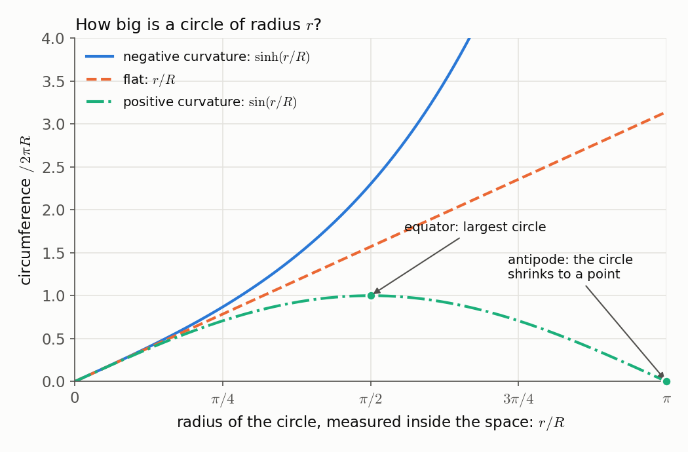

*Figure 4. Circumference of a circle of radius $r$ in the three uniform geometries, all with the same $|K| = 1/R^2$. They agree for $r \ll R$ and differ completely for $r \gtrsim R$.*

---

**Aside: curvature from the metric, and the angle-excess law.**

For a metric of the form $d\ell^2 = dr^2 + f(r)^2d\theta^2$, which is what you get with geodesic polar coordinates, the Gaussian curvature is

$$
K = -\frac{f''(r)}{f(r)} .
$$

(This is the Brioschi formula for an orthogonal metric with $E = 1$, $G = f^2$.) Check the three cases: $f = R\sin(r/R)$ gives $K = 1/R^2$; $f = r$ gives $0$; $f = R\sinh(r/R)$ gives $-1/R^2$. Now run the argument backwards. If $K$ is constant, then $f'' + Kf = 0$. Smoothness at the centre (small circles have circumference $2\pi r$) requires $f(0) = 0$ and $f'(0) = 1$, and the unique solutions are $\sin(\sqrt K r)/\sqrt K$, $r$ and $\sinh(\sqrt{-K}r)/\sqrt{-K}$. So "uniformly curved" and "has one of these three metrics" are the same statement.

The angle-sum laws are one theorem. The Gauss–Bonnet theorem for a region bounded by geodesic segments says $\iint K\,dA + \sum_i(\pi - \theta_i) = 2\pi$, where the $\theta_i$ are the interior angles. For a triangle this gives $\iint K\,dA = \alpha + \beta + \gamma - \pi$, and for constant $K$, $\alpha + \beta + \gamma = \pi + KA$. For a closed surface Gauss–Bonnet becomes $\iint K\,dA = 2\pi\chi$, where $\chi$ is the Euler characteristic. For a sphere, $(1/R^2)(4\pi R^2) = 4\pi = 2\pi\cdot 2$. For a torus $\chi = 0$, so the total curvature must vanish: a torus can be flat, but it can never be positively curved everywhere. That fact will come back when we ask about the global shape of the universe.

---

> **In short.** Curvature is the failure of circles to have circumference $2\pi r$ and of triangles to have angles adding to $\pi$. On a uniformly curved surface a single number, $K$, controls both failures, and both grow with size: invisible on scales much smaller than $R$, unavoidable on scales comparable to $R$.

#### From two dimensions to three

Everything carries over to three-dimensional space. **Flat** space has

$$
d\ell^2 = dx^2 + dy^2 + dz^2 = dr^2 + r^2\left[d\theta^2 + \sin^2\theta\,d\phi^2\right].
$$

Uniform **positive** curvature gives the **3-sphere**, the set of points $x^2 + y^2 + z^2 + w^2 = R^2$ in four-dimensional Euclidean space:

$$
d\ell^2 = dr^2 + R^2\sin^2(r/R)\left[d\theta^2 + \sin^2\theta\,d\phi^2\right].
$$

It has finite volume, $\int_0^{\pi R}4\pi R^2\sin^2(r/R)\,dr = 2\pi^2R^3$. The point $r = \pi R$ is the antipode of the origin, and travelling $2\pi R$ in a straight line brings you back to where you started. Uniform **negative** curvature gives hyperbolic 3-space, the hyperboloid $w^2 - x^2 - y^2 - z^2 = R^2$ in four-dimensional Minkowski space:

$$
d\ell^2 = dr^2 + R^2\sinh^2(r/R)\left[d\theta^2 + \sin^2\theta\,d\phi^2\right],
$$

with infinite volume, like flat space.

All three fit into one formula,

$$
\boxed{\;d\ell^2 = dr^2 + S_\kappa(r)^2\,d\Omega^2\;}
\qquad
S_\kappa(r) =
\begin{cases}
R\sin(r/R) & (\kappa = +1) \\
r & (\kappa = 0) \\
R\sinh(r/R) & (\kappa = -1),
\end{cases}
$$

where the **curvature constant** $\kappa$ gives the sign of the curvature and $R$ is the **radius of curvature**. The sphere of radius $r$ around any point has area $4\pi S_\kappa(r)^2$. For $r \ll R$ all three agree, $S_\kappa \approx r$. For $\kappa = 0$ and $-1$, $S_\kappa$ grows without limit. For $\kappa = +1$ it reaches a maximum $R$ at $r = \pi R/2$ and falls back to zero at the antipode.

Changing the radial coordinate to $x = S_\kappa(r)$ gives another common form. Since $(dS_\kappa/dr)^2 = 1 - \kappa S_\kappa^2/R^2$ in all three cases ($\cos^2 = 1 - \sin^2$, $\cosh^2 = 1 + \sinh^2$),

$$
d\ell^2 = \frac{dx^2}{1 - \kappa x^2/R^2} + x^2d\Omega^2 .
$$

This is the same space in different coordinates. It is the form you will often meet in GR textbooks.

---

**Aside: why only three geometries?**

Homogeneity and isotropy are much stronger requirements than they look. Here is why they force constant curvature.

In three dimensions the Riemann tensor is completely determined by the Ricci tensor, because the Weyl tensor vanishes identically when $n = 3$:

$$
R_{ijkl} = g_{ik}R_{jl} - g_{il}R_{jk} + g_{jl}R_{ik} - g_{jk}R_{il} - \frac{R}{2}\left(g_{ik}g_{jl} - g_{il}g_{jk}\right).
$$

Isotropy at a point means there is no preferred direction there. The Ricci tensor is a symmetric 2-tensor, and if it were not proportional to the metric its eigenvectors would be preferred directions. So $R_{ij} = 2K g_{ij}$ and $R = 6K$, and substituting,

$$
R_{ijkl} = K\left(g_{ik}g_{jl} - g_{il}g_{jk}\right):
$$

the sectional curvature is $K$ in every plane through the point. Homogeneity makes $K$ the same everywhere. (In three or more dimensions isotropy at every point already forces this, via the Bianchi identity: Schur's theorem.) Finally, a classical theorem of Killing and Hopf says that a complete, simply connected space of constant curvature $K$ is the 3-sphere ($K > 0$), Euclidean space ($K = 0$) or hyperbolic space ($K < 0$). There is nothing else.

These spaces are as symmetric as a 3-dimensional space can be. Each has 6 independent Killing vectors, 3 "translations" and 3 rotations; an $n$-dimensional space can have at most $n(n+1)/2$. Their isometry groups are the orthogonal group $O(4)$ for the 3-sphere, the Euclidean group $E(3)$ for flat space, and, beautifully, the Lorentz group $O^+(3,1)$ for hyperbolic space, acting on its hyperboloid. In the language of group actions: homogeneity says the isometry group acts transitively on points, and isotropy says the stabiliser of a point, $O(3)$, acts transitively on the directions at that point. It is the continuous analogue of an incidence geometry whose automorphism group is transitive on point–direction flags. In three dimensions that is enough to force constant curvature. From four dimensions on it is not: the complex projective plane is homogeneous and transitive on directions but not uniformly curved. There one needs the full orthogonal group as stabiliser, transitive on complete orthonormal frames, the analogue of transitivity on chambers.

---

**Aside: the shape of space is not the shape of the universe.**

Everything above is local. Curvature fixes the geometry of every small region, but not how the regions are glued together globally. Take flat space and declare that points differing by whole multiples of a length $L$ in $x$, $y$ or $z$ are the same point. The result, the **3-torus**, is flat everywhere but has finite volume $L^3$, and a straight line in any of the three axis directions brings you back to your starting point. Mathematically, it is the quotient of $\mathbb R^3$ by a group of translations acting freely. In general one takes $X/\Gamma$, where $\Gamma$ is a discrete group of isometries of $X$ acting freely.

There are exactly ten compact flat 3-manifolds, six orientable and four not, classified by Hantzsche and Wendt in the 1930s. For the 3-sphere, $\Gamma$ must be a finite subgroup of $SO(4)$ acting freely, which is where your finite group theory comes in. $\Gamma = \{\pm 1\}$ identifies antipodal points and gives real projective space $\mathbb{RP}^3$. Cyclic groups give the lens spaces. The binary icosahedral group, of order 120, gives the **Poincaré dodecahedral space**. Its fundamental domain is a regular dodecahedron whose opposite faces are glued after a twist of $36^\circ$. Hyperbolic space has infinitely many compact quotients.

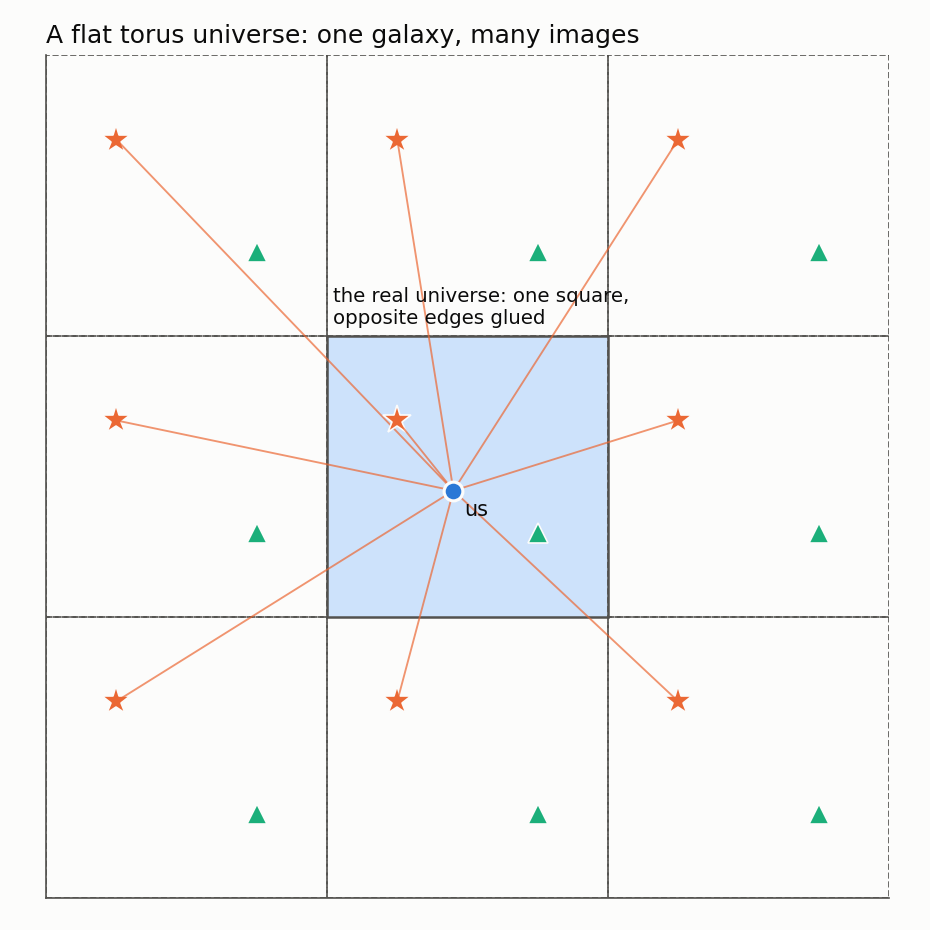

*Figure 5. A two-dimensional flat torus universe. The real universe is the shaded square, with opposite edges glued. Light can reach us from the same galaxy along many different paths, so we see repeated images of it in different directions.*

Could our universe be like this? If it is small enough, we would see repeated images of the same galaxies (Figure 5). We would also see the sphere from which the cosmic microwave background was emitted intersect its own images, producing pairs of matched circles on the sky with identical temperature patterns ([Cornish, Spergel & Starkman 1998](https://arxiv.org/abs/astro-ph/9801212)). [Luminet et al. (2003)](https://doi.org/10.1038/nature01944) proposed the Poincaré dodecahedral space to explain why the microwave background shows unexpectedly weak correlations on the largest angular scales. The Planck satellite searched for the matched circles and found none. For a cubic 3-torus, the fundamental domain must be large enough to contain a sphere whose radius is at least 97% of the distance to the surface from which the CMB was emitted ([Planck Collaboration 2016](https://arxiv.org/abs/1502.01593)). So if the universe is multiply connected, the gluing happens on scales at least comparable to the observable universe. In these notes we assume simply connected spaces; all the local formulas hold either way.

---

**Note: could we measure the curvature of the universe with a triangle?** Measurements described in later chapters show that if space is curved at all, its radius of curvature today is at least about 60 Gpc. Lay out an equilateral triangle with sides of 1 Gpc, already a quarter of the Hubble distance. Its area is $(\sqrt3/4)(1\ \mathrm{Gpc})^2 \approx 0.43\ \mathrm{Gpc}^2$, so its angle sum would differ from $\pi$ by at most $0.43/60^2 \approx 1.2\times10^{-4}$ radians, about 25 arcseconds. Nobody can lay out such a triangle, but the idea survives in a different form. Comparing the known physical size of features in the CMB with the angle they subtend on the sky is a giant triangle measurement, and it is how the flatness of the universe is actually measured.

---

### The Robertson–Walker metric

Minkowski spacetime is flat, static and empty of gravity. What is the most general spacetime that is homogeneous and isotropic in space at every moment, but whose distances are allowed to change with time? Friedmann ([1922](https://doi.org/10.1007/BF01332580)) and Lemaître ([1927, translated 1931](https://doi.org/10.1093/mnras/91.5.483)) used the answer, and [Robertson (1935)](https://doi.org/10.1086/143681) and [Walker (1937)](https://doi.org/10.1112/plms/s2-42.1.90) independently proved it is the only one. It is the **Robertson–Walker metric**:

$$
\boxed{\;ds^2 = -c^2dt^2 + a(t)^2\left[dr^2 + S_\kappa(r)^2\,d\Omega^2\right]\;}
$$

Here $S_\kappa$ is the function above, with $R = R_0$, the radius of curvature today. The function $a(t)$ is the **scale factor**, normalised to $a(t_0) = 1$ today. The spatial part is a uniformly curved space whose size is multiplied by $a(t)$. (You will also see this called the FRW or FLRW metric, after all four authors.)

The time coordinate $t$ is **cosmic time**: the proper time measured by an observer who sees the universe expanding uniformly around them. The spatial coordinates $(r, \theta, \phi)$ are **comoving coordinates**: if the expansion is perfectly homogeneous and isotropic, each such observer stays at fixed $(r, \theta, \phi)$ forever, and the expansion is carried entirely by $a(t)$.

**Why this form?** You know enough GR to see why symmetry forces it.

1. Take the "fundamental observers", the galaxies, smoothed out. For them to see the universe as isotropic, their worldlines must be perpendicular to the slices of homogeneity. A component of their 4-velocity along a slice would be a preferred direction. So we can choose coordinates in which each fundamental observer sits at fixed $x^i$ and the slices are $t = \text{const}$, which makes $g_{0i} = 0$.
2. Homogeneity says all fundamental observers are equivalent, so their clocks tick off the same proper time between any two slices. Label the slices by that proper time and $g_{00} = -c^2$. The metric is now $ds^2 = -c^2dt^2 + h_{ij}(t, \vec x)\,dx^idx^j$.
3. Each slice is homogeneous and isotropic, so it has constant curvature. How can $h_{ij}$ change with time? The rate of change $\partial_t h_{ij}$ describes how a small cloud of comoving observers deforms, and it too must be isotropic at every point. So it is proportional to the metric, $\partial_t h_{ij} = 2\lambda h_{ij}$: no stretching in one direction more than another (no shear). Rotation was already excluded in step 1, because the observers' worldlines are perpendicular to the slices. Homogeneity makes $\lambda$ depend on $t$ only. Integrating, $h_{ij}(t, \vec x) = a(t)^2 h_{ij}(t_0, \vec x)$, with $a(t) = \exp\int_{t_0}^t \lambda\,dt'$.
4. $h_{ij}(t_0, \vec x)$ is a constant-curvature metric with radius $R_0$. That gives the Robertson–Walker metric.

The payoff is enormous. The geometry of the entire universe is reduced to one function, $a(t)$, one sign, $\kappa$, and, if $\kappa \neq 0$, one length, $R_0$. Much of observational cosmology is an effort to measure these. Einstein, Friedmann, Lemaître, Robertson and Walker all assumed homogeneity and isotropy (the **cosmological principle**) long before there was any good evidence for them.

> **In short.** Symmetry does almost all the work. Einstein's field equation is not needed to find the shape of the metric, only to find how $a(t)$ changes with time.

**What "comoving" means in practice.** The natural comoving frame is the one in which the cosmic microwave background looks the same in every direction. We are not quite in it. The CMB is about 0.12% hotter than average in one direction of the sky and 0.12% colder in the opposite one, because the Sun moves at $369.82 \pm 0.11$ km/s relative to it ([Planck Collaboration 2020](https://arxiv.org/abs/1807.06205)). This motion relative to the comoving frame is our **peculiar velocity**.

**Where the metric applies.** The real universe is lumpy. The Robertson–Walker metric describes it only after smoothing over scales large enough for homogeneity to hold. As the chapter on fundamental observations showed, that means scales above roughly 100 Mpc. Smaller structures don't take part in the expansion at all. Atoms, people and rocks are held together by electromagnetic forces; planets, stars, galaxies and clusters of galaxies by their own gravity. A bound system does not "partly expand": it either follows the expansion completely or, once formed, ignores it completely ([Price 2005](https://arxiv.org/abs/gr-qc/0508052)). Your desk is not growing.

---

**Note: why do we see a CMB dipole if the universe is isotropic?** Isotropy is promised only to comoving observers, and we are moving relative to the comoving frame. Moving at speed $v$ through a blackbody radiation field Doppler-shifts it into a blackbody whose temperature depends on direction, $T(\theta) \approx T_0\left(1 + \frac{v}{c}\cos\theta\right)$ to first order. With $T_0 = 2.7255$ K and $v = 370$ km/s, the amplitude is $T_0 v/c \approx 3.4$ mK. Planck measures 3.36 mK. We use the dipole to *measure* our velocity and then subtract it; what remains is isotropic to a few parts in $10^5$.

---

### Proper distance

In an expanding universe, "the distance to that galaxy" needs a time stamp. The natural definition is the **proper distance** $d_p(t)$: the length of the spatial geodesic between two points, measured at a fixed cosmic time $t$, as if you could freeze the expansion and lay out a chain of rulers. At fixed $t$ the metric is

$$
ds^2 = a(t)^2\left[dr^2 + S_\kappa(r)^2d\Omega^2\right],
$$

and along a radial line from us (at the origin) to a galaxy at comoving coordinate $r$, $\theta$ and $\phi$ are constant, so $ds = a(t)\,dr$. Therefore

$$
d_p(t) = a(t)\int_0^r dr = a(t)\,r .
$$

The proper distance is proportional to the scale factor, and since $a(t_0) = 1$ the comoving coordinate $r$ is simply the galaxy's proper distance *today*.

#### Hubble's law from the metric

Since $r$ is constant, the proper distance changes at the rate

$$
\dot d_p = \dot a\,r = \frac{\dot a}{a}\,d_p .
$$

Today, defining the recession speed $v_p \equiv \dot d_p$ and the **Hubble constant** $H_0 \equiv (\dot a/a)_{t_0}$,

$$
\boxed{\;v_p(t_0) = H_0\,d_p(t_0)\;}
$$

This is Hubble's law, predicted and first estimated by [Lemaître (1927)](https://doi.org/10.1093/mnras/91.5.483) and established observationally by [Hubble (1929)](https://doi.org/10.1073/pnas.15.3.168). (Lemaître's estimate, about 625 km/s/Mpc, was left out of the 1931 English translation of his paper, by Lemaître himself as it turns out ([Livio 2011](https://doi.org/10.1038/479171a)); Hubble's own value was about 500.) Here it is a direct consequence of the metric. At other times the same relation holds with the **Hubble parameter** $H(t) \equiv \dot a/a$. The radius of curvature grows along with everything else: $R(t) = a(t)R_0$.

Why must the law be *linear*? Because nothing else is compatible with homogeneity and isotropy. Suppose an observer at $\vec x_0$ sees galaxies moving with velocities $\vec v(\vec x) - \vec v(\vec x_0)$. Homogeneity says every observer sees the same pattern, so $\vec v(\vec x) - \vec v(\vec x_0) = \vec F(\vec x - \vec x_0)$ for some function $\vec F$, for all $\vec x$ and $\vec x_0$. Applying this from $\vec x_0$ to an intermediate point $\vec x_1$, then from $\vec x_1$ to $\vec x$, and adding gives $\vec F(\vec d_1 + \vec d_2) = \vec F(\vec d_1) + \vec F(\vec d_2)$, so (assuming continuity) $\vec F$ is linear: $\vec F(\vec d) = M\vec d$ for some matrix $M$. Isotropy says $M$ commutes with every rotation, which forces $M$ to be a multiple of the identity, $M = H\,\mathbb 1$. To see why, split $M$ into symmetric and antisymmetric parts. A symmetric part that is not a multiple of the identity has unequal eigenvalues, and its eigenvectors would be preferred axes (a shear). An antisymmetric part is a rotation about some axis, which would again be a preferred direction. (This is Schur's lemma for the rotation group acting on $\mathbb R^3$.) So $\vec v = H\vec d$ is the *only* expansion law that looks the same to everybody. Figure 6 shows it from two different galaxies.

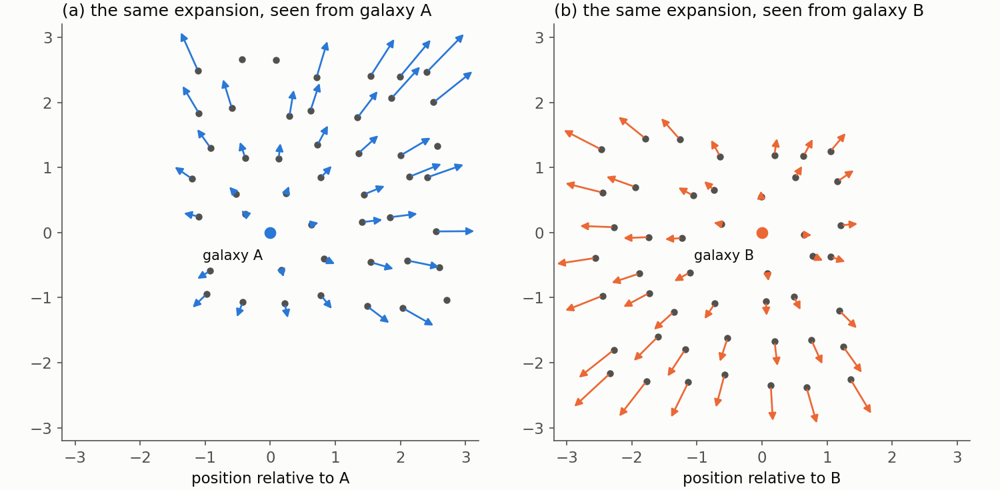

*Figure 6. A uniformly expanding set of galaxies, with arrows showing how each moves relative to the chosen galaxy over a fixed time. Seen from galaxy A or from galaxy B, the pattern is the same: everything recedes radially, at a speed proportional to distance.*

---

**Note: where is the centre of the expansion?** Nowhere, or everywhere, which comes to the same thing. Every galaxy sees exactly the same radial pattern (Figure 6), so the observations single out no centre. The expansion is not an explosion into pre-existing empty space from a particular point. It is a uniform change of scale of space itself, with no edge and no middle.

---

**The value of $H_0$.** Fitting the cosmic microwave background with the standard cosmological model gives $H_0 = 67.4 \pm 0.5\ \mathrm{km\,s^{-1}\,Mpc^{-1}}$ ([Planck 2018](https://arxiv.org/abs/1807.06209)). Measuring distances and velocities of nearby galaxies directly gives values around $73$, a disagreement called the *Hubble tension*, which we examine in the chapter on model universes. With $H_0 = 67.4$, the **Hubble time** is $H_0^{-1} = 14.5$ Gyr and the **Hubble distance** is

$$
d_H(t_0) \equiv \frac{c}{H_0} = 4450\ \mathrm{Mpc} \approx 4.4\ \mathrm{Gpc}.
$$

**A beginning, and an alternative.** Run the expansion backwards. If galaxies had always moved at their present speeds, two galaxies now a distance $d$ apart were together a time $d/v = d/(H_0d) = H_0^{-1}$ ago, the same for every pair. So the universe had a beginning a finite time ago, when everything was crammed together: the **Big Bang**. Gravity slows the expansion and dark energy speeds it up, but in our universe these change the age by only a few percent; the chapter on model universes finds 13.8 Gyr.

An expanding universe can avoid a beginning only if new matter appears to keep the density constant. That was the **Steady State** model of [Bondi & Gold (1948)](https://ui.adsabs.harvard.edu/abs/1948MNRAS.108..252B) and [Hoyle (1948)](https://ui.adsabs.harvard.edu/abs/1948MNRAS.108..372H). With $H$ truly constant, $\dot d = H_0d$ gives $d \propto e^{H_0t}$, and a volume $V \propto e^{3H_0t}$ needs new mass at the rate

$$
\frac{\dot M}{V} = 3H_0\rho_{m,0} \approx 6\times10^{-28}\ \mathrm{kg\,m^{-3}\,Gyr^{-1}},
$$

where $\rho_{m,0} \approx 2.7\times10^{-27}\ \mathrm{kg\,m^{-3}}$ is today's mean density of matter. That is about one hydrogen atom per cubic metre every three billion years, far too little to notice. The model was a serious rival (Hoyle coined the name "Big Bang" for the theory he disliked) until the 1960s, when the evolution of quasars and radio galaxies with distance, and above all the cosmic microwave background, showed that the universe has not always looked the same.

**Is space expanding, or are galaxies moving through space?** Both phrases are attempts to put the metric into words, and both can mislead. "Expanding space drags the galaxies apart" suggests space is a substance that pushes; "the galaxies drag space with them" suggests the opposite. In general relativity the statement is just the metric: in comoving coordinates the galaxies sit still and the scale factor grows. The physics lies in how spacetime and its contents determine each other through Einstein's equation. [Peacock's "diatribe on expanding space"](https://arxiv.org/abs/0809.4573) and [Bunn & Hogg (2009)](https://arxiv.org/abs/0808.1081) are short, readable papers on how far the "stretching space" language can safely be pushed.

**Faster than light?** A galaxy more than a Hubble distance away has $v_p = H_0d_p > c$. Today, everything beyond about 4.4 Gpc is receding faster than light in this sense. This does not violate special relativity. Special relativity's speed limit is *local*: no two objects passing each other at the same event can have a relative speed of $c$ or more. For objects far apart in a curved spacetime, "relative velocity" has no unique meaning. To compare two 4-velocities at different points you must parallel-transport one of them to the other, and in a curved spacetime the result depends on the path you choose. The recession speed $v_p = \dot d_p$ is a perfectly good number, but it is the rate of change of a distance measured along a slice of constant cosmic time, not a speed anyone measures with local rulers and clocks. ([Davis & Lineweaver 2004](https://arxiv.org/abs/astro-ph/0310808) untangle the confusions this causes.) In the chapter on model universes we will meet a universe in which the same galaxy recedes faster than light in one description and slower than light in another, and both descriptions are correct.

> **In short.** $v_p$ is not a velocity anyone measures. It is the rate at which a distance grows, where the distance is defined on a slice of the universe that no single observer can lay a ruler across.

### The cosmological redshift

Redshift does not tell us a galaxy's present distance directly, but it does tell us something just as useful: how big the universe was when the light set out.

Light from a galaxy at comoving coordinate $r$ travels to us along a radial null geodesic: $ds = 0$ with $\theta$, $\phi$ fixed. The metric gives $c^2dt^2 = a(t)^2dr^2$, or

$$
c\,\frac{dt}{a(t)} = dr ,
$$

where the left side depends only on $t$ and the right side only on $r$. Suppose a wave crest leaves the galaxy at time $t_e$ and reaches us at $t_0$. Then

$$
c\int_{t_e}^{t_0}\frac{dt}{a(t)} = \int_0^r dr = r .
$$

The next crest leaves at $t_e + \lambda_e/c$ and arrives at $t_0 + \lambda_0/c$, where $\lambda_e$ and $\lambda_0$ are the emitted and observed wavelengths. The galaxy has the same comoving coordinate, so

$$
c\int_{t_e + \lambda_e/c}^{t_0 + \lambda_0/c}\frac{dt}{a(t)} = r .
$$

The two integrals are equal. Subtracting the stretch from $t_e + \lambda_e/c$ to $t_0$ that they share leaves

$$
\int_{t_e}^{t_e + \lambda_e/c}\frac{dt}{a(t)} = \int_{t_0}^{t_0 + \lambda_0/c}\frac{dt}{a(t)} .
$$

The universe doesn't expand noticeably between two wave crests: the period of visible light is about $10^{-15}$ s, while the time over which $a$ changes appreciably is of order $H_0^{-1} \approx 4.6\times10^{17}$ s. So $a$ is constant within each integral, and

$$
\frac{\lambda_e}{a(t_e)} = \frac{\lambda_0}{a(t_0)} .
$$

Wavelengths stretch in proportion to the scale factor. With the redshift defined as $z \equiv (\lambda_0 - \lambda_e)/\lambda_e$ and $a(t_0) = 1$,

$$
\boxed{\;1 + z = \frac{a(t_0)}{a(t_e)} = \frac{1}{a(t_e)}\;}
$$

**The same argument in conformal time.** The integral $\int dt/a$ keeps appearing, so give it a name: **conformal time**, $d\eta \equiv dt/a(t)$ (not to be confused with the baryon-to-photon ratio, also written $\eta$). In terms of $\eta$, a light ray obeys $dr = c\,d\eta$, a straight line at $45^\circ$ in the $(\eta, r)$ plane, as in special relativity. Two successive crests are then two parallel lines, separated by the same $\Delta\eta$ when they leave and when they arrive. Converting back to cosmic time, $\Delta t = a\,\Delta\eta$, so the interval between crests is stretched by exactly the factor by which $a$ grew. Figure 7 shows both views. Conformal time will be our main tool for working out distances and horizons in the chapter on model universes.

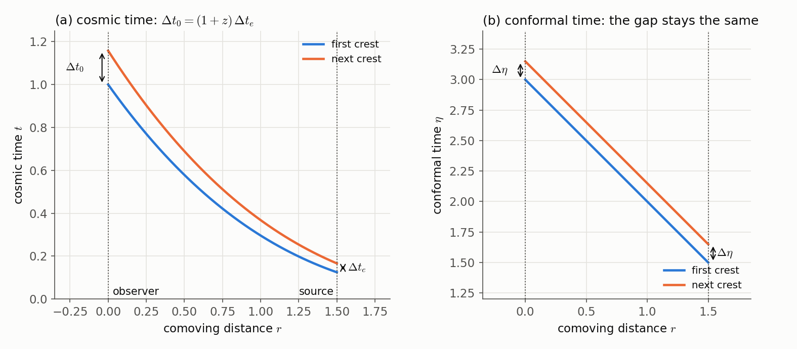

*Figure 7. Two successive wave crests travelling from a source to an observer, in a universe that grew by a factor of 4 while the light was in flight ($z = 3$). (a) In cosmic time the paths curve and the gap between crests grows. (b) In conformal time the paths are parallel straight lines and the gap is constant. The gap is greatly exaggerated: a real wave period is about $10^{-32}$ of the travel time.*

Some consequences are worth stating plainly.

- **The redshift tells you $a(t_e)$, and nothing else.** A galaxy at $z = 2$ is seen as it was when the universe was one third of its present size. It doesn't matter whether the expansion in between was steady or sudden, or even whether the universe contracted for a while: only the endpoints count. The cosmic microwave background, at $z \approx 1090$, was emitted when the universe was about $1/1100$ of its present size. The most distant spectroscopically confirmed galaxy, at $z = 14.44$ ([Naidu et al. 2026](https://arxiv.org/abs/2505.11263)), is seen when the universe was $1/15.4$ of its present size.
- **The redshift does not tell you the distance** unless you know $a(t)$. Turning $z$ into a distance, an age or a lookback time requires the expansion history, which is the business of the chapters on cosmic dynamics and model universes.
- **Clocks at the source appear slowed by the same factor.** The derivation never used the fact that the two signals were wave crests. Any two events at the source separated by $\Delta t_e$ are seen separated by $\Delta t_0 = (1+z)\,\Delta t_e$. Distant supernovae should therefore appear to brighten and fade more slowly, and they do. In 1504 Type Ia supernovae from the Dark Energy Survey, the light-curve widths scale as $(1+z)^b$ with $b = 1.003 \pm 0.005\,(\mathrm{stat}) \pm 0.010\,(\mathrm{sys})$ ([White et al. 2024](https://arxiv.org/abs/2406.05050)). Supernova spectra also age at the slowed rate ([Blondin et al. 2008](https://arxiv.org/abs/0804.3595)), and so does the variability of quasars ([Lewis & Brewer 2023](https://arxiv.org/abs/2306.04053)). This rules out "tired light" theories, in which photons lose energy on the way to us without any expansion, because tired light would redden the light without slowing the clocks.

In the chapter on model universes we derive the same $1/a$ stretching once more, from the geodesic equation, and find that it applies to the momentum of massive particles too.

> **In short.** $1 + z$ is a ratio of scale factors, full stop. The expansion stretches every interval in transit by the same factor: the distance between wave crests, the time between supernova flickers, the gap between any two signals.

---

### Summary

**The three homogeneous, isotropic geometries**, assuming the space is simply connected:

| | Flat | Positive curvature | Negative curvature |
| --- | --- | --- | --- |
| $\kappa$ | $0$ | $+1$ | $-1$ |
| $S_\kappa(r)$ | $r$ | $R\sin(r/R)$ | $R\sinh(r/R)$ |
| Angle sum of a triangle | $\pi$ | $\pi + A/R^2$ | $\pi - A/R^2$ |
| Circumference of a circle | $2\pi r$ | $2\pi R\sin(r/R)$, less than $2\pi r$ | $2\pi R\sinh(r/R)$, more than $2\pi r$ |
| Total volume | infinite | $2\pi^2R^3$ | infinite |
| Lives naturally in | $\mathbb R^3$ | a sphere in $\mathbb R^4$ | a hyperboloid in Minkowski space $\mathbb R^{3,1}$ |
| Isometry group | Euclidean group $E(3)$ | $O(4)$ | Lorentz group $O^+(3,1)$ |

**The ideas to carry away.**

- In a homogeneous universe Newtonian gravity defines only relative accelerations, and these show that a uniform universe cannot be static.
- Homogeneity and isotropy force constant spatial curvature, and constant curvature leaves only three geometries.
- The Robertson–Walker metric, $ds^2 = -c^2dt^2 + a(t)^2\left[dr^2 + S_\kappa(r)^2d\Omega^2\right]$, reduces the geometry of the universe to $a(t)$, $\kappa$ and $R_0$.
- Proper distance is $d_p = a(t)\,r$, and Hubble's law $v_p = H_0d_p$ follows; it is the only expansion law consistent with homogeneity and isotropy. Recession faster than light is no paradox.
- Redshift measures the scale factor at emission, $1 + z = 1/a(t_e)$, and the same factor slows every clock we watch at the source.

---

## Cosmic Dynamics

In the chapter on Newton versus Einstein we found the geometry of a homogeneous, isotropic universe. It is completely described by the Robertson–Walker metric, one function $a(t)$ and two constants, $\kappa$ and $R_0$. Geometry alone can't tell us how $a(t)$ behaves. For that we need dynamics: Einstein's field equation, which links the curvature of spacetime to what the universe contains. This chapter derives the three equations that govern the expansion of the universe, and then tells the strange story of the cosmological constant.

Three pictures to carry away:

1. The Friedmann equation is the energy equation of a test mass sitting on the edge of a sphere of matter. Expansion is "kinetic energy", the density supplies the "potential energy", and the curvature of space is the total energy.
2. In relativity, pressure gravitates. What slows the expansion is not $\varepsilon$ but $\varepsilon + 3P$, so a substance with enough negative pressure, $P < -\varepsilon/3$, makes the expansion speed up.
3. Everything a component of the universe does to the expansion is encoded in one number, its equation-of-state parameter $w = P/\varepsilon$.

---

### How curved can the universe be? A first look

Before any dynamics, geometry alone already limits the curvature. In a curved space the angles of a triangle of area $A$ add up to

$$
\alpha + \beta + \gamma = \pi + \frac{\kappa A}{R_0^2}.
$$

Lobachevsky suggested as early as 1829 testing this with the huge triangles formed by the Earth's orbit and distant stars. The idea is sound, but any triangle we can actually lay out is far too small for the deviation from $\pi$ to show.

Angular sizes do better, because they let us use the whole visible universe. In a static, flat space, a galaxy of diameter $D$ at distance $r$ subtends an angle

$$
\alpha = \frac{D}{r}.
$$

In a curved space the transverse distance at radius $r$ is $S_\kappa(r)\,d\theta$, not $r\,d\theta$, so

$$
\alpha_+ = \frac{D}{R_0\sin(r/R_0)} \quad (\kappa = +1), \qquad
\alpha_- = \frac{D}{R_0\sinh(r/R_0)} \approx \frac{2D}{R_0}e^{-r/R_0} \quad (\kappa = -1,\ r \gg R_0).
$$

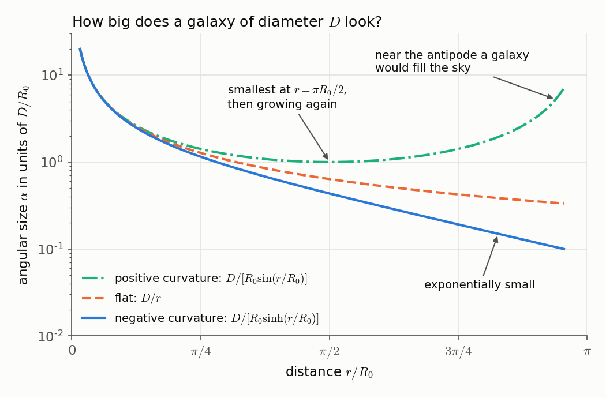

*Figure 8. The angular size of a galaxy of fixed diameter $D$ at distance $r$, ignoring the expansion of the universe. Positive curvature acts as a magnifying lens beyond $r = \pi R_0/2$; negative curvature shrinks distant galaxies exponentially.*

Positive curvature acts like a magnifying lens (Figure 8). Lines of sight that leave us diverging start to reconverge beyond the equator of the 3-sphere, so a galaxy at the antipode, $r = \pi R_0$, would fill the entire sky. Negative curvature does the opposite: galaxies much farther than $R_0$ would look exponentially small. We see neither. Galaxies out to distances of order $c/H_0$ look like ordinary galaxies, neither bloated nor shrunk to nothing. So, if the universe is curved at all, $R_0$ can't be much smaller than the Hubble distance, about 4.4 Gpc. (These formulas ignore the expansion, which changes the details; the chapter on measuring cosmological parameters does it properly.) Later in this chapter we'll tie the curvature to the density of the universe and do far better.

---

### Einstein's field equation

In Newtonian gravity, Poisson's equation $\nabla^2\Phi = 4\pi G\rho$ gives the potential from the mass density, and the gradient of the potential gives accelerations. Its counterpart in general relativity is **Einstein's field equation**,

$$
G_{\mu\nu} = \frac{8\pi G}{c^4}\,T_{\mu\nu},
$$

where $G_{\mu\nu} = R_{\mu\nu} - \frac{1}{2}R\,g_{\mu\nu}$ is the Einstein tensor, built from the metric and its first and second derivatives, and $T_{\mu\nu}$ is the stress–energy tensor of whatever is present. Both are symmetric $4\times 4$ tensors, so this is a set of ten coupled, nonlinear, second-order differential equations for the metric. It looks deceptively simple.

You know two of its consequences from the Schwarzschild solution and from your GR course:

- Because the equations are second order, spacetime can be curved where $T_{\mu\nu} = 0$, just as the Newtonian field is nonzero outside a planet. The Schwarzschild exterior is exactly such a solution.
- Second-order equations in space and time admit waves. A time-varying mass quadrupole radiates gravitational waves, as a time-varying electric dipole radiates electromagnetic waves. Einstein predicted them in 1916 (and later doubted they were real), and the LIGO detectors first observed them on 14 September 2015, from two merging black holes ([LIGO Scientific and Virgo Collaborations 2016](https://arxiv.org/abs/1602.03837)).

One more property matters here. The contracted Bianchi identity makes the Einstein tensor divergence-free, $\nabla^\mu G_{\mu\nu} = 0$, identically. So the field equation *requires* $\nabla^\mu T_{\mu\nu} = 0$: matter must conserve energy and momentum locally. That will give us the fluid equation below.

For a homogeneous, isotropic universe the content is a **perfect fluid**, with stress–energy tensor

$$
T_{\mu\nu} = \left(\varepsilon + P\right)\frac{u_\mu u_\nu}{c^2} + P\,g_{\mu\nu},
$$

where $\varepsilon$ is the energy density and $P$ the pressure, both measured by an observer moving with the fluid, and $u^\mu$ is the fluid's 4-velocity. Isotropy forbids any bulk flow relative to the comoving observers (a flow would be a preferred direction), so in comoving coordinates $u^\mu = (c, 0, 0, 0)$, and homogeneity makes $\varepsilon$ and $P$ functions of $t$ alone. The task is to put this, together with the Robertson–Walker metric, into the field equation, and find how $a(t)$, $\kappa$ and $R_0$ are tied to $\varepsilon(t)$ and $P(t)$.

---

### The Friedmann equation

The equation that results was first derived by [Alexander Friedmann in 1922](https://doi.org/10.1007/BF01332580), a meteorologist turned cosmologist. That was five years before Lemaître interpreted galaxy redshifts as a sign of expansion, and seven years before Hubble's law. We'll get it two ways: first with Newtonian physics, which is quick and gives the right intuition, and then with general relativity, which gives the right answer.

#### The Newtonian version

Take a sphere of mass $M_s$, expanding or contracting uniformly, and a test mass $m$ on its surface at radius $R_s(t)$ (Figure 9). The test mass feels

$$
F = -\frac{GM_sm}{R_s(t)^2}, \qquad\text{so}\qquad \frac{d^2R_s}{dt^2} = -\frac{GM_s}{R_s(t)^2}.
$$

With $M_s = \frac{4\pi}{3}\rho R_s^3$ this is $\ddot R_s = -\frac{4\pi G\rho}{3}R_s$: exactly the relative acceleration we found for a uniform universe in the chapter on Newton versus Einstein. The Friedmann equation is its first integral.

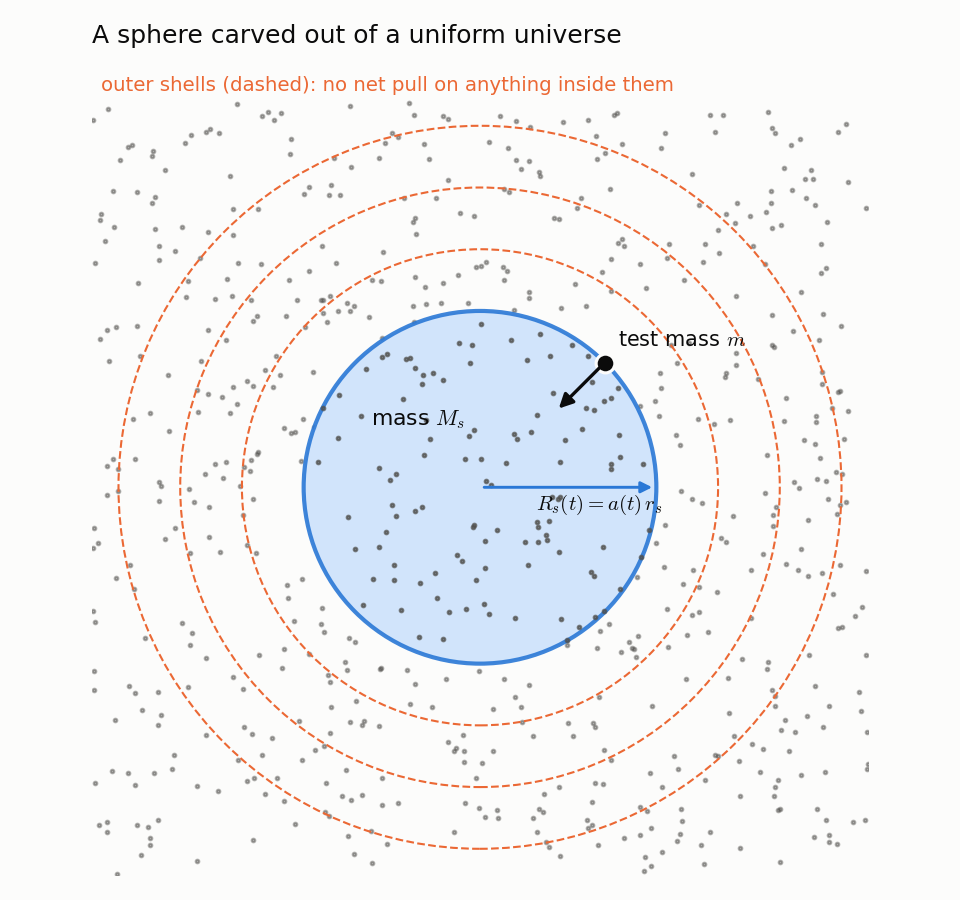

*Figure 9. A sphere of radius $R_s$ in a uniform universe, with a test mass on its surface. By the shell theorem, the matter outside (dashed shells) exerts no net force on anything inside, so the sphere evolves as if it were alone.*

Multiply by $dR_s/dt$ and integrate once:

$$
\frac{1}{2}\left(\frac{dR_s}{dt}\right)^2 = \frac{GM_s}{R_s(t)} + U .
$$

This is energy conservation per unit mass. The kinetic energy $\frac{1}{2}\dot R_s^2$ plus the potential energy $-GM_s/R_s$ equals a constant $U$. Now write the mass in terms of the density, $M_s = \frac{4\pi}{3}\rho(t)R_s(t)^3$, and the radius in terms of the scale factor, $R_s(t) = a(t)\,r_s$, with $r_s$ the comoving radius. Then $\frac{1}{2}r_s^2\dot a^2 = \frac{4\pi}{3}Gr_s^2\rho(t)a(t)^2 + U$, or

$$
\left(\frac{\dot a}{a}\right)^2 = \frac{8\pi G}{3}\rho(t) + \frac{2U}{r_s^2}\frac{1}{a(t)^2}.
$$

This is the **Friedmann equation** in Newtonian form. Only $\dot a^2$ appears, so a contracting universe is the time-reverse of an expanding one. The sign of $U$ decides the fate, exactly as for a ball thrown upwards:

- $U > 0$: the right-hand side stays positive and the expansion never stops (the ball exceeds escape speed).
- $U < 0$: the expansion stops at $a_{\max} = -GM_s/(Ur_s)$ and reverses into collapse (the ball falls back).
- $U = 0$: the expansion slows towards zero as $a \to \infty$ (exactly escape speed).

There are two good reasons to distrust this derivation. A finite sphere has a centre and an edge, which a homogeneous, isotropic universe does not. And carving the sphere out of an infinite universe relies on the shell theorem, which is a statement about Euclidean space, while the whole point is that space may be curved. Remarkably, the answer is almost right anyway; the aside below explains why.

---

**Aside: why the Newtonian derivation works (Birkhoff's theorem).**

You met **Birkhoff's theorem** with the Schwarzschild solution: every spherically symmetric vacuum solution of Einstein's equation is Schwarzschild, and therefore static, even if the matter inside is pulsating or collapsing. Two corollaries rescue the Newtonian argument.

First, inside an empty spherical cavity at the centre of a spherically symmetric distribution of matter, spacetime is flat: it is Schwarzschild with $M = 0$. Spherical shells of matter outside have *no* effect inside, in general relativity just as in Newton. So the matter outside our sphere really can be ignored, curved space or not.

Second, an isolated, uniform ball of pressureless matter is exactly a piece of a Friedmann universe, glued at its surface to a Schwarzschild exterior. That is how [Oppenheimer & Snyder (1939)](https://doi.org/10.1103/PhysRev.56.455) described the collapse of a star into a black hole: their collapsing dust ball *is* a closed Friedmann universe, run backwards in time and cut off at the surface.

Now choose the sphere small, $R_s \ll c/H$. Inside it, gravity is weak and speeds are small, so Newtonian mechanics is accurate, and it gives the equation above. But homogeneity means every sphere, of every size, obeys the same equation for $a(t)$. So the small-sphere result holds for the whole universe. The relative-acceleration argument from the chapter on Newton versus Einstein is the same idea in local form: only tidal accelerations are physical, and they don't care about the matter far away.

What the Newtonian argument *does* miss is that pressure gravitates. That only shows up in the second-derivative equation, as we'll see.

---

#### The relativistic version

Now do it properly. With $x^0 = ct$ and the spatial metric written $a^2\gamma_{ij}$, where $\gamma_{ij}$ is the metric of a space of constant curvature $\kappa/R_0^2$, the only Christoffel symbols that mix time and space are

$$
\Gamma^0_{ij} = \frac{a\dot a}{c}\,\gamma_{ij}, \qquad \Gamma^i_{0j} = \frac{\dot a}{ac}\,\delta^i_j ,
$$

and the purely spatial ones are those of $\gamma_{ij}$. Working out the Ricci tensor is a standard exercise (try it). The results are

$$
R_{00} = -\frac{3}{c^2}\frac{\ddot a}{a}, \qquad
R_{ij} = \left[\frac{a\ddot a + 2\dot a^2}{c^2} + \frac{2\kappa}{R_0^2}\right]\gamma_{ij}, \qquad
R = \frac{6}{c^2}\left[\frac{\ddot a}{a} + \frac{\dot a^2}{a^2} + \frac{\kappa c^2}{R_0^2a^2}\right].
$$

The time–time component of the Einstein tensor is then

$$
G_{00} = R_{00} - \tfrac{1}{2}g_{00}R = \frac{3}{c^2}\left[\frac{\dot a^2}{a^2} + \frac{\kappa c^2}{R_0^2a^2}\right],
$$

and the matter side is $T_{00} = \varepsilon$. Setting $G_{00} = 8\pi G\,T_{00}/c^4$ gives the relativistic **Friedmann equation**:

$$
\boxed{\;\left(\frac{\dot a}{a}\right)^2 = \frac{8\pi G}{3c^2}\,\varepsilon(t) - \frac{\kappa c^2}{R_0^2}\frac{1}{a(t)^2}\;}
$$

This is one of the most important equations in cosmology. Compare it with the Newtonian version. Two things changed.

**Mass density became energy density divided by $c^2$.** What gravitates in relativity is energy, not mass. A particle of mass $m$ and momentum $p$ has

$$
E = \left(m^2c^4 + p^2c^2\right)^{1/2},
$$

which for a slow particle is $E \approx mc^2 + \frac{1}{2}mv^2$, so for cold matter $\varepsilon \approx \rho c^2$ and nothing changes. But photons, with $E = pc = hf$ and no mass at all, contribute too. Photons respond to the curvature of spacetime, and they also produce it. (Here $p$ is the *peculiar* momentum, measured by a comoving observer at the particle's location: motion over and above the expansion.)

**The integration constant became curvature.** The Newtonian energy and the curvature are related by

$$
\frac{2U}{r_s^2} = -\frac{\kappa c^2}{R_0^2}.
$$

A bound universe ($U < 0$) is positively curved ($\kappa = +1$); an unbound one ($U > 0$) is negatively curved ($\kappa = -1$); the marginal case ($U = 0$) is flat. In Newton's version the total energy was an arbitrary constant. In Einstein's it is the geometry of space.

The spatial components $G_{ij} = 8\pi G\,T_{ij}/c^4$ give a second equation, which involves the pressure,

$$
2\frac{\ddot a}{a} + \frac{\dot a^2}{a^2} + \frac{\kappa c^2}{R_0^2a^2} = -\frac{8\pi G}{c^2}P .
$$

We'll meet its more useful form, the acceleration equation, shortly.

---

**Aside: the Friedmann equation from the action principle.**

You learned to get Einstein's equation by varying the Einstein–Hilbert action. For a homogeneous universe the whole field theory collapses to the mechanics of a single variable, $a(t)$, and the Friedmann equation emerges as a constraint. Set $c = 1$, write the metric with a lapse function $N(t)$, $ds^2 = -N^2dt^2 + a^2\gamma_{ij}dx^idx^j$, and integrate over a comoving volume $V_0$. The Ricci scalar is $R = 6\left[\ddot a/(aN^2) - \dot a\dot N/(aN^3) + \dot a^2/(a^2N^2) + \kappa/(R_0^2a^2)\right]$ and $\sqrt{-g} = Na^3\sqrt\gamma$. After integrating the $\ddot a$ term by parts,

$$
S_{\rm grav} = \frac{1}{16\pi G}\int R\sqrt{-g}\,d^4x = \frac{3V_0}{8\pi G}\int dt\left[-\frac{a\dot a^2}{N} + \frac{\kappa Na}{R_0^2}\right].
$$

For the matter, treat its energy as a potential, $S_{\rm m} = -V_0\int dt\,Na^3\varepsilon(a)$, where $\varepsilon(a)$ is whatever the fluid equation says it is.

Varying $N$ and then setting $N = 1$ gives $\frac{3}{8\pi G}\left(a\dot a^2 + \kappa a/R_0^2\right) = a^3\varepsilon$, which is exactly the Friedmann equation. Because $N$ appears with no time derivatives, its equation is a constraint rather than an equation of motion: the "Hamiltonian" of the universe must vanish. Varying $a$ gives the equation of motion. Using $d\varepsilon/da = -3(\varepsilon + P)/a$, it comes out as

$$
2\frac{\ddot a}{a} + \frac{\dot a^2}{a^2} + \frac{\kappa}{R_0^2a^2} = -8\pi GP,
$$

the spatial Einstein equation above. Notice the strange sign of the kinetic term, $-a\dot a^2$: the scale factor has negative kinetic energy. This is the root of the familiar picture in which the total "energy" of an expanding universe is zero, gravitational and matter contributions cancelling, and it is a famous headache for quantum gravity.

---

#### The Hubble parameter and the critical density

Since $\dot d/d = \dot a/a$ for any proper distance, the expansion obeys

$$
v(t) = H(t)\,d(t), \qquad H(t) \equiv \frac{\dot a}{a},
$$

and the Friedmann equation reads

$$
H(t)^2 = \frac{8\pi G}{3c^2}\varepsilon(t) - \frac{\kappa c^2}{R_0^2a(t)^2}.
$$

$H(t)$ is the **Hubble parameter**; its value today is the **Hubble constant** $H_0$, which we take as $67.4\ \mathrm{km\,s^{-1}\,Mpc^{-1}}$ (local measurements give about 73; the chapter on model universes describes this Hubble tension). Evaluated today, the Friedmann equation ties together the expansion rate, the density and the curvature:

$$
H_0^2 = \frac{8\pi G}{3c^2}\varepsilon_0 - \frac{\kappa c^2}{R_0^2}.
$$

For a flat universe, $H^2 = \frac{8\pi G}{3c^2}\varepsilon$, so a given expansion rate corresponds to one special density, the **critical density**:

$$
\boxed{\;\varepsilon_c(t) \equiv \frac{3c^2}{8\pi G}H(t)^2\;}
$$

If $\varepsilon > \varepsilon_c$ the universe is positively curved, and if $\varepsilon < \varepsilon_c$ negatively curved. With $H_0 = 67.4\ \mathrm{km\,s^{-1}\,Mpc^{-1}}$,

$$
\varepsilon_{c,0} = 7.67\times10^{-10}\ \mathrm{J\,m^{-3}} = 4790\ \mathrm{MeV\,m^{-3}},
$$

or, as an equivalent mass density,

$$
\rho_{c,0} = \frac{\varepsilon_{c,0}}{c^2} = 8.53\times10^{-27}\ \mathrm{kg\,m^{-3}} = 1.26\times10^{11}\ M_\odot\,\mathrm{Mpc^{-3}}.
$$

Because $\varepsilon_c \propto H_0^2$, the 1% uncertainty in a given measurement of $H_0$ becomes 2% in $\varepsilon_c$, and the 9% spread of the Hubble tension becomes nearly 20%.

---

**Note: how empty is the universe?** The critical mass density is about five proton masses per cubic metre, or one proton in every 200 litres. Typical gas between the stars of our galaxy has about one atom per cubic centimetre, a million per cubic metre, so the universe on average is some 200,000 times emptier than interstellar space. Yet the total energy density of the universe, most of it not in galaxies at all but in smoothly spread dark energy, comes out within a fraction of a percent of this critical value (see the curvature limit below).

---

It is convenient to measure densities in units of the critical density, with the **density parameter**

$$
\Omega(t) \equiv \frac{\varepsilon(t)}{\varepsilon_c(t)} .
$$

Dividing the Friedmann equation by $H^2$ then gives it a particularly transparent form:

$$
1 - \Omega(t) = -\frac{\kappa c^2}{R_0^2a(t)^2H(t)^2}.
$$

The right-hand side never changes sign. So **$\Omega$ can never cross 1**. A universe with $\Omega < 1$ stays below 1 forever and is always negatively curved. One with $\Omega > 1$ stays above 1 and is always positively curved. One with $\Omega = 1$ exactly stays at exactly 1. Evaluated today, the same equation gives the curvature from two things we can measure:

$$
\frac{\kappa}{R_0^2} = \frac{H_0^2}{c^2}(\Omega_0 - 1).
$$

The sign of $\Omega_0 - 1$ gives the sign of the curvature, and $\Omega_0$ together with the Hubble distance $c/H_0$ gives the radius of curvature, $R_0 = (c/H_0)/\sqrt{|\Omega_0 - 1|}$. Combining the cosmic microwave background with baryon acoustic oscillations gives $\Omega_{k,0} \equiv 1 - \Omega_0 = 0.001 \pm 0.002$ ([Planck 2018](https://arxiv.org/abs/1807.06209)). So $|\Omega_0 - 1|$ is at most about $0.005$, and if space is curved at all, $R_0 \gtrsim (4.45\ \mathrm{Gpc})/\sqrt{0.005} \approx 60$ Gpc, at least 14 Hubble distances. The angular-size argument at the start of the chapter gave only $R_0 \gtrsim c/H_0$.

> **In short.** $\Omega - 1$ is the curvature of space in disguise: $\kappa/R^2$ measured in units of $(H/c)^2$. That is why it can never change sign. It can, however, change size, and we'll see in the chapter on model universes that in a decelerating universe it grows.

---

### The fluid and acceleration equations

The Friedmann equation is one equation for two unknown functions, $a(t)$ and $\varepsilon(t)$. We need a second relation, and energy conservation provides it.

Apply the first law of thermodynamics,

$$
dQ = dE + P\,dV,
$$

to a sphere of comoving radius $r_s$ expanding with the universe. In a perfectly homogeneous universe there are no hotter or colder regions, so no heat can flow anywhere: $dQ = 0$. The expansion is **adiabatic**, and since $dS = dQ/T$, it doesn't change the entropy. So $\dot E + P\dot V = 0$. The sphere has volume and energy

$$
V = \frac{4\pi}{3}r_s^3a^3, \qquad \dot V = 3\frac{\dot a}{a}V, \qquad E = V\varepsilon, \qquad \dot E = V\left(\dot\varepsilon + 3\frac{\dot a}{a}\varepsilon\right),
$$

and substituting gives the **fluid equation**:

$$
\boxed{\;\dot\varepsilon + 3\frac{\dot a}{a}\left(\varepsilon + P\right) = 0\;}
$$

Unlike the Friedmann equation, this one needs no correction in going from Newton to Einstein. In general relativity it is the time component of local energy–momentum conservation, $\nabla_\mu T^{\mu\nu} = 0$, which the Bianchi identity guarantees. The chapter on model universes checks this explicitly, and asks what happens to energy conservation globally.

Now combine the two. Multiply the Friedmann equation by $a^2$,

$$
\dot a^2 = \frac{8\pi G}{3c^2}\varepsilon a^2 - \frac{\kappa c^2}{R_0^2},
$$

and differentiate with respect to time,

$$
2\dot a\ddot a = \frac{8\pi G}{3c^2}\left(\dot\varepsilon a^2 + 2\varepsilon a\dot a\right).
$$

Divide by $2a\dot a$ and use the fluid equation in the form $\dot\varepsilon\,a/\dot a = -3(\varepsilon + P)$:

$$
\boxed{\;\frac{\ddot a}{a} = -\frac{4\pi G}{3c^2}\left(\varepsilon + 3P\right)\;}
$$

This is the **acceleration equation**. (It is also what you get by combining the Friedmann equation with the spatial Einstein equation above.) Positive energy density decelerates the expansion, as you'd expect from attractive gravity. The surprise is the $3P$. **Pressure gravitates.** Ordinary gas, photons, neutrinos and dark matter all have positive pressure, and it makes them decelerate the expansion *more* than their energy alone would. And a component with

$$
P < -\frac{1}{3}\varepsilon
$$

makes $\ddot a$ positive: it *accelerates* the expansion. (Energy density and pressure have the same units: $1\ \mathrm{J\,m^{-3}} = 1\ \mathrm{N\,m^{-2}}$.)

---

**Note: why doesn't pressure push the universe apart?** A gas pushes on its container because the pressure inside is higher than outside. Forces come from pressure *differences*, $-\nabla P$. In a homogeneous universe the pressure is the same everywhere, so it pushes nothing anywhere. Its only effect is through gravity, and in general relativity positive pressure strengthens gravity. A hot, high-pressure universe decelerates *faster* than a cold one with the same energy density.

---

> **In short.** In Newtonian gravity mass is the source; in general relativity, for the expansion of a homogeneous universe, the source is $\varepsilon + 3P$. Everything about acceleration and deceleration follows from that one combination.

---

### Equations of state

Count again. We have three equations, the Friedmann, fluid and acceleration equations, but only two are independent, since we derived the third from the other two. There are three unknowns: $a(t)$, $\varepsilon(t)$ and $P(t)$. To close the system we need an **equation of state** linking pressure and energy density, $P = P(\varepsilon)$. The contents of the universe are dilute enough that the equation of state is linear,

$$
P = w\varepsilon,
$$

with $w$ a dimensionless constant for each component.

One formula covers all ordinary gases. The pressure of an isotropic gas is the momentum it carries across a unit area per unit time, which by isotropy is

$$
P = \frac{1}{3}\,n\,\langle p\,v\rangle ,
$$

where $n$ is the number density, $p$ the momentum and $v$ the speed of the particles.

**Non-relativistic gas.** Here $p = mv$, so $P = \frac{1}{3}nm\langle v^2\rangle$, which is the perfect gas law $P = \frac{\rho}{\mu}kT$ (with $\mu$ the mean particle mass and $3kT = \mu\langle v^2\rangle$). The energy density is dominated by rest mass, $\varepsilon \approx \rho c^2$, so

$$
P \approx \frac{kT}{\mu c^2}\,\varepsilon, \qquad w \approx \frac{\langle v^2\rangle}{3c^2} \ll 1 .
$$

Nitrogen at room temperature has $v_{\rm rms} \approx 500$ m/s and so $w \approx 10^{-12}$. In an ionised hydrogen gas the electrons stay non-relativistic as long as $kT \ll m_ec^2$, i.e. $T \ll 6\times10^9$ K, and the protons for $T \ll 10^{13}$ K.

**Relativistic gas.** Here $v = c$ and $p = E/c$, so $P = \frac{1}{3}n\langle E\rangle$ and

$$
P = \frac{1}{3}\varepsilon .
$$

This holds for photons and for any gas of highly relativistic particles; a mildly relativistic gas has $0 < w < 1/3$. There is a neat relativistic way to see the $1/3$. For a gas of particles the trace of the stress–energy tensor, $T^\mu{}_\mu = -\varepsilon + 3P$, adds up the invariant $p^\mu p_\mu = -m^2c^2$ of every particle, so it vanishes when the particles are massless.

Cosmologists use a shorthand for components by their $w$:

- **Matter** is anything non-relativistic, $w \approx 0$, whether it is ordinary "baryonic" matter or dark matter.
- **Radiation** is photons and anything else relativistic, $w = 1/3$.
- **Dark energy** is anything with $w < -1/3$, which by the acceleration equation speeds up the expansion. The name was introduced by [Huterer & Turner (1999)](https://arxiv.org/abs/astro-ph/9808133).
- The **cosmological constant**, $\Lambda$, is the special case $w = -1$, $P = -\varepsilon$.

There is also an upper limit. The speed of sound in a fluid is given by $c_s^2 = c^2\,dP/d\varepsilon$, which for constant $w$ is $c_s^2 = w\,c^2$. Causality requires $c_s \le c$, so $w \le 1$. A fluid with $w = 1$ is called "stiff". Figure 10 puts all these components on one line of $w$.

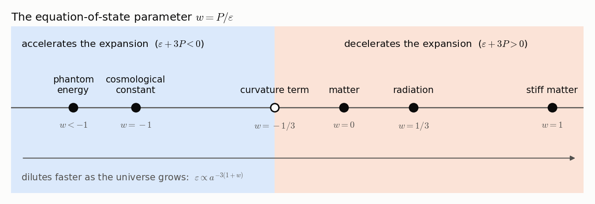

*Figure 10. The equation-of-state parameter $w$ of the components we meet in cosmology. Components to the left of $w = -1/3$ accelerate the expansion; those to the right decelerate it. The larger $w$, the faster the component thins out as the universe grows. The curvature term of the Friedmann equation thins out like a component with $w = -1/3$, and phantom energy has $w < -1$; both are met in the chapter on model universes.*

---

### Learning to love Lambda

#### Einstein's static universe

When [Einstein applied general relativity to the universe in 1917](https://ui.adsabs.harvard.edu/abs/1917SPAW.......142E), he made two assumptions that were reasonable at the time. The only radiation he knew of was starlight, whose energy density is tiny compared with the rest energy of the stars, so he took the universe to be made of pressureless matter. And the stars of our galaxy showed no systematic expansion or contraction (other galaxies were not yet known to be separate systems), so he took the universe to be static.

But a static universe full of matter is impossible. In Newtonian terms, a static universe needs zero acceleration everywhere, $\vec a = -\nabla\Phi = 0$, so $\Phi$ is constant and Poisson's equation gives

$$
\rho = \frac{1}{4\pi G}\nabla^2\Phi = 0 .
$$

Only an empty universe can be static. (We reached the same conclusion from relative accelerations in the chapter on Newton versus Einstein.) A static universe full of matter is like a ball thrown upwards that is expected to hang in mid-air.

Einstein's fix was to add a term. In Newtonian language it amounts to $\nabla^2\Phi + \Lambda = 4\pi G\rho$, which allows a static universe with $\Lambda = 4\pi G\rho$. In general relativity he added a term $\Lambda g_{\mu\nu}$ to the field equation; with $\Lambda$ measured in $\mathrm{s^{-2}}$, as here, it reads $G_{\mu\nu} + (\Lambda/c^2)g_{\mu\nu} = 8\pi G\,T_{\mu\nu}/c^4$. The Friedmann and acceleration equations become

$$
\left(\frac{\dot a}{a}\right)^2 = \frac{8\pi G}{3c^2}\varepsilon - \frac{\kappa c^2}{R_0^2a^2} + \frac{\Lambda}{3}, \qquad
\frac{\ddot a}{a} = -\frac{4\pi G}{3c^2}\left(\varepsilon + 3P\right) + \frac{\Lambda}{3},
$$

while the fluid equation is unchanged.

You can read $\Lambda$ in two ways. On the left-hand side of the field equation it is part of the geometry. Moved to the right, it is a component of the universe with energy density

$$
\varepsilon_\Lambda \equiv \frac{c^2}{8\pi G}\Lambda ,
$$

constant in time. The fluid equation then demands that a constant energy density come with pressure

$$
P_\Lambda = -\varepsilon_\Lambda = -\frac{c^2}{8\pi G}\Lambda ,
$$

i.e. $w = -1$. Gravitationally the two readings are indistinguishable.

For Einstein's static universe, $\ddot a = 0$ requires $\Lambda = 4\pi G\rho$, and then $\dot a = 0$ in the Friedmann equation requires

$$
0 = \frac{8\pi G}{3}\rho - \frac{\kappa c^2}{R_0^2} + \frac{\Lambda}{3} = 4\pi G\rho - \frac{\kappa c^2}{R_0^2}.
$$

So the universe must be positively curved, $\kappa = +1$, with radius

$$
R_0 = \frac{c}{2\sqrt{\pi G\rho}} = \frac{c}{\sqrt\Lambda} .
$$

A finite, closed, unchanging universe, held up by $\Lambda$ against its own gravity.

---

**Note: how big would Einstein's universe be?** Put in today's average matter density, $\rho = 0.315\,\rho_{c,0} = 2.7\times10^{-27}\ \mathrm{kg\,m^{-3}}$. Then $R_0 = c/(2\sqrt{\pi G\rho}) \approx 6.5$ Gpc, about one and a half Hubble distances. It would also need $\Lambda = 4\pi G\rho \approx 2.3\times10^{-36}\ \mathrm{s^{-2}}$. The value we actually measure, $\Lambda = 3H_0^2\,\Omega_{\Lambda,0} \approx 9.8\times10^{-36}\ \mathrm{s^{-2}}$, is about four times larger.

---

The balance is unstable, as [Eddington (1930)](https://ui.adsabs.harvard.edu/abs/1930MNRAS..90..668E) showed. Expand the static universe slightly: the matter density drops while $\varepsilon_\Lambda$ stays fixed, so repulsion wins and the expansion runs away. Compress it slightly and the collapse runs away. It is a ball balanced on a hilltop, which is exactly how it looks in the potential picture of the chapter on model universes.

Hubble's 1929 discovery of the expanding universe gave Einstein his reason to drop $\Lambda$. George Gamow later recalled Einstein calling it "the biggest blunder of my life". Historians have doubted the story, but a careful study concludes that he very probably did say it at least once ([O'Raifeartaigh & Mitton 2018](https://arxiv.org/abs/1804.06768)).

Ironically, Hubble's paper also gave $\Lambda$ its first comeback. Hubble's distances were badly underestimated, and his value of the Hubble constant, about $500\ \mathrm{km\,s^{-1}\,Mpc^{-1}}$, gives a Hubble time $H_0^{-1} \approx 2$ Gyr. Radioactive dating already suggested the Earth was a few billion years old. A universe without $\Lambda$ decelerates and is younger than $H_0^{-1}$, so it would be younger than the Earth. But if $\Lambda$ is large enough to make $\ddot a > 0$, the expansion was slower in the past and the universe can be older than $H_0^{-1}$. $\Lambda$ has gone in and out of fashion ever since, favoured whenever ages looked embarrassingly short. It returned for good in 1998, when distant supernovae showed that the expansion is accelerating today ([Riess et al. 1998](https://arxiv.org/abs/astro-ph/9805201); [Perlmutter et al. 1999](https://arxiv.org/abs/astro-ph/9812133)).

#### Vacuum energy

What could have an energy density that stays exactly constant as the universe expands? The leading candidate is the energy of empty space itself, the **vacuum energy**. Two separate questions arise: why it would have $w = -1$, and how big it should be. Relativity answers the first beautifully. Quantum mechanics answers the second terribly.

**Why $w = -1$.** The vacuum must look the same to every inertial observer; otherwise it would define a preferred state of rest, and it wouldn't be a vacuum. So its stress–energy tensor must be unchanged by every Lorentz transformation. The only symmetric tensor with that property is a multiple of the metric itself. So $T^{\rm vac}_{\mu\nu} = -\varepsilon_{\rm vac}\,g_{\mu\nu}$, and comparing with the perfect-fluid form gives $P_{\rm vac} = -\varepsilon_{\rm vac}$. A vacuum energy is automatically a cosmological constant.

**How big?** In quantum mechanics a harmonic oscillator can't have zero energy: its ground state has $\frac{1}{2}\hbar\omega$. A quantum field behaves like a collection of oscillators, one for each wave mode $\vec k$, so the vacuum carries the zero-point energy of all of them. For a massless field, with $\omega = ck$,

$$
\varepsilon_{\rm vac} = \int\frac{d^3k}{(2\pi)^3}\,\frac{1}{2}\hbar ck = \frac{\hbar c}{4\pi^2}\int_0^{k_{\max}}k^3\,dk = \frac{\hbar c\,k_{\max}^4}{16\pi^2},
$$

which is infinite unless the modes are cut off at some $k_{\max}$. The only "natural" cutoff is the Planck scale, where quantum gravity should take over. With $k_{\max} \sim 1/\ell_P$, the estimate is of order the Planck energy density,

$$
\varepsilon_{\rm vac} \sim \frac{E_P}{\ell_P^3} \approx 3\times10^{132}\ \mathrm{eV\,m^{-3}}.
$$

The observed dark-energy density is $\varepsilon_\Lambda = 0.685\,\varepsilon_{c,0} \approx 3\times10^{9}\ \mathrm{eV\,m^{-3}}$. The estimate is too big by roughly 120 orders of magnitude, which is surely the worst prediction in physics. To be fair, a sharp momentum cutoff is chosen in one particular frame, so it breaks the very Lorentz invariance that gave $w = -1$; done consistently with relativity, the estimate is "only" about 55 orders of magnitude too large ([Martin 2012](https://arxiv.org/abs/1205.3365)). That is still no agreement at all. Why the vacuum energy is so small but apparently not zero is the **cosmological constant problem** ([Weinberg 1989](https://doi.org/10.1103/RevModPhys.61.1)).

There is a bright side. By measuring how the universe expands on the very largest scales, we are weighing the vacuum on the very smallest.

> **In short.** Relativity forces the vacuum's equation of state to be $w = -1$, so any vacuum energy behaves exactly like Einstein's $\Lambda$. Nothing we know explains its size.

---

### Summary

**The equations of cosmic dynamics**, with a cosmological constant included:

$$
\begin{aligned}
\left(\frac{\dot a}{a}\right)^2 &= \frac{8\pi G}{3c^2}\varepsilon - \frac{\kappa c^2}{R_0^2a^2} + \frac{\Lambda}{3} &&\text{(Friedmann)}\\
\dot\varepsilon + 3\frac{\dot a}{a}(\varepsilon + P) &= 0 &&\text{(fluid)}\\
\frac{\ddot a}{a} &= -\frac{4\pi G}{3c^2}(\varepsilon + 3P) + \frac{\Lambda}{3} &&\text{(acceleration)}\\
P &= w\varepsilon &&\text{(equation of state)}
\end{aligned}
$$

together with $\varepsilon_c = 3c^2H^2/(8\pi G)$, $\Omega = \varepsilon/\varepsilon_c$ and $\kappa/R_0^2 = (H_0/c)^2(\Omega_0 - 1)$.

**The ideas to carry away.**

- The Friedmann equation is the energy equation of the edge of any sphere of the universe; Birkhoff's theorem is why the Newtonian derivation works. In general relativity it is the $00$ component of Einstein's equation, and a constraint in the action principle.
- Energy gravitates, not just mass; and the total "energy" of the Newtonian picture is the curvature of space.
- $\Omega - 1$ has the sign of the curvature forever. Observations put $|\Omega_0 - 1| \lesssim 0.005$, so any curvature radius exceeds about 60 Gpc.
- Pressure gravitates: deceleration is driven by $\varepsilon + 3P$, and acceleration needs $w < -1/3$.
- A cosmological constant is a fluid with $w = -1$. Relativity makes vacuum energy behave this way, but its observed size is a deep mystery.

---

## Model Universes

In the chapter on cosmic dynamics we built a machine: the Friedmann equation, the fluid equation and an equation of state. Put in the contents of a homogeneous, isotropic universe, and out comes its whole history, $a(t)$. In this chapter we turn the crank. We will solve the machine for an empty universe, for universes holding one ingredient, then two, and finally for the model that matches what we observe.

It is easy to drown in this material. There is a whole catalogue of exact solutions, each with its own age, horizon and distance formula, and it is tempting to memorise the catalogue. Don't. Almost everything here follows from a few pictures, and if you carry the pictures in your head you can rebuild any formula in a few lines:

1. Each ingredient thins out at its own rate as the universe grows, $\varepsilon \propto a^{-3(1+w)}$, so different ingredients take turns dominating.
2. The Friedmann equation is the energy equation for a ball rolling on a one-dimensional hill. The shape of the hill is set by the contents, and the ball's total energy is the curvature.
3. Distances are integrals of $1/a$ along a light ray. Light doesn't care how big the universe *is*, only how much it grew while the light was in flight.

Because you already know general relativity, we can also see something that a purely Newtonian treatment hides. Two of the "different" universes in the catalogue turn out to be flat Minkowski space and the de Sitter hyperboloid, seen through unusual coordinates. Those asides are worth the detour.

---

### The equations we are solving

Here are the three equations from the chapter on cosmic dynamics. The Friedmann equation,

$$
\left(\frac{\dot{a}}{a}\right)^2 = \frac{8\pi G}{3c^2}\varepsilon - \frac{\kappa c^2}{R_0^2 a^2},
$$

the fluid equation,

$$
\dot{\varepsilon} + 3\frac{\dot{a}}{a}(\varepsilon + P) = 0,
$$

and the equation of state,

$$
P = w\varepsilon.
$$

Recall the bookkeeping. There are three unknown functions, $a(t)$, $\varepsilon(t)$ and $P(t)$. The acceleration equation is not independent (it follows from the other two), so these three equations are the complete set. Give them today's expansion rate $H_0 = \dot a/a|_{t_0}$ and today's energy densities, and they determine the past and the future. We write $H \equiv \dot a/a$ throughout.

What makes real life harder is that the universe holds several ingredients at once, each with its own $w$. So the first job is to understand each ingredient separately.

---

### How each ingredient thins out

#### Ingredients add, and each obeys its own fluid equation

If the universe holds several components, their energy densities and pressures simply add:

$$
\varepsilon = \sum_i \varepsilon_i, \qquad P = \sum_i P_i = \sum_i w_i \varepsilon_i.
$$

The fluid equation is a statement about energy conservation in a comoving volume. If the components don't trade energy with one another (photons don't turn into protons, and so on), then each one conserves its own energy separately, and each obeys its own fluid equation:

$$
\dot{\varepsilon}_i + 3\frac{\dot{a}}{a}(\varepsilon_i + P_i) = 0
\quad\Longrightarrow\quad
\dot{\varepsilon}_i + 3\frac{\dot{a}}{a}(1 + w_i)\varepsilon_i = 0.
$$

Since $\dot\varepsilon_i/\dot a = d\varepsilon_i/da$, we can separate variables,

$$
\frac{d\varepsilon_i}{\varepsilon_i} = -3(1 + w_i)\frac{da}{a},
$$

and for constant $w_i$ this integrates at once to

$$
\boxed{\;\varepsilon_i(a) = \varepsilon_{i,0}\, a^{-3(1+w_i)}\;}
$$

Notice what we did *not* use: the Friedmann equation. This scaling law needs only local energy conservation and the fact that comoving volumes grow as $a^3$. It doesn't care about $G$, curvature or the other components, which is why it holds so generally.

The caveat about interactions is real. When electrons and positrons annihilated in the early universe, energy flowed from the $e^\pm$ component into photons, and the separate fluid equations failed for each of them. The *total* fluid equation still held; that one never fails.

#### The picture: count particles in a comoving box

Here is the way to *see* the scaling law. Take a box whose corners are attached to galaxies, so that it grows with the universe; its volume goes as $a^3$. Write the energy density as

$$
\varepsilon = n \times (\text{energy per particle}),
$$

where $n$ is the number density. If particles are neither created nor destroyed, the number in the box is fixed and $n \propto a^{-3}$. Now:

- **Matter** (non-relativistic, $w \approx 0$): each particle carries its rest energy $mc^2$, which doesn't change, so $\varepsilon_m = \varepsilon_{m,0}/a^3$.
- **Radiation** ($w = 1/3$): each photon carries $E = hc/\lambda$, and wavelengths stretch in proportion to $a$. So each photon loses energy as $1/a$ *on top of* the dilution, and $\varepsilon_r = \varepsilon_{r,0}/a^4$.
- **Cosmological constant** ($w = -1$): $\varepsilon_\Lambda$ is constant, so the energy *in the box* grows as $a^3$. We will come back to how unsettling that is.

| Component | $w$ | $\varepsilon(a)$ | Energy in a comoving box | Why |
| --- | --- | --- | --- | --- |
| Radiation | $1/3$ | $a^{-4}$ | $\propto a^{-1}$ | fixed number of quanta, each stretched |
| Matter | $0$ | $a^{-3}$ | constant | fixed number of particles, fixed rest energy |
| (Curvature term) | $-1/3$ | $a^{-2}$ | $\propto a$ | not a substance; see below |
| Cosmological constant | $-1$ | $a^{0}$ | $\propto a^3$ | energy density of empty space itself |

The curvature row is there because the curvature term in the Friedmann equation, $-\kappa c^2/(R_0^2 a^2)$, scales exactly like a fictitious fluid with $w = -1/3$. Nothing physical here has $w = -1/3$; it is a bookkeeping trick, but a handy one, and it is why curvature is often written as one more "$\Omega$".

> **In short.** The equation-of-state parameter $w$ is a measure of how the energy in a comoving box changes as the box grows: $E_{\rm box} = \varepsilon a^3 \propto a^{-3w}$. Radiation's box loses energy, matter's keeps it, the vacuum's gains it. And the pressure is simply the price of that change, $P = -dE_{\rm box}/dV$: check that this gives back $P = w\varepsilon$.

---

**Note: stiff matter.** Some models of the very early universe contain "stiff matter" with $w = 1$: the pressure equals the energy density, so sound travels at the speed of light. How would it scale, and when would it matter? The scaling law gives $\varepsilon \propto a^{-6}$, faster than anything else. So if stiff matter exists at all, it dominates at the very earliest times, before radiation, and then vanishes almost at once. That is also why it is so hard to rule out.

---

**Aside: why every particle's momentum decays as $1/a$.**

When we derived the cosmological redshift from the Robertson–Walker metric, we followed two successive wave crests. You already have a slicker tool from the Schwarzschild metric: if the metric doesn't depend on a coordinate $x^\mu$, then the covariant momentum component $p_\mu = g_{\mu\nu}p^\nu$ is conserved along geodesics. That is how you got the conserved energy (from $\partial_t$) and angular momentum (from $\partial_\phi$) of an orbit.

Take the flat Robertson–Walker metric,

$$
ds^2 = -c^2dt^2 + a(t)^2\left(dx^2 + dy^2 + dz^2\right).
$$

It doesn't depend on $x$, so $\partial_x$ is a Killing vector and

$$
p_x = g_{xx}\,p^x = a^2 p^x = \text{constant along the particle's path.}
$$

But $p^x$ is a *coordinate* component. A comoving observer measures momentum with rulers, i.e. in an orthonormal frame whose $x$-leg is $\hat e_x = a^{-1}\partial_x$. In that frame the momentum is $p^{\hat x} = a\,p^x = p_x/a$. So the momentum any comoving observer measures is

$$
p_{\rm phys} \propto \frac{1}{a}.
$$

Nothing in this argument cared about the particle's mass. That one line has three consequences.

For photons, $p = h/\lambda$, so $\lambda \propto a$: the redshift law $1 + z = 1/a(t_e)$, now from the geodesic equation instead of from wave crests.

For a non-relativistic particle, $p = mv$, so its peculiar velocity decays as $v \propto 1/a$. Expansion acts as a refrigerator for random motions. This is why dark matter can be "cold" today even if it was born with some velocity.

For a neutrino, $E^2 = p^2c^2 + m^2c^4$ with $p \propto 1/a$. Early on $pc \gg mc^2$ and $E \approx pc \propto 1/a$: it behaves as radiation. Late on $pc \ll mc^2$ and $E \approx mc^2$: it behaves as matter. The switch happens when $pc \sim mc^2$, which we use below.

If you'd rather not rely on a Killing vector (in a curved space you can't use the simple $\partial_x$), use the time component of the geodesic equation. With $x^0 = ct$ and spatial metric $a^2\gamma_{ij}$, the only Christoffel symbols mixing time and space are

$$
\Gamma^0_{ij} = \frac{a\dot a}{c}\,\gamma_{ij}, \qquad \Gamma^i_{0j} = \frac{\dot a}{ac}\,\delta^i_j .
$$

The geodesic equation $dp^0/d\lambda + \Gamma^0_{ij}p^ip^j = 0$, with $p^0 = E/c$ and $d/d\lambda = (p^0/c)\,d/dt$, becomes $p^0\,\dot p^0 = -H\,|\vec p|^2$, where $|\vec p|^2 = a^2\gamma_{ij}p^ip^j$ is the physical momentum squared. Because the mass shell $(p^0)^2 = |\vec p|^2 + m^2c^2$ gives $p^0\dot p^0 = |\vec p|\,\tfrac{d|\vec p|}{dt}$, we get

$$
\frac{d|\vec p|}{dt} = -H|\vec p| \quad\Longrightarrow\quad |\vec p| \propto \frac{1}{a}
$$

for any $\kappa$.

---

**Aside: where does the energy go?**

A comoving box of radiation *loses* energy as $1/a$. A comoving box of vacuum energy *gains* energy as $a^3$. Students reasonably ask where the energy goes, or where it comes from. The honest answer is that in an expanding universe there is no global energy to conserve, and you have the tools to see exactly why.

By Noether's theorem, energy conservation comes from time-translation symmetry. In GR the statement is: if $\xi^\nu$ is a Killing vector, the current $J^\mu = T^\mu{}_\nu\,\xi^\nu$ satisfies $\nabla_\mu J^\mu = 0$, and integrating over a spatial slice gives a conserved charge. For Schwarzschild, $\xi = \partial_t$ is Killing and you get a conserved total energy. The Robertson–Walker metric depends on $t$ through $a(t)$, so $\partial_t$ is *not* Killing, and a Robertson–Walker spacetime that contains matter or radiation has no timelike Killing vector at all. (The exceptions are the empty and $\Lambda$-only universes, which we will meet below as Minkowski and de Sitter space in disguise.) There is no conserved total energy because there is no time-translation symmetry to generate one.

What survives is *local* conservation, $\nabla_\mu T^{\mu\nu} = 0$, which holds in any spacetime (it follows from the Bianchi identity). Let's check that it is the fluid equation. For a perfect fluid at rest in comoving coordinates, $T^{00} = \varepsilon$, $T^{0i} = 0$ and $T^{ij} = P\,g^{ij} = P\gamma^{ij}/a^2$. Using the Christoffel symbols from the previous aside (and $\Gamma^0_{00} = 0$, so $\Gamma^\mu_{\mu 0} = \Gamma^i_{i0} = 3\dot a/(ac)$),

$$
\nabla_\mu T^{\mu 0} = \partial_0 T^{00} + \Gamma^\mu_{\mu 0}T^{00} + \Gamma^0_{ij}T^{ij} = \frac{\dot\varepsilon}{c} + \frac{3\dot a}{ac}\varepsilon + \frac{a\dot a}{c}\gamma_{ij}\frac{P\gamma^{ij}}{a^2} = \frac{1}{c}\Big[\dot\varepsilon + 3H(\varepsilon + P)\Big].
$$

Setting this to zero gives the fluid equation. So the fluid equation *is* local energy conservation, and that is all there is.

If you want a thermodynamic story, the first law $dE = -P\,dV$ provides one. Radiation has $P > 0$, so a growing box of it does work and loses energy. Vacuum energy has $P < 0$, a tension, so stretching it costs work and its energy grows, the way a stretched rubber band stores energy. But in a homogeneous universe every box is doing the same thing as its neighbours, so the "work" isn't delivered to anything. It is bookkeeping, not a transfer. You will sometimes read that the missing energy "goes into the gravitational field". You can define quantities that make such a statement true, but GR has no unique local gravitational energy density (by the equivalence principle you can always transform the gravitational field away at a point), so I find that answer more confusing than helpful.

---

#### What counts as radiation today?

**Photons.** The cosmic microwave background (CMB) is a blackbody at [$T_0 = 2.7255$ K](https://arxiv.org/abs/0911.1955), so its energy density is

$$
\varepsilon_{\mathrm{CMB},0} = \alpha T_0^4 = 4.175 \times 10^{-14}\,\mathrm{J\,m^{-3}} = 0.2606\,\mathrm{MeV\,m^{-3}}.
$$

The critical density today is $\varepsilon_{c,0} = 3c^2H_0^2/(8\pi G) = 7.67\times10^{-10}\ \mathrm{J\,m^{-3}} = 4790\ \mathrm{MeV\,m^{-3}}$, so

$$
\Omega_{\mathrm{CMB},0} = \frac{0.2606}{4790} = 5.44 \times 10^{-5}.
$$

Isn't starlight radiation too? It is, and stars keep making new photons, which breaks the "fixed number in a box" assumption. A rough estimate says it doesn't matter. Galaxies today emit about $2\times10^8$ solar luminosities per cubic megaparsec, i.e. a luminosity density $\Psi \approx 2.6 \times 10^{-33}\,\mathrm{W\,m^{-3}}$. If they had shone this brightly for the whole age of the universe, $t_0 \approx 4.4\times10^{17}$ s, the accumulated starlight would be

$$
\varepsilon_{\mathrm{starlight},0} \sim \Psi t_0 \sim 10^{-15}\,\mathrm{J\,m^{-3}} \sim 0.007\,\mathrm{MeV\,m^{-3}},
$$

about 3% of the CMB. The measured value agrees in order of magnitude. Adding up the light of all galaxies in deep surveys gives an optical background of about 24 and an infrared background (starlight absorbed and re-emitted by dust) of about $26\ \mathrm{nW\,m^{-2}\,sr^{-1}}$ ([Driver et al. 2016](https://arxiv.org/abs/1605.01523)). Converting intensity to energy density with $\varepsilon = 4\pi I/c$, that is $0.013\ \mathrm{MeV\,m^{-3}}$, about 5% of the CMB. The CMB dominates, and we can ignore every other photon.

**Neutrinos.** The early universe was dense enough to be opaque to neutrinos, so there should be a **cosmic neutrino background**, a relic just like the CMB but cooler. For one neutrino flavour, while it is relativistic, the predicted energy density is

$$
\varepsilon_\nu = \frac{7}{8}\left(\frac{4}{11}\right)^{4/3}\varepsilon_{\mathrm{CMB}} = 0.227\,\varepsilon_{\mathrm{CMB}}
$$

(the aside below explains the strange numbers). Three flavours would give $3 \times 0.227 = 0.681$ times the CMB. The precise Standard Model calculation gives slightly more, because the neutrinos had not quite finished decoupling when the electrons and positrons annihilated. Cosmologists absorb this into an "effective number of neutrino species", calculated to be $N_{\rm eff} = 3.044$ ([Froustey, Pitrou & Volpe 2020](https://arxiv.org/abs/2008.01074); [Bennett et al. 2021](https://arxiv.org/abs/2012.02726)), and the CMB combined with baryon acoustic oscillations gives $N_{\rm eff} = 2.99 \pm 0.17$ ([Planck 2018](https://arxiv.org/abs/1807.06209)), in good agreement. So

$$
\Omega_{\nu,0} = N_{\rm eff}\times 0.227\,\Omega_{\mathrm{CMB},0} = 0.691\,\Omega_{\mathrm{CMB},0} = 3.76\times10^{-5}.
$$

Neutrinos have small masses, though, so they don't stay radiation forever. By the momentum argument above, the mean energy of a relic neutrino falls as

$$
E_\nu \approx \frac{5.3 \times 10^{-4}\,\mathrm{eV}}{a}
$$

while it is relativistic, and once $E_\nu$ drops to about $m_\nu c^2$, that species moves from the "radiation" column to the "matter" column. If we pretend all three are still massless today,

$$
\Omega_{r,0} = \Omega_{\mathrm{CMB},0} + \Omega_{\nu,0} = 5.44 \times 10^{-5} + 3.76 \times 10^{-5} = 9.2 \times 10^{-5}.
$$

That pretence is wrong today but harmless, as the note below explains: radiation only matters at early times, when the neutrinos *were* relativistic.

---

**Aside: where $\tfrac{7}{8}$ and $\left(\tfrac{4}{11}\right)^{4/3}$ come from.**

You met Bose–Einstein and Fermi–Dirac statistics in quantum mechanics; here they earn their keep.

*The 7/8.* The energy density of a relativistic gas at temperature $T$ is proportional to the number of internal states $g$ times an integral over the occupation number. Writing $x = pc/kT$, the integral is $\int_0^\infty x^3\,dx/(e^x - 1)$ for bosons and $\int_0^\infty x^3\,dx/(e^x + 1)$ for fermions. Call the boson integral $I$. The identity

$$
\frac{1}{e^x + 1} = \frac{1}{e^x - 1} - \frac{2}{e^{2x} - 1}
$$

(check it by putting the right-hand side over a common denominator) gives, after substituting $y = 2x$ in the second piece,

$$
\int_0^\infty \frac{x^3\,dx}{e^x + 1} = I - 2\cdot\frac{1}{2^4}\,I = \frac{7}{8}\,I.
$$

The Pauli exclusion principle costs exactly one eighth. Photons have $g = 2$ (two polarisations). One neutrino flavour also has $g = 2$: one helicity state of $\nu$ and one of $\bar\nu$. So per flavour $\varepsilon_\nu/\varepsilon_\gamma = \frac{7}{8}(T_\nu/T_\gamma)^4$.

*The $(4/11)^{1/3}$.* Neutrinos stopped interacting at $kT \sim 1$ MeV (the chapter on nucleosynthesis explains why), just *before* electrons and positrons annihilated at $kT \lesssim m_ec^2 = 0.511$ MeV. The annihilation heated the photons but not the already-decoupled neutrinos. To see by how much, use entropy. For a relativistic gas with zero chemical potential the entropy density is $s = (\varepsilon + P)/T = \frac{4}{3}\varepsilon/T \propto g_{\rm eff}T^3$, where fermions count with weight $7/8$. Before annihilation, the photon–$e^\pm$ plasma had $g_{\rm eff} = 2 + \frac{7}{8}\times 4 = \frac{11}{2}$ ($e^-$ and $e^+$, two spin states each). Afterwards only photons remained, with $g = 2$. Entropy in a comoving volume is conserved through the (adiabatic) annihilation, so

$$
\frac{11}{2}\,(aT)^3_{\rm before} = 2\,(aT_\gamma)^3_{\rm after}.
$$

The neutrinos simply kept $aT_\nu = (aT)_{\rm before}$. Hence $T_\nu/T_\gamma = (4/11)^{1/3}$, and energy density goes as the fourth power. Today that means a neutrino background at $T_{\nu,0} = 2.7255\times(4/11)^{1/3} = 1.95$ K, which nobody has yet detected directly.

The 3.044 instead of 3 comes from the weak spot in this argument: neutrino decoupling was not instantaneous. The highest-energy neutrinos were still interacting a little when the annihilation began, so they caught a sliver of the $e^\pm$ entropy. [Lesgourgues & Pastor's review](https://arxiv.org/abs/astro-ph/0603494) is a good place to read more about relic neutrinos.

---

**Note: which neutrinos are radiation today?** Neutrino oscillation experiments measure the *differences* of the squared masses ([Esteban et al. 2024](https://arxiv.org/abs/2410.05380)). They imply that the heaviest neutrino has $mc^2 \geq 0.05$ eV and the middle one $mc^2 \geq 0.0086$ eV. At what redshift, at the latest, did each stop being radiation? Setting $E_\nu \approx m_\nu c^2$ gives $a \approx 5\times10^{-4}\,\mathrm{eV}/(m_\nu c^2)$. For $0.05$ eV that is $a \approx 0.01$, $z \approx 100$; for $0.0086$ eV, $a \approx 0.06$, $z \approx 16$. So at least two of the three species are non-relativistic today, and only the lightest, whose mass could be zero, might still be radiation. Today's $\Omega_{r,0} = 9.2\times10^{-5}$ therefore overstates the radiation, which is harmless because radiation only matters at early times. (The upper limit on the sum of the masses from cosmology, and how close it comes to the lower limit from oscillations, are in the chapter on fundamental observations.)

---

#### Who dominates when

To go further we need the amounts of matter and $\Lambda$, which come from the measurements described in the chapters on cosmological parameters and dark matter. The [Planck 2018](https://arxiv.org/abs/1807.06209) fit of the flat $\Lambda$CDM model gives

$$
\Omega_{r,0} = 9.2\times 10^{-5}, \qquad \Omega_{m,0} = 0.315, \qquad \Omega_{\Lambda,0} = 1 - \Omega_{r,0} - \Omega_{m,0} = 0.685.
$$

Today $\Lambda$ wins by about two to one:

$$
\frac{\varepsilon_{\Lambda,0}}{\varepsilon_{m,0}} = \frac{\Omega_{\Lambda,0}}{\Omega_{m,0}} = \frac{0.685}{0.315} = 2.17.
$$

But this ratio changes as the universe grows, because matter thins out and $\Lambda$ doesn't:

$$
\frac{\varepsilon_\Lambda(a)}{\varepsilon_m(a)} = \frac{\Omega_{\Lambda,0}}{\Omega_{m,0}}\,a^3 .
$$

They were equal at

$$
a_{m\Lambda} = \left(\frac{\Omega_{m,0}}{\Omega_{\Lambda,0}}\right)^{1/3} = 0.772,
$$

i.e. at redshift $z_{m\Lambda} = 1/a_{m\Lambda} - 1 = 0.30$, where the matter and $\Lambda$ lines cross in Figure 11. Galaxies at $z = 0.3$ are not far away by cosmological standards. In cosmic terms $\Lambda$ took over very recently.

Going the other way, matter beats radiation today by a large factor, $\Omega_{m,0}/\Omega_{r,0} = 3420$, but radiation thins out one power of $a$ faster:

$$
\frac{\varepsilon_m(a)}{\varepsilon_r(a)} = \frac{\Omega_{m,0}}{\Omega_{r,0}}\,a,
$$

so the two were equal at

$$
a_{rm} = \frac{\Omega_{r,0}}{\Omega_{m,0}} = 2.9 \times 10^{-4}, \qquad z_{rm} \approx 3400.
$$

At that time the mean relic-neutrino energy was about 2 eV, so any neutrino with $m_\nu c^2 \ll 2$ eV was still relativistic, and counting all three as radiation was fine.

*Figure 11. Energy density of each ingredient of our universe, in units of today's critical density, on log–log axes. Each ingredient is a straight line of slope $-3(1+w)$. The steepest line wins at small $a$, the flattest at large $a$.*

The log–log plot makes the rule obvious. Each component is a straight line of slope $-3(1+w_i)$. Going back in time (to the left), the *steepest* line eventually rises above all others; going forward, the *flattest* line wins. So **as $a \to 0$ the component with the largest $w$ dominates, and as $a \to \infty$ the component with the smallest $w$ dominates.** Our universe went radiation ($w = 1/3$), then matter ($w = 0$), then $\Lambda$ ($w = -1$).

Because $a$ grows monotonically in our universe, we can use $a$ itself, or $z = 1/a - 1$, as a clock. Astronomers do this all the time: "at $z = 3$" is a time, not a place. It is also more convenient than $t$, because, as we'll see, converting $a$ to $t$ in a universe with several ingredients usually requires a numerical integral.

#### The Friedmann equation with several ingredients

Substituting the scaling law into the Friedmann equation and multiplying by $a^2$:

$$
\dot{a}^2 = \frac{8\pi G}{3c^2}\sum_i \varepsilon_{i,0}\, a^{-1-3w_i} - \frac{\kappa c^2}{R_0^2}.
$$

On the right, radiation contributes a term $\propto a^{-2}$, matter $\propto a^{-1}$, curvature $\propto a^0$ and $\Lambda$ $\propto a^{2}$. With more than one term there is generally no closed-form $a(t)$. Before we solve special cases, let's turn this equation into a picture that covers all of them.

#### The whole story in one picture: a ball on a hill

Divide by 2 and move the energy terms to the left:

$$
\frac{1}{2}\dot a^2 + \mathcal{V}(a) = \mathcal{E}, \qquad \mathcal{V}(a) \equiv -\frac{4\pi G}{3c^2}\,\varepsilon(a)\,a^2, \qquad \mathcal{E} \equiv -\frac{\kappa c^2}{2R_0^2}.
$$

This is the energy equation for a particle of unit mass moving in one dimension: kinetic energy $\frac{1}{2}\dot a^2$ plus potential energy $\mathcal V(a)$ equals a constant total energy $\mathcal E$. It is the same energy integral we met in the Newtonian derivation of the Friedmann equation (a test mass on the surface of an expanding sphere), with the contents now allowed to be anything.

Three things to read off:

- **Curvature is total energy.** Closed universes ($\kappa = +1$) have $\mathcal E < 0$: the ball is bound. Open universes ($\kappa = -1$) have $\mathcal E > 0$: unbound. Flat universes sit exactly at $\mathcal E = 0$, like a ball thrown at precisely escape speed.
- **The ball can only be where $\mathcal V(a) \le \mathcal E$.** Where $\mathcal V = \mathcal E$ the ball momentarily stops ($\dot a = 0$) and turns round. Turnarounds, bounces and loitering all come from this.
- **Downhill means accelerating.** Differentiating the energy equation gives $\ddot a = -\mathcal V'(a)$. Using $d\varepsilon/da = -3(\varepsilon + P)/a$, you can check that $\mathcal V'(a) = \frac{4\pi G}{3c^2}(\varepsilon + 3P)\,a$, so this is precisely the acceleration equation. Each component contributes $\mathcal V_i \propto -a^{-(1+3w_i)}$. For $w > -1/3$ that rises with $a$ (uphill, so it decelerates the expansion); for $w < -1/3$ it falls with $a$ (downhill, so it accelerates the expansion). The magic number $-1/3$ in the acceleration equation is just where the exponent changes sign.

For most of the chapter we'll use the dimensionless version, obtained by dividing by $H_0^2$ and using the density parameters. Recall $\Omega_{k,0} \equiv 1 - \Omega_0$, where $\Omega_0$ is the total density parameter today; note that $\Omega_{k,0} > 0$ means *open*. Then

$$
\frac{1}{2}\left(\frac{\dot a}{H_0}\right)^2 - \frac{1}{2}\left[\frac{\Omega_{r,0}}{a^2} + \frac{\Omega_{m,0}}{a} + \Omega_{\Lambda,0}\,a^2\right] = \frac{\Omega_{k,0}}{2}.
$$

Keep this picture in mind; Figure 14, in the section on universes with several ingredients, draws it.

---

### Empty universes

Start with nothing. With $\varepsilon = 0$ the Friedmann equation reads

$$
\dot{a}^2 = -\frac{\kappa c^2}{R_0^2}.
$$

In the ball-on-a-hill picture there is no hill: $\mathcal V = 0$, and the ball just coasts with whatever kinetic energy it has. There are three cases.

- $\kappa = +1$: $\dot a^2 < 0$, which is impossible. A closed universe can't be empty, because a bound state needs a potential well to be bound in, and an empty universe has none.
- $\kappa = 0$: $\dot a = 0$. A static, flat, empty universe: Minkowski spacetime, where special relativity holds.
- $\kappa = -1$: $\dot a = \pm c/R_0$. This is the interesting one.

Taking the expanding sign and $a(t_0) = 1$,

$$
a(t) = \frac{t}{t_0}, \qquad t_0 = \frac{R_0}{c} = H_0^{-1}.
$$

This is the **Milne universe**, after [E. A. Milne (1933)](https://ui.adsabs.harvard.edu/abs/1933ZA......6....1M). The Newtonian reading is simple: with no gravity, nothing slows anything down, so every galaxy keeps the speed it started with and separations grow linearly in time. The age is *exactly* the Hubble time, because the naive estimate "distance divided by speed" is correct when speeds never change. Any universe with $\Omega \ll 1$ looks approximately like this.

In the Milne universe redshift and time are tied together simply. Light we see at redshift $z$ satisfies $1 + z = 1/a(t_e) = t_0/t_e$, so it left its source at

$$
t_e = \frac{t_0}{1 + z} = \frac{H_0^{-1}}{1 + z}.
$$

#### Distances in any Robertson–Walker universe

How far away is that galaxy *now*? Put us at the origin and the galaxy at comoving radius $r$. At fixed time $t_0$ the radial proper distance is $d_p(t_0) = a(t_0)\int_0^r dr = r$. Light travels radially on a null geodesic, $c\,dt = a(t)\,dr$, so the comoving distance it covers between emission and observation is

$$
c\int_{t_e}^{t_0} \frac{dt}{a(t)} = \int_0^r dr = r.
$$

Combining the two:

$$
\boxed{\;d_p(t_0) = c\int_{t_e}^{t_0} \frac{dt}{a(t)}\;}
$$

This holds in *every* Robertson–Walker universe, and it is the workhorse for the rest of the chapter. Read it as: each little stretch $c\,dt$ of the light's journey has since been stretched by a factor $1/a(t)$.

The integral is a difference of **conformal time**, which we met when deriving the cosmological redshift,

$$
d\eta = \frac{dt}{a(t)}.
$$

In terms of $\eta$, the Robertson–Walker metric becomes

$$
ds^2 = a(\eta)^2\left[-c^2d\eta^2 + dr^2 + S_\kappa(r)^2\,d\Omega^2\right],
$$

a static metric multiplied by an overall time-dependent factor. Radial light rays obey $dr = \pm c\,d\eta$: in the $(\eta, r)$ plane they travel at $45^\circ$, exactly as in special relativity. So conformal time is the clock in which light behaves as if the universe weren't expanding at all, and the workhorse integral just says $d_p(t_0) = c(\eta_0 - \eta_e)$. We'll use this to draw a closed universe later on.

For the Milne universe, $a = t/t_0$ makes the integral elementary:

$$
d_p(t_0) = ct_0\int_{t_e}^{t_0} \frac{dt}{t} = ct_0 \ln\left(\frac{t_0}{t_e}\right) = \frac{c}{H_0}\ln(1 + z).
$$

For $z \ll 1$ this is $d_p \approx cz/H_0$, Hubble's law. For $z \gg 1$ it grows only logarithmically, so in an empty universe you can see objects at *any* current distance, given enough redshift.

The distance at the moment of emission is smaller by the factor $a(t_e) = 1/(1+z)$:

$$
d_p(t_e) = \frac{c}{H_0}\frac{\ln(1 + z)}{1 + z}.
$$

This has a maximum at $z = e - 1 \approx 1.72$, where $d_p(t_e) = c/(eH_0) \approx 0.37\,c/H_0$. Very high-redshift objects were *closer* to us when they emitted the light we now see. That sounds paradoxical until you picture it: the light set out when the universe was small and everything was close, but it had to swim against the expansion for a very long time to reach us. We'll meet a maximum like this again in every model that starts with a Big Bang (de Sitter has none). In a *flat* universe $d_p(t_e)$ is exactly the angular-diameter distance, so in the chapter on measuring cosmological parameters it shows up as the strange fact that distant galaxies can look *bigger* on the sky than nearer ones.

---

**Aside: the Milne universe is Minkowski space in disguise.**

An empty universe has $T_{\mu\nu} = 0$, so its spacetime should be flat. Yet the Milne metric has expanding, negatively curved spatial slices. These two facts fit together, and the way they fit is one of the most useful pictures in cosmology.

With $a = t/t_0$ and $R_0 = ct_0$, the Milne metric is

$$
ds^2 = -c^2dt^2 + c^2t^2\left[d\chi^2 + \sinh^2\!\chi\,d\Omega^2\right], \qquad \chi = r/R_0 .
$$

Now change coordinates to

$$
T = t\cosh\chi, \qquad R = ct\sinh\chi .
$$

Then $dT = \cosh\chi\,dt + t\sinh\chi\,d\chi$ and $dR = c\sinh\chi\,dt + ct\cosh\chi\,d\chi$, and the cross terms cancel in

$$
-c^2dT^2 + dR^2 = -c^2dt^2 + c^2t^2d\chi^2 .
$$

Since $R^2 d\Omega^2 = c^2t^2\sinh^2\chi\,d\Omega^2$, the whole metric is

$$
ds^2 = -c^2dT^2 + dR^2 + R^2d\Omega^2 ,
$$

which is Minkowski space, restricted to the region $cT > R$: the inside of the future light cone of the event $T = R = 0$. Figure 12 draws the galaxies and the surfaces of constant cosmic time in these coordinates.

*Figure 12. The Milne universe drawn in ordinary Minkowski coordinates. Galaxies (blue) are straight worldlines fanning out from one event. Surfaces of constant cosmic time (orange) are hyperbolae, which in 3+1 dimensions are hyperboloids.*

Now everything about the Milne universe has a concrete meaning.

**Galaxies** sit at fixed $\chi$. Their worldlines $R = cT\tanh\chi$ are straight lines through the origin with constant velocity $V = c\tanh\chi$. The Milne universe is debris from an explosion at a single event, each fragment coasting forever at its own speed.

**Cosmic time** $t$ is the proper time each galaxy's clock has ticked since the explosion: $T/\gamma = t\cosh\chi\,\sqrt{1 - \tanh^2\chi} = t$. A surface of constant $t$ is the set of events where every galaxy's clock shows the same reading. That surface is the hyperboloid $c^2T^2 - R^2 = c^2t^2$.

**The negatively curved space.** Even its two-dimensional version, the hyperbolic plane, can't be built as a complete surface in Euclidean $\mathbb R^3$ (Hilbert's theorem), yet hyperbolic 3-space sits perfectly comfortably as one sheet of a quadric in Minkowski space. That hyperboloid *is* hyperbolic 3-space $H^3$, with radius of curvature $ct$, which is $R_0$ today.

**The redshift is a Doppler shift.** The special-relativistic Doppler factor for a source receding at $\beta = \tanh\chi$ is

$$
1 + z = \sqrt{\frac{1+\beta}{1-\beta}} = \sqrt{\frac{1 + \tanh\chi}{1 - \tanh\chi}} = e^{\chi}.
$$

The distance formula above says $d_p(t_0) = ct_0\ln(1+z)$, and $d_p(t_0) = R_0\chi = ct_0\chi$, so it says $1 + z = e^\chi$. Same thing. In an empty universe "cosmological redshift" and "Doppler shift" are two descriptions of one effect. The comoving coordinate $\chi$ is the galaxy's **rapidity**.

**Superluminal recession, resolved.** The proper distance $d_p = ct\chi$ grows at $\dot d_p = c\chi$, which exceeds $c$ for $\chi > 1$. Yet in Minkowski coordinates every galaxy moves at $c\tanh\chi < c$. Both statements are true. They disagree because they measure "distance at the same time" along different surfaces: the hyperboloid (galaxies' clocks agree) versus the flat slice $T = \text{const}$ (our inertial frame's clocks agree). "Faster than light recession" is a statement about a choice of slicing; nothing ever overtakes a light ray.

Two caveats. First, this works only because an empty spacetime is flat. Once matter is present, spacetime curvature is real and you can't globally turn expansion into Doppler motion; you can only do it locally, which is why Hubble's law looks like a Doppler law at small $z$. Second, the "static flat empty universe" and the "expanding open empty universe" are the *same spacetime*, sliced differently. So $\kappa$ is not a property of spacetime alone; it belongs to the choice of slicing. In a universe with matter, the matter's rest frame picks out the slicing, and then $\kappa$ means something. We'll see the same thing, more dramatically, with de Sitter space below.

*A projective-geometry bonus.* Map each galaxy to the point where its worldline crosses the flat slice $T = t_0$. Galaxy $\chi$ lands at $R/(cT) = \tanh\chi = \beta$, so the whole hyperboloid maps onto the open unit ball $|\beta| < 1$, the space of velocities. Its boundary sphere is the light cone, i.e. the celestial sphere. This is the **Beltrami–Klein model** of hyperbolic space. Its geodesics are straight chords (projective lines), and the hyperbolic distance between two points is half the log of a cross-ratio taken with the two points where their chord meets the boundary. For the points $0$ and $\beta$ on a diameter, the boundary points are $\pm 1$ and

$$
\mathrm{CR}(0, \beta;\, 1, -1) = \frac{(0 - 1)(\beta + 1)}{(0 + 1)(\beta - 1)} = \frac{1 + \beta}{1 - \beta}, \qquad \tfrac{1}{2}\ln\mathrm{CR} = \operatorname{artanh}\beta = \chi .
$$

So in a Milne universe, $1 + z = \sqrt{\mathrm{CR}}$: **the redshift of a galaxy is the square root of a projective cross-ratio, measured against the light cone as the absolute quadric.** This is Cayley–Klein geometry, the same idea as in your polar spaces course. Hyperbolic geometry is projective geometry together with a distinguished non-degenerate quadric, and its isometries are the projectivities that preserve that quadric (here, the Lorentz group).

---

### Universes with a single ingredient

Now fill the universe with one ingredient and keep it flat. The Friedmann equation becomes

$$
\dot{a}^2 = \frac{8\pi G \varepsilon_0}{3c^2}\,a^{-(1+3w)}.
$$

Try a power law, $a \propto t^q$. Then $\dot a^2 \propto t^{2q-2}$ and the right-hand side $\propto t^{-q(1+3w)}$. Matching powers, $2q - 2 = -q(1 + 3w)$, so $q = 2/(3 + 3w)$, and with $a(t_0) = 1$,

$$
\boxed{\;a(t) = \left(\frac{t}{t_0}\right)^{2/(3+3w)}\;} \qquad (w \neq -1).
$$

Matching the coefficients as well fixes the age in terms of today's energy density,

$$
t_0 = \frac{1}{1 + w}\left(\frac{c^2}{6\pi G \varepsilon_0}\right)^{1/2}.
$$

The Hubble constant is $H_0 = \dot a/a$ at $t_0$, which for a power law is just $q/t_0$. So the age in units of the Hubble time is

$$
t_0 = \frac{2}{3(1 + w)}\,H_0^{-1}.
$$

For $w > -1/3$ the universe is *younger* than the Hubble time; for $w < -1/3$ it is older.

*Figure 13. Single-component universes (flat, plus the empty Milne universe) that all have $a = 1$ and the same slope $H_0$ today. The empty universe is the straight tangent line. Decelerating universes curve below it and hit $a = 0$ sooner; the $\Lambda$-only universe curves above it and never does.*

Figure 13 is the picture to remember. All four curves share the point $(t_0, 1)$ and the slope $H_0$ there. Extrapolating the tangent line back to $a = 0$ takes exactly one Hubble time; that is the Milne universe. A decelerating universe has $\ddot a < 0$, so $a(t)$ is concave and lies *below* its tangent line: going back in time it hits $a = 0$ *sooner*, and the universe is younger than $1/H_0$. An accelerating universe is convex, lies above its tangent, and is older. "Deceleration means younger" is just the geometry of a concave curve.

#### The energy density knows only one clock

Combining the scaling law with the power law, $\varepsilon \propto a^{-3(1+w)} \propto t^{-2}$, whatever $w$ is: $\varepsilon(t) = \varepsilon_0 (t/t_0)^{-2}$. A flat universe has $\varepsilon_0 = \varepsilon_{c,0} = 3c^2H_0^2/(8\pi G)$, and combining this with the age formula gives, at any time,

$$
\varepsilon(t) = \frac{1}{6\pi(1+w)^2}\frac{c^2}{G}\,t^{-2} = \frac{1}{6\pi(1+w)^2}\frac{E_P}{\ell_P^3}\left(\frac{t}{t_P}\right)^{-2}.
$$

Why $t^{-2}$ always? Dimensional analysis. A flat, single-component universe has no built-in length or time scale. There is no $R_0$, and there is no second component to compare with. The only quantities available are $G$, $c$ and the age $t$, and the only energy density you can build from them is $c^2/(Gt^2)$. The equation of state can only change the number in front. (The last form uses Planck units, $E_P/\ell_P^3 = c^7/(\hbar G^2)$ and $t_P = \sqrt{\hbar G/c^5}$; we'll need it in a moment.)

#### Distances and horizons

Light seen at redshift $z$ was emitted when $1 + z = (t_0/t_e)^{2/(3+3w)}$, i.e. at

$$
t_e = \frac{t_0}{(1+z)^{3(1+w)/2}} = \frac{2}{3(1+w)H_0}\frac{1}{(1+z)^{3(1+w)/2}}.
$$

Putting the power law into the workhorse integral,

$$
d_p(t_0) = c\int_{t_e}^{t_0}\frac{dt}{a(t)} = ct_0\frac{3(1+w)}{1+3w}\left[1 - \left(\frac{t_e}{t_0}\right)^{(1+3w)/(3+3w)}\right],
$$

or, in terms of what we observe,

$$
d_p(t_0) = \frac{c}{H_0}\frac{2}{1+3w}\left[1 - (1+z)^{-(1+3w)/2}\right] \qquad (w \neq -1/3).
$$

Now push the source back to the Big Bang, $t_e \to 0$. The light that left at $t = 0$ has reached the farthest point from which *anything* could have reached us by now. Its current distance is the **horizon distance**, more precisely the *particle horizon*:

$$
d_{\mathrm{hor}}(t_0) = c\int_0^{t_0}\frac{dt}{a(t)},
$$

which in conformal time is simply $c\,\eta_0$. For the power law, the integral of $t^{-q}$ from $0$ converges if and only if $q < 1$, i.e. $w > -1/3$, and then

$$
d_{\mathrm{hor}}(t_0) = ct_0\frac{3(1+w)}{1+3w} = \frac{c}{H_0}\frac{2}{1+3w}.
$$

The part of the universe inside the horizon is the **visible universe**: everything that can have influenced us. For $w \le -1/3$ the integral diverges, so the horizon is infinite and every point has been in causal contact with every other.

The horizon distance and the Hubble distance $c/H_0$ are different things, though they are often confused. One is set by the whole history of the expansion; the other is just today's expansion rate turned into a length. [Rindler (1956)](https://ui.adsabs.harvard.edu/abs/1956MNRAS.116..662R) is the classic paper that first sorted out the different kinds of cosmological horizon.

---

**Note: a flat universe that looks empty.** The distance formula above fails for $w = -1/3$. What happens in a flat universe filled with a $w = -1/3$ fluid? Then $q = 2/(3+3w) = 1$, so $a = t/t_0$ and $H_0 = 1/t_0$, and $d_p(t_0) = ct_0\ln(t_0/t_e) = (c/H_0)\ln(1+z)$: exactly the Milne universe's result. That is no coincidence. In the Milne universe the curvature term acts like a $w = -1/3$ fluid, so both universes have the same $a(t)$, and $d_p(t_0)$ depends only on $a(t)$. They still differ in geometry: angles and areas involve $S_\kappa(r)$, which is $r$ in one and $R_0\sinh(r/R_0)$ in the other. Angular sizes and fluxes, which we use in the chapter on measuring cosmological parameters, can tell them apart.

---

#### Matter only

Set $w = 0$. This is the **Einstein–de Sitter universe**, proposed by [Einstein & de Sitter (1932)](https://ui.adsabs.harvard.edu/abs/1932PNAS...18..213E) and the cosmologist's default model for most of the twentieth century. Its scale factor, age and horizon distance are

$$
a(t) = \left(\frac{t}{t_0}\right)^{2/3}, \qquad t_0 = \frac{2}{3H_0}, \qquad d_{\mathrm{hor}}(t_0) = 3ct_0 = \frac{2c}{H_0}.
$$

The current proper distance to a source at redshift $z$ is

$$
d_p(t_0) = c\int_{t_e}^{t_0}\frac{dt}{(t/t_0)^{2/3}} = 3ct_0\left[1 - \left(\frac{t_e}{t_0}\right)^{1/3}\right] = \frac{2c}{H_0}\left[1 - \frac{1}{\sqrt{1+z}}\right],
$$

and at emission it was

$$
d_p(t_e) = \frac{2c}{H_0(1+z)}\left[1 - \frac{1}{\sqrt{1+z}}\right].
$$

As in the Milne universe, $d_p(t_e)$ has a maximum: at $z = 5/4$, where $d_p(t_e) = \frac{8}{27}c/H_0 \approx 0.30\,c/H_0$.

#### Radiation only

Set $w = 1/3$. Our own universe looked like this before radiation–matter equality. Now

$$
a(t) = \left(\frac{t}{t_0}\right)^{1/2}, \qquad t_0 = \frac{1}{2H_0}, \qquad d_{\mathrm{hor}}(t_0) = 2ct_0 = \frac{c}{H_0}.
$$

Here, and only here among the power laws, the horizon distance happens to equal the Hubble distance, because $2/(1+3w) = 1$ when $w = 1/3$. Don't generalise from this. The distances are

$$
d_p(t_0) = 2ct_0\left[1 - \left(\frac{t_e}{t_0}\right)^{1/2}\right] = \frac{c}{H_0}\frac{z}{1+z}, \qquad d_p(t_e) = \frac{c}{H_0}\frac{z}{(1+z)^2},
$$

the last peaking at $z = 1$ with $d_p(t_e) = 0.25\,c/H_0$.

**How far back can we trust this?** A radiation-dominated universe is our best description of the first $\sim 50{,}000$ years, so it is worth asking where it breaks. With $w = 1/3$,

$$
\varepsilon_r(t) = \frac{3}{32\pi}\frac{E_P}{\ell_P^3}\left(\frac{t}{t_P}\right)^{-2} \approx 0.030\,\frac{E_P}{\ell_P^3}\left(\frac{t}{t_P}\right)^{-2}.
$$

Treating all the radiation as blackbody photons, $\varepsilon_r = \alpha T^4$ with $\alpha = \pi^2k^4/(15\hbar^3c^3)$, and writing $T_P = E_P/k$,

$$
T(t) = \left(\frac{45}{32\pi^3}\right)^{1/4}T_P\left(\frac{t}{t_P}\right)^{-1/2} \approx 0.46\,T_P\left(\frac{t}{t_P}\right)^{-1/2}.
$$

A handy everyday form: at $t = 1$ s this gives $T \approx 1.5\times10^{10}$ K, or $kT \approx 1.3$ MeV, and $T \propto t^{-1/2}$. Including neutrinos and $e^\pm$ in the radiation changes the coefficient by a factor of order one, and the chapter on nucleosynthesis does it properly; the number to remember is $T \sim 10^{10}$ K at one second.

The mean photon energy of a blackbody is $2.70\,kT$, so

$$
E_{\mathrm{mean}}(t) \approx 1.2\, E_P\left(\frac{t}{t_P}\right)^{-1/2}, \qquad n(t) = \frac{\varepsilon_r(t)}{E_{\mathrm{mean}}(t)} \approx \frac{0.024}{\ell_P^3}\left(\frac{t}{t_P}\right)^{-3/2}.
$$

The horizon distance at time $t$ is $d_{\mathrm{hor}}(t) = 2ct = 2\ell_P(t/t_P)$, enclosing a volume $V_{\mathrm{hor}} = \frac{4\pi}{3}d_{\mathrm{hor}}^3 \approx 34\,\ell_P^3(t/t_P)^3$, which holds

$$
N(t) = V_{\mathrm{hor}}(t)\,n(t) \approx 0.8\left(\frac{t}{t_P}\right)^{3/2}
$$

photons. Here is the punchline. At $t \approx t_P$ (more precisely $N = 1$ at $t \approx 1.2\,t_P$) the entire visible universe contains about *one* photon, and that photon's wavelength is about the size of the horizon. A smooth classical fluid with an energy density is then a meaningless description, and so is GR's classical treatment of spacetime. The formal infinities of $\varepsilon$ and $T$ as $t \to 0$ shouldn't be taken seriously: the model has left its domain of validity long before. Describing $t \lesssim t_P \sim 10^{-43}$ s needs a theory of quantum gravity, which we don't have. Our story starts at $t \sim t_P$, with photon energies $\sim E_P \sim 10^{28}$ eV.

#### Cosmological constant only

Set $w = -1$, so $\varepsilon_\Lambda$ is constant. The Friedmann equation becomes $\dot a = H_0 a$, with a Hubble parameter that never changes,

$$
H_0 = \left(\frac{8\pi G \varepsilon_\Lambda}{3c^2}\right)^{1/2},
$$

and the solution is exponential growth:

$$
a(t) = e^{H_0(t - t_0)}.
$$

This is the (flat) **de Sitter universe**, first found by [de Sitter (1917)](https://ui.adsabs.harvard.edu/abs/1917MNRAS..78....3D). It resembles the old Steady State model of [Bondi & Gold (1948)](https://ui.adsabs.harvard.edu/abs/1948MNRAS.108..252B) and [Hoyle (1948)](https://ui.adsabs.harvard.edu/abs/1948MNRAS.108..372H), which also expanded exponentially at constant density. Steady State kept $\varepsilon$ constant by continually creating real matter. If $\Lambda$ is vacuum energy, the constancy is instead a property of empty space itself: every new cubic metre of space comes with the same vacuum energy as the old ones. (Why the vacuum energy is as small as it is, rather than the Planck-scale value naive quantum field theory suggests, is the famous [cosmological constant problem](https://doi.org/10.1103/RevModPhys.61.1).)

The de Sitter universe has no beginning ($a \to 0$ only as $t \to -\infty$), so it is infinitely old and its particle horizon is infinite. Its distance–redshift relation is

$$
d_p(t_0) = c\int_{t_e}^{t_0} e^{H_0(t_0 - t)}\,dt = \frac{c}{H_0}\left[e^{H_0(t_0 - t_e)} - 1\right] = \frac{c}{H_0}z,
$$

exactly linear in $z$ at all redshifts. It is the *only* Robertson–Walker universe where that is true; in every other model $d_p \propto z$ holds only for $z \ll 1$. At emission,

$$
d_p(t_e) = \frac{c}{H_0}\frac{z}{1+z},
$$

which approaches $c/H_0$ as $z \to \infty$ but never reaches it.

That limit points to a new kind of horizon. Ask the opposite question to the particle horizon: of the light emitted *now*, which will *ever* reach us? Light emitted at time $t$ from comoving distance $r$ arrives eventually if $r < c\int_t^\infty dt'/a(t')$. The corresponding proper distance,

$$
d_{\rm eh}(t) = a(t)\,c\int_t^\infty \frac{dt'}{a(t')},
$$

is the **event horizon**. For de Sitter, $d_{\rm eh} = c/H_0$ at all times. A galaxy now more than $c/H_0$ away recedes faster than light, and light it emits from now on can never reach us: as the light travels towards us, the space it still has to cross grows faster than it can cross it. The particle horizon is finite when the integral from $t = 0$ converges. The event horizon is finite when the integral to $t = \infty$ converges, which happens whenever a component with $w < -1/3$ dominates at late times. Ours is one of them, as we'll see at the end of the chapter.

---

**Note: two galaxies in a de Sitter universe.** Galaxy A is at proper distance $c/(2H_0)$ today and galaxy B at $2c/H_0$. Both send us a light signal today. Which signal, if any, arrives? The event horizon is at $c/H_0$, so A's signal arrives and B's never does. In comoving terms, after a time $\Delta t$ the light from A has covered $(c/H_0)(1 - e^{-H_0\Delta t})$, which reaches $c/(2H_0)$ after $\Delta t = \ln 2/H_0$. The light from B can cover at most a comoving distance $c/H_0$ even after infinite time, so it never gets here.

---

**Aside: de Sitter space is a hyperboloid, and "flat", "closed" and "open" are just slicings.**

The Milne universe turned out to be a piece of Minkowski space. The de Sitter universe is a quadric in a Minkowski space one dimension up. Take five-dimensional Minkowski space, $ds^2 = -dX_0^2 + dX_1^2 + dX_2^2 + dX_3^2 + dX_4^2$, and the hyperboloid

$$
-X_0^2 + X_1^2 + X_2^2 + X_3^2 + X_4^2 = \ell^2, \qquad \ell = c/H .
$$

Its induced metric is de Sitter spacetime. Picture the 1+1 dimensional version: a one-sheeted hyperboloid, an hourglass whose waist is a circle of radius $\ell$, opening up along the $X_0$ axis. This is the same doubly ruled surface you met as the hyperbolic quadric $\mathcal Q^+(3)$ in projective geometry, and its rulings are null lines, i.e. light rays.

Now slice it in three different ways (with $c = 1$ for brevity). A good reference for all three is the [lectures by Spradlin, Strominger & Volovich](https://arxiv.org/abs/hep-th/0110007).

**Closed slicing.** Set $X_0 = \ell\sinh(t/\ell)$ and $(X_1,\dots,X_4) = \ell\cosh(t/\ell)\,\hat\omega$ with $\hat\omega \in S^3$. Substituting gives $ds^2 = -dt^2 + \ell^2\cosh^2(t/\ell)\,d\Omega_3^2$: a $\kappa = +1$ Robertson–Walker universe with $a \propto \cosh(Ht)$. The 3-spheres shrink to radius $\ell$ at the waist and re-expand, a "Big Bounce" universe containing only $\Lambda$. In terms of today's density parameter $\Omega_0 = \Omega_{\Lambda,0} > 1$, it bounces at

$$
a_{\mathrm{bounce}} = \left(\frac{\Omega_0 - 1}{\Omega_0}\right)^{1/2}, \qquad a(t) = a_{\mathrm{bounce}}\cosh\left[\sqrt{\Omega_0}\,H_0(t - t_{\mathrm{bounce}})\right].
$$

These slices cover the whole hyperboloid.

**Flat slicing.** Set $X_0 = \ell\sinh(t/\ell) + \frac{|\vec x|^2}{2\ell}e^{t/\ell}$, $X_4 = \ell\cosh(t/\ell) - \frac{|\vec x|^2}{2\ell}e^{t/\ell}$ and $X_i = e^{t/\ell}x_i$ for $i = 1,2,3$. You can check that $-X_0^2 + X_4^2 + \sum X_i^2 = \ell^2$, using $X_4 - X_0 = \ell e^{-t/\ell} - \frac{|\vec x|^2}{\ell}e^{t/\ell}$ and $X_4 + X_0 = \ell e^{t/\ell}$. The metric becomes $ds^2 = -dt^2 + e^{2t/\ell}d\vec x^{\,2}$: the exponential universe above. These slices cover only half the hyperboloid (the half with $X_0 + X_4 > 0$).

**Open slicing.** Set $X_0 = \ell\sinh(t/\ell)\cosh\chi$, $X_4 = \ell\cosh(t/\ell)$ and $X_i = \ell\sinh(t/\ell)\sinh\chi\,\hat n_i$ with $\hat n \in S^2$. The metric becomes $ds^2 = -dt^2 + \ell^2\sinh^2(t/\ell)\left[d\chi^2 + \sinh^2\!\chi\,d\Omega^2\right]$: a $\kappa = -1$ universe with $a \propto \sinh(Ht)$. That is what you get by solving $H^2/H_0^2 = \Omega_{\Lambda,0} + (1 - \Omega_{\Lambda,0})/a^2$ with $\Omega_{\Lambda,0} < 1$.

Three Friedmann solutions with different $\kappa$ and different $a(t)$ turn out to be one spacetime. With only $\Lambda$ present, nothing picks a preferred slicing. The hyperboloid's symmetry group is the group of linear maps of $\mathbb R^{4,1}$ preserving the quadratic form, $O(4,1)$, which is 10-dimensional. That is the maximum possible for a 4D spacetime, and much more than the 6 dimensions of symmetry (3 "translations" and 3 rotations) that a Robertson–Walker universe needs. As soon as you add matter, its rest frame singles out one family of slices, and then $\kappa$ and $a(t)$ become meaningful.

If you like the finite-geometry view: $O(4,1)$ acts transitively on the points of the hyperboloid, just as the orthogonal group of a non-degenerate quadric in $\mathrm{PG}(n,q)$ acts transitively on that quadric's points. The stabiliser of a point is $O(3,1)$, the Lorentz group of the observer sitting there. "Every point of de Sitter space looks the same, in every direction, at every time" is the statement that this action is transitive with that stabiliser.

A negative cosmological constant gives **anti-de Sitter** space, the quadric $-X_0^2 - X_4^2 + \sum_{i=1}^3 X_i^2 = -\ell^2$ with *two* timelike directions. Its open slicing has $a \propto \sin(Ht)$. Without matter, that apparent crunch is a coordinate artefact. With matter, as we'll see shortly, it is real.

> **In short.** The empty universe and the $\Lambda$-only universe are each a single, maximally symmetric spacetime (Minkowski and de Sitter) that can be cut into "space at one time" in several ways, each with its own $\kappa$ and its own $a(t)$. The curvature of space is not a fact about spacetime alone. It becomes one only when matter is present to define whose "now" we mean.

---

### Universes with several ingredients

Apart from the other slicings in the de Sitter aside, every universe so far either sits still or expands forever. To get anything more interesting (recollapse, bounces, a history that isn't a pure power law or exponential) we need at least two terms on the right-hand side of the Friedmann equation.

Write the Friedmann equation with the Hubble parameter,

$$
H(t)^2 = \frac{8\pi G}{3c^2}\varepsilon(t) - \frac{\kappa c^2}{R_0^2 a(t)^2},
$$

and get rid of $\kappa$ and $R_0$ using the fact, from the chapter on cosmic dynamics, that today's curvature is fixed by $\Omega_0$ and $H_0$:

$$
\frac{\kappa}{R_0^2} = \frac{H_0^2}{c^2}(\Omega_0 - 1).
$$

Dividing by $H_0^2$ then makes the equation dimensionless,

$$
\frac{H(t)^2}{H_0^2} = \frac{\varepsilon(t)}{\varepsilon_{c,0}} + \frac{1 - \Omega_0}{a(t)^2}, \qquad \varepsilon_{c,0} \equiv \frac{3c^2 H_0^2}{8\pi G}.
$$

For a universe of radiation, matter and $\Lambda$ this gives the equation you should be able to write down in your sleep:

$$
\boxed{\;\frac{H^2}{H_0^2} = \frac{\Omega_{r,0}}{a^4} + \frac{\Omega_{m,0}}{a^3} + \Omega_{\Lambda,0} + \frac{1 - \Omega_0}{a^2}\;}
$$

where $\Omega_0 = \Omega_{r,0} + \Omega_{m,0} + \Omega_{\Lambda,0}$. Setting $a = 1$ returns $1 = 1$, a good check that you have the signs right. We keep the curvature term even though our universe looks flat, because the data are *consistent* with flatness, they don't *demand* it: combining the CMB with baryon acoustic oscillations gives $\Omega_{k,0} = 0.001 \pm 0.002$ ([Planck 2018](https://arxiv.org/abs/1807.06209)).

Multiplying by $a^2$, taking the square root and separating variables gives the master integral for $t(a)$:

$$
H_0 t = \int_0^a \frac{da}{\left[\Omega_{r,0}/a^2 + \Omega_{m,0}/a + \Omega_{\Lambda,0}a^2 + (1 - \Omega_0)\right]^{1/2}}.
$$

In general you do this integral on a computer. But our universe spends most of its life dominated by one component: radiation for $a \ll a_{rm} \approx 2.9\times10^{-4}$, $\Lambda$ for $a \gg a_{m\Lambda} \approx 0.77$, matter in between. Only near the two equalities do two components matter at once, and the two-component models below cover exactly those transitions.

#### Matter and curvature

These were the first expanding solutions ever found, by [Friedmann in 1922](https://doi.org/10.1007/BF01332580) (closed) and [1924](https://doi.org/10.1007/BF01328280) (open). With $\Lambda$ out of fashion for much of the twentieth century, they were *the* family of cosmological models, and they show the interplay of density, curvature and fate most cleanly. With curvature allowed, the master equation becomes

$$
\frac{H^2}{H_0^2} = \frac{\Omega_0}{a^3} + \frac{1 - \Omega_0}{a^2}.
$$

In the ball-on-a-hill picture, the potential is $\mathcal V(a) = -\Omega_0/(2a)$, a single well that rises monotonically towards zero, and the energy is $\mathcal E = (1 - \Omega_0)/2$. This is the gravitational potential of a point mass, and the three cases are the three cases of throwing a ball straight up (Figure 14a).

*Figure 14. The Friedmann equation as a ball rolling in a potential $\mathcal V(a)$ with total energy $\mathcal E = \Omega_{k,0}/2$. Each panel shows several possible energies for one potential. The ball can only be where its energy line lies above the curve. (a) Matter plus curvature: a single well, so the energy alone decides the fate. (b) Matter plus positive $\Lambda$ (and curvature): the potential has a crest, and which side of it the ball is on matters as much as its energy.*

- $\Omega_0 < 1$ ($\mathcal E > 0$, open): the ball escapes. Both terms are positive, so $H$ never vanishes. Early on matter dominates and $a \propto t^{2/3}$; once $a \gg \Omega_0/(1 - \Omega_0)$ the curvature term wins and $a \propto t$, coasting like the Milne universe.
- $\Omega_0 = 1$ ($\mathcal E = 0$, flat): the ball has exactly escape speed; $\dot a \to 0$ as $a \to \infty$.
- $\Omega_0 > 1$ ($\mathcal E < 0$, closed): the ball turns round where its energy line meets the potential. Setting $H = 0$ gives the maximum scale factor, $a_{\mathrm{max}} = \Omega_0/(\Omega_0 - 1)$.

After turnaround, the closed universe collapses. Because only $H^2$ appears in the Friedmann equation, the collapse is the time-reverse of the expansion, ending in a **Big Crunch** at $a = 0$ after a finite time: a universe finite in both space and time, ending as hot and dense as it began. (The time-reversal is exact only for a perfectly smooth, adiabatic universe. Stars shining during the collapse won't un-shine; entropy-producing processes break the symmetry on small scales.)

| Density | Curvature | Fate |
| --- | --- | --- |
| $\Omega_0 < 1$ | $\kappa = -1$ | Big Chill, eventually $a \propto t$ |
| $\Omega_0 = 1$ | $\kappa = 0$ | Big Chill, $a \propto t^{2/3}$ |
| $\Omega_0 > 1$ | $\kappa = +1$ | Big Crunch |

*Matter-only universes: density, curvature and destiny are the same thing.*

Hence the old slogan **"density is destiny"**, which needs a footnote in very small print: *if $\Lambda = 0$*. We'll see in a moment how $\Lambda$ breaks it.

**The exact solutions.** Write the equation as

$$
\frac{\dot{a}^2}{H_0^2} = \frac{\Omega_0}{a} + (1 - \Omega_0), \qquad\text{so}\qquad H_0 t = \int_0^a \frac{da}{\left[\Omega_0/a + (1 - \Omega_0)\right]^{1/2}}.
$$

For $\Omega_0 > 1$, substitute $a = A(1 - \cos\theta)$ with $A = \frac{\Omega_0}{2(\Omega_0 - 1)}$. Then $\Omega_0/a - (\Omega_0 - 1) = (\Omega_0 - 1)\frac{1 + \cos\theta}{1 - \cos\theta}$, whose square root is $\sqrt{\Omega_0 - 1}\,\frac{\sin\theta}{1 - \cos\theta}$, and $da = A\sin\theta\,d\theta$. The integrand collapses to $\frac{A}{\sqrt{\Omega_0 - 1}}(1 - \cos\theta)\,d\theta$, so

$$
a(\theta) = \frac{1}{2}\frac{\Omega_0}{\Omega_0 - 1}(1 - \cos\theta), \qquad
t(\theta) = \frac{1}{2H_0}\frac{\Omega_0}{(\Omega_0 - 1)^{3/2}}(\theta - \sin\theta),
$$

with $\theta$ running from $0$ (Big Bang) through $\pi$ (maximum expansion) to $2\pi$ (Big Crunch). The curve $(t, a)$ is a cycloid: the path of a pebble stuck in a rolling tyre. The lifetime is

$$
t_{\mathrm{crunch}} = \frac{\pi}{H_0}\frac{\Omega_0}{(\Omega_0 - 1)^{3/2}}.
$$

For $\Omega_0 < 1$ the same substitution with hyperbolic functions gives

$$
a(\eta) = \frac{1}{2}\frac{\Omega_0}{1 - \Omega_0}(\cosh\eta - 1), \qquad
t(\eta) = \frac{1}{2H_0}\frac{\Omega_0}{(1 - \Omega_0)^{3/2}}(\sinh\eta - \eta),
$$

with $\eta$ running from $0$ to $\infty$. Setting $a = 1$ gives the present ages:

$$
H_0 t_0 = \frac{\Omega_0}{2(\Omega_0 - 1)^{3/2}}\cos^{-1}\left(\frac{2 - \Omega_0}{\Omega_0}\right) - \frac{1}{\Omega_0 - 1} \quad (\Omega_0 > 1),
$$

$$
H_0 t_0 = \frac{1}{1 - \Omega_0} - \frac{\Omega_0}{2(1 - \Omega_0)^{3/2}}\cosh^{-1}\left(\frac{2 - \Omega_0}{\Omega_0}\right) \quad (\Omega_0 < 1).
$$

(For the first: at $a = 1$, $\cos\theta_0 = (2 - \Omega_0)/\Omega_0$ and $\sin\theta_0 = 2\sqrt{\Omega_0 - 1}/\Omega_0$; substitute into $t(\theta)$.)

*Figure 15. Matter-only universes with the same $H_0$. (a) $\Omega_0 = 0.9$ and $1.1$ are almost indistinguishable for several Hubble times. (b) With $\Omega_0 = 2$ the full cycloid, from Bang to Crunch, fits on the page.*

Look at Figure 15a. Universes with $\Omega_0 = 0.9$ and $\Omega_0 = 1.1$ have opposite fates, yet today they are twins. Their ages differ by 4% ($0.681$ versus $0.654\,H_0^{-1}$), and one Hubble time from now their scale factors differ by under 2% ($1.858$ versus $1.826$). The $\Omega_0 = 1.1$ universe keeps expanding to $a_{\rm max} = 11$ and only crunches about 110 Hubble times after its Big Bang, some $1.6\times10^{12}$ years. Telling these apart from local measurements of density and expansion rate alone is hard. Distances to far-away objects do it, as we'll see in the chapter on measuring cosmological parameters.

---

**Aside: the development angle $\theta$ is conformal time, and light circles a closed universe exactly once.**

The parameter $\theta$ looks like a trick for doing an integral. It is actually the most natural clock the closed universe has. From the cycloid solution, $dt/d\theta = \frac{1}{2H_0}\frac{\Omega_0}{(\Omega_0 - 1)^{3/2}}(1 - \cos\theta) = \frac{a}{H_0\sqrt{\Omega_0 - 1}}$, so

$$
d\theta = H_0\sqrt{\Omega_0 - 1}\,\frac{dt}{a} = \frac{c}{R_0}\frac{dt}{a},
$$

where the last step uses $\kappa/R_0^2 = H_0^2(\Omega_0 - 1)/c^2$ with $\kappa = +1$. So $\theta = c\eta/R_0$: conformal time measured in units of $R_0/c$. And $c\,dt/(aR_0)$ is exactly the comoving *angle* $d\chi = dr/R_0$ that a light ray covers on the 3-sphere. A light ray that leaves us at the Big Bang has therefore travelled an angle $\chi = \theta$ around the universe at "time" $\theta$. At maximum expansion ($\theta = \pi$) it reaches the antipode, the point diametrically opposite us on the 3-sphere. At the Big Crunch ($\theta = 2\pi$) it arrives back where it started (Figure 16).

*Figure 16. A closed, matter-only universe drawn in conformal time and comoving angle. Light rays travel at $45^\circ$. A ray leaving us at the Big Bang reaches the antipode at maximum expansion and returns exactly at the Big Crunch.*

So in a closed matter-only universe, light gets round exactly once in the universe's entire lifetime, and you could see the back of your own head only at the very end. The same reasoning shows that the parameter $\eta$ in the open solution is conformal time, in the same units.

There is also an old friend hiding here. A body falling radially in Newtonian gravity from rest follows $r = A(1 - \cos E)$, $t \propto E - \sin E$: Kepler's equation for an orbit of eccentricity $e = 1$, with $\theta$ playing the role of the eccentric anomaly $E$. The closed universe is a ball thrown straight up, in the most literal sense.

---

**Aside: flatness is unstable.**

How does $\Omega$ change with time? From the Friedmann equation in the form $1 - \Omega(t) = -\kappa c^2/(R_0^2a^2H^2)$, and $\Omega H^2 = \frac{8\pi G}{3c^2}\varepsilon$,

$$
\frac{1}{\Omega} - 1 = -\frac{3c^4\kappa}{8\pi G R_0^2}\cdot\frac{1}{\varepsilon a^2} \;\propto\; \frac{1}{\varepsilon a^2}.
$$

With one dominant component, $\varepsilon a^2 \propto a^{-(1+3w)}$, so

$$
\left|\frac{1}{\Omega} - 1\right| \propto a^{1+3w}.
$$

For matter the deviation from flatness grows as $a$; for radiation as $a^2$. Flatness is an *unstable* equilibrium of a decelerating universe, a ball balanced on a knife-edge, exactly like the $\Omega_0 = 0.9$ and $1.1$ twins drifting apart in Figure 15. Run it backwards: if $|\Omega_0 - 1|$ is at most a few thousandths today, then at radiation–matter equality it was only about $2\times10^{-6}$, and at earlier times it was smaller still (the chapter on inflation puts numbers on this). Why did the universe start out so finely balanced? That is the *flatness problem*, and inflation, the subject of a later chapter, is one proposed answer. Notice the twist for $w < -1/3$: then $|1/\Omega - 1|$ *shrinks* as $a$ grows, so an accelerating universe drives itself towards flatness.

---

#### Matter and a cosmological constant

Now keep the universe flat, $\Omega_{\Lambda,0} = 1 - \Omega_{m,0}$, but add $\Lambda$:

$$
\frac{H^2}{H_0^2} = \frac{\Omega_{m,0}}{a^3} + (1 - \Omega_{m,0}).
$$

**Negative $\Lambda$** ($\Omega_{m,0} > 1$, $\Omega_{\Lambda,0} < 0$) is extra attraction, and it always wins in the end: as $a$ grows the negative $\Lambda$ term stays fixed while the matter term fades, so $H$ must reach zero, at

$$
a_{\mathrm{max}} = \left(\frac{\Omega_{m,0}}{\Omega_{m,0} - 1}\right)^{1/3}.
$$

To solve, write $H_0\,dt = \sqrt a\,da/\sqrt{\Omega_{m,0} - (\Omega_{m,0} - 1)a^3}$ and substitute $y = a^{3/2}$, so $dy = \tfrac{3}{2}\sqrt a\,da$. The integral becomes an arcsine:

$$
H_0 t = \frac{2}{3\sqrt{\Omega_{m,0} - 1}}\sin^{-1}\left[\left(\frac{a}{a_{\mathrm{max}}}\right)^{3/2}\right]
\quad\Longleftrightarrow\quad
a(t) = a_{\rm max}\sin^{2/3}\!\left(\tfrac{3}{2}\sqrt{\Omega_{m,0} - 1}\,H_0t\right).
$$

The universe crunches when the sine returns to zero, at

$$
t_{\mathrm{crunch}} = \frac{2\pi}{3H_0}\frac{1}{\sqrt{\Omega_{m,0} - 1}}.
$$

These universes live fast. With $\Omega_{m,0} = 1.1$, the flat negative-$\Lambda$ universe lasts $6.6\,H_0^{-1}$; the closed matter-only universe with the same $\Omega_0 = 1.1$ lasts $109\,H_0^{-1}$.

**Positive $\Lambda$** is the case that describes us. Both terms are positive, so the universe expands forever. Matter and $\Lambda$ are equal at

$$
a_{m\Lambda} = \left(\frac{\Omega_{m,0}}{1 - \Omega_{m,0}}\right)^{1/3},
$$

and the same $y = a^{3/2}$ substitution now gives an inverse hyperbolic sine, $\sinh^{-1}x = \ln\left(x + \sqrt{1 + x^2}\right)$:

$$
H_0 t = \frac{2}{3\sqrt{1 - \Omega_{m,0}}}\ln\left[\left(\frac{a}{a_{m\Lambda}}\right)^{3/2} + \sqrt{1 + \left(\frac{a}{a_{m\Lambda}}\right)^3}\right].
$$

This one is worth inverting, because the result is memorable:

$$
\boxed{\;a(t) = a_{m\Lambda}\,\sinh^{2/3}\!\left(\tfrac{3}{2}\sqrt{1 - \Omega_{m,0}}\;H_0 t\right)\;}
$$

Compare it with the negative-$\Lambda$ solution: flipping the sign of $\Lambda$ turns $\sin$ into $\sinh$, just as flipping the sign of $\kappa$ turned $\sin$ into $\sinh$ in $S_\kappa(r)$. The limits come straight from $\sinh x \approx x$ for small $x$ and $\sinh x \approx \tfrac12 e^x$ for large $x$:

$$
a(t) \approx \left(\frac{3}{2}\sqrt{\Omega_{m,0}}\,H_0 t\right)^{2/3} \quad (a \ll a_{m\Lambda}), \qquad
a(t) \approx 2^{-2/3}\,a_{m\Lambda}\exp\left(\sqrt{1 - \Omega_{m,0}}\,H_0 t\right) \quad (a \gg a_{m\Lambda}).
$$

The first is the flat matter-only law; the second is de Sitter's exponential, with the Hubble parameter of the $\Lambda$ component alone.

**The age of the universe.** Setting $a = 1$,

$$
t_0 = \frac{2H_0^{-1}}{3\sqrt{1 - \Omega_{m,0}}}\ln\left[\frac{\sqrt{1 - \Omega_{m,0}} + 1}{\sqrt{\Omega_{m,0}}}\right].
$$

With $\Omega_{m,0} = 0.315$ this is $t_0 = 0.951\,H_0^{-1}$, which for $H_0 = 67.4\ \mathrm{km\,s^{-1}\,Mpc^{-1}}$ is 13.8 Gyr. Planck's full fit gives $13.797 \pm 0.023$ Gyr ([Planck 2018](https://arxiv.org/abs/1807.06209)). It is a coincidence that $H_0t_0$ is so close to 1 today: the universe decelerated for its first 7.7 Gyr and has accelerated since, and the two effects nearly cancel.

That age is only as good as $H_0$, and $H_0$ is currently the most argued-over number in cosmology. The value above comes from fitting the $\Lambda$CDM model to the CMB, i.e. it is inferred from the early universe. Measuring it directly in the local universe, with a ladder of distance indicators, gives a higher value. The SH0ES team finds $73.0 \pm 1.0$ ([Riess et al. 2022](https://arxiv.org/abs/2112.04510)). In 2026 the H0DN collaboration combined Cepheids, the tip of the red giant branch, Miras, masers and Type Ia and II supernovae into a "Local Distance Network" and found $73.50 \pm 0.81$, which they put $7.1\sigma$ away from the early-universe value of $67.24 \pm 0.35$ that comes from combining the CMB measurements of Planck, ACT and the South Pole Telescope ([H0DN Collaboration 2026](https://doi.org/10.1051/0004-6361/202557993)). The Chicago–Carnegie team, using the tip of the red giant branch with HST and JWST, finds $70.39 \pm 1.22\,({\rm stat}) \pm 1.33\,({\rm sys}) \pm 0.70\,(\sigma_{\rm SN})$ ([Freedman et al. 2025](https://arxiv.org/abs/2408.06153)), in between. Whether this "Hubble tension" is new physics or an unrecognised systematic error is unresolved. Notice what is at stake in this chapter's terms. All the dimensionless results ($H_0 t_0 = 0.951$, the horizon in units of $c/H_0$, and so on) depend only on the $\Omega$s; $H_0$ just sets the units. With $H_0 = 73.5$ and the same $\Omega$s, $t_0$ drops to 12.7 Gyr. In the past, an embarrassingly short age has been exactly the kind of number that made cosmologists reach for $\Lambda$.

Setting $a = a_{m\Lambda}$ gives the moment $\Lambda$ took over:

$$
t_{m\Lambda} = \frac{2H_0^{-1}}{3\sqrt{1 - \Omega_{m,0}}}\ln\left[1 + \sqrt{2}\right] = 0.710\, H_0^{-1} = 10.3\ \mathrm{Gyr}.
$$

So $\Lambda$ has dominated for the last 3.5 billion years. The Earth is older than the era of dark-energy domination.

**When did the acceleration start?** Not at $a_{m\Lambda}$, but earlier. The acceleration equation says $\ddot a \propto -(\varepsilon + 3P)$, and pressure gravitates: $\varepsilon + 3P = \varepsilon_m + \varepsilon_\Lambda - 3\varepsilon_\Lambda = \varepsilon_m - 2\varepsilon_\Lambda$. So acceleration begins once $\varepsilon_\Lambda > \varepsilon_m/2$, at

$$
a_{\rm acc} = \left(\frac{\Omega_{m,0}}{2\,\Omega_{\Lambda,0}}\right)^{1/3} = 2^{-1/3}a_{m\Lambda} = 0.61, \qquad z_{\rm acc} = 0.63 .
$$

That was 7.7 Gyr after the Big Bang, about 6 Gyr ago. In the potential picture, $a_{\rm acc}$ is the crest of the hill in Figure 14b: before it the ball climbs and slows, after it the ball rolls downhill and speeds up. The acceleration was discovered in 1998 from the faintness of distant Type Ia supernovae ([Riess et al. 1998](https://arxiv.org/abs/astro-ph/9805201); [Perlmutter et al. 1999](https://arxiv.org/abs/astro-ph/9812133)), and the chapter on measuring cosmological parameters shows how.

---

**Note: finding the inflection point.** Where exactly is the inflection point of $a(t)$ in the flat matter + $\Lambda$ universe? At $a = 2^{-1/3}a_{m\Lambda}$ we have $(a/a_{m\Lambda})^{3/2} = 1/\sqrt2$, and the logarithm in $t(a)$ is $\sinh^{-1}$ of that. So $H_0t_{\rm acc} = \frac{2}{3\sqrt{1 - \Omega_{m,0}}}\sinh^{-1}(1/\sqrt2) = 0.805 \times 0.6585 = 0.530$, and $0.530 \times 14.5$ Gyr $= 7.7$ Gyr.

---

#### Is the cosmological constant really constant?

Everything above assumes the dark energy has $w = -1$ exactly. Nothing forces that. If the dark energy is something dynamical, a slowly rolling field for instance, its $w$ can differ from $-1$ and can change with time. The standard way to test this is to let $w$ vary linearly with the scale factor,

$$
w(a) = w_0 + w_a(1 - a),
$$

a form introduced by [Chevallier & Polarski (2001)](https://arxiv.org/abs/gr-qc/0009008) and [Linder (2003)](https://arxiv.org/abs/astro-ph/0208512). A cosmological constant has $w_0 = -1$, $w_a = 0$. You can already handle such a model with this chapter's tools: put $w(a)$ into the separated fluid equation $d\varepsilon/\varepsilon = -3(1+w)\,da/a$ and integrate to get

$$
\varepsilon_{\rm DE}(a) = \varepsilon_{{\rm DE},0}\;a^{-3(1 + w_0 + w_a)}\,e^{-3w_a(1 - a)} .
$$

In 2025 the Dark Energy Spectroscopic Instrument (DESI) measured baryon acoustic oscillations precisely enough to make this test sharp. Combining its data with the CMB, a $w_0w_a$ model is preferred over a pure cosmological constant at about $3.1\sigma$; adding supernova samples gives between $2.8\sigma$ and $4.2\sigma$, depending on which sample is used ([DESI Collaboration 2025](https://arxiv.org/abs/2503.14738)). A later recalibration of the Dark Energy Survey supernovae, the sample behind the $4.2\sigma$, brings that figure down to $3.2\sigma$ ([Popovic et al. 2026](https://arxiv.org/abs/2511.07517)). Every combination prefers $w_0 > -1$ and $w_a < 0$: dark energy that is *weakening* today, after having had $w < -1$ in the past. Treat this as a strong hint, not a discovery. It falls short of the $5\sigma$ standard, and how robust it is depends on the supernova samples and other analysis choices, which are still being argued over. Crossing $w = -1$ is also theoretically awkward, because a single ordinary scalar field can't do it, which is one more reason for caution. If the hint holds up, the far future is not the de Sitter exponential of this chapter, and "$\Lambda$" was only ever a first approximation.

---

**Aside: phantom energy and the Big Rip.**

What if dark energy has $w < -1$ for good? [Caldwell (2002)](https://arxiv.org/abs/astro-ph/9908168) called this *phantom energy*. By the scaling law its density *grows* as the universe expands, $\varepsilon_p \propto a^{3|1+w|}$. In the potential picture the hill doesn't just slope down, it steepens without limit, and the ball reaches $a = \infty$ in a *finite* time. Every bound structure, from galaxy clusters down to atoms, is eventually torn apart: the **Big Rip** ([Caldwell, Kamionkowski & Weinberg 2003](https://arxiv.org/abs/astro-ph/0302506)). Ignoring matter at late times, $\dot a/a = H_0\sqrt{1 - \Omega_{m,0}}\,a^{3|1+w|/2}$ integrates to

$$
H_0(t_{\mathrm{rip}} - t_0) \approx \frac{2}{3|1 + w|}(1 - \Omega_{m,0})^{-1/2}.
$$

For $w = -1.1$ and $\Omega_{m,0} = 0.315$ that is about $8\,H_0^{-1}$, roughly 120 Gyr from now. A physical aside: a phantom fluid violates the null energy condition, $\varepsilon + P \ge 0$, which is why many theorists distrust it, though nobody has shown that nature must obey that condition. The DESI hint, with $w_0 > -1$ today, points away from a Big Rip.

---

#### Matter, curvature and a cosmological constant

Now let curvature, matter and $\Lambda$ all play:

$$
\frac{H^2}{H_0^2} = \frac{\Omega_{m,0}}{a^3} + \frac{1 - \Omega_{m,0} - \Omega_{\Lambda,0}}{a^2} + \Omega_{\Lambda,0}.
$$

If $\Omega_{m,0} + \Omega_{\Lambda,0} > 1$, the middle (curvature) term is negative, and for some parameter values the right-hand side goes negative over a range of $a$. Those values of $a$ are forbidden. Whether the forbidden range lies in our past or our future decides everything.

**The picture.** With $\Lambda > 0$, the potential $\mathcal V(a) = -\frac{1}{2}\left(\Omega_{m,0}/a + \Omega_{\Lambda,0}a^2\right)$ rises from $-\infty$ (matter's well at small $a$), reaches a crest, and falls to $-\infty$ again ($\Lambda$'s slope at large $a$); see Figure 14b. The crest is at $\mathcal V'(a) = 0$, i.e. at $a^3 = \Omega_{m,0}/(2\Omega_{\Lambda,0})$, which is $a_{\rm acc}$ from the previous section. Now classify by the total energy $\mathcal E = \Omega_{k,0}/2$.

- **Energy above the crest.** The ball rolls over the top: Big Bang, deceleration, then acceleration once past the crest, then expansion forever, a **Big Chill**. Our universe is in this class. Note that $\mathcal E$ can be negative (a *closed* universe) and still clear the crest. With $\Lambda$, a closed universe need not recollapse, and that is how "density is destiny" fails.
- **Energy just above the crest.** The ball crawls over the top, spending a long time near the crest with $\dot a \approx 0$, then accelerates away. This is a **loitering** universe, first described by Lemaître: a matter era, a long nearly static pause, then exponential expansion.
- **Energy exactly at the crest.** The ball can sit on the top forever. This is the static universe [Einstein proposed in 1917](https://ui.adsabs.harvard.edu/abs/1917SPAW.......142E), the reason he introduced $\Lambda$ in the first place, and you can now *see* why it is unstable, as [Eddington (1930)](https://ui.adsabs.harvard.edu/abs/1930MNRAS..90..668E) showed. A ball that rolls off the crest towards large $a$, having sat there since $t = -\infty$, is the Eddington–Lemaître universe.
- **Energy below the crest, ball on the left.** It never gets over: Big Bang, turnaround, **Big Crunch**, even though $\Lambda > 0$.
- **Energy below the crest, ball on the right.** It came in from large $a$, failed to climb the crest, and rolled back out: a contracting universe that stops at $a_{\min} > 0$ and re-expands. This is a **Big Bounce**, an expanding universe with no Big Bang at all.

**The algebra, and a discriminant.** We can turn these words into exact boundaries in the $(\Omega_{m,0}, \Omega_{\Lambda,0})$ plane. Multiply the equation by $a^3$:

$$
\frac{a^3H^2}{H_0^2} = f(a) \equiv \Omega_{\Lambda,0}\,a^3 + \Omega_{k,0}\,a + \Omega_{m,0}, \qquad \Omega_{k,0} = 1 - \Omega_{m,0} - \Omega_{\Lambda,0}.
$$

The universe is allowed only where $f(a) \ge 0$, and turnarounds or bounces occur at positive roots of the cubic $f$. Take $\Lambda > 0$. Then $f(0) = \Omega_{m,0} > 0$, $f(1) = 1 > 0$ (the universe exists today) and $f \to +\infty$ as $a \to \infty$. If $\Omega_{k,0} \ge 0$, every term is positive and there is no forbidden range. If $\Omega_{k,0} < 0$, $f$ has a minimum at $a_* = \sqrt{-\Omega_{k,0}/(3\Omega_{\Lambda,0})}$, and a forbidden range exists if $f(a_*) < 0$. The borderline case $f(a_*) = 0$ is a *double root* of the cubic, i.e. the **discriminant** of the cubic vanishes. Solving $f = f' = 0$ together (from $f' = 0$, $\Omega_{k,0} = -3\Omega_{\Lambda,0}a^2$; then $f = 0$ gives $a = -3\Omega_{m,0}/(2\Omega_{k,0})$) and eliminating $a$ gives

$$
4\,\Omega_{k,0}^3 + 27\,\Omega_{\Lambda,0}\,\Omega_{m,0}^2 = 0 .
$$

This is exactly $-\Omega_{\Lambda,0}^3$ times the familiar discriminant $-4p^3 - 27q^2$ of the depressed cubic $a^3 + pa + q$, with $p = \Omega_{k,0}/\Omega_{\Lambda,0}$ and $q = \Omega_{m,0}/\Omega_{\Lambda,0}$. When $4\Omega_{k,0}^3 + 27\Omega_{\Lambda,0}\Omega_{m,0}^2 < 0$, the forbidden range exists. It is exactly where the ball's energy line lies below the potential, so it contains the crest of $\mathcal V$, and since $f(1) > 0$ it lies entirely on one side of $a = 1$. Which side is easiest to read off from the crest, $a_{\rm acc} = (\Omega_{m,0}/2\Omega_{\Lambda,0})^{1/3}$.

- If the crest is in our past ($\Omega_{\Lambda,0} > \Omega_{m,0}/2$, i.e. the universe is accelerating today), the forbidden range is in our past: a **Big Bounce**.
- If the crest is in our future ($\Omega_{\Lambda,0} < \Omega_{m,0}/2$, decelerating today), it is in our future: a **Big Crunch**.

For $\Lambda < 0$, $f \to -\infty$ at large $a$, so every such universe recollapses; for $\Lambda = 0$ we are back to the matter-and-curvature table. The single curve "discriminant $= 0$" therefore draws both the Bounce/Chill boundary and the Crunch/Chill boundary for $\Lambda > 0$. Its two branches never meet: they would have to meet at a double root sitting exactly at $a = 1$, but $f(1) = 1$. In Figure 17 the dotted "accelerating today" line separates the two branches. The classic papers that mapped this plane are [Felten & Isaacman (1986)](https://doi.org/10.1103/RevModPhys.58.689) and [Carroll, Press & Turner (1992)](https://ui.adsabs.harvard.edu/abs/1992ARA%26A..30..499C).

*Figure 17. Fates of matter + $\Lambda$ universes (radiation neglected), computed from the discriminant condition. The dashed line is flat universes; above the dotted line ($\Omega_{\Lambda,0} > \Omega_{m,0}/2$) the expansion is accelerating today. Loitering universes lie just below the Bounce/Chill boundary, and loiter longer the closer they are to it.*

> **In short.** Without $\Lambda$, the total energy (the curvature) decides the fate. With $\Lambda > 0$, what matters is whether the ball has a forbidden zone at all and, if it does, which side of the crest it is on. Since the crest is where acceleration begins, a universe with a forbidden zone bounces if it is accelerating today and crunches if it is decelerating. Only universes with no forbidden zone get both a Big Bang and a Big Chill.

**Four universes that look alike today.** Take four universes, all with $\Omega_{m,0} = 0.315$ and the same $H_0$, but different $\Lambda$ (Figure 18):

| $\Omega_{\Lambda,0}$ | $\Omega_{k,0}$ | Curvature | Fate |
| --- | --- | --- | --- |
| $0.685$ | $0$ | flat | Big Chill (our universe) |
| $-0.315$ | $+1$ | open | total energy density zero today; expands to $a_{\max} \approx 1.92$, then Big Crunch |
| $1.7364$ | $-1.051$ | closed | loiters at $a \approx 0.45$, then Big Chill |
| $1.8$ | $-1.115$ | closed | Big Bounce at $a \approx 0.548$, no Big Bang |

*Figure 18. Four universes with $\Omega_{m,0} = 0.315$ and the same $H_0$. Today (the black dot) they share $a = 1$ and the same slope. Their pasts and futures could hardly differ more.*

In the bouncing universe, nothing can be seen at redshift greater than

$$
z_{\max} = \frac{1}{a_{\rm bounce}} - 1 \approx 0.83,
$$

because the universe was never smaller than $a_{\rm bounce}$. Light emitted during the contracting phase *before* the bounce, while $a > 1$, would even arrive *blueshifted*. All four universes are indistinguishable if all you measure is today's matter density and expansion rate. You have to look far away, and back in time, to tell them apart.

---

**Note: why we don't live in the bouncing universe.** Two observations rule it out at once. The bouncing universe can show us nothing beyond $z \approx 0.83$, yet we observe galaxies at $z \approx 14$. And it never had a hot, dense beginning, yet we see the CMB, the relic of a hot dense phase at $z \approx 1100$.

---

#### Radiation and matter

Near $a_{rm}$, curvature and $\Lambda$ are utterly negligible, and the flat radiation + matter model is excellent:

$$
\frac{H^2}{H_0^2} = \frac{\Omega_{r,0}}{a^4} + \frac{\Omega_{m,0}}{a^3}.
$$

Multiplying by $a^2$, separating, and using $a_{rm} = \Omega_{r,0}/\Omega_{m,0}$:

$$
H_0\,dt = \frac{a\,da}{\Omega_{r,0}^{1/2}}\left[1 + \frac{a}{a_{rm}}\right]^{-1/2}.
$$

Substitute $u = 1 + a/a_{rm}$, so $a = a_{rm}(u - 1)$, and the integrand becomes $a_{rm}^2(u - 1)u^{-1/2}\,du$. Integrating from $u = 1$ gives $a_{rm}^2\left[\tfrac{2}{3}u^{3/2} - 2u^{1/2} + \tfrac{4}{3}\right]$, which rearranges to

$$
H_0 t = \frac{4a_{rm}^2}{3\sqrt{\Omega_{r,0}}}\left[1 - \left(1 - \frac{a}{2a_{rm}}\right)\left(1 + \frac{a}{a_{rm}}\right)^{1/2}\right].
$$

Expanding for small and large $a/a_{rm}$ recovers the two single-component laws:

$$
a \approx \left(2\sqrt{\Omega_{r,0}}\,H_0 t\right)^{1/2} \quad (a \ll a_{rm}), \qquad
a \approx \left(\frac{3}{2}\sqrt{\Omega_{m,0}}\,H_0 t\right)^{2/3} \quad (a \gg a_{rm}).
$$

Setting $a = a_{rm}$ gives the time of radiation–matter equality,

$$
t_{rm} = \frac{4}{3}\left(1 - \frac{1}{\sqrt{2}}\right)\frac{a_{rm}^2}{\sqrt{\Omega_{r,0}}}H_0^{-1} \approx 0.391\frac{\Omega_{r,0}^{3/2}}{\Omega_{m,0}^2}H_0^{-1} = 3.5 \times 10^{-6}\,H_0^{-1} \approx 50\,000\ \mathrm{yr}.
$$

The radiation era, glorious as it was, lasted about fifty thousand years out of 13.8 billion. That is why we can ignore radiation when computing the age of the universe. How big is the error? The time spent *in* the radiation era is only $t_{rm}/t_0 \approx 4\times10^{-6}$ of the age. But radiation also slightly speeds up the expansion throughout the early matter era, by a fraction $\sim a_{rm}/a$, and integrating that effect gives a shift of order $a_{rm}/(\sqrt{\Omega_{m,0}}\,H_0)$. The full numerical integral gives 4 parts in $10^4$, about 5 Myr. Either way it is far smaller than the uncertainty that comes from $H_0$.

---

### Our universe: the ΛCDM model

Here is the model, with the values from [Planck 2018](https://arxiv.org/abs/1807.06209):

| Component | Density parameter today |
| --- | --- |
| Photons (CMB, $T_0 = 2.7255$ K) | $\Omega_{\gamma,0} = 5.44\times10^{-5}$ |
| Neutrinos (counted as relativistic, $N_{\rm eff} = 3.044$) | $\Omega_{\nu,0} = 3.76\times10^{-5}$ |
| **Total radiation** | $\Omega_{r,0} = 9.2\times10^{-5}$ |
| Baryonic matter ($\Omega_b h^2 = 0.0224$) | $\Omega_{b,0} = 0.049$ |
| Cold dark matter ($\Omega_c h^2 = 0.120$) | $\Omega_{c,0} = 0.264$ |
| **Total matter** (including about 0.001 in massive neutrinos) | $\Omega_{m,0} = 0.315$ |
| **Cosmological constant** | $\Omega_{\Lambda,0} = 0.685$ |
| Curvature (CMB + BAO) | $\Omega_{k,0} = 0.001 \pm 0.002$ |

| Epoch | Scale factor | Redshift | Time since the Big Bang |
| --- | --- | --- | --- |
| Radiation–matter equality | $2.9\times10^{-4}$ | $\approx 3400$ | $\approx 50\,000$ yr |
| Acceleration begins | $0.61$ | $0.63$ | 7.7 Gyr |
| Matter–$\Lambda$ equality | $0.77$ | $0.30$ | 10.3 Gyr |
| Today | $1$ | $0$ | 13.8 Gyr |

*The flat $\Lambda$CDM model with $H_0 = 67.4\ \mathrm{km\,s^{-1}\,Mpc^{-1}}$. Here $h = H_0/(100\ \mathrm{km\,s^{-1}\,Mpc^{-1}})$. Quoting $\Omega h^2$, which is proportional to the physical density $\varepsilon$, makes a density independent of the value of $H_0$.*

Some remarks on the inventory. Dark matter outweighs ordinary matter more than five to one, and the chapter on dark matter asks what it might be. A neutrino of mass $m_\nu$ moves from the radiation row to the matter row when $a \sim 5\times10^{-4}\,{\rm eV}/(m_\nu c^2)$. And other probes agree with these numbers to within a few percent, though not perfectly. DESI's baryon acoustic oscillations alone give $\Omega_{m,0} = 0.2975 \pm 0.0086$ ([DESI Collaboration 2025](https://arxiv.org/abs/2503.14738)), a mild tension with the CMB value that is part of what drives the dark-energy hint above.

*Figure 19. (a) The scale factor of our universe from a year after the Big Bang to the far future, computed from the master integral. The dashed guides show $t^{1/2}$ and $t^{2/3}$. (b) Current proper distance $d_p(t_0)$ and distance at emission $d_p(t_e)$ as functions of the redshift we observe.*

Figure 19a shows the history: $a \propto t^{1/2}$, then $a \propto t^{2/3}$, then exponential growth. The transitions are smooth, not abrupt, because near each equality both components contribute. Notice also where we are. On a logarithmic time axis, "now" sits almost on top of matter–$\Lambda$ equality. Of all the epochs in which observers could have appeared, we arrived just as $\Lambda$ was taking over. Whether this "coincidence problem" needs an explanation, or is simply luck, is still argued about; [Carroll's review of the cosmological constant](https://arxiv.org/abs/astro-ph/0004075) discusses both this and the vacuum-energy problem.

#### How far is far? Three distances you should not confuse

Integrating the workhorse distance formula numerically all the way to $z \to \infty$, $d_p(t_0)$ approaches the horizon distance:

$$
d_{\mathrm{hor}}(t_0) = 3.18\, c/H_0 = 3.35\, ct_0 \approx 14\,100\ \mathrm{Mpc}.
$$

Nothing beyond 14 Gpc can be seen, not because it is too faint but because its light hasn't had time to reach us. Here is how the horizon compares with two other lengths that sound similar:

| Distance today | Value | Galaxies there have redshift | Meaning |
| --- | --- | --- | --- |
| Hubble distance $c/H_0$ | $1.00\,c/H_0 \approx 4.4$ Gpc | $z \approx 1.48$ | beyond it, galaxies recede faster than light *now* |
| Event horizon | $1.15\,c/H_0 \approx 5.1$ Gpc | $z \approx 1.87$ | light emitted *now* from beyond it will never reach us |
| Particle horizon | $3.18\,c/H_0 \approx 14.1$ Gpc | $z \to \infty$ | beyond it, no light has reached us *yet* |

Read the table slowly, because it contains two facts that surprise everyone. First, we routinely observe galaxies at $z > 1.48$, which are receding from us faster than light *today*. The light we see from them was emitted long ago, when they were closer; superluminal recession doesn't stop light from eventually reaching us. Second, a galaxy at $z = 2$ is visible now, but any light it emits *today* will never arrive, because it lies beyond our event horizon. We will go on seeing it forever, but its image will redshift and fade, and its history will appear to slow down, approaching but never passing the moment it crossed our event horizon. [Davis & Lineweaver (2004)](https://arxiv.org/abs/astro-ph/0310808) is a very readable paper on exactly these points, and on how often textbooks get them wrong.

> **In short.** The particle horizon is the edge of the past: what we can have seen by now. The event horizon is the edge of the future: what we will ever see from events happening now. The Hubble sphere is neither. It is not a horizon at all, just the distance at which today's recession speed equals $c$, and light crosses it in both directions.

The distance *at emission* behaves as in every Big Bang model we've seen (Figure 19b): it peaks at $z = 1.6$, where $d_p(t_e) = 0.40\,c/H_0$, and falls for more distant objects.

---

**Note: a galaxy at $z = 2$.** In our universe a galaxy at $z = 2$ is now at $d_p(t_0) = 1.19\,c/H_0$. Is it receding faster than light today? Can we see it? Will a signal it sends today ever reach us? Yes, it recedes faster than light, since $1.19\,c/H_0 > c/H_0$ means $v_p = H_0 d_p > c$. Yes, we see it, using light it emitted 10.5 Gyr ago. No, a signal it sends today will never arrive, because $1.19\,c/H_0$ lies beyond the event horizon at $1.15\,c/H_0$.

---

#### Lookback time

"How far away?" is not the same question as "how long has the light been travelling?" The **lookback time** is $t_0 - t_e$. For $z \ll 1$ it is about $z/H_0$, but at larger $z$ it depends on the whole model, which makes it a test of the model. For a galaxy at $z = 2$, with the same $H_0$:

| Model | Lookback time to $z = 2$ |
| --- | --- |
| Our universe ($\Lambda$CDM) | 10.5 Gyr |
| Flat, $\Lambda$ only | 15.9 Gyr |
| Flat, matter only | 7.8 Gyr |

Now push to the frontier. The James Webb Space Telescope has spectroscopically confirmed galaxies at $z \approx 14$: JADES-GS-z14-0 at $z = 14.18$ (found by [Carniani et al. 2024](https://arxiv.org/abs/2405.18485), redshift measured with ALMA by [Schouws et al. 2024](https://arxiv.org/abs/2409.20549)) and, the current record, MoM-z14 at $z = 14.44$ ([Naidu et al. 2026](https://arxiv.org/abs/2505.11263)). In our universe MoM-z14 is now $d_p(t_0) = 2.33\,c/H_0 \approx 10.4$ Gpc away, about three quarters of the way to the horizon. When it emitted the light we now see, it was only $d_p(t_e) = d_p(t_0)/15.44 \approx 670$ Mpc away, and the universe was 280 Myr old, 2% of its present age. A telescope is a time machine: the deeper you look, the younger the universe you see.

---

**Aside: watching the expansion happen.**

Every number in this chapter is inferred from a snapshot. Could we watch $a(t)$ change directly? The idea goes back to [Sandage (1962)](https://ui.adsabs.harvard.edu/abs/1962ApJ...136..319S) and was revived by [Loeb (1998)](https://arxiv.org/abs/astro-ph/9802122). Observe the same galaxy twice, a time $\Delta t_0$ apart. Since $1 + z = a(t_0)/a(t_e)$, and an interval $\Delta t_0$ at reception corresponds to $\Delta t_e = \Delta t_0\, a(t_e)/a(t_0)$ at emission (cosmological time dilation),

$$
\frac{dz}{dt_0} = \frac{\dot a(t_0)}{a(t_e)} - \frac{a(t_0)}{a(t_e)^2}\,\dot a(t_e)\frac{a(t_e)}{a(t_0)} = H_0(1 + z) - H(t_e).
$$

For a flat single-component universe, $H(t_e) = H_0(1 + z)^{3(1+w)/2}$, so

$$
\frac{dz}{dt_0} = H_0(1 + z) - H_0(1 + z)^{3(1+w)/2}.
$$

In a decelerating universe $H(t_e) > H_0(1+z)$ and redshifts *decrease* with time; in an accelerating epoch they can increase. In our universe the drift for a source at $z = 1$ corresponds to a velocity change of about 2 mm/s per year. Measuring it is a long-term goal for the next generation of very large telescopes, and it would be the most direct measurement of acceleration possible.

---

### Summary

**Single-component universes** (flat, plus the empty Milne universe), all normalised to the same $H_0$:

| Model | $w$ | $a(t)$ | Age $H_0t_0$ | Horizon $d_{\rm hor}H_0/c$ | $d_p(t_0)H_0/c$ | Maximum of $d_p(t_e)$ |
| --- | --- | --- | --- | --- | --- | --- |
| Empty (Milne, $\kappa = -1$) | – | $t/t_0$ | $1$ | $\infty$ | $\ln(1+z)$ | $0.37\,c/H_0$ at $z = e - 1$ |
| Radiation | $1/3$ | $(t/t_0)^{1/2}$ | $1/2$ | $1$ | $z/(1+z)$ | $0.25\,c/H_0$ at $z = 1$ |
| Matter (Einstein–de Sitter) | $0$ | $(t/t_0)^{2/3}$ | $2/3$ | $2$ | $2\left[1 - (1+z)^{-1/2}\right]$ | $0.30\,c/H_0$ at $z = 5/4$ |
| $\Lambda$ (de Sitter) | $-1$ | $e^{H_0(t - t_0)}$ | $\infty$ | $\infty$ | $z$ | none; $\to c/H_0$ as $z \to \infty$ |
| Our universe ($\Lambda$CDM), for comparison | – | numerical | $0.951$ | $3.18$ | numerical | $0.40\,c/H_0$ at $z = 1.6$ |

**The ideas to carry away.**

- Each component dilutes as $\varepsilon \propto a^{-3(1+w)}$. The largest $w$ dominates early, the smallest $w$ late.
- The Friedmann equation is $\frac12\dot a^2 + \mathcal V(a) = \mathcal E$, with curvature as the total energy. Turnarounds and bounces are where the energy line meets the potential, and acceleration happens where the potential slopes downhill.
- All distances come from $d_p(t_0) = c\int_{t_e}^{t_0}dt/a$, i.e. differences of conformal time. The particle horizon is the integral from $t = 0$, the event horizon the integral to $t = \infty$.
- Without $\Lambda$, density, curvature and destiny coincide. With $\Lambda$ they don't, and the boundaries of the $(\Omega_{m,0}, \Omega_{\Lambda,0})$ plane are where a cubic acquires a double root.
- The Milne universe is a piece of Minkowski space, and de Sitter space is a hyperboloid. In both, $\kappa$ depends on how you slice the spacetime; matter is what makes the slicing physical.

---

## Measuring Cosmological Parameters

In the chapter on model universes we went from the contents of a universe to its expansion history: give the Friedmann equation the densities of radiation, matter and $\Lambda$, and out comes $a(t)$. Observational cosmology runs the argument the other way. The scale factor can't be seen directly, but its history is written into the light of distant objects, and from that history we can infer what the universe contains. This chapter is about how that is done: how to measure distances in an expanding universe, how astronomers built a ladder of distance indicators out to billions of parsecs, and how the faintness of distant supernovae revealed that the expansion is accelerating.

Three pictures to carry away:

1. Near the present, the expansion is described by two numbers: the Hubble constant $H_0$ (how fast) and the deceleration parameter $q_0$ (whether it is speeding up or slowing down).
2. In an expanding universe "distance" has several meanings. A standard candle measures the **luminosity distance**, a standard ruler the **angular-diameter distance**, and they differ by a factor $(1+z)^2$.
3. Cosmic distances are measured with a ladder, each rung calibrating the next. Acceleration shows up because distant supernovae are fainter than they would be in a decelerating universe.

---

### A search for two numbers

We don't know $a(t)$ exactly, but near the present we can expand it in a Taylor series about $t_0$:

$$
a(t) = a(t_0) + \left.\frac{da}{dt}\right|_{t_0}(t - t_0) + \frac{1}{2}\left.\frac{d^2a}{dt^2}\right|_{t_0}(t - t_0)^2 + \cdots
$$

Truncating after three terms is reasonable, because all our model universes have smoothly varying scale factors, and nothing suggests the real one oscillates wildly. Dividing by $a(t_0) = 1$,

$$
\boxed{\;a(t) \approx 1 + H_0(t - t_0) - \frac{1}{2}q_0H_0^2(t - t_0)^2\;}
$$

where

$$
H_0 \equiv \left.\frac{\dot a}{a}\right|_{t_0}, \qquad q_0 \equiv -\left(\frac{\ddot a\,a}{\dot a^2}\right)_{t_0} = -\left(\frac{\ddot a}{aH^2}\right)_{t_0}.
$$

The dimensionless **deceleration parameter** $q_0$ is positive if the expansion is slowing down and negative if it is speeding up. The sign convention, chosen so that the parameter would come out positive, dates from the 1950s, when everyone expected deceleration. In a famous 1970 article Allan Sandage described observational cosmology as ["a search for two numbers"](https://doi.org/10.1063/1.3021960), $H_0$ and $q_0$.

The expansion above is pure kinematics: it says nothing about forces. To connect $q_0$ to the contents of the universe, use the acceleration equation from the chapter on cosmic dynamics. For components with equations of state $P_i = w_i\varepsilon_i$,

$$
\frac{\ddot a}{a} = -\frac{4\pi G}{3c^2}\sum_i\varepsilon_i(1 + 3w_i).
$$

Dividing by $-H^2$, and recognising $8\pi G/(3c^2H^2) = 1/\varepsilon_c$,

$$
q_0 = \frac{1}{2}\sum_i\Omega_{i,0}(1 + 3w_i) = \Omega_{r,0} + \frac{1}{2}\Omega_{m,0} - \Omega_{\Lambda,0}
$$

for radiation, matter and a cosmological constant. The expansion accelerates today ($q_0 < 0$) if $\Omega_{\Lambda,0} > \Omega_{r,0} + \Omega_{m,0}/2$. With the Planck values, $q_0 = 0.00009 + 0.1575 - 0.685 = -0.53$.

**Distance and redshift at small $z$.** In principle measuring $H_0$ is easy: at small redshift Hubble's law $cz = H_0d$ is linear, so plot $cz$ against distance and read off the slope. In practice, distance is hard both to measure and to define. As a first step, connect the proper distance to the redshift using the Taylor expansion. Light emitted at $t_e$ and seen at $t_0$ comes from a current proper distance

$$
d_p(t_0) = c\int_{t_e}^{t_0}\frac{dt}{a(t)}.
$$

To second order, $1/a \approx 1 - H_0(t - t_0) + \left(1 + \frac{q_0}{2}\right)H_0^2(t - t_0)^2$, and integrating,

$$
d_p(t_0) \approx c(t_0 - t_e) + \frac{cH_0}{2}(t_0 - t_e)^2 .
$$

The first term is the distance light would travel in a static universe; the second is the extra distance because the universe expanded during the trip. But we don't observe $t_e$. We observe the redshift, $z = 1/a(t_e) - 1$, which to the same order is

$$
z \approx H_0(t_0 - t_e) + \left(1 + \frac{q_0}{2}\right)H_0^2(t_0 - t_e)^2
\quad\Longrightarrow\quad
t_0 - t_e \approx H_0^{-1}\left[z - \left(1 + \frac{q_0}{2}\right)z^2\right].
$$

Substituting,

$$
d_p(t_0) \approx \frac{c}{H_0}\,z\left[1 - \frac{1 + q_0}{2}\,z\right].
$$

Hubble's linear law is just the first term. It holds only for $z \ll 2/(1 + q_0)$, and the size of the correction is exactly where $q_0$ shows up.

---

### Luminosity distance

You can't measure the proper distance to a galaxy directly. You would need a tape measure that you could unroll instantly, because during any finite unrolling the universe expands. Within the Solar System we bounce radar off planets and time the echo; that is how the astronomical unit was pinned down, and since 2012 it has been *defined* as exactly $149\,597\,870\,700$ m. For nearby stars we use **parallax**, the apparent shift of a star as the Earth orbits the Sun:

$$
d_\pi = 1\ \mathrm{pc}\left(\frac{b}{1\ \mathrm{AU}}\right)\left(\frac{\theta}{1\ \mathrm{arcsec}}\right)^{-1},
$$

where $b$ is the baseline and $\theta$ the parallax angle. The Gaia satellite measures the parallaxes of bright stars to about 0.02 to 0.03 milliarcseconds ([Lindegren et al. 2021](https://arxiv.org/abs/2012.03380)), which gives distances good to 10% out to a few kiloparsecs, across a good part of our own galaxy. Later Gaia data releases will push this further. But a galaxy 100 Mpc away has a parallax of $10^{-8}$ arcsec, a hundredth of a micro-arcsecond. Parallax will never reach cosmological distances.

What we *can* measure for a distant object is its flux $f$, its redshift $z$ and, if it is extended, its angular size $\delta\theta$. Distances must be inferred from these.

A **standard candle** is an object whose luminosity $L$ we know. Its **luminosity distance** is defined as the distance that would give the observed flux in a static Euclidean universe:

$$
d_L \equiv \left(\frac{L}{4\pi f}\right)^{1/2}.
$$

What is it in a Robertson–Walker universe? Put a source of luminosity $L$ at comoving coordinate $r$, emitting at $t_e$. Today, its photons are spread over a sphere centred on the source whose proper area is (with $a(t_0) = 1$)

$$
A_p(t_0) = 4\pi S_\kappa(r)^2 .
$$

In a positively curved space this is smaller than $4\pi r^2$ and in a negatively curved one larger, a purely geometric effect. The expansion then dims the source by two further factors of $1 + z$. Each photon arrives with its energy reduced, $E_0 = E_e/(1 + z)$. And the photons arrive less often, because the time between them is stretched, $\delta t_0 = (1 + z)\,\delta t_e$. So

$$
f = \frac{L}{4\pi S_\kappa(r)^2(1 + z)^2}
\qquad\Longrightarrow\qquad
\boxed{\;d_L = S_\kappa(r)\,(1 + z)\;}
$$

The universe is very nearly flat, with any radius of curvature far larger than the horizon (see the chapter on cosmic dynamics), so in practice $S_\kappa(r) \approx r = d_p(t_0)$, and

$$
d_L \approx d_p(t_0)\,(1 + z).
$$

So even in a flat universe, a naive inverse-square estimate overestimates the present distance by a factor of $1 + z$. At small $z$, multiplying the expansion for $d_p$ by $1 + z$ gives

$$
d_L \approx \frac{c}{H_0}\,z\left[1 + \frac{1 - q_0}{2}\,z\right].
$$

---

### Angular-diameter distance

A **standard ruler** is an object of known proper length $\ell$, ideally one held together (by gravity, or by duct tape) so that it does not itself expand. Its **angular-diameter distance** is defined by the small-angle formula,

$$
d_A \equiv \frac{\ell}{\delta\theta}.
$$

In a Robertson–Walker universe, light from the two ends of the ruler, at $(r, \theta_1, \phi)$ and $(r, \theta_2, \phi)$, travels to us along paths of constant $\theta$ and $\phi$. The proper distance between the ends at the moment of emission is $\ell = a(t_e)S_\kappa(r)\,\delta\theta = S_\kappa(r)\,\delta\theta/(1 + z)$, so

$$
\boxed{\;d_A = \frac{S_\kappa(r)}{1 + z} = \frac{d_L}{(1 + z)^2}\;}
$$

For an object that is both a standard candle and a standard ruler, the angular-diameter distance is always smaller than the luminosity distance. In a flat universe, $d_A = d_p(t_0)/(1 + z) = d_p(t_e)$: the angular-diameter distance is the proper distance *at the time the light was emitted*. That is why a galaxy looks the size it was when it was close to us. At small redshift,

$$
d_A \approx \frac{c}{H_0}\,z\left[1 - \frac{3 + q_0}{2}\,z\right],
$$

so as $z \to 0$ all three distances agree, $d_A \approx d_L \approx d_p(t_0) \approx cz/H_0$.

At large redshift they part company dramatically (Figure 20). With a finite horizon, $d_p(t_0) \to d_{\rm hor}(t_0)$, so

$$
d_L \approx z\,d_{\rm hor}(t_0) \to \infty, \qquad d_A \approx \frac{d_{\rm hor}(t_0)}{z} \to 0 .
$$

In between, $d_A$ has a maximum: in our universe at $z = 1.6$, where $d_A = 0.40\,c/H_0 = 1790$ Mpc. A ruler at that redshift subtends the *smallest* angle it can,

$$
\delta\theta_{\min} = \frac{\ell}{1790\ \mathrm{Mpc}} \approx 0.12\ \mathrm{arcsec}\left(\frac{\ell}{1\ \mathrm{kpc}}\right),
$$

and identical rulers farther away look *bigger*. A sky full of identical glowing rods would show them shrinking with distance out to $z \approx 1.6$ and then growing again, while getting fainter all the time.

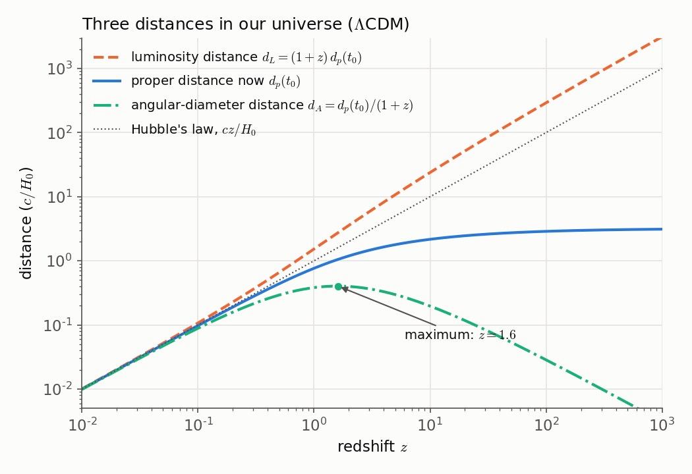

*Figure 20. Three distances to a source at redshift $z$ in our universe, in units of the Hubble distance. They agree at small $z$ (and follow Hubble's law), and diverge at large $z$, where $d_L$ grows without limit and $d_A$ falls after a maximum at $z = 1.6$.*

**Rulers in practice.** For a long time standard rulers were a disappointment. Galaxies and clusters are big enough to resolve, but they have no sharp edges, and they grow over time through mergers and infall. The modern rulers are not objects at all, but a length imprinted on the whole universe: the distance a sound wave could travel in the hot plasma before the baryons were released from the photons, just after the CMB itself was released, about 147 Mpc today (the chapters on the cosmic microwave background and on structure formation explain it). It appears as a preferred angular scale in the CMB, measured to 0.03% by Planck, and as a slight preference for pairs of galaxies to be separated by that distance, the **baryon acoustic oscillations** measured by galaxy surveys such as DESI ([DESI Collaboration 2025](https://arxiv.org/abs/2503.14738)). The CMB angle is how the flatness of the universe is measured: it is a triangle with a known side, about 144 Mpc (the sound horizon at the moment the CMB was released, slightly less than the 147 Mpc relevant for galaxies), seen from 14 Gpc away.

> **In short.** For a flat universe, the three distances are one distance and two factors of $1 + z$: $d_A = d_p(t_0)/(1 + z)$ and $d_L = d_p(t_0)(1 + z)$. Rulers see the universe as it was when the light left; candles are dimmed by the stretching both of each photon and of the time between photons.

---

**Aside: distance duality and the Tolman test.**

The relation $d_L = (1 + z)^2d_A$ is far more general than the Robertson–Walker metric. [Etherington (1933)](https://doi.org/10.1080/14786443309462220) proved that it holds in *any* spacetime, provided light travels on null geodesics and photons are neither created nor destroyed on the way. It follows from conservation of phase-space volume along a bundle of light rays. So testing it, by comparing standard candles with standard rulers at the same redshift, tests fundamental physics: photons turning into axions, for instance, or dust dimming distant sources, would break it.

It also settles the Olbers' paradox argument from the chapter on fundamental observations. There we found that surface brightness, $\Sigma = f/\Omega$, is independent of distance in a static Euclidean universe. In an expanding universe the flux falls as $1/d_L^2$ but the solid angle only as $1/d_A^2$, so

$$
\Sigma \propto \frac{d_A^2}{d_L^2} = (1 + z)^{-4}.
$$

Distant galaxies are dimmer per unit area, by four powers of $1 + z$. This is the **Tolman surface-brightness test**, and observations of galaxies out to $z \approx 0.9$ confirm the expected dimming, once the evolution of their stars is allowed for ([Lubin & Sandage 2001](https://arxiv.org/abs/astro-ph/0106566)). The universe really is expanding. The same factor $(1 + z)^{-4}$ turns the 3000 K glow of the last-scattering surface into the faint 2.7 K microwave background.

---

### Standard candles and the Hubble constant

The recipe for measuring $H_0$ goes back to Hubble. Find a population of standard candles of known luminosity $L$. Measure each one's redshift and flux, compute $d_L = (L/4\pi f)^{1/2}$, plot $cz$ against $d_L$, and the slope at small $z$ is $H_0$. As the old recipe for rabbit stew begins, "first catch your rabbit": the hard part is finding a good standard candle.

**Cepheids.** Cepheid variables are luminous supergiant stars that pulsate, swelling and shrinking with periods from about one day to a few months; their brightness varies with the pulsation. In 1912 Henrietta Leavitt, studying Cepheids in the Small Magellanic Cloud, noticed that the longer a Cepheid's period, the brighter it is ([Leavitt & Pickering 1912](https://ui.adsabs.harvard.edu/abs/1912HarCi.173....1L)). All the stars in the Small Magellanic Cloud are at nearly the same distance from us, so the brightness differences must be differences in luminosity. If the **period–luminosity relation** is universal, a Cepheid's period tells you its luminosity, and its flux then tells you its distance.

Even without knowing the luminosities, Cepheids give *relative* distances. Cepheids of the same period in the Large Magellanic Cloud (LMC) and in the Andromeda galaxy (M31) have the same luminosity, so the ratio of their fluxes gives the square of the ratio of distances. Cepheids in the LMC appear about 235 times brighter than those of the same period in M31, so M31 is $\sqrt{235} \approx 15.3$ times farther away, at 761 kpc ([Li et al. 2021](https://arxiv.org/abs/2107.08029)). To get absolute distances the relation must be **calibrated** by geometry, and today there are three geometric anchors:

- **Parallaxes** of Cepheids in our own galaxy, from the Gaia satellite.
- The **LMC**, whose distance has been measured to about 1% using pairs of eclipsing stars: $49.59 \pm 0.09\,(\mathrm{stat}) \pm 0.54\,(\mathrm{sys})$ kpc ([Pietrzyński et al. 2019](https://arxiv.org/abs/1903.08096)).
- The galaxy **NGC 4258**, where water masers orbiting the central black hole give a geometric distance of $7.576 \pm 0.082\,(\mathrm{stat}) \pm 0.076\,(\mathrm{sys})$ Mpc ([Reid, Pesce & Riess 2019](https://arxiv.org/abs/1908.05625)).

Cepheids can be found out to a few tens of megaparsecs with the Hubble and James Webb space telescopes. Other stars serve as standard candles over similar ranges: the brightest red giants (the **tip of the red giant branch**, TRGB) and carbon-rich giants (the **J-region asymptotic giant branch**, JAGB). These are easier to model and independent of Cepheids.

**Why go far.** Within a few tens of megaparsecs the universe is not smooth, and galaxies have **peculiar velocities** of a few hundred km/s on top of the Hubble flow. Our Local Group, for instance, is falling towards the Virgo cluster, 16.5 Mpc away ([Mei et al. 2007](https://arxiv.org/abs/astro-ph/0702510)). At 15 Mpc a peculiar velocity of 300 km/s is a 30% error on the Hubble velocity of about 1000 km/s; at 100 Mpc it is under 5%. So the ladder needs one more rung, a standard candle bright enough to see far into the smooth Hubble flow: Type Ia supernovae, discussed below. Cepheids and TRGB stars calibrate the supernovae in nearby galaxies, and the supernovae then carry the scale out to hundreds of megaparsecs (Figure 21).

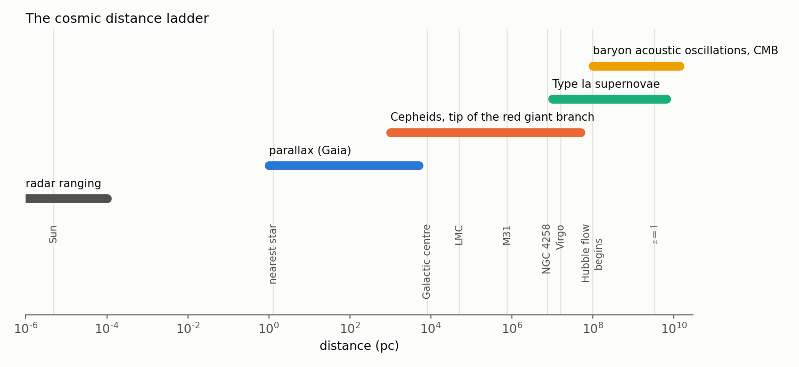

*Figure 21. The cosmic distance ladder. Each rung reaches farther than the one below it and is calibrated by it. The top bar, baryon acoustic oscillations and the CMB, is not part of the ladder: its ruler, the sound horizon, is calibrated by the physics of the early universe. Beyond about 100 Mpc the distances are comoving. Vertical lines mark some landmark distances.*

**The results.** Hubble's own 1929 value was about 500 km/s/Mpc, because he had underestimated his candles' luminosities by a factor of about 50, and so the distances by a factor of about 7. The Hubble Space Telescope was built partly to fix this. Its Key Project found $H_0 = 72 \pm 8\ \mathrm{km\,s^{-1}\,Mpc^{-1}}$ ([Freedman et al. 2001](https://arxiv.org/abs/astro-ph/0012376)), and the ladder has been refined ever since. The table collects modern values, including methods that bypass the ladder entirely.

| Method | $H_0$ ($\mathrm{km\,s^{-1}\,Mpc^{-1}}$) | Source |
| --- | --- | --- |
| CMB fitted with $\Lambda$CDM (early universe) | $67.4 \pm 0.5$ | [Planck 2018](https://arxiv.org/abs/1807.06209) |
| Cepheids and Type Ia supernovae | $73.04 \pm 1.04$ | [Riess et al. 2022](https://arxiv.org/abs/2112.04510) |
| "Local Distance Network" combining many ladders | $73.50 \pm 0.81$ | [H0DN Collaboration 2026](https://doi.org/10.1051/0004-6361/202557993) |
| Red giants (TRGB) and Type Ia supernovae | $70.39 \pm 1.22\,(\mathrm{stat}) \pm 1.33\,(\mathrm{sys}) \pm 0.70\,(\sigma_{\rm SN})$ | [Freedman et al. 2025](https://arxiv.org/abs/2408.06153) |
| Time delays of gravitationally lensed quasars | $71.6^{+3.9}_{-3.3}$ | [TDCOSMO Collaboration 2025](https://arxiv.org/abs/2506.03023) |
| Gravitational-wave "standard sirens" | $75.4^{+12.8}_{-9.1}$ | [LIGO–Virgo–KAGRA 2026](https://arxiv.org/abs/2509.04348) |

The last two rows skip the ladder entirely. When a quasar is lensed into several images by a foreground galaxy, its flickering reaches us along the different paths at different times, and the delays are inversely proportional to $H_0$. A merger of neutron stars or black holes is a "standard siren": general relativity predicts the strength of its gravitational waves, so their measured amplitude gives $d_L$ directly. The first, GW170817, gave $H_0 = 70^{+12}_{-8}$ on its own ([Abbott et al. 2017](https://arxiv.org/abs/1710.05835)), and the sirens' errors are still far too large to settle the question.

Most distance-ladder values cluster around 73 (the red-giant ladder of the Chicago–Carnegie team is lower, at 70.4), the early-universe value is 67.4, and their difference is the **Hubble tension** introduced in the chapter on model universes. Every rung inherits the errors of the rungs below, so a subtle problem in, say, the crowded fields around Cepheids in distant galaxies could propagate all the way up. That is why independent ladders (TRGB and JAGB instead of Cepheids) and independent methods (lensing, gravitational waves) matter so much. So far no single error has been found that would remove the tension.

> **In short.** The distance ladder is only as strong as its weakest rung. Geometry calibrates stars, stars calibrate supernovae, and supernovae reach the Hubble flow. The Hubble tension is the question of whether that chain has a broken link or whether the universe itself has a surprise for us.

---

### Standard candles and acceleration

To measure $q_0$ we need standard candles at redshifts where $d_L(z)$ bends away from a straight line,

$$
d_L \approx \frac{c}{H_0}\,z\left[1 + \frac{1 - q_0}{2}\,z\right].
$$

At $z = 0.2$ this formula says that our universe ($q_0 = -0.53$) puts a candle 5% farther away than an empty universe ($q_0 = 0$) would. (The exact calculation gives 4%: at $z = 0.2$ the higher-order terms already matter.) Measuring that difference needs a candle that is both very bright and very standard.

**Type Ia supernovae.** Supernovae are classified by their spectra: Type II show strong hydrogen lines and Type I do not. Type II supernovae, and Types Ib and Ic, are the core collapse of massive stars, with $M \gtrsim 8\,M_\odot$; Types Ib and Ic have lost their hydrogen envelopes beforehand. Type Ia supernovae are a different animal. They are white dwarfs, stars supported by electron degeneracy pressure, which are pushed close to the **Chandrasekhar mass**, about $1.4\,M_\odot$, by accreting matter from a companion or by merging with another white dwarf. Carbon ignites in the dense core, and a runaway thermonuclear explosion destroys the star completely. Because they all explode at nearly the same mass, they are nearly standard. At peak a Type Ia supernova shines with about $4\times10^9\,L_\odot$, briefly as bright as a whole galaxy, so they can be seen at great distances: the most distant one confirmed so far, found by the James Webb Space Telescope, is at $z = 2.90$ ([Pierel et al. 2024](https://arxiv.org/abs/2406.05089)). [Hillebrandt & Niemeyer (2000)](https://arxiv.org/abs/astro-ph/0006305) review what we know about how they explode.

They are not perfectly standard: peak luminosities vary by tens of percent. But the variation correlates with the shape of the light curve. Supernovae that brighten and fade quickly are fainter at peak; those that evolve leisurely are brighter ([Phillips 1993](https://doi.org/10.1086/186970)). Measuring the light curve corrects the luminosity, much as a Cepheid's period gives its luminosity, and makes Type Ia supernovae standard to about 10% in luminosity.

**Magnitudes.** Astronomers measure brightness on the logarithmic magnitude scale inherited from Hipparchus, in which *smaller* numbers mean *brighter*. The bolometric (all wavelengths) **apparent magnitude** is

$$
m \equiv -2.5\log_{10}\left(\frac{f}{f_0}\right), \qquad f_0 = 2.518\times10^{-8}\ \mathrm{W\,m^{-2}},
$$

and the **absolute magnitude** is the apparent magnitude the object would have at a luminosity distance of 10 pc,

$$
M \equiv -2.5\log_{10}\left(\frac{L}{L_0}\right), \qquad L_0 = 3.0128\times10^{28}\ \mathrm{W} = 78.7\,L_\odot ,
$$

with zero points fixed by the [International Astronomical Union in 2015](https://arxiv.org/abs/1510.06262). The Sun, with $f = 1361\ \mathrm{W\,m^{-2}}$, has $m = -26.83$ and $M = 4.74$; a standardised Type Ia supernova at peak has an absolute magnitude of about $-19.3$ in blue light. Combining the two definitions with $f = L/(4\pi d_L^2)$ gives the **distance modulus**,

$$
m - M = 5\log_{10}\left(\frac{d_L}{1\ \mathrm{Mpc}}\right) + 25 .
$$

The LMC, at 49.6 kpc, has $m - M = 18.48$; the Virgo cluster has about 31.1. Using the low-redshift expression for $d_L$,

$$
m - M \approx 43.24 - 5\log_{10}\left(\frac{H_0}{67.4\ \mathrm{km\,s^{-1}\,Mpc^{-1}}}\right) + 5\log_{10}z + 1.086\,(1 - q_0)\,z .
$$

On a plot of $m - M$ against $\log z$, the **Hubble diagram**, nearby candles lie on a straight line whose height gives $H_0$. Farther out the points bend away from the line, and the bending gives $q_0$. In an accelerating universe a candle at a given redshift is farther away, and so *fainter*, than in a decelerating one.

**The discovery.** In the 1990s two teams, the Supernova Cosmology Project and the High-z Supernova Search Team, set out to measure the deceleration with distant Type Ia supernovae. They found the opposite. Supernovae at $z \approx 0.5$ were on average 10 to 15% farther away, about a quarter of a magnitude fainter, than expected in a low-density universe without a cosmological constant ($\Omega_{m,0} = 0.2$). They were fainter even than in a completely empty universe, which coasts at constant speed, and no amount of ordinary matter can do that: the expansion is accelerating ([Riess et al. 1998](https://arxiv.org/abs/astro-ph/9805201); [Perlmutter et al. 1999](https://arxiv.org/abs/astro-ph/9812133)). The discovery won the 2011 Nobel Prize in Physics.

**The data today.** Compilations now contain well over a thousand Type Ia supernovae. Pantheon+ has 1701 light curves of 1550 supernovae ([Brout et al. 2022](https://arxiv.org/abs/2202.04077)), Union3 has 2087 ([Rubin et al. 2025](https://arxiv.org/abs/2311.12098)), and the Dark Energy Survey's five-year sample has about 1600 of its own plus 194 nearby ones ([DES Collaboration 2024](https://arxiv.org/abs/2401.02929)). Fitting flat $\Lambda$CDM to supernovae alone gives $\Omega_{m,0}$ between about 0.33 and 0.36, a little above the CMB's 0.315. Calibrating supernovae from many telescopes onto one scale is delicate. A recalibration of the DES sample lowered its $\Omega_{m,0}$ to $0.330 \pm 0.015$ and weakened the evolving-dark-energy hint described in the chapter on model universes ([Popovic et al. 2026](https://arxiv.org/abs/2511.07517)). Figure 22 shows the Pantheon+ compilation. At $z \approx 1$, supernovae in our universe are 0.58 magnitudes fainter than they would be in a flat, matter-only universe, and 0.58 magnitudes *brighter* than in a flat universe containing only $\Lambda$. So the same data that demand acceleration also limit how much there can be.

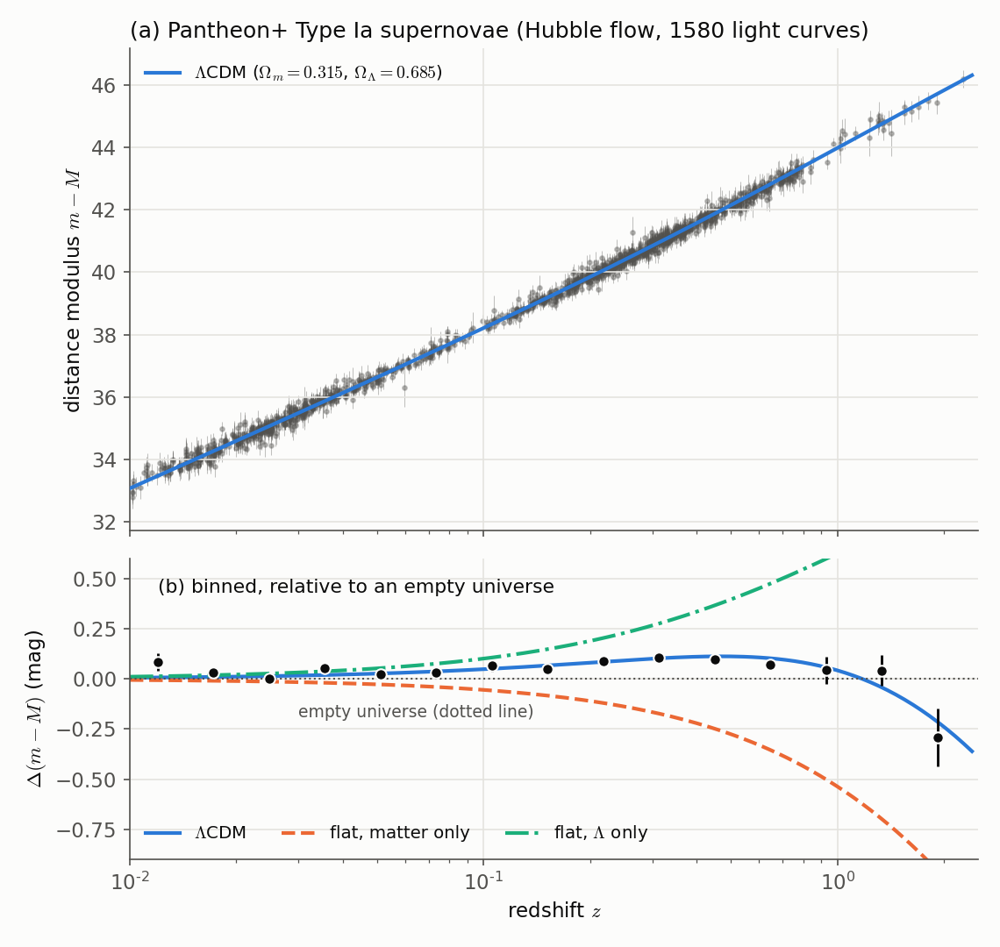

*Figure 22. (a) The Hubble diagram of Type Ia supernovae from the Pantheon+ compilation (the 1580 light curves of supernovae beyond $z = 0.01$ that are not distance-ladder calibrators), with the flat $\Lambda$CDM model. (b) The same data averaged in redshift bins, relative to an empty universe, compared with three models. Pantheon+ distances are calibrated with Cepheids, so the curves here use the corresponding $H_0 = 73.4$; only the shape of the curves matters for acceleration. Data from the [Pantheon+ release](https://github.com/PantheonPlusSH0ES/DataRelease).*

Supernovae alone constrain a combination of $\Omega_{m,0}$ and $\Omega_{\Lambda,0}$: in the plane of Figure 17 they pick out a long, thin region that rules out decelerating universes, Big Crunches and Big Bounces, but allows a range of curvatures. The cosmic microwave background constrains a nearly perpendicular combination, close to $\Omega_{m,0} + \Omega_{\Lambda,0} = 1$, and baryon acoustic oscillations a third. Where the three regions cross is the flat $\Lambda$CDM model of the chapter on model universes, with $\Omega_{m,0} \approx 0.3$ and $\Omega_{\Lambda,0} \approx 0.7$. Allow the dark energy's equation of state to vary, and the same combination produces the hint of evolving dark energy described there.

---

**Note: how much does $1.086\,(1 - q_0)\,z$ matter?** At $z = 0.1$, the difference between our universe ($q_0 = -0.53$) and an empty one ($q_0 = 0$) is $1.086 \times 0.53 \times 0.1 \approx 0.06$ magnitudes, about a 5% difference in flux. Individual standardised supernovae scatter by about 0.1 to 0.15 magnitudes, so you need dozens of them, and a careful account of systematic errors, to see the effect. That is why the discovery had to wait until the 1990s, when wide-field digital cameras made it possible to catch many distant supernovae on schedule.

---

### Summary

**Key relations.**

| Quantity | Definition | In a flat universe | At small $z$ |
| --- | --- | --- | --- |
| Proper distance now | $d_p(t_0) = c\int_{t_e}^{t_0}dt/a$ | $r$ | $\frac{c}{H_0}z\left[1 - \frac{1+q_0}{2}z\right]$ |
| Luminosity distance | $d_L = (L/4\pi f)^{1/2}$ | $d_p(t_0)(1+z)$ | $\frac{c}{H_0}z\left[1 + \frac{1-q_0}{2}z\right]$ |
| Angular-diameter distance | $d_A = \ell/\delta\theta$ | $d_p(t_0)/(1+z)$ | $\frac{c}{H_0}z\left[1 - \frac{3+q_0}{2}z\right]$ |

**The ideas to carry away.**

- Near the present, $a(t) \approx 1 + H_0(t - t_0) - \frac{1}{2}q_0H_0^2(t - t_0)^2$, and $q_0 = \Omega_{r,0} + \Omega_{m,0}/2 - \Omega_{\Lambda,0} \approx -0.53$ for our universe.
- Proper distance can't be measured. Standard candles give $d_L = S_\kappa(1+z)$, standard rulers $d_A = S_\kappa/(1+z)$, and $d_L = (1+z)^2d_A$ in any metric theory.
- Distances are built as a ladder: geometric anchors (parallax, eclipsing binaries, masers), then Cepheids or red giants, then Type Ia supernovae. The ladder gives $H_0 \approx 73$; the CMB with $\Lambda$CDM gives 67.4.
- Distant Type Ia supernovae are fainter than in any decelerating universe: the expansion is accelerating. Combined with the CMB and baryon acoustic oscillations, they point to a flat universe with $\Omega_{m,0} \approx 0.3$ and $\Omega_{\Lambda,0} \approx 0.7$.

---

## Dark Matter

The model universe that fits our observations has $\Omega_{m,0} \approx 0.3$. What is that matter? Supernovae alone can't tell us how much there is, because they constrain only a combination of $\Omega_{m,0}$ and $\Omega_{\Lambda,0}$. So we need an independent census: count the matter we can see, and weigh the matter we can't. The answer is one of the strangest facts in science. Most of the matter in the universe gives off no light at all. And most of *that* is not made of atoms.

Three pictures to carry away:

1. **Motion weighs mass.** Anything in orbit, or bound in a swarm, moves at a speed set by the mass inside it, roughly $v^2 \sim GM/R$. Measure speeds and sizes and you have masses. In galaxies and clusters these masses far exceed everything that shines.
2. **Light weighs mass too.** Gravity bends light by an amount set by the mass along the way, so gravitational lensing weighs mass without any assumption about how it moves.
3. **The dark matter is not ordinary matter.** Two independent measurements, the light elements made in the first minutes and the pattern of fluctuations in the cosmic microwave background, fix the density of ordinary (baryonic) matter at about one sixth of the total. The rest must be something new.

---

### Visible matter

**Starlight.** Galaxies in the nearby universe produce, in the visible (V) band, a luminosity density of about $\Psi_V \approx 1.1\times10^8\ L_{\odot,V}\ \mathrm{Mpc^{-3}}$, where $L_{\odot,V} \approx 0.12\,L_\odot$ is the Sun's luminosity in that band. To turn light into mass we need the **mass-to-light ratio** $M/L$. A galaxy made of Sun-like stars would have $M/L_V = 1$ in solar units. Real stellar populations span a huge range, because luminosity rises steeply with mass. An O star of $60\,M_\odot$ shines with about $2\times10^4\,L_{\odot,V}$, so $M/L_V \approx 0.003$; an M dwarf of $0.1\,M_\odot$ has $M/L_V \approx 2000$.

What matters is how many stars of each mass a galaxy has. The distribution of masses at birth, the **initial mass function** $\chi(M)\,dM$, is roughly a power law for massive stars and a log-normal for low-mass ones:

$$
\chi(M) \propto M^{-\beta}\ \ (M > 1\,M_\odot,\ \beta \approx 2.3), \qquad
\chi(M) \propto \frac{1}{M}\exp\left(-\frac{(\log M - \log M_c)^2}{2\sigma^2}\right)\ \ (M < 1\,M_\odot),
$$

with $M_c \approx 0.2\,M_\odot$ and $\sigma \approx 0.5$ (the "Chabrier" form). Nature makes many more small stars than big ones: for every O star there are about 250 M dwarfs. They have about the same total mass, but the single O star outshines all of them. Below $0.08\,M_\odot$ the core never gets hot enough to fuse hydrogen, and the object is a dim **brown dwarf**.

A galaxy still forming stars has $M/L_V \approx 0.3$. One that stopped forming stars long ago has lost its short-lived massive stars (an O star lives about 3 Myr) and has $M/L_V \approx 8$. The local average is $\langle M/L_V\rangle \approx 4$, so the mass density in stars is

$$
\rho_{\star,0} = \langle M/L_V\rangle\,\Psi_V \approx 4\times10^8\ M_\odot\ \mathrm{Mpc^{-3}},
\qquad
\Omega_{\star,0} = \frac{\rho_{\star,0}}{\rho_{c,0}} \approx \frac{4\times10^8}{1.26\times10^{11}} \approx 0.003 .
$$

A direct inventory of the cosmic energy budget gives the same, $\Omega_{\star,0} = 0.0027 \pm 0.0005$ ([Fukugita & Peebles 2004](https://arxiv.org/abs/astro-ph/0406095)). Stars make up a third of a percent of the critical density.

**Gas.** Spiral galaxies like ours and M31 hold gas amounting to about 20% of their stars' mass, and irregular galaxies more. But most gas is not in galaxies. Clusters of galaxies are filled with gas at $T \approx 10^8$ K ($kT \approx 9$ keV), which glows in X-rays and weighs about ten times as much as all the stars in the cluster's galaxies. And most of all the baryons in the universe are spread thinly between the galaxies, too diffuse and too hot or too cold to see easily. For decades this "missing baryon" problem was an embarrassment. Fast radio bursts have now settled it. The radio waves of a burst are delayed by the free electrons they pass, so a burst from a galaxy of known redshift measures the column of ionised gas along the way. The delays add up to the expected baryon density, $\Omega_b = 0.051^{+0.021}_{-0.025}$ for $h = 0.7$ ([Macquart et al. 2020](https://arxiv.org/abs/2005.13161)), and a larger sample puts about three quarters of all baryons in the diffuse gas between galaxies ([Connor et al. 2025](https://arxiv.org/abs/2409.16952)).

**All the baryons.** We know how many baryons there must be, independently of whether we can see them. The abundance of deuterium made in the first few minutes (the chapter on nucleosynthesis) and the pattern of fluctuations in the CMB (the next chapter) both measure the baryon-to-photon ratio, and they agree:

$$
\Omega_{b,0} = 0.049
$$

([Planck 2018](https://arxiv.org/abs/1807.06209)). Stars are only about 6% of the baryons. But the bigger surprise comes when we weigh things.

---

### Dark matter in galaxies

The disc stars of a spiral galaxy move on nearly circular orbits. A star at radius $R$ moving at speed $v$ needs a centripetal acceleration $v^2/R$, supplied by the gravity of the mass $M(R)$ inside its orbit (exactly so if the mass is spherically distributed, approximately for a disc):

$$
\frac{v^2}{R} = \frac{GM(R)}{R^2} \qquad\Longrightarrow\qquad v = \sqrt{\frac{GM(R)}{R}} .
$$

The light of a spiral disc falls off exponentially with radius, $I(R) = I(0)\,e^{-R/R_s}$, with a scale length $R_s$ of a few kiloparsecs. A few scale lengths out, almost all the starlight is inside, so if the stars were all the mass, $M(R)$ would level off and the speed would fall as $v \propto R^{-1/2}$, just as the planets' speeds fall with distance from the Sun. This **Keplerian** decline is not what we see.

[Rubin & Ford (1970)](https://doi.org/10.1086/150317) measured the rotation of the Andromeda galaxy M31 from the emission lines of its ionised gas, out to 24 kpc, four scale lengths, and found no decline. Radio observations of the 21-cm line of neutral hydrogen, which extends far beyond the visible disc, pushed the measurements farther out ([Roberts & Whitehurst 1975](https://doi.org/10.1086/153889)), and the same pattern turned up in galaxy after galaxy ([Rubin, Ford & Thonnard 1980](https://doi.org/10.1086/158003)). Figure 23 shows a classic case, NGC 3198 ([van Albada et al. 1985](https://doi.org/10.1086/163375)), using data from the SPARC database ([Lelli, McGaugh & Schombert 2016](https://arxiv.org/abs/1606.09251)). The rotation speed rises and then stays flat at 150 km/s out to 44 kpc, while the stars and gas alone would give a speed falling to about 65 km/s.

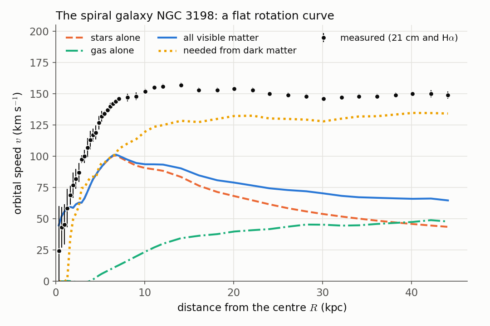

*Figure 23. The rotation curve of the spiral galaxy NGC 3198 (points), compared with the speeds that its stars, its gas, and both together would produce on their own (stellar mass-to-light ratio 0.5 at 3.6 μm). The difference must be supplied by a dark halo; the dotted curve is the speed it must provide, $v_{\rm dm}^2 = v^2 - v_{\rm visible}^2$. Data from the SPARC database.*

A flat rotation curve, $v = \text{const}$, means $M(R) = v^2R/G$: the enclosed mass keeps growing in proportion to radius, long after the light has run out. The visible disc sits inside a much larger, roughly spherical **dark halo**. Differentiating, $dM/dR = 4\pi R^2\rho = v^2/G$, so the halo's density falls as

$$
\rho(R) = \frac{v^2}{4\pi GR^2},
$$

the density profile of a so-called singular isothermal sphere. Near the Sun this gives about $0.01\,M_\odot\ \mathrm{pc^{-3}}$, or about $0.5\ \mathrm{GeV}$ of dark matter per cubic centimetre. That is an overestimate, because near the Sun the stellar disc supplies much of the gravity. Careful models give $0.30 \pm 0.03\ \mathrm{GeV\,cm^{-3}}$ ([Eilers et al. 2019](https://arxiv.org/abs/1810.09466)), and direct-detection experiments quote their results for a standard $0.3\ \mathrm{GeV\,cm^{-3}}$.

**Our own galaxy.** The Sun is $R_0 = 8.28$ kpc from the Galactic centre, a distance measured by following stars on their orbits around the central black hole ([GRAVITY Collaboration 2022](https://arxiv.org/abs/2112.07478)). It moves around the centre at $v = 229$ km/s, and the rotation curve stays nearly flat from 5 to 25 kpc ([Eilers et al. 2019](https://arxiv.org/abs/1810.09466)). The mass inside the Sun's orbit is then

$$
M(R) = \frac{v^2R}{G} \approx 1.0\times10^{11}\,M_\odot\left(\frac{v}{229\ \mathrm{km\,s^{-1}}}\right)^2\left(\frac{R}{8.3\ \mathrm{kpc}}\right).
$$

The Milky Way's visible light, $L_V \approx 2\times10^{10}\,L_{\odot,V}$, comes mostly from inside the Sun's orbit. How far the halo extends is harder to say. The orbits of the satellite galaxies and globular clusters suggest a total mass of about $10^{12}\,M_\odot$, with estimates ranging from about $0.5$ to $2\times10^{12}\,M_\odot$ ([Bland-Hawthorn & Gerhard 2016](https://arxiv.org/abs/1602.07702); [Wang et al. 2020](https://arxiv.org/abs/1912.02599)). Some analyses of Gaia data find the rotation curve declining beyond about 19 kpc and a total mass five times smaller ([Jiao et al. 2023](https://arxiv.org/abs/2309.00048)), but that conclusion rests on extrapolating an assumed halo shape and is disputed. Taking $10^{12}\,M_\odot$ gives a mass-to-light ratio of about 50, an order of magnitude more than stars alone.

---

**Note: how much dark matter is in this room?** At the local density of about $0.3\ \mathrm{GeV\,cm^{-3}}$, which is $5\times10^{-22}\ \mathrm{kg\,m^{-3}}$, a room of 50 cubic metres contains about $3\times10^{-20}$ kg of dark matter, roughly the mass of 16 million protons. The Earth, sweeping through the halo at about 230 km/s, passes through some 15 grams of it every second, and a square metre of detector meets about $10^{-16}$ kg per second. That trickle is what direct-detection experiments try to catch.

---

---

**Aside: could gravity be different instead?** A flat rotation curve can be read two ways: extra mass, or a different law of gravity. In 1983 Mordehai Milgrom proposed **MOND** (Modified Newtonian Dynamics): below a tiny acceleration $a_0 \approx 1.2\times10^{-10}\ \mathrm{m\,s^{-2}}$, gravity falls off as $1/r$ instead of $1/r^2$ ([Milgrom 1983](https://doi.org/10.1086/161130)). Then $v^4 = GMa_0$ far from a galaxy: rotation curves are automatically flat, and their height is set by the visible mass alone. That last prediction works remarkably well. In real galaxies the acceleration predicted from the visible matter and the acceleration actually observed are tightly related, with very little scatter, the **radial acceleration relation** ([McGaugh, Lelli & Schombert 2016](https://arxiv.org/abs/1609.05917)). Dark-matter models must explain why invisible halos track visible matter so closely. MOND, in turn, fails badly in galaxy clusters, where it still needs unseen mass. It has no natural explanation of the cosmic microwave background or of how structure formed, and it is not a relativistic theory without major additions. A newer test uses wide binary stars in the Gaia catalogue, whose orbital accelerations are below $a_0$. So far the analyses disagree: one finds a MOND-like boost of gravity ([Chae 2023](https://arxiv.org/abs/2305.04613)), another rules MOND out at high significance ([Banik et al. 2024](https://arxiv.org/abs/2311.03436)), and a reanalysis of a later MOND-favouring sample finds ordinary Newtonian orbits ([Saad & Ting 2026](https://arxiv.org/abs/2603.11015)). Most cosmologists consider dark matter far the better explanation, but the regularities MOND predicted are real data that any theory has to explain.

---

### Dark matter in clusters

The case for dark matter is older than the rotation curves. In 1933 Fritz Zwicky measured the speeds of galaxies in the Coma cluster and found them moving so fast that the visible matter could not possibly hold the cluster together. There must be much more "dunkle Materie", dark matter ([Zwicky 1933](https://ui.adsabs.harvard.edu/abs/1933AcHPh...6..110Z); [Zwicky 1937](https://doi.org/10.1086/143864)).

**The virial theorem.** Treat a cluster as $N$ galaxies, point masses $m_i$ at positions $\vec x_i$, bound together and isolated, obeying Newton's laws:

$$
\ddot{\vec x}_i = G\sum_{j\neq i}m_j\,\frac{\vec x_j - \vec x_i}{|\vec x_j - \vec x_i|^3}.
$$

Its potential and kinetic energies are

$$
W = -\frac{G}{2}\sum_{i\neq j}\frac{m_im_j}{|\vec x_j - \vec x_i|} \equiv -\alpha\frac{GM^2}{r_h},
\qquad
K = \frac{1}{2}\sum_i m_i|\dot{\vec x}_i|^2 \equiv \frac{1}{2}M\langle v^2\rangle ,
$$

where $M$ is the total mass, $r_h$ the radius containing half of it, $\langle v^2\rangle$ the mass-weighted mean square speed, and $\alpha \approx 0.45$ for the mass profiles of real clusters. Now take the moment of inertia, $I = \sum_i m_i|\vec x_i|^2$, and differentiate twice:

$$
\ddot I = 2\sum_i m_i\left(\vec x_i\cdot\ddot{\vec x}_i\right) + 4K .
$$

Substitute the equation of motion into the first term. Writing the double sum once as it stands and once with $i$ and $j$ swapped, and averaging the two, gives $\sum_i m_i(\vec x_i\cdot\ddot{\vec x}_i) = W$. So

$$
\ddot I = 2W + 4K ,
$$

the **virial theorem**. A cluster in a steady state has $\ddot I = 0$, so $2K + W = 0$, and

$$
\boxed{\;M = \frac{\langle v^2\rangle\,r_h}{\alpha G}\;}
$$

As with the rotation curve, a mass is a speed squared times a size divided by $G$.

**Coma.** The Coma cluster is at redshift $\langle z\rangle = 0.0231$, about 100 Mpc away. We can measure only the velocities along the line of sight, whose spread is $\sigma_r \approx 1080$ km/s ([Colless & Dunn 1996](https://doi.org/10.1086/176827)); assuming random motions are the same in all three directions, $\langle v^2\rangle = 3\sigma_r^2$. Assuming also that the mass follows the light, the half-mass radius is about 1.5 Mpc. Then

$$
M_{\rm Coma} = \frac{3\sigma_r^2\,r_h}{\alpha G} \approx 3\times10^{15}\,M_\odot .
$$

This crude estimate is high by about a factor of two. Careful modern analyses, which model the galaxies' orbits instead of assuming mass follows light, find $M \approx 1.4\times10^{15}\,M_\odot$ ([Łokas & Mamon 2003](https://arxiv.org/abs/astro-ph/0302461)), and weak lensing gives about $1.2\times10^{15}\,M_\odot$ ([Okabe et al. 2014](https://arxiv.org/abs/1304.2399)). Either way, the stars are only about 1% of the mass and the hot gas about 10%. The mass-to-light ratio is several hundred: the cluster is mostly dark.

**X-ray weighing.** The hot gas gives an independent check. Without enough mass to hold it, gas at $10^8$ K would boil out of the cluster in far less than the age of the universe. Assume the gas is in hydrostatic equilibrium, its pressure gradient balancing gravity:

$$
\frac{dP_{\rm gas}}{dr} = -\frac{GM(r)\,\rho_{\rm gas}(r)}{r^2}, \qquad P_{\rm gas} = \frac{\rho_{\rm gas}kT_{\rm gas}}{\mu}.
$$

Then the total mass inside radius $r$ follows from the measured temperature and density profiles of the gas:

$$
M(r) = \frac{kT_{\rm gas}(r)\,r}{G\mu}\left[-\frac{d\ln\rho_{\rm gas}}{d\ln r} - \frac{d\ln T_{\rm gas}}{d\ln r}\right],
$$

where $\mu$ is the mean mass per particle. For Coma this gives a mass of order $10^{15}\,M_\odot$, consistent with the galaxy motions.

**Clusters as fair samples.** Rich clusters gather matter from regions tens of megaparsecs across, so their mix of baryons and dark matter should be the cosmic mix. In massive clusters the hot gas plus stars make up about 15% of the total mass: the hot gas alone is 13 to 14% of the mass inside the radius where the mean density is 500 times the critical density ([Eckert et al. 2019](https://arxiv.org/abs/1805.00034)), and stars add a percent or two. If that is the universal baryon fraction, $\Omega_{b,0}/\Omega_{m,0}$, then with $\Omega_{b,0} = 0.049$ we get $\Omega_{m,0} \approx 0.3$ to $0.35$. This argument, made by [White et al. (1993)](https://doi.org/10.1038/366429a0) when most cosmologists still believed $\Omega_{m,0} = 1$, was one of the first strong signs that we live in a low-density universe. Adding up the masses of all clusters directly gives $\Omega \approx 0.2$, a lower limit, because it misses the matter outside clusters.

---

**Note: the same theorem in a hydrogen atom.** The virial theorem holds for any $1/r$ potential, classical or quantum. For an electron bound to a proton, $2\langle K\rangle + \langle W\rangle = 0$, so the binding energy is $E = \langle K\rangle + \langle W\rangle = -\langle K\rangle$. The electron in hydrogen's ground state therefore has a mean kinetic energy of exactly 13.6 eV, and a mean speed of about $c/137$. A Coma galaxy and a hydrogen electron obey the same bookkeeping.

---

### Gravitational lensing

Dark matter bends light as well as deflecting galaxies, so it acts as a **gravitational lens**. A light ray passing a mass $M$ at impact parameter $b$ is deflected by

$$
\alpha = \frac{4GM}{c^2b},
$$

which for a ray grazing the Sun is 1.75 arcseconds, the deflection measured in the 1919 eclipse. Today radio interferometry of quasars passing near the Sun confirms the general-relativistic value to about one part in $10^4$ ([Lambert & Le Poncin-Lafitte 2011](https://doi.org/10.1051/0004-6361/201016370)).

---

**Aside: why the factor of 4.**

Treat the photon as a Newtonian particle moving at speed $c$ and you get half this answer, $2GM/c^2b$, which is what Einstein himself found in 1911, before general relativity. The other half comes from the curvature of space. In a weak field, the metric around a mass is

$$
ds^2 = -\left(1 + \frac{2\Phi}{c^2}\right)c^2dt^2 + \left(1 - \frac{2\Phi}{c^2}\right)d\vec x^{\,2}, \qquad \Phi = -\frac{GM}{r}.
$$

For light, $ds = 0$, so its coordinate speed is $|d\vec x/dt| = c\left(1 + 2\Phi/c^2\right)$: gravity acts like a medium of refractive index $n = 1 - 2\Phi/c^2$. The time part of the metric contributes half of the $2\Phi$ and the space part the other half. A ray bends towards higher $n$, by $\alpha = \int\nabla_\perp n\,dl$ along the path. For a point mass, $\int_{-\infty}^{\infty}\partial_b\left(GM/\sqrt{b^2 + z^2}\right)dz = -GMb\int_{-\infty}^{\infty}\frac{dz}{(b^2 + z^2)^{3/2}} = -GMb\cdot\frac{2}{b^2} = -\frac{2GM}{b}$, which gives $\alpha = (2/c^2)(2GM/b) = 4GM/(c^2b)$. Measuring the bending of light was therefore a test of the curvature of *space*, not just of the equivalence principle.

---

If the lens lies exactly on the line of sight to a source, the light comes round it equally on all sides, and the source appears as a ring (Figure 24). With the source at distance $d$ and the lens at $xd$, the small-angle geometry gives the **Einstein radius**

$$
\theta_E = \left(\frac{4GM}{c^2d}\,\frac{1 - x}{x}\right)^{1/2}.
$$

If the alignment is not perfect, we see two or more distorted images instead of a ring.

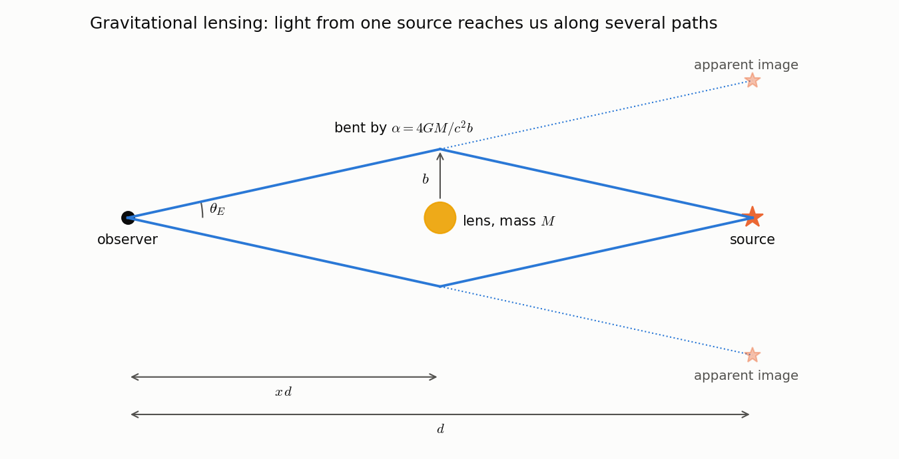

*Figure 24. A mass between us and a distant source bends its light, so the source is seen in more than one place. With perfect alignment the images merge into a ring of angular radius $\theta_E$.*

**MACHOs and microlensing.** Could the dark halo of our galaxy be made of dark but ordinary objects, such as brown dwarfs, dead stars or black holes (**MA**ssive **C**ompact **H**alo **O**bjects)? If such an object passes in front of a star in the Large Magellanic Cloud, 50 kpc away, it lenses it. With the lens halfway,

$$
\theta_E \approx 4\times10^{-4}\ \mathrm{arcsec}\left(\frac{M}{1\,M_\odot}\right)^{1/2}\left(\frac{d}{50\ \mathrm{kpc}}\right)^{-1/2},
$$

far too small to resolve, but the two images together make the star *brighter* for as long as the alignment lasts. The time to cross the Einstein radius is

$$
\Delta t = \frac{d\,\theta_E}{2v} \approx 90\ \mathrm{days}\left(\frac{M}{1\,M_\odot}\right)^{1/2}\left(\frac{v}{200\ \mathrm{km\,s^{-1}}}\right)^{-1}.
$$

Even if the halo were made entirely of MACHOs, only about one LMC star in two million would be lensed at any moment, so surveys in the 1990s and 2000s monitored millions of stars for years. They found too few events. The MACHO project saw 13 to 17. If these are caused by objects in the halo, compact objects make up about 20% of it (95% range 8 to 50%), and a halo made entirely of MACHOs is ruled out ([Alcock et al. 2000](https://arxiv.org/abs/astro-ph/0001272)), and EROS-2 found less than 8% for masses near $0.4\,M_\odot$, ruling out compact objects between $10^{-7}$ and $15\,M_\odot$ as the main component ([Tisserand et al. 2007](https://arxiv.org/abs/astro-ph/0607207)). The halo is not made of compact objects in the planet-to-star mass range. One window remains open: primordial black holes of asteroid mass, about $10^{17}$ to $10^{23}$ g, could still be all of the dark matter ([Carr et al. 2021](https://arxiv.org/abs/2002.12778)).

**Clusters as lenses.** A cluster of $10^{14}\,M_\odot$ halfway to a galaxy 1000 Mpc away has $\theta_E \approx 0.5$ arcmin, easily resolved. Massive clusters stretch the images of background galaxies into long arcs, and even far from the centre they distort background galaxies slightly and systematically (**weak lensing**), which lets us map where the mass is. Masses from lensing agree with those from galaxy motions and X-ray gas.

**The Bullet Cluster.** The most direct evidence comes from the "Bullet Cluster", a pair of clusters caught shortly after colliding head-on. The hot gas, which makes up most of the ordinary matter, collided and was slowed down, and now sits between the two clusters, glowing in X-rays. The galaxies, and the mass mapped by weak lensing, passed through each other and sit well ahead of the gas. The mass is not where most of the ordinary matter is, a spatial offset detected at $8\sigma$ ([Clowe et al. 2006](https://arxiv.org/abs/astro-ph/0608407)). It is hard to see how any modification of gravity sourced by the visible matter could produce this. Comparing many such collisions also shows that dark matter particles hardly interact with each other at all. A study of 72 cluster collisions limits the self-interaction cross-section per unit mass to below $0.47\ \mathrm{cm^2\,g^{-1}}$ ([Harvey et al. 2015](https://arxiv.org/abs/1503.07675)), though a reanalysis loosened this to about $2\ \mathrm{cm^2\,g^{-1}}$ ([Wittman, Golovich & Dawson 2018](https://arxiv.org/abs/1701.05877)).

> **In short.** Three independent ways of weighing (orbits, hot gas and lensing) agree. In galaxies and clusters there is five or more times as much mass as all the ordinary matter, and the dark matter does not collide with itself or with gas the way ordinary matter does.

---

### What is the dark matter?

The candidates span a range of masses so wide it is a measure of our ignorance: from axions, with rest energies around $10^{-5}$ eV, to primordial black holes of thousands of solar masses, some 74 orders of magnitude apart. What we do know rules out a lot.

**It is not ordinary matter.** The baryon density, $\Omega_{b,0} = 0.049$, is fixed by nucleosynthesis and the CMB, and the matter density is $\Omega_{m,0} = 0.315$. At least 84% of the matter is something else. Figure 25 summarises the census.

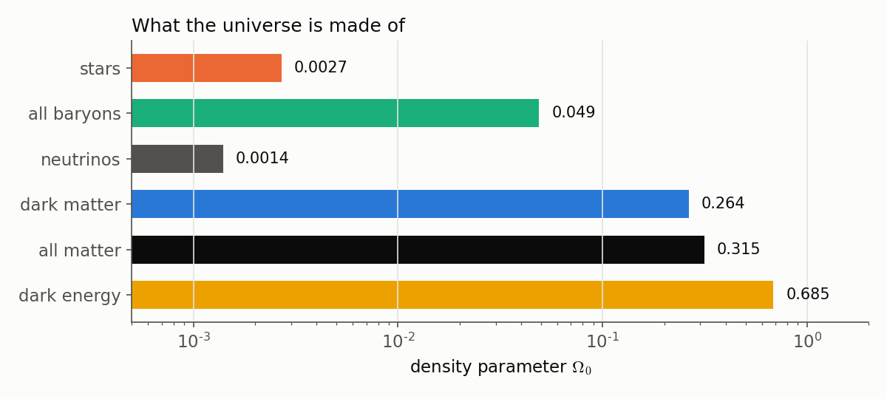

*Figure 25. The density parameters of the components of the universe today, on a logarithmic scale. Stars are a few percent of the baryons, baryons about a sixth of the matter, and neutrinos a fraction of a percent of it.*

**It is not neutrinos.** Neutrinos are the one known particle that is massive, neutral and weakly interacting. Like the CMB, there is a relic background of them (the chapter on model universes), with number density, for all three flavours,

$$
n_\nu = 3\times\frac{3}{11}\,n_\gamma = 336\ \mathrm{cm^{-3}},
$$

so about 20 million relic neutrinos are inside your body at any moment. To make up all the dark matter, their average mass would need to be

$$
m_\nu c^2 = \frac{\Omega_{c,0}\,\varepsilon_{c,0}}{n_\nu} \approx \frac{0.264\times4790\ \mathrm{MeV\,m^{-3}}}{3.36\times10^8\ \mathrm{m^{-3}}} \approx 3.8\ \mathrm{eV}.
$$

But oscillations require a sum of at least 0.059 eV, and cosmology limits it to below 0.064 eV (95% confidence, assuming $\Lambda$CDM), which gives $\Omega_{\nu,0} = \sum m_\nu c^2/(93.1\,h^2\ \mathrm{eV}) \approx 0.0014$, about half a percent of the dark matter. Neutrinos are also "hot": they moved too fast in the early universe to stay in small clumps, so dark matter made of them would have erased small galaxies, which we see in abundance (the chapter on gravitational instability).

**WIMPs.** A natural candidate is a **weakly interacting massive particle**, heavy (perhaps 10 to 1000 times the proton mass) and interacting only through gravity and the weak force. Such particles would have been in thermal equilibrium in the early universe. As it cooled they would have annihilated each other until the expansion made them too rare to find each other, leaving a relic density inversely proportional to their annihilation rate. A cross-section typical of the weak interaction, $\langle\sigma v\rangle \approx 2\times10^{-26}\ \mathrm{cm^3\,s^{-1}}$ (often rounded to $3\times10^{-26}$), gives about the observed dark-matter density ([Steigman, Dasgupta & Beacom 2012](https://arxiv.org/abs/1204.3622)). This coincidence, the "WIMP miracle", made WIMPs the favourite for decades ([Jungman, Kamionkowski & Griest 1996](https://arxiv.org/abs/hep-ph/9506380)). They should occasionally bump into atomic nuclei, and huge underground detectors of liquid xenon wait for the recoils. None have been seen. The best limit, from the LZ experiment, excludes a cross-section with nucleons above $2.2\times10^{-48}\ \mathrm{cm^2}$ for a particle of 40 GeV ([LZ Collaboration 2025](https://arxiv.org/abs/2410.17036)). These detectors are now sensitive enough to see neutrinos from the Sun bouncing off xenon nuclei ([XENONnT 2024](https://arxiv.org/abs/2408.02877); [PandaX-4T 2024](https://arxiv.org/abs/2407.10892); [LZ 2026](https://arxiv.org/abs/2512.08065)), the "neutrino fog" that will eventually limit any search of this kind. The Large Hadron Collider has not produced any new particles either.

**Axions.** A very light particle, invented to solve a puzzle about the strong force (why the neutron has no measurable electric dipole moment), would also be produced in the early universe in the right amount to be the dark matter. Axions would convert into photons in a strong magnetic field, which resonant-cavity experiments try to detect. So far the ADMX experiment has excluded axion dark matter only in narrow mass windows between about 2.7 and 5.4 μeV ([Du et al. 2018](https://arxiv.org/abs/1804.05750); [Bartram et al. 2021](https://arxiv.org/abs/2110.06096); [ADMX 2025](https://arxiv.org/abs/2504.07279)). Most of the plausible mass range has not been searched.

**And the rest.** Primordial black holes, sterile neutrinos, ultralight "fuzzy" dark matter whose quantum wavelength is as big as a galaxy core, and many more are all still allowed in some range. The dark matter could also be a whole "dark sector" of particles with interactions of their own. We know how much there is, where it is, and that it is cold and nearly collisionless, but after nearly a century we still do not know what it is.

> **In short.** Dark matter is something that gravitates like matter, moves slowly, emits and absorbs no light, and barely interacts with itself or with us. It is about 85% of the matter in the universe and is not made of atoms. Its identity is one of the great open problems in physics.

---

### Summary

| Quantity | Value |
| --- | --- |
| Stars | $\Omega_{\star,0} \approx 0.003$ |
| All baryons (nucleosynthesis, CMB) | $\Omega_{b,0} = 0.049$ |
| Neutrinos | $\Omega_{\nu,0} \approx 0.0014$ |
| Cold dark matter | $\Omega_{c,0} = 0.264$ |
| All matter | $\Omega_{m,0} = 0.315$ |

**The ideas to carry away.**

- Masses come from motions, $M \sim v^2R/G$: flat rotation curves for galaxies, the virial theorem $2K + W = 0$ for clusters, hydrostatic equilibrium for cluster gas.
- Lensing weighs mass directly: $\alpha = 4GM/c^2b$, half of it from the curvature of space. Microlensing rules out a halo of compact objects in the planet-to-star range; the Bullet Cluster shows dark matter separated from the gas.
- Ordinary matter is only about a sixth of all matter, and stars only a few percent of the ordinary matter.
- Dark matter is not neutrinos, and searches for WIMPs and axions have so far found nothing. It is cold, nearly collisionless and unidentified.

---

## The Cosmic Microwave Background

In the chapter on fundamental observations we met the cosmic microwave background (CMB): a perfect blackbody at 2.7255 K, the same in every direction to one part in $10^5$. This chapter is about where it comes from and what it tells us. The CMB is light released when the universe was about 370,000 years old and a thousand times smaller than today. Its tiny fluctuations are a snapshot of the universe at that moment, and that snapshot pins down most of the cosmological parameters used in these notes.

Three pictures to carry away:

1. **Escaping from the fog.** For its first few hundred thousand years the universe was a hot plasma, and light could not travel far before scattering off a free electron. When the temperature fell to about 3000 K, electrons and protons combined into hydrogen atoms, the fog cleared, and light has travelled freely ever since. We see the CMB coming from the "surface" where that happened, all around us.
2. **Hydrogen waits for the tail.** Hydrogen's binding energy, 13.6 eV, corresponds to a temperature of 160,000 K, yet it stays ionised down to about 4000 K. Photons outnumber baryons more than a billion to one, so even the rare photons in the far tail of the blackbody spectrum are enough to keep breaking up atoms.
3. **The universe rang like a bell.** The hot and cold spots are sound waves in the photon–baryon plasma, frozen at the moment of release. The size of the strongest wave on the sky measures the geometry of the universe; the relative heights of the peaks measure how much ordinary and dark matter there is.

---

### What we observe

Today the CMB has energy density $\varepsilon_{\gamma,0} = 0.2606\ \mathrm{MeV\,m^{-3}}$, only about 1/18,000 of the critical density, but its photons are very numerous: $n_{\gamma,0} = 411\ \mathrm{cm^{-3}}$, each with a mean energy of $6.3\times10^{-4}$ eV. Baryons have about 900 times the CMB's energy density, $\varepsilon_{b,0} = \Omega_{b,0}\varepsilon_{c,0} \approx 236\ \mathrm{MeV\,m^{-3}}$, but each carries about 939 MeV, so there are only

$$
n_{b,0} = \frac{\varepsilon_{b,0}}{m_pc^2} \approx 0.25\ \mathrm{m^{-3}}, \qquad \eta = \frac{n_{b,0}}{n_{\gamma,0}} \approx 6.1\times10^{-10}:
$$

about 1.6 billion photons for every baryon. This ratio controls much of what follows.

**Observing it.** Typical CMB photons have energies comparable to the rotational energies of small molecules such as water and oxygen, so the atmosphere absorbs and emits strongly at millimetre wavelengths, leaving only a few transparent windows. That is why the precision measurements come from balloons, from high, dry sites such as the Atacama desert and the South Pole, and from space: COBE (launched 1989), WMAP (2001) and Planck (2009–2013), the last two from the Sun–Earth L2 point 1.5 million km away. Ground-based telescopes with large dishes now map the finest scales better than Planck could. Combined with Planck, the Atacama Cosmology Telescope gives $H_0 = 67.6 \pm 0.5\ \mathrm{km\,s^{-1}\,Mpc^{-1}}$ ([Louis et al. 2025](https://arxiv.org/abs/2503.14452)), and the South Pole Telescope on its own gives $66.7 \pm 0.6$ ([Camphuis et al. 2026](https://arxiv.org/abs/2506.20707)), both in line with Planck and far from the distance-ladder value (the chapter on measuring cosmological parameters).

Three results stand out.

1. **The spectrum is a blackbody**, in every direction, with an rms deviation below 50 parts per million of the peak (the chapter on fundamental observations).
2. **There is a dipole.** One half of the sky is slightly hotter, the other slightly cooler, by 3.4 mK, because the Sun moves at 370 km/s relative to the frame in which the CMB is isotropic (the chapter on Newton versus Einstein). Correcting for the Sun's motion around the galaxy and the galaxy's within the Local Group, the Local Group moves at about 620 km/s, pulled by the Virgo cluster and by larger concentrations of mass beyond it.
3. **There are tiny fluctuations.** With the dipole removed, the temperature varies from place to place by

$$
\frac{\delta T}{T}(\theta, \phi) \equiv \frac{T(\theta, \phi) - \langle T\rangle}{\langle T\rangle}, \qquad \left\langle\left(\frac{\delta T}{T}\right)^2\right\rangle^{1/2} \approx 1.1\times10^{-5},
$$

about 30 μK when the map is smoothed over 10°, as COBE saw it ([Smoot et al. 1992](https://doi.org/10.1086/186504)). At Planck's 5-arcminute resolution the rms is about 110 μK, or $4\times10^{-5}$. A nearly perfect blackbody that is nearly the same in every direction is just what you expect if the universe was once hot, dense, opaque and almost perfectly uniform. Any other explanation has to work much harder.

---

### Recombination and decoupling

Three related events need to be kept apart.

- **Recombination** is when the baryons go from ionised to neutral. (It should really be called "combination": electrons and nuclei had never been bound before.) We define its moment as when half the hydrogen is neutral.
- **Photon decoupling** is when photons stop scattering frequently, because the scattering rate drops below the expansion rate. The universe becomes transparent.
- **Last scattering** is the time when a typical CMB photon scattered for the last time. It is very close to decoupling.

Ignore helium for simplicity. Charge neutrality gives $n_e = n_p$, and the **fractional ionisation** is

$$
X \equiv \frac{n_p}{n_p + n_{\rm H}} = \frac{n_e}{n_b},
$$

which runs from 1 (fully ionised) to 0 (fully neutral). It is set by the balance between photoionisation and radiative recombination,

$$
\mathrm{H} + \gamma \rightleftharpoons p + e^- ,
$$

the forward reaction needing a photon with $hf > Q = 13.6$ eV.

Early on, the universe was fully ionised. At $a = 10^{-5}$, about 70 years after the Big Bang, the temperature was $3\times10^5$ K and the mean photon energy about 60 eV. Any atom that formed was blasted apart at once.

In the ionised plasma, photons scatter mainly off free electrons, by **Thomson scattering**, with cross-section $\sigma_e = 6.65\times10^{-29}\ \mathrm{m^2}$. The mean free path and scattering rate are

$$
\lambda = \frac{1}{n_e\sigma_e}, \qquad \Gamma = \frac{c}{\lambda} = n_e\sigma_ec .
$$

When fully ionised, $n_e = n_{b,0}/a^3$, so

$$
\Gamma = \frac{n_{b,0}\,\sigma_ec}{a^3} = \frac{5.0\times10^{-21}\ \mathrm{s^{-1}}}{a^3}.
$$

At $a = 10^{-5}$ that is $5\times10^{-6}\ \mathrm{s^{-1}}$: a photon scattered about three times a week. Compare the expansion rate. In the radiation era $H = H_0\Omega_{r,0}^{1/2}/a^2 = 2.1\times10^{-20}\ \mathrm{s^{-1}}/a^2$, which at $a = 10^{-5}$ is $2\times10^{-10}\ \mathrm{s^{-1}}$, far smaller. As long as $\Gamma \gg H$, photons scatter many times while the universe barely changes. They stay tightly coupled to the electrons, and through them to the protons, so the whole plasma shares one temperature. Once $\Gamma < H$, the electrons are being diluted faster than photons can find them: the photons decouple and stream freely.

If hydrogen had stayed ionised, dilution alone would have decoupled the photons only at $z \approx 38$, when the CMB was at about 107 K. But at that temperature hydrogen can't possibly stay ionised. Decoupling is driven instead by the sudden collapse of the free-electron density during recombination, as Figure 26 shows.

---

### The physics of recombination

**A crude estimate fails.** You might guess that recombination happens when the mean photon energy drops below the ionisation energy, $2.7kT \approx Q$, i.e. at $T \sim Q/(2.7k) \approx 60,000$ K. That is far too hot. A blackbody has an exponential tail of energetic photons: about 1 photon in 500 has $E > 10kT$, 1 in 3 million has $E > 20kT$, and 1 in 30 billion has $E > 30kT$. With 1.6 billion photons per baryon, even the far tail holds enough ionising photons to keep hydrogen ionised well below 60,000 K. So the recombination temperature depends on $\eta$ as well as on $Q$.

**Equilibrium statistical mechanics.** Near recombination the photons, electrons, protons and hydrogen atoms are in thermal equilibrium at a common temperature. Each species $x$ has the momentum distribution

$$
n_x(p)\,dp = g_x\frac{4\pi}{h^3}\,\frac{p^2\,dp}{\exp\left([E - \mu_x]/kT\right) \pm 1},
$$

with $+$ for fermions and $-$ for bosons, $g_x$ the number of spin states and $\mu_x$ the chemical potential. For photons, $\mu_\gamma = 0$, and this is the blackbody spectrum, with $n_\gamma = 0.2436\,(kT/\hbar c)^3$. For non-relativistic particles, $E \approx m_xc^2 + p^2/2m_x$ and $kT \ll m_xc^2 - \mu_x$, the distribution becomes Maxwell–Boltzmann, and integrating,

$$
n_x = g_x\left(\frac{m_xkT}{2\pi\hbar^2}\right)^{3/2}\exp\left(\frac{-m_xc^2 + \mu_x}{kT}\right).
$$

If photoionisation and recombination balance, the chemical potentials satisfy $\mu_{\rm H} = \mu_p + \mu_e$. Taking the ratio $n_{\rm H}/(n_pn_e)$, the chemical potentials cancel. Then use $g_p = g_e = 2$, $g_{\rm H} = 4$, $m_{\rm H} \approx m_p$ and $(m_p + m_e - m_{\rm H})c^2 = Q$, and you get the **Saha equation**

$$
\frac{n_{\rm H}}{n_pn_e} = \left(\frac{m_ekT}{2\pi\hbar^2}\right)^{-3/2}\exp\left(\frac{Q}{kT}\right),
$$

first derived by Meghnad Saha for the ionisation of stellar atmospheres ([Saha 1920](https://doi.org/10.1080/14786441008636148)).

---

**Aside: what the Saha equation is saying.** The factor in front is the cube of the electron's thermal de Broglie wavelength, $\lambda_T = h/\sqrt{2\pi m_ekT}$. So the Saha equation reads $n_{\rm H}/(n_pn_e) = \lambda_T^3\,e^{Q/kT}$: the chance that a given proton has captured its electron is the number of electrons in one de Broglie volume around it, $n_e\lambda_T^3$, times the Boltzmann factor for being bound. Because quantum mechanics sets the size of a "cell" in phase space, ionisation balance is a competition between an energy, which favours binding, and an entropy, the enormous phase space available to a free electron, which favours ionisation. At low densities entropy wins until $kT$ is far below $Q$. The cosmic plasma is extremely dilute, with only $\eta$ baryons per photon, so recombination is delayed far below $Q/k$.

---

**Solving for $X$.** Write $n_{\rm H} = n_p(1 - X)/X$, $n_e = n_p$, and $n_p = X\eta\,n_\gamma = 0.2436\,X\eta\,(kT/\hbar c)^3$. Then the Saha equation becomes a quadratic in $X$,

$$
\frac{1 - X}{X^2} = S(T, \eta) \equiv 3.84\,\eta\left(\frac{kT}{m_ec^2}\right)^{3/2}\exp\left(\frac{Q}{kT}\right),
\qquad
X = \frac{-1 + \sqrt{1 + 4S}}{2S}.
$$

Setting $X = \tfrac12$ with $\eta = 6.1\times10^{-10}$ gives

$$
kT_{\rm rec} = 0.324\ \mathrm{eV} = \frac{Q}{42}, \qquad T_{\rm rec} = 3760\ \mathrm{K}, \qquad z_{\rm rec} = 1380,
$$

at an age of about 250,000 years. Because $S$ depends exponentially on $T$, the answer hardly depends on $\eta$: changing $\eta$ by a factor of ten moves $z_{\rm rec}$ by only about 6% (Figure 26a). In the Saha picture recombination is quick by cosmic standards: $X$ falls from 0.9 at $z = 1480$ to 0.1 at $z = 1260$, in about 70,000 years.

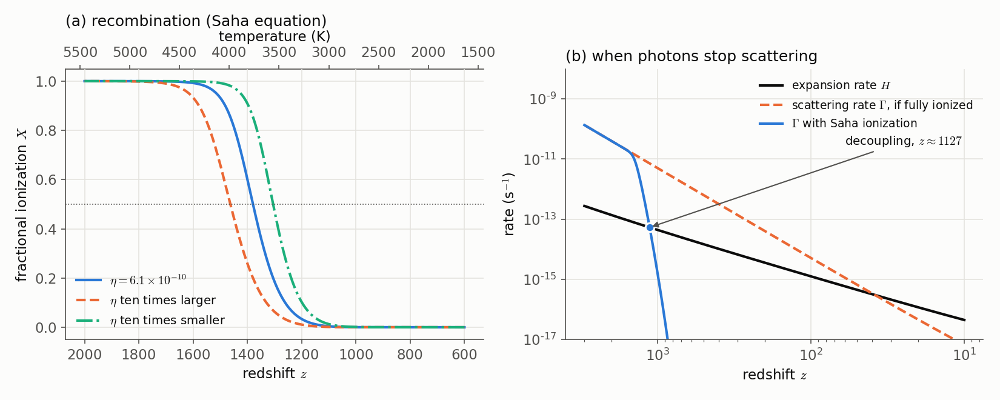

*Figure 26. (a) The fractional ionisation of hydrogen from the Saha equation, for the measured baryon-to-photon ratio and for values ten times larger and smaller. (b) The photon scattering rate $\Gamma$ compared with the expansion rate $H$. Fully ionised, the plasma would hold on to its photons until $z \approx 38$; recombination makes $\Gamma$ plunge below $H$ at $z \approx 1130$.*

**Decoupling.** With partial ionisation the scattering rate is $\Gamma(z) = 5.0\times10^{-21}\ \mathrm{s^{-1}}\,X(z)(1 + z)^3$, and during recombination the universe is matter-dominated, with $H(z) = H_0\Omega_{m,0}^{1/2}(1 + z)^{3/2} = 1.23\times10^{-18}\ \mathrm{s^{-1}}(1 + z)^{3/2}$. Setting $\Gamma = H$ gives

$$
1 + z_{\rm dec} = \frac{39.2}{X(z_{\rm dec})^{2/3}},
$$

and the Saha ionisation gives $z_{\rm dec} \approx 1130$. The real history is a little later, because recombination falls out of equilibrium. A recombination directly to the ground state emits a photon that promptly ionises another atom; atoms reach the ground state only through the slow two-photon decay of the 2s level or by the escape of Lyman-α photons redshifting out of the line ([Peebles 1968](https://doi.org/10.1086/149628); found independently by [Zel'dovich, Kurt & Sunyaev 1968](https://ui.adsabs.harvard.edu/abs/1968ZhETF..55..278Z)). Recombination is held back, more electrons survive than Saha predicts, and decoupling is delayed. Codes that follow these rates ([Seager, Sasselov & Scott 1999](https://arxiv.org/abs/astro-ph/9909275)), fitted to Planck's data, put last scattering at

$$
z_* = 1089.9 \pm 0.3, \qquad T_* \approx 2970\ \mathrm{K}, \qquad t_* \approx 370{,}000\ \mathrm{yr} .
$$

**The last-scattering surface.** The expected number of scatterings a CMB photon has undergone since time $t$ is the **optical depth**

$$
\tau(t) = \int_t^{t_0}\Gamma(t')\,dt' = \int_0^z\frac{\Gamma(z')}{H(z')}\frac{dz'}{1 + z'} ,
$$

and last scattering is where $\tau = 1$. Photons don't all last-scatter at exactly the same redshift: most do so between $z \approx 1180$ and $z \approx 980$. The "surface" is really a layer, like the edge of a fog bank you can see a little way into. Much later, when the first stars reionised the universe, a few percent of CMB photons scattered again: the optical depth from that epoch is $\tau = 0.054 \pm 0.007$, placing reionisation at $z \approx 7.7$ ([Planck 2018](https://arxiv.org/abs/1807.06209)), which we return to in the second chapter on structure formation.

| Event | Redshift | Temperature | Time |
| --- | --- | --- | --- |
| Radiation–matter equality | $3400$ | $9300$ K | $51,000$ yr |
| Recombination (Saha, $X = \frac12$) | $1380$ | $3760$ K | $250,000$ yr |
| Last scattering (decoupling) | $1090$ | $2970$ K | $370,000$ yr |

*The CMB timeline, in our $\Lambda$CDM model. Both events after equality happen in the matter era.*

The CMB therefore shows us the universe when it was about 1/37,000 of its present age.

---

### Temperature fluctuations

**From angles to sizes.** A feature of angular size $\delta\theta$ on the last-scattering surface had physical size $s = d_A\,\delta\theta$ when the light left. The angular-diameter distance to last scattering is the current distance divided by $1 + z_*$; with the current distance about 13,900 Mpc,

$$
d_A \approx \frac{13{,}900\ \mathrm{Mpc}}{1091} \approx 12.7\ \mathrm{Mpc}, \qquad s = 3.7\ \mathrm{kpc}\left(\frac{\delta\theta}{1\ \mathrm{arcmin}}\right).
$$

Planck resolves features about 5 arcminutes across: 18 kpc at last scattering, 20 Mpc today, a region that now contains about $2\times10^{14}\,M_\odot$ of matter, the mass of a cluster of galaxies.

**Describing a pattern on a sphere.** We don't care about the exact position of each hot spot, only about its statistics. Expand the fluctuations in spherical harmonics,

$$
\frac{\delta T}{T}(\theta, \phi) = \sum_{\ell = 0}^\infty\sum_{m = -\ell}^{\ell}a_{\ell m}Y_{\ell m}(\theta, \phi),
$$

and characterise the pattern by its correlation function, the average product of the fluctuations in two directions an angle $\theta$ apart:

$$
C(\theta) = \left\langle\frac{\delta T}{T}(\hat n)\,\frac{\delta T}{T}(\hat n')\right\rangle_{\hat n\cdot\hat n' = \cos\theta} = \frac{1}{4\pi}\sum_{\ell = 0}^\infty(2\ell + 1)\,C_\ell\,P_\ell(\cos\theta).
$$

The $C_\ell$ form the **angular power spectrum**. The multipole $\ell$ corresponds to an angular scale $\theta \approx 180^\circ/\ell$. The monopole $\ell = 0$ vanishes by definition and the dipole $\ell = 1$ is our own motion, so the cosmology is in $\ell \geq 2$. Results are usually plotted as

$$
\mathcal D_\ell = \frac{\ell(\ell + 1)}{2\pi}C_\ell\,\langle T\rangle^2,
$$

the contribution to the temperature variance per logarithmic interval of $\ell$. (Some authors plot its square root, $\Delta_T$, in μK.)

---

**Aside: isotropy, Schur's lemma and cosmic variance.**

Why is a single number $C_\ell$ enough for each $\ell$? The $Y_{\ell m}$ with fixed $\ell$ span a $(2\ell + 1)$-dimensional space that rotations map into itself, an irreducible representation of the rotation group. If the universe is statistically isotropic, the covariance matrix of the $a_{\ell m}$ must commute with every rotation. By Schur's lemma it is then a multiple of the identity on each irreducible block:

$$
\langle a_{\ell m}a^*_{\ell'm'}\rangle = C_\ell\,\delta_{\ell\ell'}\delta_{mm'} .
$$

Isotropy does all the work: different $\ell$ are uncorrelated, and within each $\ell$ all $2\ell + 1$ values of $m$ are equivalent. The addition theorem for spherical harmonics, $\sum_m Y_{\ell m}(\hat n)Y^*_{\ell m}(\hat n') = \frac{2\ell + 1}{4\pi}P_\ell(\hat n\cdot\hat n')$, then gives the formula for $C(\theta)$ above.

There is a sting in the tail. We have only one sky, so each $C_\ell$ is estimated from just $2\ell + 1$ numbers. Even with a perfect instrument, its value is uncertain by

$$
\frac{\Delta C_\ell}{C_\ell} = \sqrt{\frac{2}{2\ell + 1}},
$$

about 60% for the quadrupole. This **cosmic variance** is why the error bars at small $\ell$ in Figure 27 are so large, and why the large-angle "anomalies" (almost no correlation between directions more than 60° apart, a large Cold Spot, a slight asymmetry between hemispheres) remain intriguing but statistically inconclusive  ([Planck Collaboration 2020](https://arxiv.org/abs/1906.02552)). Each would turn up in roughly one simulated sky in a hundred, but they were noticed only after looking at the data, and the polarisation maps have not independently confirmed them.

---

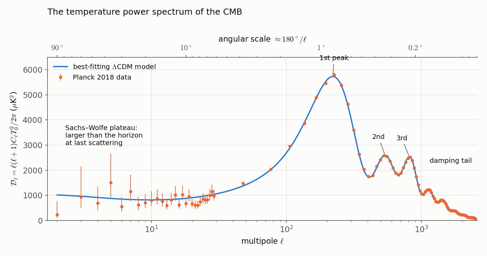

*Figure 27. The angular power spectrum of the CMB temperature measured by Planck, with the best-fitting $\Lambda$CDM model. The $\ell$ axis is logarithmic, and the top axis gives the matching angular scale. Below $\ell = 30$ each point is a single multipole; above it the points are averages over bins of $\ell$. Data from the Planck Legacy Archive.*

Figure 27 shows the measured spectrum, which has two regimes. On large angular scales, $\ell \lesssim 40$, $\mathcal D_\ell$ is a nearly flat plateau. Below about one degree there is a series of peaks and troughs (the first three at $\ell = 220.0 \pm 0.5$, $537.5 \pm 0.7$ and $810.8 \pm 0.7$; [Planck Collaboration 2016](https://arxiv.org/abs/1502.01582)), falling off towards high $\ell$. The two regimes have different physical causes.

---

### What causes the fluctuations?

**The horizon at last scattering.** The proper horizon distance at last scattering, computed with the radiation-plus-matter expansion of the early universe, is

$$
d_{\rm hor}(t_*) = a(t_*)\,c\int_0^{t_*}\frac{dt}{a(t)} \approx 0.26\ \mathrm{Mpc},
$$

which on the sky subtends $\theta_{\rm hor} = d_{\rm hor}/d_A \approx 0.26/12.7 \approx 1.2^\circ$, or $\ell \approx 160$. Fluctuations on larger angular scales were bigger than the horizon when the CMB was released: no physical process could yet have acted on them, so they show the universe's primordial fluctuations almost untouched. Smaller scales had time to evolve.

**Who dominates at last scattering?** Scaling today's densities back to $z_* = 1090$:

$$
\varepsilon_{\rm dm} \approx 1.6\times10^{12}, \qquad \varepsilon_\gamma \approx 3.7\times10^{11}, \qquad \varepsilon_b \approx 3.1\times10^{11}\ \ \mathrm{MeV\,m^{-3}},
$$

in the ratio $5.4 : 1.2 : 1$. Dark matter dominates the density, and so it sets the gravitational potential. Small density fluctuations $\delta\varepsilon$ produce potential fluctuations $\delta\Phi$ through Poisson's equation,

$$
\nabla^2(\delta\Phi) = \frac{4\pi G}{c^2}\,\delta\varepsilon .
$$

**Large scales: the Sachs–Wolfe effect.** A photon that starts in a potential well loses energy climbing out, and arrives cooler than average; one that starts on a potential hill arrives hotter. The net effect, worked out by [Sachs & Wolfe (1967)](https://doi.org/10.1086/148982), is

$$
\frac{\delta T}{T} = \frac{1}{3}\frac{\delta\Phi}{c^2} .
$$

On large scales, then, a map of the CMB is a map of the gravitational potential at last scattering. The flat Sachs–Wolfe plateau at $\ell \lesssim 40$ says that the potential fluctuations had the same amplitude on all those scales, a clue to their origin that the chapter on inflation takes up.

---

**Aside: where the $\frac13$ comes from.** Two effects compete for a photon leaving a region with potential $\delta\Phi < 0$. First, it is gravitationally redshifted as it climbs out: $\delta T/T = \delta\Phi/c^2$, cooler. Second, clocks run slow in a potential well: by the time-dilation factor of the weak-field metric, the region is seen as it was at a slightly earlier time, $\delta t/t = \delta\Phi/c^2$, when the universe was hotter. In the matter era $T \propto a^{-1} \propto t^{-2/3}$, so being seen earlier makes it look hotter by $\delta T/T = -\frac{2}{3}\delta t/t = -\frac23\delta\Phi/c^2$. The total is $\delta\Phi/c^2 - \frac23\delta\Phi/c^2 = \frac13\delta\Phi/c^2$. Potential wells look cold, but less cold than the redshift alone would suggest.

---

**Small scales: sound waves.** Before decoupling, photons, electrons and protons were bound into a single **photon–baryon fluid**. Its own density was less than half of the dark matter's, so it moved mainly in response to the dark matter's gravity. Fluid falls into a dark-matter potential well, is compressed, and heats up. The rising photon pressure pushes it back out, it overshoots and rarefies, gravity pulls it back, and so on. Each potential well hosts a standing sound wave, an **acoustic oscillation**. When the photons decouple, each region's fluid is caught at some phase of its oscillation. Maximally compressed regions release hotter photons, maximally rarefied regions cooler ones, and fluid still moving adds a Doppler shift.

The fluid's sound speed is $c_s = c/\sqrt{3(1 + R)}$, where $R = 3\rho_b/4\rho_\gamma$ measures how much the baryons weigh the fluid down; at last scattering $R \approx 0.6$, so $c_s \approx 0.45c$. A wave can have travelled at most the **sound horizon**, which in comoving units (scaled up to today's size) is

$$
r_* = c\int_0^{t_*}\frac{c_s(t)}{c}\,\frac{dt}{a(t)} .
$$

Planck measures $r_* = 144.4 \pm 0.3$ Mpc. At the time it was 1091 times smaller, 0.13 Mpc, about half the horizon distance. Its angle on the sky, $\theta_* = r_*/D_*$ with $D_*$ the comoving distance to last scattering, is the best-measured number in cosmology, $100\,\theta_* = 1.0411 \pm 0.0003$, i.e. $\theta_* = 0.596^\circ$ ([Planck 2018](https://arxiv.org/abs/1807.06209)).

The peaks come from waves caught at an extreme of their oscillation: those with wavenumber $k$ such that $k\,r_* = n\pi$ (Figure 28). The first peak is a wavelength that had just reached maximum compression for the first time at decoupling. The second was compressed, bounced back, and reached maximum rarefaction. The third was compressed a second time, and so on. In the simplest picture the peaks are evenly spaced in $\ell$, at multiples of $\ell_A = \pi/\theta_* \approx 300$. The first observed peak is at $\ell \approx 220$ rather than 300, because the potentials themselves change while the fluid oscillates and because each wavenumber projects onto a range of $\ell$ ([Hu & Dodelson 2002](https://arxiv.org/abs/astro-ph/0110414) explain these shifts clearly).

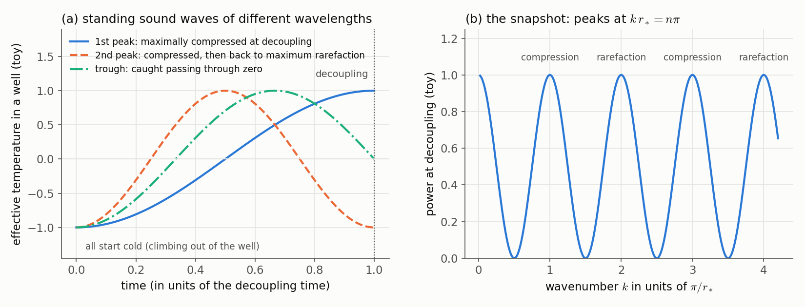

*Figure 28. A toy model of the acoustic peaks. (a) The photon fluid in potential wells of three different sizes oscillates at a frequency proportional to the wavenumber; all start cold (climbing out of the well) and are caught at different phases at decoupling. (b) The power at decoupling peaks for waves caught at an extreme: $k\,r_* = n\pi$. The limit $k \to 0$ corresponds to the large scales of the Sachs–Wolfe plateau. Real peaks are shifted, unequal and damped.*

**What the peaks tell us.**

- **Their position measures curvature.** The physical size of the sound horizon is fixed by well-understood physics, so it is a standard ruler, and its angular size depends on the geometry between us and last scattering. In a positively curved universe the ruler would look bigger (the peaks would move to smaller $\ell$), in a negatively curved one smaller. The measured position agrees with a flat universe. Combined with baryon acoustic oscillations it gives $\Omega_{k,0} = 0.001 \pm 0.002$ ([Planck 2018](https://arxiv.org/abs/1807.06209)). This is the giant triangle mentioned in the chapter on Newton versus Einstein.
- **Their heights measure the baryons.** Baryons add mass but no pressure to the fluid. They make it fall deeper into the wells, which enhances the compressions (odd peaks) relative to the rarefactions (even peaks), and they lower the sound speed. The measured ratio of peak heights gives $\Omega_bh^2 = 0.0224 \pm 0.0002$, i.e. $\eta = 6.1\times10^{-10}$, in remarkable agreement with the value from nucleosynthesis, which uses completely different physics in the first few minutes, when the universe was a quarter of a million times hotter.
- **The third peak measures the dark matter.** Whether the potential wells stay deep while the fluid oscillates depends on how much non-oscillating dark matter there is, which shows up in the height of the third peak relative to the first two. It gives $\Omega_ch^2 = 0.120 \pm 0.001$.
- **The damping tail.** On scales smaller than the distance a photon random-walks before decoupling, photons diffuse out of hot regions into cold ones and smear out the fluctuations. This **Silk damping** ([Silk 1968](https://doi.org/10.1086/149449)) makes the peaks fade away at $\ell \gtrsim 1000$.

From the baryon density the CMB also gives the present baryon budget: $n_{b,0} = \eta\,n_{\gamma,0} = 0.251\ \mathrm{m^{-3}}$, $\varepsilon_{b,0} = m_pc^2\,n_{b,0} \approx 236\ \mathrm{MeV\,m^{-3}}$, and $\Omega_{b,0} = 0.049$.

> **In short.** The CMB power spectrum is a recording of sound in the early universe. The plateau is the untouched primordial fluctuations; the first peak's angle is a ruler that measures the geometry of space; the peak heights weigh the baryons and the dark matter; and the damping tail shows the photons leaking out of the waves.

**Polarisation and beyond.** Thomson scattering of light that is brighter from one direction than another produces linear polarisation. The CMB is polarised at a level of a few percent of its temperature fluctuations, first detected by the DASI experiment ([Kovac et al. 2002](https://arxiv.org/abs/astro-ph/0209478)). The pattern splits into curl-free "E-modes", produced by the same sound waves, and "B-modes". Gravitational lensing by intervening matter converts some E-modes into B-modes, first detected in 2013 ([Hanson et al. 2013](https://arxiv.org/abs/1307.5830)). Gravitational waves from the earliest moments, if they exist, would also make B-modes; the current limit on their strength is that their primordial power is less than 3.6% of that of the density fluctuations (a tensor-to-scalar ratio $r < 0.036$; [BICEP/Keck 2021](https://arxiv.org/abs/2110.00483)), or about 3% when other data are included ([Tristram et al. 2022](https://arxiv.org/abs/2112.07961)), a constraint we will meet again, with the experiments that hope to beat it, in the chapter on inflation.

---

### Summary

| Quantity | Value |
| --- | --- |
| CMB temperature, photon density | $T_0 = 2.7255$ K, $n_{\gamma,0} = 411\ \mathrm{cm^{-3}}$ |
| Baryon-to-photon ratio | $\eta = 6.1\times10^{-10}$ |
| Recombination (Saha, $X = \frac12$) | $T = 3760$ K, $z = 1380$ |
| Last scattering | $z_* \approx 1090$, $T_* \approx 2970$ K, $t_* \approx 370{,}000$ yr |
| Angular-diameter distance to last scattering | $d_A \approx 12.7$ Mpc |
| Sound horizon, its angle | $r_* \approx 144$ Mpc (comoving), $\theta_* = 0.596^\circ$ |
| Rms fluctuation | $\delta T/T \approx 1.1\times10^{-5}$ on 10° scales, $4\times10^{-5}$ at 5 arcminutes |

**The ideas to carry away.**

- The universe became transparent when hydrogen formed, at about 3000 K rather than 160,000 K because photons outnumber baryons a billion to one. The Saha equation captures this, and non-equilibrium effects delay decoupling slightly to $z \approx 1090$.
- Statistical isotropy reduces the CMB pattern to one number per multipole, $C_\ell$, and our single sky limits how well low multipoles can be known.
- Large scales show the primordial potential through the Sachs–Wolfe effect, $\delta T/T = \delta\Phi/3c^2$. Small scales show acoustic oscillations of the photon–baryon fluid.
- The peak positions show that space is flat; the peak heights fix $\Omega_bh^2$ and $\Omega_ch^2$.

---

## Nucleosynthesis and the Early Universe

By mass, the ordinary matter of the universe is about three quarters hydrogen and one quarter helium-4, with traces of deuterium, helium-3 and lithium-7. Everything else, the carbon and oxygen and iron that planets and people are made of, adds up to less than 2% even in the Sun, and it was made later, in stars. The hydrogen, helium and the traces were made in the first few minutes, when the whole universe was a nuclear reactor. [Alpher, Bethe & Gamow (1948)](https://doi.org/10.1103/PhysRev.73.803) first tried to make all the elements this way. That fails beyond lithium, but for the light elements the calculation works, and it is one of the strongest tests we have that the hot Big Bang really happened. It is also our earliest direct probe of the universe itself: it tests physics from one second to a few minutes after the Big Bang, at temperatures from ten billion down to a billion degrees.

Three pictures to carry away:

1. **A reactor that cools as it runs.** At one second the temperature was $10^{10}$ K, $kT \approx 1$ MeV, and by four minutes it had fallen tenfold. Nuclei could only be built during a short window, and the universe had no second chance.
2. **The neutrons decide the helium.** Weak interactions keep neutrons and protons in equilibrium until $kT \approx 0.7$ MeV, leaving about one neutron for every five protons. Free neutrons then decay until, at about 200 seconds, deuterium can survive. Almost every neutron left at that point ends up in helium-4, so the helium mass fraction is about 25%.
3. **Deuterium weighs the baryons.** Just as in recombination, the huge number of photons per baryon delays the formation of deuterium. How much deuterium is left over depends steeply on the baryon-to-photon ratio, and the value it gives agrees with the CMB's.

---

### The universe at one second

In the radiation era $a \propto t^{1/2}$, so $H = 1/2t$, and the Friedmann equation $H^2 = 8\pi G\varepsilon/3c^2$ links time to the energy density:

$$
t = \left(\frac{3c^2}{32\pi G\varepsilon}\right)^{1/2}.
$$

A gas of relativistic particles at temperature $T$, with zero chemical potential, has energy density

$$
\varepsilon = g_*\,\frac{\pi^2}{30}\,\frac{(kT)^4}{(\hbar c)^3},
$$

where $g_*$ counts the internal states, each boson state counting 1 and each fermion state $\tfrac78$ (the aside on $\tfrac78$ in the chapter on model universes explains why). At $kT$ of a few MeV the relativistic species are photons ($g = 2$), electrons and positrons ($4\times\tfrac78$), and three flavours of neutrino and antineutrino ($6\times\tfrac78$), so $g_* = 2 + \tfrac72 + \tfrac{21}{4} = 10.75$. Putting in the numbers,

$$
t \approx 0.74\ \mathrm{s}\left(\frac{1\ \mathrm{MeV}}{kT}\right)^2,
\qquad
kT \approx 0.86\ \mathrm{MeV}\left(\frac{t}{1\ \mathrm{s}}\right)^{-1/2},
\qquad
T \approx 1.0\times10^{10}\ \mathrm{K}\left(\frac{t}{1\ \mathrm{s}}\right)^{-1/2}.
$$

Once $kT$ drops well below $m_ec^2 = 0.511$ MeV, electrons and positrons annihilate. That heats the photons but not the neutrinos, which have already stopped interacting, and afterwards $T_\nu = (4/11)^{1/3}T$ (the chapter on model universes). Then the photons and neutrinos together have $g_* = 3.36$ and $t \approx 1.32\ \mathrm{s}\,(1\ \mathrm{MeV}/kT)^2$. The calculation behind Figure 29 follows the annihilation exactly, using entropy conservation; the top axis of Figure 29a shows the result.

---

**Note: hot but thin.** When deuterium formed, at $kT \approx 0.066$ MeV, the temperature was $7.7\times10^8$ K, fifty times hotter than the centre of the Sun. The density of baryons was then $\rho_{b,0}(1 + z)^3 = 4.2\times10^{-28}\ \mathrm{kg\,m^{-3}}\times(2.8\times10^8)^3 \approx 0.01\ \mathrm{kg\,m^{-3}}$, about a hundredth of the density of air and ten million times less than at the centre of the Sun. Radiation, not matter, set the expansion rate: the photons and neutrinos had a mass density of about $5000\ \mathrm{kg\,m^{-3}}$, half a million times that of the baryons. A stellar core is a slow, dense reactor; the early universe was a fast, dilute one. That is why it made such a different mix of elements.

---

---

**Note: could stars have made the helium?** Stars do turn hydrogen into helium, and fusing hydrogen into a mass $M$ of helium releases $0.0071\,Mc^2$. Today the baryons have an energy density $\varepsilon_{b,0} \approx 236\ \mathrm{MeV\,m^{-3}}$ (the chapter on the CMB), so a helium mass fraction of 0.245 means $58\ \mathrm{MeV\,m^{-3}}$ of helium, whose formation would have released $0.41\ \mathrm{MeV\,m^{-3}}$. That is more than the entire CMB, $0.26\ \mathrm{MeV\,m^{-3}}$, and thirty times the measured background of all the starlight ever emitted, about $0.013\ \mathrm{MeV\,m^{-3}}$ (the chapter on model universes). Even allowing for the redshift of old starlight, stars have released only a few percent of the energy needed. [Hoyle & Tayler (1964)](https://doi.org/10.1038/2031108a0) made a version of this argument, comparing the energy with the light output of galaxies: the helium must have been made somewhere hotter and faster than in ordinary stars.

---

### Neutrons and protons

**Equilibrium.** The neutron is heavier than the proton by

$$
Q_n = (m_n - m_p)c^2 = 1.293\ \mathrm{MeV}
$$

([CODATA 2022](https://doi.org/10.1103/RevModPhys.97.025002)). A free neutron decays, $n \to p + e^- + \bar\nu_e$, with a mean lifetime $\tau_n = 878.3 \pm 0.4$ s ([Particle Data Group 2026](https://pdg.lbl.gov/2026/listings/rpp2026-list-n.pdf)). At high temperatures neutrons and protons are converted into each other much faster than that, by the weak reactions

$$
n + \nu_e \rightleftharpoons p + e^-, \qquad n + e^+ \rightleftharpoons p + \bar\nu_e .
$$

While these are fast, neutrons and protons are in thermal equilibrium, and the Maxwell–Boltzmann formula from the chapter on the CMB gives their ratio. Both have two spin states and the lepton chemical potentials are negligible, so

$$
\frac{n_n}{n_p} = \left(\frac{m_n}{m_p}\right)^{3/2}\exp\left(-\frac{Q_n}{kT}\right) \approx \exp\left(-\frac{Q_n}{kT}\right).
$$

For $kT \gg 1.3$ MeV there are as many neutrons as protons. As the universe cools, the balance tips towards the lighter proton.

**Freeze-out.** The weak cross-section grows with energy as $\sigma_w \propto G_F^2E^2$, where $G_F$ is Fermi's constant, and the density of leptons to collide with grows as $T^3$. So the conversion rate per neutron is $\Gamma \propto G_F^2T^5$, while the expansion rate is only $H \propto T^2$. The ratio $\Gamma/H \propto T^3$ falls steeply. At high temperatures neutrons and protons convert into each other many times per expansion time; at low temperatures they hardly convert at all. Figure 29a shows the result of following the conversion rates through this transition. The rates fall below the expansion rate at $kT_f \approx 0.7$ MeV, $t \approx 1.5$ s, but the freeze-out is gradual: the neutron-to-proton ratio lags behind its equilibrium value and settles at

$$
\frac{n_n}{n_p} \approx 0.19 \approx \frac15
$$

(a sudden freeze-out at $kT = 0.8$ MeV, where $e^{-Q_n/kT} = 0.20$, reproduces this; at the temperature where $\Gamma = H$, about 0.7 MeV, the equilibrium value is only 0.16, because the ratio starts to lag behind equilibrium well before then). The neutrinos stop interacting for the same reason and at about the same time, which is why they missed the heating when electrons and positrons annihilated.

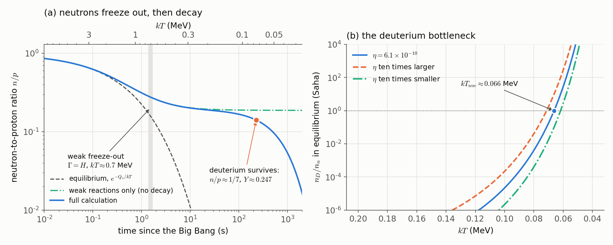

*Figure 29. (a) The neutron-to-proton ratio, computed from the weak reaction rates (in the Born approximation, normalised to the neutron lifetime) through electron–positron annihilation. It follows equilibrium (dashed) down to $kT \approx 2$ MeV, then lags behind it, levels off near 0.19 if neutrons did not decay (green), and falls as free neutrons decay. The dot, at $kT = 0.075$ MeV ($t \approx 230$ s), is where the helium fraction is read off in the note below. (b) The equilibrium ratio of deuterons to free neutrons from the Saha equation, for the measured baryon-to-photon ratio and for values ten times larger and smaller. Deuterium becomes as abundant as free neutrons only at $kT \approx 0.066$ MeV.*

After freeze-out the only thing that changes the number of neutrons is their decay, so the neutron fraction $X_n = n_n/(n_n + n_p)$ falls as $X_n \propto e^{-t/\tau_n}$. The neutrons have about ten minutes to find a partner before half of them are gone. What decides when they do?

---

**Aside: why one MeV?** Work in natural units, $\hbar = c = k = 1$, where Fermi's constant has dimensions of $\mathrm{(energy)^{-2}}$: $G_F = 1.17\times10^{-5}\ \mathrm{GeV^{-2}}$. A rate has dimensions of energy, and the only way to make one from $G_F$ and $T$ is $\Gamma \sim G_F^2T^5$. The expansion rate in the radiation era is $H \sim \sqrt{g_*}\,T^2/M_{\rm Pl}$, where $M_{\rm Pl} = (\hbar c/G)^{1/2} = 1.22\times10^{19}$ GeV. Setting $\Gamma = H$,

$$
kT_f \sim \left(\frac{\sqrt{g_*}}{G_F^2M_{\rm Pl}}\right)^{1/3} \approx 1\ \mathrm{MeV}.
$$

This number is set by the strength of the weak force and of gravity. The neutron–proton mass difference, 1.29 MeV, has nothing to do with either: it comes from the masses of the up and down quarks and from electromagnetism. That the two energies are so close is a coincidence, and an important one. If freeze-out happened at a temperature well above $Q_n$, there would be as many neutrons as protons, and the universe would have come out almost entirely helium. If it happened well below, there would be almost no neutrons and no helium at all.

---

---

**Aside: the neutron lifetime puzzle.** The neutron lifetime matters here twice: it sets the strength of the weak conversion rates, and it sets how fast free neutrons decay. It is measured in two ways. "Bottle" experiments trap ultracold neutrons and count how many survive; the most precise gives $877.82 \pm 0.22\,^{+0.20}_{-0.17}$ s ([Musedinovic et al. 2025](https://doi.org/10.1103/PhysRevC.111.045501); earlier [Gonzalez et al. 2021](https://arxiv.org/abs/2106.10375)). "Beam" experiments count the protons produced as a neutron beam passes through a trap, and give $887.7 \pm 1.2 \pm 1.9$ s ([Yue et al. 2013](https://arxiv.org/abs/1309.2623)). The two disagree by about 4 standard deviations, and nobody knows why: an unknown systematic error, or neutrons decaying into something other than a proton? A beam experiment at J-PARC that counts electrons instead of protons finds $877.2 \pm 1.7\,^{+4.0}_{-3.6}$ s, in line with the bottles but not yet precise enough to settle the question ([Fuwa et al. 2024](https://arxiv.org/abs/2412.19519)). For nucleosynthesis, the calculation behind Figure 29 gives a helium fraction 0.002 higher with the beam lifetime than with the bottle lifetime, comparable to the observational uncertainty.

---

### The deuterium bottleneck

Heavier nuclei have to be built step by step, and the first step is deuterium:

$$
p + n \rightleftharpoons \mathrm{D} + \gamma, \qquad B_{\rm D} = (m_p + m_n - m_{\rm D})c^2 = 2.2246\ \mathrm{MeV}.
$$

Two-body reactions are fast, so this one stays in equilibrium, and the same argument that gave the Saha equation for hydrogen in the chapter on the CMB applies. With $g_{\rm D} = 3$ (the deuteron has spin 1), $g_p = g_n = 2$ and $m_{\rm D} \approx 2m_n$,

$$
\frac{n_{\rm D}}{n_pn_n} = 6\left(\frac{m_nkT}{\pi\hbar^2}\right)^{-3/2}\exp\left(\frac{B_{\rm D}}{kT}\right).
$$

Write the proton density as $n_p = (1 - X_n)\,\eta\,n_\gamma$ with $n_\gamma = 0.2436\,(kT/\hbar c)^3$ and $X_n \approx 0.12$. Then

$$
\frac{n_{\rm D}}{n_n} \approx 7.2\,\eta\left(\frac{kT}{m_nc^2}\right)^{3/2}\exp\left(\frac{B_{\rm D}}{kT}\right).
$$

The binding energy of deuterium corresponds to $B_{\rm D}/k = 2.6\times10^{10}$ K, but with $\eta \approx 6\times10^{-10}$ the prefactor is tiny, and deuterium becomes as abundant as free neutrons only when

$$
kT_{\rm nuc} \approx 0.066\ \mathrm{MeV}, \qquad T_{\rm nuc} \approx 7.7\times10^8\ \mathrm{K}
$$

(Figure 29b). As with recombination, the photons, outnumbering baryons more than a billion to one, keep breaking up deuterons with photons from the far tail of the blackbody spectrum. A deuteron is also fragile, bound far more weakly than any other light nucleus, so it is the bottleneck: nothing heavier can be built until deuterium survives.

Deuterium never actually becomes as common as the neutrons, because as soon as it forms it is burned into heavier nuclei. Full reaction-network calculations find that nucleosynthesis gets going when even a percent or so of the neutrons are in deuterons, at $kT \approx 0.08$ MeV and $t \approx 200$ s ([Pitrou et al. 2018](https://arxiv.org/abs/1801.08023)). By then neutron decay has lowered the ratio to

$$
\frac{n_n}{n_p} \approx \frac17 .
$$

---

**Note: the helium fraction on the back of an envelope.** Suppose every neutron left at that moment ends up in helium-4, which has two neutrons and two protons. With $f = n_n/n_p$, a sample with $n_p$ protons and $fn_p$ neutrons makes $fn_p/2$ helium nuclei, each of mass about $4m_p$, so the helium mass fraction is

$$
Y_p = \frac{4m_p\,(fn_p/2)}{m_p(n_p + fn_p)} = \frac{2f}{1 + f}.
$$

If no neutrons had decayed, $f = \frac15$ would give $Y_p = 0.33$. With $f = \frac17$, $Y_p = 0.25$. The full calculation behind Figure 29a, taken to $t \approx 230$ s, gives $f = 0.141$ and $Y_p = 0.247$. Detailed codes give $Y_p = 0.2467$ to $0.2472$ for the measured baryon density ([Pitrou et al. 2021](https://arxiv.org/abs/2011.11320); [Aver et al. 2026](https://doi.org/10.3847/1538-4357/ae879b)).

---

### From deuterium to helium, and where it stops

Once deuterium survives, a chain of fast two-body reactions follows:

$$
\begin{aligned}
&\mathrm{D} + p \to {}^3\mathrm{He} + \gamma, &\qquad &\mathrm{D} + n \to {}^3\mathrm{H} + \gamma,\\
&\mathrm{D} + \mathrm{D} \to {}^3\mathrm{He} + n, & &\mathrm{D} + \mathrm{D} \to {}^3\mathrm{H} + p,\\
&{}^3\mathrm{H} + \mathrm{D} \to {}^4\mathrm{He} + n, & &{}^3\mathrm{He} + \mathrm{D} \to {}^4\mathrm{He} + p,\\
&{}^3\mathrm{He} + n \to {}^3\mathrm{H} + p, & &{}^3\mathrm{H} + p \to {}^4\mathrm{He} + \gamma .
\end{aligned}
$$

Helium-4 is where the chain ends. Its binding energy, 28.3 MeV or 7.07 MeV per nucleon, is far more than that of deuterium (1.11 MeV per nucleon) or helium-3 (2.57), so it is a deep trap (Figure 30). Within a few minutes essentially all the neutrons are locked inside it.

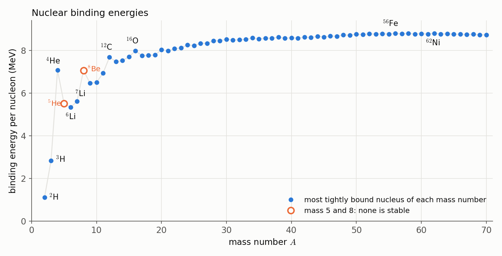

*Figure 30. Binding energy per nucleon of the most tightly bound nucleus of each mass number, from the 2020 Atomic Mass Evaluation ([Wang et al. 2021](https://doi.org/10.1088/1674-1137/abddaf)). Helium-4 stands out among the light nuclei. There is no stable nucleus with 5 or 8 nucleons: helium-5 falls apart at once, and beryllium-8 is less tightly bound than two helium-4 nuclei. Binding peaks near iron and nickel, at 8.79 MeV per nucleon.*

Going further is hard, for two reasons.

- **There is no stable nucleus with mass 5 or 8.** Adding a proton or neutron to helium-4 gives nothing that lasts, and fusing two helium-4 nuclei gives beryllium-8, which is unbound by 92 keV and splits back into two helium nuclei in about $10^{-16}$ s. Stars get past this gap by fusing three helium nuclei into carbon at once, but that needs a density about $10^{10}$ times higher than the early universe had, and a lot longer than a few minutes.
- **The Coulomb barrier rises as the temperature falls.** Reactions between nuclei with more charge need more energetic collisions, and the universe is cooling fast. By about 25 minutes, $kT \approx 0.03$ MeV, nuclear reactions have effectively stopped.

A little lithium-7 does get made, through ${}^4\mathrm{He} + {}^3\mathrm{H} \to {}^7\mathrm{Li} + \gamma$ and ${}^4\mathrm{He} + {}^3\mathrm{He} \to {}^7\mathrm{Be} + \gamma$; the beryllium-7 later captures an electron and becomes lithium-7. Some deuterium and helium-3 are left unburned because their reactions freeze out too. The final mix, by number relative to hydrogen, is about $2.5\times10^{-5}$ deuterium, $10^{-5}$ helium-3 and $5\times10^{-10}$ lithium-7, alongside a helium-4 mass fraction of 0.247.

---

### Weighing the baryons

The yields depend on the baryon-to-photon ratio $\eta$, the one free parameter of the standard calculation (Figure 31).

- **Deuterium** is the most sensitive. With more baryons, nucleosynthesis starts earlier and the burning of deuterium into helium is more complete, so less is left: $\mathrm{D/H} \propto \eta^{-1.6}$ near the measured value.
- **Helium-4** depends only weakly on $\eta$. More baryons make the bottleneck open a little earlier, so fewer neutrons have decayed, but the gain is logarithmic: $Y_p$ rises by only 0.0016 for a 17% increase in $\eta$.
- **Lithium-7** comes mostly from beryllium-7 at the measured $\eta$, and rises roughly as $\eta^2$.

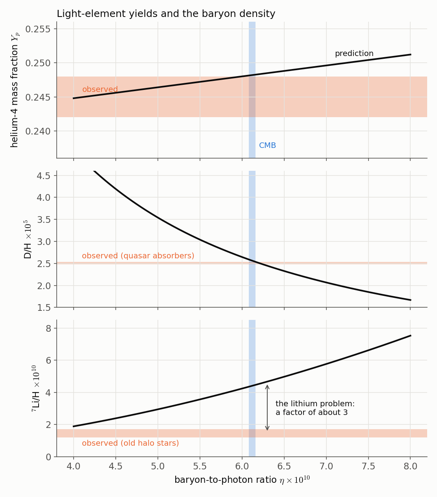

*Figure 31. Predicted light-element abundances against the baryon-to-photon ratio (black, from the fitting formulas of [Kneller & Steigman 2004](https://arxiv.org/abs/astro-ph/0406320); current calculations give helium within 0.5%, deuterium 2 to 5% lower and lithium 7 to 25% higher). The orange bands show the observed primordial abundances and the blue band the value of $\eta$ from the CMB. Helium and deuterium agree with the CMB; lithium does not.*

**Deuterium.** Deuterium is destroyed in stars and not made anywhere else, so we must measure it in gas that has seen almost no stars. The best such gas lies in clouds of hydrogen far away, seen as absorption lines in the spectra of background quasars. The deuterium lines sit next to the much stronger hydrogen lines; the nucleus's extra mass shifts them by $\Delta\lambda/\lambda \approx m_e/2m_p$, equivalent to 82 km/s. The seven most precise systems give $\mathrm{D/H} = (2.527 \pm 0.030)\times10^{-5}$ ([Cooke, Pettini & Steidel 2018](https://arxiv.org/abs/1710.11129)), and the Particle Data Group's mean of twelve is $(2.508 \pm 0.029)\times10^{-5}$. Compared with the predictions, this gives

$$
\eta = (6.04 \pm 0.12)\times10^{-10}
$$

([Particle Data Group 2026](https://pdg.lbl.gov/2026/reviews/rpp2026-rev-bbang-nucleosynthesis.pdf)). The CMB peak heights give $\Omega_bh^2 = 0.02237 \pm 0.00015$, i.e. $\eta = (6.12 \pm 0.04)\times10^{-10}$ ([Particle Data Group 2026](https://pdg.lbl.gov/2026/reviews/rpp2026-rev-bbang-nucleosynthesis.pdf); see the chapter on the CMB). Two measurements, one from nuclear physics in the first minutes and one from sound waves at 370,000 years, using entirely different physics, agree to about 1%. The remaining uncertainty is in the nuclear reaction rates; the rate of $\mathrm{D} + p \to {}^3\mathrm{He} + \gamma$ was measured to a few percent at the relevant energies only in 2020, deep underground in the LUNA experiment ([Mossa et al. 2020](https://doi.org/10.1038/s41586-020-2878-4)), and predictions still differ by a few percent, from $2.44$ ([Pitrou et al. 2021](https://arxiv.org/abs/2011.11320)) to $2.51\times10^{-5}$ ([Pisanti et al. 2021](https://arxiv.org/abs/2011.11537)), depending mainly on the D + D rates.

**Helium-4.** Helium is measured from the emission lines of ionised gas in small, metal-poor galaxies. Stars have added helium along with metals, so astronomers plot the helium fraction against the abundance of oxygen and extrapolate to zero. The recommended value is $Y_p = 0.245 \pm 0.003$ ([Particle Data Group 2026](https://pdg.lbl.gov/2026/reviews/rpp2026-rev-bbang-nucleosynthesis.pdf)), and the newest measurement gives $0.2458 \pm 0.0013$ ([Aver et al. 2026](https://doi.org/10.3847/1538-4357/ae879b)), against a prediction of 0.247. A survey of extremely metal-poor galaxies finds a lower value, $0.2402 \pm 0.0040$ ([Yanagisawa et al. 2026](https://doi.org/10.3847/1538-4357/ae64fc)); whether that difference is real is still being argued about.

**Helium-3.** Helium-3 is both made and destroyed in stars, so its primordial value is hard to pin down. Measurements in our galaxy ([Bania, Rood & Balser 2002](https://doi.org/10.1038/415054a)) and the first measurement of the helium isotope ratio outside the Local Interstellar Cloud, in the Orion nebula ([Cooke et al. 2022](https://arxiv.org/abs/2203.11256)), now lead to a primordial ratio ${}^3\mathrm{He}/{}^4\mathrm{He} = 1.15^{+0.24}_{-0.21}\times10^{-4}$, consistent with the prediction ([Cooke et al. 2026](https://doi.org/10.3847/1538-4357/ae66f8)).

**Lithium-7: the problem.** The oldest, most metal-poor stars in the halo of our galaxy all have the same lithium abundance, the "Spite plateau" ([Spite & Spite 1982](https://ui.adsabs.harvard.edu/abs/1982A%26A...115..357S)), at $\mathrm{Li/H} = (1.45 \pm 0.25)\times10^{-10}$ ([Particle Data Group 2026](https://pdg.lbl.gov/2026/reviews/rpp2026-rev-bbang-nucleosynthesis.pdf); see also [Sbordone et al. 2010](https://arxiv.org/abs/1003.4510)). Predictions for the CMB baryon density range from $4.7$ to $5.5\times10^{-10}$, three to four times higher; for $(4.72 \pm 0.7)\times10^{-10}$ the discrepancy is 4.4 standard deviations ([Fields 2011](https://arxiv.org/abs/1203.3551) reviews the problem). Experiments have closed off the possible nuclear-physics fixes. The leading explanation is that the stars themselves have slowly destroyed lithium in their outer layers over 13 billion years, but this is not proven, and some physicists still see a hint of new physics.

> **In short.** The baryon-to-photon ratio is the only number the standard calculation needs. Deuterium measures it to 2%, the CMB to under 1%, and they agree. With that one number, helium and helium-3 come out right as well. Only lithium refuses to fit.

---

### Counting neutrinos

Helium is a poor baryometer, but it is an excellent measure of the expansion rate during the first few seconds. Any extra relativistic particles would add to $g_*$, speed up the expansion, and make freeze-out happen earlier, at a higher temperature, with more neutrons. Repeating the calculation behind Figure 29 with a fourth neutrino flavour, $g_* = 10.75 + \tfrac74$, raises $Y_p$ by $0.013$, in agreement with the full codes:

$$
\Delta Y_p \approx 0.013\,\Delta N_{\rm eff}.
$$

[Steigman, Schramm & Gunn (1977)](https://doi.org/10.1016/0370-2693%2877%2990176-9) used this to argue that there can be only a few families of light neutrinos, a decade before particle colliders could check. From 1989 to 1995 the LEP collider at CERN measured the decay rate of the Z boson into invisible particles and found $N_\nu = 2.984 \pm 0.008$ ([ALEPH et al. 2006](https://arxiv.org/abs/hep-ex/0509008)), revised to $2.9963 \pm 0.0074$ after a correction to the luminosity calibration ([Janot & Jadach 2020](https://arxiv.org/abs/1912.02067)). Today helium and deuterium together give $N_{\rm eff} = 2.90 \pm 0.14$ ([Particle Data Group 2026](https://pdg.lbl.gov/2026/reviews/rpp2026-rev-bbang-nucleosynthesis.pdf)). The CMB combined with baryon acoustic oscillations, which measures the same quantity 370,000 years later through its effect on the expansion, gives $2.99 \pm 0.17$ (the chapter on model universes). Both agree with the Standard Model's 3.044, and between them they leave little room for any undiscovered "dark radiation".

---

### Where did the baryons come from?

Run the clock further back. Above $kT \approx 156$ MeV ([Bazavov et al. 2019](https://arxiv.org/abs/1812.08235)), protons and neutrons dissolve into a plasma of free quarks and gluons. This **quark–gluon plasma** has been recreated in collisions of heavy nuclei at Brookhaven and at CERN. In it, quarks and antiquarks were about as numerous as photons. As the universe cooled, they annihilated, and what survived to make every atom today was a tiny excess of quarks over antiquarks, a few parts per billion. That excess is the reason $\eta$ is $6\times10^{-10}$ rather than zero: in a perfectly symmetric universe matter and antimatter would have annihilated almost completely.

Andrei Sakharov listed in 1967 what any process that creates such an excess needs ([Sakharov 1967, English reprint 1991](https://doi.org/10.1070/PU1991v034n05ABEH002497)):

- **Baryon number must not be conserved**, or the excess could never change from zero.
- **C and CP symmetry must be violated**, or every process making baryons would have a mirror process making antibaryons at the same rate.
- **There must be a departure from thermal equilibrium**, or the reverse reactions would undo whatever the forward ones did.

The Standard Model has all three ingredients in principle, but not in the right amounts: its CP violation is far too small, and for a Higgs boson of 125 GeV the electroweak transition is a smooth crossover, not the violent departure from equilibrium that would be needed. So the baryon asymmetry is evidence of physics beyond the Standard Model ([Canetti, Drewes & Shaposhnikov 2012](https://arxiv.org/abs/1204.4186)).

---

**Aside: why equilibrium erases an asymmetry.** In thermal equilibrium at temperature $T$, with baryon number not conserved, the state of the universe is the density operator $\rho = e^{-H/kT}/Z$. There is no chemical potential for baryon number, because nothing conserves it. The CPT theorem, which follows from Lorentz invariance and locality in any quantum field theory, says that there is an antiunitary operator $\Theta$ with $\Theta H\Theta^{-1} = H$, while baryon number changes sign, $\Theta B\Theta^{-1} = -B$. Since $\mathrm{Tr}(\Theta X\Theta^{-1}) = \overline{\mathrm{Tr}\,X}$ for an antiunitary $\Theta$, and $\mathrm{Tr}(\rho B)$ is real,

$$
\langle B\rangle = \mathrm{Tr}(\rho B) = \mathrm{Tr}\left(\Theta\rho\Theta^{-1}\,\Theta B\Theta^{-1}\right) = -\mathrm{Tr}(\rho B) = 0 .
$$

However much C and CP are violated, equilibrium has zero net baryon number. That is Sakharov's third condition, and it is why the asymmetry must have been made while something in the universe was out of equilibrium.

---

---

**Note: how far back can we test?** In its third run, from 2022 to 2026, the LHC collided protons at a total energy of 13.6 TeV. The quarks and gluons inside share that energy, so the collisions probe energies of a few TeV. In the early universe, with all the Standard Model particles relativistic ($g_* = 106.75$), $kT = 1$ TeV was reached at $t \approx 0.74\ \mathrm{s}\times(10.75/106.75)^{1/2}\times(10^{-6})^2 \approx 2\times10^{-13}$ s. Nucleosynthesis tests the universe directly at one second; colliders test the laws of physics that governed it back to about $10^{-13}$ s. Anything earlier, including inflation, is extrapolation that has to be tested indirectly.

---

### Summary

| Quantity | Value |
| --- | --- |
| Time and temperature ($kT \gtrsim 1$ MeV, $g_* = 10.75$) | $kT \approx 0.86\ \mathrm{MeV}\,(t/1\ \mathrm{s})^{-1/2}$, $T \approx 10^{10}\ \mathrm{K}\,(t/1\ \mathrm{s})^{-1/2}$ |
| Neutron–proton mass difference, neutron lifetime | $Q_n = 1.293$ MeV, $\tau_n = 878.3$ s |
| Weak freeze-out | $kT_f \approx 0.7$ MeV, $t \approx 1.5$ s, $n/p \approx 1/5$ |
| Start of nucleosynthesis | $kT \approx 0.08$ MeV, $t \approx 200$ s, $n/p \approx 1/7$ |
| Helium-4 mass fraction | predicted 0.247, observed $0.245 \pm 0.003$ |
| Deuterium | $\mathrm{D/H} = (2.51 \pm 0.03)\times10^{-5}$, so $\eta = (6.04 \pm 0.12)\times10^{-10}$ |
| Lithium-7 | predicted $\approx 5\times10^{-10}$, observed $(1.45 \pm 0.25)\times10^{-10}$ |
| Effective number of neutrinos | $N_{\rm eff} = 2.90 \pm 0.14$ (nucleosynthesis), $3.044$ (Standard Model) |

**The ideas to carry away.**

- In the radiation era $t \propto T^{-2}$, with $kT \approx 1$ MeV at one second. Weak interactions freeze out at about that temperature, and that sets the neutron-to-proton ratio.
- Neutrons survive only by being locked into nuclei, which has to wait for the deuterium bottleneck to open at $kT \approx 0.08$ MeV. Then nearly all of them end up in helium-4, giving $Y_p \approx 2f/(1 + f) \approx 0.25$.
- Nucleosynthesis stops at lithium because there are no stable nuclei of mass 5 or 8 and the universe cools too fast.
- Deuterium measures the baryon density; it agrees with the CMB to about 1%. Helium counts the relativistic species and finds three neutrinos. Lithium is predicted three times higher than observed.
- The baryons exist because of a tiny matter–antimatter asymmetry, which needs baryon-number violation, C and CP violation and a departure from equilibrium, and physics beyond the Standard Model.

---

## Inflation and the Very Early Universe

The hot Big Bang works. Run backwards from today, it explains the expansion, the CMB and the light elements, and we have tested it directly back to about one second. But it works only if the universe started in a very special state: astonishingly flat, astonishingly uniform, and seeded with tiny fluctuations of one particular kind. The hot Big Bang does not explain any of these. It takes them as initial conditions.

**Inflation** is a proposal about where those conditions came from: a brief period, long before nucleosynthesis, when the expansion accelerated. It was introduced in 1980–81 to solve three puzzles, and it turned out to do something its inventors had not set out to do. It explains where the fluctuations that grew into galaxies came from. Read this chapter in a different register from the earlier ones. Nobody has observed the inflationary epoch the way we observe the CMB. We infer it from the properties of the universe it left behind, and several of its predictions have since been confirmed. The most distinctive one, a background of primordial gravitational waves, has not yet been seen.

Three pictures to carry away:

1. **Flatness and uniformity are unstable.** In a decelerating universe any departure from flatness grows, and regions we see in opposite directions have never been in causal contact. A universe as flat and uniform as ours needs either fantastically fine-tuned initial conditions or a mechanism.
2. **A shrinking Hubble sphere.** During inflation the comoving Hubble radius shrinks. Regions that were in contact are pushed out of contact, then come back into view billions of years later, already matched.
3. **Quantum fluctuations stretched to the size of galaxies.** Inflation magnifies the unavoidable quantum jitter of the field that drives it into density fluctuations on astronomical scales. They come out nearly the same on all scales, with a slight tilt, just as the CMB shows.

---

### Three puzzles of the hot Big Bang

#### The flatness problem

The Friedmann equation links the density parameter to the curvature:

$$
1 - \Omega(t) = -\frac{\kappa c^2}{R_0^2\,a(t)^2H(t)^2} = \frac{H_0^2\,(1 - \Omega_0)}{a(t)^2H(t)^2}.
$$

As the chapter on model universes showed, the deviation from flatness is set by $(aH)^{-2}$, the inverse square of the expansion rate in comoving terms. In a decelerating universe $\dot a = aH$ decreases, so $|1 - \Omega|$ grows. In the radiation era $aH \propto a^{-1}$, so $|1 - \Omega| \propto a^2 \propto t$; in the matter era $|1 - \Omega| \propto a \propto t^{2/3}$. Flatness is an unstable equilibrium, like a pencil balanced on its point.

Today the CMB and baryon acoustic oscillations give $\Omega_{k,0} = 0.001 \pm 0.002$ (the chapter on model universes), so $|1 - \Omega_0| \lesssim 0.005$. Running this back (Figure 32):

| Epoch | Scale factor | $\lvert 1 - \Omega\rvert$ at most |
| --- | --- | --- |
| Radiation–matter equality | $2.9\times10^{-4}$ | $2\times10^{-6}$ |
| Nucleosynthesis | $3.5\times10^{-9}$ | $7\times10^{-16}$ |
| Planck time, $5\times10^{-44}$ s | $\sim 4\times10^{-32}$ | $\sim 10^{-61}$ |

Had $|1 - \Omega|$ been $10^{-6}$ at nucleosynthesis instead of $10^{-15}$, it would have grown to order one within about six years: the universe would have collapsed or thinned out into near-emptiness long before any star formed. Nothing in the hot Big Bang explains why the density was tuned to the critical value to sixty decimal places at the Planck time. Whether this counts as fine-tuning depends on how you put a probability on initial conditions. Using the natural measure on the space of Robertson–Walker solutions (Liouville's theorem applied to cosmology), [Carroll & Tam (2010)](https://arxiv.org/abs/1007.1417) argue that almost all such universes are flat, so the flatness problem may not be a problem at all; the horizon problem, they find, is real. Still, a physical mechanism that makes the universe flat would be more satisfying than an unexplained coincidence.

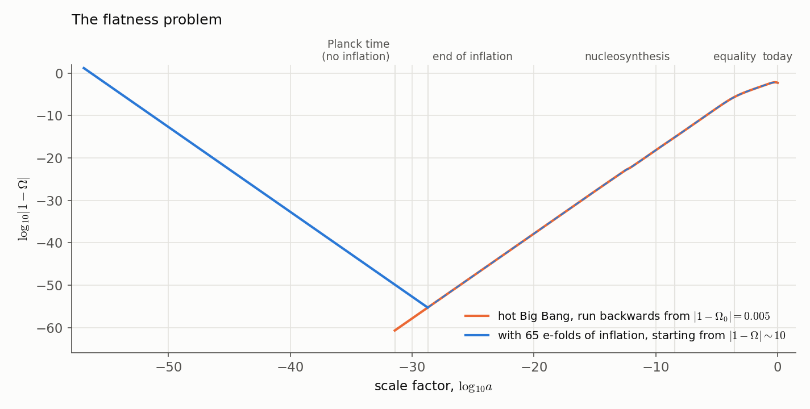

*Figure 32. The deviation from flatness, $\lvert 1 - \Omega\rvert$, against scale factor. Orange: the hot Big Bang, run backwards from today's limit; the deviation shrinks to $10^{-61}$ at the Planck time. Blue: a universe that starts strongly curved and then inflates by 65 e-folds (a factor $e^{65}$ in $a$) at an energy of $10^{16}$ GeV. Inflation drives the deviation down; afterwards it grows again as before. The Planck-time marker applies to the orange history only; with inflation the Planck epoch lies to the left of the blue curve.*

#### The horizon problem

The CMB has the same temperature in every direction to one part in $10^5$. In the hot Big Bang that is very hard to understand. The proper horizon distance at last scattering was only 0.26 Mpc, which subtends $1.2^\circ$ on the sky (the chapter on the CMB). The comoving distance to the last-scattering surface is 13,860 Mpc, while the comoving horizon at last scattering was only 280 Mpc: points on opposite sides of the sky are $2\times13{,}860$ Mpc apart and had never exchanged a signal. The sky divides into some 30,000 patches that were causally disconnected from each other when the CMB was released, and yet they all have the same temperature. They must have been brought to it by something.

It is not only the average temperature. The fluctuations are correlated over scales larger than the horizon at last scattering. Sound waves can't produce such correlations, because they travel no faster than light. The clearest signature is in the correlation between temperature and polarisation. Polarisation is generated only at last scattering, so a causal process acting after the Big Bang cannot correlate it with temperature on angles larger than about $2^\circ$ ([Spergel & Zaldarriaga 1997](https://arxiv.org/abs/astro-ph/9705182)). The WMAP satellite found exactly such a large-angle anticorrelation, "the signature of adiabatic superhorizon fluctuations at the time of decoupling" ([Peiris et al. 2003](https://arxiv.org/abs/astro-ph/0302225)). Something set up correlations before the hot Big Bang as we have described it began.

#### The monopole problem

The third puzzle comes from particle physics. The electromagnetic and weak forces are two faces of one electroweak force above about 100 GeV. **Grand unified theories** (GUTs) propose that, at an energy of roughly $10^{16}$ GeV, the strong force joins them too, so that a single gauge group $G$ breaks down to the Standard Model's $SU(3)\times SU(2)\times U(1)$ as the universe cools. In such a symmetry-breaking transition the field that does the breaking (a Higgs field) chooses a direction in its space of possible vacua, independently in regions that are not in causal contact. Where neighbouring regions chose differently, the field gets knotted, and the knots cannot be undone. These are **topological defects** ([Kibble 1976](https://doi.org/10.1088/0305-4470/9/8/029)).

Every grand unified theory predicts point-like defects that carry magnetic charge: **magnetic monopoles** (['t Hooft 1974](https://doi.org/10.1016/0550-3213%2874%2990486-6); [Polyakov 1974](https://ui.adsabs.harvard.edu/abs/1974JETPL..20..194P)). Their mass is about the unification energy divided by the coupling constant, around $10^{17}$ GeV: about 0.2 micrograms, in a single elementary particle. The field can't be correlated over more than a horizon, so at least one monopole forms per horizon volume. At $kT = 10^{16}$ GeV the universe was $2\times10^{-39}$ s old and the horizon distance $2ct$ was $1.4\times10^{-30}$ m, which gives $n_M \sim 4\times10^{89}\ \mathrm{m^{-3}}$, about one monopole per hundred thousand photons. Carried forward to today, that is about 200 monopoles per cubic metre, a density parameter of order $10^{18}$. Monopoles and antimonopoles annihilate too slowly to change this much ([Preskill 1979](https://doi.org/10.1103/PhysRevLett.43.1365)). A universe like that would have recollapsed almost at once.

Observations find none. The MACRO experiment, deep under the Gran Sasso mountain in Italy, found none and set a limit on their flux of $1.4\times10^{-16}\ \mathrm{cm^{-2}\,s^{-1}\,sr^{-1}}$ ([MACRO Collaboration 2002](https://arxiv.org/abs/hep-ex/0207020)). For monopoles moving at typical galactic speeds, $10^{-3}c$, that means fewer than $10^{-16}$ per cubic metre in our neighbourhood, at least eighteen orders of magnitude below the prediction.

The monopole problem is only as solid as grand unification. No GUT has been confirmed, and the proton decay that most of them predict has not been seen: Super-Kamiokande finds a lifetime above $2.4\times10^{34}$ years for the decay $p \to e^+\pi^0$ ([Super-Kamiokande Collaboration 2020](https://arxiv.org/abs/2010.16098)), which rules out the simplest GUT. But the flatness and horizon problems do not depend on particle physics at all.

---

**Aside: the topology of defects.** Suppose a gauge group $G$ is broken to a subgroup $H$. The possible vacua form the coset space $\mathcal M = G/H$. Far from a defect the field lies in $\mathcal M$, so a defect is classified by how the field wraps around it: by the homotopy groups of $\mathcal M$. A wall in space separates disconnected pieces of $\mathcal M$ ($\pi_0(\mathcal M) \neq 0$: **domain walls**). A loop around a line can be non-contractible ($\pi_1(\mathcal M) \neq 0$: **cosmic strings**). A sphere around a point can wrap $\mathcal M$ non-trivially ($\pi_2(\mathcal M) \neq 0$: **monopoles**).

The simplest example is $G = SU(2)$ broken to $H = U(1)$ by a Higgs triplet, the Georgi–Glashow model. Then $\mathcal M = SU(2)/U(1) \cong S^2$, the field's direction on a large sphere around a point is a map $S^2 \to S^2$, and its degree, an integer, is the magnetic charge. This is the 't Hooft–Polyakov monopole.

For a grand unified theory, the long exact homotopy sequence of the fibration $H \to G \to G/H$ contains

$$
\pi_2(G) \to \pi_2(G/H) \to \pi_1(H) \to \pi_1(G).
$$

For any compact Lie group $\pi_2(G) = 0$, and a simple GUT group such as $SU(5)$ is simply connected, $\pi_1(G) = 0$. So $\pi_2(G/H) \cong \pi_1(H)$. The unbroken group has a $U(1)$ factor (hypercharge, which later contains electromagnetism's $U(1)$): it is $(SU(3)\times SU(2)\times U(1))/\mathbb Z_6$, and a loop once around the $U(1)$ factor cannot be shrunk, so $\pi_1(H) \cong \mathbb Z$. (A $U(1)$ that merely sits inside a simple group would not do: $\pi_1(SU(2)) = 0$.) Monopoles are therefore unavoidable in any such theory, whatever its details. The same integer appears as Dirac's quantisation of magnetic charge, which is a statement about $\pi_1(U(1)) = \mathbb Z$.

---

### Inflation

**Definition.** Inflation is an epoch in which the expansion accelerates, $\ddot a > 0$. Since $\dot a = aH$, this is the same as saying that the **comoving Hubble radius** $c/(aH)$ shrinks:

$$
\frac{d}{dt}\left(\frac{c}{aH}\right) = \frac{d}{dt}\left(\frac{c}{\dot a}\right) = -\frac{c\,\ddot a}{\dot a^2} < 0 .
$$

From the acceleration equation, $\ddot a/a = -(4\pi G/3c^2)(\varepsilon + 3P)$, it needs a component with $P < -\varepsilon/3$. The simplest is something that acts like a large, temporary cosmological constant. Then $H = H_i$ is constant and the expansion is exponential,

$$
a(t) \propto e^{H_it},
$$

a stretch of de Sitter space (the aside on de Sitter space in the chapter on model universes). If inflation lasts from $t_i$ to $t_f$, the scale factor grows by $e^N$, where

$$
N = \ln\frac{a(t_f)}{a(t_i)} = H_i(t_f - t_i)
$$

is the number of **e-folds**.

**Flatness, solved.** The curvature term goes as $(aH)^{-2}$, and during inflation $aH \propto e^{H_it}$ grows. So

$$
|1 - \Omega(t_f)| = e^{-2N}\,|1 - \Omega(t_i)| .
$$

A universe that starts strongly curved, $|1 - \Omega| \sim 1$, comes out of 65 e-folds flat to one part in $10^{56}$ (Figure 32). Think of blowing up a balloon by a factor $e^{65} \approx 10^{28}$: any patch you can see on it looks flat.

**Horizons, solved.** The comoving Hubble radius marks which regions can affect each other within one expansion time. During inflation it shrinks by a factor $e^N$; afterwards it grows again (Figure 33a). A region the size of today's Hubble radius can therefore have been well inside the Hubble radius early in inflation, had time to come to equilibrium, been pushed outside it as inflation went on, and re-entered at $z \approx 2$; now that the expansion is accelerating it is leaving again. The whole observable universe is about three times larger still and lies outside today's Hubble radius; about one more e-fold of inflation brings it into causal contact too, as the numbers below show. The uniformity of the CMB is the leftover of contact before inflation.

The conformal diagram in Figure 33b shows the same thing. With conformal time $d\tau = dt/a$ (called $\eta$ in the chapter on Newton versus Einstein; here $\eta$ is already taken), light rays travel at $45^\circ$. In the hot Big Bang, conformal time starts at $\tau = 0$, only 280 Mpc before last scattering, so the past light cones of two opposite points on the last-scattering surface never meet. Inflation adds a long stretch of conformal time before that, $c\,\Delta\tau \approx c/(a_iH_i)$, enough for the light cones to overlap. One consequence for the rest of these notes: the "horizon distances" computed in earlier chapters measure the distance light has travelled since the end of inflation, not since $t = 0$.

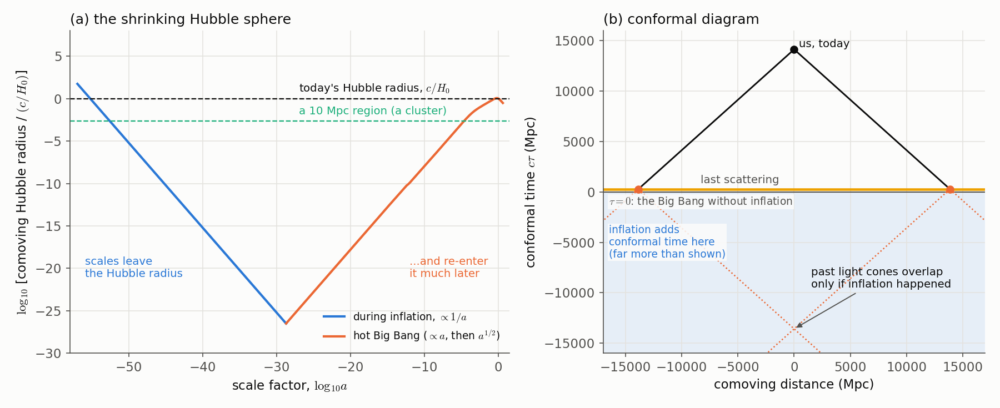

*Figure 33. (a) The comoving Hubble radius against scale factor, for 65 e-folds of inflation at $10^{16}$ GeV followed by the hot Big Bang. A region the size of today's Hubble radius (black dashed line) was inside the Hubble radius at the start of inflation, left it, re-entered at $z \approx 2$, and is now leaving again as the expansion accelerates; a 10 Mpc region (green) re-entered long ago. (b) A conformal diagram. Light travels at $45^\circ$. The past light cones of opposite points on the last-scattering surface (orange) do not meet before $\tau = 0$; with inflation, conformal time extends far below zero and they do.*

**Monopoles, solved.** If the monopoles form before or early in inflation, their number density falls by $e^{-3N}$, a factor of $10^{-85}$ for 65 e-folds. That leaves far less than one in the observable universe, provided the universe is not reheated above the GUT temperature after inflation.

**How much inflation?** For the whole observable universe to have been in causal contact, today's comoving Hubble radius must have been inside the Hubble radius at the start of inflation: $a_iH_i < a_0H_0$. That needs

$$
N > \ln\frac{a_fH_f}{a_0H_0} .
$$

For inflation at an energy density $V = (10^{16}\ \mathrm{GeV})^4$, close to the upper limit that the CMB allows (see below), and with the energy immediately turned into radiation afterwards, $a_f \approx 2\times10^{-29}$ and $H_f \approx 4\times10^{37}\ \mathrm{s^{-1}}$. This gives $N > 61$; fitting the whole sphere of last scattering inside takes 62. The flatness problem gives the same condition, because both depend on how much $aH$ grew. If the energy scale is lower, or the universe takes time to reheat, fewer e-folds are needed, so the usual statement is that inflation must have lasted **at least 50 to 65 e-folds**. Nothing forbids more.

---

**Note: the observable universe after inflation.** With the numbers above, inflation lasts only about $60/H \approx 2\times10^{-36}$ s. Today's observable universe, about 14,000 Mpc in radius (the particle horizon of the chapter on model universes), had a radius of $14{,}000\ \mathrm{Mpc}\times a_f \approx 8$ mm at the end of inflation: the size of a marble. Sixty-five e-folds earlier its radius was $5\times10^{-31}$ m, smaller than the Hubble radius at that time, $c/H \approx 8\times10^{-30}$ m. Everything we will ever see came from a region that could have equilibrated before inflation began.

---

### The physics of inflation

What could make $P < -\varepsilon/3$ for a while and then stop? The standard answer is a **scalar field** $\phi$, the **inflaton**, whose potential energy $V(\phi)$ dominates the universe. The Higgs field is the only fundamental scalar we know, and it is possible (though not established) that it is the inflaton ([Bezrukov & Shaposhnikov 2008](https://arxiv.org/abs/0710.3755)); in most models the inflaton is a new field.

In this section we use natural units, $\hbar = c = k = 1$, as particle physicists do. Energies and temperatures are in GeV, an energy density of $1\ \mathrm{GeV}^4$ is $1.3\times10^{50}\ \mathrm{MeV\,m^{-3}}$, and gravity enters through the **reduced Planck mass** $M_{\rm P} = (8\pi G)^{-1/2} = 2.435\times10^{18}$ GeV.

**Energy density, pressure and motion.** A homogeneous scalar field $\phi(t)$ has

$$
\varepsilon_\phi = \tfrac12\dot\phi^2 + V(\phi), \qquad P_\phi = \tfrac12\dot\phi^2 - V(\phi),
$$

kinetic energy plus or minus potential energy (the aside below derives these). If the field changes slowly, $\dot\phi^2 \ll V$, then $P_\phi \approx -\varepsilon_\phi \approx -V$: the field behaves like a cosmological constant. The field obeys

$$
\ddot\phi + 3H\dot\phi = -\frac{dV}{d\phi}, \qquad H^2 = \frac{\tfrac12\dot\phi^2 + V}{3M_{\rm P}^2} .
$$

This is a ball rolling down the potential $V$, with an extra friction term $3H\dot\phi$, **Hubble friction**, that comes from the expansion diluting the field's kinetic energy. If the potential is flat enough, the friction wins and the ball reaches a terminal velocity, $3H\dot\phi \approx -dV/d\phi$, like a skydiver. This is **slow roll**. It holds as long as the two **slow-roll parameters**

$$
\epsilon_V = \frac{M_{\rm P}^2}{2}\left(\frac{V'}{V}\right)^2, \qquad \eta_V = M_{\rm P}^2\,\frac{V''}{V}
$$

are both small. The potential must be flat compared with its height on the scale of the Planck mass. The number of e-folds produced while the field rolls from $\phi_*$ to $\phi_{\rm end}$ is

$$
N = \int H\,dt \approx \frac{1}{M_{\rm P}^2}\int_{\phi_{\rm end}}^{\phi_*}\frac{V}{V'}\,d\phi .
$$

Inflation ends when the potential steepens and $\epsilon$ reaches 1. Figure 34 shows a numerical solution for a plateau potential of the kind that fits the data well.

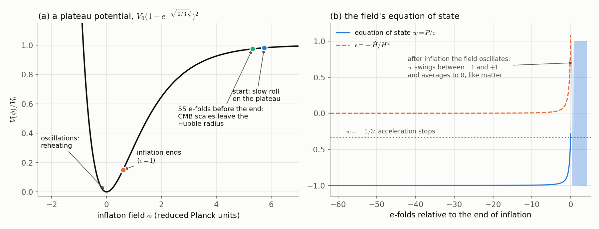

*Figure 34. (a) A plateau potential, $V = V_0(1 - e^{-\sqrt{2/3}\,\phi/M_{\rm P}})^2$, the form that arises in Starobinsky's $R^2$ model and in Higgs inflation. The field starts high on the plateau and rolls slowly; the scales we see in the CMB left the Hubble radius about 55 e-folds before the end. Inflation ends where the slope steepens, and the field then oscillates about the minimum. (b) The numerical solution: $w$ stays at $-1$ for tens of e-folds, rises to $-1/3$ as inflation ends, and then oscillates between $-1$ and $+1$.*

---

**Aside: the inflaton from an action.** You know how to get a field equation from an action. For a scalar field in curved spacetime (signature $-+++$, $\hbar = c = 1$),

$$
S = \int d^4x\,\sqrt{-g}\left[-\tfrac12 g^{\mu\nu}\partial_\mu\phi\,\partial_\nu\phi - V(\phi)\right].
$$

In a flat Robertson–Walker metric $\sqrt{-g} = a^3$, and for $\phi = \phi(t)$ the Lagrangian per unit comoving volume is $L = a^3\left(\tfrac12\dot\phi^2 - V\right)$. The Euler–Lagrange equation is $\frac{d}{dt}(a^3\dot\phi) + a^3V' = 0$, which is $\ddot\phi + 3H\dot\phi + V' = 0$. The friction term is just the $a^3$ in the volume element. Varying the action with respect to the metric gives the stress–energy tensor $T_{\mu\nu} = \partial_\mu\phi\,\partial_\nu\phi - g_{\mu\nu}\left[\tfrac12(\partial\phi)^2 + V\right]$. Its time–time component is $\varepsilon = \tfrac12\dot\phi^2 + V$ and its space–space components give $P = \tfrac12\dot\phi^2 - V$. The fluid equation $\dot\varepsilon + 3H(\varepsilon + P) = 0$ then reproduces the field equation, as it must. A potential energy that is the same everywhere has $T_{\mu\nu} = -Vg_{\mu\nu}$, exactly the form of a cosmological constant, for the reason given in the chapter on cosmic dynamics: it is the only stress tensor that looks the same to every inertial observer.

---

**Reheating.** When the field reaches the bottom of the potential it oscillates (Figure 34b). An oscillating field has $w$ swinging between $-1$ and $+1$, averaging to zero, so it behaves like matter. Its couplings to other fields drain its energy into particles, which collide and come to thermal equilibrium: the universe is **reheated**. The energy that was stored in the potential, like the latent heat released when water freezes, becomes the radiation of the hot Big Bang.

Inflation does not merely precede the hot Big Bang; it empties the universe. During $N$ e-folds any pre-existing radiation cools by a factor $e^{-N}$, from $10^{16}$ GeV to a few kelvin after 65 e-folds, and any particles are diluted by $e^{-3N}$. All the matter and radiation we see were made in reheating. For inflation at $V = (10^{16}\ \mathrm{GeV})^4$ with immediate reheating, the temperature afterwards is $kT \approx 4\times10^{15}$ GeV. It may be much lower if reheating is slow, but it must exceed the MeV temperatures of nucleosynthesis.

---

**Note: two cosmological constants.** The energy density during inflation at $V^{1/4} = 10^{16}$ GeV is $V \approx 10^{64}\ \mathrm{GeV^4} \approx 10^{114}\ \mathrm{MeV\,m^{-3}}$. The dark energy today is $\varepsilon_{\Lambda,0} \approx 3300\ \mathrm{MeV\,m^{-3}}$, smaller by a factor of $4\times10^{110}$. The universe has had at least one period of accelerated expansion before and is in another now, driven by vacuum-like energies that differ by 110 orders of magnitude. We understand neither value.

---

### Quantum fluctuations: the seeds of structure

Inflation smooths away everything: any classical inhomogeneity present at the start is stretched by $e^{65}$ and diluted to nothing. If that were the whole story, inflation would be too successful, leaving a universe with no seeds from which galaxies could grow. What saves it is quantum mechanics.

**The fluctuations.** The inflaton field cannot be perfectly uniform: each of its Fourier modes is a quantum harmonic oscillator with an irreducible zero-point jitter. While a mode's wavelength is inside the Hubble radius, $k/a \gg H$, it oscillates like a mode in flat spacetime. Inflation stretches its wavelength until it exceeds the Hubble radius, $k = aH$. From then on the mode can no longer oscillate, because the expansion pulls it apart faster than it can respond: its amplitude freezes. Solving the mode equation in de Sitter space (the aside below) gives a frozen amplitude, per logarithmic interval in wavenumber, of

$$
\delta\phi = \frac{H}{2\pi},
$$

the same for every mode, because each one freezes when it crosses the same Hubble radius.

**From field to density.** A fluctuation $\delta\phi$ means that in one region the field is slightly ahead of or behind its neighbours on its way down the potential, so inflation ends there earlier or later by $\delta t = \delta\phi/\dot\phi$. That region has expanded by a different amount, a fractional difference $H\,\delta t$ in its scale factor. This is the **curvature perturbation** $\mathcal R = H\,\delta\phi/\dot\phi$, and it stays constant while the scale is outside the Hubble radius. Its power per logarithmic interval of $k$ is

$$
\Delta_{\mathcal R}^2 = \left(\frac{H}{\dot\phi}\,\frac{H}{2\pi}\right)^2 = \frac{H^2}{8\pi^2\epsilon\,M_{\rm P}^2},
$$

evaluated when each scale left the Hubble radius ([Mukhanov & Chibisov 1981](https://ui.adsabs.harvard.edu/abs/1981JETPL..33..532M); [Hawking 1982](https://doi.org/10.1016/0370-2693%2882%2990373-2); [Guth & Pi 1982](https://doi.org/10.1103/PhysRevLett.49.1110); [Starobinsky 1982](https://doi.org/10.1016/0370-2693%2882%2990541-X); [Bardeen, Steinhardt & Turner 1983](https://doi.org/10.1103/PhysRevD.28.679)). The measured value is $\Delta_{\mathcal R}^2 = 2.1\times10^{-9}$ ([Planck 2018](https://arxiv.org/abs/1807.06211)). In the matter era a curvature perturbation produces a potential $\delta\Phi/c^2 = \frac35\mathcal R$, and the Sachs–Wolfe effect turns that into $\delta T/T = \frac15\mathcal R \approx \frac15\sqrt{2.1\times10^{-9}} \approx 10^{-5}$, the size of the CMB fluctuations.

**Nearly scale invariant, slightly tilted.** Because $H$ and $\epsilon$ change only slowly during inflation, $\Delta_{\mathcal R}^2$ is almost the same on all scales: this is the flat Sachs–Wolfe plateau of the CMB power spectrum. But as the field rolls, $H$ falls slightly and, more importantly, the potential steepens so that $\epsilon$ grows. Both give the scales that leave the Hubble radius later (smaller scales) slightly less power, since $\Delta_{\mathcal R}^2 \propto H^2/\epsilon$. Writing $\Delta_{\mathcal R}^2 \propto k^{n_s - 1}$, slow roll predicts

$$
n_s - 1 = 2\eta_V - 6\epsilon_V ,
$$

slightly less than zero. The measured value is $n_s = 0.9649 \pm 0.0042$ from Planck alone ([Planck 2018](https://arxiv.org/abs/1807.06211)), and $n_s = 0.9682 \pm 0.0032$ combining Planck, ACT, SPT and BICEP/Keck ([Balkenhol et al. 2026](https://arxiv.org/abs/2512.10613)). An exactly scale-invariant spectrum, $n_s = 1$, is excluded at about ten standard deviations.

**Gravitational waves.** The metric itself fluctuates in the same way, making gravitational waves with power $\Delta_t^2 = 2H^2/(\pi^2M_{\rm P}^2)$. Their size relative to the density fluctuations is the **tensor-to-scalar ratio**

$$
r = \frac{\Delta_t^2}{\Delta_{\mathcal R}^2} = 16\,\epsilon .
$$

Because $H^2 = V/3M_{\rm P}^2$, a measurement of $r$ would give the energy scale of inflation directly: $V = \tfrac32\pi^2\Delta_{\mathcal R}^2\,r\,M_{\rm P}^4$. These waves would leave a B-mode pattern in the polarisation of the CMB (the chapter on the CMB). None has been seen: $r < 0.036$ from BICEP/Keck ([BICEP/Keck 2021](https://arxiv.org/abs/2110.00483)) and $r < 0.034$ combining Planck, ACT, SPT and BICEP/Keck ([Balkenhol et al. 2026](https://arxiv.org/abs/2512.10613)). So $V^{1/4} < 1.4\times10^{16}$ GeV and $H < 5\times10^{13}$ GeV: if inflation happened, it happened at an energy at least a hundred times below the Planck scale.

---

**Aside: why $H/2\pi$, and the squeezed state it leaves behind.** Write the inflaton fluctuation as $\delta\phi = v/a$ and use conformal time, which in de Sitter space is $\tau = -1/(aH)$, running from $-\infty$ to $0$. For a light field each Fourier mode obeys

$$
v_k'' + \left(k^2 - \frac{2}{\tau^2}\right)v_k = 0 ,
$$

a harmonic oscillator whose frequency is pulled down by the expansion. Deep inside the Hubble radius ($|k\tau| \gg 1$) it is an ordinary oscillator, and we take it to start in its ground state, $v_k \to e^{-ik\tau}/\sqrt{2k}$. The exact solution with that behaviour is

$$
v_k = \frac{e^{-ik\tau}}{\sqrt{2k}}\left(1 - \frac{i}{k\tau}\right).
$$

Outside the Hubble radius ($|k\tau| \ll 1$), $|v_k| \to 1/(\sqrt{2k}\,k|\tau|)$, so $|\delta\phi_k| = |v_k|/a \to H/\sqrt{2k^3}$. The power per logarithmic interval, $k^3|\delta\phi_k|^2/2\pi^2$, is $(H/2\pi)^2$. This is the temperature $kT = \hbar H/2\pi$ that [Gibbons & Hawking (1977)](https://doi.org/10.1103/PhysRevD.15.2738) found for the horizon of de Sitter space, the cosmological cousin of Hawking radiation from a black hole.

Now look at the quantum state. Expand the field operator in the modes $v_k$ and define, at each time, the annihilation operator $\hat a_k(\tau)$ of the instantaneous oscillator. It is a Bogoliubov transformation of the initial one, $\hat a_k(\tau) = \alpha_k\hat a_k + \beta_k\hat a_{-k}^\dagger$, and from the solution above (with the usual choice of canonical momentum) $|\beta_k| = 1/(2|k\tau|)$. The initial vacuum has evolved into a **two-mode squeezed state** of the modes $\vec k$ and $-\vec k$, with squeezing parameter $r_k$ given by $\sinh r_k = |\beta_k| = aH/2k$. For a mode well outside the Hubble radius, $r_k \approx \ln(aH/k)$: the number of e-folds since it left. CMB scales left about 55 e-folds before the end of inflation, so $r_k \approx 55$. The two modes are then entangled with an entanglement entropy of about $2r_k + 1 - 2\ln2 \approx 110$ nats, or 160 bits per pair. One quadrature of the field has a variance amplified by $e^{2r_k}$, the conjugate one suppressed by $e^{-2r_k} \approx 10^{-48}$. Any measurement we could make sees only the amplified quadrature, and its statistics are indistinguishable from those of a classical random field. This is why we can treat the primordial fluctuations as classical, even though they are quantum in origin ([Albrecht et al. 1994](https://arxiv.org/abs/astro-ph/9303001); [Polarski & Starobinsky 1996](https://arxiv.org/abs/gr-qc/9504030)). Whether any observation could ever reveal the quantum origin directly is an open question ([Martin & Vennin 2016](https://arxiv.org/abs/1510.04038)).

---

### Testing inflation

Inflation has made several predictions that were not known when it was proposed, and that have since been tested.

- Flatness: $\Omega_{k,0} = 0.001 \pm 0.002$, confirmed.
- Fluctuations on superhorizon scales, set up before the hot Big Bang: seen in the temperature–polarisation correlation.
- Adiabatic fluctuations, in which all components are perturbed together, because they all come from the decay of one field: confirmed by the CMB peak structure ([Calabrese et al. 2025](https://arxiv.org/abs/2503.14454)).
- Gaussian fluctuations. The simplest models predict a non-Gaussianity parameter $f_{\rm NL}$ far below 1. Planck measures $f_{\rm NL}^{\rm local} = -0.9 \pm 5.1$ ([Planck 2018](https://arxiv.org/abs/1905.05697)).
- A nearly scale-invariant spectrum with a red tilt, $n_s$ slightly below 1: confirmed.
- Primordial gravitational waves, $r > 0$: not yet detected.

Within inflation, the measurements of $n_s$ and $r$ are what distinguish one model from another (Figure 35). For a potential $V \propto \phi^p$, slow roll gives $n_s - 1 = -2(p + 2)/(4N_* + p)$ and $r = 16p/(4N_* + p)$, where $N_*$ is the number of e-folds between the moment our scales left the Hubble radius and the end of inflation. The simplest model of all, $V = \frac12m^2\phi^2$ ([Linde 1983](https://doi.org/10.1016/0370-2693%2883%2990837-7)), predicts $r \approx 0.13$ to 0.16 and is ruled out. Plateau potentials, such as Starobinsky's $R^2$ model ([Starobinsky 1980](https://doi.org/10.1016/0370-2693%2880%2990670-X)) and Higgs inflation, predict $n_s \approx 1 - 2/N_*$ and $r \approx 12/N_*^2$, about $0.964$ and $0.004$ for $N_* = 55$. They fit the CMB alone well. Adding the DESI baryon acoustic oscillation data moves $n_s$ up to $0.9728 \pm 0.0029$, which mildly prefers other models ([Balkenhol et al. 2026](https://arxiv.org/abs/2512.10613)). The shift comes from a marginal difference between the CMB and the BAO data, and it is too early to say which models it really disfavours.

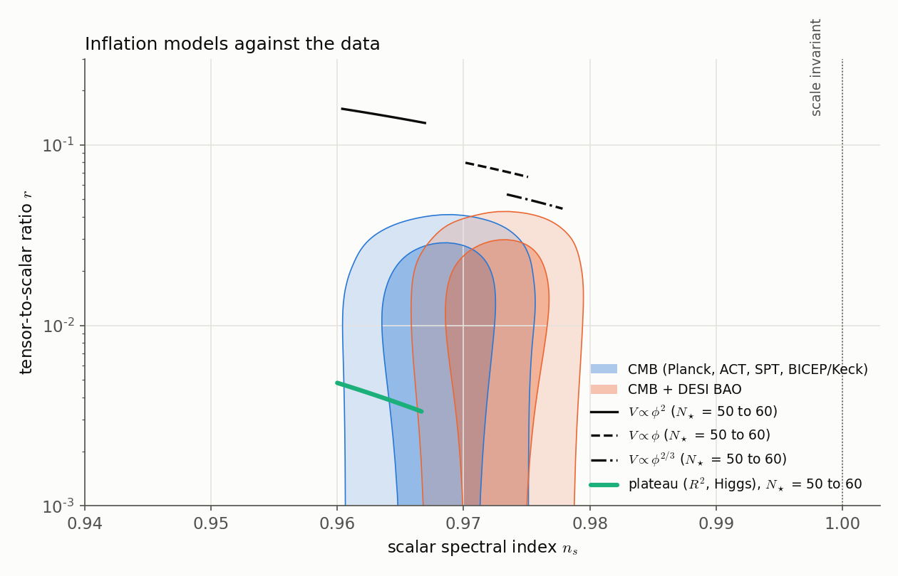

*Figure 35. Constraints on the spectral index $n_s$ and the tensor-to-scalar ratio $r$ (68% and 95% regions) from the CMB alone and combined with DESI baryon acoustic oscillations ([Balkenhol et al. 2026](https://arxiv.org/abs/2512.10613)), compared with the predictions of power-law potentials and plateau models for 50 to 60 e-folds. Note the logarithmic $r$ axis.*

The next generation of CMB experiments will go after the gravitational waves. The Simons Observatory in the Atacama aims to measure $r$ to $\pm0.003$ ([Ade et al. 2019](https://arxiv.org/abs/1808.07445)), enough to see the signal of plateau models, and the LiteBIRD satellite, planned for the 2030s, is designed to find it or rule out the best-motivated models ([LiteBIRD Collaboration 2023](https://arxiv.org/abs/2202.02773)). A detection would show that the universe really went through a phase of near-exponential expansion at about $10^{16}$ GeV, and would be the first observation of a quantum fluctuation of the gravitational field.

**Is inflation testable?** Not everyone is convinced. Critics point out that inflation is a framework rather than a single theory: with enough freedom in the potential and the initial conditions it can fit a wide range of data. Many models also inflate forever in some regions, producing a "multiverse" in which predictions become hard to define ([Ijjas, Steinhardt & Loeb 2013](https://arxiv.org/abs/1304.2785)). Its defenders reply that the simplest models made definite predictions which have been borne out, that some models have been ruled out (as $\phi^2$ has), and that this is how a framework is tested ([Guth, Kaiser & Nomura 2014](https://arxiv.org/abs/1312.7619)). Alternatives such as bouncing cosmologies try to reproduce the same observations without an inflationary phase. For a careful introduction to the subject, [Baumann's lectures](https://arxiv.org/abs/0907.5424) are a good next step.

The idea itself goes back to [Starobinsky (1980)](https://doi.org/10.1016/0370-2693%2880%2990670-X) and [Guth (1981)](https://doi.org/10.1103/PhysRevD.23.347). Guth's original version, in which inflation ended by bubbles of true vacuum forming in a false vacuum, could not end smoothly. The slow-roll version that fixed this came a year later ([Linde 1982](https://doi.org/10.1016/0370-2693%2882%2991219-9); [Albrecht & Steinhardt 1982](https://doi.org/10.1103/PhysRevLett.48.1220)).

> **In short.** Inflation replaces three unexplained initial conditions (flatness, uniformity, and the absence of relics) with one: a patch of the early universe dominated by the potential energy of a slowly rolling field. It then predicts a fourth, the spectrum of fluctuations, from quantum mechanics, and that prediction has been confirmed. Its signature in gravitational waves is still being searched for.

---

### Summary

| Quantity | Value |
| --- | --- |
| Flatness today | $\Omega_{k,0} = 0.001 \pm 0.002$; $\lvert 1 - \Omega\rvert \sim 10^{-61}$ at the Planck time without inflation |
| Horizon at last scattering | 280 Mpc comoving, $1.2^\circ$ on the sky; 30,000 disconnected patches |
| Inflation | $\ddot a > 0$, comoving Hubble radius shrinks; $\lvert 1 - \Omega\rvert \propto e^{-2N}$ |
| E-folds needed | about 50 to 65 |
| Slow roll | $\ddot\phi + 3H\dot\phi = -V'$, with $\epsilon_V, \lvert\eta_V\rvert \ll 1$ |
| Fluctuations | $\Delta_{\mathcal R}^2 = 2.1\times10^{-9}$, $n_s = 0.968 \pm 0.003$ (CMB) |
| Gravitational waves | $r < 0.034$, so $V^{1/4} < 1.4\times10^{16}$ GeV |

**The ideas to carry away.**

- In a decelerating universe, flatness and uniformity are unstable and unexplained: $|1 - \Omega| \propto (aH)^{-2}$ grows, and the CMB sky contains tens of thousands of regions that were never in causal contact.
- Inflation is any epoch with $\ddot a > 0$, equivalently a shrinking comoving Hubble radius. About 60 e-folds flatten the universe, put the observable universe in causal contact, and dilute relics such as monopoles.
- A slowly rolling scalar field has $P \approx -\varepsilon$ and drives inflation; when it reaches the bottom of its potential it oscillates and reheats the universe.
- Quantum fluctuations of the inflaton, frozen when they leave the Hubble radius, become density fluctuations with a nearly scale-invariant, slightly red spectrum, as measured. Gravitational waves would measure the energy scale of inflation; so far $r < 0.034$.

---

## Structure Formation: Gravitational Instability

The universe is homogeneous and isotropic only when smoothed over spheres about 100 Mpc in radius. On smaller scales it is lumpy. Galaxies gather into groups and clusters, clusters into filaments and sheets, and between them lie voids tens of megaparsecs across that hold few galaxies. Redshift surveys made this visible: a slice of the nearby universe mapped in 1986 showed galaxies lying on the walls of bubble-like voids ([de Lapparent, Geller & Huchra 1986](https://doi.org/10.1086/184625)). The 2dF survey measured 221,414 redshifts ([Colless et al. 2003](https://arxiv.org/abs/astro-ph/0306581)), and the DESI survey now measures millions. The pattern, often called the **cosmic web**, is the same everywhere we look.

All of this grew from the fluctuations we see in the CMB, which had a fractional amplitude of about $10^{-5}$. The engine was gravity, and the principle is simple: a region slightly denser than average pulls in matter from its surroundings and becomes denser still, while an underdense region empties out. This chapter follows that growth while the fluctuations are small, and shows what the dark matter, the photons and the expansion of the universe do to it. The next chapter follows the baryons into galaxies and stars.

Three pictures to carry away:

1. **Gravity amplifies contrasts, but slowly.** In a static medium small overdensities grow exponentially. In an expanding universe they grow only in proportion to the scale factor, $\delta \propto a$, and only while matter dominates.
2. **Pressure resists, and dark matter has a head start.** Below the Jeans length, pressure turns collapse into sound waves. Before decoupling the baryons were locked to the photons and could not collapse at all; the dark matter could, and the baryons later fell into its potential wells.
3. **The power spectrum records history.** The distribution of fluctuations over scales carries the imprint of inflation, of when each scale entered the Hubble radius, of whether the dark matter is hot or cold, and of the sound waves in the early plasma, which survive as a standard ruler 147 Mpc long.

---

### The rich get richer

Describe the lumpiness by the **density contrast**

$$
\delta(\vec r, t) = \frac{\rho(\vec r, t) - \bar\rho(t)}{\bar\rho(t)},
$$

where $\bar\rho$ is the mean density. Since $\rho \geq 0$, $\delta \geq -1$, but it has no upper limit: a galaxy has $\delta \sim 10^6$.

Start with the simplest case, a static, uniform, pressureless medium of density $\bar\rho$. (There is no truly static uniform universe of matter, which is why Einstein added $\Lambda$, but the medium can be static locally, like the air in a room.) Make a sphere of radius $R$ slightly denser, $\delta \ll 1$. Its excess mass pulls its edge inwards:

$$
\frac{\ddot R}{R} = -\frac{4\pi G\bar\rho}{3}\,\delta .
$$

Its mass $M = \frac43\pi R^3\bar\rho(1 + \delta)$ is conserved, so $R \propto (1 + \delta)^{-1/3} \approx 1 - \delta/3$ and $\ddot R/R \approx -\ddot\delta/3$. Together,

$$
\ddot\delta = 4\pi G\bar\rho\,\delta, \qquad \delta(t) = A_1e^{t/t_{\rm dyn}} + A_2e^{-t/t_{\rm dyn}}, \qquad t_{\rm dyn} = \frac{1}{\sqrt{4\pi G\bar\rho}} \approx 9.6\ \mathrm{h}\left(\frac{\bar\rho}{1\ \mathrm{kg\,m^{-3}}}\right)^{-1/2}.
$$

The overdensity grows exponentially, on a **dynamical time** that depends only on the density. A region with more than its share of mass gets more; one with less loses even what it has, the "Matthew effect".

---

### Pressure and the Jeans length

Air has a density of about $1\ \mathrm{kg\,m^{-3}}$, so its dynamical time is ten hours, yet the air in a room does not collapse. Pressure stops it. A pressure gradient builds up in the time a sound wave takes to cross the region, $R/c_s$, where $c_s = (dP/d\rho)^{1/2}$ is the sound speed. If that is shorter than $t_{\rm dyn}$, the region settles into hydrostatic equilibrium; if longer, it collapses.

Make this precise by adding pressure to the equation of motion. For a plane wave $\delta \propto e^{i\vec k\cdot\vec r}$ the pressure gradient adds a restoring acceleration, and

$$
\ddot\delta = \left(4\pi G\bar\rho - c_s^2k^2\right)\delta .
$$

Short waves, $k > k_J = \sqrt{4\pi G\bar\rho}/c_s$, oscillate as sound waves; long waves grow. The dividing wavelength is the **Jeans length** ([Jeans 1902](https://doi.org/10.1098/rsta.1902.0012)):

$$
\lambda_J = \frac{2\pi}{k_J} = c_s\left(\frac{\pi}{G\bar\rho}\right)^{1/2} = 2\pi c_s t_{\rm dyn} .
$$

For air, $c_s = 340$ m/s gives $\lambda_J \approx 70{,}000$ km, so the atmosphere is in no danger.

**In an expanding universe** the expansion time and the dynamical time are about the same: in a flat universe $H^2 = 8\pi G\bar\rho/3$, so $H^{-1} = (3/2)^{1/2}t_{\rm dyn}$. A component with $P = w\rho c^2$ has $c_s = \sqrt w\,c$ and

$$
\lambda_J = 2\pi\left(\frac23\right)^{1/2}\sqrt w\,\frac{c}{H}.
$$

For radiation, $w = 1/3$, this is $\lambda_J \approx 3\,c/H$: anything smaller than the Hubble distance just oscillates. A universe of radiation alone could never make bound structures. Structure needs something non-relativistic.

**Before decoupling** the baryons were tied to the photons in a single fluid (the chapter on the CMB), with sound speed $c/\sqrt{3(1 + R)}$, where $R = 3\rho_b/4\rho_\gamma$. At $z = 1090$ that gives a Jeans length of 0.45 Mpc, and the mass of baryons inside a sphere of that radius, the **baryonic Jeans mass**, is $3\times10^{18}\,M_\odot$, a thousand times more than the richest cluster of galaxies. Until decoupling, no baryonic structure of any interesting size could grow.

**After decoupling** the baryons form an ordinary gas of hydrogen and helium atoms at $T = 2970$ K, with an adiabatic sound speed of only 6 km/s. The Jeans length falls to 23 pc and the Jeans mass to $4\times10^5\,M_\odot$, a drop of thirteen orders of magnitude (Figure 36). Afterwards the gas stays at the CMB temperature for a while, because the few free electrons left over from recombination keep exchanging energy with the CMB photons. Below $z \approx 200$ to 300 the gas decouples thermally and cools faster than the CMB, approaching $T \propto (1 + z)^2$, and the Jeans mass falls further, to about $10^4\,M_\odot$ by $z = 10$. From decoupling on, baryonic structures from the scale of superclusters down to that of globular clusters could grow.

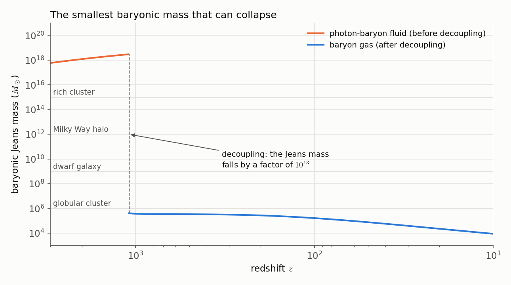

*Figure 36. The baryonic Jeans mass, the smallest mass of baryons that gravity can pull together against pressure. Before decoupling the baryons share the photons' pressure; after it they are an ordinary gas. The gas temperature after decoupling is from the CAMB code's recombination calculation ([Lewis, Challinor & Lasenby 2000](https://arxiv.org/abs/astro-ph/9911177)).*

The dark matter feels no pressure from photons. Its fluctuations can grow before decoupling, and that turns out to be essential.

---

### Growth in an expanding universe

In an expanding universe gravity no longer wins exponentially, because the expansion dilutes an overdensity on the same timescale on which gravity builds it. Redo the sphere calculation with the background expanding: the sphere's radius is $R \propto a(1 + \delta)^{-1/3}$, and subtracting the acceleration equation for the background, $\ddot a/a = -4\pi G\bar\rho/3$, leaves, to first order in $\delta$,

$$
\ddot\delta + 2H\dot\delta = 4\pi G\bar\rho\,\delta = \frac32\Omega_m(t)H^2\delta .
$$

This is the **growth equation** ([Lifshitz 1946](https://ui.adsabs.harvard.edu/abs/1946ZhETF..16..587L)). The new term $2H\dot\delta$ is a friction that the expansion supplies, like the Hubble friction on the inflaton (the chapter on inflation). It holds for a perturbation of any shape, as long as $|\delta| \ll 1$, its wavelength is larger than the Jeans length and smaller than the Hubble distance, and $\delta$ refers to the matter that can cluster: when radiation or dark energy is present, they enter only through $H$.

**Matter era**, $\Omega_m = 1$ and $H = 2/3t$. Try $\delta \propto t^n$: then $n(n - 1) + \frac43n - \frac23 = 0$, so $n = \frac23$ or $-1$, and

$$
\delta(t) = D_1t^{2/3} + D_2t^{-1} \quad\Longrightarrow\quad \delta \propto t^{2/3} \propto a = \frac{1}{1 + z}
$$

once the decaying mode has died away. Growth is a power law, not an exponential: a perturbation grows by the same factor as the universe expands.

**Radiation era**, $\Omega_m \ll 1$ and $H = 1/2t$: $\ddot\delta + \dot\delta/t \approx 0$, so $\delta = B_1 + B_2\ln t$. Dark-matter perturbations inside the Hubble radius grow only logarithmically. The radiation, which cannot cluster, drives the expansion so fast that the dark matter's own gravity is too weak to keep up. This stalling is the **Mészáros effect** ([Mészáros 1974](https://ui.adsabs.harvard.edu/abs/1974A%26A....37..225M)).

**Dark-energy era**, $H$ constant: $\delta = C_1 + C_2e^{-2Ht}$. Perturbations freeze at fixed contrast while the mean density keeps falling.

Figure 37 shows the result for our universe. A mode that entered the Hubble radius at $a = 10^{-6}$ grows by only a factor of about twelve by matter–radiation equality, then by 1600 from equality to today. Without dark energy, and with equality at the same time, it would have grown by about 2100. Today the growth is about 78% of what $\delta \propto a$ would give, and slowing. A useful approximation for the growth rate is $f = d\ln\delta/d\ln a \approx \Omega_m(z)^{0.55}$ ([Linder 2005](https://arxiv.org/abs/astro-ph/0507263)), which is $0.53$ today. The growth rate can be measured from the way the motions of galaxies falling into structures distort a redshift map ([Kaiser 1987](https://doi.org/10.1093/mnras/227.1.1)). Comparing it with the expansion history tests whether gravity on cosmological scales is general relativity.

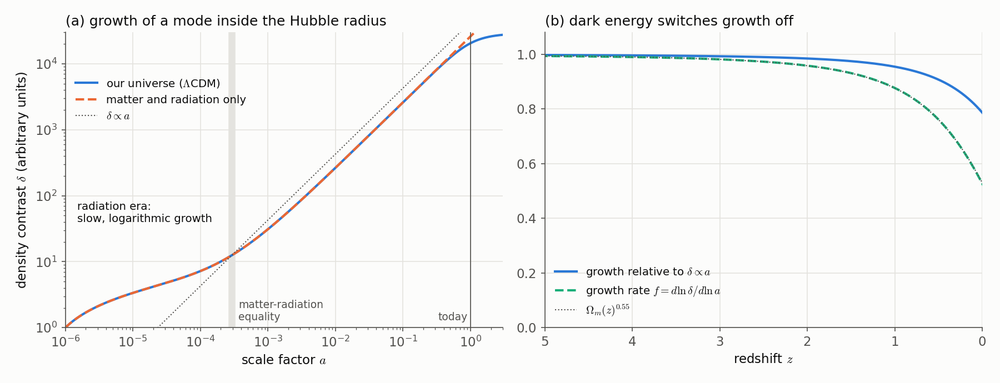

*Figure 37. (a) The growth of a matter perturbation inside the Hubble radius, from solving the growth equation for our universe and for one without dark energy. Growth is logarithmic in the radiation era, $\delta \propto a$ in the matter era, and stops once dark energy dominates. (b) The growth relative to $\delta \propto a$ and the growth rate $f$, which follows $\Omega_m(z)^{0.55}$ closely.*

---

**Note: why galaxies need dark matter.** The CMB shows the baryons at decoupling with $\delta_b \sim 10^{-5}$ to $10^{-4}$. If they were all the matter there is, they could grow from $z = 1090$ to today by at most a factor of about 1100 (less, with dark energy), reaching $\delta \sim 0.1$. Nothing would have collapsed: no galaxies, no stars, no us. The dark matter solves this twice over. It has no pressure, so its perturbations grew from matter–radiation equality at $z \approx 3400$ rather than from decoupling; and it was never tied to the photons, so on the scales of galaxies its fluctuations were already tens to hundreds of times larger than the baryons' at decoupling. After decoupling the baryons simply fall into the dark matter's potential wells and within a short time match its density contrast. The baryon fluctuations in the CMB are not the fluctuations that formed galaxies: they are the small ripples on top of much deeper wells.

---

---

**Aside: the growth equation from fluid dynamics.** Treat matter as a fluid with density $\rho = \bar\rho(1 + \delta)$, peculiar velocity $\vec u$ and gravitational potential $\phi$ (the part due to the perturbation), in comoving coordinates $\vec x = \vec r/a$. The continuity, Euler and Poisson equations, linearised in $\delta$ and $\vec u$, are

$$
\dot\delta + \frac1a\nabla\cdot\vec u = 0, \qquad \dot{\vec u} + H\vec u = -\frac1a\nabla\phi - \frac{c_s^2}{a}\nabla\delta, \qquad \nabla^2\phi = 4\pi G\bar\rho\,a^2\,\delta,
$$

with $\nabla$ taken with respect to $\vec x$. The $H\vec u$ term says that peculiar velocities decay as $1/a$ when nothing pushes them, because a particle coasting relative to the Hubble flow keeps meeting regions that are receding with it. Take the time derivative of the first equation, use the divergence of the second, and substitute Poisson's equation. For a Fourier mode with comoving wavenumber $k$,

$$
\ddot\delta_k + 2H\dot\delta_k = \left(4\pi G\bar\rho - \frac{c_s^2k^2}{a^2}\right)\delta_k .
$$

With $H = 0$ this is the static Jeans equation; with $c_s = 0$ it is the growth equation. The physical Jeans length is $2\pi a/k_J$, exactly as before. The derivation also shows when it fails: the Newtonian equations hold only on scales well inside the Hubble radius. On larger scales the meaning of $\delta$ depends on how spacetime is sliced into space and time, and a relativistic treatment is needed. The quantity that is independent of slicing there is the curvature perturbation of the chapter on inflation, which stays constant outside the Hubble radius.

---

### The power spectrum

While the fluctuations are small, the growth equation is linear, so each Fourier component evolves independently. Write

$$
\delta(\vec x) = \int\frac{d^3k}{(2\pi)^3}\,\delta_{\vec k}\,e^{i\vec k\cdot\vec x}.
$$

We cannot predict where the peaks of $\delta$ are, only their statistics. A statistically homogeneous field has Fourier modes that are uncorrelated with each other, and a statistically isotropic one has a variance that depends only on $k = |\vec k|$:

$$
\langle\delta_{\vec k}\,\delta^*_{\vec k'}\rangle = (2\pi)^3\,\delta_D(\vec k - \vec k')\,P(k).
$$

$P(k)$ is the **power spectrum**. This is the same group theory as the CMB's $C_\ell$ (the aside on Schur's lemma in the chapter on the CMB): translations act on $e^{i\vec k\cdot\vec x}$ by a phase, so the plane waves are the irreducible representations of the translation group, and translation invariance forces the covariance to be diagonal in $\vec k$. If the phases of the $\delta_{\vec k}$ are random, the field is **Gaussian**, and $P(k)$ contains everything there is to know about it. Inflation predicts Gaussian fluctuations, and the CMB confirms it (the chapter on inflation).

**Mass fluctuations.** Place spheres of radius $R$ at random. The mean mass of matter in each is $\langle M\rangle = \frac43\pi R^3\rho_{m,0} = 1.66\times10^{11}\,M_\odot\,(R/1\ \mathrm{Mpc})^3$, and its rms fractional fluctuation is

$$
\sigma^2(R) = \left\langle\left(\frac{\delta M}{M}\right)^2\right\rangle = \int_0^\infty\frac{k^2\,dk}{2\pi^2}\,P(k)\,W^2(kR), \qquad W(x) = \frac{3(\sin x - x\cos x)}{x^3}.
$$

For a power law $P \propto k^n$, $\sigma \propto R^{-(3 + n)/2} \propto M^{-(3 + n)/6}$. Points scattered at random have $n = 0$ and $\sigma \propto M^{-1/2}$. The value $n = 1$, proposed by [Harrison (1970)](https://doi.org/10.1103/PhysRevD.1.2726) and [Zel'dovich (1972)](https://doi.org/10.1093/mnras/160.1.1P) before inflation was invented, is the one for which the fluctuations in the gravitational potential are the same on every scale, the **scale-invariant** spectrum. Inflation predicts a primordial spectrum close to it, and the CMB measures $n_s = 0.965$ (the chapter on inflation). The conventional measure of the amplitude today is $\sigma_8$, the rms linear fluctuation in spheres of radius $8h^{-1}$ Mpc ($11.9$ Mpc). Planck gives $\sigma_8 = 0.811 \pm 0.006$ ([Planck 2018](https://arxiv.org/abs/1807.06209)). Weak gravitational lensing surveys measure the related combination $S_8 = \sigma_8(\Omega_{m,0}/0.3)^{1/2}$, for which Planck predicts $0.832 \pm 0.013$. For some years they found values a few percent lower, the "$S_8$ tension". The newest results depend on the survey: KiDS-Legacy finds $S_8 = 0.815^{+0.016}_{-0.021}$, in agreement with Planck ([Wright et al. 2025](https://arxiv.org/abs/2503.19441)), while the Dark Energy Survey's final data give $0.789 \pm 0.012$, 2.6 standard deviations below the combined Planck, ACT and SPT measurements of the CMB ([DES Collaboration 2026](https://arxiv.org/abs/2601.14559)). No current result is in tension at more than three standard deviations.

**What happens to the spectrum.** The primordial $P \propto k^{n_s}$ is not what we see today, because different scales grew by different amounts (Figure 38a). A fluctuation grows only after it enters the Hubble radius if the universe is matter dominated at the time; if it enters during the radiation era, it stalls until equality. Scales larger than the comoving Hubble radius at equality, $c/(a_{\rm eq}H_{\rm eq}) \approx 96$ Mpc, entered after equality and kept the primordial shape. Smaller scales entered earlier and stalled for longer, the smaller the longer. So the power spectrum today rises as $k^{n_s}$ on large scales, turns over near $k_{\rm eq} \approx 0.010\ \mathrm{Mpc^{-1}}$ (wavelength $2\pi/k_{\rm eq} \approx 600$ Mpc), and falls roughly as $k^{n_s - 4}$ on small scales. The position of the turnover measures $\Omega_{m,0}h$, and in 1990 the clustering of galaxies in the APM survey gave one of the first strong indications that the matter density is well below critical ([Efstathiou, Sutherland & Maddox 1990](https://doi.org/10.1038/348705a0)).

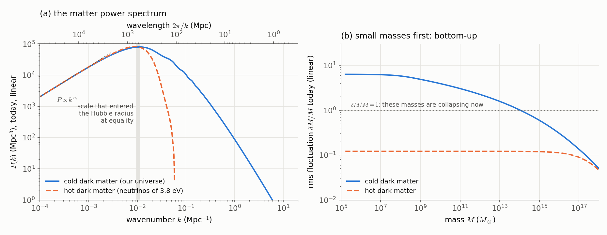

*Figure 38. (a) The linear matter power spectrum today, computed with the CAMB code for our universe (blue) and for a universe in which the dark matter is massive neutrinos, three of about 3.8 eV each, with the same primordial fluctuations (orange). Note the wiggles near $k \sim 0.1\ \mathrm{Mpc^{-1}}$: baryon acoustic oscillations. (b) The rms mass fluctuation $\delta M/M$ in linear theory: masses where it exceeds 1 have already collapsed.*

Figure 38b shows $\delta M/M$ today, as linear theory would have it. It reaches 1 at $M \approx 10^{14}\,M_\odot$: clusters of galaxies are collapsing now. Smaller masses have larger fluctuations and collapsed earlier, but the curve is shallow at small masses, $\delta M/M \propto M^{-0.14}$ near a galaxy's mass of $10^{12}\,M_\odot$, so galaxies of very different masses formed at not very different times.

---

### Hot and cold dark matter

The dark matter itself can erase fluctuations. Particles moving fast enough stream freely out of overdense regions into underdense ones and smooth them away. A particle species that was relativistic until late does this on large scales; one that was slow does it only on tiny scales. Dark matter is called **hot** if it was still relativistic when the mass inside the Hubble radius equalled that of a large galaxy, and **cold** if it was already slow.

**Hot dark matter.** The obvious candidate is neutrinos. They become non-relativistic when their mean energy, $5.3\times10^{-4}\ \mathrm{eV}/a$ (the chapter on model universes), drops to $m_\nu c^2$. Before that they fly at nearly $c$ and erase every fluctuation smaller than the Hubble radius. For the 3.8 eV neutrinos that could make up all the dark matter (the chapter on dark matter), that happens at $a \approx 1.4\times10^{-4}$, when the comoving Hubble radius was about 55 Mpc. Fluctuations smaller than this, containing up to a few times $10^{16}\,M_\odot$, are wiped out (Figure 38a). In a hot-dark-matter universe the first objects to collapse are supercluster-sized pancakes, which then fragment into galaxies: **top-down** formation ([Bond, Efstathiou & Silk 1980](https://doi.org/10.1103/PhysRevLett.45.1980)). Simulations in the early 1980s showed that it puts galaxies in the wrong places and makes them far too late ([White, Frenk & Davis 1983](https://doi.org/10.1086/184139)). We see galaxies at $z > 10$ (the next chapter), while superclusters are only now collapsing. Most of the dark matter is not hot.

**Cold dark matter.** WIMPs, with masses of order 100 GeV, were non-relativistic long before they decoupled, and axions were produced with tiny velocities. Their free streaming erases only fluctuations far below the mass of a galaxy. The smallest objects collapse first and merge into larger ones: **bottom-up** formation. This **cold dark matter** model ([Peebles 1982](https://doi.org/10.1086/183911); [Blumenthal et al. 1984](https://doi.org/10.1038/311517a0); [Davis et al. 1985](https://doi.org/10.1086/163168)), combined with a cosmological constant, is the **ΛCDM model**, the standard model of cosmology used throughout these notes.

Between the two lies **warm dark matter**, with particle masses of a few keV, which would erase only the smallest dwarf galaxies. The Lyman-α forest, absorption by intergalactic hydrogen in the spectra of distant quasars, still shows fluctuations on those scales, which puts a lower limit of 5.3 keV on the mass of a thermal warm-dark-matter particle ([Iršič et al. 2017](https://arxiv.org/abs/1702.01764)).

**Weighing neutrinos with galaxies.** Real neutrinos are a small hot component of the dark matter. Every percent of the matter in neutrinos lowers the small-scale power spectrum by about 8%, because neutrinos do not fall into the small potential wells and slow their growth ([Hu, Eisenstein & Tegmark 1998](https://arxiv.org/abs/astro-ph/9712057)). The same suppression weakens the lensing of the CMB by intervening structure. Combined with the matter density fixed by the DESI BAO distances, which on their own are blind to neutrino mass, it gives the upper limit $\sum m_\nu < 0.064$ eV quoted in the chapter on fundamental observations. That limit is so close to the lower limit of 0.059 eV from oscillations that the effect of neutrino mass on the growth of structure may soon be detected.

> **In short.** Structure grows only when three conditions hold: the scale is larger than the Jeans length, smaller than the Hubble radius, and matter dominates the expansion. That makes the radiation era a pause, the matter era a period of growth and the dark-energy era an ending. Cold dark matter started growing at equality and the baryons joined it after decoupling; small things formed first.

---

### Baryon acoustic oscillations

The sound waves that make the peaks of the CMB (the chapter on the CMB) left a mark on the matter as well. Picture a single point-like overdensity in the early universe. Its excess dark matter stays put. Its excess photon–baryon fluid, pushed out by the photons' pressure, spreads as a spherical sound wave at about $0.45c$ to $0.58c$. When the photons release the baryons, at the **drag epoch** $z_d = 1060$, a little after last scattering because there are so many photons per baryon, the wave stalls. It leaves a shell of extra baryons at a comoving radius equal to the sound horizon,

$$
r_d = \int_0^{t_d}\frac{c_s\,dt}{a} = 147.1\ \mathrm{Mpc}
$$

([Planck 2018](https://arxiv.org/abs/1807.06209)). Afterwards dark matter and baryons attract each other, and the final density profile is a central peak plus a small bump at 147 Mpc ([Eisenstein, Seo & White 2007](https://arxiv.org/abs/astro-ph/0604361)). The real universe is a superposition of many such points, so there is a slight excess of pairs of galaxies separated by 147 Mpc.

The statistic that shows it is the **two-point correlation function** $\xi(r)$. Pick a galaxy; the expected number of galaxies in a volume $dV$ at distance $r$ from it is $n[1 + \xi(r)]\,dV$, where $n$ is the mean number density. Randomly placed galaxies would have $\xi = 0$; real galaxies are clustered, with $\xi > 0$ at small $r$. It is the Fourier transform of the power spectrum,

$$
\xi(r) = \int_0^\infty\frac{k^2\,dk}{2\pi^2}\,P(k)\,\frac{\sin kr}{kr},
$$

so it carries the same information, arranged by separation instead of wavenumber. The bump at 147 Mpc in $\xi$ (Figure 39a) is the same thing as the wiggles in $P(k)$. It was first detected in 2005, at 3.4 standard deviations, in the clustering of 46,748 luminous red galaxies of the Sloan Digital Sky Survey ([Eisenstein et al. 2005](https://arxiv.org/abs/astro-ph/0501171)), and at the same time, less significantly, in the 2dF survey ([Cole et al. 2005](https://arxiv.org/abs/astro-ph/0501174)).

**A standard ruler.** The length $r_d$ depends only on early-universe physics that the CMB measures precisely, so the BAO bump is a ruler of known comoving length laid down throughout the universe. Seen across the sky at redshift $z$, it subtends an angle $r_d/D_M(z)$, where $D_M$ is the comoving distance (equal to the proper distance today in a flat universe). Seen along the line of sight, it spans a redshift interval $\Delta z = r_d H(z)/c$, so it also measures $D_H(z) = c/H(z)$ directly. These are the baryon acoustic oscillation measurements combined with supernovae and the CMB in the chapters on model universes and on measuring cosmological parameters. The second data release of the DESI survey measures them to better than 1% at several redshifts out to $z = 2.3$ (Figure 39b; [DESI Collaboration 2025](https://arxiv.org/abs/2503.14738)). On their own the BAO distances give $\Omega_{m,0} = 0.2975 \pm 0.0086$, a little below Planck's 0.315, and the points between $z \approx 0.5$ and 1.3 lie slightly below the Planck model. This mild disagreement is what drives the hint of evolving dark energy described in the chapter on model universes.

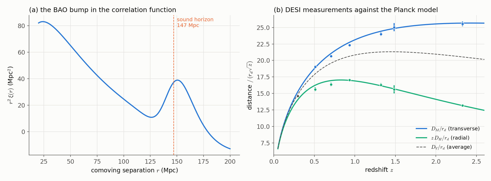

*Figure 39. (a) The linear correlation function of matter today for our universe, computed from the CAMB power spectrum. The bump near 150 Mpc is the sound horizon at the drag epoch. (b) BAO distances measured by DESI (points; [DESI Collaboration 2025](https://arxiv.org/abs/2503.14738)) compared with the predictions of the Planck model (lines). Each distance is divided by $\sqrt z$ to compress the range, and $D_H$ is first multiplied by $z$.*

---

### Summary

| Quantity | Value |
| --- | --- |
| Dynamical time | $t_{\rm dyn} = (4\pi G\bar\rho)^{-1/2}$ |
| Jeans length | $\lambda_J = c_s(\pi/G\bar\rho)^{1/2}$ |
| Baryonic Jeans mass at $z = 1090$ | $3\times10^{18}\,M_\odot$ before decoupling, $4\times10^5\,M_\odot$ after |
| Growth equation | $\ddot\delta + 2H\dot\delta = \frac32\Omega_mH^2\delta$ |
| Growth | $\ln t$ (radiation era), $\propto a$ (matter era), frozen (dark-energy era) |
| Turnover of $P(k)$ | $k_{\rm eq} \approx 0.010\ \mathrm{Mpc^{-1}}$ |
| Amplitude | $\sigma_8 = 0.811$; $\delta M/M = 1$ at $10^{14}\,M_\odot$ today |
| BAO scale | $r_d = 147.1$ Mpc (comoving) |

**The ideas to carry away.**

- Small overdensities grow by gravity. In a static medium the growth is exponential; in an expanding universe it is $\delta \propto a$ in the matter era and nearly stops in the radiation and dark-energy eras.
- Pressure prevents collapse below the Jeans length. The baryons could not collapse before decoupling; the dark matter could, and gave the baryons wells to fall into.
- The power spectrum $P(k)$ describes Gaussian fluctuations completely. Its primordial form is nearly scale invariant, and it turns over at the scale that entered the Hubble radius at matter–radiation equality.
- Hot dark matter would erase small-scale structure and make galaxies form late; observations require cold dark matter, with structure forming bottom-up.
- The sound waves of the early universe leave a bump at 147 Mpc in the clustering of galaxies, a standard ruler for measuring the expansion history.

---

## Structure Formation: Baryons and Photons

Dark matter builds the scaffolding, but everything we see is made of baryons. They are about a sixth of the matter, and they behave quite differently from the dark matter. Before decoupling, their coupling to the photons stopped them from collapsing at all. Afterwards, their ability to radiate lets them do something the dark matter cannot: lose energy, sink to the centres of dark halos and reach enormous densities. The mean density of baryons today is $\rho_{b,0} = 4.2\times10^{-28}\ \mathrm{kg\,m^{-3}}$; the Sun's mean density is $1410\ \mathrm{kg\,m^{-3}}$, a density contrast of $3\times10^{30}$. This chapter is about how the baryons got from one to the other, and about the light they gave off on the way, which reionised the universe.

Three pictures to carry away:

1. **Most baryons are not in galaxies.** About three quarters are in thin, ionised gas between the galaxies, and only a few percent are in stars.
2. **The first stars switched the lights back on.** Hydrogen became neutral at recombination. Something had half ionised it again by $z \approx 7.7$, when the universe was about 670 million years old, and finished the job by $z \approx 5.3$. The CMB, quasar spectra and the James Webb Space Telescope point to hot young stars in small galaxies.
3. **Galaxies form where gas can cool.** Dark halos collapse and heat their gas. Gas that can radiate its heat away in less than the age of the universe sinks inwards and makes a galaxy; gas that can't stays hot. That sets the masses of galaxies, and the same argument at the scale of molecular clouds sets the masses of stars.

---

### Where the baryons are

The baryon density is known precisely from nucleosynthesis and the CMB. Accounting for all of it locally is much harder. Stars, which are easy to see, hold only 4 to 7% of the baryons. The cold gas in galaxies is about 1%. The hot gas in galaxy clusters and groups, visible in X-rays, holds about 9%. For decades the sum fell far short of the total, the "missing baryon" problem. Fast radio bursts have now found the rest (the chapter on dark matter): about 76% of all baryons are in the diffuse intergalactic medium ([Connor et al. 2025](https://arxiv.org/abs/2409.16952); [Shull, Smith & Danforth 2012](https://arxiv.org/abs/1112.2706) give an earlier inventory). Part of it is cool gas at $T \sim 10^4$ K, which absorbs light in the spectra of distant quasars, and part is the "warm–hot" gas at $10^5$ to $10^7$ K in the filaments between clusters. Most of the remainder is thin gas in the halos around galaxies.

This intergalactic gas is almost completely ionised. We know because neutral hydrogen absorbs Lyman-α photons (121.6 nm) so efficiently that even one atom in $10^5$ neutral would black out a quasar's spectrum at wavelengths shorter than its redshifted Lyman-α line ([Gunn & Peterson 1965](https://doi.org/10.1086/148444)). Instead, quasar spectra show a "forest" of separate absorption lines from denser clouds, with transmitted light between them. But recombination made the universe neutral at $z \approx 1100$ (the chapter on the CMB). So something must have **reionised** it.

---

### Reionisation

**The CMB counts the free electrons.** CMB photons that travel through reionised gas can scatter off its free electrons, with optical depth

$$
\tau = \int_{t_{\rm re}}^{t_0}n_e(t)\,\sigma_ec\,dt = \frac{\sigma_ec\,n_{e,0}}{H_0}\int_0^{z_{\rm re}}\frac{(1 + z)^2\,dz}{E(z)},
$$

where $n_e = n_{e,0}(1 + z)^3$ and $E(z) = H(z)/H_0$. With $E(z) \approx [\Omega_{m,0}(1 + z)^3 + \Omega_{\Lambda,0}]^{1/2}$ the integral can be done exactly:

$$
\tau = \frac{2\sigma_ecn_{e,0}}{3\Omega_{m,0}H_0}\left(\left[\Omega_{m,0}(1 + z_{\rm re})^3 + \Omega_{\Lambda,0}\right]^{1/2} - 1\right).
$$

Today there are $n_{\rm H,0} = 0.19$ hydrogen nuclei and $0.016$ helium nuclei per cubic metre. If hydrogen and helium were ionised (helium once) at $z_{\rm re}$, and helium a second time at $z \approx 3.5$, Planck's $\tau = 0.054 \pm 0.007$ ([Planck 2018](https://arxiv.org/abs/1807.06209)) requires

$$
z_{\rm re} = 7.7 \pm 0.7,
$$

when the universe was about 670 million years old (Figure 40a). For a gradual reionisation, $z_{\rm re}$ is in effect the redshift at which the gas was half ionised. About 5% of CMB photons have scattered since. Planck measures $\tau$ mostly from the polarisation that this scattering produces on the largest angular scales. About 70% of the optical depth comes from $z < 6$, simply because the universe has been ionised for so long; the early stages of reionisation hide in the remaining third.

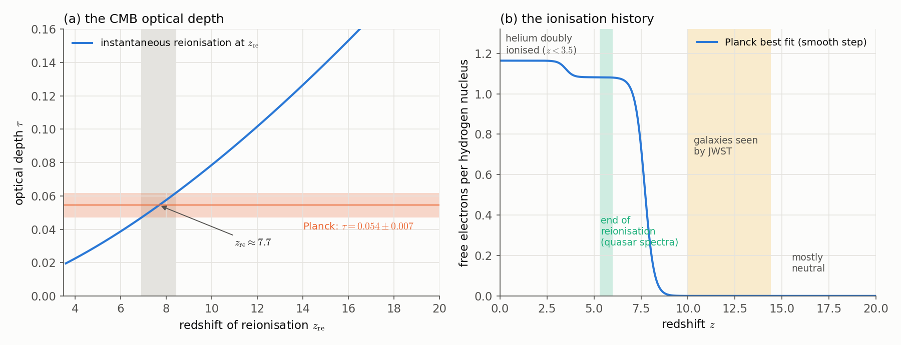

*Figure 40. (a) The optical depth to Thomson scattering for reionisation at redshift $z_{\rm re}$, against Planck's measurement. (b) The ionisation history of the Planck best-fitting model, in free electrons per hydrogen nucleus: hydrogen and singly ionised helium give 1.08, and the second ionisation of helium at $z \approx 3.5$ raises it to 1.16. Also marked are the end of reionisation seen in quasar spectra and the redshifts of the most distant galaxies found by JWST.*

**Quasar spectra see the end.** Above $z \approx 6$ the Lyman-α forest merges into a black trough: the first such Gunn–Peterson trough was found in a quasar at $z = 6.28$ ([Becker et al. 2001](https://arxiv.org/abs/astro-ph/0108097)). The large fluctuations in absorption from place to place show that the last neutral islands survived until at least $z \approx 5.3$, a billion years after the Big Bang ([Bosman et al. 2022](https://arxiv.org/abs/2108.03699)). Reionisation was patchy and took several hundred million years: bubbles of ionised gas grew around the first galaxies and eventually merged.

**What did it?** Ionising hydrogen needs photons with $hf > 13.6$ eV, and more than one per atom, because protons and electrons keep recombining. Two kinds of source make such photons in quantity.

- Hot, massive stars: a main-sequence O star of about $30\,M_\odot$ emits $Q \approx 10^{49}$ ionising photons per second ([Martins, Schaerer & Hillier 2005](https://arxiv.org/abs/astro-ph/0503346)) for about 5 million years, some $1.5\times10^{63}$ photons in its life.
- Quasars, gas falling into supermassive black holes, are far brighter, but they are rare, and most rare at early times: their number density peaks at $z \approx 2$ to 3 ([Richards et al. 2006](https://arxiv.org/abs/astro-ph/0601434)), long after reionisation. JWST has found a population of fainter active nuclei at $z > 4$ ([Maiolino et al. 2024](https://arxiv.org/abs/2308.01230)), and how much they contributed is still being worked out.

---

**Note: the photon budget.** There are $5.6\times10^{66}$ hydrogen atoms in each comoving cubic megaparsec. Suppose each needs two ionising photons, allowing for recombinations, and only a fraction $f_{\rm esc} \approx 0.2$ of the photons escape the galaxies where they are made. Then about $6\times10^{67}$ photons per $\mathrm{Mpc^3}$ are needed, the lifetime output of about 40,000 O stars. For a Salpeter mass function (see below), stars above $20\,M_\odot$ are about 7% of the mass in a new stellar population, so this takes a total of about $2\times10^7\,M_\odot$ of stars per $\mathrm{Mpc^3}$: only about a quarter of a percent of the baryons. Reionising the universe is cheap. Whether the galaxies made enough stars early enough is a different question. Extrapolating the measured star-formation history (Figure 41) beyond $z \approx 8$ gives too few; at face value, the bright galaxies found by JWST give too many ([Muñoz et al. 2024](https://arxiv.org/abs/2404.07250)). The escape fraction is the biggest unknown.

---

### The dark ages and the first stars

Between recombination and the first stars lie the **dark ages**: dark in starlight, but not in radiation. At last scattering the whole sky glowed at 2970 K, like the surface of a red dwarf star, and the CMB faded through the infrared as the universe expanded. The first stars formed when the gas in small dark halos, about $10^5$ to $10^6\,M_\odot$, could cool. Without carbon, oxygen or dust, the only coolant was molecular hydrogen, which is inefficient. Simulations suggest that the gas did not fragment much, and that the first stars, called **Population III**, were very massive, tens to hundreds of solar masses ([Abel, Bryan & Norman 2002](https://arxiv.org/abs/astro-ph/0112088); [Bromm, Coppi & Larson 2002](https://arxiv.org/abs/astro-ph/0102503)). They lived for a few million years, and their supernovae made the first carbon, oxygen and iron. No Population III star has been unambiguously detected, although JWST has found candidates in extremely metal-poor systems.

The 21-cm line of neutral hydrogen offers a way to see the dark ages directly. The first starlight changes the population of the hyperfine levels of hydrogen and should imprint a feature on the radio sky at frequencies near 100 MHz. The EDGES experiment reported an absorption feature at 78 MHz much deeper than expected ([Bowman et al. 2018](https://doi.org/10.1038/nature25792)), but the SARAS 3 experiment rejected the EDGES profile with 95.3% confidence ([Singh et al. 2022](https://arxiv.org/abs/2112.06778)). The question is open.

**JWST** now sees galaxies well into the epoch of reionisation. The most distant spectroscopically confirmed galaxy, MoM-z14, is at $z = 14.44$, 280 million years after the Big Bang ([Naidu et al. 2026](https://arxiv.org/abs/2505.11263)), and JADES-GS-z14-0 is at $z = 14.18$ ([Carniani et al. 2024](https://arxiv.org/abs/2405.18485), with the redshift refined by [Schouws et al. 2024](https://arxiv.org/abs/2409.20549)). There are more bright galaxies at these redshifts than most models predicted.

**The cosmic star-formation history.** Adding up the light of galaxies at each redshift gives the rate at which the universe has been forming stars (Figure 41). It rose for the first 3.5 billion years, peaked at $z \approx 1.9$ at about nine times today's rate, and has declined since ([Madau & Dickinson 2014](https://arxiv.org/abs/1403.0007)). Half of today's stars had formed by $z \approx 1.3$, nine billion years ago; only about 1% formed before reionisation ended. Integrated over time, and allowing for the 27% of the mass that stars return to space as winds and supernovae, the curve gives a stellar density close to that counted directly, $\Omega_{\star,0} \approx 0.003$ (the chapter on dark matter), once a realistic mass function for the stars is used.

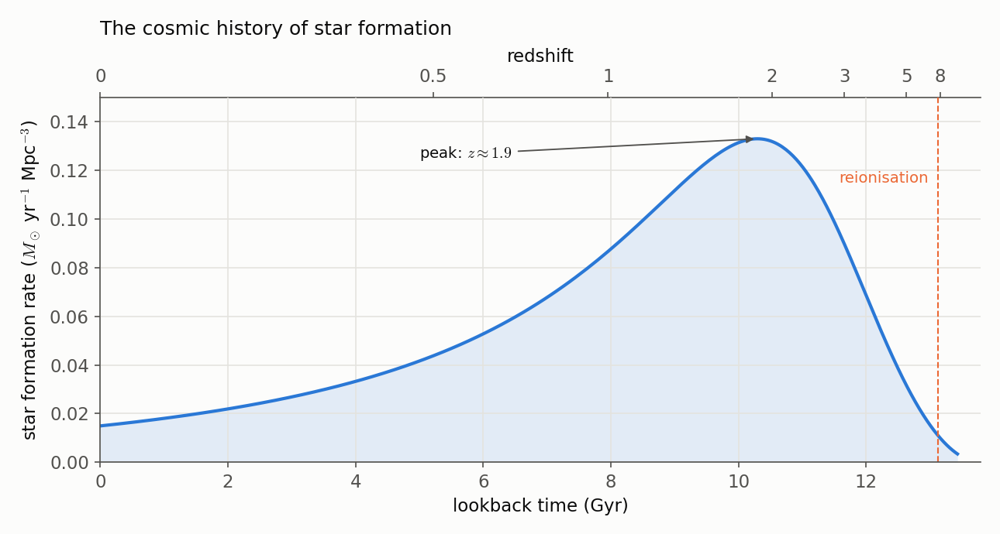

*Figure 41. The comoving rate of star formation against lookback time, from the fitting formula of [Madau & Dickinson (2014)](https://arxiv.org/abs/1403.0007), $\psi(z) = 0.015\,(1 + z)^{2.7}/[1 + ((1 + z)/2.9)^{5.6}]\ M_\odot\,\mathrm{yr^{-1}\,Mpc^{-3}}$ (for a Salpeter mass function). The dashed line marks reionisation.*

---

### Making galaxies

**Galaxies come in a limited range of sizes.** The number of galaxies per unit volume with luminosity between $L$ and $L + dL$ follows the **Schechter function**

$$
\Phi(L)\,dL = \Phi^*\left(\frac{L}{L^*}\right)^\alpha e^{-L/L^*}\,\frac{dL}{L^*},
$$

a power law at low luminosity and an exponential cutoff above $L^*$. In the red light of nearby galaxies $\alpha \approx -1.05$, $\Phi^* \approx 4.6\times10^{-3}\ \mathrm{Mpc^{-3}}$, and $L^*$ is close to the luminosity of our own galaxy ([Blanton et al. 2003](https://arxiv.org/abs/astro-ph/0210215)); the characteristic stellar mass is about $5\times10^{10}\,M_\odot$ ([Baldry et al. 2012](https://arxiv.org/abs/1111.5707)). Galaxies ten times brighter than $L^*$ are found only at the centres of rich clusters. Yet dark halos far more massive than our galaxy's $10^{12}\,M_\odot$ exist: the Coma cluster's is $10^{15}\,M_\odot$. They hold many galaxies, not one giant one. Why?

**Spherical collapse.** Model a halo as a uniform overdense sphere in a matter-dominated universe. Each shell behaves like a small closed universe (the chapter on cosmic dynamics): it expands, slows, turns around and collapses (Figure 42). Turnaround happens when linear theory would give $\delta_{\rm lin} = 1.06$; the real overdensity is then 4.55. Collapse happens when $\delta_{\rm lin} = 1.686$. In reality the sphere does not collapse to a point: its particles, crossing and scattering, settle into equilibrium at half the turnaround radius, where the virial theorem is satisfied. The final density is $18\pi^2 \approx 178$ times the mean density of the universe at the time of collapse ([Gunn & Gott 1972](https://doi.org/10.1086/151605)). Halos that collapsed earlier, when the universe was denser, are denser.

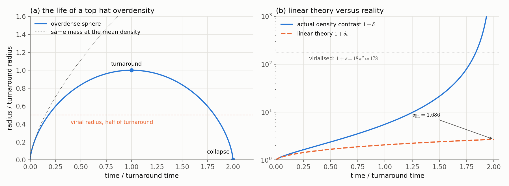

*Figure 42. (a) The radius of an overdense sphere in a matter-dominated universe, and of a sphere of the same mass at the mean density. (b) Its density contrast compared with the prediction of linear theory. At collapse linear theory gives $\delta_{\rm lin} = 1.686$, while the real sphere has settled at a density 178 times the mean.*

---

**Aside: the top-hat in closed form.** A shell enclosing mass $M$ obeys $\ddot R = -GM/R^2$, so $\frac12\dot R^2 - GM/R = E$. For a bound shell, $E < 0$, the solution is the cycloid

$$
R = A(1 - \cos\theta), \qquad t = B(\theta - \sin\theta), \qquad A^3 = GMB^2,
$$

which turns around at $\theta = \pi$ and collapses at $\theta = 2\pi$. The mean density of the universe in the matter era is $\bar\rho = 1/(6\pi Gt^2)$, so the density contrast is

$$
1 + \delta = \frac{3M}{4\pi R^3\bar\rho} = \frac{9}{2}\,\frac{(\theta - \sin\theta)^2}{(1 - \cos\theta)^3}.
$$

Expanding for small $\theta$ gives the linear-theory value, $\delta_{\rm lin} = \frac{3}{20}\left[6(\theta - \sin\theta)\right]^{2/3}$, which grows as $t^{2/3}$, as it should. At turnaround, $1 + \delta = 9\pi^2/16 = 5.55$ while $\delta_{\rm lin} = 1.06$; at $\theta = 2\pi$, $\delta_{\rm lin} = \frac{3}{20}(12\pi)^{2/3} = 1.686$. For the virialised halo, the virial theorem $2K + W = 0$ (the chapter on dark matter) with energy conservation, $K + W = W_{\rm ta}$, gives $W = 2W_{\rm ta}$, and since $W \propto -1/R$, $R_{\rm vir} = R_{\rm ta}/2$. The density rises by 8 from turnaround, while the background density falls by $(t_{\rm coll}/t_{\rm ta})^2 = 4$, so $1 + \delta = 5.55\times8\times4 = 18\pi^2$.

---

**When halos collapse.** A region collapses when its linearly extrapolated overdensity reaches 1.686. A fluctuation $\nu$ times the rms, in a halo of mass $M$, does so at the redshift where $\nu\,\sigma(M)\,D(z) = 1.686$, with $\sigma(M)$ from the power spectrum (the previous chapter) and $D(z)$ the growth factor normalised to 1 today. [Press & Schechter (1974)](https://doi.org/10.1086/152650) turned this idea into a prediction for the number of halos of each mass. For our universe:

| Halo mass | Collapse redshift for 1σ, 2σ, 3σ peaks | Virial temperature (2σ) |
| --- | --- | --- |
| $10^{10}\,M_\odot$ | 1.9, 4.9, 7.8 | $1.3\times10^5$ K |
| $10^{12}\,M_\odot$ | 0.6, 2.4, 4.1 | $1.6\times10^6$ K |
| $10^{14}\,M_\odot$ | none yet, 0.4, 1.2 | $1.4\times10^7$ K |

Because $\sigma(M)$ varies slowly with mass, galaxy-sized halos collapsed at $z \sim 2$ to 5, while clusters are collapsing now. Simulations that follow the full nonlinear collapse, such as the Millennium simulation of 10 billion particles ([Springel et al. 2005](https://arxiv.org/abs/astro-ph/0504097)), confirm this bottom-up history and show that halos have a universal density profile, $\rho \propto 1/[(r/r_s)(1 + r/r_s)^2]$ ([Navarro, Frenk & White 1997](https://arxiv.org/abs/astro-ph/9611107)), rather than a uniform one.

**Virial temperature.** When the halo virialises, its gas is shocked to the temperature at which the thermal speeds match the orbital speeds of the dark matter:

$$
kT_{\rm vir} = \frac{\mu m_p}{2}\,\frac{GM}{R_{\rm vir}},
$$

with $\mu = 0.59$ for ionised primordial gas. A $10^{12}\,M_\odot$ halo that collapsed at $z = 2.4$ has $R_{\rm vir} \approx 100$ kpc, $T_{\rm vir} \approx 1.6\times10^6$ K, and a mean gas density of about $2\times10^{-3}$ nucleons per $\mathrm{cm^3}$.

**Cooling decides.** Hot gas in hydrostatic equilibrium stays hot unless it can radiate. A galaxy forms only if the gas cools in less than the time it would take to fall to the centre, and certainly in less than the age of the universe ([Rees & Ostriker 1977](https://doi.org/10.1093/mnras/179.4.541); [Silk 1977](https://doi.org/10.1086/154972); [White & Rees 1978](https://doi.org/10.1093/mnras/183.3.341)). Above $10^6$ K the gas is fully ionised and cools by free–free emission (bremsstrahlung), with power per unit volume $\propto n^2T^{1/2}$. Its thermal energy density is $\frac32nkT$, so the cooling time is

$$
t_{\rm cool} = \frac{\frac32nkT}{\Lambda_{\rm ff}\,n^2T^{1/2}} \propto \frac{T^{1/2}}{n}.
$$

Between $10^4$ and $10^6$ K, collisionally excited lines of hydrogen and helium ions cool the gas much faster ([Sutherland & Dopita 1993](https://doi.org/10.1086/191823)). Figure 43 compares the halos in the table with the cooling time.

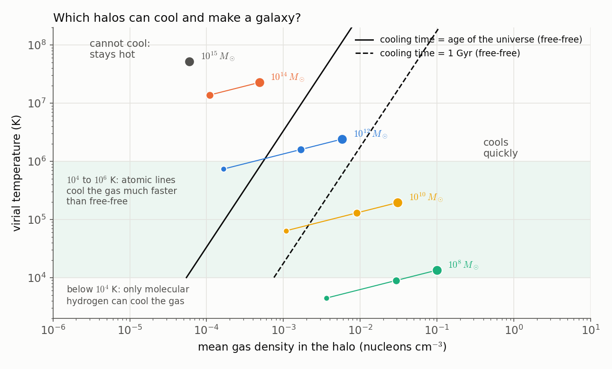

*Figure 43. Mean gas density and virial temperature of halos of different masses, for 1σ, 2σ and 3σ fluctuations (small to large dots), compared with the lines where the free–free cooling time equals 1 Gyr and the age of the universe. Halos to the right of the lines can cool and form galaxies. Line cooling, important below $10^6$ K, moves the boundary further left there.*

The result is clear. Halos of $10^{10}$ to $10^{12}\,M_\odot$ that collapse at $z \gtrsim 2$ are dense enough to cool in less than the age of the universe, the smaller ones in well under a billion years, and make galaxies. Cluster halos, $10^{14}$ to $10^{15}\,M_\odot$, are too hot and too dilute: their cooling times are 70 to 900 billion years. Their gas stays hot, and we see it as the X-ray-emitting intracluster gas of the chapter on dark matter. The upper limit on galaxy masses is set by the baryons' ability to cool, not by the dark matter. In real galaxies, energy injected by supernovae in small halos and by the jets of supermassive black holes in large ones also stops gas cooling ([Croton et al. 2006](https://arxiv.org/abs/astro-ph/0508046)). Not all gas is shock-heated, either: in galaxy-mass halos at high redshift, cold streams can flow straight to the centre ([Dekel & Birnboim 2006](https://arxiv.org/abs/astro-ph/0412300)).

Most large galaxies have a supermassive black hole at the centre. Ours, Sagittarius A*, has $4.30\times10^6\,M_\odot$, measured from the orbits of stars around it ([GRAVITY Collaboration 2022](https://arxiv.org/abs/2112.07478)) and imaged by the Event Horizon Telescope ([EHT Collaboration 2022](https://doi.org/10.3847/2041-8213/ac6674)). The giant elliptical galaxy NGC 4889 in the Coma cluster has one of about $2\times10^{10}\,M_\odot$ ([McConnell et al. 2011](https://arxiv.org/abs/1112.1078)).

---

### Making stars

Gas that has cooled into a galaxy forms stars in **molecular clouds**: cold ($T \approx 10$ to 20 K), dense, dusty clouds of molecular hydrogen. Their densest cores have $\rho \sim 10^{-15}\ \mathrm{kg\,m^{-3}}$, a trillion times the cosmic mean and still $10^{18}$ times less dense than the Sun. With mean particle mass $\mu = 2.3\,m_p$ (molecular hydrogen plus helium), the sound speed at 20 K is $c_s = (kT/\mu m_p)^{1/2} = 270$ m/s, the dynamical time is $t_{\rm dyn} = 1.1\times10^{12}$ s (35,000 years), and the Jeans mass is

$$
M_J = \frac{4\pi}{3}\rho\,\lambda_J^3 \approx 13\,M_\odot\left(\frac{\rho}{10^{-15}\ \mathrm{kg\,m^{-3}}}\right)^{-1/2}\left(\frac{T}{20\ \mathrm{K}}\right)^{3/2}.
$$

That is a puzzle, since most stars are much lighter: the mass function of new stars peaks at a few tenths of a solar mass (the chapter on dark matter). The answer is again cooling.

**Fragmentation.** A collapsing core is compressed and should heat up, but dust grains radiate the heat away in the far infrared, to which the core is transparent, and the temperature stays near 20 K. At fixed temperature $M_J \propto \rho^{-1/2}$, so as the core contracts its Jeans mass falls, and the core fragments into smaller pieces, each of which collapses and fragments again ([Hoyle 1953](https://doi.org/10.1086/145780)). This hierarchical fragmentation stops when the fragments become so dense that they can no longer radiate fast enough to stay cool: they heat up, their Jeans mass rises, and they become protostars. The **opacity limit** comes at about a hundredth of a solar mass ([Rees 1976](https://doi.org/10.1093/mnras/176.3.483); [Low & Lynden-Bell 1976](https://doi.org/10.1093/mnras/176.2.367)), close to the low end of the observed stellar masses. A protostar above $0.08\,M_\odot$ ignites hydrogen fusion and becomes a star.

---

**Note: a mass function from fragmentation.** Suppose each round of fragmentation halves the mass, and in each round a small fixed fraction of the fragments collapse into stars without fragmenting further. After $n$ rounds there are $\propto 2^n$ stars of mass $2^{-n}M$, so the number of stars per logarithmic interval of mass goes as $1/M$, a mass function $dN/dM \propto M^{-2}$. The observed mass function of stars above a solar mass is $dN/dM \propto M^{-2.35}$ ([Salpeter 1955](https://doi.org/10.1086/145971)), with a turnover below a few tenths of a solar mass ([Chabrier 2003](https://arxiv.org/abs/astro-ph/0304382)). The toy model gets close; turbulence, magnetic fields and rotation, which it leaves out, all matter in real clouds. Rotation also leaves each protostar with a disk, which can form planets. In the Solar System the planets are 0.13% of the Sun's mass. If that is typical, planets have $\Omega_{\rm pl,0} \sim 0.0013\,\Omega_{\star,0} \sim 4\times10^{-6}$: negligible for cosmology, but not for those who ask where it all came from.

---

> **In short.** The story of the baryons is a story of cooling. Coupled to the photons, they could not collapse; released, they fell into the dark matter's wells and were heated; where they could radiate the heat away they sank further and made galaxies, and inside galaxies the same competition between gravity, pressure and radiation made stars. The first stars had half reionised the universe within its first 700 million years and finished within about a billion, and the CMB still carries the record.

---

### Summary

| Quantity | Value |
| --- | --- |
| Where the baryons are | intergalactic gas ~76%, gas in groups and clusters ~9%, stars 4 to 7%, cold gas ~1%, the rest mostly in gas around galaxies |
| Optical depth, reionisation | $\tau = 0.054 \pm 0.007$, $z_{\rm re} = 7.7 \pm 0.7$ (half ionised); complete by $z \approx 5.3$ |
| Star-formation history | peak at $z \approx 1.9$, nine times today's rate; half of stars formed by $z \approx 1.3$ |
| Spherical collapse | turnaround at $\delta_{\rm lin} = 1.06$, collapse at $\delta_{\rm lin} = 1.686$, virial density $18\pi^2 \approx 178$ times the mean |
| Virial temperature | $kT = \mu m_pGM/2R_{\rm vir}$; $1.6\times10^6$ K for a $10^{12}\,M_\odot$ halo collapsing at $z \approx 2.4$ |
| Jeans mass in a molecular cloud core | $\approx 13\,M_\odot$ at $10^{-15}\ \mathrm{kg\,m^{-3}}$ and 20 K |

**The ideas to carry away.**

- Most baryons are in ionised intergalactic gas; stars are a few percent.
- The universe was half reionised by $z \approx 7.7$, probably by young massive stars in small galaxies. The CMB measures the total column of free electrons; quasar spectra show the end of the process at $z \approx 5.3$.
- A halo collapses when its linear overdensity reaches 1.686 and settles at 178 times the mean density, heating its gas to the virial temperature.
- Galaxies form where that gas can cool in less than the age of the universe; cluster gas cannot, which is why there are no galaxies of $10^{14}\,M_\odot$.
- Stars form by fragmentation of cold molecular clouds, which stops when the fragments can no longer cool, at about a hundredth of a solar mass.

---

### Open questions

These notes end with the standard model of cosmology, ΛCDM, fitting a remarkable range of data with six parameters. It would be misleading to stop without listing what it does not explain.

- What is the dark matter? It is about 85% of the matter, it is cold, and it is not made of any known particle (the chapter on dark matter). Direct searches are approaching the neutrino fog without a signal.
- What is the dark energy? A cosmological constant fits most data, but its value is unexplained by 120 orders of magnitude, and the DESI measurements hint that it may be changing with time (the chapter on model universes).
- Is the expansion rate in tension? The distance ladder gives $H_0 \approx 73$ and the CMB gives 67.4 (the chapter on measuring cosmological parameters), a disagreement that has survived every check so far.
- Did inflation happen? Its predictions for flatness and the spectrum of fluctuations have been confirmed; its gravitational waves have not been seen (the chapter on inflation).
- Where did the baryons come from? The matter–antimatter asymmetry needs physics beyond the Standard Model (the chapter on nucleosynthesis).
- Smaller puzzles may turn out to be clues: the primordial lithium abundance, the neutron lifetime, the mild $S_8$ discrepancy, and the masses of the neutrinos.

Each of these is being attacked with new data, from the Simons Observatory, DESI, Euclid, the Rubin Observatory, JWST and underground detectors. Some of the questions we should be asking have probably not been thought of yet.

---
