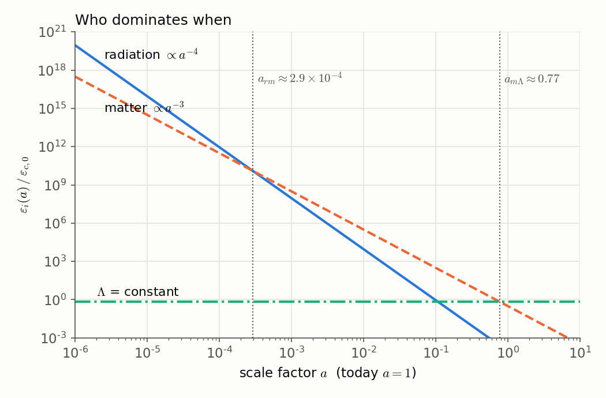
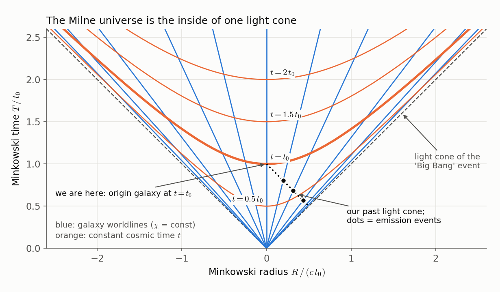
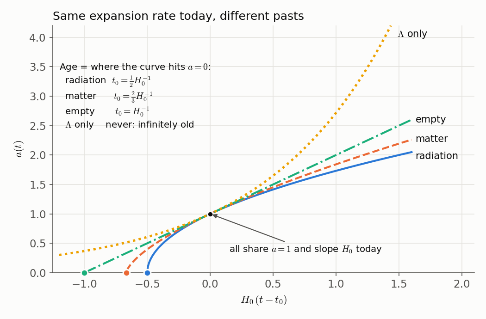
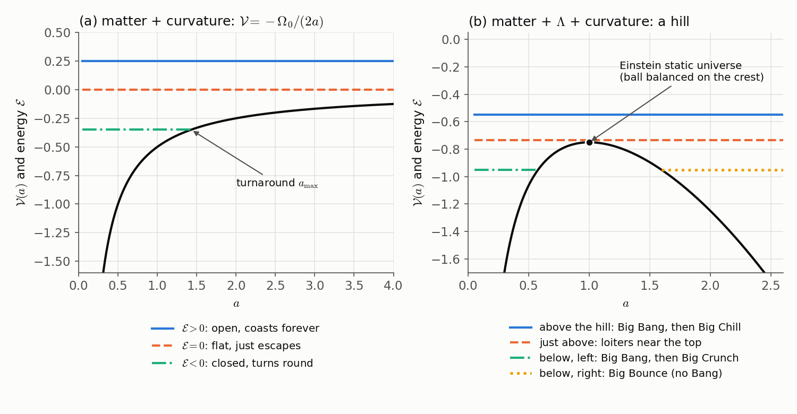
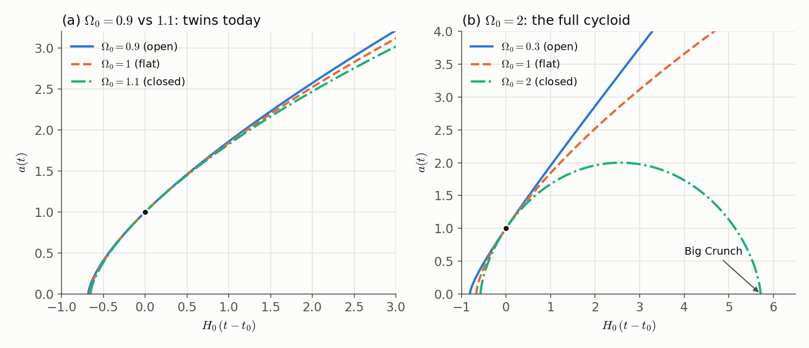
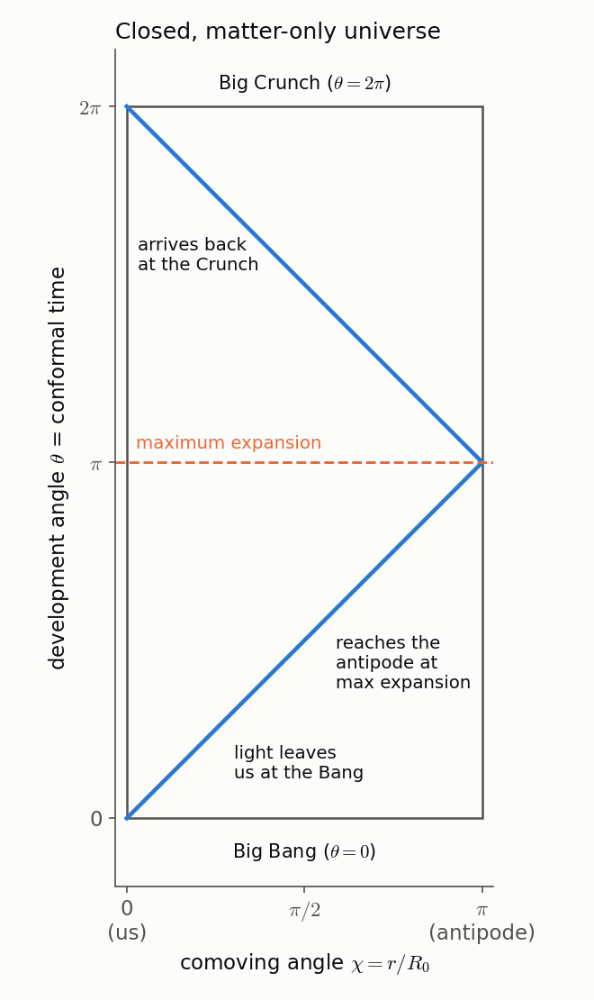
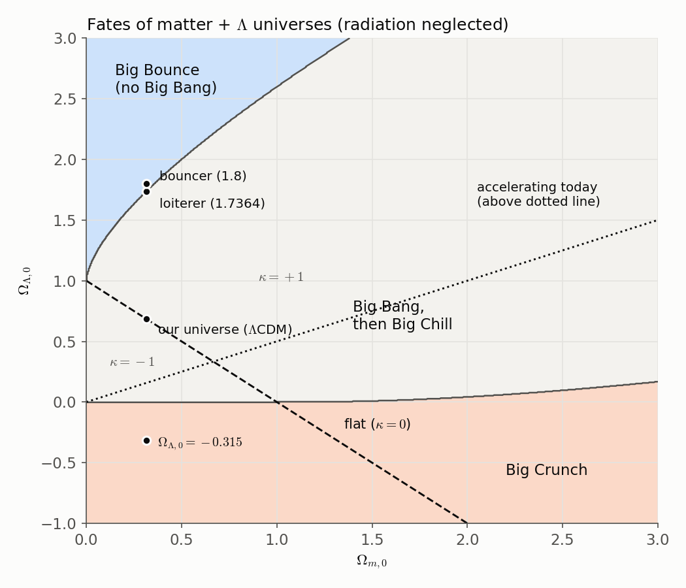
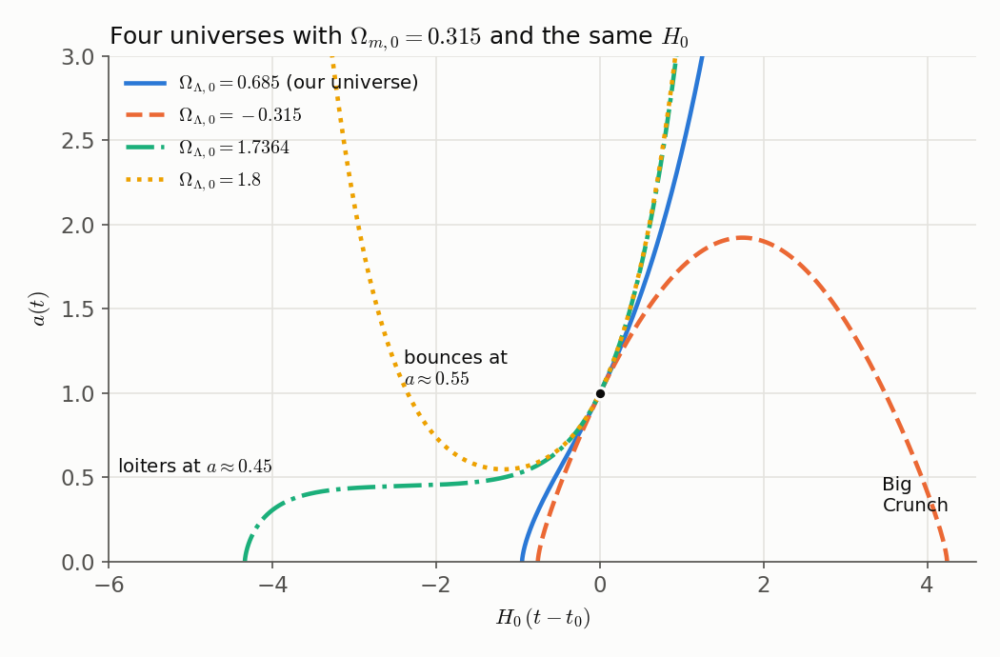
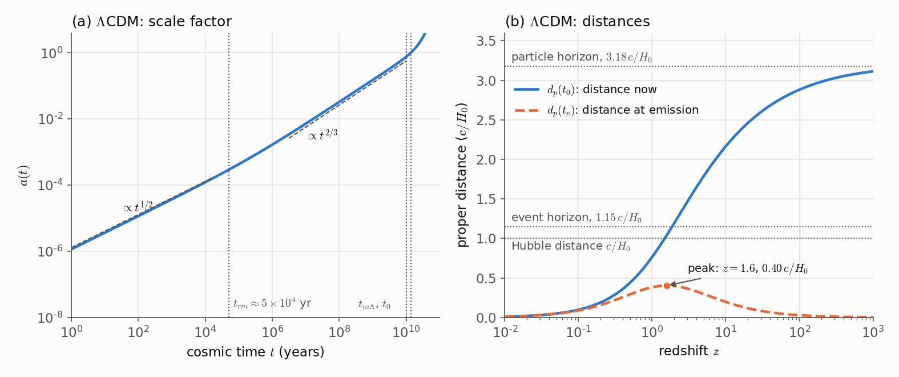

# Astrophysics 2 - Cosmology

## Model Universes

In the chapter on cosmic dynamics we built a machine: the Friedmann equation, the fluid equation and an equation of state. Put in the contents of a homogeneous, isotropic universe, and out comes its whole history, $a(t)$. In this chapter we turn the crank. We will solve the machine for an empty universe, for universes holding one ingredient, then two, and finally for the model that matches what we observe.

It is easy to drown in this material. There is a whole catalogue of exact solutions, each with its own age, horizon and distance formula, and it is tempting to memorise the catalogue. Don't. Almost everything here follows from a few pictures, and if you carry the pictures in your head you can rebuild any formula in a few lines:

1. Each ingredient thins out at its own rate as the universe grows, $\varepsilon \propto a^{-3(1+w)}$, so different ingredients take turns dominating.
2. The Friedmann equation is the energy equation for a ball rolling on a one-dimensional hill. The shape of the hill is set by the contents, and the ball's total energy is the curvature.
3. Distances are integrals of $1/a$ along a light ray. Light doesn't care how big the universe *is*, only how much it grew while the light was in flight.

Because you already know general relativity, we can also see something that a purely Newtonian treatment hides. Two of the "different" universes in the catalogue turn out to be flat Minkowski space and the de Sitter hyperboloid, seen through unusual coordinates. Those asides are worth the detour.

**How to read these notes.**

- Conventions: $\varepsilon$ is energy density (J m$^{-3}$), $P$ is pressure, and $P = w\varepsilon$. The metric signature is $(-,+,+,+)$ with $x^0 = ct$. The scale factor is normalised to $a(t_0) = 1$ today. $\kappa \in \{-1, 0, +1\}$ is the sign of the spatial curvature and $R_0$ is today's radius of curvature. A subscript $0$ always means "today". In some GR asides we set $c = 1$, and we say so when we do.
- Passages set off between horizontal rules and starting with **Aside** go deeper. Skip them on a first read; nothing in the main text depends on them. Passages starting with **Note** are short questions worth pausing on, with their answers.
- Numbers come from the [Planck 2018 analysis of the cosmic microwave background](https://arxiv.org/abs/1807.06209) unless stated otherwise: $H_0 = 67.4\ \mathrm{km\,s^{-1}\,Mpc^{-1}}$, so the Hubble time is $H_0^{-1} = 14.5$ Gyr and the Hubble distance is $c/H_0 = 4450$ Mpc.
- The figures are generated by `figures/make_model_universes_figures.py`.

---

## The equations we are solving

Here are the three equations from the chapter on cosmic dynamics. The Friedmann equation,

$$
\left(\frac{\dot{a}}{a}\right)^2 = \frac{8\pi G}{3c^2}\varepsilon - \frac{\kappa c^2}{R_0^2 a^2},
$$

the fluid equation,

$$
\dot{\varepsilon} + 3\frac{\dot{a}}{a}(\varepsilon + P) = 0,
$$

and the equation of state,

$$
P = w\varepsilon.
$$

Recall the bookkeeping. There are three unknown functions, $a(t)$, $\varepsilon(t)$ and $P(t)$. The acceleration equation is not independent (it follows from the other two), so these three equations are the complete set. Give them today's expansion rate $H_0 = \dot a/a|_{t_0}$ and today's energy densities, and they determine the past and the future. We write $H \equiv \dot a/a$ throughout.

What makes real life harder is that the universe holds several ingredients at once, each with its own $w$. So the first job is to understand each ingredient separately.

---

## How each ingredient thins out

### Ingredients add, and each obeys its own fluid equation

If the universe holds several components, their energy densities and pressures simply add:

$$
\varepsilon = \sum_i \varepsilon_i, \qquad P = \sum_i P_i = \sum_i w_i \varepsilon_i.
$$

The fluid equation is a statement about energy conservation in a comoving volume. If the components don't trade energy with one another (photons don't turn into protons, and so on), then each one conserves its own energy separately, and each obeys its own fluid equation:

$$
\dot{\varepsilon}_i + 3\frac{\dot{a}}{a}(\varepsilon_i + P_i) = 0
\quad\Longrightarrow\quad
\dot{\varepsilon}_i + 3\frac{\dot{a}}{a}(1 + w_i)\varepsilon_i = 0.
$$

Since $\dot\varepsilon_i/\dot a = d\varepsilon_i/da$, we can separate variables,

$$
\frac{d\varepsilon_i}{\varepsilon_i} = -3(1 + w_i)\frac{da}{a},
$$

and for constant $w_i$ this integrates at once to

$$
\boxed{\;\varepsilon_i(a) = \varepsilon_{i,0}\, a^{-3(1+w_i)}\;}
$$

Notice what we did *not* use: the Friedmann equation. This scaling law needs only local energy conservation and the fact that comoving volumes grow as $a^3$. It doesn't care about $G$, curvature or the other components, which is why it holds so generally.

The caveat about interactions is real. When electrons and positrons annihilated in the early universe, energy flowed from the $e^\pm$ component into photons, and the separate fluid equations failed for each of them. The *total* fluid equation still held; that one never fails.

### The picture: count particles in a comoving box

Here is the way to *see* the scaling law. Take a box whose corners are attached to galaxies, so that it grows with the universe; its volume goes as $a^3$. Write the energy density as

$$
\varepsilon = n \times (\text{energy per particle}),
$$

where $n$ is the number density. If particles are neither created nor destroyed, the number in the box is fixed and $n \propto a^{-3}$. Now:

- **Matter** (non-relativistic, $w \approx 0$): each particle carries its rest energy $mc^2$, which doesn't change, so $\varepsilon_m = \varepsilon_{m,0}/a^3$.
- **Radiation** ($w = 1/3$): each photon carries $E = hc/\lambda$, and wavelengths stretch in proportion to $a$. So each photon loses energy as $1/a$ *on top of* the dilution, and $\varepsilon_r = \varepsilon_{r,0}/a^4$.
- **Cosmological constant** ($w = -1$): $\varepsilon_\Lambda$ is constant, so the energy *in the box* grows as $a^3$. We will come back to how unsettling that is.

| Component | $w$ | $\varepsilon(a)$ | Energy in a comoving box | Why |
| --- | --- | --- | --- | --- |
| Radiation | $1/3$ | $a^{-4}$ | $\propto a^{-1}$ | fixed number of quanta, each stretched |
| Matter | $0$ | $a^{-3}$ | constant | fixed number of particles, fixed rest energy |
| (Curvature term) | $-1/3$ | $a^{-2}$ | $\propto a$ | not a substance; see below |
| Cosmological constant | $-1$ | $a^{0}$ | $\propto a^3$ | energy density of empty space itself |

The curvature row is there because the curvature term in the Friedmann equation, $-\kappa c^2/(R_0^2 a^2)$, scales exactly like a fictitious fluid with $w = -1/3$. Nothing physical here has $w = -1/3$; it is a bookkeeping trick, but a handy one, and it is why curvature is often written as one more "$\Omega$".

> **In short.** The equation-of-state parameter $w$ is a measure of how the energy in a comoving box changes as the box grows: $E_{\rm box} = \varepsilon a^3 \propto a^{-3w}$. Radiation's box loses energy, matter's keeps it, the vacuum's gains it. And the pressure is simply the price of that change, $P = -dE_{\rm box}/dV$: check that this gives back $P = w\varepsilon$.

---

**Note: stiff matter.** Some models of the very early universe contain "stiff matter" with $w = 1$: the pressure equals the energy density, so sound travels at the speed of light. How would it scale, and when would it matter? The scaling law gives $\varepsilon \propto a^{-6}$, faster than anything else. So if stiff matter exists at all, it dominates at the very earliest times, before radiation, and then vanishes almost at once. That is also why it is so hard to rule out.

---

**Aside: why every particle's momentum decays as $1/a$.**

When we derived the cosmological redshift from the Robertson–Walker metric, we followed two successive wave crests. You already have a slicker tool from the Schwarzschild metric: if the metric doesn't depend on a coordinate $x^\mu$, then the covariant momentum component $p_\mu = g_{\mu\nu}p^\nu$ is conserved along geodesics. That is how you got the conserved energy (from $\partial_t$) and angular momentum (from $\partial_\phi$) of an orbit.

Take the flat Robertson–Walker metric,

$$
ds^2 = -c^2dt^2 + a(t)^2\left(dx^2 + dy^2 + dz^2\right).
$$

It doesn't depend on $x$, so $\partial_x$ is a Killing vector and

$$
p_x = g_{xx}\,p^x = a^2 p^x = \text{constant along the particle's path.}
$$

But $p^x$ is a *coordinate* component. A comoving observer measures momentum with rulers, i.e. in an orthonormal frame whose $x$-leg is $\hat e_x = a^{-1}\partial_x$. In that frame the momentum is $p^{\hat x} = a\,p^x = p_x/a$. So the momentum any comoving observer measures is

$$
p_{\rm phys} \propto \frac{1}{a}.
$$

Nothing in this argument cared about the particle's mass. That one line has three consequences.

For photons, $p = h/\lambda$, so $\lambda \propto a$: the redshift law $1 + z = 1/a(t_e)$, now from the geodesic equation instead of from wave crests.

For a non-relativistic particle, $p = mv$, so its peculiar velocity decays as $v \propto 1/a$. Expansion acts as a refrigerator for random motions. This is why dark matter can be "cold" today even if it was born with some velocity.

For a neutrino, $E^2 = p^2c^2 + m^2c^4$ with $p \propto 1/a$. Early on $pc \gg mc^2$ and $E \approx pc \propto 1/a$: it behaves as radiation. Late on $pc \ll mc^2$ and $E \approx mc^2$: it behaves as matter. The switch happens when $pc \sim mc^2$, which we use below.

If you'd rather not rely on a Killing vector (in a curved space you can't use the simple $\partial_x$), use the time component of the geodesic equation. With $x^0 = ct$ and spatial metric $a^2\gamma_{ij}$, the only Christoffel symbols mixing time and space are

$$
\Gamma^0_{ij} = \frac{a\dot a}{c}\,\gamma_{ij}, \qquad \Gamma^i_{0j} = \frac{\dot a}{ac}\,\delta^i_j .
$$

The geodesic equation $dp^0/d\lambda + \Gamma^0_{ij}p^ip^j = 0$, with $p^0 = E/c$ and $d/d\lambda = (p^0/c)\,d/dt$, becomes $p^0\,\dot p^0 = -H\,|\vec p|^2$, where $|\vec p|^2 = a^2\gamma_{ij}p^ip^j$ is the physical momentum squared. Because the mass shell $(p^0)^2 = |\vec p|^2 + m^2c^2$ gives $p^0\dot p^0 = |\vec p|\,\tfrac{d|\vec p|}{dt}$, we get

$$
\frac{d|\vec p|}{dt} = -H|\vec p| \quad\Longrightarrow\quad |\vec p| \propto \frac{1}{a}
$$

for any $\kappa$.

---

**Aside: where does the energy go?**

A comoving box of radiation *loses* energy as $1/a$. A comoving box of vacuum energy *gains* energy as $a^3$. Students reasonably ask where the energy goes, or where it comes from. The honest answer is that in an expanding universe there is no global energy to conserve, and you have the tools to see exactly why.

By Noether's theorem, energy conservation comes from time-translation symmetry. In GR the statement is: if $\xi^\nu$ is a Killing vector, the current $J^\mu = T^\mu{}_\nu\,\xi^\nu$ satisfies $\nabla_\mu J^\mu = 0$, and integrating over a spatial slice gives a conserved charge. For Schwarzschild, $\xi = \partial_t$ is Killing and you get a conserved total energy. The Robertson–Walker metric depends on $t$ through $a(t)$, so $\partial_t$ is *not* Killing, and an expanding Robertson–Walker spacetime has no timelike Killing vector at all. There is no conserved total energy because there is no time-translation symmetry to generate one.

What survives is *local* conservation, $\nabla_\mu T^{\mu\nu} = 0$, which holds in any spacetime (it follows from the Bianchi identity). Let's check that it is the fluid equation. For a perfect fluid at rest in comoving coordinates, $T^{00} = \varepsilon$, $T^{0i} = 0$ and $T^{ij} = P\,g^{ij} = P\gamma^{ij}/a^2$. Using the Christoffel symbols from the previous aside (and $\Gamma^0_{00} = 0$, so $\Gamma^\mu_{\mu 0} = \Gamma^i_{i0} = 3\dot a/(ac)$),

$$
\nabla_\mu T^{\mu 0} = \partial_0 T^{00} + \Gamma^\mu_{\mu 0}T^{00} + \Gamma^0_{ij}T^{ij} = \frac{\dot\varepsilon}{c} + \frac{3\dot a}{ac}\varepsilon + \frac{a\dot a}{c}\gamma_{ij}\frac{P\gamma^{ij}}{a^2} = \frac{1}{c}\Big[\dot\varepsilon + 3H(\varepsilon + P)\Big].
$$

Setting this to zero gives the fluid equation. So the fluid equation *is* local energy conservation, and that is all there is.

If you want a thermodynamic story, the first law $dE = -P\,dV$ provides one. Radiation has $P > 0$, so a growing box of it does work and loses energy. Vacuum energy has $P < 0$, a tension, so stretching it costs work and its energy grows, the way a stretched rubber band stores energy. But in a homogeneous universe every box is doing the same thing as its neighbours, so the "work" isn't delivered to anything. It is bookkeeping, not a transfer. You will sometimes read that the missing energy "goes into the gravitational field". You can define quantities that make such a statement true, but GR has no unique local gravitational energy density (by the equivalence principle you can always transform the gravitational field away at a point), so I find that answer more confusing than helpful.

---

### What counts as radiation today?

**Photons.** The cosmic microwave background (CMB) is a blackbody at [$T_0 = 2.7255$ K](https://arxiv.org/abs/0911.1955), so its energy density is

$$
\varepsilon_{\mathrm{CMB},0} = \alpha T_0^4 = 4.175 \times 10^{-14}\,\mathrm{J\,m^{-3}} = 0.2606\,\mathrm{MeV\,m^{-3}}.
$$

The critical density today is $\varepsilon_{c,0} = 3c^2H_0^2/(8\pi G) = 7.67\times10^{-10}\ \mathrm{J\,m^{-3}} = 4790\ \mathrm{MeV\,m^{-3}}$, so

$$
\Omega_{\mathrm{CMB},0} = \frac{0.2606}{4790} = 5.44 \times 10^{-5}.
$$

Isn't starlight radiation too? It is, and stars keep making new photons, which breaks the "fixed number in a box" assumption. A rough estimate says it doesn't matter. Galaxies today emit about $2\times10^8$ solar luminosities per cubic megaparsec, i.e. a luminosity density $\Psi \approx 2.2 \times 10^{-33}\,\mathrm{W\,m^{-3}}$. If they had shone this brightly for the whole age of the universe, $t_0 \approx 4.4\times10^{17}$ s, the accumulated starlight would be

$$
\varepsilon_{\mathrm{starlight},0} \sim \Psi t_0 \sim 10^{-15}\,\mathrm{J\,m^{-3}} \sim 0.006\,\mathrm{MeV\,m^{-3}},
$$

about 2% of the CMB. The measured value agrees in order of magnitude. Adding up the light of all galaxies in deep surveys gives an optical background of about 24 and an infrared background (starlight absorbed and re-emitted by dust) of about $26\ \mathrm{nW\,m^{-2}\,sr^{-1}}$ ([Driver et al. 2016](https://arxiv.org/abs/1605.01523)). Converting intensity to energy density with $\varepsilon = 4\pi I/c$, that is $0.013\ \mathrm{MeV\,m^{-3}}$, about 5% of the CMB. The CMB dominates, and we can ignore every other photon.

**Neutrinos.** The early universe was dense enough to be opaque to neutrinos, so there should be a **cosmic neutrino background**, a relic just like the CMB but cooler. For one neutrino flavour, while it is relativistic, the predicted energy density is

$$
\varepsilon_\nu = \frac{7}{8}\left(\frac{4}{11}\right)^{4/3}\varepsilon_{\mathrm{CMB}} = 0.227\,\varepsilon_{\mathrm{CMB}}
$$

(the aside below explains the strange numbers). Three flavours would give $3 \times 0.227 = 0.681$ times the CMB. The precise Standard Model calculation gives slightly more, because the neutrinos were not quite decoupled when they should have been. Cosmologists absorb this into an "effective number of neutrino species", calculated to be $N_{\rm eff} = 3.044$ ([Froustey, Pitrou & Volpe 2020](https://arxiv.org/abs/2008.01074); [Bennett et al. 2021](https://arxiv.org/abs/2012.02726)), and the CMB measures $N_{\rm eff} = 2.99 \pm 0.17$ ([Planck 2018](https://arxiv.org/abs/1807.06209)), in good agreement. So

$$
\Omega_{\nu,0} = N_{\rm eff}\times 0.227\,\Omega_{\mathrm{CMB},0} = 0.691\,\Omega_{\mathrm{CMB},0} = 3.76\times10^{-5}.
$$

Neutrinos have small masses, though, so they don't stay radiation forever. By the momentum argument above, the mean energy of a relic neutrino falls as

$$
E_\nu \approx \frac{5 \times 10^{-4}\,\mathrm{eV}}{a}
$$

while it is relativistic, and once $E_\nu$ drops to about $m_\nu c^2$, that species moves from the "radiation" column to the "matter" column. If we pretend all three are still massless today,

$$
\Omega_{r,0} = \Omega_{\mathrm{CMB},0} + \Omega_{\nu,0} = 5.44 \times 10^{-5} + 3.76 \times 10^{-5} = 9.2 \times 10^{-5}.
$$

That pretence is wrong today but harmless, as the note below explains: radiation only matters at early times, when the neutrinos *were* relativistic.

---

**Aside: where $\tfrac{7}{8}$ and $\left(\tfrac{4}{11}\right)^{4/3}$ come from.**

You met Bose–Einstein and Fermi–Dirac statistics in quantum mechanics; here they earn their keep.

*The 7/8.* The energy density of a relativistic gas at temperature $T$ is proportional to the number of internal states $g$ times an integral over the occupation number. Writing $x = pc/kT$, the integral is $\int_0^\infty x^3\,dx/(e^x - 1)$ for bosons and $\int_0^\infty x^3\,dx/(e^x + 1)$ for fermions. Call the boson integral $I$. The identity

$$
\frac{1}{e^x + 1} = \frac{1}{e^x - 1} - \frac{2}{e^{2x} - 1}
$$

(check it by putting the right-hand side over a common denominator) gives, after substituting $y = 2x$ in the second piece,

$$
\int_0^\infty \frac{x^3\,dx}{e^x + 1} = I - 2\cdot\frac{1}{2^4}\,I = \frac{7}{8}\,I.
$$

The Pauli exclusion principle costs exactly one eighth. Photons have $g = 2$ (two polarisations). One neutrino flavour also has $g = 2$: one helicity state of $\nu$ and one of $\bar\nu$. So per flavour $\varepsilon_\nu/\varepsilon_\gamma = \frac{7}{8}(T_\nu/T_\gamma)^4$.

*The $(4/11)^{1/3}$.* Neutrinos stopped interacting at $kT \sim 1$ MeV (the chapter on nucleosynthesis explains why), just *before* electrons and positrons annihilated at $kT \lesssim m_ec^2 = 0.511$ MeV. The annihilation heated the photons but not the already-decoupled neutrinos. To see by how much, use entropy. For a relativistic gas with zero chemical potential the entropy density is $s = (\varepsilon + P)/T = \frac{4}{3}\varepsilon/T \propto g_{\rm eff}T^3$, where fermions count with weight $7/8$. Before annihilation, the photon–$e^\pm$ plasma had $g_{\rm eff} = 2 + \frac{7}{8}\times 4 = \frac{11}{2}$ ($e^-$ and $e^+$, two spin states each). Afterwards only photons remained, with $g = 2$. Entropy in a comoving volume is conserved through the (adiabatic) annihilation, so

$$
\frac{11}{2}\,(aT)^3_{\rm before} = 2\,(aT_\gamma)^3_{\rm after}.
$$

The neutrinos simply kept $aT_\nu = (aT)_{\rm before}$. Hence $T_\nu/T_\gamma = (4/11)^{1/3}$, and energy density goes as the fourth power. Today that means a neutrino background at $T_{\nu,0} = 2.7255\times(4/11)^{1/3} = 1.95$ K, which nobody has yet detected directly.

The 3.044 instead of 3 comes from the weak spot in this argument: neutrino decoupling was not instantaneous. The highest-energy neutrinos were still interacting a little when the annihilation began, so they caught a sliver of the $e^\pm$ entropy. [Lesgourgues & Pastor's review](https://arxiv.org/abs/astro-ph/0603494) is a good place to read more about relic neutrinos.

---

**Note: which neutrinos are radiation today?** Neutrino oscillation experiments measure the *differences* of the squared masses ([NuFIT](http://www.nu-fit.org)). They imply that the heaviest neutrino has $mc^2 \geq 0.05$ eV and the middle one $mc^2 \geq 0.0086$ eV. At what redshift, at the latest, did each stop being radiation? Setting $E_\nu \approx m_\nu c^2$ gives $a \approx 5\times10^{-4}\,\mathrm{eV}/(m_\nu c^2)$. For $0.05$ eV that is $a \approx 0.01$, $z \approx 100$; for $0.0086$ eV, $a \approx 0.06$, $z \approx 16$. So at least two of the three species are non-relativistic today, and only the lightest, whose mass could be zero, might still be radiation. Today's $\Omega_{r,0} = 9.2\times10^{-5}$ therefore overstates the radiation, which is harmless because radiation only matters at early times. Cosmology also bounds the masses from *above*. The DESI baryon acoustic oscillation data combined with the CMB give $\sum m_\nu < 0.064$ eV at 95% confidence ([Elbers et al. 2025](https://arxiv.org/abs/2503.14744)), while oscillations require $\sum m_\nu \geq 0.059$ eV. The two limits now almost touch, which is either a beautiful convergence or a sign that something in the model is off.

---

### Who dominates when

To go further we need the amounts of matter and $\Lambda$, which come from the measurements described in the chapters on cosmological parameters and dark matter. The [Planck 2018](https://arxiv.org/abs/1807.06209) fit of the flat $\Lambda$CDM model gives

$$
\Omega_{r,0} = 9.2\times 10^{-5}, \qquad \Omega_{m,0} = 0.315, \qquad \Omega_{\Lambda,0} = 1 - \Omega_{r,0} - \Omega_{m,0} = 0.685.
$$

Today $\Lambda$ wins by about two to one:

$$
\frac{\varepsilon_{\Lambda,0}}{\varepsilon_{m,0}} = \frac{\Omega_{\Lambda,0}}{\Omega_{m,0}} = \frac{0.685}{0.315} = 2.17.
$$

But this ratio changes as the universe grows, because matter thins out and $\Lambda$ doesn't:

$$
\frac{\varepsilon_\Lambda(a)}{\varepsilon_m(a)} = \frac{\Omega_{\Lambda,0}}{\Omega_{m,0}}\,a^3 .
$$

They were equal at

$$
a_{m\Lambda} = \left(\frac{\Omega_{m,0}}{\Omega_{\Lambda,0}}\right)^{1/3} = 0.772,
$$

i.e. at redshift $z_{m\Lambda} = 1/a_{m\Lambda} - 1 = 0.30$. Galaxies at $z = 0.3$ are not far away by cosmological standards. In cosmic terms $\Lambda$ took over very recently.

Going the other way, matter beats radiation today by a large factor, $\Omega_{m,0}/\Omega_{r,0} = 3420$, but radiation thins out one power of $a$ faster:

$$
\frac{\varepsilon_m(a)}{\varepsilon_r(a)} = \frac{\Omega_{m,0}}{\Omega_{r,0}}\,a,
$$

so the two were equal at

$$
a_{rm} = \frac{\Omega_{r,0}}{\Omega_{m,0}} = 2.9 \times 10^{-4}, \qquad z_{rm} \approx 3400.
$$

At that time the mean relic-neutrino energy was about 2 eV, so any neutrino with $m_\nu c^2 \ll 2$ eV was still relativistic, so counting all three as radiation was fine.

*Figure 1. Energy density of each ingredient of our universe, in units of today's critical density, on log–log axes. Each ingredient is a straight line of slope $-3(1+w)$. The steepest line wins at small $a$, the flattest at large $a$.*

The log–log plot makes the rule obvious. Each component is a straight line of slope $-3(1+w_i)$. Going back in time (to the left), the *steepest* line eventually rises above all others; going forward, the *flattest* line wins. So **as $a \to 0$ the component with the largest $w$ dominates, and as $a \to \infty$ the component with the smallest $w$ dominates.** Our universe went radiation ($w = 1/3$), then matter ($w = 0$), then $\Lambda$ ($w = -1$).

Because $a$ grows monotonically in our universe, we can use $a$ itself, or $z = 1/a - 1$, as a clock. Astronomers do this all the time: "at $z = 3$" is a time, not a place. It is also more convenient than $t$, because, as we'll see, converting $a$ to $t$ in a universe with several ingredients usually requires a numerical integral.

### The Friedmann equation with several ingredients

Substituting the scaling law into the Friedmann equation and multiplying by $a^2$:

$$
\dot{a}^2 = \frac{8\pi G}{3c^2}\sum_i \varepsilon_{i,0}\, a^{-1-3w_i} - \frac{\kappa c^2}{R_0^2}.
$$

On the right, radiation contributes a term $\propto a^{-2}$, matter $\propto a^{-1}$, curvature $\propto a^0$ and $\Lambda$ $\propto a^{2}$. With more than one term there is generally no closed-form $a(t)$. Before we solve special cases, let's turn this equation into a picture that covers all of them.

### The whole story in one picture: a ball on a hill

Divide by 2 and move the energy terms to the left:

$$
\frac{1}{2}\dot a^2 + \mathcal{V}(a) = \mathcal{E}, \qquad \mathcal{V}(a) \equiv -\frac{4\pi G}{3c^2}\,\varepsilon(a)\,a^2, \qquad \mathcal{E} \equiv -\frac{\kappa c^2}{2R_0^2}.
$$

This is the energy equation for a particle of unit mass moving in one dimension: kinetic energy $\frac{1}{2}\dot a^2$ plus potential energy $\mathcal V(a)$ equals a constant total energy $\mathcal E$. It is the same energy integral we met in the Newtonian derivation of the Friedmann equation (a test mass on the surface of an expanding sphere), with the contents now allowed to be anything.

Three things to read off:

- **Curvature is total energy.** Closed universes ($\kappa = +1$) have $\mathcal E < 0$: the ball is bound. Open universes ($\kappa = -1$) have $\mathcal E > 0$: unbound. Flat universes sit exactly at $\mathcal E = 0$, like a ball thrown at precisely escape speed.
- **The ball can only be where $\mathcal V(a) \le \mathcal E$.** Where $\mathcal V = \mathcal E$ the ball momentarily stops ($\dot a = 0$) and turns round. Turnarounds, bounces and loitering all come from this.
- **Downhill means accelerating.** Differentiating the energy equation gives $\ddot a = -\mathcal V'(a)$. Using $d\varepsilon/da = -3(\varepsilon + P)/a$, you can check that $\mathcal V'(a) = \frac{4\pi G}{3c^2}(\varepsilon + 3P)\,a$, so this is precisely the acceleration equation. Each component contributes $\mathcal V_i \propto -a^{-(1+3w_i)}$. For $w > -1/3$ that rises with $a$ (uphill, so it decelerates the expansion); for $w < -1/3$ it falls with $a$ (downhill, so it accelerates the expansion). The magic number $-1/3$ in the acceleration equation is just where the exponent changes sign.

For most of the chapter we'll use the dimensionless version, obtained by dividing by $H_0^2$ and using the density parameters. Define $\Omega_{k,0} \equiv 1 - \Omega_0$, where $\Omega_0$ is the total density parameter today; note that $\Omega_{k,0} > 0$ means *open*. Then

$$
\frac{1}{2}\left(\frac{\dot a}{H_0}\right)^2 - \frac{1}{2}\left[\frac{\Omega_{r,0}}{a^2} + \frac{\Omega_{m,0}}{a} + \Omega_{\Lambda,0}\,a^2\right] = \frac{\Omega_{k,0}}{2}.
$$

Keep this picture in mind; Figure 4, in the section on universes with several ingredients, draws it.

---

## Empty universes

Start with nothing. With $\varepsilon = 0$ the Friedmann equation reads

$$
\dot{a}^2 = -\frac{\kappa c^2}{R_0^2}.
$$

In the ball-on-a-hill picture there is no hill: $\mathcal V = 0$, and the ball just coasts with whatever kinetic energy it has. There are three cases.

- $\kappa = +1$: $\dot a^2 < 0$, which is impossible. A closed universe can't be empty, because a bound state needs a potential well to be bound in, and an empty universe has none.
- $\kappa = 0$: $\dot a = 0$. A static, flat, empty universe: Minkowski spacetime, where special relativity holds.
- $\kappa = -1$: $\dot a = \pm c/R_0$. This is the interesting one.

Taking the expanding sign and $a(t_0) = 1$,

$$
a(t) = \frac{t}{t_0}, \qquad t_0 = \frac{R_0}{c} = H_0^{-1}.
$$

This is the **Milne universe**, after [E. A. Milne (1933)](https://ui.adsabs.harvard.edu/abs/1933ZA......6....1M). The Newtonian reading is simple: with no gravity, nothing slows anything down, so every galaxy keeps the speed it started with and separations grow linearly in time. The age is *exactly* the Hubble time, because the naive estimate "distance divided by speed" is correct when speeds never change. Any universe with $\Omega \ll 1$ looks approximately like this.

In the Milne universe redshift and time are tied together simply. Light we see at redshift $z$ satisfies $1 + z = 1/a(t_e) = t_0/t_e$, so it left its source at

$$
t_e = \frac{t_0}{1 + z} = \frac{H_0^{-1}}{1 + z}.
$$

### Distances in any Robertson–Walker universe

How far away is that galaxy *now*? Put us at the origin and the galaxy at comoving radius $r$. At fixed time $t_0$ the radial proper distance is $d_p(t_0) = a(t_0)\int_0^r dr = r$. Light travels radially on a null geodesic, $c\,dt = a(t)\,dr$, so the comoving distance it covers between emission and observation is

$$
c\int_{t_e}^{t_0} \frac{dt}{a(t)} = \int_0^r dr = r.
$$

Combining the two:

$$
\boxed{\;d_p(t_0) = c\int_{t_e}^{t_0} \frac{dt}{a(t)}\;}
$$

This holds in *every* Robertson–Walker universe, and it is the workhorse for the rest of the chapter. Read it as: each little stretch $c\,dt$ of the light's journey has since been stretched by a factor $1/a(t)$.

It pays to give the integral a name. Define **conformal time** $\eta$ by

$$
d\eta = \frac{dt}{a(t)}.
$$

Then the Robertson–Walker metric becomes

$$
ds^2 = a(\eta)^2\left[-c^2d\eta^2 + dr^2 + S_\kappa(r)^2\,d\Omega^2\right],
$$

a static metric multiplied by an overall time-dependent factor. Radial light rays obey $dr = \pm c\,d\eta$: in the $(\eta, r)$ plane they travel at $45^\circ$, exactly as in special relativity. So conformal time is the clock in which light behaves as if the universe weren't expanding at all, and the workhorse integral just says $d_p(t_0) = c(\eta_0 - \eta_e)$. We'll use this to draw a closed universe later on.

For the Milne universe, $a = t/t_0$ makes the integral elementary:

$$
d_p(t_0) = ct_0\int_{t_e}^{t_0} \frac{dt}{t} = ct_0 \ln\left(\frac{t_0}{t_e}\right) = \frac{c}{H_0}\ln(1 + z).
$$

For $z \ll 1$ this is $d_p \approx cz/H_0$, Hubble's law. For $z \gg 1$ it grows only logarithmically, so in an empty universe you can see objects at *any* current distance, given enough redshift.

The distance at the moment of emission is smaller by the factor $a(t_e) = 1/(1+z)$:

$$
d_p(t_e) = \frac{c}{H_0}\frac{\ln(1 + z)}{1 + z}.
$$

This has a maximum at $z = e - 1 \approx 1.72$, where $d_p(t_e) = c/(eH_0) \approx 0.37\,c/H_0$. Very high-redshift objects were *closer* to us when they emitted the light we now see. That sounds paradoxical until you picture it: the light set out when the universe was small and everything was close, but it had to swim against the expansion for a very long time to reach us. We'll meet this maximum again in every model, and in the chapter on measuring cosmological parameters it shows up as the strange fact that distant galaxies can look *bigger* on the sky than nearer ones.

---

**Aside: the Milne universe is Minkowski space in disguise.**

An empty universe has $T_{\mu\nu} = 0$, so its spacetime should be flat. Yet the Milne metric has expanding, negatively curved spatial slices. These two facts fit together, and the way they fit is one of the most useful pictures in cosmology.

With $a = t/t_0$ and $R_0 = ct_0$, the Milne metric is

$$
ds^2 = -c^2dt^2 + c^2t^2\left[d\chi^2 + \sinh^2\!\chi\,d\Omega^2\right], \qquad \chi = r/R_0 .
$$

Now change coordinates to

$$
T = t\cosh\chi, \qquad R = ct\sinh\chi .
$$

Then $dT = \cosh\chi\,dt + t\sinh\chi\,d\chi$ and $dR = c\sinh\chi\,dt + ct\cosh\chi\,d\chi$, and the cross terms cancel in

$$
-c^2dT^2 + dR^2 = -c^2dt^2 + c^2t^2d\chi^2 .
$$

Since $R^2 d\Omega^2 = c^2t^2\sinh^2\chi\,d\Omega^2$, the whole metric is

$$
ds^2 = -c^2dT^2 + dR^2 + R^2d\Omega^2 ,
$$

which is Minkowski space, restricted to the region $cT > R$: the inside of the future light cone of the event $T = R = 0$.

*Figure 2. The Milne universe drawn in ordinary Minkowski coordinates. Galaxies (blue) are straight worldlines fanning out from one event. Surfaces of constant cosmic time (orange) are hyperbolae, which in 3+1 dimensions are hyperboloids.*

Now everything about the Milne universe has a concrete meaning.

**Galaxies** sit at fixed $\chi$. Their worldlines $R = cT\tanh\chi$ are straight lines through the origin with constant velocity $V = c\tanh\chi$. The Milne universe is debris from an explosion at a single event, each fragment coasting forever at its own speed.

**Cosmic time** $t$ is the proper time each galaxy's clock has ticked since the explosion: $T/\gamma = t\cosh\chi\,\sqrt{1 - \tanh^2\chi} = t$. A surface of constant $t$ is the set of events where every galaxy's clock shows the same reading. That surface is the hyperboloid $c^2T^2 - R^2 = c^2t^2$.

**The negatively curved space**, which can't be built as a surface in Euclidean $\mathbb R^3$ (Hilbert's theorem), sits perfectly comfortably as one sheet of a quadric in Minkowski space. That hyperboloid *is* hyperbolic 3-space $H^3$, with radius of curvature $ct$, which is $R_0$ today.

**The redshift is a Doppler shift.** The special-relativistic Doppler factor for a source receding at $\beta = \tanh\chi$ is

$$
1 + z = \sqrt{\frac{1+\beta}{1-\beta}} = \sqrt{\frac{1 + \tanh\chi}{1 - \tanh\chi}} = e^{\chi}.
$$

The distance formula above says $d_p(t_0) = ct_0\ln(1+z)$, and $d_p(t_0) = R_0\chi = ct_0\chi$, so it says $1 + z = e^\chi$. Same thing. In an empty universe "cosmological redshift" and "Doppler shift" are two descriptions of one effect. The comoving coordinate $\chi$ is the galaxy's **rapidity**.

**Superluminal recession, resolved.** The proper distance $d_p = ct\chi$ grows at $\dot d_p = c\chi$, which exceeds $c$ for $\chi > 1$. Yet in Minkowski coordinates every galaxy moves at $c\tanh\chi < c$. Both statements are true. They disagree because they measure "distance at the same time" along different surfaces: the hyperboloid (galaxies' clocks agree) versus the flat slice $T = \text{const}$ (our inertial frame's clocks agree). "Faster than light recession" is a statement about a choice of slicing; nothing ever overtakes a light ray.

Two caveats. First, this works only because an empty spacetime is flat. Once matter is present, spacetime curvature is real and you can't globally turn expansion into Doppler motion; you can only do it locally, which is why Hubble's law looks like a Doppler law at small $z$. Second, the "static flat empty universe" and the "expanding open empty universe" are the *same spacetime*, sliced differently. So $\kappa$ is not a property of spacetime alone; it belongs to the choice of slicing. In a universe with matter, the matter's rest frame picks out the slicing, and then $\kappa$ means something. We'll see the same thing, more dramatically, with de Sitter space below.

*A projective-geometry bonus.* Map each galaxy to the point where its worldline crosses the flat slice $T = t_0$. Galaxy $\chi$ lands at $R/(cT) = \tanh\chi = \beta$, so the whole hyperboloid maps onto the open unit ball $|\beta| < 1$, the space of velocities. Its boundary sphere is the light cone, i.e. the celestial sphere. This is the **Beltrami–Klein model** of hyperbolic space. Its geodesics are straight chords (projective lines), and the hyperbolic distance between two points is half the log of a cross-ratio taken with the two points where their chord meets the boundary. For the points $0$ and $\beta$ on a diameter, the boundary points are $\pm 1$ and

$$
\mathrm{CR}(0, \beta;\, 1, -1) = \frac{(0 - 1)(\beta + 1)}{(0 + 1)(\beta - 1)} = \frac{1 + \beta}{1 - \beta}, \qquad \tfrac{1}{2}\ln\mathrm{CR} = \operatorname{artanh}\beta = \chi .
$$

So in a Milne universe, $1 + z = \sqrt{\mathrm{CR}}$: **the redshift of a galaxy is the square root of a projective cross-ratio, measured against the light cone as the absolute quadric.** This is Cayley–Klein geometry, the same idea as in your polar spaces course. Hyperbolic geometry is projective geometry together with a distinguished non-degenerate quadric, and its isometries are the projectivities that preserve that quadric (here, the Lorentz group).

---

## Universes with a single ingredient

Now fill the universe with one ingredient and keep it flat. The Friedmann equation becomes

$$
\dot{a}^2 = \frac{8\pi G \varepsilon_0}{3c^2}\,a^{-(1+3w)}.
$$

Try a power law, $a \propto t^q$. Then $\dot a^2 \propto t^{2q-2}$ and the right-hand side $\propto t^{-q(1+3w)}$. Matching powers, $2q - 2 = -q(1 + 3w)$, so $q = 2/(3 + 3w)$, and with $a(t_0) = 1$,

$$
\boxed{\;a(t) = \left(\frac{t}{t_0}\right)^{2/(3+3w)}\;} \qquad (w \neq -1).
$$

Matching the coefficients as well fixes the age in terms of today's energy density,

$$
t_0 = \frac{1}{1 + w}\left(\frac{c^2}{6\pi G \varepsilon_0}\right)^{1/2}.
$$

The Hubble constant is $H_0 = \dot a/a$ at $t_0$, which for a power law is just $q/t_0$. So the age in units of the Hubble time is

$$
t_0 = \frac{2}{3(1 + w)}\,H_0^{-1}.
$$

For $w > -1/3$ the universe is *younger* than the Hubble time; for $w < -1/3$ it is older.

*Figure 3. Single-component universes (flat, plus the empty Milne universe) that all have $a = 1$ and the same slope $H_0$ today. The empty universe is the straight tangent line. Decelerating universes curve below it and hit $a = 0$ sooner; the $\Lambda$-only universe curves above it and never does.*

Figure 3 is the picture to remember. All four curves share the point $(t_0, 1)$ and the slope $H_0$ there. Extrapolating the tangent line back to $a = 0$ takes exactly one Hubble time; that is the Milne universe. A decelerating universe has $\ddot a < 0$, so $a(t)$ is concave and lies *below* its tangent line: going back in time it hits $a = 0$ *sooner*, and the universe is younger than $1/H_0$. An accelerating universe is convex, lies above its tangent, and is older. "Deceleration means younger" is just the geometry of a concave curve.

### The energy density knows only one clock

Combining the scaling law with the power law, $\varepsilon \propto a^{-3(1+w)} \propto t^{-2}$, whatever $w$ is: $\varepsilon(t) = \varepsilon_0 (t/t_0)^{-2}$. A flat universe has $\varepsilon_0 = \varepsilon_{c,0} = 3c^2H_0^2/(8\pi G)$, and combining this with the age formula gives, at any time,

$$
\varepsilon(t) = \frac{1}{6\pi(1+w)^2}\frac{c^2}{G}\,t^{-2} = \frac{1}{6\pi(1+w)^2}\frac{E_P}{\ell_P^3}\left(\frac{t}{t_P}\right)^{-2}.
$$

Why $t^{-2}$ always? Dimensional analysis. A flat, single-component universe has no built-in length or time scale. There is no $R_0$, and there is no second component to compare with. The only quantities available are $G$, $c$ and the age $t$, and the only energy density you can build from them is $c^2/(Gt^2)$. The equation of state can only change the number in front. (The last form uses Planck units, $E_P/\ell_P^3 = c^7/(\hbar G^2)$ and $t_P = \sqrt{\hbar G/c^5}$; we'll need it in a moment.)

### Distances and horizons

Light seen at redshift $z$ was emitted when $1 + z = (t_0/t_e)^{2/(3+3w)}$, i.e. at

$$
t_e = \frac{t_0}{(1+z)^{3(1+w)/2}} = \frac{2}{3(1+w)H_0}\frac{1}{(1+z)^{3(1+w)/2}}.
$$

Putting the power law into the workhorse integral,

$$
d_p(t_0) = c\int_{t_e}^{t_0}\frac{dt}{a(t)} = ct_0\frac{3(1+w)}{1+3w}\left[1 - \left(\frac{t_e}{t_0}\right)^{(1+3w)/(3+3w)}\right],
$$

or, in terms of what we observe,

$$
d_p(t_0) = \frac{c}{H_0}\frac{2}{1+3w}\left[1 - (1+z)^{-(1+3w)/2}\right] \qquad (w \neq -1/3).
$$

Now push the source back to the Big Bang, $t_e \to 0$. The light that left at $t = 0$ has reached the farthest point from which *anything* could have reached us by now. Its current distance is the **horizon distance**, more precisely the *particle horizon*:

$$
d_{\mathrm{hor}}(t_0) = c\int_0^{t_0}\frac{dt}{a(t)},
$$

which in conformal time is simply $c\,\eta_0$. For the power law, the integral of $t^{-q}$ from $0$ converges if and only if $q < 1$, i.e. $w > -1/3$, and then

$$
d_{\mathrm{hor}}(t_0) = ct_0\frac{3(1+w)}{1+3w} = \frac{c}{H_0}\frac{2}{1+3w}.
$$

The part of the universe inside the horizon is the **visible universe**: everything that can have influenced us. For $w \le -1/3$ the integral diverges, so the horizon is infinite and every point has been in causal contact with every other.

The horizon distance and the Hubble distance $c/H_0$ are different things, though they are often confused. One is set by the whole history of the expansion; the other is just today's expansion rate turned into a length. [Rindler (1956)](https://ui.adsabs.harvard.edu/abs/1956MNRAS.116..662R) is the classic paper that first sorted out the different kinds of cosmological horizon.

---

**Note: a flat universe that looks empty.** The distance formula above fails for $w = -1/3$. What happens in a flat universe filled with a $w = -1/3$ fluid? Then $q = 2/(3+3w) = 1$, so $a = t/t_0$ and $H_0 = 1/t_0$, and $d_p(t_0) = ct_0\ln(t_0/t_e) = (c/H_0)\ln(1+z)$: exactly the Milne universe's result. That is no coincidence. In the Milne universe the curvature term acts like a $w = -1/3$ fluid, so both universes have the same $a(t)$, and $d_p(t_0)$ depends only on $a(t)$. They still differ in geometry: angles and areas involve $S_\kappa(r)$, which is $r$ in one and $R_0\sinh(r/R_0)$ in the other. Angular sizes and fluxes, which we use in the chapter on measuring cosmological parameters, can tell them apart.

---

### Matter only

Set $w = 0$. This is the **Einstein–de Sitter universe**, proposed by [Einstein & de Sitter (1932)](https://ui.adsabs.harvard.edu/abs/1932PNAS...18..213E) and the cosmologist's default model for most of the twentieth century. Its scale factor, age and horizon distance are

$$
a(t) = \left(\frac{t}{t_0}\right)^{2/3}, \qquad t_0 = \frac{2}{3H_0}, \qquad d_{\mathrm{hor}}(t_0) = 3ct_0 = \frac{2c}{H_0}.
$$

The current proper distance to a source at redshift $z$ is

$$
d_p(t_0) = c\int_{t_e}^{t_0}\frac{dt}{(t/t_0)^{2/3}} = 3ct_0\left[1 - \left(\frac{t_e}{t_0}\right)^{1/3}\right] = \frac{2c}{H_0}\left[1 - \frac{1}{\sqrt{1+z}}\right],
$$

and at emission it was

$$
d_p(t_e) = \frac{2c}{H_0(1+z)}\left[1 - \frac{1}{\sqrt{1+z}}\right].
$$

As in the Milne universe, $d_p(t_e)$ has a maximum: at $z = 5/4$, where $d_p(t_e) = \frac{8}{27}c/H_0 \approx 0.30\,c/H_0$.

### Radiation only

Set $w = 1/3$. Our own universe looked like this before radiation–matter equality. Now

$$
a(t) = \left(\frac{t}{t_0}\right)^{1/2}, \qquad t_0 = \frac{1}{2H_0}, \qquad d_{\mathrm{hor}}(t_0) = 2ct_0 = \frac{c}{H_0}.
$$

Here, and only here among the power laws, the horizon distance happens to equal the Hubble distance, because $2/(1+3w) = 1$ when $w = 1/3$. Don't generalise from this. The distances are

$$
d_p(t_0) = 2ct_0\left[1 - \left(\frac{t_e}{t_0}\right)^{1/2}\right] = \frac{c}{H_0}\frac{z}{1+z}, \qquad d_p(t_e) = \frac{c}{H_0}\frac{z}{(1+z)^2},
$$

the last peaking at $z = 1$ with $d_p(t_e) = 0.25\,c/H_0$.

**How far back can we trust this?** A radiation-dominated universe is our best description of the first $\sim 50{,}000$ years, so it is worth asking where it breaks. With $w = 1/3$,

$$
\varepsilon_r(t) = \frac{3}{32\pi}\frac{E_P}{\ell_P^3}\left(\frac{t}{t_P}\right)^{-2} \approx 0.030\,\frac{E_P}{\ell_P^3}\left(\frac{t}{t_P}\right)^{-2}.
$$

Treating all the radiation as blackbody photons, $\varepsilon_r = \alpha T^4$ with $\alpha = \pi^2k^4/(15\hbar^3c^3)$, and writing $T_P = E_P/k$,

$$
T(t) = \left(\frac{45}{32\pi^3}\right)^{1/4}T_P\left(\frac{t}{t_P}\right)^{-1/2} \approx 0.46\,T_P\left(\frac{t}{t_P}\right)^{-1/2}.
$$

A handy everyday form: at $t = 1$ s this gives $T \approx 1.5\times10^{10}$ K, or $kT \approx 1.3$ MeV, and $T \propto t^{-1/2}$. Including neutrinos and $e^\pm$ in the radiation changes the coefficient by a factor of order one, and the chapter on nucleosynthesis does it properly; the number to remember is $T \sim 10^{10}$ K at one second.

The mean photon energy of a blackbody is $2.70\,kT$, so

$$
E_{\mathrm{mean}}(t) \approx 1.2\, E_P\left(\frac{t}{t_P}\right)^{-1/2}, \qquad n(t) = \frac{\varepsilon_r(t)}{E_{\mathrm{mean}}(t)} \approx \frac{0.024}{\ell_P^3}\left(\frac{t}{t_P}\right)^{-3/2}.
$$

The horizon distance at time $t$ is $d_{\mathrm{hor}}(t) = 2ct = 2\ell_P(t/t_P)$, enclosing a volume $V_{\mathrm{hor}} = \frac{4\pi}{3}d_{\mathrm{hor}}^3 \approx 34\,\ell_P^3(t/t_P)^3$, which holds

$$
N(t) = V_{\mathrm{hor}}(t)\,n(t) \approx 0.8\left(\frac{t}{t_P}\right)^{3/2}
$$

photons. Here is the punchline. At $t \approx t_P$ (more precisely $N = 1$ at $t \approx 1.2\,t_P$) the entire visible universe contains about *one* photon, and that photon's wavelength is about the size of the horizon. A smooth classical fluid with an energy density is then a meaningless description, and so is GR's classical treatment of spacetime. The formal infinities of $\varepsilon$ and $T$ as $t \to 0$ shouldn't be taken seriously: the model has left its domain of validity long before. Describing $t \lesssim t_P \sim 10^{-43}$ s needs a theory of quantum gravity, which we don't have. Our story starts at $t \sim t_P$, with photon energies $\sim E_P \sim 10^{28}$ eV.

### Cosmological constant only

Set $w = -1$, so $\varepsilon_\Lambda$ is constant. The Friedmann equation becomes $\dot a = H_0 a$, with a Hubble parameter that never changes,

$$
H_0 = \left(\frac{8\pi G \varepsilon_\Lambda}{3c^2}\right)^{1/2},
$$

and the solution is exponential growth:

$$
a(t) = e^{H_0(t - t_0)}.
$$

This is the (flat) **de Sitter universe**, first found by [de Sitter (1917)](https://ui.adsabs.harvard.edu/abs/1917MNRAS..78....3D). It resembles the old Steady State model of [Bondi & Gold (1948)](https://ui.adsabs.harvard.edu/abs/1948MNRAS.108..252B) and [Hoyle (1948)](https://ui.adsabs.harvard.edu/abs/1948MNRAS.108..372H), which also expanded exponentially at constant density. Steady State kept $\varepsilon$ constant by continually creating real matter. If $\Lambda$ is vacuum energy, the constancy is instead a property of empty space itself: every new cubic metre of space comes with the same vacuum energy as the old ones. (Why the vacuum energy is as small as it is, rather than the Planck-scale value naive quantum field theory suggests, is the famous [cosmological constant problem](https://doi.org/10.1103/RevModPhys.61.1).)

The de Sitter universe has no beginning ($a \to 0$ only as $t \to -\infty$), so it is infinitely old and its particle horizon is infinite. Its distance–redshift relation is

$$
d_p(t_0) = c\int_{t_e}^{t_0} e^{H_0(t_0 - t)}\,dt = \frac{c}{H_0}\left[e^{H_0(t_0 - t_e)} - 1\right] = \frac{c}{H_0}z,
$$

exactly linear in $z$ at all redshifts. It is the *only* Robertson–Walker universe where that is true; in every other model $d_p \propto z$ holds only for $z \ll 1$. At emission,

$$
d_p(t_e) = \frac{c}{H_0}\frac{z}{1+z},
$$

which approaches $c/H_0$ as $z \to \infty$ but never reaches it.

That limit points to a new kind of horizon. Ask the opposite question to the particle horizon: of the light emitted *now*, which will *ever* reach us? Light emitted at time $t$ from comoving distance $r$ arrives eventually if $r < c\int_t^\infty dt'/a(t')$. The corresponding proper distance,

$$
d_{\rm eh}(t) = a(t)\,c\int_t^\infty \frac{dt'}{a(t')},
$$

is the **event horizon**. For de Sitter, $d_{\rm eh} = c/H_0$ at all times. A galaxy now more than $c/H_0$ away recedes faster than light, and light it emits from now on can never reach us: as the light travels towards us, the space it still has to cross grows faster than it can cross it. The particle horizon is finite when the integral from $t = 0$ converges. The event horizon is finite when the integral to $t = \infty$ converges, which happens whenever a component with $w < -1/3$ dominates at late times. Ours is one of them, as we'll see at the end of the chapter.

---

**Note: two galaxies in a de Sitter universe.** Galaxy A is at proper distance $c/(2H_0)$ today and galaxy B at $2c/H_0$. Both send us a light signal today. Which signal, if any, arrives? The event horizon is at $c/H_0$, so A's signal arrives and B's never does. In comoving terms, after a time $\Delta t$ the light from A has covered $(c/H_0)(1 - e^{-H_0\Delta t})$, which reaches $c/(2H_0)$ after $\Delta t = \ln 2/H_0$. The light from B can cover at most a comoving distance $c/H_0$ even after infinite time, so it never gets here.

---

**Aside: de Sitter space is a hyperboloid, and "flat", "closed" and "open" are just slicings.**

The Milne universe turned out to be a piece of Minkowski space. The de Sitter universe is a quadric in a Minkowski space one dimension up. Take five-dimensional Minkowski space, $ds^2 = -dX_0^2 + dX_1^2 + dX_2^2 + dX_3^2 + dX_4^2$, and the hyperboloid

$$
-X_0^2 + X_1^2 + X_2^2 + X_3^2 + X_4^2 = \ell^2, \qquad \ell = c/H .
$$

Its induced metric is de Sitter spacetime. Picture the 1+1 dimensional version: a one-sheeted hyperboloid, an hourglass whose waist is a circle of radius $\ell$, opening up along the $X_0$ axis. This is the same doubly ruled surface you met as the hyperbolic quadric $\mathcal Q^+(3)$ in projective geometry, and its rulings are null lines, i.e. light rays.

Now slice it in three different ways (with $c = 1$ for brevity). A good reference for all three is the [lectures by Spradlin, Strominger & Volovich](https://arxiv.org/abs/hep-th/0110007).

**Closed slicing.** Set $X_0 = \ell\sinh(t/\ell)$ and $(X_1,\dots,X_4) = \ell\cosh(t/\ell)\,\hat\omega$ with $\hat\omega \in S^3$. Substituting gives $ds^2 = -dt^2 + \ell^2\cosh^2(t/\ell)\,d\Omega_3^2$: a $\kappa = +1$ Robertson–Walker universe with $a \propto \cosh(Ht)$. The 3-spheres shrink to radius $\ell$ at the waist and re-expand, a "Big Bounce" universe containing only $\Lambda$. In terms of today's density parameter $\Omega_0 = \Omega_{\Lambda,0} > 1$, it bounces at

$$
a_{\mathrm{bounce}} = \left(\frac{\Omega_0 - 1}{\Omega_0}\right)^{1/2}, \qquad a(t) = a_{\mathrm{bounce}}\cosh\left[\sqrt{\Omega_0}\,H_0(t - t_{\mathrm{bounce}})\right].
$$

These slices cover the whole hyperboloid.

**Flat slicing.** Set $X_0 = \ell\sinh(t/\ell) + \frac{|\vec x|^2}{2\ell}e^{t/\ell}$, $X_4 = \ell\cosh(t/\ell) - \frac{|\vec x|^2}{2\ell}e^{t/\ell}$ and $X_i = e^{t/\ell}x_i$ for $i = 1,2,3$. You can check that $-X_0^2 + X_4^2 + \sum X_i^2 = \ell^2$, using $X_4 - X_0 = \ell e^{-t/\ell} - \frac{|\vec x|^2}{\ell}e^{t/\ell}$ and $X_4 + X_0 = \ell e^{t/\ell}$. The metric becomes $ds^2 = -dt^2 + e^{2t/\ell}d\vec x^{\,2}$: the exponential universe above. These slices cover only half the hyperboloid (the half with $X_0 + X_4 > 0$).

**Open slicing.** Set $X_0 = \ell\sinh(t/\ell)\cosh\chi$, $X_4 = \ell\cosh(t/\ell)$ and $X_i = \ell\sinh(t/\ell)\sinh\chi\,\hat n_i$ with $\hat n \in S^2$. The metric becomes $ds^2 = -dt^2 + \ell^2\sinh^2(t/\ell)\left[d\chi^2 + \sinh^2\!\chi\,d\Omega^2\right]$: a $\kappa = -1$ universe with $a \propto \sinh(Ht)$. That is what you get by solving $H^2/H_0^2 = \Omega_{\Lambda,0} + (1 - \Omega_{\Lambda,0})/a^2$ with $\Omega_{\Lambda,0} < 1$.

Three Friedmann solutions with different $\kappa$ and different $a(t)$ turn out to be one spacetime. With only $\Lambda$ present, nothing picks a preferred slicing. The hyperboloid's symmetry group is the group of linear maps of $\mathbb R^{4,1}$ preserving the quadratic form, $O(4,1)$, which is 10-dimensional. That is the maximum possible for a 4D spacetime, and much more than the 6 dimensions of symmetry (3 "translations" and 3 rotations) that a Robertson–Walker universe needs. As soon as you add matter, its rest frame singles out one family of slices, and then $\kappa$ and $a(t)$ become meaningful.

If you like the finite-geometry view: $O(4,1)$ acts transitively on the points of the hyperboloid, just as the orthogonal group of a non-degenerate quadric in $\mathrm{PG}(n,q)$ acts transitively on that quadric's points. The stabiliser of a point is $O(3,1)$, the Lorentz group of the observer sitting there. "Every point of de Sitter space looks the same, in every direction, at every time" is the statement that this action is transitive with that stabiliser.

A negative cosmological constant gives **anti-de Sitter** space, the quadric $-X_0^2 - X_4^2 + \sum_{i=1}^3 X_i^2 = -\ell^2$ with *two* timelike directions. Its open slicing has $a \propto \sin(Ht)$. Without matter, that apparent crunch is a coordinate artefact. With matter, as we'll see shortly, it is real.

> **In short.** The empty universe and the $\Lambda$-only universe are each a single, maximally symmetric spacetime (Minkowski and de Sitter) that can be cut into "space at one time" in several ways, each with its own $\kappa$ and its own $a(t)$. The curvature of space is not a fact about spacetime alone. It becomes one only when matter is present to define whose "now" we mean.

---

## Universes with several ingredients

Every universe so far either sits still or expands forever. To get anything more interesting (recollapse, bounces, a history that isn't a pure power law or exponential) we need at least two terms on the right-hand side of the Friedmann equation.

Write the Friedmann equation with the Hubble parameter,

$$
H(t)^2 = \frac{8\pi G}{3c^2}\varepsilon(t) - \frac{\kappa c^2}{R_0^2 a(t)^2},
$$

and get rid of $\kappa$ and $R_0$ using the fact, from the chapter on cosmic dynamics, that today's curvature is fixed by $\Omega_0$ and $H_0$:

$$
\frac{\kappa}{R_0^2} = \frac{H_0^2}{c^2}(\Omega_0 - 1).
$$

Dividing by $H_0^2$ then makes the equation dimensionless,

$$
\frac{H(t)^2}{H_0^2} = \frac{\varepsilon(t)}{\varepsilon_{c,0}} + \frac{1 - \Omega_0}{a(t)^2}, \qquad \varepsilon_{c,0} \equiv \frac{3c^2 H_0^2}{8\pi G}.
$$

For a universe of radiation, matter and $\Lambda$ this gives the equation you should be able to write down in your sleep:

$$
\boxed{\;\frac{H^2}{H_0^2} = \frac{\Omega_{r,0}}{a^4} + \frac{\Omega_{m,0}}{a^3} + \Omega_{\Lambda,0} + \frac{1 - \Omega_0}{a^2}\;}
$$

where $\Omega_0 = \Omega_{r,0} + \Omega_{m,0} + \Omega_{\Lambda,0}$. Setting $a = 1$ returns $1 = 1$, a good check that you have the signs right. We keep the curvature term even though our universe looks flat, because the data are *consistent* with flatness, they don't *demand* it: combining the CMB with baryon acoustic oscillations gives $\Omega_{k,0} = 0.001 \pm 0.002$ ([Planck 2018](https://arxiv.org/abs/1807.06209)).

Multiplying by $a^2$, taking the square root and separating variables gives the master integral for $t(a)$:

$$
H_0 t = \int_0^a \frac{da}{\left[\Omega_{r,0}/a^2 + \Omega_{m,0}/a + \Omega_{\Lambda,0}a^2 + (1 - \Omega_0)\right]^{1/2}}.
$$

In general you do this integral on a computer. But our universe spends most of its life dominated by one component: radiation for $a \ll a_{rm} \approx 2.9\times10^{-4}$, $\Lambda$ for $a \gg a_{m\Lambda} \approx 0.77$, matter in between. Only near the two equalities do two components matter at once, and the two-component models below cover exactly those transitions.

### Matter and curvature

These were the first expanding solutions ever found, by [Friedmann in 1922](https://doi.org/10.1007/BF01332580) (closed) and [1924](https://doi.org/10.1007/BF01328280) (open). With $\Lambda$ out of fashion for much of the twentieth century, they were *the* family of cosmological models, and they show the interplay of density, curvature and fate most cleanly. With curvature allowed, the master equation becomes

$$
\frac{H^2}{H_0^2} = \frac{\Omega_0}{a^3} + \frac{1 - \Omega_0}{a^2}.
$$

In the ball-on-a-hill picture, the potential is $\mathcal V(a) = -\Omega_0/(2a)$, a single well that rises monotonically towards zero, and the energy is $\mathcal E = (1 - \Omega_0)/2$. This is the gravitational potential of a point mass, and the three cases are the three cases of throwing a ball straight up (Figure 4a).

*Figure 4. The Friedmann equation as a ball rolling in a potential $\mathcal V(a)$ with total energy $\mathcal E = \Omega_{k,0}/2$. The ball can only be where its energy line lies above the curve. (a) Matter plus curvature: a single well, so the energy alone decides the fate. (b) Matter plus positive $\Lambda$: the potential has a crest, and which side of it the ball is on matters as much as its energy.*

- $\Omega_0 < 1$ ($\mathcal E > 0$, open): the ball escapes. Both terms are positive, so $H$ never vanishes. Early on matter dominates and $a \propto t^{2/3}$; once $a \gg \Omega_0/(1 - \Omega_0)$ the curvature term wins and $a \propto t$, coasting like the Milne universe.
- $\Omega_0 = 1$ ($\mathcal E = 0$, flat): the ball has exactly escape speed; $\dot a \to 0$ as $a \to \infty$.
- $\Omega_0 > 1$ ($\mathcal E < 0$, closed): the ball turns round where its energy line meets the potential. Setting $H = 0$ gives the maximum scale factor, $a_{\mathrm{max}} = \Omega_0/(\Omega_0 - 1)$.

After turnaround, the closed universe collapses. Because only $H^2$ appears in the Friedmann equation, the collapse is the time-reverse of the expansion, ending in a **Big Crunch** at $a = 0$ after a finite time: a universe finite in both space and time, ending as hot and dense as it began. (The time-reversal is exact only for a perfectly smooth, adiabatic universe. Stars shining during the collapse won't un-shine; entropy-producing processes break the symmetry on small scales.)

| Density | Curvature | Fate |
| --- | --- | --- |
| $\Omega_0 < 1$ | $\kappa = -1$ | Big Chill, eventually $a \propto t$ |
| $\Omega_0 = 1$ | $\kappa = 0$ | Big Chill, $a \propto t^{2/3}$ |
| $\Omega_0 > 1$ | $\kappa = +1$ | Big Crunch |

*Matter-only universes: density, curvature and destiny are the same thing.*

Hence the old slogan **"density is destiny"**, which needs a footnote in very small print: *if $\Lambda = 0$*. We'll see in a moment how $\Lambda$ breaks it.

**The exact solutions.** Write the equation as

$$
\frac{\dot{a}^2}{H_0^2} = \frac{\Omega_0}{a} + (1 - \Omega_0), \qquad\text{so}\qquad H_0 t = \int_0^a \frac{da}{\left[\Omega_0/a + (1 - \Omega_0)\right]^{1/2}}.
$$

For $\Omega_0 > 1$, substitute $a = A(1 - \cos\theta)$ with $A = \frac{\Omega_0}{2(\Omega_0 - 1)}$. Then $\Omega_0/a - (\Omega_0 - 1) = (\Omega_0 - 1)\frac{1 + \cos\theta}{1 - \cos\theta}$, whose square root is $\sqrt{\Omega_0 - 1}\,\frac{\sin\theta}{1 - \cos\theta}$, and $da = A\sin\theta\,d\theta$. The integrand collapses to $\frac{A}{\sqrt{\Omega_0 - 1}}(1 - \cos\theta)\,d\theta$, so

$$
a(\theta) = \frac{1}{2}\frac{\Omega_0}{\Omega_0 - 1}(1 - \cos\theta), \qquad
t(\theta) = \frac{1}{2H_0}\frac{\Omega_0}{(\Omega_0 - 1)^{3/2}}(\theta - \sin\theta),
$$

with $\theta$ running from $0$ (Big Bang) through $\pi$ (maximum expansion) to $2\pi$ (Big Crunch). The curve $(t, a)$ is a cycloid: the path of a pebble stuck in a rolling tyre. The lifetime is

$$
t_{\mathrm{crunch}} = \frac{\pi}{H_0}\frac{\Omega_0}{(\Omega_0 - 1)^{3/2}}.
$$

For $\Omega_0 < 1$ the same substitution with hyperbolic functions gives

$$
a(\eta) = \frac{1}{2}\frac{\Omega_0}{1 - \Omega_0}(\cosh\eta - 1), \qquad
t(\eta) = \frac{1}{2H_0}\frac{\Omega_0}{(1 - \Omega_0)^{3/2}}(\sinh\eta - \eta),
$$

with $\eta$ running from $0$ to $\infty$. Setting $a = 1$ gives the present ages:

$$
H_0 t_0 = \frac{\Omega_0}{2(\Omega_0 - 1)^{3/2}}\cos^{-1}\left(\frac{2 - \Omega_0}{\Omega_0}\right) - \frac{1}{\Omega_0 - 1} \quad (\Omega_0 > 1),
$$

$$
H_0 t_0 = \frac{1}{1 - \Omega_0} - \frac{\Omega_0}{2(1 - \Omega_0)^{3/2}}\cosh^{-1}\left(\frac{2 - \Omega_0}{\Omega_0}\right) \quad (\Omega_0 < 1).
$$

(For the first: at $a = 1$, $\cos\theta_0 = (2 - \Omega_0)/\Omega_0$ and $\sin\theta_0 = 2\sqrt{\Omega_0 - 1}/\Omega_0$; substitute into $t(\theta)$.)

*Figure 5. Matter-only universes with the same $H_0$. (a) $\Omega_0 = 0.9$ and $1.1$ are almost indistinguishable for several Hubble times. (b) With $\Omega_0 = 2$ the full cycloid, from Bang to Crunch, fits on the page.*

Look at Figure 5a. Universes with $\Omega_0 = 0.9$ and $\Omega_0 = 1.1$ have opposite fates, yet today they are twins. Their ages differ by 4% ($0.681$ versus $0.654\,H_0^{-1}$), and one Hubble time from now their scale factors differ by under 2% ($1.858$ versus $1.826$). The $\Omega_0 = 1.1$ universe keeps expanding to $a_{\rm max} = 11$ and only crunches about 110 Hubble times after its Big Bang, some $1.6\times10^{12}$ years. Telling these apart from local measurements of density and expansion rate alone is hard. Distances to far-away objects do it, as we'll see in the chapter on measuring cosmological parameters.

---

**Aside: the development angle $\theta$ is conformal time, and light circles a closed universe exactly once.**

The parameter $\theta$ looks like a trick for doing an integral. It is actually the most natural clock the closed universe has. From the cycloid solution, $dt/d\theta = \frac{1}{2H_0}\frac{\Omega_0}{(\Omega_0 - 1)^{3/2}}(1 - \cos\theta) = \frac{a}{H_0\sqrt{\Omega_0 - 1}}$, so

$$
d\theta = H_0\sqrt{\Omega_0 - 1}\,\frac{dt}{a} = \frac{c}{R_0}\frac{dt}{a},
$$

where the last step uses $\kappa/R_0^2 = H_0^2(\Omega_0 - 1)/c^2$ with $\kappa = +1$. So $\theta = c\eta/R_0$: conformal time measured in units of $R_0/c$. And $c\,dt/(aR_0)$ is exactly the comoving *angle* $d\chi = dr/R_0$ that a light ray covers on the 3-sphere. A light ray that leaves us at the Big Bang has therefore travelled an angle $\chi = \theta$ around the universe at "time" $\theta$. At maximum expansion ($\theta = \pi$) it reaches the antipode, the point diametrically opposite us on the 3-sphere. At the Big Crunch ($\theta = 2\pi$) it arrives back where it started.

*Figure 6. A closed, matter-only universe drawn in conformal time and comoving angle. Light rays travel at $45^\circ$. A ray leaving us at the Big Bang reaches the antipode at maximum expansion and returns exactly at the Big Crunch.*

So in a closed matter-only universe, light gets round exactly once in the universe's entire lifetime, and you could see the back of your own head only at the very end. The same reasoning shows that the parameter $\eta$ in the open solution is conformal time, in the same units.

There is also an old friend hiding here. A body falling radially in Newtonian gravity from rest follows $r = A(1 - \cos E)$, $t \propto E - \sin E$: Kepler's equation for an orbit of eccentricity $e = 1$, with $\theta$ playing the role of the eccentric anomaly $E$. The closed universe is a ball thrown straight up, in the most literal sense.

---

**Aside: flatness is unstable.**

How does $\Omega$ change with time? From the Friedmann equation in the form $1 - \Omega(t) = -\kappa c^2/(R_0^2a^2H^2)$, and $\Omega H^2 = \frac{8\pi G}{3c^2}\varepsilon$,

$$
\frac{1}{\Omega} - 1 = -\frac{3c^4\kappa}{8\pi G R_0^2}\cdot\frac{1}{\varepsilon a^2} \;\propto\; \frac{1}{\varepsilon a^2}.
$$

With one dominant component, $\varepsilon a^2 \propto a^{-(1+3w)}$, so

$$
\left|\frac{1}{\Omega} - 1\right| \propto a^{1+3w}.
$$

For matter the deviation from flatness grows as $a$; for radiation as $a^2$. Flatness is an *unstable* equilibrium of a decelerating universe, a ball balanced on a knife-edge, exactly like the $\Omega_0 = 0.9$ and $1.1$ twins drifting apart in Figure 5. Run it backwards: if $|\Omega_0 - 1|$ is at most a few thousandths today, then at radiation–matter equality it was only a few $\times 10^{-6}$, and at earlier times it was smaller still. Why did the universe start out so finely balanced? That is the *flatness problem*, and inflation, the subject of a later chapter, is one proposed answer. Notice the twist for $w < -1/3$: then $|1/\Omega - 1|$ *shrinks* as $a$ grows, so an accelerating universe drives itself towards flatness.

---

### Matter and a cosmological constant

Now keep the universe flat, $\Omega_{\Lambda,0} = 1 - \Omega_{m,0}$, but add $\Lambda$:

$$
\frac{H^2}{H_0^2} = \frac{\Omega_{m,0}}{a^3} + (1 - \Omega_{m,0}).
$$

**Negative $\Lambda$** ($\Omega_{m,0} > 1$, $\Omega_{\Lambda,0} < 0$) is extra attraction, and it always wins in the end: as $a$ grows the negative $\Lambda$ term stays fixed while the matter term fades, so $H$ must reach zero, at

$$
a_{\mathrm{max}} = \left(\frac{\Omega_{m,0}}{\Omega_{m,0} - 1}\right)^{1/3}.
$$

To solve, write $H_0\,dt = \sqrt a\,da/\sqrt{\Omega_{m,0} - (\Omega_{m,0} - 1)a^3}$ and substitute $y = a^{3/2}$, so $dy = \tfrac{3}{2}\sqrt a\,da$. The integral becomes an arcsine:

$$
H_0 t = \frac{2}{3\sqrt{\Omega_{m,0} - 1}}\sin^{-1}\left[\left(\frac{a}{a_{\mathrm{max}}}\right)^{3/2}\right]
\quad\Longleftrightarrow\quad
a(t) = a_{\rm max}\sin^{2/3}\!\left(\tfrac{3}{2}\sqrt{\Omega_{m,0} - 1}\,H_0t\right).
$$

The universe crunches when the sine returns to zero, at

$$
t_{\mathrm{crunch}} = \frac{2\pi}{3H_0}\frac{1}{\sqrt{\Omega_{m,0} - 1}}.
$$

These universes live fast. With $\Omega_{m,0} = 1.1$, the flat negative-$\Lambda$ universe lasts $6.6\,H_0^{-1}$; the closed matter-only universe with the same $\Omega_0 = 1.1$ lasts $109\,H_0^{-1}$.

**Positive $\Lambda$** is the case that describes us. Both terms are positive, so the universe expands forever. Matter and $\Lambda$ are equal at

$$
a_{m\Lambda} = \left(\frac{\Omega_{m,0}}{1 - \Omega_{m,0}}\right)^{1/3},
$$

and the same $y = a^{3/2}$ substitution now gives an inverse hyperbolic sine, $\sinh^{-1}x = \ln\left(x + \sqrt{1 + x^2}\right)$:

$$
H_0 t = \frac{2}{3\sqrt{1 - \Omega_{m,0}}}\ln\left[\left(\frac{a}{a_{m\Lambda}}\right)^{3/2} + \sqrt{1 + \left(\frac{a}{a_{m\Lambda}}\right)^3}\right].
$$

This one is worth inverting, because the result is memorable:

$$
\boxed{\;a(t) = a_{m\Lambda}\,\sinh^{2/3}\!\left(\tfrac{3}{2}\sqrt{1 - \Omega_{m,0}}\;H_0 t\right)\;}
$$

Compare it with the negative-$\Lambda$ solution: flipping the sign of $\Lambda$ turns $\sin$ into $\sinh$, just as flipping the sign of $\kappa$ turned $\sin$ into $\sinh$ in $S_\kappa(r)$. The limits come straight from $\sinh x \approx x$ for small $x$ and $\sinh x \approx \tfrac12 e^x$ for large $x$:

$$
a(t) \approx \left(\frac{3}{2}\sqrt{\Omega_{m,0}}\,H_0 t\right)^{2/3} \quad (a \ll a_{m\Lambda}), \qquad
a(t) \approx 2^{-2/3}\,a_{m\Lambda}\exp\left(\sqrt{1 - \Omega_{m,0}}\,H_0 t\right) \quad (a \gg a_{m\Lambda}).
$$

The first is the flat matter-only law; the second is de Sitter's exponential, with the Hubble parameter of the $\Lambda$ component alone.

**The age of the universe.** Setting $a = 1$,

$$
t_0 = \frac{2H_0^{-1}}{3\sqrt{1 - \Omega_{m,0}}}\ln\left[\frac{\sqrt{1 - \Omega_{m,0}} + 1}{\sqrt{\Omega_{m,0}}}\right].
$$

With $\Omega_{m,0} = 0.315$ this is $t_0 = 0.951\,H_0^{-1}$, which for $H_0 = 67.4\ \mathrm{km\,s^{-1}\,Mpc^{-1}}$ is 13.8 Gyr. Planck's full fit gives $13.797 \pm 0.023$ Gyr ([Planck 2018](https://arxiv.org/abs/1807.06209)). It is a coincidence that $H_0t_0$ is so close to 1 today: the universe decelerated for its first 7.7 Gyr and has accelerated since, and the two effects nearly cancel.

That age is only as good as $H_0$, and $H_0$ is currently the most argued-over number in cosmology. The value above comes from fitting the $\Lambda$CDM model to the CMB, i.e. it is inferred from the early universe. Measuring it directly in the local universe, with a ladder of distance indicators, gives a higher value. The SH0ES team finds $73.0 \pm 1.0$ ([Riess et al. 2022](https://arxiv.org/abs/2112.04510)). In 2026 the H0DN collaboration combined Cepheids, the tip of the red giant branch, Miras, masers and Type Ia and II supernovae into a "Local Distance Network" and found $73.50 \pm 0.81$, which they put $7.1\sigma$ away from the early-universe value of $67.24 \pm 0.35$ that comes from combining the CMB with baryon acoustic oscillations ([H0DN Collaboration 2026](https://doi.org/10.1051/0004-6361/202557993)). The Chicago–Carnegie team, using the tip of the red giant branch with HST and JWST, finds $70.39 \pm 1.22\,({\rm stat}) \pm 1.33\,({\rm sys}) \pm 0.70\,(\sigma_{\rm SN})$ ([Freedman et al. 2025](https://arxiv.org/abs/2408.06153)), in between. Whether this "Hubble tension" is new physics or an unrecognised systematic error is unresolved. Notice what is at stake in this chapter's terms. All the dimensionless results ($H_0 t_0 = 0.951$, the horizon in units of $c/H_0$, and so on) depend only on the $\Omega$s; $H_0$ just sets the units. With $H_0 = 73.5$ and the same $\Omega$s, $t_0$ drops to 12.6 Gyr. In the past, an embarrassingly short age has been exactly the kind of number that made cosmologists reach for $\Lambda$.

Setting $a = a_{m\Lambda}$ gives the moment $\Lambda$ took over:

$$
t_{m\Lambda} = \frac{2H_0^{-1}}{3\sqrt{1 - \Omega_{m,0}}}\ln\left[1 + \sqrt{2}\right] = 0.710\, H_0^{-1} = 10.3\ \mathrm{Gyr}.
$$

So $\Lambda$ has dominated for the last 3.5 billion years. The Earth is older than the era of dark-energy domination.

**When did the acceleration start?** Not at $a_{m\Lambda}$, but earlier. The acceleration equation says $\ddot a \propto -(\varepsilon + 3P)$, and pressure gravitates: $\varepsilon + 3P = \varepsilon_m + \varepsilon_\Lambda - 3\varepsilon_\Lambda = \varepsilon_m - 2\varepsilon_\Lambda$. So acceleration begins once $\varepsilon_\Lambda > \varepsilon_m/2$, at

$$
a_{\rm acc} = \left(\frac{\Omega_{m,0}}{2\,\Omega_{\Lambda,0}}\right)^{1/3} = 2^{-1/3}a_{m\Lambda} = 0.61, \qquad z_{\rm acc} = 0.63 .
$$

That was 7.7 Gyr after the Big Bang, about 6 Gyr ago. In the potential picture, $a_{\rm acc}$ is the crest of the hill in Figure 4b: before it the ball climbs and slows, after it the ball rolls downhill and speeds up. The acceleration was discovered in 1998 from the faintness of distant Type Ia supernovae ([Riess et al. 1998](https://arxiv.org/abs/astro-ph/9805201); [Perlmutter et al. 1999](https://arxiv.org/abs/astro-ph/9812133)), and the chapter on measuring cosmological parameters shows how.

---

**Note: finding the inflection point.** Where exactly is the inflection point of $a(t)$ in the flat matter + $\Lambda$ universe? At $a = 2^{-1/3}a_{m\Lambda}$ we have $(a/a_{m\Lambda})^{3/2} = 1/\sqrt2$, and the logarithm in $t(a)$ is $\sinh^{-1}$ of that. So $H_0t_{\rm acc} = \frac{2}{3\sqrt{1 - \Omega_{m,0}}}\sinh^{-1}(1/\sqrt2) = 0.805 \times 0.6585 = 0.530$, and $0.530 \times 14.5$ Gyr $= 7.7$ Gyr.

---

### Is the cosmological constant really constant?

Everything above assumes the dark energy has $w = -1$ exactly. Nothing forces that. If the dark energy is something dynamical, a slowly rolling field for instance, its $w$ can differ from $-1$ and can change with time. The standard way to test this is to let $w$ vary linearly with the scale factor,

$$
w(a) = w_0 + w_a(1 - a),
$$

a form introduced by [Chevallier & Polarski (2001)](https://arxiv.org/abs/gr-qc/0009008) and [Linder (2003)](https://arxiv.org/abs/astro-ph/0208512). A cosmological constant has $w_0 = -1$, $w_a = 0$. You can already handle such a model with this chapter's tools: put $w(a)$ into the separated fluid equation $d\varepsilon/\varepsilon = -3(1+w)\,da/a$ and integrate to get

$$
\varepsilon_{\rm DE}(a) = \varepsilon_{{\rm DE},0}\;a^{-3(1 + w_0 + w_a)}\,e^{-3w_a(1 - a)} .
$$

In 2025 the Dark Energy Spectroscopic Instrument (DESI) measured baryon acoustic oscillations precisely enough to make this test sharp. Combining its data with the CMB, a $w_0w_a$ model is preferred over a pure cosmological constant at about $3.1\sigma$; adding supernova samples gives between $2.8\sigma$ and $4.2\sigma$, depending on which sample is used ([DESI Collaboration 2025](https://arxiv.org/abs/2503.14738)). Every combination prefers $w_0 > -1$ and $w_a < 0$: dark energy that is *weakening* today, after having had $w < -1$ in the past. Treat this as a strong hint, not a discovery. It falls short of the $5\sigma$ standard, and how robust it is depends on the supernova samples and other analysis choices, which are still being argued over. Crossing $w = -1$ is also theoretically awkward, because a single ordinary scalar field can't do it, which is one more reason for caution. If the hint holds up, the far future is not the de Sitter exponential of this chapter, and "$\Lambda$" was only ever a first approximation.

---

**Aside: phantom energy and the Big Rip.**

What if dark energy has $w < -1$ for good? [Caldwell (2002)](https://arxiv.org/abs/astro-ph/9908168) called this *phantom energy*. By the scaling law its density *grows* as the universe expands, $\varepsilon_p \propto a^{3|1+w|}$. In the potential picture the hill doesn't just slope down, it steepens without limit, and the ball reaches $a = \infty$ in a *finite* time. Every bound structure, from galaxy clusters down to atoms, is eventually torn apart: the **Big Rip** ([Caldwell, Kamionkowski & Weinberg 2003](https://arxiv.org/abs/astro-ph/0302506)). Ignoring matter at late times, $\dot a/a = H_0\sqrt{1 - \Omega_{m,0}}\,a^{3|1+w|/2}$ integrates to

$$
H_0(t_{\mathrm{rip}} - t_0) \approx \frac{2}{3|1 + w|}(1 - \Omega_{m,0})^{-1/2}.
$$

For $w = -1.1$ and $\Omega_{m,0} = 0.315$ that is about $8\,H_0^{-1}$, roughly 120 Gyr from now. A physical aside: a phantom fluid violates the null energy condition, $\varepsilon + P \ge 0$, which is why many theorists distrust it, though nobody has shown that nature must obey that condition. The DESI hint, with $w_0 > -1$ today, points away from a Big Rip.

---

### Matter, curvature and a cosmological constant

Now let curvature, matter and $\Lambda$ all play:

$$
\frac{H^2}{H_0^2} = \frac{\Omega_{m,0}}{a^3} + \frac{1 - \Omega_{m,0} - \Omega_{\Lambda,0}}{a^2} + \Omega_{\Lambda,0}.
$$

If $\Omega_{m,0} + \Omega_{\Lambda,0} > 1$, the middle (curvature) term is negative, and for some parameter values the right-hand side goes negative over a range of $a$. Those values of $a$ are forbidden. Whether the forbidden range lies in our past or our future decides everything.

**The picture.** With $\Lambda > 0$, the potential $\mathcal V(a) = -\frac{1}{2}\left(\Omega_{m,0}/a + \Omega_{\Lambda,0}a^2\right)$ rises from $-\infty$ (matter's well at small $a$), reaches a crest, and falls to $-\infty$ again ($\Lambda$'s slope at large $a$); see Figure 4b. The crest is at $\mathcal V'(a) = 0$, i.e. at $a^3 = \Omega_{m,0}/(2\Omega_{\Lambda,0})$, which is $a_{\rm acc}$ from the previous section. Now classify by the total energy $\mathcal E = \Omega_{k,0}/2$.

- **Energy above the crest.** The ball rolls over the top: Big Bang, deceleration, then acceleration once past the crest, then expansion forever, a **Big Chill**. Our universe is in this class. Note that $\mathcal E$ can be negative (a *closed* universe) and still clear the crest. With $\Lambda$, a closed universe need not recollapse, and that is how "density is destiny" fails.
- **Energy just above the crest.** The ball crawls over the top, spending a long time near the crest with $\dot a \approx 0$, then accelerates away. This is a **loitering** universe, first described by Lemaître: a matter era, a long nearly static pause, then exponential expansion.
- **Energy exactly at the crest.** The ball can sit on the top forever. This is the static universe [Einstein proposed in 1917](https://ui.adsabs.harvard.edu/abs/1917SPAW.......142E), the reason he introduced $\Lambda$ in the first place, and you can now *see* why it is unstable, as [Eddington (1930)](https://ui.adsabs.harvard.edu/abs/1930MNRAS..90..668E) showed. A ball that rolls off the crest towards large $a$, having sat there since $t = -\infty$, is the Eddington–Lemaître universe.
- **Energy below the crest, ball on the left.** It never gets over: Big Bang, turnaround, **Big Crunch**, even though $\Lambda > 0$.
- **Energy below the crest, ball on the right.** It came in from large $a$, failed to climb the crest, and rolled back out: a contracting universe that stops at $a_{\min} > 0$ and re-expands. This is a **Big Bounce**, an expanding universe with no Big Bang at all.

**The algebra, and a discriminant.** We can turn these words into exact boundaries in the $(\Omega_{m,0}, \Omega_{\Lambda,0})$ plane. Multiply the equation by $a^3$:

$$
\frac{a^3H^2}{H_0^2} = f(a) \equiv \Omega_{\Lambda,0}\,a^3 + \Omega_{k,0}\,a + \Omega_{m,0}, \qquad \Omega_{k,0} = 1 - \Omega_{m,0} - \Omega_{\Lambda,0}.
$$

The universe is allowed only where $f(a) \ge 0$, and turnarounds or bounces occur at positive roots of the cubic $f$. Take $\Lambda > 0$. Then $f(0) = \Omega_{m,0} > 0$, $f(1) = 1 > 0$ (the universe exists today) and $f \to +\infty$ as $a \to \infty$. If $\Omega_{k,0} \ge 0$, every term is positive and there is no forbidden range. If $\Omega_{k,0} < 0$, $f$ has a minimum at $a_* = \sqrt{-\Omega_{k,0}/(3\Omega_{\Lambda,0})}$, and a forbidden range exists if $f(a_*) < 0$. The borderline case $f(a_*) = 0$ is a *double root* of the cubic, i.e. the **discriminant** of the cubic vanishes. Solving $f = f' = 0$ together (from $f' = 0$, $\Omega_{k,0} = -3\Omega_{\Lambda,0}a^2$; then $f = 0$ gives $a = -3\Omega_{m,0}/(2\Omega_{k,0})$) and eliminating $a$ gives

$$
4\,\Omega_{k,0}^3 + 27\,\Omega_{\Lambda,0}\,\Omega_{m,0}^2 = 0 .
$$

This is exactly $-\Omega_{\Lambda,0}^3$ times the familiar discriminant $-4p^3 - 27q^2$ of the depressed cubic $a^3 + pa + q$, with $p = \Omega_{k,0}/\Omega_{\Lambda,0}$ and $q = \Omega_{m,0}/\Omega_{\Lambda,0}$. When $4\Omega_{k,0}^3 + 27\Omega_{\Lambda,0}\Omega_{m,0}^2 < 0$, the forbidden range exists. It is exactly where the ball's energy line lies below the potential, so it contains the crest of $\mathcal V$, and since $f(1) > 0$ it lies entirely on one side of $a = 1$. Which side is easiest to read off from the crest, $a_{\rm acc} = (\Omega_{m,0}/2\Omega_{\Lambda,0})^{1/3}$.

- If the crest is in our past ($\Omega_{\Lambda,0} > \Omega_{m,0}/2$, i.e. the universe is accelerating today), the forbidden range is in our past: a **Big Bounce**.
- If the crest is in our future ($\Omega_{\Lambda,0} < \Omega_{m,0}/2$, decelerating today), it is in our future: a **Big Crunch**.

For $\Lambda < 0$, $f \to -\infty$ at large $a$, so every such universe recollapses; for $\Lambda = 0$ we are back to the matter-and-curvature table. The single curve "discriminant $= 0$" therefore draws both the Bounce/Chill boundary and the Crunch/Chill boundary for $\Lambda > 0$. Its two branches never meet: they would have to meet at a double root sitting exactly at $a = 1$, but $f(1) = 1$. In Figure 7 the dotted "accelerating today" line separates the two branches. The classic papers that mapped this plane are [Felten & Isaacman (1986)](https://doi.org/10.1103/RevModPhys.58.689) and [Carroll, Press & Turner (1992)](https://ui.adsabs.harvard.edu/abs/1992ARA%26A..30..499C).

*Figure 7. Fates of matter + $\Lambda$ universes (radiation neglected), computed from the discriminant condition. The dashed line is flat universes; above the dotted line ($\Omega_{\Lambda,0} > \Omega_{m,0}/2$) the expansion is accelerating today. Loitering universes lie just below the Bounce/Chill boundary, and loiter longer the closer they are to it.*

> **In short.** Without $\Lambda$, the total energy (the curvature) decides the fate. With $\Lambda > 0$, what matters is whether the ball has a forbidden zone at all and, if it does, which side of the crest it is on. Since the crest is where acceleration begins, a universe with a forbidden zone bounces if it is accelerating today and crunches if it is decelerating. Only universes with no forbidden zone get both a Big Bang and a Big Chill.

**Four universes that look alike today.** Take four universes, all with $\Omega_{m,0} = 0.315$ and the same $H_0$, but different $\Lambda$:

| $\Omega_{\Lambda,0}$ | $\Omega_{k,0}$ | Curvature | Fate |
| --- | --- | --- | --- |
| $0.685$ | $0$ | flat | Big Chill (our universe) |
| $-0.315$ | $+1$ | open | total energy density zero today; expands to $a_{\max} \approx 1.92$, then Big Crunch |
| $1.7364$ | $-1.051$ | closed | loiters at $a \approx 0.45$, then Big Chill |
| $1.8$ | $-1.115$ | closed | Big Bounce at $a \approx 0.548$, no Big Bang |

*Figure 8. Four universes with $\Omega_{m,0} = 0.315$ and the same $H_0$. Today (the black dot) they share $a = 1$ and the same slope. Their pasts and futures could hardly differ more.*

In the bouncing universe, nothing can be seen at redshift greater than

$$
z_{\max} = \frac{1}{a_{\rm bounce}} - 1 \approx 0.83,
$$

because the universe was never smaller than $a_{\rm bounce}$. Light emitted during the contracting phase *before* the bounce, while $a > 1$, would even arrive *blueshifted*. All four universes are indistinguishable if all you measure is today's matter density and expansion rate. You have to look far away, and back in time, to tell them apart.

---

**Note: why we don't live in the bouncing universe.** Two observations rule it out at once. The bouncing universe can show us nothing beyond $z \approx 0.83$, yet we observe galaxies at $z \approx 14$. And it never had a hot, dense beginning, yet we see the CMB, the relic of a hot dense phase at $z \approx 1100$.

---

### Radiation and matter

Near $a_{rm}$, curvature and $\Lambda$ are utterly negligible, and the flat radiation + matter model is excellent:

$$
\frac{H^2}{H_0^2} = \frac{\Omega_{r,0}}{a^4} + \frac{\Omega_{m,0}}{a^3}.
$$

Multiplying by $a^2$, separating, and using $a_{rm} = \Omega_{r,0}/\Omega_{m,0}$:

$$
H_0\,dt = \frac{a\,da}{\Omega_{r,0}^{1/2}}\left[1 + \frac{a}{a_{rm}}\right]^{-1/2}.
$$

Substitute $u = 1 + a/a_{rm}$, so $a = a_{rm}(u - 1)$, and the integrand becomes $a_{rm}^2(u - 1)u^{-1/2}\,du$. Integrating from $u = 1$ gives $a_{rm}^2\left[\tfrac{2}{3}u^{3/2} - 2u^{1/2} + \tfrac{4}{3}\right]$, which rearranges to

$$
H_0 t = \frac{4a_{rm}^2}{3\sqrt{\Omega_{r,0}}}\left[1 - \left(1 - \frac{a}{2a_{rm}}\right)\left(1 + \frac{a}{a_{rm}}\right)^{1/2}\right].
$$

Expanding for small and large $a/a_{rm}$ recovers the two single-component laws:

$$
a \approx \left(2\sqrt{\Omega_{r,0}}\,H_0 t\right)^{1/2} \quad (a \ll a_{rm}), \qquad
a \approx \left(\frac{3}{2}\sqrt{\Omega_{m,0}}\,H_0 t\right)^{2/3} \quad (a \gg a_{rm}).
$$

Setting $a = a_{rm}$ gives the time of radiation–matter equality,

$$
t_{rm} = \frac{4}{3}\left(1 - \frac{1}{\sqrt{2}}\right)\frac{a_{rm}^2}{\sqrt{\Omega_{r,0}}}H_0^{-1} \approx 0.391\frac{\Omega_{r,0}^{3/2}}{\Omega_{m,0}^2}H_0^{-1} = 3.5 \times 10^{-6}\,H_0^{-1} \approx 50\,000\ \mathrm{yr}.
$$

The radiation era, glorious as it was, lasted about fifty thousand years out of 13.8 billion. That is why we can ignore radiation when computing the age of the universe. How big is the error? The time spent *in* the radiation era is only $t_{rm}/t_0 \approx 4\times10^{-6}$ of the age. But radiation also slightly speeds up the expansion throughout the early matter era, by a fraction $\sim a_{rm}/a$, and integrating that effect gives a shift of order $a_{rm}/(\sqrt{\Omega_{m,0}}\,H_0)$. The full numerical integral gives 4 parts in $10^4$, about 5 Myr. Either way it is far smaller than the uncertainty that comes from $H_0$.

---

## Our universe: the ΛCDM model

Here is the model, with the values from [Planck 2018](https://arxiv.org/abs/1807.06209):

| Component | Density parameter today |
| --- | --- |
| Photons (CMB, $T_0 = 2.7255$ K) | $\Omega_{\gamma,0} = 5.44\times10^{-5}$ |
| Neutrinos (counted as relativistic, $N_{\rm eff} = 3.044$) | $\Omega_{\nu,0} = 3.76\times10^{-5}$ |
| **Total radiation** | $\Omega_{r,0} = 9.2\times10^{-5}$ |
| Baryonic matter ($\Omega_b h^2 = 0.0224$) | $\Omega_{b,0} = 0.049$ |
| Cold dark matter ($\Omega_c h^2 = 0.120$) | $\Omega_{c,0} = 0.264$ |
| **Total matter** (including about 0.001 in massive neutrinos) | $\Omega_{m,0} = 0.315$ |
| **Cosmological constant** | $\Omega_{\Lambda,0} = 0.685$ |
| Curvature (CMB + BAO) | $\Omega_{k,0} = 0.001 \pm 0.002$ |

| Epoch | Scale factor | Redshift | Time since the Big Bang |
| --- | --- | --- | --- |
| Radiation–matter equality | $2.9\times10^{-4}$ | $\approx 3400$ | $\approx 50\,000$ yr |
| Acceleration begins | $0.61$ | $0.63$ | 7.7 Gyr |
| Matter–$\Lambda$ equality | $0.77$ | $0.30$ | 10.3 Gyr |
| Today | $1$ | $0$ | 13.8 Gyr |

*The flat $\Lambda$CDM model with $H_0 = 67.4\ \mathrm{km\,s^{-1}\,Mpc^{-1}}$. Here $h = H_0/(100\ \mathrm{km\,s^{-1}\,Mpc^{-1}})$, the usual way of quoting densities independently of the Hubble tension.*

Some remarks on the inventory. Dark matter outweighs ordinary matter more than five to one, and the chapter on dark matter asks what it might be. A neutrino of mass $m_\nu$ moves from the radiation row to the matter row when $a \sim 5\times10^{-4}\,{\rm eV}/(m_\nu c^2)$. And other probes agree with these numbers to within a few percent, though not perfectly. DESI's baryon acoustic oscillations alone give $\Omega_{m,0} = 0.2975 \pm 0.0086$ ([DESI Collaboration 2025](https://arxiv.org/abs/2503.14738)), a mild tension with the CMB value that is part of what drives the dark-energy hint above.

*Figure 9. (a) The scale factor of our universe from a year after the Big Bang to the far future, computed from the master integral. The dashed guides show $t^{1/2}$ and $t^{2/3}$. (b) Current proper distance $d_p(t_0)$ and distance at emission $d_p(t_e)$ as functions of the redshift we observe.*

Figure 9a shows the history: $a \propto t^{1/2}$, then $a \propto t^{2/3}$, then exponential growth. The transitions are smooth, not abrupt, because near each equality both components contribute. Notice also where we are. On a logarithmic time axis, "now" sits almost on top of matter–$\Lambda$ equality. Of all the epochs in which observers could have appeared, we arrived just as $\Lambda$ was taking over. Whether this "coincidence problem" needs an explanation, or is simply luck, is still argued about; [Carroll's review of the cosmological constant](https://arxiv.org/abs/astro-ph/0004075) discusses both this and the vacuum-energy problem.

### How far is far? Three distances you should not confuse

Integrating the workhorse distance formula numerically all the way to $z \to \infty$, $d_p(t_0)$ approaches the horizon distance:

$$
d_{\mathrm{hor}}(t_0) = 3.18\, c/H_0 = 3.35\, ct_0 \approx 14\,100\ \mathrm{Mpc}.
$$

Nothing beyond 14 Gpc can be seen, not because it is too faint but because its light hasn't had time to reach us. Here is how the horizon compares with two other lengths that sound similar:

| Distance today | Value | Galaxies there have redshift | Meaning |
| --- | --- | --- | --- |
| Hubble distance $c/H_0$ | $1.00\,c/H_0 \approx 4.4$ Gpc | $z \approx 1.48$ | beyond it, galaxies recede faster than light *now* |
| Event horizon | $1.15\,c/H_0 \approx 5.1$ Gpc | $z \approx 1.87$ | light emitted *now* from beyond it will never reach us |
| Particle horizon | $3.18\,c/H_0 \approx 14.1$ Gpc | $z \to \infty$ | beyond it, no light has reached us *yet* |

Read the table slowly, because it contains two facts that surprise everyone. First, we routinely observe galaxies at $z > 1.48$, which are receding from us faster than light *today*. The light we see from them was emitted long ago, when they were closer; superluminal recession doesn't stop light from eventually reaching us. Second, a galaxy at $z = 2$ is visible now, but any light it emits *today* will never arrive, because it lies beyond our event horizon. We will go on seeing it forever, but its image will redshift and fade, frozen at earlier and earlier moments of its history. [Davis & Lineweaver (2004)](https://arxiv.org/abs/astro-ph/0310808) is a very readable paper on exactly these points, and on how often textbooks get them wrong.

> **In short.** The particle horizon is the edge of the past: what we can have seen by now. The event horizon is the edge of the future: what we will ever see from events happening now. The Hubble sphere is neither. It is not a horizon at all, just the distance at which today's recession speed equals $c$, and light crosses it in both directions.

The distance *at emission* behaves as in every model we've seen (Figure 9b): it peaks at $z = 1.6$, where $d_p(t_e) = 0.40\,c/H_0$, and falls for more distant objects.

---

**Note: a galaxy at $z = 2$.** In our universe a galaxy at $z = 2$ is now at $d_p(t_0) = 1.19\,c/H_0$. Is it receding faster than light today? Can we see it? Will a signal it sends today ever reach us? Yes, it recedes faster than light, since $1.19\,c/H_0 > c/H_0$ means $v_p = H_0 d_p > c$. Yes, we see it, using light it emitted 10.5 Gyr ago. No, a signal it sends today will never arrive, because $1.19\,c/H_0$ lies beyond the event horizon at $1.15\,c/H_0$.

---

### Lookback time

"How far away?" is not the same question as "how long has the light been travelling?" The **lookback time** is $t_0 - t_e$. For $z \ll 1$ it is about $z/H_0$, but at larger $z$ it depends on the whole model, which makes it a test of the model. For a galaxy at $z = 2$, with the same $H_0$:

| Model | Lookback time to $z = 2$ |
| --- | --- |
| Our universe ($\Lambda$CDM) | 10.5 Gyr |
| Flat, $\Lambda$ only | 15.9 Gyr |
| Flat, matter only | 7.8 Gyr |

Now push to the frontier. The James Webb Space Telescope has spectroscopically confirmed galaxies at $z \approx 14$: JADES-GS-z14-0 at $z = 14.32$ ([Carniani et al. 2024](https://arxiv.org/abs/2405.18485)) and, the current record, MoM-z14 at $z = 14.44$ ([Naidu et al. 2025](https://arxiv.org/abs/2505.11263)). In our universe MoM-z14 is now $d_p(t_0) = 2.33\,c/H_0 \approx 10.4$ Gpc away, about three quarters of the way to the horizon. When it emitted the light we now see, it was only $d_p(t_e) = d_p(t_0)/15.44 \approx 670$ Mpc away, and the universe was 280 Myr old, 2% of its present age. A telescope is a time machine: the deeper you look, the younger the universe you see.

---

**Aside: watching the expansion happen.**

Every number in this chapter is inferred from a snapshot. Could we watch $a(t)$ change directly? The idea goes back to [Sandage (1962)](https://ui.adsabs.harvard.edu/abs/1962ApJ...136..319S) and was revived by [Loeb (1998)](https://arxiv.org/abs/astro-ph/9802122). Observe the same galaxy twice, a time $\Delta t_0$ apart. Since $1 + z = a(t_0)/a(t_e)$, and an interval $\Delta t_0$ at reception corresponds to $\Delta t_e = \Delta t_0\, a(t_e)/a(t_0)$ at emission (cosmological time dilation),

$$
\frac{dz}{dt_0} = \frac{\dot a(t_0)}{a(t_e)} - \frac{a(t_0)}{a(t_e)^2}\,\dot a(t_e)\frac{a(t_e)}{a(t_0)} = H_0(1 + z) - H(t_e).
$$

For a flat single-component universe, $H(t_e) = H_0(1 + z)^{3(1+w)/2}$, so

$$
\frac{dz}{dt_0} = H_0(1 + z) - H_0(1 + z)^{3(1+w)/2}.
$$

In a decelerating universe $H(t_e) > H_0(1+z)$ and redshifts *decrease* with time; in an accelerating epoch they can increase. In our universe the drift for a source at $z = 1$ corresponds to a velocity change of about 2 mm/s per year. Measuring it is a long-term goal for the next generation of very large telescopes, and it would be the most direct measurement of acceleration possible.

---

## Summary

**Single-component universes** (flat, plus the empty Milne universe), all normalised to the same $H_0$:

| Model | $w$ | $a(t)$ | Age $H_0t_0$ | Horizon $d_{\rm hor}H_0/c$ | $d_p(t_0)H_0/c$ | Maximum of $d_p(t_e)$ |
| --- | --- | --- | --- | --- | --- | --- |
| Empty (Milne, $\kappa = -1$) | – | $t/t_0$ | $1$ | $\infty$ | $\ln(1+z)$ | $0.37\,c/H_0$ at $z = e - 1$ |
| Radiation | $1/3$ | $(t/t_0)^{1/2}$ | $1/2$ | $1$ | $z/(1+z)$ | $0.25\,c/H_0$ at $z = 1$ |
| Matter (Einstein–de Sitter) | $0$ | $(t/t_0)^{2/3}$ | $2/3$ | $2$ | $2\left[1 - (1+z)^{-1/2}\right]$ | $0.30\,c/H_0$ at $z = 5/4$ |
| $\Lambda$ (de Sitter) | $-1$ | $e^{H_0(t - t_0)}$ | $\infty$ | $\infty$ | $z$ | none; $\to c/H_0$ as $z \to \infty$ |
| Our universe ($\Lambda$CDM), for comparison | – | numerical | $0.951$ | $3.18$ | numerical | $0.40\,c/H_0$ at $z = 1.6$ |

**The ideas to carry away.**

- Each component dilutes as $\varepsilon \propto a^{-3(1+w)}$. The largest $w$ dominates early, the smallest $w$ late.
- The Friedmann equation is $\frac12\dot a^2 + \mathcal V(a) = \mathcal E$, with curvature as the total energy. Turnarounds and bounces are where the energy line meets the potential, and acceleration happens where the potential slopes downhill.
- All distances come from $d_p(t_0) = c\int_{t_e}^{t_0}dt/a$, i.e. differences of conformal time. The particle horizon is the integral from $t = 0$, the event horizon the integral to $t = \infty$.
- Without $\Lambda$, density, curvature and destiny coincide. With $\Lambda$ they don't, and the boundaries of the $(\Omega_{m,0}, \Omega_{\Lambda,0})$ plane are where a cubic acquires a double root.
- The Milne universe is a piece of Minkowski space, and de Sitter space is a hyperboloid. In both, $\kappa$ depends on how you slice the spacetime; matter is what makes the slicing physical.

