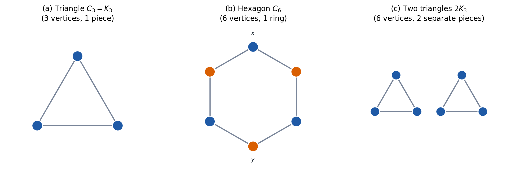
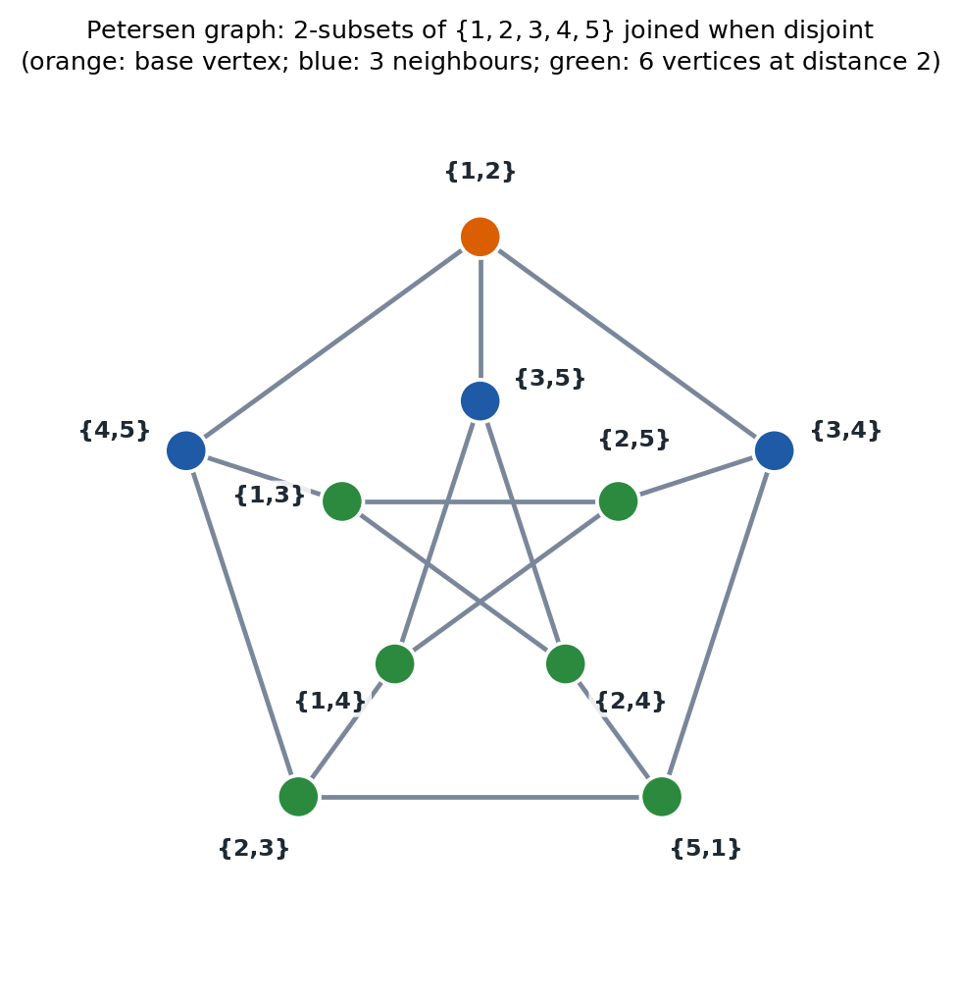
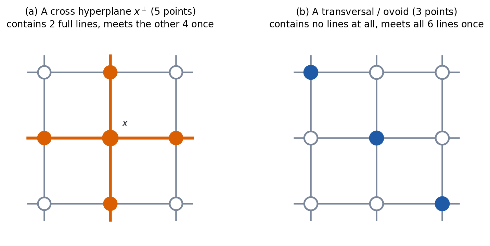
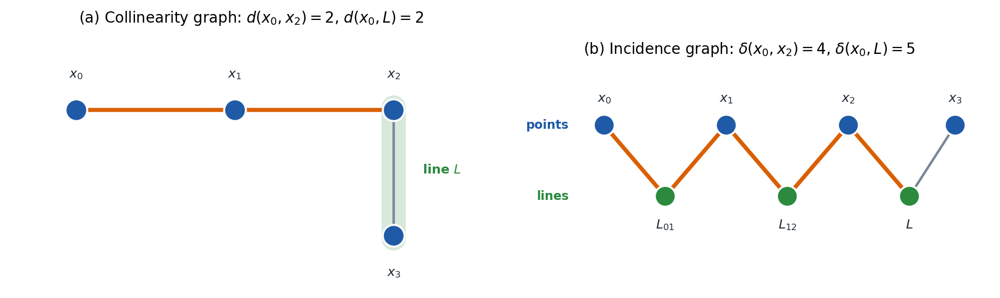
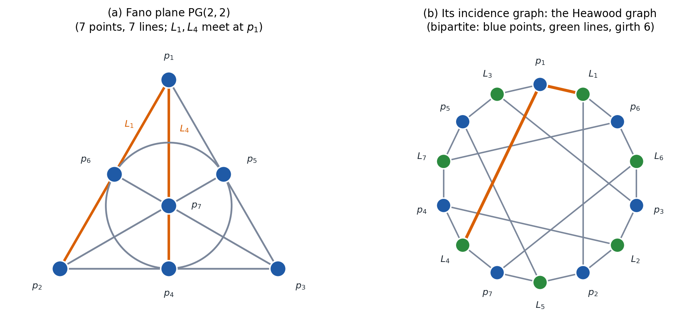
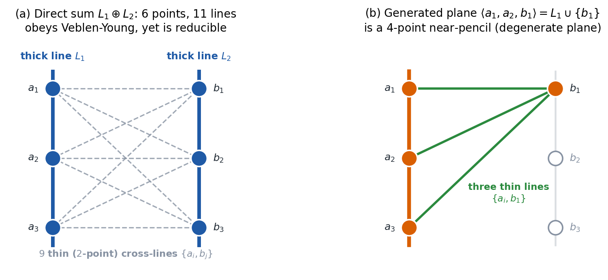
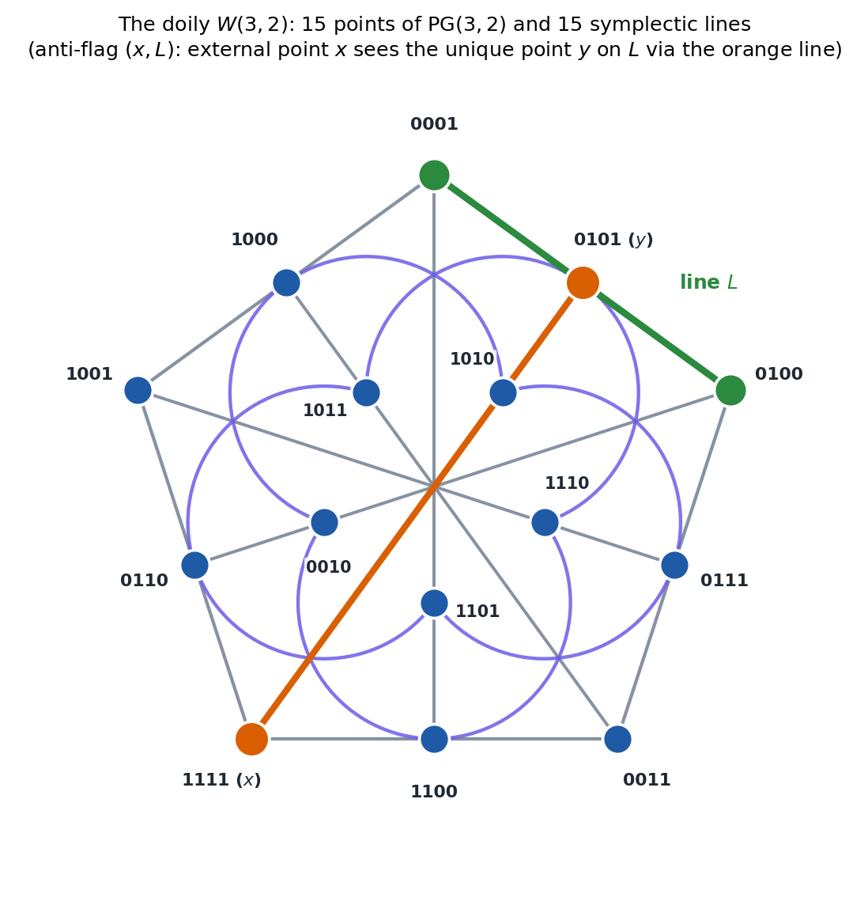
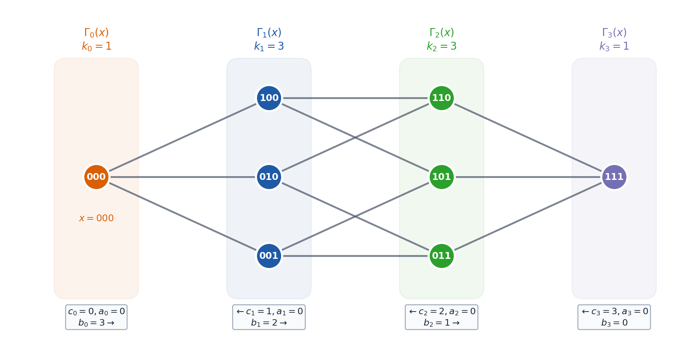
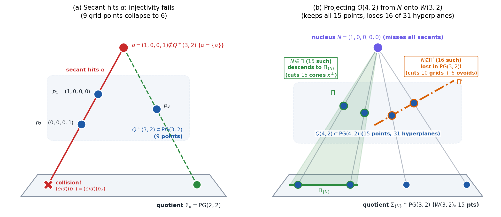
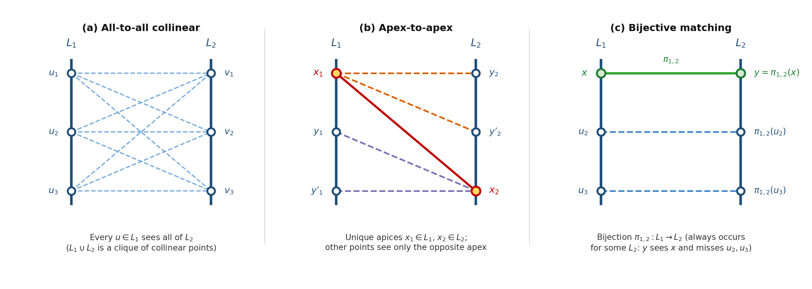

# Maths 4 - Incidence Geometry

A convention used here: Vector spaces are right vector spaces, with scalars written on the right and coordinates as column vectors, whereas the earlier projective geometry notes used left vector spaces. The prologue explains why this changes nothing over a field ([right vector spaces](#linear-algebra-over-finite-fields)).

## Prologue: The Linear Algebra We Need

Incidence geometry is concerned with point-line geometries, which is a fancy way of saying "how points connect to each other with lines." One important aspect is to figure out what sort of point-line geometries (or connections between points via lines) are allowed and not allowed over various fields and within various constraints. Surprisingly, some pretty simple matrics which contain just $1$s and $0$s can tell us a lot when we apply the tools of linear algebra on them.

Let's recap some core linear algebra. One example matrix runs throughout:

$$A = \begin{pmatrix} 0 & 1 & 1 \\ 1 & 0 & 1 \\ 1 & 1 & 0 \end{pmatrix}.$$

Label the corners of a triangle $1, 2, 3$, and put a $1$ in row $x$, column $y$ when corners $x$ and $y$ are joined by an edge, and $0$ otherwise. The result is $A$, which is called [the adjacency matrix](#the-adjacency-matrix-and-its-eigenvalues) of the triangle. "Adjacency" because it indicates which points are adjacent i.e. connected by a line and thus neighbours.

### Eigenvalues and eigenspaces

A number $\theta$ is an eigenvalue of a square matrix $A$ when $Av = \theta v$ for some nonzero vector $v$. The eigenvectors for $\theta$, together with $0$, form the eigenspace $V_\theta = \ker(A - \theta I)$. Two numbers measure how much of $\theta$ there is. The *algebraic multiplicity* is its multiplicity as a root of the characteristic polynomial $\det(XI - A)$. The *geometric multiplicity* is $\dim V_\theta$. The second is never larger than the first, and $A$ is diagonalizable exactly when the two agree for every eigenvalue.

For the running example, $\det(XI - A) = (X-2)(X+1)^2$. The eigenvalue $2$ has the eigenvector $j = (1,1,1)^T$, because every row of $A$ sums to $2$. For $\theta = -1$, note that $(Ax)_i = (x_1 + x_2 + x_3) - x_i$. Since $Av = \theta v$, we have $(x_1 + x_2 + x_3) - x_i = -1\cdot x_i$ and cancelling the $x_i$ on both side, we see every vector in the plane $x_1 + x_2 + x_3 = 0$ is an eigenvector. That plane has dimension $2$, equal to the algebraic multiplicity. Compare

$$N = \begin{pmatrix} 1 & 1 \\ 0 & 1 \end{pmatrix},$$

whose characteristic polynomial is $(X-1)^2$ but whose only eigenvectors are the multiples of $(1,0)^T$. Its two multiplicities are $2$ and $1$, and it cannot be diagonalized.

Similar matrices $P^{-1}AP$ (where $P$ represents a change of basis and is invertible) have the same characteristic polynomial, so they have the same eigenvalues with the same multiplicities.

**Where it is used.** The next chapter shows that the eigenvalues of a graph do not depend on how its vertices are labelled ([the adjacency matrix and its eigenvalues](#the-adjacency-matrix-and-its-eigenvalues)). In the chapter on [strongly regular graphs](#the-adjacency-matrix-of-a-strongly-regular-graph), the decisive test is that a multiplicity, being the dimension of an eigenspace, must be a whole number.

### Real symmetric matrices and the spectral theorem

Almost every matrix in the graph chapters is real and symmetric, and such matrices are as well behaved as matrices get. Their eigenvalues are real. Eigenvectors for different eigenvalues are orthogonal: if $Au = \theta u$ and $Av = \tau v$, then

$$\theta \langle u, v\rangle = \langle Au, v\rangle = \langle u, Av\rangle = \tau \langle u, v\rangle,$$

so $\langle u, v\rangle = 0$ when $\theta \neq \tau$. And there is an orthonormal basis of eigenvectors, so the two multiplicities always agree and we can simply say "multiplicity".

The spectral theorem packages all this. Let $E_\theta$ be the [orthogonal projector](#projectors-trace-and-positive-semidefinite-matrices) onto $V_\theta$. Then

$$A = \sum_\theta \theta E_\theta, \qquad \sum_\theta E_\theta = I, \qquad E_\theta E_\tau = 0 \ \text{ for } \theta \neq \tau.$$

This is the decomposition of an observable in quantum mechanics, with $E_\theta = \sum |v\rangle\langle v|$ over an orthonormal basis of $V_\theta$.

In the running example, the projector onto the line through $j$ is $E_2 = jj^T/3$, with every entry $1/3$, and the projector onto the plane is $E_{-1} = I - E_2$, with diagonal entries $2/3$ and off-diagonal entries $-1/3$. Then $2E_2 - E_{-1}$ has diagonal entries $0$ and off-diagonal entries $2/3 + 1/3 = 1$: it is $A$.

**Where it is used.** Adjacency matrices are real and symmetric, which is why a graph's eigenvalues are real ([the adjacency matrix and its eigenvalues](#the-adjacency-matrix-and-its-eigenvalues)). The decomposition $A = \sum_\theta \theta E_\theta$ is the backbone of [distance-regular graphs](#distance-regular-graphs), where $E_\theta$ is also called a minimal idempotent.

### Projectors, trace and positive semidefinite matrices

An **orthogonal projector** of a subspace $U$ is a matrix $E$ which takes a vector and returns the portion of the vector inside the subspace. Here's how it works. Every subspace $U \subseteq \mathbb{R}^n$ splits the entire space into two mutually perpendicular pieces: the target subspace $U$ (the image of $E$) and its orthogonal complement $U^\perp$ (the kernel of $E$), so that $\mathbb{R}^n = U \oplus U^\perp$. Every vector $v \in \mathbb{R}^n$ can be uniquely written as the sum of two perpendicular vectors: $v = v_\parallel + v_\perp$, where $v_\parallel \in U$ lies completely inside the subspace, and $v_\perp \in U^\perp$ is perpendicular to every vector in $U$.

When you multiply $v$ by the matrix $E$, it acts as a linear filter on those two components:

$$Ev = E(v_\parallel + v_\perp) = Ev_\parallel + Ev_\perp = 1\cdot v_\parallel + 0\cdot v_\perp = v_\parallel$$

It leaves the in-plane part $v_\parallel$ untouched (eigenvalue $1$). It annihilates the perpendicular part $v_\perp$ (eigenvalue $0$).

It's properties are $E^2 = E$ (doing it twice is the same as doing it once) and $E^T = E$ (it projects at right angles). Its eigenvalues are $0$ and $1$ as we saw: vectors in its image are fixed, and vectors orthogonal to the image are sent to $0$.

The trace, the sum of the diagonal entries, equals the sum of the eigenvalues counted with multiplicity, and $\operatorname{tr}(BC) = \operatorname{tr}(CB)$. For a projector the trace counts the eigenvalues equal to $1$, so $\operatorname{tr} E = \operatorname{rank} E$, the dimension of the image. In the running example $\operatorname{tr} E_2 = 3 \cdot \tfrac13 = 1$ and $\operatorname{tr} E_{-1} = 3 \cdot \tfrac23 = 2$, the dimensions of the two eigenspaces.

Trace equations pin down multiplicities. In the running example $\operatorname{tr} A = 0 = 2 + 2\cdot(-1)$, and $\operatorname{tr} A^2 = \sum_{i,l} A_{il}^2$, which for a symmetric matrix of zeros and ones counts its ones, is $6 = 2^2 + 2\cdot(-1)^2$. Knowing only the eigenvalues $2$ and $-1$ and that their multiplicities add up to $3$, either equation tells us how often each occurs.

A symmetric matrix $M$ is **positive semidefinite** when $x^T M x \geq 0$ for every vector $x$; equivalently, all its eigenvalues are $\geq 0$. Density matrices are the familiar case. Projectors are positive semidefinite, since $x^T E x = x^T E^T E x = |Ex|^2$.

**Where it is used.** In the chapter on [strongly regular graphs](#the-adjacency-matrix-of-a-strongly-regular-graph), the equation $\operatorname{tr} A = 0$ turns the eigenvalues into multiplicities. Positive semidefiniteness drives two inequalities proved there and in [distance-regular graphs](#distance-regular-graphs), the absolute bound and the Krein conditions.

### Polynomials in a matrix and the minimal polynomial

A polynomial $p(X) = c_0 + c_1 X + \dots + c_m X^m$ can be evaluated at a square matrix: $p(A) = c_0 I + c_1 A + \dots + c_m A^m$. Polynomials in the same matrix commute, and if $Av = \theta v$ then $p(A)v = p(\theta)v$: $p(A)$ has the eigenvalues $p(\theta)$ on the same eigenvectors.

The **minimal polynomial** of $A$ is the monic polynomial $m_A$ (leading coefficient $1$) of least degree with $m_A(A) = 0$; any nonzero scalar multiple of it is also called a minimal polynomial. It divides every polynomial that sends $A$ to $0$, including the characteristic polynomial (Cayley–Hamilton). Its roots are exactly the eigenvalues: if $Av = \theta v$ then $0 = m_A(A)v = m_A(\theta)v$, so $m_A(\theta) = 0$.

In the running example, $A^2$ has diagonal entries $2$ and off-diagonal entries $1$, so $A^2 = A + 2I$. Since $A$ is not a multiple of $I$, no polynomial of degree $1$ works, and

$$m_A(X) = X^2 - X - 2 = (X-2)(X+1).$$

It has degree $2$, although $A$ is $3 \times 3$ and its characteristic polynomial $(X-2)(X+1)^2$ has degree $3$.

You know minimal polynomials from field theory, where the minimal polynomial of an element $\alpha$ over a field $K$ is always irreducible. Here $m_A$ factors, and the difference is zero divisors. In a field, $g(\alpha)h(\alpha) = 0$ forces $g(\alpha) = 0$ or $h(\alpha) = 0$, so a factorization would produce a smaller polynomial. Matrices can multiply to zero without either being zero: $(A - 2I)(A + I) = 0$ here. For a matrix, "minimal" means least degree and nothing more.

The factorization carries information: a real matrix is diagonalizable over $\mathbb{R}$ exactly when its minimal polynomial has distinct real roots $\theta_1, \dots, \theta_s$. The reason is a set of projectors built from $A$:

$$E_i = \prod_{l \neq i} \frac{A - \theta_l I}{\theta_i - \theta_l},$$

the Lagrange polynomial that is $1$ at $\theta_i$ and $0$ at the other roots, evaluated at $A$. These add up to $I$, as the polynomials add up to $1$, and $(A - \theta_i I)E_i$ is a multiple of $m_A(A) = 0$, so each $E_i$ maps into the eigenspace of $\theta_i$; the eigenspaces fill the space. A repeated root signals failure ($N$ above has $m_N = (X-1)^2$, since $(N - I)^2 = 0 \neq N - I$), and so does a missing real root (a rotation by $90^\circ$ has $X^2 + 1$). For a real symmetric matrix, $m_A = \prod (X - \theta)$ over its distinct eigenvalues, so the degree of $m_A$ is the number of distinct eigenvalues, and the $E_i$ are exactly the orthogonal projectors onto the eigenspaces. In the example, $E_2 = (A + I)/3$ and $E_{-1} = (2I - A)/3$.

**Where it is used.** For [strongly regular graphs](#the-adjacency-matrix-of-a-strongly-regular-graph), a quadratic equation holds for the adjacency matrix on the vectors orthogonal to the all-ones vector, giving two eigenvalues there and, with one more on the all-ones vector, three in all. For [distance-regular graphs](#distance-regular-graphs), the degree of the minimal polynomial counts the eigenvalues. Projectors written as polynomials in $A$ appear in both.

### The all-ones matrix and commuting matrices

Write $j$ for the column vector with every entry $1$, and $J = jj^T$ for the square matrix with every entry $1$. The earlier projective geometry notes used $J$ for the matrix of a symplectic form; in these notes $J$ is always the all-ones matrix. For any $x$, $Jx = (x_1 + \dots + x_n)\,j$. So the $n \times n$ matrix $J$ has eigenvalue $n$ on $j$, and eigenvalue $0$ on the $(n-1)$-dimensional space $j^\perp$ of vectors whose entries sum to zero. Also $J^2 = nJ$.

Matrices of the form $aI + bJ$ come up constantly, and their eigenvalues can be read off: $a + nb$ once, on $j$, and $a$ with multiplicity $n - 1$, on $j^\perp$. Hence

$$\det(aI + bJ) = (a + nb)\,a^{n-1}.$$

The running example $A = J - I$ has eigenvalues $2$ once and $-1$ twice, as found above. In the next chapter the $7 \times 7$ matrix $2I + J$ appears; its eigenvalues are $9$ once and $2$ six times, and its determinant is $9 \cdot 2^6 = 576$, which is not zero.

Commuting symmetric matrices can be diagonalized together: if $AB = BA$ and $Av = \theta v$, then $A(Bv) = \theta\, Bv$, so $B$ maps each eigenspace of $A$ into itself and can be diagonalized inside it. The typical case: if every row and column of $A$ sums to $k$, then $AJ = JA = kJ$, so we may take $j$ as one eigenvector and all the others in $j^\perp$, where $J$ acts as $0$. On $j^\perp$, any equation in $A$, $I$ and $J$ loses its $J$ terms.

**Permutation matrices.** A permutation matrix $P$ has exactly one $1$ in each row and each column, and $0$ elsewhere. It is orthogonal, $P^T = P^{-1}$, and $PJ = JP = J$. Renumbering the rows and columns of $A$ by the same permutation replaces $A$ by the similar matrix $P^TAP$, with the same eigenvalues. And $P$ commutes with $A$ exactly when $P^TAP = A$, as every permutation of three indices does for the running example.

**Where it is used.** Relabelling a graph is conjugation by a permutation matrix ([the adjacency matrix and its eigenvalues](#the-adjacency-matrix-and-its-eigenvalues)). The matrix $2I + J$ counts incidences in the Fano plane ([point-line geometries](#point-line-geometries)), and a relative of it gives [Fisher's inequality](#fishers-inequality). Dropping $J$ on $j^\perp$ is the first step for [strongly regular graphs](#the-adjacency-matrix-of-a-strongly-regular-graph). The permutation matrices commuting with $A$ are the symmetries of a graph, and the matrices commuting with all of them form the commutant you know from group theory, which returns in [distance-regular graphs](#distance-regular-graphs).

### Rank, determinants and Gram matrices

The rank of a matrix is the dimension of its column space; for a symmetric matrix it is the number of nonzero eigenvalues, counted with multiplicity. The determinant is the product of the eigenvalues, so a square matrix is invertible exactly when its determinant is nonzero.

One rank fact does real work later. For a real matrix $M$,

$$\operatorname{rank}(MM^T) = \operatorname{rank} M.$$

The reason: if $MM^Tx = 0$, then $0 = x^TMM^Tx = |M^Tx|^2$, so $M^Tx = 0$; thus $MM^T$ and $M^T$ have the same kernel, hence the same rank. So if $M$ has $n$ rows and $MM^T$ is invertible, $M$ has at least $n$ columns. The step $|M^Tx|^2 = 0 \Rightarrow M^Tx = 0$ fails over $\mathbb{F}_2$: for $M = (1 \;\; 1)$, $MM^T = (2) = (0)$ although $M$ has rank $1$. This is one reason why the zero-one matrices of a geometry are taken over $\mathbb{R}$.

The **Gram matrix** of vectors $v_1, \dots, v_m$ in $\mathbb{R}^n$ is the $m \times m$ matrix $G$ with $G_{il} = \langle v_i, v_l \rangle$. If the $v_i$ are the columns of a matrix $V$, then $G = V^TV$. So $G$ is symmetric, positive semidefinite ($x^TGx = |Vx|^2$), and of rank equal to the dimension of the span of the $v_i$. It records the vectors up to rotation: their lengths and angles, nothing else.

Conversely, every positive semidefinite matrix $M$ of rank $r$ is a Gram matrix of vectors in $\mathbb{R}^r$. Write $M = \sum \theta\, uu^T$ over an orthonormal basis of eigenvectors $u$, with exactly $r$ of the $\theta$ positive. Stack the $r$ rows $\sqrt{\theta}\, u^T$ into a matrix $B$; then $M = B^TB$, the Gram matrix of the columns of $B$.

For example, three unit vectors in the plane at $120^\circ$ to each other have inner products $1$ and $\cos 120^\circ = -\tfrac12$, so their Gram matrix is

$$\begin{pmatrix} 1 & -\tfrac12 & -\tfrac12 \\ -\tfrac12 & 1 & -\tfrac12 \\ -\tfrac12 & -\tfrac12 & 1 \end{pmatrix} = \tfrac32\, E_{-1},$$

of rank $2$, as it must be for vectors in a plane. Read backwards, the projector $E_{-1}$ of the running example *is* a configuration of three vectors at $120^\circ$. Project the three standard basis vectors $e_i$ onto the plane $x_1 + x_2 + x_3 = 0$: the Gram matrix of the projections is $E_{-1}$ itself, because $\langle Ee_i, Ee_l\rangle = (E^TE)_{il} = E_{il}$. This is the idea behind the absolute bound for strongly regular graphs. A small eigenspace must hold one vector per vertex with only a few different angles between them, and there is a limit: $\mathbb{R}^m$ holds at most $m(m+3)/2$ unit vectors with only two different angles between them.

The **entrywise product** of two matrices of the same shape multiplies them entry by entry: $(B \circ C)_{il} = B_{il} C_{il}$. It is also called the Hadamard or Schur product. The **Schur product theorem** says that the entrywise product of two positive semidefinite matrices is positive semidefinite. With Gram matrices the proof is one line. Write $B$ as the Gram matrix of vectors $u_i$ and $C$ as the Gram matrix of vectors $w_i$; then $B \circ C$ is the Gram matrix of the tensor products $u_i \otimes w_i$, because

$$\langle u \otimes w,\, u' \otimes w' \rangle = \langle u, u' \rangle \langle w, w' \rangle,$$

the rule for the inner product of two product states of a pair of qubits. For instance, $E_{-1} \circ E_{-1}$ has diagonal entries $4/9$ and off-diagonal entries $1/9$, so it equals $\tfrac13 I + \tfrac19 J$, with eigenvalues $\tfrac13 + \tfrac39 = \tfrac23$ once and $\tfrac13$ twice: positive, as promised.

One more identity is needed only for the Krein conditions in [distance-regular graphs](#distance-regular-graphs): for symmetric $B$ and $C$, the sum of all the entries of $B \circ C$ is $\operatorname{tr}(BC)$. For $E_{-1} \circ E_{-1}$ both sides equal $2$.

**Where it is used.** The rank argument is [Fisher's inequality](#fishers-inequality). Gram matrices give the absolute bound for [strongly regular graphs](#the-adjacency-matrix-of-a-strongly-regular-graph), and the Schur product theorem gives the Krein conditions for [distance-regular graphs](#distance-regular-graphs).

### Linear algebra over finite fields

This section is used only from the chapter on [hyperplanes and projective embeddings](#hyperplanes-and-projective-embeddings) onwards and can be skipped until then. It sharpens two tools from the earlier notes' construction of $PG(n, q)$ from $\mathbb{F}_q^{n+1}$, hyperplanes as kernels and quotient spaces, after a convention.

**Right vector spaces.** In these notes, scalars multiply vectors on the right, $v\lambda$, and coordinates are column vectors, so a matrix acts by $v \mapsto Mv$. The earlier projective geometry notes used left vector spaces and row vectors. Over a field the two conventions describe the same objects, and every finite skew field is a field (Wedderburn's theorem). The choice matters only over a genuine skew field such as the quaternions, in [polar spaces from sesquilinear forms](#polar-spaces-from-sesquilinear-forms).

**Linear functionals and hyperplanes.** A linear functional is a linear map $\varphi: V \to \mathbb{F}_q$. In coordinates, $\varphi(x) = a^Tx = a_0x_0 + \dots + a_nx_n$ for a coefficient vector $a$: the earlier notes wrote $a$ as the column of hyperplane coordinates $[a_0, \dots, a_n]$, and as a functional it acts as the row $a^T$. A nonzero $\varphi$ has a hyperplane as its kernel, every hyperplane arises this way, and two nonzero functionals have the same kernel exactly when one is a scalar multiple of the other. So the hyperplanes of $PG(n, q)$ correspond to the nonzero functionals up to scalars, and there are as many hyperplanes as points, $(q^{n+1} - 1)/(q - 1)$. Over $\mathbb{F}_2$ the only nonzero scalar is $1$, so hyperplanes and nonzero functionals match one to one: $PG(3, 2)$ has $2^4 - 1 = 15$ planes, and $PG(4, 2)$ has $2^5 - 1 = 31$ hyperplanes.

**Quotient spaces.** For a subspace $U$ of $V$, the quotient $V/U$ has the cosets $v + U$ as its elements, and $\dim(V/U) = \dim V - \dim U$. Its subspaces correspond to the subspaces of $V$ that contain $U$, the bijection the earlier notes used to count subspaces through a fixed one. In particular, a projective point of $V/U$ is a subspace of $V$ one dimension larger than $U$ and containing it.

For example, take $V = \mathbb{F}_2^4$ and $U = \langle c \rangle$ with $c = (1,0,0,1)^T$; any nonzero $c$ would do, and this one returns in [what projection loses](#what-projection-loses). Then $V/U \cong \mathbb{F}_2^3$. A point of the quotient is a line of $PG(3, 2)$ through the point $\langle c \rangle$. Each such line holds two points $p$ and $p + c$ besides $c$, so the $14$ other points fall into $7$ pairs, the $7$ points of a Fano plane. This is projection from $c$: each pair looks like one point when seen from $c$.

**Where it is used.** A hyperplane of $PG(n, q)$, the kernel of a single functional, cuts out a hyperplane of any geometry sitting inside $PG(n, q)$, and projection from a point is a quotient ([giving a geometry coordinates](#giving-a-geometry-coordinates) and [what projection loses](#what-projection-loses)). Quotients also build [quotient polar spaces](#quotient-polar-spaces).

### Bilinear and sesquilinear forms in coordinates

This section is used only from the chapter on [polar spaces](#polar-spaces) onwards, apart from one example in [what projection loses](#what-projection-loses), and can be skipped until then. It handles the forms behind the earlier notes' polar spaces through their matrices.

Fix a basis $e_0, \dots, e_n$ of $V$. A bilinear form $f$ is determined by its Gram matrix $G$, with $G_{il} = f(e_i, e_l)$: the same idea as before, all pairings of the basis vectors. For coordinate vectors $x$ and $y$,

$$f(x, y) = x^T G y.$$

The form is symmetric when $G^T = G$, and alternating when $G^T = -G$ with zero diagonal.

Changing the basis changes $G$ by congruence. If the new basis vectors are the columns of an invertible $P$, so that $x = Px'$, the new Gram matrix is $G' = P^TGP$. This is not similarity: the eigenvalues of $G$ mean nothing for a form, but its rank does not change.

The radical of $f$, met in the earlier notes, is the set of vectors orthogonal to everything:

$$\operatorname{rad} f = \{ v : f(v, w) = 0 \text{ for all } w \}.$$

For a symmetric or alternating form it is the null space of $G$, and $f$ is nondegenerate (radical $0$) exactly when $\det G \neq 0$.

Two examples over $\mathbb{F}_2$:

- The form $f(x, y) = x_0y_1 + x_1y_0 + x_2y_3 + x_3y_2$ on $\mathbb{F}_2^4$ has the Gram matrix with $G_{01} = G_{10} = G_{23} = G_{32} = 1$ and all other entries $0$. Its determinant is $1$, so $f$ is nondegenerate. It is alternating, since $f(x, x) = 2x_0x_1 + 2x_2x_3 = 0$ over $\mathbb{F}_2$. Its totally isotropic lines give the $15$-point geometry of [generalized quadrangles: a first look](#generalized-quadrangles-a-first-look).
- The quadratic form $\Phi(x) = x_0^2 + x_1x_2 + x_3x_4$ on $\mathbb{F}_2^5$ has the polar form $f(x, y) = \Phi(x + y) - \Phi(x) - \Phi(y) = 2x_0y_0 + x_1y_2 + x_2y_1 + x_3y_4 + x_4y_3$. Over $\mathbb{F}_2$ the term $2x_0y_0$ vanishes, so the first row and column of $G$ are zero and $\operatorname{rad} f = \langle e_0 \rangle$. The quadric $\Phi = 0$ itself, with its $15$ points, is still the nondegenerate parabolic quadric $Q(4, 2)$ of the earlier notes, and $\langle e_0 \rangle$ is its nucleus.

**Sesquilinear forms.** A sesquilinear form twists one slot by a field automorphism $\sigma$, such as complex conjugation, or $a \mapsto a^q$ on $\mathbb{F}_{q^2}$. In these notes $\sigma$ acts on the first slot,

$$f(v\lambda, w\mu) = \lambda^\sigma f(v, w)\, \mu,$$

just as Dirac's $\langle v | w \rangle$ is antilinear in the bra. The earlier projective geometry notes put $\sigma$ on the second slot. The two conventions are mirror images: $f(v, w)$ in one is $f(w, v)$ in the other.

In coordinates, $f(x, y) = (x^\sigma)^T G y$, where $x^\sigma$ applies $\sigma$ to each entry, and a change of basis gives $G' = (P^\sigma)^T G P$. The form is Hermitian when $f(w, v) = f(v, w)^\sigma$ for all $v, w$. For example, let $\mathbb{F}_4 = \{0, 1, \omega, \omega^2\}$ with $\omega^2 = \omega + 1$, and let $\sigma(a) = a^2$, which swaps $\omega$ and $\omega^2$ and fixes $0$ and $1$. The form $f(x, y) = x_0^2 y_0 + x_1^2 y_1$ on $\mathbb{F}_4^2$ has $G = I$ and is Hermitian. A vector is isotropic when $f(x, x) = x_0^3 + x_1^3 = 0$. Every nonzero element of $\mathbb{F}_4$ has cube $1$ (the multiplicative group has order $3$), so $x_0^3 + x_1^3$ is $1 + 1 = 0$ when both coordinates are nonzero and $1$ otherwise. Of the $5$ points of $PG(1, 4)$, the $3$ points $\langle (1, a)^T \rangle$ with $a \neq 0$ are isotropic.

**Where it is used.** Forms in coordinates are the language of [polar spaces from sesquilinear forms](#polar-spaces-from-sesquilinear-forms) and [the classical polar spaces](#the-classical-polar-spaces), and the radical of a polar form is the nucleus used in [what projection loses](#what-projection-loses).

<!-- terms checked: positive semidefinite; minimal polynomial; entrywise product -->

## Graphs and Point-Line Geometries

<!-- terms checked: degree; automorphism; geometry; points; subspace; hyperplane -->

How can linear algebra prove that a finite geometry does not exist? The bridge goes through graphs. Every [point-line geometry](#point-line-geometries) gives rise to two natural graphs (one recording which points share a line, the other recording which points lie on which lines). Once we encode a graph in a real symmetric $0/1$ matrix, those local counts turn into polynomial equations for its [eigenvalues](#eigenvalues-and-eigenspaces), whose multiplicities are the dimensions of the corresponding eigenspaces and whose non-vanishing counts give the matrix rank. Because a vector space cannot have a fractional dimension, any hypothetical geometry whose counts force a non-integer eigenspace dimension cannot exist: that single integrality test will rule out impossible quadrangles in [Strongly Regular and Distance-Regular Graphs](#from-geometries-to-graphs-and-back) and restrict finite [generalized polygons](#generalized-polygons-a-first-look) (with at least three points per line and three lines per point) to $3$-, $4$-, $6$- and $8$-gons in [The Feit–Higman theorem](#the-feithigman-theorem), while a two-line rank check on [the incidence matrix](#collinearity-graphs-incidence-graphs) will bound block counts in [Designs](#fishers-inequality). First we build the graph language, then the geometry language that feeds into it.

### Graphs

#### Neighbours, valency and why local counts miss global shape

Let's begin by defining a simple undirected graph $\Gamma = (V, E)$, where $V$ is a set of vertices and $E$ is a set of 2-element subsets of $V$ called edges. Because edges are 2-element subsets rather than ordered pairs or multisets, loops (edges from a vertex to itself) and multiple edges between the same two vertices are automatically excluded.

* Empty and Complete graphs: An empty graph has no edges ($E = \emptyset$), whereas a complete graph $K_n$ has every possible edge between its $n$ vertices.

* Isomorphism and Automorphism: Two graphs are isomorphic if we can relabel the vertices of one to get the exact edge structure of the other. An automorphism is a symmetry of a single graph—a permutation of its vertices that preserves adjacency and non-adjacency.

* Complement: The complement of $\Gamma$ keeps the same vertices $V$ but flips all connections: edges become non-edges ($x \not\sim y$) and non-edges become edges ($x \sim y$).

* Valency (or degree) and Regularity: The valency of a vertex is the number of neighbors it has. If every vertex has the same number of neighbors $k$, the graph is regular of valency $k$.

*Figure 1. Three graphs that are all regular of valency $2$: (a) the triangle $C_3 = K_3$, (b) the hexagon $C_6$ with alternating blue and orange vertices and top and bottom corners $x, y$, and (c) two disjoint triangles $2 K_3$. Looking one step out from any vertex, all three look identical.*

Every vertex in Figure 1 has valency $2$. Even total counts fail to separate $C_6$ from $2 K_3$: both have $6$ vertices and $6$ edges, yet one is a single ring and the other falls into two pieces. Valency is purely local; to tell graphs apart, we have to walk further than one step.

* Cliques: A clique is a subset of vertices where every vertex is connected to every other vertex in the subset. It is therefore a complete graph sitting inside a larger graph. A maximal clique is one that does not lie within a larger clique i.e. adding any other vertex from the graph cannot enlarge it.

#### Paths, geodesics and distance
A path is a walk along edges without repeating vertices. The distance $d(x, y)$ is the length of a shortest path (called a geodesic) between $x$ and $y$. The distance between a set of points or lines and a point or set of points or lines is the shortest distance between two points, one take from each of the two sets.

The diameter $\operatorname{diam}(\Gamma)$ is the largest distance between any pair of vertices in the graph (or $\infty$ if $\Gamma$ is disconnected), while the girth $g = \operatorname{girth}(\Gamma)$ is the length of a shortest closed cycle (or $\infty$ if $\Gamma$ has no cycles). In any graph with a cycle, two opposite vertices $x, y$ on a shortest cycle $C$ of length $g$ lie at distance $d(x, y) = \lfloor g / 2 \rfloor$ in $\Gamma$ (any shorter path between them would combine with half of $C$ to create a cycle shorter than $g$). Because $d(x, y) \le \operatorname{diam}(\Gamma)$, girth and diameter always satisfy

$$\operatorname{girth}(\Gamma) \le 2 \operatorname{diam}(\Gamma) + 1$$

(sharpening to $\operatorname{girth}(\Gamma) \le 2 \operatorname{diam}(\Gamma)$ when $g$ is even), and any two vertices at distance $d(u, v) < g / 2$ have a *unique* geodesic between them (two distinct paths of length $i$ would close a cycle of length $\le 2i < g$).

Two points at the maximum possible distance (the diameter $d$) are called **opposite**.

Check Figure 1:

- $C_3$ has diameter $1$ and girth $3 = 2(1) + 1$.
- In $C_6$, the girth is $6 = 2(3)$ and the top and bottom corners $x$ and $y$ in Figure 1(b) satisfy $d(x, y) = 3$ (the diameter), joined by *two* distinct geodesics of length $3$ (left or right around the ring), whereas closer pairs ($d < 6 / 2 = 3$) have a unique geodesic.
- $2 K_3$ is disconnected, with $2$ components, girth $3$, and diameter $\infty$.

Valency only tells you what happens in the locality of a vertex. Distance captures global information. Keep that uniqueness switch in $C_6$ in mind: in [Basic properties of generalized polygons](#basic-properties-of-generalized-polygons), geodesics will stay *unique* at every distance below the maximum distance, then close from several directions at once.

* Subgraph vs. Induced Subgraph: A general subgraph takes a subset of vertices $V'$ and some chosen subset of edges between them. An induced subgraph on $V'$ takes the subset of vertices $V'$ and is forced to keep every edge from the original graph whose endpoints both lie in $V'$.

Induced subgraphs vs. cliques in collinearity graphs: Later, when we pass from a graph to a point-line geometry, a line is always a clique in the collinearity graph, but not every maximal clique is a line. Also, the distinction between a general subgraph and an induced subgraph mirrors the later distinction between a general subgeometry and a subspace.

#### Bipartite graphs

A graph $\Gamma = (V, E)$ is **bipartite** if $V$ splits into two disjoint subsets $X_1, X_2$ (possibly empty) so every edge has one endpoint in $X_1$ and one in $X_2$. A graph is bipartite if and only if every cycle has even length. To see this, consider the hexagon in Figure 1(b). Colour each vertex alternately with two colours, blue and orange. Each edge then passes between the two disjoint sets (one blue and the other orange) of coloured vertices. Check how alternating blue and orange around $C_6$ in Figure 1(b) works cleanly, whereas two-colouring $C_3$ fails on the third corner. This is because in odd cycles, we will invariably end up with two vertices of the same colour adjacent to each other.

[Every geometry's incidence graph](#point-line-geometries) is bipartite by construction, and distance-parity will [recover a polygon from its double](#basic-properties-of-generalized-polygons).

A **multipartite** (or **$k$-partite**) graph partitions the vertex set $V$ into $k$ disjoint sets $X_1, \dots, X_k$ so that every edge crosses between two different sets. It is a **complete $k$-partite graph**, written $K_{n_1, n_2, \dots, n_k}$ when the parts have sizes $|X_i| = n_i$ (and $K_{n_1, n_2}$ for a **complete bipartite graph** when $k = 2$), if every vertex in each $X_i$ is joined by an edge to every vertex in every other $X_j$ ($i \neq j$).

#### The Petersen graph as a packing puzzle

Before bringing in matrices, watch how small diameter plus large girth locks a graph's size and local structure completely.

**Puzzle:** If every vertex of $\Gamma$ has valency $3$ and any two vertices lie at distance at most $2$, how many vertices can $\Gamma$ have?

Count outwards from any base vertex $x$: there is $1$ vertex at distance $0$ ($x$), $3$ neighbours at distance $1$, and at most $2$ further edges leaving each neighbour, giving at most $3 \times 2 = 6$ vertices at distance $2$. Since diameter $\le 2$, there is nothing further out:

$$|V| \le 1 + 3 + 6 = 10.$$

What if $\Gamma$ actually hits $10$ vertices? Then none of the $6$ outgoing edges from distance $1$ can be wasted:

1. No edge can join two neighbours of $x$ (that would stay inside layer $1$ and form a triangle). Since $x$ was arbitrary, $\Gamma$ has no $3$-cycles, and *adjacent vertices share $0$ common neighbours*.
2. No two outgoing edges can meet at the same distance-$2$ vertex (that would merge two of the $6$ slots and form a $4$-cycle). Since $x$ was arbitrary, $\Gamma$ has no $4$-cycles, and *non-adjacent vertices share a unique common neighbour*.

Reaching $10$ vertices forces girth $\ge 5$! We can build this graph in one stroke: take the $\binom{5}{2} = 10$ two-element subsets of $\{1, 2, 3, 4, 5\}$ as vertices, and join two $2$-subsets whenever they are disjoint. This is the **Petersen graph** (Figure 2).

*Figure 2. The Petersen graph: vertices are the $10$ two-element subsets of $\{1, 2, 3, 4, 5\}$, joined when disjoint. From $\{1, 2\}$ (orange), the $3$ blue neighbours are pairs from $\{3, 4, 5\}$, and the $6$ green vertices at distance $2$ overlap $\{1, 2\}$ in one symbol. Unmarked crossings of inner star edges are not vertices.*

Check all four properties directly from $\{1, 2, 3, 4, 5\}$:

- **Valency $3$:** $\{1, 2\}$ leaves $\{3, 4, 5\}$, forming $\binom{3}{2} = 3$ disjoint pairs $\{3, 4\}, \{3, 5\}, \{4, 5\}$.
- **Adjacent pairs share $0$ neighbours:** $\{1, 2\}$ and $\{3, 4\}$ use four symbols, leaving only $\{5\}$, too small to form a pair.
- **Non-adjacent pairs share $1$ neighbour:** $\{1, 2\}$ and $\{1, 3\}$ use $\{1, 2, 3\}$, leaving uniquely $\{4, 5\}$ disjoint from both (diameter $2$, no $4$-cycles).
- **Girth $5$:** the outer pentagon $\{1, 2\} \sim \{3, 4\} \sim \{5, 1\} \sim \{2, 3\} \sim \{4, 5\} \sim \{1, 2\}$ closes a $5$-cycle.

This is the fundamental of what we will call [Generalized Polygons](#generalized-polygons) later: forbidding short cycles while keeping everything close forces an exact vertex count and uniform neighbour counts. Graphs on $v$ vertices of valency $k$ whose adjacent and non-adjacent pairs have constant common-neighbour counts $\lambda$ and $\mu$ are called [strongly regular](#strongly-regular-graphs) (here $(v, k, \lambda, \mu) = (10, 3, 0, 1)$), studied in [Strongly Regular and Distance-Regular Graphs](#strongly-regular-and-distance-regular-graphs).

#### The adjacency matrix and its eigenvalues

Order the $v$ vertices of a finite graph $\Gamma$ as $(p_1, \dots, p_v)$ and form its $v \times v$ **adjacency matrix** $A$ over $\mathbb{R}$ (never over $\mathbb{F}_2$, since we want real path counts without mod-$2$ cancellation), setting $A_{ij} = 1$ if $p_i \sim p_j$ and $0$ otherwise. Because $A$ is real symmetric with zero diagonal, [the spectral theorem](#real-symmetric-matrices-and-the-spectral-theorem) guarantees real eigenvalues and diagonalizability.

Writing $A$ down needs an order for the vertices. But let's say you changed the order. You can do this by using $P^TAP$ as the adjacency matrix, where $P$ is a permutation matrix on the vertices. The new madjacency matrix will still have the same eigenvalues and multiplicities ([permutation matrices](#the-all-ones-matrix-and-commuting-matrices)). These eigenvalues are therefore the eigenvalues of $\Gamma$ itself. The list of eigenvalues is sometimes called the spectrum of $\Gamma$. In eigenvalue lists, exponents mark multiplicity: $1^2$ means eigenvalue $1$ twice.

Compare our two $6$-vertex valency-$2$ graphs from Figure 1:

- **Two triangles $2 K_3$:** The $2K_3$ adjacency matrix contains two triangle matrices arranged along the diagonal with zeroes everywhere else. Since $A_{K_3} = J_3 - I_3$ had eigenvalues $2, (-1)^2$ in [the prologue](#real-symmetric-matrices-and-the-spectral-theorem). Doubling the block gives $2^2, (-1)^4$.
- **Hexagon $C_6$:** Around the $6$-cycle, $(A w)_i = w_{i-1} + w_{i+1}$. Constant $(1, 1, 1, 1, 1, 1)^T$ gives $\theta = 2$; alternating $(1, -1, 1, -1, 1, -1)^T$ gives $\theta = -2$; $(1, 1, 0, -1, -1, 0)^T$ and its shift $(0, 1, 1, 0, -1, -1)^T$ give $\theta = 1$ twice; and $(1, -1, 0, 1, -1, 0)^T$ and $(0, 1, -1, 0, 1, -1)^T$ give $\theta = -1$ twice. Thus $C_6$ has eigenvalues $2, 1^2, (-1)^2, -2$.

Where do these eigenvalues come from without guessing the vectors?

1. **Standing waves around the cycle (roots of unity):** Because shifting one step around the $6$-cycle is rotation by $\alpha = \frac{2\pi r}{6}$ ($r = 0, 1, 2, 3, 4, 5$), testing $w_m = e^{i m \alpha}$ gives $(Aw)_m = e^{i(m-1)\alpha} + e^{i(m+1)\alpha} = (e^{-i\alpha} + e^{i\alpha})e^{im\alpha} = 2\cos(\alpha)\, w_m$. Plugging in $\alpha = r \cdot 60^\circ$ immediately yields $\theta_r = 2\cos(r \cdot 60^\circ) = 2,\, 1,\, -1,\, -2,\, -1,\, 1$ (and the real eigenvectors above are integer-scaled combinations of $\cos(m \cdot 60^\circ)$ and $\sin(m \cdot 60^\circ)$).

2. **Polynomial shortcut ($A^3 - 3A = 2P$):** Taking $3$ steps on $C_6$ from vertex $i$ either reaches the opposite corner ($2$ ways: clockwise or counterclockwise) or steps back and forth to an immediate neighbour ($3$ ways each). Thus $A^3 = 3A + 2P$, where $P$ swaps opposite corners of the hexagon. Since $P^2 = I$ has eigenvalues $\pm 1$, every eigenvalue $\theta$ of $A$ satisfies $\theta^3 - 3\theta = \pm 2$, which factors into $(\theta - 2)(\theta + 1)^2 = 0$ and $(\theta + 2)(\theta - 1)^2 = 0$, giving $\theta = 2, (-1)^2$ and $\theta = -2, 1^2$.

Two differences jump out between $2^2, (-1)^4$ and $2, 1^2, (-1)^2, -2$: the multiplicity of $2$, and the appearance of $-2$ because the hexagon is bipartite.

We can put a few conditions on the eiegenvalues. The valency $k$ is always an eigenvalue of the graph because every row has $k$ ones, so the all-ones vector $j$ satisfies $Aj = kj$.

No eigenvalue $\theta$ can ever exceed $k$ in absolute value ($\vert{}\theta\vert{} \le k$). To see why, assume that the eigenvector $w$ has a maximum component $w_i$. The $i^{th}$ component of $Aw = \theta w$ will be a maximum of $kw_i$. But this should equal $\theta w_i$, which means $\theta w_i \le kw_i$ which gives us the limit.

The multiplicity of the eigenvalue $k$ counts the exact number of connected components of the graph. In particular, a $k$-regular graph is connected if and only if the eigenvalue $k$ has multiplicity 1.

A connected finite $k$-regular graph ($k \ge 1$) has $-k$ as an eigenvalue if and only if it is bipartite. 

A few more definitions of types of graphs. 

Strongly Regular Graphs (SRGs): A graph with $v$ vertices (neither empty nor complete) is strongly regular with parameters $(v, k, \lambda, \mu)$ if it is $k$-regular i.e. every vertex has a valency of $k$, every pair of adjacent vertices shares $\lambda$ common neighbors, and every pair of distinct non-adjacent vertices shares $\mu$ common neighbors. Note that when we say non-adjacent, we mean any distance larger than 1, but the fact that they share common neighbours means that the distance is always 2.

Distance-Regular Graphs (DRGs): This generalizes strong regularity to arbitrary diameter $d$, with parameters $(a_i, b_i, c_i)$ for each distance $i \in \{0, \dots, d\}$. Instead of only looking at distance 1 (adjacent) and distance 2 (non-adjacent), we require that for any two vertices $x$ and $y$ at distance $i$ from each other, the number of neighbors of $y$ that are one step closer to $x$ (at distance $i-1$) is a constant $c_i$, the number of neighbors of $y$ at the same distance $i$ from $x$ is a constant $a_i$, and the number of neighbors of $y$ one step further away from $x$ (at distance $i+1$) is a constant $b_i$.

We have the property $a_i + b_i + c_i = k$ for every $i$ because any neighbor of $y$ can only be at distance $i-1$, $i$, or $i+1$ from $x$. Since $y$ has $k$ neighbors in total, those three counts must add up to $k$. At the boundaries, several values are fixed automatically: $c_0 = 0$ and $a_0 = 0$ (no vertices at distance $-1$ and no self-loops), $b_0 = k$ (all $k$ neighbors of $x$ are at distance $1$), $c_1 = 1$ (for $y \sim x$, $x$ itself is the only neighbor of $y$ at distance $0$), and $b_d = 0$ (no vertices exist beyond the diameter $d$).

SRGs are DRGs of diameter 2. In a connected graph of diameter 2, the only possible distances between distinct vertices are $i = 1$ (adjacent) and $i = 2$ (non-adjacent). For $i = 1$, $a_1$ is the number of common neighbors of two adjacent vertices ($\lambda$). For $i = 2$, $c_2$ is the number of common neighbors of two non-adjacent vertices ($\mu$).

### Point-line geometries

#### Points, lines, duals and doubles

A point-line geometry is a triple $S = (\mathcal{P}, \mathcal{L}, I)$ of points $\mathcal{P}$, lines $\mathcal{L}$ (kept formally disjoint from $\mathcal{P}$), and an incidence relation $I \subseteq \mathcal{P} \times \mathcal{L}$ telling us which points lie on which lines, with the single basic requirement that every line contains at least two points.

From any geometry $S$, we have three derived geometries:

**The Point-Line Dual $S^D$**: Swap the roles of points and lines ($\mathcal{P}^D = \mathcal{L}$ and $\mathcal{L}^D = \mathcal{P}$) and keep incidence the same. Notice the condition: every point of $S$ must lie on at least two lines. Why? Because our definition of a geometry requires every line to have at least two points; when points of $S$ become lines of $S^D$, each old point needs at least two old lines on it so that the new lines in $S^D$ have at least two new points.

**The Double $S'$**: Put points and lines of $S$ together as the points of $S'$, and use the flags $\{x, L\}$ ($x$ is a point) of $S$ as the lines of $S'$ (so every line in $S'$ is thin, having size 2).

**The Internal Structure $S_x$ at a point $x$**: Assuming every line through $x$ has at least 3 points, take all neighbors of $x$ ($x^\perp \setminus \{x\}$, where $x^\perp$ is the set of points collinear with $x$ as well as $x$ itself) as the points, and the lines of $S$ passing through $x$ as the lines.

Notice carefully that in $S_x = (x^\perp \setminus \{x\}, \mathcal{L}_x, I_x)$, the lines are only the lines through $x$. If $S$ is a partial linear space, two lines through $x$ cannot meet anywhere else, so in $S_x$ the lines $\mathcal{L}_x$ simply partition $x^\perp \setminus \{x\}$ into disjoint sets of points. Later, when studying polar spaces or near polygons, we enrich this local view by either looking at how lines not through $x$ cut across $\mathcal{L}_x$ (turning the lines through $x$ into points and planes through $x$ into lines—the residue at $x$), or looking at the induced subgeometry on $x^\perp \setminus \{x\}$.

On the $3 \times 3$ grid in figure 5, $\mathcal{S}_x$ is $4$ points on two disjoint $2$-point lines. **Do not confuse $\mathcal{S}_x$ with the residue at $x$** from the earlier projective geometry notes (and [Quotient polar spaces](#quotient-polar-spaces)), where lines through $x$ become *points* and planes through $x$ become *lines*; $\mathcal{S}_x$ keeps neighbouring points as points, which is how we will build [derived designs](#designs-a-first-look) in [Designs: a first look](#designs-a-first-look) and [New designs from old](#new-designs-from-old).

Here are a few examples:

**The Fano plane $\mathrm{PG}(2, 2)$** (Figure 4(a)): $7$ points and $7$ lines of $3$ points each, $3$ lines per point. Swapping vectors and functionals on $\mathbb{F}_2^3$ shows $\mathrm{PG}(2, 2)$ is self-dual; its double has $14$ points and $21$ two-point lines.

**The $3 \times 3$ grid $Q^+(3, 2)$** ($x_0 x_3 + x_1 x_2 = 0$ in $\mathrm{PG}(3, 2)$, where $+$ and $-$ agree over $\mathbb{F}_2$): $9$ points on $3$ rows $R_1, R_2, R_3$ and $3$ columns $C_1, C_2, C_3$ ($2$ lines per point). Its dual $\mathcal{S}^D$ has $6$ points $\{R_1, R_2, R_3, C_1, C_2, C_3\}$ and $9$ two-point lines $\{R_i, C_j\}$ joining every row-point to every column-point (a **dual grid**), visibly non-isomorphic to the $9$-point grid yet sharing the same $15$-point, $18$-line double. Both return in [Basic properties of generalized polygons](#basic-properties-of-generalized-polygons) and [Which polygons exist](#which-polygons-exist).

#### Partial Linear Spaces

In a projective plane, we say any two lines are incident at exactly one point and any two points are connected by exactly one line. This is a linear space. But recall that our hyperbolic quadric in 3D did not satisfy this rule. Any two points had either 0 or 1 line connecting them.

So a more general rule is a geometry where any two distinct points lie on at most one common line (equivalently, any two distinct lines intersect in at most one point). This is a partial linear space. Here, no two distinct lines have the exact same set of incident points.

The partial linear space has order $(s, t)$ if every line has $s + 1$ points, and every point lies on $t + 1$ lines. Why $s + 1$ and $t + 1$ instead of $s$ and $t$? This comes from projective geometry over a finite field $\mathbb{F}_q$, where a projective line $PG(1, q)$ has $q + 1$ points (one point at infinity plus $q$ affine points). So for classical geometries over $\mathbb{F}_q$, $s = q$. Also, when you fix a point $x$ on a line, there are exactly $s$ other points on that line, so in a partial linear space of order $(s, t)$, the collinearity graph is regular with valency $k = s(t + 1)$.

A subgeometry picks a subset of points $\mathcal{P}'$ and a subset of lines $\mathcal{L}'$. In a general subgeometry, a line $L \in \mathcal{L}'$ might lose some of its original points if those points were not included in $\mathcal{P}'$ (so the line gets "chopped" or shortened). A subgeometry is called full if every line $L \in \mathcal{L}'$ keeps 100% of the points it had in the ambient geometry $S$. For example, in $PG(2, q) \subset PG(3, q)$, every line in the plane retains all $q + 1$ of its points from the ambient 3-space, making it a full subgeometry.

In a partial linear space $S = (\mathcal{P}, \mathcal{L}, I)$:

* Subspace: A subset of points $X \subseteq \mathcal{P}$ with the "two-point closure rule": whenever a line of $S$ has at least two of its points inside $X$, the entire line (all of its points) must lie inside $X$. Every nonempty subspace $X$ naturally forms a full subgeometry $\tilde{X}$ using the lines contained in $X$.

* Singular Subspace: A subspace where every pair of points is collinear. (Because $X$ is also a subspace, for any two points in a singular subspace, the unique line joining themexists in $S$ and lies completely inside $X$. Thus, singular subspaces look like projective spaces—points, lines, planes, etc., where all points are mutually collinear.)

In $\mathrm{PG}(n, q)$, if a subset $X$ obeys the two-point line rule ("whenever $x, y \in X$, the line $xy$ is in $X$"), then every pair $x, y \in X$ has a line in $X$, because every pair had a line in $\mathrm{PG}(n, q)$ to begin with.

In a **partial linear space $S$**, two points $x, y \in X$ might **not** have a line joining them in $S$. That creates a fork in the road:

1. **Subspace (plain two-point closure):** *"If a line of $S$ hits $X$ in $\ge 2$ points, the whole line is in $X$."*
   - What if $x, y \in X$ don't share a line in $S$? Nothing happens!
   - So a subspace does **not** have to be a flat plane: on the $3 \times 3$ grid (Figure 5), $3$ diagonal points with *no lines at all* form a subspace (because no grid line hits two of them!), and $1$ row + $1$ column forms a $5$-point cross subspace.
   - **Why we need it:** To define **hyperplanes** (slices of $S$ by ambient hyperplanes in [Hyperplanes and Projective Embeddings](#hyperplanes-and-projective-embeddings)), **subquadrangles**, and **generating sets** $\langle X \rangle$.

2. **Singular subspace:** *"A subspace where every two points of $X$ **are** collinear in $S$."*
   - This is the exact counterpart of a **linear subspace** from projective geometry: a genuinely flat projective space (point, line, plane, $\mathrm{PG}(k, q)$) sitting inside a curved quadric or polar space.
   - **Why we need it:** In [Polar Spaces](#polar-spaces), a polar space is built out of the flat projective spaces (singular subspaces) sitting on a quadric.

* Generated Subspace $\langle X \rangle$: Given any starting set of points $X$, there is a unique smallest subspace containing $X$, equal to the intersection of all subspaces containing $X$. How to build this subspace step by step from the bottom up:

Start with $X_0 = X$. To get $X_1$, draw every line that passes through at least two points of $X_0$, and throw all the points on those lines into $X_1$. Repeat: to get $X_i$, take every line passing through at least two points of $X_{i-1}$ together and add all points on those lines. The union $\bigcup_{i \in \mathbb{N}} X_i$ of all these steps is the exact subspace generated by $X$.

Adding all lines through pairs of points in $X_0$ creates new points in $X_1$. A line passing through two of those newly added points in $X_1$ might not have contained two points of $X_0$, so you have to run the line-completion step again for $X_2$, $X_3$, and so on. 

The generating index is the minimum number of points needed to generate the whole geometry $\mathcal{P}$. For an $n$-dimensional projective space $PG(n, q)$, the generating index is $n + 1$ (a basis of $n + 1$ points in general position generates the entire space in $n$ steps), whereas for polar spaces and generalized quadrangles, computing the generating index tells us the minimum dimension of the ambient vector space into which the geometry can be projectively embedded.

* Hyperplane: A proper subspace ($X \neq \mathcal{P}$) that intersects every single line of the geometry in at least one point. (Because $X$ is a subspace, any line of $S$ either meets the hyperplane $X$ in a single point, or is completely contained inside $X$.)

Unlike projective hyperplanes, a hyperplane of $\mathcal{S}$ need not look flat and may contain *no lines at all*! Let us find every hyperplane $H$ of the $3 \times 3$ grid (Figure 5):

- **If $H$ contains a line**, say row $R_i$, then $R_i$ alone misses the other two rows, so $H$ needs points in both. Picking points in two different columns would give two columns $2$ points each in $H$, swallowing both columns and then all $9$ points ($H = \mathcal{P}$, not proper). So the extra points must lie in one column $C_k$, giving **$9$ hyperplanes** $x^\perp = R_i \cup C_k$ of $5$ points each (Figure 5(a)).
- **If $H$ contains no line**, it meets every row and every column in *precisely $1$ point*: a permutation pattern! There are $3! = 6$ such $3$-point **transversals** (Figure 5(b)), which are subspaces vacuously because no line hits them twice.

There are thus 15 hyperplanes in total.

*Figure 5. The $15$ hyperplanes of the $3 \times 3$ grid fall into two shapes: (a) $9$ crosses $x^\perp$ ($5$ orange points, two full lines), and (b) $6$ transversals ($3$ blue points, no lines at all, meeting all six lines once).*

A set of points meeting *every line of $\mathcal{S}$ in precisely one point* is an **ovoid** of $\mathcal{S}$ (so every ovoid of a thick-lined partial linear space is a line-free hyperplane, like the $6$ transversals). **Watch the context shift:** in the earlier projective geometry notes, an ovoid of $\mathrm{PG}(3, q)$ was a $(q^2 + 1)$-point cap like $Q^-(3, q)$ missing many ambient lines, whereas an ovoid *of $\mathcal{S}$* meets every line *of $\mathcal{S}$* once. Notice that the $3 \times 3$ grid $Q^+(3, 2) \subset \mathrm{PG}(3, 2)$ has $9 + 6 = 15$ hyperplanes, matching the $15$ planes of $\mathrm{PG}(3, 2)$ ($9$ tangent planes cutting crosses, $6$ non-tangent planes cutting ovoids), a match explained in [What projection loses](#what-projection-loses).

#### Collinearity Graphs & Incidence Graphs

Every point-line geometry $S$ has two natural graphs attached to it:

The Collinearity Graph $\Gamma$: Vertices are the points $\mathcal{P}$, and two points are connected by an edge if they share a line.

For straightforward geometries where any line has only two points, this graph is the actual figure of the geometry that we would have learnt in high school. For example, the collinearity graph of a triangle is a triangle.

But notice what this graph cannot distinguish: one $3$-point line also has a collinearity graph that is a triangle $K_3$. This is why we need the Incidence Graph. 

The Incidence Graph: Vertices are both points and lines ($\mathcal{P} \cup \mathcal{L}$), and edges connect a point $p$ to a line $L$ whenever $(p, L)$ is a flag.

If every line of the geometry has only $2$ points (for example, in a thin geometry or when taking the double $\mathcal{S}'$), the incidence graph is literally obtained from the collinearity graph by inserting one line node in the middle of every edge.

When a line has $3$ or more points (say $L = \{p_1, p_2, p_3\}$), instead of putting $3$ separate line nodes on the $3$ edges of that triangle, all $3$ points connect to one single shared line node $L$ (forming a $3$-spoke star with hub $L$):

$$p_1 - L - p_2 \quad\text{and}\quad p_3 - L.$$

(Putting a separate node on each of the $3$ edges would instead describe three separate $2$-point lines $\{p_1, p_2\}, \{p_2, p_3\}, \{p_1, p_3\}$.)

*Figure 3. Collinearity distance $d$ versus incidence distance $\delta$: (a) a two-step collinearity path $x_0 \sim x_1 \sim x_2$ reaching the nearest point $x_2$ of $L$, giving $d(x_0, x_2) = d(x_0, L) = 2$; (b) the matching alternating incidence path $x_0 - L_{01} - x_1 - L_{12} - x_2 - L$, giving $\delta(x_0, x_2) = 4$ and $\delta(x_0, L) = 5$.*

There is a relationship that translates distances $d(\cdot, \cdot)$ measured in the collinearity graph into distances $\delta(\cdot, \cdot)$ measured in the bipartite incidence graph:

- Between two points $x$ and $y$: $\delta(x, y) = 2 \cdot d(x, y)$.
- Between a point $x$ and a line $L$: $\delta(x, L) = 2 \cdot d(x, L) + 1$.
- Between two distinct lines $L_1$ and $L_2$: $\delta(L_1, L_2) = 2 \cdot d(L_1, L_2) + 2$.

Why are there $+0$, $+1$, and $+2$ in the three formulas?

In the incidence graph, every single step alternates between a point and a line: $\text{point} \to \text{line} \to \text{point}$. So one collinearity step between two points always takes 2 steps in the incidence graph, giving $2 \cdot d(x, y)$.

For a point $x$ and a line $L$, $d(x, L)$ measures the collinearity distance from $x$ to the closest point $y$ on $L$. In the incidence graph, getting from $x$ to $y$ takes $2 \cdot d(x, L)$ steps, and then stepping from the point $y$ onto the line vertex $L$ itself takes 1 final step, giving $2 \cdot d(x, L) + 1$. (Notice that if $x$ lies on $L$, $d(x, L) = 0$ and $\delta(x, L) = 1$, which is a single flag edge.)

Similarly, for two distinct lines $L_1$ and $L_2$, we add another $1$ for the second line as well. 

Notice also that parity in the incidence graph is completely locked: point-to-point and line-to-line distances are always even, while point-to-line distances are always odd.

For a finite geometry $\mathcal{S}$, the two graphs give two real matrices: an adjacency matrix $A$ of $\Gamma$ (a **collinearity matrix**, whose eigenvalues are the eigenvalues of $\mathcal{S}$). 

But the full adjacency matrix of the bipartite incidence graph listing all points $\mathcal{P}$ first and all lines $\mathcal{L}$ second, splits into four blocks:

$$\widetilde{A} = \begin{pmatrix} 0 & M \\ M^T & 0 \end{pmatrix} \begin{matrix} \leftarrow \text{points } \mathcal{P} \\ \leftarrow \text{lines } \mathcal{L} \end{matrix}$$

- **Top-left ($0$):** no point-to-point edges in the incidence graph.
- **Bottom-right ($0$):** no line-to-line edges in the incidence graph.
- **Top-right ($M$):** point-to-line edges ($M_{p, L} = 1$ if $p \,\mathrm{I}\, L$).
- **Bottom-left ($M^T$):** line-to-point edges (just the transpose of $M$).

Because the two diagonal blocks are always $0$ and the bottom-left is just $M^T$, all the information in the incidence graph's adjacency matrix lives in that **top-right $|\mathcal{P}| \times |\mathcal{L}|$ block $M$**, which is what we call the **incidence matrix**. 

*Figure 4. (a) The Fano plane $\mathrm{PG}(2, 2)$ of order $(2, 2)$ ($7$ points, $7$ lines; $L_1$ and $L_4$ meet at $p_1$). (b) Its bipartite incidence graph, the $14$-vertex Heawood graph, drawn as a $14$-cycle alternating blue points and green lines with step-$5$ chords; orange edges mark the flags $(p_1, L_1)$ and $(p_1, L_4)$.*

Check both on $\mathrm{PG}(2, 2)$ in Figure 4. Its collinearity graph is $K_7$, forgetting which triples are lines; its incidence graph, the **Heawood graph** (also called simply the incidence graph of $\mathrm{PG}(2, 2)$), keeps everything, with $14$ vertices, valency $3$, girth $6$, and diameter $3$ (every two distinct points share a line and every two distinct lines share a point, giving $\delta = 2$, while anti-flags have $d(x, L) = 1$ and $\delta(x, L) = 3$). And multiplying its $7 \times 7$ incidence matrix $M$ by $M^T$ counts lines through both $x$ and $y$ via $(M M^T)_{xy} = \sum_L M_{x, L} M_{y, L}$: $3$ on the diagonal, $1$ off the diagonal (because each point has 3 lines incident on it and any pair of points share one line), giving

$$M M^T = 3 I_7 + (J_7 - I_7) = 2 I_7 + J_7$$

without writing down a single entry of $M$. Products like $M M^T$ and $A^2$ turn incidence counts into eigenvalue equations ([The adjacency matrix of a strongly regular graph](#the-adjacency-matrix-of-a-strongly-regular-graph) and [Fisher's inequality](#fishers-inequality)).

This will give us two algebraic weapons that prove theorems and rule out impossible geometries without ever having to draw or search for them. We will look at this in a little while. 

## A Gallery of Geometries

<!-- terms checked: blocks; order; rank; irreducible; reducible; direct sum; dimension; alternating -->

With graphs and point-line geometries in place, we now tour the core families of the course, building concrete small examples and stating the landmark classifications before proving them in later chapters. Projective spaces lay down the flat baseline; [Designs](#designs) keep uniform block counts while dropping coordinates; generalized quadrangles return in [From geometries to graphs and back](#from-geometries-to-graphs-and-back) and [Generalized quadrangles in depth](#generalized-quadrangles-in-depth); [Polar Spaces](#polar-spaces) lift quadrangles to arbitrary rank; and [Generalized Polygons](#generalized-polygons) govern how far paths must travel before closing.

### Small geometries that test the definitions

First, define the **complete bipartite graph** $K_{n_1, n_2}$ ($n_1, n_2 \ge 1$): its vertices split into two disjoint sets of sizes $n_1$ and $n_2$, with an edge joining *every* vertex of the first set to *every* vertex of the second. Now test our definitions from [Point-line geometries](#point-line-geometries) against eight edge-case geometries.

| Geometry | Points and lines | What it tests |
| --- | --- | --- |
| **Point** | $1$ point, $\mathcal{L} = \emptyset$, $\mathrm{I} = \emptyset$ | $\mathcal{L}$ may be empty; shows why $\mathcal{S}^D$ requires $\ge 2$ lines per point |
| **Line** | $\ge 2$ points, $1$ line containing all of them | A linear space of $1$ line; shows why plane and quadrangle axioms demand non-collinear points or disjoint lines |
| **Graph as thin geometry** | Vertices of $\Gamma = (V, E)$ as points, edges as $2$-point lines; for $\Gamma = K_n$ ($n \ge 3$), called a **circular space** | Every graph is a partial linear space whose lines are all [thin](#point-line-geometries) |
| **Generalized digon** (or **generalized $2$-gon**) | $\lvert\mathcal{P}\rvert \ge 2$, $\lvert\mathcal{L}\rvert \ge 2$, and $\mathrm{I} = \mathcal{P} \times \mathcal{L}$ (every point on every line) | Distinct lines share the *same* point set $\mathcal{P}$ (why [Point-line geometries](#point-line-geometries) used $\mathrm{I}$ rather than $\subseteq$); incidence graph has $4$-cycles |
| **Ordinary $n$-gon** ($n \ge 3$) | Points $\{1, \dots, n\}$, lines $\{\{1, 2\}, \dots, \{n, 1\}\}$ ($C_n$ as a geometry) | Self-dual baseline ($n = 3$ is a $3$-point circular space) |
| **Near-pencil** ($n \ge 3$) | $n$ points; one base line of size $n - 1$, plus $n - 1$ thin lines from an external point $p$ to each base point | Self-dual; the [degenerate projective planes](#projective-spaces-revisited) ($n = 3$ is an ordinary $3$-gon) |
| **$(k_1, \dots, k_r)$-star** (for $r = 2$, a **$(k_1, k_2)$-cross**) | Linear space with a hub $p$ on $r \ge 2$ lines of sizes $k_1, \dots, k_r \ge 2$, plus all $2$-point lines joining points on different hub lines | When $k_1, k_2 \ge 3$, two thick lines *meeting* at $p$ violate Veblen–Young (unlike *disjoint* thick lines below!) |
| **$(n_1 \times n_2)$-grid** and **dual grid** ($n_1, n_2 \ge 2$) | Points $X_1 \times X_2$ ($\lvert X_i\rvert = n_i$), lines the $n_1$ rows $\{i\} \times X_2$ and $n_2$ columns $X_1 \times \{j\}$; dual is $K_{n_1, n_2}$ as $2$-point lines | **Symmetrical** when $n_1 = n_2$, **nonsymmetrical** when $n_1 \neq n_2$; tests whether an order $(s, t)$ is automatic |

Watch one wording distinction: an **ordinary $n$-gon** here is simply the ring $C_n$ ($n$ points, $n$ two-point lines), not the "complete $n$-angle" of the earlier projective geometry notes ($4$ coplanar points determining all $\binom{4}{2} = 6$ joining lines, our $4$-point circular space $K_4$).

Extending [thin and thick lines](#point-line-geometries) ($2$ versus $\ge 3$ points) to a whole geometry:

- A geometry is **thick** if *every line has at least three points* and *every point lies on at least three lines* (like $\mathrm{PG}(2, 2)$).
- A geometry is **thin** if *every line has two points* and *every point lies on two lines* (like an ordinary $n$-gon).
- Between them sit geometries **thick one way and thin the other**: a $3 \times 3$ grid ($3$ points per line, $2$ lines per point), or its dual grid $K_{3, 3}$ and the [double](#point-line-geometries) of $\mathrm{PG}(2, 2)$ ($2$ points per line, $3$ lines per point).

Test the **$2 \times 3$ nonsymmetrical grid** ($2$ rows of $3$ points, $3$ columns of $2$ points): **it has no order $(s, t)$** because line sizes vary, yet for *every* anti-flag $(x, L)$, the perpendicular grid line through $x$ meets $L$ in a unique point! Unlike the earlier projective geometry notes (which baked an order $(s, t)$ into generalized quadrangles), [the quadrangle projection rule](#generalized-quadrangles-a-first-look) holds without forcing uniform line sizes.

### Projective spaces revisited

#### Projective spaces with thin lines allowed

A **projective plane** is a [linear space](#point-line-geometries) in which any two distinct lines meet in a unique point and three non-collinear points exist (making its dual a projective plane too). It is **nondegenerate** (or **irreducible**) if four points exist with no three collinear, forcing a uniform **order** $s \ge 2$ ($s + 1$ points per line, $s + 1$ lines per point); otherwise it is **degenerate** (or **reducible**). Every degenerate projective plane is a *near-pencil* (if a thick line $B$ had two external points $c, e$, picking two points of $B \setminus (ce \cap B)$ alongside $c, e$ would yield four points with no three collinear!).

In any dimension, a **projective space** is a linear space $\mathcal{S}$ obeying the **Veblen–Young axiom**: whenever distinct lines $L_1, L_2$ meet at an apex $z$ and we pick $x_i, y_i \in L_i \setminus \{z\}$ with $x_i \neq y_i$ ($i = 1, 2$), the lines $x_1 x_2$ and $y_1 y_2$ meet in a point. Equivalently, every three non-collinear points generate a [subspace](#point-line-geometries) that is a projective plane (possibly a near-pencil!).

Allowing $2$-point lines splits projective spaces in two: $\mathcal{S}$ is **irreducible** if every line is thick ($\ge 3$ points, including a single point with no lines at all), and **reducible** if at least one line is thin ($2$ points). Defining $x \equiv y$ when $x = y$ or $xy$ is thick partitions any reducible projective space into a **direct sum** $\bigoplus_i \mathcal{S}_i$ of irreducible projective spaces on disjoint point sets: keep all lines inside each piece $\mathcal{S}_i$, and glue distinct pieces together by adding *every* $2$-point cross-line $\{x_i, x_j\}$!

*Figure 6. Direct sum $L_1 \oplus L_2$ of two $3$-point lines: (a) $6$ points with $2$ thick lines (blue) and $9$ thin cross-lines $\{a_i, b_j\}$ (dashed); (b) any non-collinear triple $\{a_1, a_2, b_1\}$ generates the $4$-point near-pencil $L_1 \oplus \{b_1\}$.*

In Figure 6, why doesn't Veblen–Young break on $L_1 \oplus L_2$? Try taking apex $z = a_1$, first side $L_1$, and second side the thin line $\{a_1, b_1\}$: after deleting $a_1$, $\{a_1, b_1\} \setminus \{a_1\} = \{b_1\}$ leaves *only one point*, so two distinct points $x_2 \neq y_2$ cannot even be chosen on that side! Yet $L_1 \oplus L_2$ has lines of sizes $3$ and $2$, so it is no $\mathrm{PG}(d, F)$.

We define the **dimension** of a projective space $\mathcal{S}$ from its [generating index](#point-line-geometries) $N_{\mathcal{S}}$ as $\dim \mathcal{S} = N_{\mathcal{S}} - 1$ (point: $0$; line: $1$; plane: $2$; since generating indices add across $\oplus$, $\dim(L_1 \oplus L_2) = (2 + 2) - 1 = 3$), and set **$\dim \emptyset = -1$**. Both conventions pay off directly:

1. Allowing reducible projective spaces lets one axiom system in [Polar Spaces](#polar-spaces) cover thick spaces, grids, and thin polygons alike.
2. Setting $\dim \emptyset = -1$ keeps subspace dimension formulas (such as $\dim(U \cap W) + \dim\langle U, W \rangle = \dim U + \dim W$ for skew lines, and [generator](#polar-spaces-a-first-look)-intersection parity in [The classical polar spaces](#the-classical-polar-spaces)) exception-free when $U \cap W = \emptyset$.

#### Why planes are the exception

Once thin lines are excluded, the **Veblen–Young theorem** classifies every *irreducible* projective space: it is a point ($\dim 0$), a thick line ($\dim 1$), a nondegenerate projective plane ($\dim 2$), or a **Desarguesian** space $\mathrm{PG}(n, F)$ of dimension $n \ge 3$, built from the $1$- and $2$-dimensional subspaces of an $(n + 1)$-dimensional [right vector space over a skew field $F$](#linear-algebra-over-finite-fields).

As in the earlier projective geometry notes, dimension $n \ge 3$ provides room outside any plane to lift perspective triangles into $3$-space, forcing Desargues's theorem automatically, whereas isolated planes ($n = 2$) have no fourth coordinate to lift into, allowing non-Desarguesian planes. Over an infinite noncommutative skew field such as Hamilton's **quaternions** $\mathbb{H} = \{a + b\mathbf{i} + c\mathbf{j} + d\mathbf{k} \mid a,b,c,d \in \mathbb{R}\}$ ($\mathbf{i}^2 = \mathbf{j}^2 = \mathbf{k}^2 = \mathbf{i}\mathbf{j}\mathbf{k} = -1$), $\mathrm{PG}(3, \mathbb{H})$ is a genuine Desarguesian $3$-space where right-scaling vectors lets left matrix multiplication preserve rays $v\mathbb{H}$ even though Pappus's theorem fails. When $F$ is *finite*, **Wedderburn's theorem** says every finite skew field is a commutative field $\mathbb{F}_q$ ($q = p^e$), so every finite irreducible projective space of dimension $n \ge 3$ is $\mathrm{PG}(n, q)$.

Every *known* finite nondegenerate projective plane ($n = 2$) has prime-power order $s = p^e$ (unique and Desarguesian for $s \in \{2, 3, 4, 5, 7, 8\}$, with four non-isomorphic planes at $s = 9$). Two landmarks (stated without proof) rule out the smallest non-prime-powers:

- **Order $6$ does not exist**, by the **Bruck–Ryser theorem** (1949): if a projective plane of order $s \equiv 1$ or $2 \pmod 4$ exists, $s$ must be a sum of two squares ($6 \equiv 2 \pmod 4$ is not, killing $6, 14, 21, 22, \dots$).
- **Order $10$ does not exist** ($10 = 1^2 + 3^2$ passes Bruck–Ryser, and fell only to a 1989 computer search of Lam, Thiel and Swiercz); order $12$ and the prime-power conjecture remain open.

In [From one-or-all to Tits's axioms](#from-one-or-all-to-titss-axioms), verifying Veblen–Young on the [maximal singular subspaces](#polar-spaces-a-first-look) of an abstract polar space will turn them into projective spaces on the spot.

### Designs: a first look

#### Designs from familiar geometries

What survives if we drop configuration axioms and keep only uniform tuple-incidence counts? For positive integers $v \ge k \ge t$ with $k \ge 2$ and $\lambda \ge 1$, a **$t$-design** with parameters $(v, k, \lambda)$, written **$t$-$(v, k, \lambda)$ design**, is a finite point-line geometry $\mathcal{S} = (\mathcal{P}, \mathcal{B}, \mathrm{I})$ whose lines, called **blocks**, satisfy:

- $\lvert\mathcal{P}\rvert = v$, $\mathcal{B} \neq \emptyset$, and every block contains precisely $k$ points;
- every $t$ distinct points lie together in precisely $\lambda$ blocks;
- distinct blocks have *distinct point sets* (so blocks are $k$-subsets of $\mathcal{P}$).

When $\lambda = 1$, the design is a **Steiner system**, written **$S(t, k, v)$**. **Watch two notation traps:**

1. **$v$ and $k$ swap positions:** $t$-$(v, k, 1)$ puts $v$ before $k$, whereas $S(t, k, v)$ orders $t \le k \le v$ in increasing size!
2. Here $k$ is block size (not valency), and $t$ is design strength (not a geometry order $(s, t)$).

An $S(2, 3, v)$ is a **Steiner triple system** (and an $S(3, 4, v)$ a **Steiner quadruple system**). Recall that an **affine plane** is a linear space with three non-collinear points obeying Playfair's parallel axiom (each anti-flag $(x, L)$ admits a unique line through $x$ disjoint from $L$). Familiar spaces yield Steiner systems immediately:

- $\mathrm{PG}(2, 2)$ is an $S(2, 3, 7)$; for all $d \ge 1$, both $\mathrm{PG}(d, 2)$ ($2^{d+1} - 1$ points) and the affine space $\mathrm{AG}(d, 3)$ ($3^d$ points) have $3$-point lines and $1$ line per pair, putting characteristic-$2$ projective spaces and characteristic-$3$ affine spaces into one combinatorial family!
- Every nondegenerate projective plane of order $n \ge 2$ is an $S(2, n + 1, n^2 + n + 1)$, and every affine plane of order $n \ge 2$ is an $S(2, n, n^2)$; in [Every t-design is an s-design](#every-t-design-is-an-s-design), those parameter triples *alone* will force the plane axioms back!

#### Curved point sets, derived designs and the Witt extensions

Slicing curved varieties in projective space produces $2$- and $3$-designs:

- **Unitals $S(2, m + 1, m^3 + 1)$ ($m \ge 2$).** Any $S(2, m + 1, m^3 + 1)$ ($m \ge 2$) is a **unital**. The Hermitian curve $X_0^{q+1} + X_1^{q+1} + X_2^{q+1} = 0$ in $\mathrm{PG}(2, q^2)$ has $q^3 + 1$ points, and its $(q + 1)$-point secant line slices form $S(2, q + 1, q^3 + 1)$. At $q = 2$, $X_0^3 + X_1^3 + X_2^3 = 0$ in $\mathrm{PG}(2, 4)$ has $9$ points (every nonzero cube in $\mathbb{F}_4$ is $1$, leaving $3$ choices for the zero coordinate times $3$ ratios in $\mathbb{F}_4^\times$) and $3$-point secants, giving $S(2, 3, 9) \cong \mathrm{AG}(2, 3)$!
- **Finite inversive planes $S(3, m + 1, m^2 + 1)$ ($m \ge 2$).** Any $S(3, m + 1, m^2 + 1)$ ($m \ge 2$) is a **finite inversive plane**. On an [elliptic quadric](#polar-spaces-a-first-look) $Q^-(3, q) \subset \mathrm{PG}(3, q)$ ($q^2 + 1$ points, no lines), every point triple spans a plane slicing $Q^-(3, q)$ in a [nonsingular](#polar-spaces-a-first-look) conic ("circle") of $q + 1$ points, giving the **classical** (or **Miquelian**) inversive plane $S(3, q + 1, q^2 + 1)$ (unique at $q = 3$, where $S(3, 4, 10)$ is a Steiner quadruple system).

Taking the [internal structure](#point-line-geometries) $\mathcal{D}_x$ at a point $x$ of a $t$-$(v, k, \lambda)$ design $\mathcal{D}$ ($t \ge 2, k \ge 3$) keeps blocks through $x$ and deletes $x$: any $(t - 1)$ points of $\mathcal{P} \setminus \{x\}$ join $x$ to lie in $\lambda$ blocks of $\mathcal{D}$, making $\mathcal{D}_x$ a $(t - 1)$-$(v - 1, k - 1, \lambda)$ design called the **derived design** at $x$! Reversing direction, $\mathcal{D}$ is an **extension** of $\mathcal{D}_x$ ($\mathcal{D}_x$ is **extendable**). Deriving $S(3, q + 1, q^2 + 1)$ at one point gives $S(2, q, q^2)$, finite stereographic projection from sphere to plane!

Deriving always works; *extending* almost never does. Remarkably, $\mathrm{PG}(2, 4)$ and $\mathrm{AG}(2, 3)$ extend three times up to $t = 5$, yielding five unique Steiner systems called the **Witt designs** (or **Mathieu designs**), connected downward by derivation:

$$\text{large Witt designs (deriving):} \quad S(5, 8, 24) \longrightarrow S(4, 7, 23) \longrightarrow S(3, 6, 22) \longrightarrow S(2, 5, 21) = \mathrm{PG}(2, 4),$$

$$\text{small Witt designs (deriving):} \quad S(5, 6, 12) \longrightarrow S(4, 5, 11) \longrightarrow S(3, 4, 10) \longrightarrow S(2, 3, 9) = \mathrm{AG}(2, 3).$$

Their automorphism groups are the five **Mathieu groups** $M_{24}, M_{23}, M_{22}, M_{12}, M_{11}$, belonging to the $26$ finite **sporadic simple groups** (groups with no proper nontrivial normal subgroups outside the infinite families). Climbing in $t$ requires extraordinary symmetry; most designs hit an arithmetic wall after zero or one extension ([Designs](#designs)).

### Generalized quadrangles: a first look

#### Each external point sees one point of a line

A **generalized quadrangle** (**GQ**) is a [partial linear space](#point-line-geometries) $\mathcal{S} = (\mathcal{P}, \mathcal{L}, \mathrm{I})$ such that:

1. there exist two disjoint lines;
2. for every [anti-flag](#point-line-geometries) $(x, L)$, $L$ contains a *unique* point collinear with $x$.

Axiom 1 rules out single lines (no anti-flags) and pencils through one hub. It also ensures $\ge 2$ lines through every point $x$ and two non-collinear points (pick disjoint lines $L_1, L_2$; for $x \notin L_1$, let $M = x y_1$ project $x$ onto $L_1$, pick $z_1 \in L_1 \setminus \{y_1\}$, and project $z_1$ onto $L_2$ via a line $N$, which misses $M$ else an intersection outside $L_1$ would see both $y_1, z_1 \in L_1$; projecting $x$ onto $N$ gives a second line through $x$, while $y_1$ and any point of $L_2 \setminus y_1^\perp$ are non-collinear). Hence **the point-line dual of a GQ is automatically a GQ**! Notice that **no order $(s, t)$ is assumed** (the $2 \times 3$ grid is a GQ).

When a finite GQ *does* have [order $(s, t)$](#point-line-geometries), axiom 2 fixes its counts:

- **Points $\lvert\mathcal{P}\rvert = (s + 1)(s t + 1)$:** a fixed line $L$ ($s + 1$ points) meets $(s + 1) t$ other lines, pairwise disjoint outside $L$ (no triangles!), partitioning $\mathcal{P} \setminus L$ into $(s + 1) t$ sets of $s$ points: $(s + 1) + (s + 1) t s = (s + 1)(s t + 1)$.
- **Lines $\lvert\mathcal{L}\rvert = (t + 1)(s t + 1)$:** by duality on $\mathcal{S}^D$ of order $(t, s)$.
- **Collinear neighbours of $x$:** the $t + 1$ lines through $x$ meet only at $x$, giving *$s(t + 1)$ collinear neighbours* ($\lvert x^\perp\rvert = 1 + s(t + 1)$).

Compare two GQs with $3$-point lines ($s = 2$):

- **The $3 \times 3$ grid** has order $(2, 1)$: $9$ points, $6$ lines, $4$ collinear neighbours per point.
- **The doily** $W(3, 2)$ (also written **$W(2)$**, since $W(q) = W(3, q)$), of order $(2, 2)$ ($15$ points, $15$ lines, $6$ collinear neighbours per point). On $\mathbb{F}_2^4$, take the nondegenerate **alternating** ($f(x, x) = 0$) bilinear form

$$f(x, y) = x_0 y_1 + x_1 y_0 + x_2 y_3 + x_3 y_2 \pmod 2.$$

Since $f(x, x) \equiv 0 \pmod 2$ identically, **all $15$ points of $\mathrm{PG}(3, 2)$ are isotropic**! Keeping the totally isotropic lines $\{u, v, u + v\}$ ($f(u, v) = 0$) selects $3$ lines through each point $u$ (inside the Fano plane $u^\perp$), giving $15 \times 3 / 3 = 15$ lines.

*Figure 7. The doily $W(3, 2)$: $15$ points of $\mathrm{PG}(3, 2)$ and $15$ lines ($5$ pentagon sides, $5$ radial spokes, and $5$ purple circular arcs such as $\{1011, 0101, 1110\}$; unmarked crossings are not points). For anti-flag $(x, L)$ with $x = 1111$ and green line $L = \{0001, 0101, 0100\}$, $x$ sees uniquely $y = 0101$ via the orange spoke $\{1111, 1010, 0101\}$.*

Check the anti-flag $(x, L)$ in Figure 7 directly from the $4$-bit coordinates: $f(1111, 0001) = 1$ and $f(1111, 0100) = 1$, whereas $f(1111, 0101) = 1 + 1 = 0 \pmod 2$, singling out $y = 0101$!

Three theorems govern GQs ahead:

- [Order trichotomy](#generalized-quadrangles-in-depth): every GQ is a nonsymmetrical grid, a nonsymmetrical dual grid, or has an order $(s, t)$.
- [Divisibility](#from-geometries-to-graphs-and-back): in any finite GQ of order $(s, t)$, $(s + t)$ divides $s t (s + 1)(t + 1)$.
- [Higman's inequalities](#from-geometries-to-graphs-and-back): in any finite thick GQ of order $(s, t)$ ($s, t \ge 2$), $s \le t^2$ and $t \le s^2$.

#### Who's who of the doily

This reference card ties together all nine guises of the doily across the notes.

| Name or guise | What it records | Where it appears |
| --- | --- | --- |
| $W(3, 2)$, or $W(2)$ | Symplectic polar space of rank $2$ over $\mathbb{F}_2$ | Built above |
| $Q(4, 2)$ | Parabolic quadric $x_0^2 + x_1 x_2 + x_3 x_4 = 0$ in $\mathrm{PG}(4, 2)$, isomorphic to $W(3, 2)$ | [Polar spaces: a first look](#polar-spaces-a-first-look), [The classical polar spaces](#the-classical-polar-spaces) |
| GQ of order $(2, 2)$ | Smallest thick generalized quadrangle ($15$ points, $15$ lines) | Built above |
| $\operatorname{srg}(15, 6, 1, 3)$ | Strongly regular collinearity graph ($15$ vertices, valency $6$, spectrum $6, 1^9, (-3)^5$) | [From geometries to graphs and back](#from-geometries-to-graphs-and-back) |
| $\operatorname{pg}(2, 2, 1)$ | [Partial geometry](#from-geometries-to-graphs-and-back) ($\alpha = 1$ point on $L$ collinear with $x \notin L$) | [From geometries to graphs and back](#from-geometries-to-graphs-and-back) |
| $15$ two-qubit Paulis | Non-identity Paulis modulo phase; commuting triples $\{P, Q, PQ\}$ form the $15$ lines | [Geometries with three points per line](#geometries-with-three-points-per-line) (aside) |
| Embedded in $\mathrm{PG}(3, 2)$ vs $\mathrm{PG}(4, 2)$ | Ambient hyperplanes cut $15$ hyperplanes of $W(2)$ in $\mathrm{PG}(3, 2)$ versus all $31$ in $\mathrm{PG}(4, 2)$ | [What projection loses](#what-projection-loses) |
| Triads with $1$ or $3$ centres | Non-collinear triples have $1$ or $3$ common neighbours ("centres") since $t = 2 < s^2 = 4$ | [Generalized quadrangles in depth](#generalized-quadrangles-in-depth) |
| Self-dual GQ | $W(q)^D \cong Q(4, q) \cong W(q)$ for even $q$, so $W(2)^D \cong W(2)$ | [Generalized quadrangles in depth](#generalized-quadrangles-in-depth) |

### Polar spaces: a first look

#### Two equivalent axiom systems

Allowing an external point to see *one or all* points of a line lifts generalized quadrangles to polar spaces of arbitrary rank $n$, described equivalently top-down or bottom-up:

1. **Veldkamp–Tits polar spaces** (**Tits's axioms**). For $n \ge 1$, a **Veldkamp–Tits polar space** of **rank** $n$ is a pair $\Pi = (\mathcal{P}, \Sigma)$, where $\Sigma$ is a collection of subsets of $\mathcal{P}$ (its [singular subspaces](#point-line-geometries)) obeying:
   - **(VT1)** For each $L \in \Sigma$, the members of $\Sigma$ inside $L$ are the subspaces of a *possibly reducible* [projective space](#projective-spaces-revisited) on $L$ of dimension $\dim L \in \{-1, 0, \dots, n - 1\}$.
   - **(VT2)** Any intersection of members of $\Sigma$ belongs to $\Sigma$.
   - **(VT3)** For any $(n - 1)$-dimensional $L \in \Sigma$ (a **generator**, or **maximal singular subspace**) and any $p \in \mathcal{P} \setminus L$, a unique generator $M$ contains $p$ with $\dim(M \cap L) = n - 2$, and $M \cap L$ consists of the points of $L$ sharing a $1$-dimensional member of $\Sigma$ (a line) with $p$.
   - **(VT4)** Two disjoint generators exist.

   Extending the earlier projective geometry notes, $\Sigma$ includes $\emptyset$ ($\dim \emptyset = -1$), allows *reducible* flats (grids and thin polygons), and includes **rank $n = 1$**: at $n = 1$, generators are single points ($\dim 0$) meeting in $\emptyset$ ($\dim -1$), so **a rank-$1$ polar space is any set of at least two points with no lines** (our induction base in [The classical polar spaces](#the-classical-polar-spaces)). At rank $n = 2$, generators are lines and **(VT1)–(VT4)** give *precisely the generalized quadrangles*.
2. **Buekenhout–Shult polar spaces** (**the one-or-all axioms**). A [partial linear space](#point-line-geometries) $\mathcal{S}$ (not a single point) is a **Buekenhout–Shult polar space** if:
   - **(BS1)** (*one-or-all*): for every anti-flag $(x, L)$, *one* or *all* points of $L$ are collinear with $x$;
   - **(BS2)** (*no universal apex*): no point $x$ is collinear with all other points of $\mathcal{S}$;
   - **(BS3)** (*finite rank*): every strictly ascending chain $X_1 \subsetneq X_2 \subsetneq \dots$ of singular subspaces is finite.

The **Buekenhout–Shult theorem** ([From one-or-all to Tits's axioms](#from-one-or-all-to-titss-axioms)) proves both systems equivalent: points and lines ($d = 0, 1$) of a Veldkamp–Tits space form a Buekenhout–Shult space, and all (possibly empty) singular subspaces of a Buekenhout–Shult space form a Veldkamp–Tits space. When a polar space comes from a reflexive form, $x^\perp$ agrees on $\mathcal{P}$ with the form's orthogonal complement.

#### The classical polar spaces at a glance

Totally isotropic or totally singular subspaces in $\mathrm{PG}(m, F)$ form the three classical families of rank $n \ge 1$ (over a commutative field $F$, per [the prologue](#linear-algebra-over-finite-fields); recall that a quadratic extension $F'/F$ splitting an irreducible polynomial $t^2 + b t + c \in F[t]$ is **separable** when its two roots in $F'$ are distinct, i.e. $b \neq 0$, automatic over $\mathbb{F}_q$ and whenever $\operatorname{char}(F) \neq 2$, and **inseparable** when $\operatorname{char}(F) = 2$ and $b = 0$, so $t^2 + c = (t + \sqrt{c})^2$ has a repeated root over $F' = F(\sqrt{c})$).

| Symbol | Ambient space | Canonical equation or form | Field condition | Rank |
| --- | --- | --- | --- | --- |
| $Q^+(2n - 1, F)$ | $\mathrm{PG}(2n - 1, F)$ | $X_0 X_1 + X_2 X_3 + \dots + X_{2n-2} X_{2n-1} = 0$ | Any field $F$ | $n$ |
| $Q(2n, F)$ | $\mathrm{PG}(2n, F)$ | $X_0^2 + X_1 X_2 + \dots + X_{2n-1} X_{2n} = 0$ | Any field $F$ | $n$ |
| $Q^-(2n + 1, F'/F)$ | $\mathrm{PG}(2n + 1, F)$ | $g(X_0, X_1) + X_2 X_3 + \dots + X_{2n} X_{2n+1} = 0$ ($g$ irreducible quadratic over $F$, splitting over $F'$) | Field $F$ with quadratic extension $F'/F$ (written $Q^-(2n + 1, q)$ over $\mathbb{F}_q$) | $n$ |
| $H(2n - 1, q^2)$ | $\mathrm{PG}(2n - 1, q^2)$ | $(X_0 X_1^q + X_1 X_0^q) + \dots + (X_{2n-2} X_{2n-1}^q + X_{2n-1} X_{2n-2}^q) = 0$ (or $\sum_{i=0}^{2n-1} X_i^{q+1} = 0$ over $\mathbb{F}_{q^2}$) | $\mathbb{F}_{q^2}$ (or any separable quadratic $F'/F$) | $n$ |
| $H(2n, q^2)$ | $\mathrm{PG}(2n, q^2)$ | $X_0^{q+1} + (X_1 X_2^q + X_2 X_1^q) + \dots + (X_{2n-1} X_{2n}^q + X_{2n} X_{2n-1}^q) = 0$ (or $\sum_{i=0}^{2n} X_i^{q+1} = 0$ over $\mathbb{F}_{q^2}$) | $\mathbb{F}_{q^2}$ (or any separable quadratic $F'/F$) | $n$ |
| $W(2n - 1, F)$ | $\mathrm{PG}(2n - 1, F)$ | Subspaces totally isotropic for $(X_0 Y_1 - X_1 Y_0) + \dots + (X_{2n-2} Y_{2n-1} - X_{2n-1} Y_{2n-2}) = 0$ | Any field $F$ | $n$ |

Keep three orientation points straight:

- **Rank $n$ versus ambient dimension $m$:** $n$ is always the *rank* (**Witt index**, so generators have dimension $n - 1$), whereas $m$ is ambient projective dimension. Over $\mathbb{F}_q$ we write $Q^+(2n - 1, q)$, $Q(2n, q)$, $Q^-(2n + 1, q)$, $W(2n - 1, q)$.
- **Elliptic versus pseudo-elliptic (row 3):** when $F'/F$ is separable, $Q^-(2n + 1, F'/F)$ is an **elliptic quadric**; when $F'/F$ is inseparable ($\operatorname{char}(F) = 2$ and $g(X_0, X_1) = X_0^2 + c X_1^2$ over an infinite field), it is a **pseudo-elliptic quadric** ([The classical polar spaces](#the-classical-polar-spaces)).
- **Nonsingular versus nondegenerate:** a quadric without singular points is **nonsingular**, while a form with zero radical is **nondegenerate** (in characteristic $2$, missing $X_0 X_1$ cross-terms can make a nonsingular quadric's polar bilinear form degenerate!).

Set $n = 2$ and $F = \mathbb{F}_2$ to build **three GQs with $3$-point lines ($s = 2$)**:

1. **$Q^+(3, 2)$ in $\mathrm{PG}(3, 2)$:** $x_0 x_1 + x_2 x_3 = 0$, the $3 \times 3$ grid ($9$ points, order $(2, 1)$, $t = 1$).
2. **$W(3, 2)$ in $\mathrm{PG}(3, 2)$ (and $Q(4, 2)$ in $\mathrm{PG}(4, 2)$):** the doily ($15$ points, order $(2, 2)$, $t = 2$).
3. **$Q^-(5, 2)$ in $\mathrm{PG}(5, 2)$:** the unique irreducible quadratic in two variables over $\mathbb{F}_2$ is $g(x_0, x_1) = x_0^2 + x_0 x_1 + x_1^2$ (nonzero on $(1, 0), (0, 1), (1, 1)$), giving

$$Q^-(5, 2) : \quad x_0^2 + x_0 x_1 + x_1^2 + x_2 x_3 + x_4 x_5 = 0 \quad \text{in } \mathrm{PG}(5, 2).$$

Counting nonzero solutions in $\mathbb{F}_2^6$ gives $27$ points; then $27 = (2 + 1)(2 t + 1)$ immediately forces **$t = 4$** and $(4 + 1)(9) = 45$ lines (order $(2, 4)$)! (Hermitian GQs need $\mathbb{F}_{q^2}$, starting at $H(3, 4)$ of order $(4, 2)$ and $45$ points.) Notice how Higman's bound $t \le s^2 = 4$ and divisibility $(2 + t) \mid 6 t(t + 1)$ (which kills $t = 3$ via $5 \nmid 72$) already prove that **$t \in \{1, 2, 4\}$ are the only orders any finite GQ with $s = 2$ can ever have**!

Why did item 2 identify $W(3, 2)$ with $Q(4, 2)$? Because **for rank $n \ge 2$, $W(2n - 1, F) \cong Q(2n, F)$ iff $\operatorname{char}(F) = 2$ and $F$ is perfect** (meaning, in characteristic $2$, that every element is a square; automatic on $\mathbb{F}_{2^e}$ since $x \mapsto x^2$ is injective and hence onto, so $W(2n - 1, q) \cong Q(2n, q)$ iff $q$ is even; [The classical polar spaces](#the-classical-polar-spaces)). At $n = 1$, both are line-free sets of $\lvert F\rvert + 1$ points, isomorphic for every $F$.

### Generalized polygons: a first look

#### Polygons with no shortcuts

Stepping the shortest allowed polygon up to $n \ge 3$: a **generalized $n$-gon** is a [partial linear space](#point-line-geometries) $\mathcal{S} = (\mathcal{P}, \mathcal{L}, \mathrm{I})$ such that:

1. $\mathcal{S}$ has no [subgeometry](#point-line-geometries) (restricting kept lines to $2$ points) isomorphic to an [ordinary $m$-gon](#small-geometries-that-test-the-definitions) for $3 \le m \le n - 1$;
2. every two elements $A_1, A_2 \in \mathcal{P} \cup \mathcal{L}$ lie together in at least one ordinary $n$-gon subgeometry.

Adjoining generalized $2$-gons gives the **generalized polygons** (closed under point-line duality since condition 2 puts $\ge 2$ lines through each point). In the bipartite [incidence graph](#point-line-geometries), a chordless $2m$-cycle is literally an ordinary $m$-gon subgeometry, so condition 1 forces **girth $2n$** and condition 2 bounds diameter by $n$. In [Recognizing generalized polygons](#recognizing-generalized-polygons) we prove a clean equivalence: **$\mathcal{S}$ is a generalized $n$-gon ($n \ge 3$) iff its incidence graph has diameter $n$ and girth $2n$**.

Walk up the [thick](#small-geometries-that-test-the-definitions) ladder at $s = t = 2$ ($3$ points per line, $3$ lines per point):

- **$n = 3$ (projective planes):** the Fano plane $\mathrm{PG}(2, 2)$ has **$7$ points** and $7$ lines (Heawood graph: diameter $3$, girth $6$).
- **$n = 4$ (generalized quadrangles):** the doily $W(3, 2)$ has **$15$ points** and $15$ lines (incidence diameter $4$, girth $8$).
- **$n = 6$:** the **split Cayley hexagon** $H(2)$ (or **split-Cayley hexagon**; **never confuse $H(2)$ with a Hermitian variety $H(m, q^2)$!**) has order $(2, 2)$, **$63$ points** and $63$ lines (incidence diameter $6$, girth $12$).

With local branching fixed at $s = t = 2$, forbidding short loops inflates the geometry from **$7$ to $15$ to $63$ points**! Why did $s = t = 2$ skip $n = 5$ and stop at $n = 6$? Because of the **Feit–Higman theorem** ([The Feit–Higman theorem](#the-feithigman-theorem)): a finite generalized $n$-gon ($n \ge 3$) of order $(s, t)$ is either an ordinary $n$-gon ($s = t = 1$) or has $n \in \{3, 4, 6, 8, 12\}$, and **thick finite generalized $n$-gons exist only for $n \in \{3, 4, 6, 8\}$**, with $s t$ a square at $n = 6$ and $2 s t$ a square at $n = 8$ (ruling out $s = t = 2$ at $n = 8$ since $2\cdot 2\cdot 2 = 8$ is not a square; the smallest thick octagon has order $(2, 4)$!). Finally, the same spectral projector-positivity method that proves Higman's $s \le t^2, t \le s^2$ for quadrangles also yields (outside our selected chapters) the **Haemers–Roos inequalities** $s \le t^3, t \le s^3$ at $n = 6$ and **Higman's octagon bounds** $s \le t^2, t \le s^2$ at $n = 8$.

## Strongly Regular and Distance-Regular Graphs

<!-- terms checked: nontrivial; parameters -->

Could a finite generalized quadrangle of order $(2, 3)$ exist? By the counts in [Generalized quadrangles: a first look](#generalized-quadrangles-a-first-look), it would have $(2 + 1)(2\cdot 3 + 1) = 21$ points, $(3 + 1)(2\cdot 3 + 1) = 28$ lines of $3$ points, $4$ lines per point, and $2(3 + 1) = 8$ collinear neighbours per point. Every local count is an integer, $21\times 4 = 84 = 28\times 3$ flags balance, and $t = 3$ sits below $s^2 = 4$. Yet every attempt to wire $21$ points into $28$ triples without triangles or unresolved anti-flags jams.

In [From geometries to graphs and back](#from-geometries-to-graphs-and-back), three lines of arithmetic prove that no generalized quadrangle of order $(2, 3)$ exists: its collinearity graph would force eigenspaces of dimensions $72/5$ and $28/5$. To reach that test, alongside [the absolute bounds](#spherical-codes-and-the-absolute-bounds) and [Krein positivity](#minimal-idempotents-and-krein-positivity), we study graphs whose neighbour counts depend only on distance: strongly regular graphs at diameter $2$, and distance-regular graphs at arbitrary diameter $d$.

### Strongly regular graphs

#### Shells, complements, cliques and multipartite graphs

Four pieces of graph vocabulary deferred from [Graphs](#graphs) streamline neighbour counting:

- **Distance shells.** Around a vertex $x$ of $\Gamma = (V, E)$, the **$i$-th distance shell** is $\Gamma_i(x) = \{y \in V \mid d(x, y) = i\}$ (so $\Gamma_0(x) = \{x\}$ and $\Gamma_1(x)$ is the neighbour set of $x$).
- **Complement.** The **complement** (or **complementary graph**) $\overline{\Gamma}$ keeps $V$ and flips edges between distinct vertices: for $x \neq y$, $\{x, y\}$ is an edge of $\overline{\Gamma}$ iff $\{x, y\} \notin E$ (so $\overline{\overline{\Gamma}} = \Gamma$).
- **Cliques and cocliques.** A subset of $V$ with all pairs adjacent is a **clique** (a **maximal clique** if no larger clique contains it); a subset with no adjacent pairs (a clique of $\overline{\Gamma}$) is a **coclique** (or **independent set**).
- **Complete multipartite graphs.** Generalizing [complete bipartite graphs](#small-geometries-that-test-the-definitions) $K_{n_1, n_2}$, a **complete multipartite graph** $K_{n_1, \dots, n_r}$ splits $V$ into $r \ge 2$ disjoint cocliques of sizes $n_1, \dots, n_r \ge 1$ and joins every pair in different parts. When all $r$ parts have size $m \ge 2$, $K_{m, \dots, m}$ is the complement of the [disjoint union](#graphs) $r K_m$.

#### Common-neighbour counts and the fundamental parameter identity

A *non-empty*, *non-complete* finite graph $\Gamma = (V, E)$ (having at least one edge and at least one non-edge) is a **strongly regular graph** with parameters $(v, k, \lambda, \mu)$, written **$\operatorname{srg}(v, k, \lambda, \mu)$**, if $\lvert V\rvert = v$, $\Gamma$ is regular of valency $k$, every two *adjacent* vertices share $\lambda$ common neighbours, and every two *distinct non-adjacent* vertices share $\mu$ common neighbours. Empty graphs ($k = 0$, no edges to pin down $\lambda$) and complete graphs ($v = k + 1$, no non-edges to pin down $\mu$) are excluded, so *$k > 0$ and $v > k + 1$* always hold.

To link $(v, k, \lambda, \mu)$, fix $x \in V$ and split $V$ into $\{x\}$ ($1$ vertex), $\Gamma_1(x)$ ($k$ vertices), and $Z = V \setminus (\{x\} \cup \Gamma_1(x))$ ($v - k - 1 > 0$ vertices). Double-count edges $\{y, z\}$ crossing between $y \in \Gamma_1(x)$ and $z \in Z$:

1. From each of the $k$ vertices $y \in \Gamma_1(x)$, $1$ edge goes to $x$ and $\lambda$ go to common neighbours inside $\Gamma_1(x)$, leaving $k - \lambda - 1 \ge 0$ crossing to $Z$: $N = k(k - \lambda - 1)$.
2. From each of the $v - k - 1$ vertices $z \in Z$, $z \not\sim x$ has $\mu$ common neighbours with $x$, all inside $\Gamma_1(x)$: $N = (v - k - 1)\mu$.

Equating the two counts proves the **strongly regular counting identity**:

$$k - \lambda - 1 \ge 0, \qquad v - k - 1 > 0, \qquad k(k - \lambda - 1) = (v - k - 1)\mu.$$

Check the boundary $\mu = 0$: since $k > 0$ and $v - k - 1 > 0$, $\mu = 0 \iff k = \lambda + 1$. When $k = \lambda + 1$, every neighbour of $x$ other than $y \sim x$ is also adjacent to $y$, making "equal or adjacent" an equivalence relation that partitions $V$ into $r = v/(k + 1) \ge 2$ cliques of size $m = k + 1 \ge 2$. Conversely, vertices in different components share $0$ neighbours ($\mu = 0$). Hence

$$\Gamma \cong r K_m \text{ ($r, m \ge 2$)} \iff \Gamma \text{ is disconnected} \iff \mu = 0 \iff k = \lambda + 1.$$

Whenever $\mu > 0$, every non-adjacent pair has a common neighbour, so **every connected strongly regular graph has diameter $2$** ($Z = \Gamma_2(x)$ of size $v - k - 1$).

#### Complements, primitive graphs and classic families

If $\Gamma$ is $\operatorname{srg}(v, k, \lambda, \mu)$, its complement $\overline{\Gamma}$ is nonempty and non-complete of valency $\overline{k} = v - k - 1$. Count common non-neighbours in $\Gamma$ by inclusion-exclusion:

- For $x \not\sim y$ in $\Gamma$ (adjacent in $\overline{\Gamma}$): among the $v - 2$ vertices outside $\{x, y\}$, $\mu$ neighbour both and $2(k - \mu)$ neighbour just one, leaving $\overline{\lambda} = (v - 2) - \mu - (2k - 2\mu) = v - 2k + \mu - 2$ adjacent to neither.
- For $x \sim y$ in $\Gamma$ (non-adjacent in $\overline{\Gamma}$): among all $v$ vertices, $\lambda$ neighbour both and $2(k - \lambda)$ (including $x$ and $y$) neighbour just one, leaving $\overline{\mu} = v - \lambda - (2k - 2\lambda) = v - 2k + \lambda$ adjacent to neither.

Thus **$\overline{\Gamma}$ is $\operatorname{srg}(v, v - k - 1, v - 2k + \mu - 2, v - 2k + \lambda)$**.

Complementing $r K_m = \operatorname{srg}(rm, m - 1, m - 2, 0)$ gives the complete multipartite graph $K_{m, \dots, m} = \operatorname{srg}(rm, (r - 1)m, (r - 2)m, (r - 1)m)$, which has $\mu = k$. In any $\operatorname{srg}(v, k, \lambda, \mu)$, $\Gamma_1(x) \cap \Gamma_1(y) \subseteq \Gamma_1(x)$ for $x \not\sim y$ forces **$\mu \le k$, with equality $\mu = k$ iff $\Gamma$ is complete multipartite** (when $\mu = k$, non-adjacent vertices have identical neighbour sets, so "equal or non-adjacent" is an equivalence relation, matching $\overline{\mu} = 0$).

A strongly regular graph $\Gamma$ is **primitive** (or **nontrivial**) if neither $\Gamma$ nor $\overline{\Gamma}$ is a disjoint union of complete graphs (equivalently **$0 < \mu < k$**, so both $\Gamma$ and $\overline{\Gamma}$ have diameter $2$), and **imprimitive** (or **trivial**) otherwise.

Test three classic families:

1. **Pentagon $C_5$:** $\operatorname{srg}(5, 2, 0, 1)$, primitive and self-complementary ($\overline{C_5} \cong C_5$).
2. **Triangular graphs $T(m)$ ($m \ge 4$):** vertices are the $\binom{m}{2} = \frac{1}{2}m(m - 1)$ two-subsets of $\{1, \dots, m\}$, joined when they *meet* in $1$ element. Pair $\{1, 2\}$ meets $2(m - 2)$ pairs $\{1, j\}, \{2, j\}$ ($j \ge 3$); adjacent $\{1, 2\}, \{1, 3\}$ share $\{2, 3\}$ and $\{1, j\}$ ($j \ge 4$), giving $\lambda = m - 2$; disjoint $\{1, 2\}, \{3, 4\}$ meet the $4$ cross-pairs $\{1, 3\}, \{1, 4\}, \{2, 3\}, \{2, 4\}$, giving $\mu = 4$. Thus *$T(m)$ is $\operatorname{srg}\bigl(\frac{1}{2}m(m - 1), 2(m - 2), m - 2, 4\bigr)$*. Notice $T(4) = \operatorname{srg}(6, 4, 2, 4) \cong K_{2, 2, 2}$ (imprimitive), while $\overline{T(5)}$ joins disjoint $2$-subsets of $\{1, \dots, 5\}$, recovering the [Petersen graph](#graphs) $\operatorname{srg}(10, 3, 0, 1)$ from $T(5) = \operatorname{srg}(10, 6, 3, 4)$.
3. **Square lattice graphs $L_2(n)$ ($n \ge 2$):** collinearity graph of the $(n \times n)$-grid ($n^2$ vertices). Each $(i, j)$ has $2(n - 1)$ row/column neighbours; collinear pairs share $n - 2$ points on their line; non-collinear $(i_1, j_1), (i_2, j_2)$ share $(i_1, j_2)$ and $(i_2, j_1)$ ($\mu = 2$). Thus *$L_2(n)$ is $\operatorname{srg}(n^2, 2n - 2, n - 2, 2)$* (primitive for $n \ge 3$, giving $\operatorname{srg}(9, 4, 1, 2)$ on the $3 \times 3$ grid).

### The adjacency matrix of a strongly regular graph

#### Two-step walks and the three-eigenvalue theorem

A **walk** of length $m \ge 0$ in $\Gamma$ is any sequence $z_0, z_1, \dots, z_m$ with $z_{r-1} \sim z_r$: unlike a [path](#graphs), *a walk may repeat vertices and edges*, and $(A^m)_{ij}$ counts length-$m$ walks from $p_i$ to $p_j$ for the [adjacency matrix](#graphs) $A$.

At $m = 2$ on $\operatorname{srg}(v, k, \lambda, \mu)$, $(A^2)_{ij}$ counts common neighbours of $p_i$ and $p_j$: $k$ when $i = j$ (matrix $I$), $\lambda$ when $p_i \sim p_j$ (matrix $A$), and $\mu$ when $i \neq j, p_i \not\sim p_j$ (matrix $J - I - A$, where $J$ is the [all-ones matrix](#the-all-ones-matrix-and-commuting-matrices)). Combining all three cases gives

$$A^2 = k I + \lambda A + \mu(J - I - A), \qquad \text{i.e.} \qquad A^2 + (\mu - \lambda)A + (\mu - k)I = \mu J.$$

Now read off the spectrum of $A$:

- *If $\mu = 0$ ($\Gamma \cong r K_m$, $m = k + 1$, $r = v/(k + 1)$):* $A$ has $r$ diagonal blocks $J_m - I_m$, giving *two distinct eigenvalues* $k^r$ and $(-1)^{v - r}$.
- *If $\mu > 0$ ($\Gamma$ connected):* $J$ has eigenvalues $v^1$ (on $\mathbb{R}\mathbf{j}$) and $0^{v - 1}$ (on $\mathbf{j}^\perp$), and $A\mathbf{j} = k\mathbf{j}$ has multiplicity $1$ (matching $k^2 + (\mu - \lambda)k + (\mu - k) = \mu v$). Every other eigenvector $w \in \mathbf{j}^\perp$ has $J w = 0$, so its eigenvalue $\theta$ must satisfy

$$X^2 + (\mu - \lambda)X + (\mu - k) = 0.$$

Its discriminant $D = (\lambda - \mu)^2 + 4(k - \mu)$ is strictly positive ($k \ge \mu$ gives $D \ge 0$, and $D = 0 \implies \mu = \lambda = k$, contradicting $k \ge \lambda + 1$), giving two distinct real roots:

$$R_{1, 2} = \frac{1}{2}\left(\lambda - \mu \pm \sqrt{(\lambda - \mu)^2 + 4(k - \mu)}\right).$$

Check their positions algebraically:

1. *$R_2 < -1$:* since $\mu > 0$, $k \ge \lambda + 2$, so $D \ge (\lambda - \mu)^2 + 4(\lambda + 2 - \mu) > (\lambda - \mu + 2)^2$; hence $\sqrt{D} > \lvert\lambda - \mu + 2\rvert \ge \lambda - \mu + 2$, forcing $\lambda - \mu - \sqrt{D} < -2$.
2. *$k > R_1 \ge 0$, with $R_1 = 0 \iff \Gamma$ is complete multipartite:* $4(k - \mu) \ge 0$ gives $\sqrt{D} \ge \lvert\lambda - \mu\rvert \ge \mu - \lambda$, so $R_1 \ge 0$ with equality iff $k = \mu$ and $\lambda \le \mu$; and $(k - R_1)(k - R_2) = k^2 + (\mu - \lambda)k + (\mu - k) = \mu v > 0$ combined with $k - R_2 > 0$ forces $k - R_1 > 0$ ($R_1 < k$).

Let $M_1, M_2$ be the multiplicities of $R_1, R_2$ in $A$. (*Notation alert:* here $M_1, M_2$ are integer *multiplicities*, not [incidence matrices](#point-line-geometries)!) Dimension and $\operatorname{tr}(A) = 0$ give

$$1 + M_1 + M_2 = v, \qquad k + M_1 R_1 + M_2 R_2 = 0,$$

so $M_1 = \frac{R_2(v - 1) + k}{R_2 - R_1}$ and $M_2 = \frac{R_1(v - 1) + k}{R_1 - R_2}$. Using $v - 1 = k + \frac{k(k - \lambda - 1)}{\mu}$, $R_1 + R_2 = \lambda - \mu$, and $R_1 R_2 = \mu - k$ rewrites $M_1, M_2$ in both factored and explicit parameter form:

$$M_1 = \frac{(R_2 + 1)k(k - R_2)}{\mu(R_2 - R_1)} > 0, \qquad M_2 = \frac{(R_1 + 1)k(k - R_1)}{\mu(R_1 - R_2)} > 0,$$

$$M_{1, 2} = \frac{1}{2}\left(v - 1 \pm \frac{(v - 1)(\mu - \lambda) - 2k}{\sqrt{(\lambda - \mu)^2 + 4(k - \mu)}}\right).$$

Because $R_2 + 1 < 0$, $R_2 - R_1 < 0$, and $k - R_1 > 0$, both $M_1 > 0$ and $M_2 > 0$: *every connected strongly regular graph has precisely three distinct eigenvalues $k > R_1 \ge 0$ and $R_2 < -1$*.

Test two examples right away:

- *Petersen graph $\operatorname{srg}(10, 3, 0, 1)$:* $X^2 + X - 2 = (X - 1)(X + 2) = 0$ gives $R_1 = 1, R_2 = -2$, $M_1 = 5, M_2 = 4$ (spectrum $3^1, 1^5, (-2)^4$).
- *First impossibility proof ($\operatorname{srg}(15, 7, 2, 4)$):* counting passes ($7\cdot 4 = 28 = 7\cdot 4$) and $D = (-2)^2 + 4(3) = 16$ gives integer roots $R_1 = 1, R_2 = -3$, yet $M_1 = \frac{1}{2}(14 + \frac{14}{4}) = \frac{35}{4}$ and $M_2 = \frac{21}{4}$ are not integers! Requiring $M_1, M_2 \in \mathbb{Z}_{> 0}$ is the **integrality condition** (or **rationality condition**): no $\operatorname{srg}(15, 7, 2, 4)$ exists.

#### Conference graphs and when eigenvalues are integers

When can $\sqrt{D}$ be irrational while $M_1, M_2$ stay integers? Only when the numerator $(v - 1)(\mu - \lambda) - 2k$ vanishes (equivalently $M_1 = M_2 = \frac{1}{2}(v - 1)$)! Otherwise $\sqrt{D}$ is rational, hence an integer with the same parity as $\lambda - \mu$ (since $D \equiv (\lambda - \mu)^2 \pmod 4$), making $R_1$ and $R_2$ integers! For $\mu > 0$, $(v - 1)(\mu - \lambda) = 2k$ and $v - 1 > k$ force $0 < \mu - \lambda < 2$, so $\mu - \lambda = 1$ ($\lambda = \mu - 1$) and $v = 2k + 1$; then $k(k - \mu) = k\mu$ gives $k = 2\mu$ and $v = 4\mu + 1$.

An $\operatorname{srg}(4\mu + 1, 2\mu, \mu - 1, \mu)$ ($\mu \ge 1$) is called a **conference graph**. Thus:

1. For $\mu > 0$, *$\Gamma$ is a conference graph $\iff M_1 = M_2 \iff (v - 1)(\mu - \lambda) = 2k$*, with odd $v = 4\mu + 1$, $R_{1, 2} = \frac{-1 \pm \sqrt{v}}{2}$, and $M_1 = M_2 = \frac{v - 1}{2}$.
2. *All eigenvalues of an SRG are integers, except when $\Gamma$ is a conference graph and $v$ is not a square* (as on $C_5 = \operatorname{srg}(5, 2, 0, 1)$, with $2^1, (\frac{-1 \pm \sqrt{5}}{2})^2$, whereas $L_2(3) = \operatorname{srg}(9, 4, 1, 2)$ has $v = 9 = 3^2$ and integer spectrum $4^1, 1^4, (-2)^4$).

#### Recognizing strong regularity from three eigenvalues alone

The three-eigenvalue theorem reverses completely: *a connected regular graph is strongly regular if and only if its adjacency matrix has precisely three distinct eigenvalues*.

To prove the converse, let $\Gamma$ be connected and $k$-regular with three distinct eigenvalues $k, R_1, R_2$ (which already rules out empty graphs with $1$ eigenvalue and complete graphs with $2$ eigenvalues). Since $A$ is real symmetric, its [minimal polynomial](#polynomials-in-a-matrix-and-the-minimal-polynomial) is $m_A(X) = (X - k)(X - R_1)(X - R_2)$. Put $B = (A - R_1 I)(A - R_2 I)$: $(A - k I)B = 0$ puts every column of $B$ inside the $1$-dimensional $k$-eigenspace $\mathbb{R}\mathbf{j}$, and symmetry $B^T = B$ forces all entries of $B$ to be equal, $B = \mu J$! Unpacking $A^2 - (R_1 + R_2)A + R_1 R_2 I = \mu J$ writes $A^2 = k' I + \lambda A + \mu(J - I - A)$, so $2$-walk counts on diagonal, edge, and non-edge entries force $k' = k$ and $\lambda, \mu \in \mathbb{Z}_{\ge 0}$, making $\Gamma$ an $\operatorname{srg}(v, k, \lambda, \mu)$.

Both hypotheses are indispensable:

- **Drop *connected*:** $2 C_4$ is $2$-regular with three eigenvalues $2^2, 0^4, (-2)^2$, but non-adjacent pairs have $2$ common neighbours inside a $C_4$ and $0$ across components.
- **Drop *regular*:** the star $K_{1, 3}$ is connected with three eigenvalues $\sqrt{3}, 0^2, -\sqrt{3}$, but valencies $3$ and $1$.

For any connected SRG ($\mu > 0$), $I, A, A^2$ are linearly independent and span the $3$-dimensional **Bose–Mesner algebra** $\mathcal{A} = \operatorname{span}\{I, A, A^2\} = \operatorname{span}\{I, A, J\}$, closed under matrix multiplication.

#### Spherical codes and the absolute bounds

Many fake parameter sets pass integrality too: $(v, k, \lambda, \mu) = (28, 9, 0, 4)$ satisfies $9\cdot 8 = 72 = 18\cdot 4$ with integer spectrum $9^1, 1^{21}, (-5)^6$. Yet generalizing our $120^\circ$ warmup from [the prologue](#rank-determinants-and-gram-matrices) yields **the absolute bounds**: for every *primitive* strongly regular graph,

$$v \le \frac{1}{2} M_1 (M_1 + 3) \qquad \text{and} \qquad v \le \frac{1}{2} M_2 (M_2 + 3).$$

At $M_2 = 6$, $\frac{1}{2}\cdot 6\cdot 9 = 27 < 28$, killing $\operatorname{srg}(28, 9, 0, 4)$ immediately! Fix $\{i, i'\} = \{1, 2\}$ to prove $v \le \frac{1}{2}M_i(M_i + 3)$ in four steps:

1. *Rescale the $R_i$-projector.* Set $F = \frac{1}{(R_{i'} + 1)k}(A - R_{i'} I)(A - k I)$. On $k$ and $R_{i'}$, $F$ has eigenvalue $0$ (multiplicity $1 + M_{i'}$); on $R_i$, it has eigenvalue $\gamma_i = \frac{(R_i - R_{i'})(R_i - k)}{(R_{i'} + 1)k} > 0$ (multiplicity $M_i$, since $R_i - k < 0$ while $(R_i - R_{i'})/(R_{i'} + 1) < 0$ for both $i = 1, 2$). Thus $F = \gamma_i E_{R_i}$ is symmetric [positive semidefinite](#projectors-trace-and-positive-semidefinite-matrices) of rank $M_i$. Substituting $A^2 = k I + \lambda A + \mu(J - I - A)$ gives

$$F = I + \alpha A + \beta(J - I - A), \qquad \alpha = \frac{\lambda - R_{i'} - k}{(R_{i'} + 1)k}, \quad \beta = \frac{\mu}{(R_{i'} + 1)k}.$$

2. *Realize $v$ distinct unit vectors on $\Omega \subset \mathbb{R}^{M_i}$ (a two-angle **spherical code**).* Diagonalizing $F = \sum_{r=1}^{M_i} \gamma_i u_r u_r^T = W^T W$ (with rows $\sqrt{\gamma_i}\, u_r^T$ of $W \in \mathbb{R}^{M_i \times v}$) expresses $F$ as the [Gram matrix](#rank-determinants-and-gram-matrices) $F_{j_1 j_2} = w_{j_1}^T w_{j_2}$ of $v$ vectors $w_1, \dots, w_v \in \mathbb{R}^{M_i}$: since $F_{jj} = 1$, every $w_j$ lies on the unit sphere $\Omega \subset \mathbb{R}^{M_i}$, with $w_{j_1}^T w_{j_2} = \alpha$ for $d(p_{j_1}, p_{j_2}) = 1$ and $\beta$ for $d(p_{j_1}, p_{j_2}) = 2$. Because $\Gamma$ is *primitive* ($0 < \mu < k$, so $R_1 > 0$ and $R_2 < -1$), $\beta = 1$ is impossible (it would put $R_{i'} = \frac{\mu}{k} - 1 \in [-1, 0]$), and connectedness then forbids $\alpha = 1$ (which would force $w_{j_1} = w_{j_2}$ across every edge, collapsing all $w_j$ to one vector and forcing $\beta = 1$). Hence $\alpha \neq 1, \beta \neq 1$, and $w_1, \dots, w_v \in \Omega$ are distinct.
3. *Build $v$ independent indicator polynomials.* On $\Omega$, define $f_{w_j}(x) = \frac{(w_j^T x - \alpha)(w_j^T x - \beta)}{(1 - \alpha)(1 - \beta)}$ ($1 \le j \le v$). Then $f_{w_j}(w_j) = 1$ and $f_{w_j}(w_{j'}) = 0$ for $j' \neq j$, so $\sum_{j=1}^v c_j f_{w_j} = 0$ on $\Omega$ implies $c_{j'} = 0$ upon evaluating at each $w_{j'}$ ($1 \le j' \le v$).
4. *Bound by the quadratic polynomial space $V'$ on $\Omega$.* In coordinates $x = (X_1, \dots, X_{M_i})^T \in \mathbb{R}^{M_i}$, $X_1^2 + \dots + X_{M_i}^2 = 1$ on $\Omega$ turns the constant term of $f_{w_j}$ into a homogeneous quadratic, placing all $v$ functions inside $V' = \operatorname{span}\{X_r,\; X_r X_s \mid 1 \le r \le s \le M_i\}$. Those $M_i + \frac{1}{2}M_i(M_i + 1) = \frac{1}{2}M_i(M_i + 3)$ monomials are linearly independent on $\Omega$ (test at $\pm e_r$ and $\frac{1}{\sqrt{2}}(e_r + e_s)$ for $1 \le r < s \le M_i$), forcing $v \le \dim V' = \frac{1}{2}M_i(M_i + 3)$.

To see why *primitivity* is required, test imprimitive $K_{3, 3} = \operatorname{srg}(6, 3, 0, 3)$ ($R_1 = 0, M_1 = 4$; $R_2 = -3, M_2 = 1$): $v = 6 > \frac{1}{2}(1)(4) = 2$ because at $R_1 = 0$, $\beta = \frac{3}{1\cdot 3} = 1$ collapses each $3$-vertex bipartite side onto a single unit vector in $\{+1, -1\} \subset \mathbb{R}^1$!

### Distance-regular graphs

#### Distance shells and the three-term matrix recurrence

A connected finite graph $\Gamma = (V, E)$ of diameter $d \ge 2$ is **distance-regular** if there exist **intersection numbers** (or **parameters**) $a_i, b_i, c_i$ ($0 \le i \le d$; $0$ outside $\{0, \dots, d\}$) such that for *every* $x, y \in V$ with $d(x, y) = i$, $y$ has *$c_i$* neighbours in $\Gamma_{i-1}(x)$, *$a_i$* in $\Gamma_i(x)$, and *$b_i$* in $\Gamma_{i+1}(x)$.

Check three basics right away:

1. Because a single edge changes distance from $x$ by at most $1$, every neighbour of $y \in \Gamma_i(x)$ lies in $\Gamma_{i-1}(x) \cup \Gamma_i(x) \cup \Gamma_{i+1}(x)$, so $\Gamma$ is regular of valency *$k = b_0 = a_i + b_i + c_i$* ($0 \le i \le d$), with $c_0 = a_0 = b_d = 0$, $c_1 = 1$, and $c_i \ge 1$ for $1 \le i \le d$ (stepping back toward $x$ along a geodesic).
2. Diameter-$2$ distance-regular graphs are *precisely the connected strongly regular graphs*, with $(b_0, a_1, b_1, c_2, a_2) = (k, \lambda, k - \lambda - 1, \mu, k - \mu)$.
3. Double-counting edges between $\Gamma_i(x)$ and $\Gamma_{i+1}(x)$ gives $\lvert\Gamma_i(x)\rvert b_i = \lvert\Gamma_{i+1}(x)\rvert c_{i+1}$, fixing uniform shell sizes $k_i = \lvert\Gamma_i(x)\rvert$ via *$k_0 = 1$ and $k_{i+1} = k_i b_i / c_{i+1}$* ($v = \sum_{i=0}^d k_i$).

*Figure 8. The $3$-cube $Q_3$ ($\{0, 1\}^3$, joined at Hamming distance $1$) unfolded from $x = 000$ into shells $\Gamma_0(x), \dots, \Gamma_3(x)$ of sizes $(k_0, k_1, k_2, k_3) = (1, 3, 3, 1)$, with $c_i = i$ (flipping a $1$ to $0$), $b_i = 3 - i$ (flipping a $0$ to $1$), and $a_i = 0$.*

Define the $v \times v$ **distance-$i$ matrix** $A_i$ by $(A_i)_{rs} = 1$ if $d(p_r, p_s) = i$ and $0$ otherwise ($A_0 = I$, $A_1 = A$, $A_i = 0$ outside $\{0, \dots, d\}$, and $\sum_{i=0}^d A_i = J$). Since $(A A_i)_{rs}$ counts neighbours of $p_r$ in $\Gamma_i(p_s)$, it equals $b_{i-1}$ when $d(p_r, p_s) = i - 1$, $a_i$ when $d(p_r, p_s) = i$, $c_{i+1}$ when $d(p_r, p_s) = i + 1$, and $0$ otherwise:

$$A A_i = b_{i-1} A_{i-1} + a_i A_i + c_{i+1} A_{i+1} \qquad (0 \le i \le d).$$

Dividing by $c_{i+1} \ge 1$ ($0 \le i \le d - 1$) expresses every $A_i$ by induction as a unique degree-$i$ polynomial *$A_i = p_i(A)$*, with $p_0(X) = 1$, $p_1(X) = X$, and $p_{i+1}(X) = \frac{1}{c_{i+1}}\bigl[(X - a_i)p_i(X) - b_{i-1}p_{i-1}(X)\bigr]$, while $J = p^*(A)$ for $p^*(X) = \sum_{i=0}^d p_i(X)$. Because $A_0, \dots, A_d$ have disjoint nonzeros, they (and hence $I, A, \dots, A^d$) are linearly independent ($\deg m_A \ge d + 1$), while $(A - b_0 I)J = 0$ and the $i = d$ recurrence $(A - a_d I)A_d - b_{d-1}A_{d-1} = 0$ annihilate $A$ at degree $d + 1$. Thus *$m_A(X)$ has degree $d + 1$* (proportional to $(X - b_0)p^*(X)$ and to $(X - a_d)p_d(X) - b_{d-1}p_{d-1}(X)$), and *$\Gamma$ has precisely $d + 1$ distinct eigenvalues* (largest $k = b_0$, multiplicity $1$).

Check $Q_3$ in Figure 8: $p_0 = 1$, $p_1 = X$, $p_2(X) = \frac{1}{2}(X^2 - 3)$, $p_3(X) = \frac{1}{3}\bigl(\tfrac{1}{2}X(X^2 - 3) - 2X\bigr) = \frac{1}{6}(X^3 - 7X)$, and $X p_3(X) - b_2 p_2(X) = \frac{1}{6}(X^4 - 10X^2 + 9) = \frac{1}{6}(X - 3)(X - 1)(X + 1)(X + 3)$, giving eigenvalues *$3, 1, -1, -3$*!

#### The Bose–Mesner algebra and standard sequences

The $(d + 1)$-dimensional space $\mathcal{A} = \operatorname{span}\{I, A, \dots, A^d\} = \operatorname{span}\{A_0, A_1, \dots, A_d\}$ is a commutative matrix algebra called the [Bose–Mesner algebra](#the-adjacency-matrix-of-a-strongly-regular-graph) of $\Gamma$. Under the entrywise [Hadamard product](#rank-determinants-and-gram-matrices) $(B_1 \circ B_2)_{rs} = (B_1)_{rs}(B_2)_{rs}$ ($r, s \in \{1, \dots, v\}$), disjoint distance shells satisfy *$A_i \circ A_j = \delta_{ij} A_i$*, so *$\mathcal{A}$ is closed under both ordinary and Hadamard matrix multiplication*.

---

**Aside: the Bose–Mesner algebra as a commutant.**

When $\Gamma$ is **distance-transitive** (its automorphism group $G = \operatorname{Aut}(\Gamma)$ acts transitively on ordered vertex pairs at each distance $i \in \{0, \dots, d\}$, as on $Q_3$, the Petersen graph, and classical generalized polygons), a $v \times v$ matrix $B$ commutes with every permutation matrix $P_g$ ($g \in G$) iff $B_{g(x), g(y)} = B_{x, y}$ for all $g \in G$, i.e. iff $B$ is constant on each $G$-orbit $d(x, y) = i$. Thus **$\mathcal{A}$ is the commutant of the permutation representation of $\operatorname{Aut}(\Gamma)$ on $\mathbb{R}^v$**, and because $\mathcal{A}$ is commutative of dimension $d + 1$, the $d + 1$ eigenspaces of $A$ are its $d + 1$ pairwise non-isomorphic irreducible constituents!

---

Set $u_i(X) = p_i(X) / k_i$ ($0 \le i \le d$, with $u_{-1} = u_{d+1} = 0$, so $u_0 = 1$ and $u_1 = X / k$). Using $k_{i+1} c_{i+1} = k_i b_i$ converts the $p_i$ recurrence into

$$b_i u_{i+1}(X) + (a_i - X) u_i(X) + c_i u_{i-1}(X) = 0 \quad (0 \le i \le d - 1), \qquad m_A(X) \propto (X - a_d) u_d(X) - c_d u_{d-1}(X).$$

Write $\Theta$ for the set of $d + 1$ distinct eigenvalues of $A$. For each $\theta \in \Theta$ (of multiplicity $f(\theta)$), $(u_0(\theta), \dots, u_d(\theta))$ is its **standard sequence** (for $\theta = k$, $a_i + b_i + c_i = k$ gives $(1, 1, \dots, 1)$). Form $E(\theta) = \sum_{i=0}^d u_i(\theta) A_i \neq 0$. Re-indexing $A E(\theta) = \sum_{i=0}^d u_i(\theta)(b_{i-1}A_{i-1} + a_i A_i + c_{i+1}A_{i+1}) = \sum_{i=0}^d \bigl(b_i u_{i+1}(\theta) + a_i u_i(\theta) + c_i u_{i-1}(\theta)\bigr) A_i$ gives *$A E(\theta) = \theta E(\theta)$* (and commutativity gives $E(\theta_1)E(\theta_2) = 0$ for $\theta_1 \neq \theta_2$). Writing $E(\theta) = \varphi(A)$ with $\varphi(X) = \sum_{i=0}^d u_i(\theta) p_i(X)$, $(A - \theta I)\varphi(A) = 0$ with $\varphi(A) \neq 0$ and $\deg\bigl((X - \theta)\varphi\bigr) \le d + 1 = \deg m_A$ forces $(X - \theta)\varphi(X) \propto m_A(X)$, so $\varphi(\theta') = 0$ for $\theta' \neq \theta$. Equating the eigenvalue trace $\operatorname{tr}(\varphi(A)) = f(\theta)\varphi(\theta) = f(\theta)\sum_{i=0}^d k_i u_i(\theta)^2$ with the diagonal trace $\operatorname{tr}\bigl(\sum_{i=0}^d u_i(\theta) A_i\bigr) = v$ (since $u_0(\theta)A_0 = I$ and $A_i$ has zero diagonal for $i \ge 1$) proves **Biggs's multiplicity formula**:

$$f(\theta) = \frac{v}{\sum_{i=0}^d k_i u_i(\theta)^2}.$$

On $Q_3$ ($v = 8$, $k_i = (1, 3, 3, 1)$, $u_i(\theta) = (1, \frac{\theta}{3}, \frac{\theta^2 - 3}{6}, \frac{\theta^3 - 7\theta}{6})$), $\theta = \pm 3$ gives $u = (1, \pm 1, 1, \pm 1)$ and $f(\pm 3) = \frac{8}{8} = 1$, while $\theta = \pm 1$ gives $u = (1, \pm\tfrac{1}{3}, -\tfrac{1}{3}, \mp 1)$ and $f(\pm 1) = \frac{8}{8/3} = 3$ (spectrum $3^1, 1^3, (-1)^3, (-3)^1$).

#### Minimal idempotents and Krein positivity

Diagonalizing $A = \sum_{\theta \in \Theta} \theta E_\theta$ gives the orthogonal projectors $E_\theta$ ($E_\theta^2 = E_\theta$, $E_{\theta_1}E_{\theta_2} = 0$, $\sum_\theta E_\theta = I$, $\operatorname{rank}(E_\theta) = \operatorname{tr}(E_\theta) = f(\theta)$), which form a basis of $\mathcal{A}$ called its **minimal idempotents** (every idempotent in $\mathcal{A}$ is a sum of a subset of them). *Watch the scaling:* because $E(\theta) \in \mathcal{A} = \operatorname{span}\{E_{\theta'}\}$, $A E(\theta) = \theta E(\theta)$ forces $E(\theta) \propto E_\theta$, and comparing traces $v$ and $f(\theta)$ gives

$$E(\theta) = \frac{v}{f(\theta)} E_\theta, \qquad E_\theta = \frac{f(\theta)}{v} E(\theta) = \frac{1}{v}\sum_{l=0}^d f(\theta) u_l(\theta) A_l$$

(so at $\theta_0 = k$, $E(k) = J$ while $E_k = \frac{1}{v} J$, and [computing $\operatorname{tr}(E_\theta) = \sum_{r, s} (E_\theta)_{rs}^2$](#projectors-trace-and-positive-semidefinite-matrices) gives $f(\theta) = \frac{f(\theta)^2}{v^2}\sum_{l=0}^d v k_l u_l(\theta)^2$, recovering Biggs's formula in one line!). Indexing $\Theta = \{\theta_0, \dots, \theta_d\}$ with $E_j = E_{\theta_j}$ and $f_j = f(\theta_j)$, closure of $\mathcal{A}$ under $\circ$ expands each entrywise product uniquely as

$$E_i \circ E_j = \frac{1}{v} \sum_{r=0}^d q_{ij}^r E_r,$$

defining the **Krein parameters** $q_{ij}^r$ of $\Gamma$.

Why must *$q_{ij}^r \ge 0$*? Conceptually, by [the Schur product theorem](#rank-determinants-and-gram-matrices), $E_i \circ E_j$ is positive semidefinite, and $(E_i \circ E_j)E_r = \frac{1}{v}q_{ij}^r E_r$ makes $\frac{1}{v}q_{ij}^r$ one of its eigenvalues! Explicitly, let $S = \sum_{r_1, r_2 = 1}^v (E_i)_{r_1 r_2} (E_j)_{r_1 r_2} (E_r)_{r_1 r_2}$:

1. Since $\sum_{r_1, r_2}(L_1 \circ L_2)_{r_1 r_2} = \operatorname{tr}(L_1 L_2)$ for symmetric $L_1, L_2$, $v^2 S = v^2 \operatorname{tr}\bigl((E_i \circ E_j)E_r\bigr) = v f_r q_{ij}^r$.
2. Using $E_m^2 = E_m$ and $E_m^T = E_m$ factors $S = \sum_{s_1, s_2, s_3 = 1}^v\bigl(\sum_{r_1 = 1}^v (E_i)_{s_1 r_1} (E_j)_{s_2 r_1} (E_r)_{s_3 r_1}\bigr)^2 \ge 0$, a pure sum of squares!
3. Expanding $E_j = \frac{1}{v}\sum_{l=0}^d Q_{lj} A_l$ ($Q_{lj} = f_j u_l(\theta_j)$) with $A_l \circ A_m \circ A_n = \delta_{lm}\delta_{mn} A_l$ and $\sum_{r_1, r_2} (A_l)_{r_1 r_2} = v k_l$ gives

$$v f_r q_{ij}^r = \sum_{l=0}^d k_l Q_{li} Q_{lj} Q_{lr} = f_i f_j f_r \sum_{l=0}^d k_l u_l(\theta_i) u_l(\theta_j) u_l(\theta_r) \ge 0.$$

Specializing $i = j = r$ ($\sum_{l=0}^2 k_l u_l(R)^3 \ge 0$) to a connected $\operatorname{srg}(v, k, \lambda, \mu)$ for $R \in \{R_1, R_2\}$, we have $u_0 = 1$, $u_1 = \frac{R}{k}$, and $u_2 = \frac{(R - \lambda)(R/k) - 1}{k - \lambda - 1} = \frac{R^2 - \lambda R - k}{k(k - \lambda - 1)} = \frac{-\mu(R + 1)}{\mu(v - k - 1)} = -\frac{R + 1}{v - k - 1}$, yielding the **SRG Krein inequalities**:

$$1 + \frac{R_1^3}{k^2} - \frac{(R_1 + 1)^3}{(v - k - 1)^2} \ge 0 \qquad \text{and} \qquad 1 + \frac{R_2^3}{k^2} - \frac{(R_2 + 1)^3}{(v - k - 1)^2} \ge 0.$$

### From geometries to graphs and back

#### Partial geometries and their collinearity graphs

For integers $s, t, \alpha \ge 1$, a **partial geometry** **$\operatorname{pg}(s, t, \alpha)$** is a finite [partial linear space](#point-line-geometries) of [order $(s, t)$](#point-line-geometries) such that for every [anti-flag](#point-line-geometries) $(x, L)$, *precisely $\alpha$* points of $L$ are collinear with $x$. Point-line duality turns $\operatorname{pg}(s, t, \alpha)$ into $\operatorname{pg}(t, s, \alpha)$ ($1 \le \alpha \le \min(s + 1, t + 1)$, since the $\alpha$ points of $L$ collinear with $x \notin L$ determine $\alpha$ distinct lines through $x$ meeting $L$); $\alpha = s + 1$ gives linear spaces of order $(s, t)$ (whose collinearity graph $K_v$ is complete), while *$\alpha = 1$ gives precisely the finite [generalized quadrangles](#generalized-quadrangles-a-first-look) of order $(s, t)$* (such as the doily $\operatorname{pg}(2, 2, 1)$).

When $\alpha \le s$ (so non-collinear points exist), double-counting shows that *the collinearity graph $\Gamma$ of $\operatorname{pg}(s, t, \alpha)$ is a connected SRG* with

$$(v, k, \lambda, \mu) = \left(\frac{(s + 1)(s t + \alpha)}{\alpha},\; s(t + 1),\; (s - 1) + t(\alpha - 1),\; \alpha(t + 1)\right).$$

Indeed: $t + 1$ lines through $x$ give $k = s(t + 1)$; counting $(s + 1) t s$ external point-line steps off a fixed line $L$ hits each $x \notin L$ precisely $\alpha$ times, giving $v = (s + 1) + \frac{(s + 1)t s}{\alpha}$; collinear $x \neq y$ share $s - 1$ points on $xy$ plus $\alpha - 1$ points on each of the other $t$ lines through $x$; and non-collinear $x, y$ share $\alpha$ points on each of the $t + 1$ lines through $x$. (For the doily $\operatorname{pg}(2, 2, 1)$: $\operatorname{srg}(15, 6, 1, 3)$.)

#### Divisibility and why no quadrangle of order (2, 3) exists

For any $\operatorname{pg}(s, t, \alpha)$ with $\alpha \le s$, the eigenvalue quadratic $X^2 + (\mu - \lambda)X + (\mu - k) = 0$ becomes

$$X^2 + (\alpha + t - s + 1)X + (\alpha - s)(t + 1) = \bigl(X - (s - \alpha)\bigr)(X + t + 1) = 0,$$

handing us integer eigenvalues **$k = s(t + 1)$, $R_1 = s - \alpha \ge 0$, and $R_2 = -(t + 1)$** (spectrum $6^1, 1^9, (-3)^5$ on the doily), with multiplicity

$$M_1 = \frac{(-t)\cdot s(t + 1)\cdot (s + 1)(t + 1)}{\alpha(t + 1)\bigl(-(t + 1) - (s - \alpha)\bigr)} = \frac{s t (s + 1)(t + 1)}{\alpha(s + t + 1 - \alpha)}.$$

Because $M_1 \in \mathbb{N}$ (and at $\alpha = s + 1$, $\alpha(s + t + 1 - \alpha) = (s + 1)t$ already divides $s t(s + 1)(t + 1)$), **$\alpha(s + t + 1 - \alpha)$ divides $s t (s + 1)(t + 1)$ in every $\operatorname{pg}(s, t, \alpha)$**, and at $\alpha = 1$:

$$\text{In every finite generalized quadrangle of order }(s, t),\qquad (s + t) \;\big|\; s t (s + 1)(t + 1).$$

Now finish our opening puzzle $(s, t) = (2, 3)$: its collinearity graph $\operatorname{srg}(21, 8, 1, 4)$ would require eigenspace dimensions $M_1 = \frac{2\cdot 3\cdot 3\cdot 4}{2 + 3} = \frac{72}{5}$ and $M_2 = \frac{28}{5}$. **No generalized quadrangle of order $(2, 3)$ exists!**

#### Krein positivity implies Higman's quadrangle inequality

What survives divisibility at $s = 2$? Writing $6 t (t + 1) = 6(t + 2)(t - 1) + 12$ shows $(t + 2) \mid 6 t(t + 1) \iff (t + 2) \mid 12$, leaving $t \in \{1, 2, 4, 10\}$. The first three exist ($Q^+(3, 2)$, $W(3, 2)$, $Q^-(5, 2)$), and **$t = 10$** ($\operatorname{srg}(63, 22, 1, 11)$, eigenvalues $22^1, 1^{55}, (-11)^7$) passes integrality cleanly!

Now apply the SRG Krein inequality at $R_2 = -(t + 1)$ to any $\operatorname{pg}(s, t, \alpha)$ ($\alpha \le s$; $\alpha = s + 1$ holds trivially). With $k = s(t + 1)$ and $v - k - 1 = \frac{s t (s + 1 - \alpha)}{\alpha}$,

$$1 - \frac{t + 1}{s^2} + \frac{t \alpha^2}{s^2(s + 1 - \alpha)^2} \ge 0 \quad \Longleftrightarrow \quad (s^2 - 1)(s + 1 - \alpha)^2 - t\bigl[(s + 1 - \alpha)^2 - \alpha^2\bigr] \ge 0.$$

Factoring out $(s + 1) > 0$ from $s^2 - 1 = (s + 1)(s - 1)$ and $(s + 1 - \alpha)^2 - \alpha^2 = (s + 1 - 2\alpha)(s + 1)$ (and dualizing) gives

$$(s + 1 - 2\alpha) t \le (s - 1)(s + 1 - \alpha)^2 \qquad \text{and} \qquad (t + 1 - 2\alpha) s \le (t - 1)(t + 1 - \alpha)^2.$$

Setting $\alpha = 1$ gives $(s - 1)t \le (s - 1)s^2$ and $(t - 1)s \le (t - 1)t^2$ (vacuously $0 \le 0$ at $s = 1$, where dual grids $K_{t+1, t+1}$ allow arbitrary $t$), proving **Higman's inequalities**:

$$\text{In any finite generalized quadrangle of order }(s, t):\qquad s \ge 2 \implies t \le s^2, \qquad t \ge 2 \implies s \le t^2.$$

At $s = 2$, $t \le 2^2 = 4$ *kills $t = 10$ immediately* (as does the absolute bound $63 > \frac{1}{2}\cdot 7\cdot 10 = 35$), leaving *$(2, 1)$, $(2, 2)$, and $(2, 4)$ as the only possible orders of a finite GQ with $3$-point lines*! Notice too that $Q^-(5, 2)$ at $(2, 4)$ ($\operatorname{srg}(27, 10, 1, 5)$, spectrum $10^1, 1^{20}, (-5)^6$) hits *both* $t = s^2 = 4$ and $27 = \frac{1}{2}\cdot 6\cdot 9$ with equality. Next, [Hyperplanes and Projective Embeddings](#hyperplanes-and-projective-embeddings) embeds $3$-point-line geometries into $\mathrm{PG}(d, 2)$, and [Generalized quadrangles in depth](#generalized-quadrangles-in-depth) proves $t \le s^2$ geometrically by counting common neighbours of non-collinear point triples.

## Hyperplanes and Projective Embeddings

<!-- terms checked: faithful; quotient; proper -->

Why did our $15$-point doily appear twice in [Generalized quadrangles: a first look](#generalized-quadrangles-a-first-look): once as $W(3, 2)$ filling $\mathrm{PG}(3, 2)$, and once as the parabolic quadric $Q(4, 2)$ inside $\mathrm{PG}(4, 2)$? Both pictures draw the *exact same* generalized quadrangle, yet ambient hyperplanes in $\mathrm{PG}(4, 2)$ slice out $31$ [hyperplanes](#point-line-geometries) of the doily while planes in $\mathrm{PG}(3, 2)$ slice out only $15$! Understanding how an abstract geometry sits inside a projective space, and what projection from an external subspace keeps or loses, explains that $31$-versus-$15$ split completely.

### Giving a geometry coordinates

Let $\mathcal{S} = (\mathcal{P}, \mathcal{L}, \mathrm{I})$ be a [partial linear space](#point-line-geometries), and let $\Sigma$ be an [irreducible projective space](#projective-spaces-revisited) (also called *nondegenerate* in this context: every line of $\Sigma$ is thick, and $\Sigma$ may have finite or infinite dimension). A **full projective embedding** $e : \mathcal{S} \to \Sigma$ is an injective map from $\mathcal{P}$ into the point set of $\Sigma$ satisfying two conditions:

1. for every line $L \in \mathcal{L}$, $e(L)$ is the *entire* point set of a line of $\Sigma$;
2. $e(\mathcal{P})$ spans all of $\Sigma$: $\langle e(\mathcal{P}) \rangle_\Sigma = \Sigma$.

(Some texts allow non-injective maps and call injective ones **faithful**; here injectivity is built in.) Together, condition 1 and injectivity send distinct lines of $\mathcal{S}$ to distinct lines of $\Sigma$ (while non-collinear points still span ambient lines outside $e(\mathcal{L})$), and force every line of $\mathcal{S}$ to be thick with the same size as the lines of $\Sigma$. Two full projective embeddings $e_1 : \mathcal{S} \to \Sigma_1$ and $e_2 : \mathcal{S} \to \Sigma_2$ are **isomorphic** ($e_1 \cong e_2$) if some collineation $\varphi : \Sigma_1 \to \Sigma_2$ satisfies $e_2 = \varphi \circ e_1$ (here $\circ$ is map composition, not the entrywise product).

Every full embedding builds hyperplanes of $\mathcal{S}$ by slicing with hyperplanes $\Pi$ of $\Sigma$. Pull back $H = e^{-1}\bigl(e(\mathcal{P}) \cap \Pi\bigr) \subseteq \mathcal{P}$:

- *$H \neq \mathcal{P}$:* $e(\mathcal{P}) \subseteq \Pi$ would give $\Sigma = \langle e(\mathcal{P}) \rangle_\Sigma \subseteq \Pi$, impossible.
- *$H$ meets every $L \in \mathcal{L}$ in $1$ point or contains $L$:* $e(L)$ is a full projective line of $\Sigma$, so it meets the hyperplane $\Pi$ in one point or lies inside $\Pi$; injectivity transfers this straight to $H \cap L$.

Thus $H$ is a hyperplane of $\mathcal{S}$, said to **arise from** $e$. Writing $\mathcal{H}_e$ for all hyperplanes of $\mathcal{S}$ arising from $e$, isomorphic embeddings cut the same slices: if $e_2 = \varphi \circ e_1$, pairing $\Pi_1$ with $\Pi_2 = \varphi(\Pi_1)$ gives $e_2^{-1}\bigl(e_2(\mathcal{P}) \cap \Pi_2\bigr) = e_1^{-1}\bigl(e_1(\mathcal{P}) \cap \Pi_1\bigr)$, so *$e_1 \cong e_2 \implies \mathcal{H}_{e_1} = \mathcal{H}_{e_2}$*.

Over $\mathbb{F}_2$ ($\Sigma = \mathrm{PG}(d, 2)$), distinct ambient hyperplanes *always* cut distinct slices: a nonzero linear functional $\psi : \mathbb{F}_2^{d+1} \to \mathbb{F}_2$ vanishes on $e(H)$ and *must* equal $1$ on $e(\mathcal{P} \setminus H)$, so $H$ fixes $\psi$ on the spanning set $e(\mathcal{P})$ and determines $\Pi = \ker \psi$, forcing $\lvert\mathcal{H}_e\rvert = 2^{d+1} - 1$! Compare our two benchmark quadrangles over $\mathbb{F}_2$:

- *The $3 \times 3$ grid $Q^+(3, 2) \subset \mathrm{PG}(3, 2)$* ($x_0 x_3 + x_1 x_2 = 0$): its $9$ points span $\mathrm{PG}(3, 2)$, each row or column is a full $\mathbb{F}_2$-line $\{u, v, u + v\}$, and the $2^4 - 1 = 15$ planes slice out *all* $15 = 9 + 6$ hyperplanes of the grid ($9$ crosses and $6$ transversal ovoids, fulfilling [Point-line geometries](#point-line-geometries)).
- *Two non-isomorphic full embeddings of the doily:*
  1. $e_{\mathrm{symp}} : W(3, 2) \to \mathrm{PG}(3, 2)$ keeps all $15$ points and the $15$ totally isotropic lines for $x_1 y_2 + x_2 y_1 + x_3 y_4 + x_4 y_3 = 0$ ($\lvert\mathcal{H}_{e_{\mathrm{symp}}}\rvert = 15$);
  2. $e_{\mathrm{quad}} : Q(4, 2) \to \mathrm{PG}(4, 2)$ embeds the doily as $x_0^2 + x_1 x_2 + x_3 x_4 = 0$ in $\mathrm{PG}(4, 2)$, spanning $\mathbb{F}_2^5$ via the last $4$ standard basis points together with $(1, 1, 1, 0, 0)$ ($\lvert\mathcal{H}_{e_{\mathrm{quad}}}\rvert = 31$!).

Since $\dim \mathrm{PG}(3, 2) = 3 \neq 4 = \dim \mathrm{PG}(4, 2)$ (and $15 \neq 31$), *$e_{\mathrm{symp}}$ and $e_{\mathrm{quad}}$ are genuinely non-isomorphic full embeddings of the doily*.

### What projection loses

#### Quotient embeddings and the secant condition

How are $e_{\mathrm{quad}}$ in $\mathrm{PG}(4, 2)$ and $e_{\mathrm{symp}}$ in $\mathrm{PG}(3, 2)$ related? By *projection*! Given any proper subspace $\alpha$ of $\Sigma$ ($\alpha \subsetneq \Sigma$), define the **quotient projective space** $\Sigma_\alpha$: its points are the subspaces of $\Sigma$ containing $\alpha$ as a hyperplane, and its lines are the subspaces $\beta$ of $\Sigma$ of the form $\beta = \langle \alpha, M \rangle_\Sigma$ for a line $M$ of $\Sigma$ disjoint from $\alpha$ (so $\alpha$ sits two steps down inside $\beta$, i.e. $\dim \beta = \dim \alpha + 2$ in finite dimension), with incidence given by inclusion. Notice that $\Sigma_\alpha$ matches the residue at $\alpha$ from the earlier projective geometry notes, and when $\Sigma = \mathrm{PG}(V)$ and $\alpha = \mathrm{PG}(U)$, $\Sigma_\alpha$ is simply $\mathrm{PG}(V / U)$ ([Linear algebra over finite fields](#linear-algebra-over-finite-fields))! When $\alpha = \{a\}$ is a single point of $\mathrm{PG}(d, F)$, $\Sigma_\alpha \cong \mathrm{PG}(d - 1, F)$ is the bundle of lines and planes through $a$: projecting $\Sigma \setminus \{a\}$ from apex $a$.

Now take a full projective embedding $e : \mathcal{S} \to \Sigma$ (with $\mathcal{L} \neq \emptyset$) and a subspace $\alpha$ of $\Sigma$ disjoint from $e(\mathcal{P})$, and try sending each $p \in \mathcal{P}$ to the point $(e / \alpha)(p) = \langle \alpha, e(p) \rangle_\Sigma$ of $\Sigma_\alpha$. *Watch a crucial geometric trap:* having $\alpha$ disjoint from $e(\mathcal{P})$ alone does *not* make $e / \alpha$ injective! Two distinct points $p_1 \neq p_2 \in \mathcal{P}$ satisfy $\langle \alpha, e(p_1) \rangle_\Sigma = \langle \alpha, e(p_2) \rangle_\Sigma$ if and only if the ambient *secant line* $\langle e(p_1), e(p_2) \rangle_\Sigma$ meets $\alpha$!

*Figure 9. Projecting an embedded geometry from $\alpha$: (a) on $Q^+(3, 2) \subset \mathrm{PG}(3, 2)$, the point $a = (1, 0, 0, 1) \notin Q^+(3, 2)$ ($\alpha = \{a\}$) still lies on three secants joining non-collinear grid points, such as $\langle (1, 0, 0, 0), (0, 0, 0, 1) \rangle$, colliding $9$ points onto $6$ in $\mathrm{PG}(2, 2)$; (b) on $Q(4, 2) \subset \mathrm{PG}(4, 2)$, the nucleus $N = (1, 0, 0, 0, 0)$ misses every secant, projecting $Q(4, 2)$ onto $W(3, 2)$ in $\Sigma_{\{N\}} \cong \mathrm{PG}(3, 2)$ while keeping only the $15$ hyperplanes $\Pi \ni N$ (which descend to $\Pi_{\{N\}}$) and losing the $16$ hyperplanes $\Pi' \not\ni N$.*

Watch Figure 9(a) in coordinates: on the $3 \times 3$ grid $Q^+(3, 2)$ ($x_0 x_3 + x_1 x_2 = 0$ in $\mathrm{PG}(3, 2)$), pick $a = (1, 0, 0, 1)$ and $\alpha = \{a\}$. Clearly $a \notin Q^+(3, 2)$ ($1 \cdot 1 + 0 = 1 \neq 0$). Yet over $\mathbb{F}_2$, the non-collinear grid points $p_1 = (1, 0, 0, 0)$ and $p_2 = (0, 0, 0, 1)$ sum to $p_1 + p_2 = (1, 0, 0, 1) = a$, so their ambient secant line passes straight through $\alpha$! (Two more pairs, $(1, 0, 1, 0) + (0, 0, 1, 1)$ and $(1, 1, 0, 0) + (0, 1, 0, 1)$, hit $\alpha$ too.) Projecting from $\alpha$ collapses the $9$-point grid onto just *six* points of $\mathrm{PG}(2, 2)$, ruining injectivity!

Once we add the missing hypothesis, everything clicks: whenever $\alpha$ is disjoint from $e(\mathcal{P})$ *and from every secant line* $\langle e(p_1), e(p_2) \rangle_\Sigma$ ($p_1 \neq p_2 \in \mathcal{P}$), $e / \alpha : \mathcal{S} \to \Sigma_\alpha$ is injective, spans $\Sigma_\alpha$, and sends each line $L \in \mathcal{L}$ bijectively onto the *full* line $\beta = \langle \alpha, e(L) \rangle_\Sigma$ of $\Sigma_\alpha$ (because every point of $\beta$ in $\Sigma_\alpha$ is a hyperplane of $\beta$ containing $\alpha$, which meets the disjoint line $e(L) \subset \beta$ in a unique point, automatically making $\Sigma_\alpha$ irreducible too!). Any such full embedding $e / \alpha$ is called a **quotient** of $e$ (a **proper quotient** when $\alpha \neq \emptyset$, with $e / \emptyset = e$). A full projective embedding $\tilde{e}$ of $\mathcal{S}$ is an **absolutely universal embedding** if *every* full projective embedding of $\mathcal{S}$ is isomorphic to a quotient of $\tilde{e}$.

#### Proper quotients strictly lose hyperplanes

Why can't two different quotient stages produce the same hyperplane set $\mathcal{H}_e$?

*Theorem.* *If $e_2$ is isomorphic to a quotient $e_1 / \alpha$ of a full projective embedding $e_1 : \mathcal{S} \to \Sigma$, then $\mathcal{H}_{e_2} \subseteq \mathcal{H}_{e_1}$; if the quotient is proper ($\alpha \neq \emptyset$), the inclusion is strict: $\mathcal{H}_{e_2} \subsetneq \mathcal{H}_{e_1}$.*

Check both halves:

1. *Inclusion $\mathcal{H}_{e_2} \subseteq \mathcal{H}_{e_1}$:* without loss of generality take $e_2 = e_1 / \alpha : \mathcal{S} \to \Sigma_\alpha$. The hyperplanes $\Pi_\alpha$ of $\Sigma_\alpha$ correspond bijectively to the hyperplanes $\Pi$ of $\Sigma$ *that contain $\alpha$* (via $\Pi_\alpha = \{\langle \alpha, q \rangle_\Sigma \mid q \in \Pi \setminus \alpha\}$). For $p \in \mathcal{P}$, $\langle \alpha, e_1(p) \rangle_\Sigma \in \Pi_\alpha \iff e_1(p) \in \Pi$, so $\Pi_\alpha$ cuts the exact same hyperplane of $\mathcal{S}$ under $e_2$ as $\Pi \supseteq \alpha$ cuts under $e_1$.
2. *Strictness when $\alpha \neq \emptyset$:* pick a point $x \in \alpha$. Since $\langle e_1(\mathcal{P}) \rangle_\Sigma = \Sigma$, $x$ lies in the span of finitely many points of $e_1(\mathcal{P})$; choose a *smallest possible* integer $k \ge 2$ and points $y_1, \dots, y_k \in \mathcal{P}$ such that

$$x \in \langle e_1(y_1), \dots, e_1(y_k) \rangle_\Sigma.$$

(In fact $k \ge 3$, since $x \notin e_1(\mathcal{P})$ rules out $k = 1$ and secant-disjointness rules out $k = 2$!) By minimality of $k$, $U = \langle e_1(y_1), \dots, e_1(y_{k-1}) \rangle_\Sigma$ misses both $x$ and $e_1(y_k)$, so we can choose a hyperplane $\Pi$ of $\Sigma$ containing $U$ *but missing $e_1(y_k)$*. Its slice $H = e_1^{-1}\bigl(e_1(\mathcal{P}) \cap \Pi\bigr) \in \mathcal{H}_{e_1}$ contains $y_1, \dots, y_{k-1}$ *and omits $y_k$*!

Could $H$ ever belong to $\mathcal{H}_{e_2}$? Any hyperplane in $\mathcal{H}_{e_2}$ comes from a hyperplane $\Pi'$ of $\Sigma$ *containing $\alpha$* (and hence containing $x \in \alpha$!). If $\Pi'$ also contains $e_1(y_1), \dots, e_1(y_{k-1})$, then $\Pi'$ contains both $U$ and $x \notin U$. Yet $U$ is a hyperplane of $W = \langle U, e_1(y_k) \rangle_\Sigma$ and $x \in W \setminus U$, so adjoining $x$ to $U$ spans all of $W$: thus $e_1(y_k) \in W = \langle U, x \rangle_\Sigma \subseteq \Pi'$! Every hyperplane in $\mathcal{H}_{e_2}$ containing $y_1, \dots, y_{k-1}$ is *forced* to contain $y_k$ too, so $H \notin \mathcal{H}_{e_2}$!

Two corollaries drop out immediately (even for infinite-dimensional $\Sigma$, where dimension counting alone cannot rule out self-quotients!):

- *No full projective embedding is ever isomorphic to a proper quotient of itself* (else $\mathcal{H}_e \subsetneq \mathcal{H}_e$).
- *An absolutely universal embedding of $\mathcal{S}$, if one exists, is unique up to isomorphism* (if $\tilde{e}_1 \not\cong \tilde{e}_2$ were both absolutely universal, each would be isomorphic to a *proper* quotient of the other, giving the contradiction $\mathcal{H}_{\tilde{e}_1} \subsetneq \mathcal{H}_{\tilde{e}_2} \subsetneq \mathcal{H}_{\tilde{e}_1}$!).

#### The nucleus of Q(4, 2) and the doily's 31 = 15 + 10 + 6 hyperplanes

Now watch Figure 9(b) explain the doily's two homes! Inside $\mathrm{PG}(4, 2)$, consider $Q(4, 2) : q(x) = x_0^2 + x_1 x_2 + x_3 x_4 = 0$ and the special external point

$$N = (1, 0, 0, 0, 0) \notin Q(4, 2)$$

(called the **nucleus** of $Q(4, 2)$, studied systematically in [The classical polar spaces](#the-classical-polar-spaces)). Why does $N$ miss *every* secant line $\{u, v, u + v\}$ of $Q(4, 2)$? Since $N \notin Q(4, 2)$ cannot equal $u$ or $v$, hitting $N$ means $u + v = N$ in $\mathbb{F}_2^5$: then $v$ agrees with $u$ in coordinates $1, 2, 3, 4$ while $v_0 = u_0 + 1$, giving

$$q(v) = (u_0 + 1)^2 + u_1 u_2 + u_3 u_4 \equiv u_0^2 + 1 + u_1 u_2 + u_3 u_4 = q(u) + 1 \pmod 2.$$

Thus $q(u)$ and $q(v)$ cannot *both* be $0$: *no secant of $Q(4, 2)$ ever passes through $N$*! Identifying $\mathrm{PG}(4, 2)_{\{N\}} \cong \mathrm{PG}(3, 2)$ by dropping coordinate $x_0$ maps $(x_0, x_1, x_2, x_3, x_4) \in Q(4, 2)$ bijectively onto $(x_1, x_2, x_3, x_4) \in \mathrm{PG}(3, 2)$ (since $x_0 \equiv x_0^2 \equiv x_1 x_2 + x_3 x_4 \pmod 2$ is uniquely recovered from $(x_1, x_2, x_3, x_4)$!). And for distinct $u, v \in Q(4, 2)$, their third ambient line point $u + v$ lies on $Q(4, 2)$ iff $q(u + v) - q(u) - q(v) = u_1 v_2 + u_2 v_1 + u_3 v_4 + u_4 v_3 = 0$: *under $\mathrm{PG}(4, 2)_{\{N\}} \cong \mathrm{PG}(3, 2)$, the quotient embedding $e_{\mathrm{quad}} / \{N\}$ is isomorphic to $e_{\mathrm{symp}} : W(3, 2) \to \mathrm{PG}(3, 2)$* (simultaneously exhibiting $Q(4, 2) \cong W(3, 2)$)!

Now count the hyperplanes! Exhausting all proper subspaces of the doily meeting every line in $1$ or $3$ points (which [Generalized quadrangles in depth](#generalized-quadrangles-in-depth) will classify without brute force into point-cones, subquadrangles, and ovoids) reveals $31$ hyperplanes of the doily:

- *$15$ point-cones $x^\perp$* ($7$ points each: $x$ plus $3$ lines through $x$);
- *$10$ grid subquadrangles $Q^+(3, 2)$* ($9$ points and $6$ lines each);
- *$6$ ovoids $Q^-(3, 2)$* ($5$ pairwise non-collinear points each, $0$ lines).

In $\mathrm{PG}(4, 2)$, our $\mathbb{F}_2$ slice-injectivity rule guarantees that the $2^5 - 1 = 31$ ambient hyperplanes $c_0 x_0 + c_1 x_1 + c_2 x_2 + c_3 x_3 + c_4 x_4 = 0$ cut $31$ distinct hyperplanes of the doily, hence *all $31 = 15 + 10 + 6$ of them*! When we project from $N = (1, 0, 0, 0, 0)$ down to $\mathrm{PG}(3, 2)$, only the $15$ ambient hyperplanes *containing $N$* ($c_0 = 0$) descend to planes of $\mathrm{PG}(3, 2)$, and every plane $c_1 x_1 + c_2 x_2 + c_3 x_3 + c_4 x_4 = 0$ in $\mathrm{PG}(3, 2)$ is the symplectic perp $u^\perp$ of a unique point $u \in W(3, 2)$: *$\mathcal{H}_{e_{\mathrm{symp}}}$ keeps only the $15$ cones $x^\perp$, losing all $10$ grids and all $6$ ovoids*!

### Geometries with three points per line

Suppose $\mathcal{S}$ is a partial linear space with at least one line ($\mathcal{L} \neq \emptyset$) and *precisely three points* on every line ($s = 2$). Any irreducible projective space $\Sigma$ receiving a full embedding $e : \mathcal{S} \to \Sigma$ must also have $3$-point lines: if $\dim \Sigma = 1$, $\Sigma \cong \mathrm{PG}(1, 2)$; if $\dim \Sigma = 2$, the unique projective plane of order $2$ is $\mathrm{PG}(2, 2)$; and if $\dim \Sigma \ge 3$ (even infinite-dimensional!), Veblen–Young coordinatizes $\Sigma$ as $\mathrm{PG}(V)$ over a skew field $F$ ([Projective spaces revisited](#projective-spaces-revisited)) whose line size $\lvert F\rvert + 1 = 3$ forces $\lvert F\rvert = 2$, so $F \cong \mathbb{F}_2$! Hence *every full projective embedding of a $3$-point-line geometry lives in $\mathrm{PG}(V)$ over $\mathbb{F}_2$*.

When does such an embedding exist, and how do we recognize the universal one? **Ronan's theorem** (proved via $\mathbb{F}_2$ pseudo-hyperplanes outside our selected sections) gives a complete answer from hyperplanes alone: for any partial linear space $\mathcal{S}$ with $\mathcal{L} \neq \emptyset$ and $3$ points on every line:

1. $\mathcal{S}$ admits a full projective embedding *if and only if hyperplanes separate points* (for every two distinct points $x_1 \neq x_2 \in \mathcal{P}$, some hyperplane of $\mathcal{S}$ contains $x_1$ and misses $x_2$);
2. if $\mathcal{S}$ admits a full projective embedding, it has an *absolutely universal embedding* $\tilde{e}$;
3. *all* hyperplanes of $\mathcal{S}$ arise from $\tilde{e}$ ($\mathcal{H}_{\tilde{e}}$ is the entire hyperplane set of $\mathcal{S}$)!

Combine Ronan's theorem with our strict-loss theorem and two universal embeddings fall into our lap immediately:

- On the doily (using the $31$-hyperplane count above), $e_{\mathrm{quad}} : Q(4, 2) \to \mathrm{PG}(4, 2)$ already realizes all $31$ hyperplanes, whereas any proper quotient of $\tilde{e}$ would have to miss at least one hyperplane! Therefore *$Q(4, 2) \subset \mathrm{PG}(4, 2)$ is the absolutely universal embedding of the doily* (and $W(3, 2) \subset \mathrm{PG}(3, 2)$ is its proper quotient by the nucleus $N$).
- On the $3 \times 3$ grid, $Q^+(3, 2) \subset \mathrm{PG}(3, 2)$ already realizes all $15 = 9 + 6$ hyperplanes, so *$Q^+(3, 2) \subset \mathrm{PG}(3, 2)$ is the absolutely universal embedding of the $3 \times 3$ grid*: it cannot lift to any higher space $\mathrm{PG}(d, 2)$ ($d \ge 4$), while downward $\lvert\mathrm{PG}(2, 2)\rvert = 7 < 9 = \lvert Q^+(3, 2)\rvert$ forces every external point in $\mathrm{PG}(3, 2) \setminus Q^+(3, 2)$ to hit a secant as in Figure 9(a)!

---

**Aside: the two-qubit Pauli doily and the Mermin–Peres square.**

In two-qubit quantum information, encode the $4^2 - 1 = 15$ non-identity Pauli tensor products $\{I, X, Y, Z\}^{\otimes 2} \setminus \{I \otimes I\}$ (modulo $\{\pm 1, \pm i\}$ phases) as $4$-bit vectors $(x_1, z_1, x_2, z_2) \in \mathbb{F}_2^4 \setminus \{0\}$ via $I \leftrightarrow 00, X \leftrightarrow 10, Z \leftrightarrow 01, Y \leftrightarrow 11$; two Paulis commute iff $x_1 z'_1 + z_1 x'_1 + x_2 z'_2 + z_2 x'_2 \equiv 0 \pmod 2$, so commuting triples $\{P, Q, \pm P Q\}$ form the $15$ lines of the doily $W(3, 2)$! Now pick one of the doily's $10$ grid hyperplanes $Q^+(3, 2)$, the $3 \times 3$ **Mermin–Peres square** with rows $(X \otimes I,\, I \otimes X,\, X \otimes X)$, $(I \otimes Z,\, Z \otimes I,\, Z \otimes Z)$, and $(X \otimes Z,\, Z \otimes X,\, Y \otimes Y)$: the three commuting observables in every row and in the first two columns multiply to $+I \otimes I$, whereas the third column multiplies to $(X \otimes X)(Z \otimes Z)(Y \otimes Y) = -I \otimes I$! Because commuting observables are simultaneously measurable, any joint measurement of a row or column must yield $\pm 1$ outcomes whose product matches the operator product ($+1$ or $-1$); yet assigning fixed, context-independent $\pm 1$ values to all $9$ observables would make the product of all $9$ numbers equal $+1$ across rows and $-1$ down columns, proving **quantum contextuality** (measurement outcomes cannot exist independently of which commuting set is co-measured)! Geometrically, those $10$ Mermin–Peres grids are *precisely* the $10$ grid hyperplanes hidden in $\mathrm{PG}(3, 2)$ that become ambient hyperplane slices once the doily is lifted to its universal embedding $Q(4, 2) \subset \mathrm{PG}(4, 2)$.

---

## Generalized Polygons

<!-- terms checked: parameters; center; centre; Moore -->

Ordinary $n$-gons exist for every $n \ge 3$: place $n$ vertices around a circle and join consecutive pairs by $2$-point lines. Yet as soon as we thicken the geometry by asking every line to carry at least three points and every point to lie on at least three lines, almost the entire infinite sequence vanishes! Among finite geometries, [thick](#small-geometries-that-test-the-definitions) generalized $n$-gons exist *only for $n \in \{3, 4, 6, 8\}$*.

Returning from ambient projective coordinates to intrinsic combinatorics and the spectral machinery of [Distance-regular graphs](#distance-regular-graphs), this chapter builds that story in four stages: equivalent descriptions and point-graph reconstruction ([What is being generalized](#what-is-being-generalized) through [Recognizing generalized polygons](#recognizing-generalized-polygons)), generalized quadrangles ([Generalized quadrangles in depth](#generalized-quadrangles-in-depth)), the Feit–Higman theorem ([The Feit–Higman theorem](#the-feithigman-theorem)), and what actually exists ([Which polygons exist](#which-polygons-exist)).

### What is being generalized

Recall from [Generalized polygons: a first look](#generalized-polygons-a-first-look) that for $n \ge 3$, a *generalized $n$-gon* is a [partial linear space](#point-line-geometries) $\mathcal{S} = (\mathcal{P}, \mathcal{L}, \mathrm{I})$ satisfying:

1. *(No short polygons)* $\mathcal{S}$ has no [subgeometry](#point-line-geometries) (restricting kept lines to $2$ points) isomorphic to an [ordinary $m$-gon](#small-geometries-that-test-the-definitions) for $3 \le m \le n - 1$;
2. *(Existence)* $\mathcal{S}$ contains an ordinary $n$-gon subgeometry (automatic from $\mathcal{P} \neq \emptyset$ once condition 3 holds);
3. *(Common $n$-gon)* every two elements $A_1, A_2 \in \mathcal{P} \cup \mathcal{L}$ lie together in an ordinary $n$-gon subgeometry.

(Adjoining [generalized $2$-gons](#small-geometries-that-test-the-definitions), where $\lvert\mathcal{P}\rvert, \lvert\mathcal{L}\rvert \ge 2$ and $\mathrm{I} = \mathcal{P} \times \mathcal{L}$, gives all generalized polygons; because ordinary $n$-gons are self-dual, the class of generalized $n$-gons is closed under [point-line duality](#point-line-geometries).)

At $n = 3$ and $n = 4$, these axioms reduce to familiar incidence rules:

- *At $n = 3$, the generalized $3$-gons are precisely the possibly degenerate [projective planes](#projective-spaces-revisited).* Every pair of elements in a (degenerate or nondegenerate) projective plane sits in a triangle, while $m \in \emptyset$ makes condition 1 vacuous. Conversely, in a generalized $3$-gon, any two points share a triangle (hence a joining line), any two lines share a triangle (hence an intersection point), and condition 2 supplies three non-collinear points.
- *At $n = 4$, a partial linear space is a generalized $4$-gon iff it satisfies the [generalized quadrangle axioms](#generalized-quadrangles-a-first-look):* (1) two disjoint lines exist, and (2) every [anti-flag](#point-line-geometries) $(x, L)$ has a unique point on $L$ collinear with $x$. In a generalized $4$-gon, an ordinary $4$-gon through $(x, L)$ yields a point of $L$ collinear with $x$ (unique, lest two form a triangle with $x$), and opposite lines of an ordinary $4$-gon are disjoint (an intersection point would see two points on a connecting side line, forming a triangle). Conversely, in any GQ, partial linearity forbids $4$-cycles in $\widetilde{\Gamma}$ and unique anti-flag projection forbids $6$-cycles, while anti-flag projections bound incidence distance by $4$ and two disjoint lines realize distance $4$; thus $\widetilde{\Gamma}$ has diameter $4$ and girth $8$, which [Recognizing generalized polygons](#recognizing-generalized-polygons) proves directly puts every two elements in an ordinary $4$-gon.

Once $n \ge 4$, forbidding triangles unlocks a major simplification: *the collinearity graph $\Gamma$ determines $\mathcal{S}$ completely*. Each line $L \in \mathcal{L}$ ($\lvert L\rvert \ge 2$) is a [clique](#strongly-regular-graphs) in $\Gamma$, every point lies on an ordinary $n$-gon and hence on $\ge 2$ lines (so $\Gamma$ has no isolated points and every maximal clique has size $\ge 2$), and no point $x \notin L$ can be collinear with two distinct points $u, v \in L$ without $\{x, u, v\}$ and $\{L, x u, x v\}$ forming an ordinary $3$-gon! Hence *for $n \ge 4$, the lines of $\mathcal{S}$ are precisely the maximal cliques of $\Gamma$*, and for any generalized $n_i$-gons $\mathcal{S}_1, \mathcal{S}_2$ with $n_1, n_2 \ge 4$:

$$\mathcal{S}_1 \cong \mathcal{S}_2 \quad \Longleftrightarrow \quad \Gamma_1 \cong \Gamma_2.$$

Compare both sides of the $n = 4$ threshold:

- *Why $n = 3$ fails:* every projective plane has a complete collinearity graph with one maximal clique $\mathcal{P}$. Thus $\mathrm{PG}(2, 9)$ and a non-Desarguesian plane of order $9$ are non-isomorphic $3$-gons sharing the exact same collinearity graph $K_{91}$.
- *A quadrangle without an order:* the $3 \times 2$ [grid](#small-geometries-that-test-the-definitions) ($6$ points, two $3$-point columns and three $2$-point rows) satisfies the GQ axioms without an order, and the maximal cliques of its prism graph $\Gamma$ recover all $5$ lines ($2$ triangles and $3$ cross-edges).

Because $\Gamma$ determines $\mathcal{S}$ for $n \ge 4$, [The Feit–Higman theorem](#the-feithigman-theorem) can work through the adjacency matrix of $\Gamma$ alone.

### Basic properties of generalized polygons

#### Unique shortest paths and opposite elements

Track both [collinearity distance $d(\cdot, \cdot)$ in $\Gamma$ and incidence distance $\delta(\cdot, \cdot)$ in the bipartite incidence graph $\widetilde{\Gamma}$](#point-line-geometries). Chordless $2m$-cycles of $\widetilde{\Gamma}$ ($m \ge 3$) correspond bijectively to ordinary $m$-gon subgeometries, and once $\widetilde{\Gamma}$ has [girth](#graphs) $\ge 2n$ every $2n$-cycle is automatically chordless, so $\mathcal{S}$ ($n \ge 3$) is a generalized $n$-gon iff $\widetilde{\Gamma}$ has girth $2n$ and every two vertices of $\widetilde{\Gamma}$ lie on a $2n$-cycle. Three metric properties follow immediately:

1. *Unique geodesics below $n$:* any $x, y$ in $\widetilde{\Gamma}$ with $\delta(x, y) = i < n$ have a unique shortest path (two shortest paths would close a cycle of length $\le 2i < 2n$), i.e. $\lvert\widetilde{\Gamma}_{i-1}(x) \cap \widetilde{\Gamma}_1(y)\rvert = 1$ for $1 \le i \le n - 1$.
2. *Non-backtracking walks up to length $n$ are geodesics:* if $x_0, \dots, x_k$ ($k \le n$) satisfies $x_{r-1} \neq x_{r+1}$, then $\delta(x_0, x_k) = k$ (at the first step $j + 1 \le k$ failing to increase distance, bipartiteness would force $\delta(x_0, x_{j+1}) = j - 1$, giving $x_j$ two distinct neighbours $x_{j-1}, x_{j+1}$ in $\widetilde{\Gamma}_{j-1}(x_0)$ with $j \le n - 1$).
3. *Diameters $n$ and $\lfloor n / 2\rfloor$:* every pair lies on a $2n$-cycle ($\delta \le n$) and opposite halves of a $2n$-cycle reach $\delta = n$, so $\operatorname{diam}(\widetilde{\Gamma}) = n$ and $\operatorname{diam}(\Gamma) = \lfloor n / 2\rfloor$ (with unique collinearity geodesics and $\lvert\Gamma_{i-1}(p) \cap \Gamma_1(q)\rvert = 1$ for $1 \le i = d(p, q) \le \lfloor(n - 1)/2\rfloor$).

Two elements $x, y \in \mathcal{P} \cup \mathcal{L}$ at maximal incidence distance $\delta(x, y) = n$ are called **opposite**: they have the *same type* (both points or both lines) when $n$ is even, and *opposite types* (a point and a line) when $n$ is odd (*terminology note:* this refines the collinearity-diameter usage of "opposite" in [Graphs](#graphs) to $\widetilde{\Gamma}$, so at odd $n$ an element is opposite only to elements of the *other* type).

*Figure 10. Opposite vertices in $\widetilde{\Gamma}$ ($\delta = n$) have equal degree: (a) at even $n = 4$, each line $L_k \ni x$ has $\delta(L_k, y) = 3 < 4$, so a unique geodesic $L_k - w_k - M_k - y$ pairs $L_k \in \widetilde{\Gamma}_1(x)$ bijectively with $M_k \in \widetilde{\Gamma}_1(y)$; (b) at odd $n = 3$, each line $M_k \ni x$ meets an opposite line $L$ ($\delta(x, L) = 3$) in a unique point $p_k \in L$, forcing $t + 1 = \deg(x) = \deg(L) = s + 1$.*

As Figure 10 shows, *any two opposite vertices $x, y$ of $\widetilde{\Gamma}$ ($\delta(x, y) = n$) have the exact same degree*: each $z \in \widetilde{\Gamma}_1(x)$ lies at distance $n - 1 < n$ from $y$, so $y$ has a unique neighbour $\pi_1(z) \in \widetilde{\Gamma}_1(y)$ at distance $n - 2$ from $z$; defining $\pi_2 : \widetilde{\Gamma}_1(y) \to \widetilde{\Gamma}_1(x)$ symmetrically, the length-$n$ walk $x - z - \dots - \pi_1(z) - y$ forces $\delta(x, \pi_1(z)) = n - 1$ with unique step $z \in \widetilde{\Gamma}_1(x)$ at distance $n - 2$ from $\pi_1(z)$, so $\pi_2 \circ \pi_1 = \mathrm{id}$ and $\pi_1 \circ \pi_2 = \mathrm{id}$.

Now watch thickness spread one degree across the whole geometry:

*Theorem.* *Every thick generalized $n$-gon ($n \ge 3$, $\ge 3$ points per line and $\ge 3$ lines per point) has an [order $(s, t)$](#point-line-geometries) (allowing infinite cardinalities $s, t$). If $n$ is odd, $s = t$.*

Indeed, take two vertices $x, y$ of the same type at $\delta(x, y) = 2$ with common neighbour $u$. Because $\mathcal{S}$ is *thick*, $\deg(u) \ge 3$, supplying a *third* neighbour $z \in \widetilde{\Gamma}_1(u) \setminus \{x, y\}$! Extending the $2$-step walks $x - u - z$ and $y - u - z$ non-backtrackingly by $n - 2$ more steps (using $\deg \ge 3 \ge 2$) reaches a vertex $v$ via length-$n$ non-backtracking walks from both $x$ and $y$, so item 2 gives $\delta(x, v) = n = \delta(y, v)$ and $\deg(x) = \deg(v) = \deg(y)$; connectivity of $\widetilde{\Gamma}$ ($\operatorname{diam}(\widetilde{\Gamma}) = n < \infty$) makes line sizes $s + 1$ and point degrees $t + 1$ constant everywhere. When $n$ is odd, an opposite point-line pair $(x, L)$ at $\delta(x, L) = n$ (Figure 10(b)) forces $t + 1 = \deg(x) = \deg(L) = s + 1$, so $s = t$ (as on the Fano plane, $3 = 3$). By contrast, on the $2 \times 3$ grid, each point $u$ lies on only $2$ lines, leaving no third branch $z$ to link a $3$-point row with a $2$-point column.

#### Doubling and near polygons

Given two flags $F_1 = \{p_1, L_1\}$ and $F_2 = \{p_2, L_2\}$ of a generalized $n$-gon $\mathcal{S}$, pick $x_1 \in F_1$ and $x_2 \in F_2$ maximizing $\delta(x_1, x_2)$, with $y_1, y_2$ the other elements of $F_1, F_2$ (if $F_1 \cap F_2 = \emptyset$, maximality forces $\delta(x_1, y_2) = \delta(x_2, y_1) = \delta(x_1, x_2) - 1$). If $\delta(x_1, x_2) = n$ and the unique length-$(n - 1)$ geodesic from $y_1$ to $x_2$ misses $y_2$, combining it with the unique geodesic from $x_1$ to $y_2$ gives two interior-disjoint length-$n$ paths between $x_1$ and $x_2$, closing a $2n$-cycle through $F_1$ and $F_2$; otherwise (when that geodesic passes through $y_2$, or when $\delta(x_1, x_2) < n$ or $F_1 \cap F_2 \neq \emptyset$), one geodesic of length $\le n$ contains both flags, and extending it non-backtrackingly to $z \in \widetilde{\Gamma}_n(x_1)$ and returning via a second neighbour of $z$ ($\deg(z) \ge 2$) closes a $2n$-cycle through $F_1$ and $F_2$. Since every vertex of $\widetilde{\Gamma}$ sits in a flag ($\deg \ge 2$) and the incidence graph of the [double](#point-line-geometries) $\mathcal{S}'$ subdivides every edge of $\widetilde{\Gamma}$ once (doubling cycle lengths to $4n$), *the double of a generalized $n$-gon is a generalized $2n$-gon*! For example, doubling the Fano plane ($7$ points, $7$ lines, $21$ flags) gives a generalized hexagon ($2n = 6$) of order $(1, 2)$ on $14$ points and $21$ thin lines whose collinearity graph is the Heawood graph.

A partial linear space of finite collinearity diameter $d$ is a **near polygon** (or **near $2d$-gon**) if every point-line pair $(p, L)$ has a *unique* point on $L$ nearest to $p$ in $d(\cdot, \cdot)$ (at $d = 1$ this holds only for a single line, since on a triangle $K_3$ an anti-flag $(p, \{q, r\})$ ties at $d = 1$):

- *Even $n = 2d$ ($d \ge 2$):* every pair $(p, L)$ shares an ordinary $2d$-gon, so $d(p, L) \le d - 1$, and non-backtracking forbids two points of $L$ from tying at distance $i \le d - 1$; thus *every generalized $2d$-gon is a near $2d$-gon*.
- *Odd $n = 2d + 1$ ($d \ge 1$):* nearest points on $L$ are unique whenever $d(p, L) \le d - 1$, *except* that for an opposite pair $(p', L')$ ($\delta(p', L') = 2d + 1$), *every* point of $L'$ has distance $d$ from $p'$ ($d(p', L') = d$). Such a geometry (diameter $d$, unique nearest points for $d(p, L) \le d - 1$, and some pair at $d(p', L') = d$) is called a **near $(2d + 1)$-gon** (*terminology alert:* a near $(2d + 1)$-gon is *not* a near polygon!). Every generalized $(2d + 1)$-gon is a near $(2d + 1)$-gon.

Near polygons reverse doubling whenever lines are thin:

*Theorem.* *Every generalized $2d$-gon ($d \ge 3$) with $2$ points on every line is isomorphic to the double of a generalized $d$-gon.*

Proof in three lines: because $\mathcal{S}$ is a near $2d$-gon with $2$-point lines $\{x_r, x_{r+1}\}$, one endpoint is closer to $x_0$ than the other ($d(x_0, x_{r+1}) = d(x_0, x_r) \pm 1$), so distance parity alternates around every cycle of $\Gamma$, making $\Gamma$ [bipartite](#graphs)! Since $\widetilde{\Gamma}$ subdivides each edge of $\Gamma$ once, $4d$-cycles of $\widetilde{\Gamma}$ un-subdivide to $2d$-cycles of $\Gamma$ (giving every vertex degree $\ge 2$), so $\Gamma$ has girth $2d$ with every pair on a $2d$-cycle; thus $\Gamma$ is the incidence graph of a generalized $d$-gon $\mathcal{S}_0$ whose double $\mathcal{S}_0'$ shares collinearity graph $\Gamma$, forcing $\mathcal{S} \cong \mathcal{S}_0'$ since $2d \ge 6 \ge 4$.

### Recognizing generalized polygons

Checking that every pair lies on a $2n$-cycle reduces to a single diameter check:

*Theorem (diameter-girth characterization).* *For every $n \ge 2$, a point-line geometry $\mathcal{S}$ is a generalized $n$-gon if and only if its incidence graph $\widetilde{\Gamma}$ has diameter $n$ and girth $2n$.*

At $n = 2$, point-line distances in bipartite $\mathcal{P} \sqcup \mathcal{L}$ are odd and $\le 2$, forcing $\delta(p, L) = 1$ for all $p, L$ ($\mathrm{I} = \mathcal{P} \times \mathcal{L}$), while diameter $2$ and girth $4$ mean $\lvert\mathcal{P}\rvert, \lvert\mathcal{L}\rvert \ge 2$. For $n \ge 3$ ($\Longleftarrow$), girth $2n$ makes $\mathcal{S}$ a partial linear space with unique geodesics below $n$ and equal degrees at distance $n$. On a $2n$-cycle $C$, a vertex $y \in C$ maximizing $\delta(x, y)$ must have $\delta(x, y) = n$ (if $\delta(x, y) = i < n$, unique geodesics below $n$ allow at most one $C$-neighbour of $y$ in $\widetilde{\Gamma}_{i-1}(x)$, so the other steps outward to $i + 1$), giving $\deg(x) = \deg(y) \ge 2$ for every $x$! Extending a geodesic through any $x, w$ to $z \in \widetilde{\Gamma}_n(x)$ (with $z = w$ if $\delta(x, w) = n$) and returning to $x$ via the unique geodesic from a second neighbour $u \in \widetilde{\Gamma}_1(z)$ closes a $2n$-cycle through $x$ and $w$.

For *even* $2d$-gons ($d \ge 2$), two collinearity-level characterizations match:

1. *Via near $2d$-gons:* a near $2d$-gon ($d \ge 2$) with unique back-steps ($\lvert\Gamma_{i-1}(x) \cap \Gamma_1(y)\rvert = 1$ for $1 \le i = d(x, y) \le d - 1$) is a generalized $2d$-gon iff every point has an opposite at distance $d$ (equivalently $\ge 2$ lines through every point).
2. *Via generalized Moore geometries:* for $s, t, c \ge 1$ and $d \ge 2$, a **generalized Moore geometry** $\mathrm{GM}_d(s, t, c)$ is a finite partial linear space of order $(s, t)$ and diameter $d$ where each $y \in \Gamma_i(x)$ ($1 \le i \le d - 1$) has a unique line meeting $\Gamma_{i-1}(x)$ (at $1$ point, while the other $t$ lines step to $\Gamma_{i+1}(x)$), and each $y \in \Gamma_d(x)$ has *precisely $c$ lines* meeting $\Gamma_{d-1}(x)$ (at $1$ point each). At $c = t + 1$, every line at distance $d$ steps back, so *$\mathrm{GM}_d(s, t, t + 1)$ ($d \ge 2$) are precisely the finite generalized $2d$-gons of order $(s, t)$*! At $s = 1, c = 1$, $\mathrm{GM}_d(1, t, 1)$ is a **Moore graph** of valency $k = t + 1$ and girth $2d + 1$, led by the Petersen graph $\mathrm{GM}_2(1, 2, 1)$ ($1 + 3 + 6 = 10$ vertices, [Graphs](#graphs)).

*Counterexample:* the $3$-cube $Q_3$ ($8$ points, $12$ thin $2$-point lines) is a near hexagon of diameter $3$ where every point has an opposite at distance $3$, yet $000$ and $110$, at $d(000, 110) = 2$, share *two* common neighbours ($100$ and $010$): its $4$-cycles give $\widetilde{\Gamma}$ girth $8 \neq 12$. "No shortcuts" lives in the girth.

### Generalized quadrangles in depth

Generalized quadrangles ($n = 4$, diameter $d = 2$) sit where generalized polygons meet rank-$2$ polar spaces.

#### Grids, dual grids, or an order

First suppose every line of a GQ $\mathcal{S}$ has $2$ points: in its triangle-free diameter-$2$ graph $\Gamma$, every $z \in \Gamma_2(x)$ and $y \in \Gamma_1(x)$ form an anti-flag $(z, \{x, y\})$, forcing $z \sim y$; because $\Gamma_1(x)$ is a coclique (no triangles) and no two points of $\Gamma_2(x)$ can be adjacent without forming a triangle with $y \in \Gamma_1(x) \neq \emptyset$, $\{x\} \cup \Gamma_2(x)$ and $\Gamma_1(x)$ are the two cocliques of a complete bipartite graph (a [dual grid](#small-geometries-that-test-the-definitions)), and dually $2$ lines per point forces a [grid](#small-geometries-that-test-the-definitions). Otherwise $\mathcal{S}$ has both a thick line $L$ ($\ge 3$ points) and a thick point ($\ge 3$ lines). Writing $t_p + 1$ for the number of lines through $p$, non-collinear points are opposite in $\widetilde{\Gamma}$ ($t_p = t_q$); for any two $x, y \in L$, picking a third point $u \in L \setminus \{x, y\}$ and a point $z \neq u$ on a second line through $u$ gives a witness $z$ non-collinear with both $x$ and $y$ ($t_x = t_z = t_y = t$); every $w \notin L$ sees at most one point of $L$ ($t_w = t$); and dualizing fixes $s$ too. Separating [nonsymmetrical](#small-geometries-that-test-the-definitions) grids/dual grids ($k_1 \neq k_2$) from symmetrical ones (orders $(k_1 - 1, 1)$ and $(1, k_1 - 1)$) proves:

*Theorem (order trichotomy for GQs).* *Every generalized quadrangle satisfies precisely one of three mutually exclusive cases: (1) a nonsymmetrical grid, (2) a nonsymmetrical dual grid, or (3) it has an order $(s, t)$.*

Recapping the rank-$2$ polar spaces of [Polar spaces: a first look](#polar-spaces-a-first-look) (writing $W(q)$ for $W(3, q)$; all six orders are derived in [The classical polar spaces](#the-classical-polar-spaces)):

| Classical GQ | Ambient space | Order $(s, t)$ | Point count $(s + 1)(s t + 1)$ |
| --- | --- | --- | --- |
| $Q^+(3, q)$ | $\mathrm{PG}(3, q)$ | $(q, 1)$ | $(q + 1)^2$ |
| $Q(4, q)$ and $W(q) = W(3, q)$ | $\mathrm{PG}(4, q)$ / $\mathrm{PG}(3, q)$ | $(q, q)$ | $(q + 1)(q^2 + 1)$ |
| $Q^-(5, q)$ | $\mathrm{PG}(5, q)$ | $(q, q^2)$ | $(q + 1)(q^3 + 1)$ |
| $H(3, q^2)$ | $\mathrm{PG}(3, q^2)$ | $(q^2, q)$ | $(q^2 + 1)(q^3 + 1)$ |
| $H(4, q^2)$ | $\mathrm{PG}(4, q^2)$ | $(q^2, q^3)$ | $(q^2 + 1)(q^5 + 1)$ |

Three classic dualities and isomorphisms (proved via the Klein correspondence in unselected sections, and via nucleus projection in [The classical polar spaces](#the-classical-polar-spaces)) link them:

- *$W(q)^D \cong Q(4, q)$* and *$H(3, q^2)^D \cong Q^-(5, q)$* for every prime power $q$;
- *$W(q) \cong Q(4, q)$ if and only if $q$ is even* (making the doily $W(2) \cong Q(4, 2)$ self-dual, whereas $W(3)$ and $Q(4, 3)$ are non-isomorphic duals of order $(3, 3)$).

#### Triads, centres, and when Higman's bound holds with equality

Why prove Higman's $t \le s^2$ a second time after Krein positivity ([From geometries to graphs and back](#from-geometries-to-graphs-and-back))? Because double-counting reveals *what equality $t = s^2$ means geometrically*. A **triad** of a GQ is a triple $T = \{x, y, z\}$ of pairwise non-collinear points; any point $u \in x^\perp \cap y^\perp \cap z^\perp$ collinear with all three is a **centre** of $T$.

*Figure 11. Counting triad centres for non-collinear $x, y$: (a) each $u \in x^\perp \cap y^\perp$ sends $t - 1$ lines other than $u x, u y$ into $Z = \mathcal{P} \setminus (x^\perp \cup y^\perp)$; (b) on the doily ($s = t = 2 < s^2$), three $3$-point lines concur at $z_0 \in Z$ ($t_{z_0} = 3$) while $z_1, z_2, z_3$ have $t_z = 1$, whereas on $Q^-(5, 2)$ ($t = s^2 = 4$) all $10$ points of $Z$ have $t_z = s + 1 = 3$.*

Fix non-collinear $x, y$ in a finite GQ of order $(s, t)$ with $s, t \ge 2$, and set $Z = \mathcal{P} \setminus (x^\perp \cup y^\perp)$ (Figure 11(a)). Since $x \in x^\perp$ gives $\lvert x^\perp\rvert = \lvert y^\perp\rvert = 1 + (t + 1)s$ and $\lvert x^\perp \cap y^\perp\rvert = t + 1$ ($x \notin y^\perp$),

$$\lvert Z\rvert = (s + 1)(s t + 1) - 2\bigl(1 + (t + 1)s\bigr) + (t + 1) = s^2 t - s t - s + t = (s - 1)(s t - 1) + (t - 1) > 0.$$

Write $t_z = \lvert x^\perp \cap y^\perp \cap z^\perp\rvert$ for $z \in Z$. Double-count incidences from $x^\perp \cap y^\perp$ ($t + 1$ pairwise non-collinear points, since an edge inside $x^\perp \cap y^\perp$ would form a triangle with $x$):

- *Pairs $(z, u)$:* each $u \in x^\perp \cap y^\perp$ has $t - 1$ lines $L$ other than $u x, u y$, and since $u$ is already the unique point of $L$ collinear with $x$ and with $y$, all $s$ points of $L \setminus \{u\}$ lie in $Z$, giving $\sum_{z \in Z} t_z = (t + 1)(t - 1)s$.
- *Ordered triples $(z, u, u')$ ($u \neq u'$):* for each of the $(t + 1)t$ pairs $(u, u')$ in $x^\perp \cap y^\perp$ ($u \not\sim u'$) and each of the $t - 1$ lines $L$ through $u$ other than $u x, u y$, projecting $(u', L)$ hits a unique $z \in L \setminus \{u\} \subseteq Z$, giving $\sum_{z \in Z} t_z(t_z - 1) = (t + 1)t(t - 1)$ and hence $\sum_{z \in Z} t_z^2 = (t + 1)(t - 1)(s + t)$.

With average $\bar{t} = \frac{1}{\lvert Z\rvert}\sum_{z \in Z} t_z$, non-negative sum of squares $\sum_{z \in Z}(t_z - \bar{t})^2 \ge 0$ clears denominators to

$$0 \le \lvert Z\rvert \sum_{z \in Z} t_z^2 - \left(\sum_{z \in Z} t_z\right)^2 = t(t^2 - 1)(s - 1)(s^2 - t).$$

---

**Aside: the variance trick.**

Under uniform choice of $z \in Z$, $\operatorname{Var}(t_z) = \mathbb{E}[t_z^2] - (\mathbb{E}[t_z])^2 \ge 0$ turns first and second incidence moments into an inequality whose vanishing $\operatorname{Var}(t_z) = 0$ characterizes exact combinatorial regularity ($t_z = \bar{t}$ for all $z \in Z$).

---

For $s, t \ge 2$, $t(t^2 - 1)(s - 1) > 0$ forces *$t \le s^2$*, with *equality $t = s^2$ if and only if every triad containing $x, y$ (equivalently every triad of $\mathcal{S}$) has a constant number of centres $\bar{t} = \frac{(s^4 - 1)s}{s^3 - s} = s + 1$* (the exact boundary where the SRG Krein parameter $q_{22}^2$ vanishes!). Check Figure 11(b) at $s = 2$: $Q^-(5, 2)$ ($t = s^2 = 4$, $\lvert Z\rvert = 10$) gives *every* triad $s + 1 = 3$ centres, whereas the doily ($t = 2 < 4$, $\lvert Z\rvert = 4$) has centre counts $3, 1, 1, 1$ ($\sum t_z = 6$, $\sum t_z^2 = 12$, $4\cdot 12 - 6^2 = 12 > 0$).

#### Subquadrangles, the hyperplane trichotomy, and complements

A (full) subgeometry of a GQ $\mathcal{S}$ that is itself a GQ is a **(full) subquadrangle**. *A subset $X \subseteq \mathcal{P}$ induces a full subquadrangle if and only if $X$ is a subspace containing two disjoint lines:* a subspace with two disjoint lines inherits unique anti-flag projections $x y \subseteq X$, while conversely in any full subquadrangle $\mathcal{S}' = (Y, \mathcal{L}', \mathrm{I}')$, if distinct collinear $y_1 \sim y_2$ in $Y$ had $y_1 y_2 \notin \mathcal{L}'$, picking $L \in \mathcal{L}'$ through $y_2$ ($y_1 \notin L$) would force $(y_1, L)$ to project in $\mathcal{S}'$ to $y_2$ (no other point of $L$ can see $y_1$ without forming a triangle with $y_1, y_2$), putting $y_1 y_2 \in \mathcal{L}'$. (Without two disjoint lines, a subspace is empty, a coclique, a line, or a star of lines through one point.)

This immediately explains the doily's $15 + 10 + 6 = 31$ hyperplanes in [What projection loses](#what-projection-loses):

*Corollary (GQ hyperplane trichotomy).* *Every [hyperplane](#point-line-geometries) $H$ of a generalized quadrangle $\mathcal{S}$ is an [ovoid](#point-line-geometries), a point-cone $x^\perp$, or a full subquadrangle.*

1. *No lines in $H$:* $H$ meets every line in $1$ point (an *ovoid*).
2. *Two disjoint lines in $H$:* $H$ induces a *full subquadrangle*. When $\mathcal{S}$ is finite of order $(s, t)$ ($s \ge 2$), fullness gives lines in $H$ size $s + 1 \ge 3$ and $\ge 2$ lines per point, ruling out nonsymmetrical grids/dual grids so $H$ has order $(s, t')$ ($t' < t$); counting all lines gives $(t + 1)(s t + 1) = (t' + 1)(s t' + 1) + (s + 1)(s t' + 1)(t - t')$, i.e. $s(t - t')(t - s t') = 0$, forcing *$t = s t'$* ($t' = 1$ grids on the $(2, 2)$ doily!).
3. *At least one line $L_1 \subseteq H$, and all lines in $H$ meet:* triangle-freeness gives all lines in $H$ a common apex $x \in L_1$ (pick any $x \in L_1$ if $L_1$ is the sole line in $H$). If some line $L_2 \ni x$ missed $H \setminus \{x\}$, picking $y \in L_2 \setminus \{x\}$ and a second line $M \ni y$ meeting $H$ at $z \neq x$ ($z \not\sim x$, lest $x y z$ be a triangle) would project $(z, L_1)$ onto $w \in L_1 \setminus \{x\}$ with $z w \subseteq H$ missing $x$, contradiction; and no $q \in H \setminus x^\perp$ can exist without projecting onto $L_1$ to give a line in $H$ missing $x$. Thus $H = x^\perp$!

What about $\mathcal{P} \setminus H$ inside $\Gamma$? (*Notation alert:* this is the vertex-set complement $\mathcal{P} \setminus H$ in $\Gamma$, not the [complementary graph](#strongly-regular-graphs) $\overline{\Gamma}$!) *In any GQ $\mathcal{S}$ that is not a dual grid, $\mathcal{P} \setminus H$ (including $\Gamma_2(x) = \mathcal{P} \setminus x^\perp$) is connected of diameter $\le 3$:* on a $(2 \times k)$-grid ($k \ge 3$), every hyperplane is $H = x^\perp$ (an ovoid cannot put $k \ge 3$ points across $2$ rows, and two columns generate all $2k$ points), leaving a $(k - 1)$-clique; otherwise lines have $\ge 3$ points, and if $y_1, y_2 \in \mathcal{P} \setminus H$ have $d(y_1, y_2) = 2$ with $\Gamma_1(y_1) \cap \Gamma_1(y_2) \subseteq H$, picking distinct $z_1, z_2 \in \Gamma_1(y_1) \cap \Gamma_1(y_2)$ and $y'_2 \in y_2 z_2 \setminus \{y_2, z_2\} \subseteq \mathcal{P} \setminus H$ projects $(y'_2, y_1 z_1)$ onto $y'_1 \in y_1 z_1 \setminus \{y_1, z_1\} \subseteq \mathcal{P} \setminus H$ (not $y_1$ or $z_1$, lest $y_1$ or $z_1$ see two points on $y_2 z_2$), linking $y_1 - y'_1 - y'_2 - y_2$! (*Counterexample:* in the dual grid $K_{3, 3}$, one bipartite side is an ovoid hyperplane $H$, leaving $3$ isolated points.) In particular, $\Gamma_2(x)$ is connected whenever $\mathcal{S}$ is not a dual grid.

### The Feit–Higman theorem

Keep the five-step roadmap in view before computing:

1. *Distance-regularity:* any finite generalized $n$-gon ($n \ge 4$) of order $(s, t)$ (thick *or* not!) has a distance-regular collinearity graph $\Gamma$ of diameter $d = \lfloor n / 2\rfloor$.
2. *Wave ansatz:* writing $\theta = \sqrt{s t}\,(\eta + \eta^{-1}) + s - 1$ ($\eta \in \mathbb{C} \setminus \{0\}$) turns the interior standard-sequence recurrence into a constant-coefficient equation solved by $\eta^{\pm i}$.
3. *Boundary quantization:* the top-shell equation at $i = d$ forces $\eta^n = 1$, turning interior eigenvalues into cosines $\theta_l = s - 1 + 2\sqrt{s t}\cos(2\pi l / n)$ alongside $s(t + 1)$ (and $-(t + 1)$ for even $n$).
4. *Biggs rationality:* integer multiplicities $f(\theta_l) = v / \sum_{i=0}^d k_i u_i(\theta_l)^2$ force $S(l) = \sum_{i=0}^d k_i u_i(\theta_l)^2 \in \mathbb{Q}$, where geometric series collapse because $\eta^n = 1$.
5. *Coxeter's doubling trap:* rational cosines occur only at denominators dividing $4$ or $6$, forcing $n \in \{3, 4, 6, 8, 12\}$ when $s > 1$ or $t > 1$, and killing $n = 12$ when thick.

#### The polygon fixes its shell counts

Let $\mathcal{S}$ be a finite generalized $n$-gon ($n \ge 4$) of order $(s, t)$, with collinearity diameter $d = \lfloor n / 2\rfloor \ge 2$ (*flag:* $n = 2d$ when $n$ is even, $n = 2d + 1$ when $n$ is odd). Around $x \in \mathcal{P}$, $b_0 = k = s(t + 1)$ and $a_0 = c_0 = 0$. For $1 \le i \le d - 1$ and $y \in \Gamma_i(x)$ ($\delta(x, y) = 2i < n$), a unique line through $y$ meets $\Gamma_{i-1}(x)$ ($1$ back-neighbour, $s - 1$ in $\Gamma_i(x)$) while the other $t$ lines push $s t$ points into $\Gamma_{i+1}(x)$, giving $c_i = 1$, $a_i = s - 1$, $b_i = s t$.

*Figure 12. The last shell $\Gamma_d(x)$ ($d = \lfloor n / 2\rfloor$): (a) for even $n = 2d$, $y \in \Gamma_d(x)$ is opposite to $x$ ($\delta(x, y) = n$), so all $t + 1$ lines through $y$ step back to $\Gamma_{d-1}(x)$ ($c_d = t + 1$); (b) for odd $n = 2d + 1$, $\delta(x, y) = n - 1 < n$, so $1$ line steps back ($c_d = 1$) while $t$ lines opposite to $x$ ($\delta(x, L) = n$) stay wholly inside $\Gamma_d(x)$.*

At the last shell $i = d$ ($b_d = 0$, Figure 12), *even $n = 2d$* makes all $t + 1$ lines through $y \in \Gamma_d(x)$ step back to $\Gamma_{d-1}(x)$ ($c_d = t + 1$, $a_d = (s - 1)(t + 1)$), whereas *odd $n = 2d + 1$* has $\delta(x, y) = n - 1 < n$, so $1$ line steps back and $t$ opposite lines stay in $\Gamma_d(x)$ ($c_d = 1$, $a_d = s t + s - 1$). Thus $\Gamma$ is distance-regular, and $k_{i+1} = k_i b_i / c_{i+1}$ yields

$$k_0 = 1, \qquad k_i = s^i t^{i-1}(t + 1) \quad (1 \le i \le d - 1), \qquad k_d = \begin{cases} s^d t^{d-1} & \text{if $n = 2d$ is even,} \\ s^d t^{d-1}(t + 1) & \text{if $n = 2d + 1$ is odd.} \end{cases}$$

For even $n = 2d$, $v = \sum_{i=0}^d k_i = (s + 1)\bigl(1 + s t + \dots + (s t)^{d-1}\bigr)$: $(s + 1)(1 + s t)$ at $n = 4$, $(s + 1)(1 + s t + s^2 t^2)$ at $n = 6$, and $(s + 1)(1 + s t + s^2 t^2 + s^3 t^3)$ at $n = 8$. For instance, *any* hexagon of order $(2, 2)$ (such as the split Cayley hexagon $H(2)$) has $d = 3$ and shells $1, 6, 24, 32$ ($n = 6$ is even!), summing to $63$ points.

#### Eigenvalues are cosines

In any distance-regular graph of diameter $d$, $A$ has minimal polynomial of degree $d + 1$, and its $d + 1$ distinct eigenvalues are precisely the $\theta$ whose standard sequence $u_i(\theta)$ satisfies the interior recurrence together with the top-shell equation $(\theta - a_d)u_d(\theta) = c_d u_{d-1}(\theta)$ (from $A A_d = b_{d-1}A_{d-1} + a_d A_d$). Write $\theta = \sqrt{s t}\,(\eta + \eta^{-1}) + s - 1$ with $\eta \in \mathbb{C} \setminus \{0\}$ (*flag:* $\eta$, not the SRG parameter $\lambda$!). Peel off the boundary solutions first:

- *Valency $\theta_0 = s(t + 1)$:* $\eta = \sqrt{s t}^{\,\pm 1}$, with $u_i = 1$.
- *Minimum eigenvalue $\theta = -(t + 1)$ for even $n = 2d$:* $\eta = -\sqrt{t/s}^{\,\pm 1}$, with $u_i = (-1/s)^i$ (which satisfies $s t(-1/s)^{i+1} + (s + t)(-1/s)^i + (-1/s)^{i-1} = 0$ and the $i = d$ boundary equation $\bigl(-(t + 1) - (s - 1)(t + 1)\bigr)(-1/s)^d - (t + 1)(-1/s)^{d-1} = 0$).

For $\eta \neq \pm 1$, rescaling $w_i = (\sqrt{s t})^i u_i(\theta)$ turns $s t\, u_{i+1} - \sqrt{s t}(\eta + \eta^{-1})u_i + u_{i-1} = 0$ into $w_{i+1} - (\eta + \eta^{-1})w_i + w_{i-1} = 0$, solved from $u_0 = 1, u_1 = \theta / k$ by

$$u_i(\theta) = \frac{t(\eta^{i+1} - \eta^{-i-1}) + (s - 1)\sqrt{t/s}\,(\eta^i - \eta^{-i}) - (\eta^{i-1} - \eta^{-i+1})}{(t + 1)(\eta - \eta^{-1})(\sqrt{s t})^i} \qquad (0 \le i \le d).$$

Substituting into $(\theta - k + c_d)u_d(\theta) - c_d u_{d-1}(\theta) = 0$ and dividing by $\theta - s(t + 1) \neq 0$ leaves

$$t(\eta^{d+1} - \eta^{-d-1}) + (c_d + s - 1)\sqrt{t/s}\,(\eta^d - \eta^{-d}) + (c_d - 1)(\eta^{d-1} - \eta^{-d+1}) = 0.$$

Both parities factor cleanly and already exhibit all $d + 1$ distinct eigenvalues (making a separate check at $\eta = \pm 1$ unnecessary):

- *Even $n = 2d$ ($c_d = t + 1$):* $(\eta^d - \eta^{-d})\bigl(s + t + \sqrt{s t}(\eta + \eta^{-1})\bigr) = 0$ yields $\eta^{2d} = \eta^n = 1$ ($\eta \neq \pm 1$), giving $d - 1$ distinct interior eigenvalues $\theta_l = s - 1 + 2\sqrt{s t}\cos(2\pi l / n)$ ($1 \le l \le d - 1$) alongside $s(t + 1)$ and $-(t + 1)$ ($d + 1$ eigenvalues in total; at $n = 4, l = 1$, $\cos(\pi / 2) = 0$ recovers $\theta_1 = s - 1$).
- *Odd $n = 2d + 1$ ($c_d = 1$, and $s = t$ for every odd $n$-gon of order $(s, t)$ by Figure 10(b)):* $s(\eta + 1)(\eta^d - \eta^{-d-1}) = 0$ yields $\eta^{2d+1} = \eta^n = 1$ ($\eta \neq 1$), giving $d$ distinct interior eigenvalues $\theta_l = s - 1 + 2s\cos(2\pi l / n)$ ($1 \le l \le d$) alongside $s(s + 1)$ ($d + 1$ in total).

---

**Aside: standing waves on a finite string.**

Because shell sizes grow as $k_i \propto (s t)^i$, rescaling $w_i = (\sqrt{s t})^i u_i$ converts spherical shell propagation on the polygon into $1$D standing waves $w_{i+1} + w_{i-1} = 2\cos(\alpha)w_i$ on a uniform string of $d + 1$ sites, whose boundary reflections at $i = 0$ and $i = d$ quantize $\alpha = 2\pi l / n$.

---

#### Whole-number multiplicities limit n

By [Biggs's multiplicity formula](#distance-regular-graphs), $f(\theta_l) = v / S(l) \in \mathbb{Z}_{> 0}$ forces $S(l) = \sum_{i=0}^d k_i u_i(\theta_l)^2 \in \mathbb{Q}$. In $k_i u_i(\theta_l)^2$, the denominator factor $(\sqrt{s t})^{2i} = (s t)^i$ cancels the $(s t)^i$ growth of $k_i$, leaving a constant term plus powers $\eta^{\pm 2i}$ whose geometric sums collapse to zero because $\eta^n = 1$ ($\eta^2 \neq 1$, with $k_0 = 1$ and, at even $n$, $k_d$'s missing $t + 1$ factor adjusting the boundary weights). Evaluating those sums yields

$$S(l) = \frac{n}{t + 1}\left(1 + \frac{s(t - 1)^2 + t(s - 1)^2 + 2(s - 1)(t - 1)\sqrt{s t}\,\cos(2\pi l / n)}{4 s t \sin^2(2\pi l / n)}\right) \qquad (\text{even } n = 2d,\; 1 \le l \le d - 1),$$

$$S(l) = \frac{n}{t + 1}\left(1 + \frac{(t - 1)^2}{2 t \bigl(1 - \cos(2\pi l / n)\bigr)}\right) \qquad (\text{odd } n = 2d + 1,\; s = t,\; 1 \le l \le d).$$

Now apply H. S. M. Coxeter's angle-doubling lemma: *for $m \ge 2$, $\cos(2\pi / m) \in \mathbb{Q}$ if and only if $m \in \{2, 3, 4, 6\}$*. Indeed, $m = 2, 3, 4, 6$ give $-1, -\tfrac{1}{2}, 0, \tfrac{1}{2}$; conversely, if $\cos\varphi = a / b$ in lowest terms with $b \ge 3$, then $\cos(2\varphi) = \frac{2a^2 - b^2}{b^2}$ has strictly larger reduced denominator $b^2 > b$ when $b$ is odd and $b^2 / 2 > b$ when $b \ge 4$ is even ($a$ odd gives $2a^2 - b^2 \equiv 2 \pmod 4$, and any resulting odd denominator $\ge 3$ stays odd under all subsequent squarings), producing infinitely many distinct rationals $\cos(2^r \varphi)$ inside the finite set $\{\cos(2^r \cdot 2\pi / m)\}$, impossible! Thus $b \in \{1, 2\}$ and $m \in \{2, 3, 4, 6\}$.

Read off every consequence from $S(l) \in \mathbb{Q}$:

1. *Ordinary $n$-gons ($s = t = 1$):* $(s - 1) = (t - 1) = 0$ gives $S(l) = \frac{n}{2} \in \mathbb{Q}$ for all $n \ge 3$ (the ordinary pentagon survives because $(t - 1)^2 = 0$ kills its irrational $\cos(2\pi / 5)$ term!).
2. *Odd $n \ge 5$ with $(s, t) \neq (1, 1)$:* $s = t \ge 2$ makes $(t - 1)^2 > 0$, so $S(1) \in \mathbb{Q}$ forces $\cos(2\pi / n) \in \mathbb{Q}$, killing every thick odd $n \ge 5$ (including a thick pentagon!).
3. *Even $n = 2d \ge 4$ with $s > 1$ or $t > 1$:* adding $S(1) + S(d - 1) \in \mathbb{Q}$ (which is $2 S(1)$ at $d = 2$, where $\cos(\pi / 2) = 0$) cancels $\cos(2\pi(d - 1)/n) = -\cos(2\pi / n)$ while keeping $s(t - 1)^2 + t(s - 1)^2 > 0$ over $\sin^2(2\pi / n)$, forcing $\sin^2(2\pi / n) \in \mathbb{Q}$ and hence $\cos(2\pi / d) = 1 - 2\sin^2(2\pi / n) \in \mathbb{Q}$! Applying Coxeter's lemma to *$d$* (not $n$!) gives $d \in \{2, 3, 4, 6\}$, so *$n \in \{4, 6, 8, 12\}$*.
4. *Thick even $n$-gons ($s, t \ge 2$):* for $n \in \{6, 8, 12\}$, $\sin^2(2\pi l / n) = \frac{1}{2}(1 - \cos(4\pi l / n)) \in \mathbb{Q}$ is already rational, so $(s - 1)(t - 1) \neq 0$ forces $\sqrt{s t}\cos(2\pi l / n) \in \mathbb{Q}$ for all $1 \le l \le d - 1$. At $n = 12$, $l = 1, 2$ would make both $\frac{1}{2}\sqrt{3 s t}$ and $\frac{1}{2}\sqrt{s t}$ rational ($\sqrt{3} \in \mathbb{Q}$, impossible!), killing thick $12$-gons; $n = 6$ ($l = 1$) forces *$s t$ to be a square*; and $n = 8$ ($l = 1$) forces *$2 s t$ to be a square*.

*Theorem (Feit–Higman, 1964).* *Every finite generalized $n$-gon ($n \ge 3$) of order $(s, t)$ is either an ordinary $n$-gon ($s = t = 1$) or has $n \in \{3, 4, 6, 8, 12\}$: a projective plane ($n = 3, s = t \ge 2$); a generalized quadrangle ($n = 4$, spectrum $s(t + 1), s - 1, -(t + 1)$); a generalized hexagon ($n = 6$, $s t$ a square if $s, t \ge 2$, spectrum $s(t + 1), s - 1 \pm \sqrt{s t}, -(t + 1)$); a generalized octagon ($n = 8$, $2 s t$ a square if $s, t \ge 2$, spectrum $s(t + 1), s - 1 \pm \sqrt{2 s t}, s - 1, -(t + 1)$); or a thin-one-way dodecagon ($n = 12$, $s = 1$ or $t = 1$). In particular, thick finite generalized $n$-gons exist only for $n \in \{3, 4, 6, 8\}$.*

### Which polygons exist

Passing arithmetic tests builds nothing by itself; finite simple groups of Lie type ($G_2, {}^3 D_4, {}^2 F_4$, introduced by Tits outside our selected sections, plus Ahrens–Szekeres and hyperoval constructions at $n = 4$) supply the known thick finite examples. Every known thick finite generalized polygon ($n \in \{4, 6, 8\}$) has prime-power parameter $q$ in one of these families:

| $n$ | Known thick orders $(s, t)$ | Named families (and duals) | Smallest thick example and point count $v$ |
| --- | --- | --- | --- |
| $4$ | $(q, q)$ | $W(q)$, $Q(4, q)$ (and non-classical) | $(2, 2)$ doily: $v = 15$ |
| $4$ | $(q, q^2)$ and $(q^2, q)$ | $Q^-(5, q)$ and $H(3, q^2)$ (and non-classical) | $(2, 4)$: $v = 27$; dual $(4, 2)$: $v = 45$ |
| $4$ | $(q^2, q^3)$ and $(q^3, q^2)$ | $H(4, q^2)$ and $H(4, q^2)^D$ | $(4, 8)$: $v = 165$; dual $(8, 4)$: $v = 297$ |
| $4$ | $(q - 1, q + 1)$ and $(q + 1, q - 1)$ ($q \ge 3$) | Ahrens–Szekeres (odd $q$) and hyperoval GQs (even $q$, from $(q + 2)$-arcs in $\mathrm{PG}(2, q)$) | $q = 3$: $(2, 4)$, $v = 27$; new at $q = 4$: $(3, 5)$, $v = 64$ (dual $(5, 3)$: $v = 96$) |
| $6$ | $(q, q)$ | Split Cayley hexagons ($G_2(q)$) and duals | $(2, 2)$ $H(2)$: $v = 63$ |
| $6$ | $(q^3, q)$ and $(q, q^3)$ | **Twisted triality hexagons** (${}^3 D_4(q)$) and **dual twisted triality hexagons** | $(8, 2)$: $v = 2457$; dual $(2, 8)$: $v = 819$ |
| $8$ | $(q, q^2)$ and $(q^2, q)$ ($q = 2^{2e+1}$, $e \ge 0$) | **Ree–Tits octagons** (${}^2 F_4(q)$) and duals | $(2, 4)$: $v = 1755$; dual $(4, 2)$: $v = 2925$ |

Three lessons stand out:

1. *New quadrangle orders $(q \mp 1, q \pm 1)$:* $q = 3$ gives $(2, 4)$ ($v = 27$, matching the order of $Q^-(5, 2)$), while even $q \ge 4$ uses $(q + 2)$-arcs (hyperovals) in $\mathrm{PG}(2, q)$ to start a genuinely new thick order $(3, 5)$ at $q = 4$, with $(3 + 1)(15 + 1) = 64$ points.
2. *Ree–Tits octagons and $2 s t$:* at $(q, q^2)$, requiring $2 s t = 2 q^3$ to be a square forces $q = 2^{2e+1}$ ($2 q^3 = (2^{3e+2})^2$), matching ${}^2 F_4(2^{2e+1})$! At $e = 0$ (order $(2, 4)$, whereas $(2, 2)$ failed $2 s t = 8$), shells $1, 10, 80, 640, 1024$ sum to $1755$ points.
3. *Prime powers and thin doubles:* whether any thick finite generalized polygon exists outside prime-power constructions remains wide open. Meanwhile, every finite generalized $2d$-gon with $2d \in \{6, 8, 12\}$ of order $(1, t)$ ($t \ge 2$) is the double $\mathcal{S}_0'$ of a generalized $d$-gon $\mathcal{S}_0$ ([Basic properties of generalized polygons](#basic-properties-of-generalized-polygons)) whose points and lines all have degree $t + 1$ in $\Gamma$, making $\mathcal{S}_0$ thick of order $(t, t)$ ($d \in \{3, 4, 6\}$); order $(s, 1)$ is its dual.

> **In short.** Forbidding short cycles up to incidence girth $2n$ while capping diameter at $n$ turns a point-line geometry into a spherical standing-wave cavity: for $n \ge 4$, maximal cliques reconstruct the lines from $\Gamma$ alone, opposite-element bijections lock thick degrees into an order $(s, t)$, and requiring integer eigenspace dimensions forces the standing-wave cosines to be rational so that thick finite polygons survive only at $n \in \{3, 4, 6, 8\}$. At $n = 4$, generalized quadrangles are simultaneously $4$-gons and rank-$2$ polar spaces, and the next chapter climbs from rank $2$ to arbitrary finite rank.

## Polar Spaces

Classical polar geometry grew up around two overlapping families in projective space: subspaces of a Desarguesian projective space totally isotropic for a polarity, and subspaces on a [nonsingular](#polar-spaces-a-first-look) quadric over a field. Veldkamp (with ten axioms) and Tits (with *(VT1)–(VT4)* from [Polar spaces: a first look](#polar-spaces-a-first-look)) unified both as [Veldkamp–Tits polar spaces](#polar-spaces-a-first-look). Buekenhout and Shult then compressed the subject into one point-line rule: *given a line $L$ and a point $x \notin L$, $x$ is collinear with either one or all points of $L$*. How much high-dimensional projective structure can one local point-line rule rebuild on its own?

Before starting from points and lines alone, record three facts about any Veldkamp–Tits polar space $\Pi = (\mathcal{P}, \Sigma)$ of [rank](#polar-spaces-a-first-look) $n \ge 1$ that follow straight from *(VT1)–(VT4)*:

1. *A generator disjoint from any given generator $M_1$ exists.* Axiom *(VT4)* gives disjoint $(n - 1)$-dimensional [generators](#polar-spaces-a-first-look) $G_1, G_2$, so every $x$ misses some $y \in G_1 \cup G_2$ outside $x^\perp$ (for $x \notin G_i$, *(VT3)* makes $x^\perp \cap G_i$ a hyperplane of $G_i$). Pick a generator $M_2$ minimizing $\dim(M_1 \cap M_2)$. If $x \in M_1 \cap M_2$, choose $y \notin x^\perp$ and apply *(VT3)* to $y$ and $M_2$: the resulting generator $M'_2$ meets $M_2$ in $U_2 = y^\perp \cap M_2 \not\ni x$, and every $y' \in M_1 \cap M'_2$ sees $U_2$ (in $M'_2$) and $x$ (in $M_1$), hence all of $\langle \{x\} \cup U_2\rangle = M_2$, forcing $y' \in M_2$ by *(VT3)*! Thus $M_1 \cap M'_2 = M_1 \cap U_2$ drops dimension by $1$, proving $M_1 \cap M_2 = \emptyset$.
2. *Every singular subspace is the meet of two generators.* Embed $L = \langle p_0, \dots, p_d\rangle \in \Sigma$ ($\dim L = d$) in a generator $M_1$ and pick a generator $N_{-1} = M'$ disjoint from $M_1$. For $i = 0, \dots, d$, set $N_i = N_{i-1}$ if $p_i \in N_{i-1}$, else let $N_i$ be *(VT3)*'s generator through $p_i$ meeting $N_{i-1}$ in $p_i^\perp \cap N_{i-1} \supseteq \langle p_0, \dots, p_{i-1}\rangle$; each step drops $\dim(N_i \cap M')$ by at most $1$, so $M_2 := N_d \supseteq L$ has $\dim(M_2 \cap M') \ge n - 2 - d$. Inside $M_2$ ($\dim M_2 = n - 1$), $M_2 \cap M_1$ and $M_2 \cap M'$ are disjoint, so $\dim(M_1 \cap M_2) + \dim(M_2 \cap M') \le n - 2$ forces $L = M_1 \cap M_2$.
3. *Generators are joined by codimension-$1$ chains.* If generators $M_1, M_2$ have $\dim(M_1 \cap M_2) = n - 1 - k$, there exist generators $N_0 = M_1, \dots, N_k = M_2$ with $\dim(N_{i-1} \cap N_i) = n - 2$. For $k \ge 2$, pick $p \in M_1 \setminus (M_1 \cap M_2)$ and let $M_3$ be *(VT3)*'s generator through $p$ meeting $M_2$ in $M_2 \cap M_3 = p^\perp \cap M_2 \supseteq M_1 \cap M_2$ (serving as $N_{k-1}$). Then $M_1 \cap M_3 = \langle p, M_1 \cap M_2 \rangle$ (any $q \in (M_1 \cap M_3) \setminus \langle p, M_1 \cap M_2\rangle$ gives a line $p q \subseteq M_1 \cap M_3$ missing $M_1 \cap M_2$ and hence missing the hyperplane $M_2 \cap M_3$ of $M_3$), raising $\dim(M_1 \cap M_3)$ to $n - k$ and closing the induction. These chains split the generators of $Q^+(2n - 1, F)$ into two families in [The classical polar spaces](#the-classical-polar-spaces).

Rank $2$ gave us the [generalized quadrangles](#generalized-quadrangles-in-depth); now we climb to arbitrary rank.

### From one-or-all to Tits's axioms

Our roadmap from points and lines back to Tits's axioms runs in four steps: inspect the collinearity graph and the positions of two disjoint lines; carve a smaller polar space out of $a^\perp \cap b^\perp$; close cliques into projective subspaces via Veblen–Young; and equate generator dimensions to recover *(VT1)–(VT4)*.

#### What the axioms say about the point graph

Recall from [Polar spaces: a first look](#polar-spaces-a-first-look) that a [partial linear space](#point-line-geometries) $\mathcal{S} = (\mathcal{P}, \mathcal{L}, \mathrm{I})$ (distinct from a single point) is a [Buekenhout–Shult polar space](#polar-spaces-a-first-look) if:

- *(BS1)* (*one-or-all*): for every [anti-flag](#point-line-geometries) $(x, L)$, *one* or *all* points of $L$ are collinear with $x$;
- *(BS2)* (*no universal apex*): no point $x$ is collinear with all remaining points of $\mathcal{S}$ (forbidding a cone's vertex);
- *(BS3)* (*chains stop*): every strictly ascending chain $X_1 \subsetneq X_2 \subsetneq \dots$ of [singular subspaces](#point-line-geometries) is finite.

Check the easy direction *(VT1)–(VT4)* $\implies$ *(BS1)–(BS3)* first: taking $\mathcal{L}$ to be the $1$-dimensional singular subspaces ($\ge 2$ points by *(VT1)*), *(VT2)* gives partial linearity and *(VT4)* gives $\lvert\mathcal{P}\rvert \ge 2$; embedding $L \in \mathcal{L}$ in a generator $M_1$ makes *(VT3)* cut $x^\perp \cap M_1$ in a hyperplane of $M_1$ (meeting $L$ in $1$ point or containing $L$, giving *(BS1)*); Property 1 supplies $y \notin x^\perp$ (*(BS2)*); and any clique $X$ builds an ascending chain in $\Sigma$ via repeated *(VT3)* of dimension $\le n - 1$, forcing singular-subspace chains to stop at length $\le n + 1$ (*(BS3)*).

Conversely, start from *(BS1)–(BS3)*. If $\mathcal{L} = \emptyset$ ($\lvert\mathcal{P}\rvert \ge 2$), *(BS1)–(BS3)* hold vacuously and $(\mathcal{P}, \{\emptyset\} \cup \{\{x\} \mid x \in \mathcal{P}\})$ is already a rank-$1$ Veldkamp–Tits space. Assume from now on that $\mathcal{S}$ has lines. Once we prove *(BS1)–(BS3)* $\implies$ *(VT1)–(VT4)*, *the collinearity graph ([point graph](#point-line-geometries)) $\Gamma$ determines $\mathcal{S}$ completely up to isomorphism*: generators are the [maximal cliques](#strongly-regular-graphs) of $\Gamma$, Property 2 recovers the poset $\Sigma$ as all intersections of maximal cliques, and $\mathcal{L}$ consists of the minimal intersections of size $\ge 2$ (recovering even thin $2$-point lines inside triangles), so $\mathcal{S}_1 \cong \mathcal{S}_2 \iff \Gamma_1 \cong \Gamma_2$.

When $\mathcal{S}$ has lines, *every point lies on a line, and $\Gamma$ is connected of diameter $2$* (*convention:* since $x \in x^\perp$ while $x \not\sim x$, we write $y \notin x^\perp$ for distinct non-collinear points): picking any line $L$, *(BS1)* connects each $x \notin L$ to $L$; *(BS2)* forces $\operatorname{diam}(\Gamma) \ge 2$; and for $y \notin x^\perp$, any line $L_x \ni x$ contains a neighbour $z$ of $y$ by *(BS1)*, giving $x \sim z \sim y$.

How can two *disjoint* lines $L_1, L_2$ sit relative to each other (Figure 13)? Let $X_1 \subseteq L_1$ be the points of $L_1$ seeing *all* of $L_2$, and $X_2 \subseteq L_2$ those seeing *all* of $L_1$:

1. *All-to-all ($\lvert X_1\rvert \ge 2$):* every point of $L_2$ sees two points of $L_1$, hence all of $L_1$ by *(BS1)* ($X_1 = L_1, X_2 = L_2$).
2. *Apex-to-apex ($\lvert X_1\rvert = 1$, say $X_1 = \{x_1\}$):* $X_2$ cannot have size $\ge 2$ (Case 1) or $0$ (if each point of $L_2$ saw a unique point of $L_1$, that neighbour would always be $x_1$, leaving $y_1 \in L_1 \setminus \{x_1\}$ with no neighbour on $L_2$). Thus $X_2 = \{x_2\}$: $x_1$ sees all of $L_2$, $x_2$ sees all of $L_1$, each $y_1 \in L_1 \setminus \{x_1\}$ sees only $x_2$, and each $y_2 \in L_2 \setminus \{x_2\}$ sees only $x_1$.
3. *Bijective matching ($X_1 = \emptyset$):* by symmetry $X_2 = \emptyset$, so unique-neighbour projection defines mutually inverse bijections $\pi_{1,2} : L_1 \to L_2$ and $\pi_{2,1} : L_2 \to L_1$.

*Figure 13. The three collinearity patterns between disjoint lines $L_1, L_2$ in a Buekenhout–Shult polar space (unmarked crossings in (a) are not points): (a) all-to-all, where $L_1 \cup L_2$ is a clique of collinear points; (b) apices $x_1 \in L_1, x_2 \in L_2$, with non-apices seeing only the opposite apex; (c) a bijective matching $\pi_{1,2} : L_1 \to L_2$, which always occurs for some $L_2$ and gives $y = \pi_{1,2}(x)$ collinear with $x$ and non-collinear with $L_1 \setminus \{x\}$.*

Crucially, *every line $L_1$ admits a disjoint line $L_2$ in the matching position (c)*. Pick any $x'_1 \in L_1$. By *(BS2)*, choose $u' \notin (x'_1)^\perp$; $u'$ sees a unique $y_1 \in L_1$ ($y_1 \neq x'_1$). By *(BS2)* again, choose $v \notin y_1^\perp$; $v$ sees a unique $x_1 \in L_1 \setminus \{y_1\}$ and a unique $u \in u' y_1 \setminus \{y_1\}$. Could $u$ see all of $L_1$? No: then $x'_1 \in L_1$ would see both $y_1$ and $u$ on $u' y_1$, forcing $x'_1 \sim u'$! Thus $u$ sees only $y_1$ on $L_1$ and $v$ sees only $x_1 \neq y_1$ on $L_1$: $L_2 := u v$ misses $L_1$ ($y_1 \notin u v$ since $v \notin y_1^\perp$, while $u$ sees nothing on $L_1 \setminus \{y_1\}$) and has two points with distinct unique neighbours $y_1 \neq x_1$ on $L_1$, ruling out Cases 1 and 2 and landing in Case (c). Taking one rung $y = \pi_{1,2}(x)$ yields our *separating-point rule*: *for every flag $(x, L_1)$, some point $y$ sees $x$ and misses all of $L_1 \setminus \{x\}$*.

#### A smaller polar space inside

For any two non-collinear points $b \notin a^\perp$ (so $a, b \notin a^\perp \cap b^\perp$), consider

$$S_{a,b} := \Gamma_1(a) \cap \Gamma_1(b) = a^\perp \cap b^\perp.$$

Every line through $a$ meets $b^\perp$, so $S_{a,b} \neq \emptyset$; if $x, y \in S_{a,b}$ are distinct and collinear, both $a$ and $b$ see $x, y$ and hence the whole line $x y$ by *(BS1)*, making $S_{a,b}$ a [subspace](#point-line-geometries). Moreover, *$\lvert S_{a,b}\rvert \ge 2$ and the induced geometry $\mathcal{S}_{a,b}$ on $S_{a,b}$ is itself a Buekenhout–Shult polar space*:

- *(BS1) and (BS3):* Since $S_{a,b}$ is a subspace, collinearity in $\mathcal{S}_{a,b}$ matches collinearity in $\mathcal{S}$, inheriting *(BS1)* and *(BS3)*.
- *$\lvert S_{a,b}\rvert \ge 2$ and (BS2):* Suppose some $x \in S_{a,b}$ satisfied $S_{a,b} \subseteq x^\perp$ (which would in particular hold if $S_{a,b} = \{x\}$). Pick $y \notin x^\perp$ by *(BS2)* in $\mathcal{S}$. On $a x$, $y$ sees a unique $z \neq x$; since $b \notin a^\perp$, $x$ is the sole neighbour of $b$ on $a x$, so $z \notin b^\perp$. On $z y$, $b$ sees a unique $y' \neq z$; on $y' b$, $a$ sees a unique $x' \neq b$. Because $x' \in a^\perp \cap b^\perp = S_{a,b} \subseteq x^\perp$, either $x' = x$ (putting $x \in y' b$) or $x \sim x'$ (so $x$ sees both $x'$ and $b$ on $y' b$), and in both cases $y' \in x^\perp$! Since $z \sim x$ and $y' \neq z$ on $z y$, *(BS1)* forces $y \in x^\perp$, contradicting $y \notin x^\perp$!

#### Recovering projective subspaces

Recall from [Point-line geometries](#point-line-geometries) that the generated subspace $\langle X \rangle = \bigcup_{i \ge 0} X_i$ starts at $X_0 = X$ and iteratively adds all lines meeting $X_i$ in $\ge 2$ points. When $X$ is a clique of mutually collinear points, each $p \in X_i$ sees $\ge 2$ points on every added line and hence sees all of $X_{i+1}$ by *(BS1)*, after which any two points of $X_{i+1}$ see $\ge 2$ points of $X_i$ on each other's defining lines and hence see each other: *every clique $X$ generates a singular subspace $\langle X \rangle$*.

For any singular subspace $S$ and $x \notin S$, *(BS1)* makes $x^\perp \cap S$ either all of $S$ or a [hyperplane](#point-line-geometries) of $S$. When $S$ is a *maximal* singular subspace, $x^\perp \cap S$ must be a hyperplane of $S$, and $M := \langle \{x\} \cup (x^\perp \cap S) \rangle$ is *also* a maximal singular subspace (if a larger singular subspace $M'$ had a line $L \ni x$ outside $M$, any $y \in S \setminus x^\perp$ would see some $z \in L \setminus \{x\}$, giving $z^\perp \cap S \supseteq (x^\perp \cap S) \cup \{y\} \implies z^\perp \supseteq S$, impossible).

Call $\pi(x, L) := \langle \{x\} \cup L \rangle$ a **plane** of $\mathcal{S}$ whenever $(x, L)$ is an anti-flag with $L \subseteq x^\perp$. Two short point-chases isolate $L$ as a hyperplane of $\pi(x, L)$:

- *Separating $L$ from $x$:* Pick distinct $u, v \in L$, and by the separating-point rule on $x u$ pick $z \sim u$ with $z \notin x^\perp$. If $z \sim v$, set $y = z$. If $z \notin v^\perp$, $z$ sees a unique $w \notin \{x, v\}$ on $x v$, and $u \sim w$, making $u w$ a line of the smaller polar space $\mathcal{S}_{v,z}$ on $v^\perp \cap z^\perp$; applying the separating-point rule *inside $\mathcal{S}_{v,z}$* gives $y \in v^\perp \cap z^\perp$ with $y \sim u$ and $y \notin w^\perp$, so $L \subseteq y^\perp$ while $y \notin x^\perp$ (since $y \sim v$, having $y \sim x$ would put $w \in x v \subseteq y^\perp$).
- *Cutting $\pi(x, L)$ along $L$:* If $y^\perp \cap \pi(x, L)$ contained some $z \in \pi(x, L) \setminus L$ ($z \neq x$ since $x \notin y^\perp$, so $x \sim z$), separate $(z, L)$ as above by $y_1$ ($L \subseteq y_1^\perp, z \notin y_1^\perp$). Projecting $y_1$ onto $y z$ gives $y_2 \neq z$ ($x \notin y_2^\perp$ since $x \sim z, x \notin y^\perp$), and projecting $x$ onto $y_1 y_2$ gives $y_3 \neq y_2$. Every point of $L$ sees $y, z \implies y_2$ and $y_1, y_2 \implies y_3$, so the subspace $y_3^\perp$ contains $\{x\} \cup L$ and hence $\pi(x, L) \ni z$; then $z$ sees $y_2$ and $y_3$ on $y_1 y_2$, forcing $z \sim y_1$, contradiction! Hence $y^\perp \cap \pi(x, L) = L$.

Now check Veblen–Young inside any singular subspace $S$: let $L_1, L_2 \subseteq S$ be distinct lines through $x$. Thin $2$-point lines satisfy Veblen–Young vacuously; otherwise pick $u_i, v_i \in L_i$ with $x, u_i, v_i$ distinct ($i = 1, 2$) and set $L := u_1 u_2$. Choosing $a \notin \pi(x, L)$ with $a^\perp \cap \pi(x, L) = L$ makes $L = u_1 u_2$ a *hyperplane* of $\pi(x, L)$, so $v_1 v_2 \subseteq \pi(x, L)$ (since $v_i \in x u_i \subseteq \pi(x, L)$) must meet $u_1 u_2$ in a unique point! By the [Veblen–Young axiom](#projective-spaces-revisited), *every singular subspace $S$ is a (possibly reducible) projective space*.

Test this on the **Klein quadric** $Q^+(5, 2) : x_0 x_1 + x_2 x_3 + x_4 x_5 = 0$ in $\mathrm{PG}(5, 2)$ ($35$ points). The three basis points $e_0, e_2, e_4$ have $x_1 = x_3 = x_5 = 0$, so they and their pairwise sums all lie on $Q^+(5, 2)$, forming a $3$-clique. Closing under $3$-point lines $\{u, v, u + v\}$ forces $e_0 + e_2 + e_4$ in too, filling out all $2^3 - 1 = 7$ nonzero points with $x_1 = x_3 = x_5 = 0$: a singular Fano plane $\mathrm{PG}(2, 2)$! Closing a clique cannot stop at a triangle; one-or-all fills in an entire projective subspace.

#### Back to Tits's axioms

Why do all maximal singular subspaces share one finite dimension $n - 1$? Axiom *(BS3)* makes every singular subspace finite-dimensional and embeds it in a maximal one. Given maximal singular subspaces $M_1, M_2$ with $M_1 \neq M_2$, picking $p \in M_2 \setminus (M_1 \cap M_2)$ replaces $M_1$ by the maximal singular subspace $M'_1 = \langle \{p\} \cup (p^\perp \cap M_1) \rangle$ of the *same* projective dimension $(\dim M_1 - 1) + 1 = \dim M_1$ while raising $\dim(M'_1 \cap M_2) \ge \dim(M_1 \cap M_2) + 1$; at most $\dim M_2 + 1$ steps reach $M_2$, proving $\dim M_2 = \dim M_1 =: n - 1$!

Axioms *(VT1)–(VT3)* follow at once (for *(VT3)* uniqueness, any generator $M' \ni p$ meeting $L$ in a hyperplane satisfies $M' \cap L \subseteq p^\perp \cap L$ with equal dimension $n - 2$, forcing $M' = \langle \{p\} \cup (p^\perp \cap L)\rangle$). For *(VT4)* (*disjoint generators exist*), pick generators $M_1, M_2$ minimizing $\dim(M_1 \cap M_2)$. If $x \in M_1 \cap M_2$, choose $y \notin x^\perp$ and set $M'_2 = \langle \{y\} \cup U \rangle$ with hyperplane $U = y^\perp \cap M_1 \not\ni x$. No point $y' \in M_2 \cap M'_2$ can lie outside $M_1$ (else $y'$ would see $U$ in $M'_2$ and $x$ in $M_2$, hence all of $M_1$), so $M_2 \cap M'_2 = M_1 \cap M_2 \cap U$ has dimension $\dim(M_1 \cap M_2) - 1$, contradicting minimality! That completes the [Buekenhout–Shult theorem](#polar-spaces-a-first-look) (stated without proof in the earlier projective geometry notes): *Buekenhout–Shult and Veldkamp–Tits polar spaces are identical*, and we use either language freely from here on.

### Polar spaces from sesquilinear forms

To build algebraic examples of polar spaces, we pass sesquilinear forms through a four-stage funnel: [reflexive](#bilinear-and-sesquilinear-forms-in-coordinates) orthogonality forces a twist-and-scalar symmetry, rescaling narrows the form to three classical families, a diagonal *trace* condition supplies *(BS1)* and *(BS2)*, and finite rank completes the polar space. (*Notation flag:* $f : V \times V \to F$ is a form here, not the multiplicity $f(\theta)$ of [Distance-regular graphs](#distance-regular-graphs).) Keep the transition honest: forms build our classical symplectic, unitary, and odd-characteristic orthogonal spaces, whereas characteristic-$2$ quadrics and exotic rank-$2$ quadrangles sit outside forms alone.

#### Why scalars change sides

Let $V$ be a [right vector space](#linear-algebra-over-finite-fields) over a [skew field](#linear-algebra-over-finite-fields) $F$ (*flag:* the earlier projective geometry notes used left vector spaces). Reversing multiplication on $F$ defines the **opposite skew field** $F^\circ$ ($a * b := b \cdot a$, equal to $F$ iff $F$ is a field), while $Z(F) := \{z \in F \mid z \lambda = \lambda z \;\forall \lambda \in F\}$ is the *centre* of $F$.

Recall from [the prologue](#bilinear-and-sesquilinear-forms-in-coordinates) that an *anti-automorphism* of $F$ is a bijection $\sigma : F \to F$ obeying $(\lambda_1 + \lambda_2)^\sigma = \lambda_1^\sigma + \lambda_2^\sigma$ and $(\lambda_1 \lambda_2)^\sigma = \lambda_2^\sigma \lambda_1^\sigma$ (note $\sigma = \mathrm{id}$ forces $F$ to be commutative!). On the [quaternions](#projective-spaces-revisited) $\mathbb{H}$, conjugation $(a + b i + c j + d k)^\sigma = a - b i - c j - d k$ gives $(i j)^\sigma = k^\sigma = -k = (-j)(-i) = j^\sigma i^\sigma$. A **$\sigma$-sesquilinear form** $f : V \times V \to F$ is bi-additive and satisfies

$$f(v \lambda_1, w \lambda_2) = \lambda_1^\sigma f(v, w) \lambda_2 \qquad (v, w \in V,\; \lambda_1, \lambda_2 \in F).$$

(*Flag:* $\sigma$ acts on the *first* slot, matching Dirac bra-ket $\langle v \lambda_1 \mid w \lambda_2 \rangle = \lambda_1^\dagger \langle v \mid w \rangle \lambda_2$, whereas the earlier projective geometry notes put $\sigma$ on the second slot.) Associativity $v(\alpha \beta) = (v \alpha)\beta$ forces $(\alpha \beta)^\sigma f(v, w) = \beta^\sigma \alpha^\sigma f(v, w)$: on a skew field, pulling right-hand scalars out on the left *forces* $\sigma$ to be an anti-automorphism!

#### Two-way orthogonality forces three families

Undirected collinearity needs $f$ to be [reflexive](#bilinear-and-sesquilinear-forms-in-coordinates) ($f(v, w) = 0 \iff f(w, v) = 0$). Call a $\sigma$-sesquilinear form **$(\sigma, \varepsilon)$-Hermitian** ($\varepsilon \in F^\times$) if

$$f(w, v) = f(v, w)^\sigma \varepsilon \qquad \text{for all } v, w \in V.$$

*When $\dim V \ge 2$ and $f$ is [nondegenerate](#bilinear-and-sesquilinear-forms-in-coordinates), every reflexive $\sigma$-sesquilinear form is $(\sigma, \varepsilon)$-Hermitian!* Watch which side the scalars sit on: for fixed $v \neq 0$, both $f_v(w) := f(v, w)$ and $g_v(w) := f(w, v)^{\sigma^{-1}}$ are *right-linear* functionals, because $\sigma^{-1}$ flips the left $\lambda^\sigma$ back onto the right:

$$g_v(w \lambda) = \bigl(\lambda^\sigma f(w, v)\bigr)^{\sigma^{-1}} = f(w, v)^{\sigma^{-1}} \lambda = g_v(w)\lambda.$$

Since $f_v$ and $g_v$ share the hyperplane kernel $v^\perp$, $g_v = \gamma_v f_v$ ($\gamma_v \in F^\times$), giving $f(w, v) = (\gamma_v f(v, w))^\sigma = f(v, w)^\sigma \varepsilon_v$ ($\varepsilon_v := \gamma_v^\sigma$). For linearly independent $u, v$ (so $u^\perp \neq v^\perp$ by nondegeneracy), expanding $f(w, u + v)$ both ways gives $f(u, w)^\sigma (\varepsilon_{u+v} - \varepsilon_u) = f(v, w)^\sigma (\varepsilon_v - \varepsilon_{u+v})$; testing $w \in u^\perp \setminus v^\perp$ and $w \in v^\perp \setminus u^\perp$ forces $\varepsilon_u = \varepsilon_{u+v} = \varepsilon_v$, and comparing $u \lambda$ ($\lambda \neq 0$) against an independent $v$ ($\dim V \ge 2$) gives $\varepsilon_{u\lambda} = \varepsilon_v = \varepsilon_u =: \varepsilon$ everywhere.

Iterating $f(w, v) = f(v, w)^\sigma \varepsilon$ twice on $f(v, w) = \lambda$ gives $\lambda = \varepsilon^\sigma \lambda^{\sigma^2} \varepsilon$, whence *$\varepsilon^\sigma \varepsilon = 1$* (at $\lambda = 1$) and *$\lambda^{\sigma^2} = \varepsilon \lambda \varepsilon^{-1}$*. Two cases emerge:

1. *$\sigma = \mathrm{id}$:* $F$ is a field and $\varepsilon^2 = 1 \implies \varepsilon \in \{1, -1\}$, so $f$ is **symmetric** ($\varepsilon = 1$, $f(w, v) = f(v, w)$) or [alternating](#generalized-quadrangles-a-first-look) ($f(v, v) = 0$ for all $v$, which automatically gives $\varepsilon = -1$, equal to $1$ in $\operatorname{char}(F) = 2$; splitting off $\operatorname{rad}(f)$ shows every reflexive bilinear form over a field is alternating or symmetric).
2. *$\sigma \neq \mathrm{id}$:* we call $f$ a **Hermitian form** when $\sigma^2 = \mathrm{id}, \varepsilon = 1$, and an **anti-Hermitian form** when $\sigma^2 = \mathrm{id}, \varepsilon = -1$. Left-rescaling $f \mapsto \mu f$ ($\mu \in F^\times$) leaves orthogonality $f(v, w) = 0$ untouched, though on a skew field $(\mu f)(v \lambda_1, w \lambda_2) = (\mu \lambda_1^\sigma \mu^{-1})(\mu f)(v, w)\lambda_2$ *conjugates the anti-automorphism* to $x^{\sigma'} := \mu x^\sigma \mu^{-1}$ and shifts $\varepsilon$ to $\varepsilon' := \mu (\mu^\sigma)^{-1} \varepsilon$! If $\varepsilon = 1$, $\lambda^{\sigma^2} = \lambda$ already makes $\sigma^2 = \mathrm{id}$ and $f$ Hermitian; if $\varepsilon \notin \{1, -1\}$, $\mu = 1 + \varepsilon^{-1} \neq 0$ ($\mu^\sigma = 1 + \varepsilon = \mu\varepsilon$) gives $\varepsilon' = 1$; and if $\varepsilon = -1 \neq 1$ ($\operatorname{char}(F) \neq 2, \sigma^2 = \mathrm{id}$), choosing $\mu = \lambda^\sigma - \lambda \neq 0$ ($\mu^\sigma = -\mu$) gives $\varepsilon' = 1$. Thus *every* $(\sigma, \varepsilon)$-Hermitian form with $\sigma \neq \mathrm{id}$ rescales to a Hermitian form!

Symmetric orthogonality thus funnels all nondegenerate forms into the symplectic, orthogonal, and unitary families.

#### Trace-valued forms and their polar spaces

A $(\sigma, \varepsilon)$-Hermitian form $f$ is **trace-valued** if

$$f(v, v) \in \{\eta + \eta^\sigma \varepsilon \mid \eta \in F\} \qquad \text{for all } v \in V$$

(equivalently on a basis of $V$, or $f(v, w) = g(v, w) + g(w, v)^\sigma \varepsilon$). Over a commutative field $F$, trace-valuedness is *automatic* when $f$ is alternating ($\{0\} = \{\eta - \eta\}$), when $\sigma = \mathrm{id}, \varepsilon = 1, \operatorname{char}(F) \neq 2$ ($\{2\eta\} = F$), and whenever $\sigma \neq \mathrm{id}$: rescaling $\mu f$ to $\varepsilon' = 1$ preserves trace-valuedness ($\mu(\eta + \eta^\sigma \varepsilon) = (\mu\eta) + (\mu\eta)^\sigma \varepsilon'$ over commutative $F$), and at $\varepsilon = 1$, $f(v, v)^\sigma = f(v, v)$ makes $\eta = f(v, v)\lambda(\lambda + \lambda^\sigma)^{-1}$ (for any $\lambda + \lambda^\sigma \neq 0$) satisfy $\eta + \eta^\sigma = f(v, v)$. *The sole field exception is $\operatorname{char}(F) = 2$ with $\sigma = \mathrm{id}, \varepsilon = 1$*, where $\{\eta + \eta\} = \{0\}$, forcing $f(v, v) = 0$ (alternating!).

Recall from the earlier projective geometry notes that a subspace $U \subseteq V$ is *totally isotropic* if $f(u_1, u_2) = 0$ for all $u_1, u_2 \in U$. When $f$ is nondegenerate and trace-valued and isotropic points $\mathcal{P} = \{\langle v \rangle \in \mathrm{PG}(V) \mid f(v, v) = 0\}$ exist, taking totally isotropic lines $\mathcal{L}$ satisfies:

- *(BS1):* For $x = \langle v \rangle \in \mathcal{P}$ and $L = \langle w_1, w_2 \rangle \in \mathcal{L}$, reflexivity reduces collinearity $x \sim \langle w_1 \lambda_1 + w_2 \lambda_2 \rangle$ to one linear equation $f(v, w_1)\lambda_1 + f(v, w_2)\lambda_2 = 0$, satisfied by *one* point or *all* of $L$.
- *(BS2):* Given $x = \langle v \rangle \in \mathcal{P}$, pick $v' \notin v^\perp$ ($f(v', v) \neq 0$) and write $f(v', v') = \eta + \eta^\sigma \varepsilon$; setting $\lambda := -f(v', v)^{-1}\eta$ makes $u := v' + v \lambda$ satisfy $f(u, u) = f(v', v') + f(v', v)\lambda + (f(v', v)\lambda)^\sigma \varepsilon = 0$ with $f(v, u) = f(v, v') \neq 0$, giving $\langle u \rangle \in \mathcal{P}$ non-collinear with $x$!

Three hypotheses complete the construction: *isotropic points must exist* ($\sum x_i^2$ on $\mathbb{R}^3$ has $\mathcal{P} = \emptyset$); *finite [Witt index](#polar-spaces-a-first-look)* (every totally isotropic subspace has finite dimension, giving *(BS3)*); and *finite ambient dimension $2 \le \dim V < \infty$* when expressing $\mathcal{S}_f$ via a *polarity* $\zeta : \pi = \mathrm{PG}(U) \mapsto \pi^\zeta := \mathrm{PG}(U^\perp)$ (here $x^\zeta$ is $x$'s polar hyperplane, and totally isotropic means $\pi \subseteq \pi^\zeta$).

Test three examples:

- *$W(3, 2)$:* $x_0 y_1 + x_1 y_0 + x_2 y_3 + x_3 y_2$ on $\mathbb{F}_2^4$ is alternating (trace-valued), making all $15$ points isotropic (the rank-$2$ doily).
- *$H(2, 4)$:* $x_0^2 y_0 + x_1^2 y_1 + x_2^2 y_2$ on $\mathbb{F}_4^3$ has $\sigma(x) = x^2 \neq \mathrm{id}$, so it is trace-valued automatically despite characteristic $2$! Its locus $x_0^3 + x_1^3 + x_2^3 = 0$ has $9$ points and *no* totally isotropic lines (since $\det I_3 \neq 0$ forces $\dim U^\perp = 3 - \dim U = 1 < 2$ for every $2$-space $U \subseteq \mathbb{F}_4^3$), giving a *rank-$1$* polar space whose $3$-point secant slices recover [the gallery's](#designs-a-first-look) unital $S(2, 3, 9) \cong \mathrm{AG}(2, 3)$.
- *Failure without trace-valued:* the dot product $f(x, y) = \sum_{i=0}^3 x_i y_i$ on $\mathbb{F}_2^4$ is nondegenerate symmetric ($\det I_4 = 1$) and *not* trace-valued ($f(e_0, e_0) = 1$). Its isotropic points satisfy $\sum_{i=0}^3 x_i^2 = \sum_{i=0}^3 x_i = 0 \pmod 2$, a single Fano plane $H$ ($7$ points), and $a = \langle (1, 1, 1, 1)^T \rangle \in H$ satisfies $f(a, x) = 0$ for *every* $x \in H$: $a$ is a universal apex, breaking *(BS2)*!

### Quotient polar spaces

#### Looking from a singular subspace

Let $\Pi = (\mathcal{P}, \Sigma)$ be a polar space of rank $n$, and fix $\alpha \in \Sigma$ of dimension $d = \dim\alpha \le n - 2$. Taking $\mathcal{P}_\alpha$ to be all $(d + 1)$-dimensional singular subspaces containing $\alpha$, and $\Sigma_\alpha := \{L_\alpha \mid \alpha \subseteq L \in \Sigma\}$ where $L_\alpha = \{M \in \mathcal{P}_\alpha \mid \alpha \subseteq M \subseteq L\}$, defines the **quotient polar space** $\Pi_\alpha := (\mathcal{P}_\alpha, \Sigma_\alpha)$ (also written $\Pi / \alpha$, or **$x^\perp / x$** at a point $\alpha = \{x\}$; called the **residue** at $\alpha$ in the earlier projective geometry notes). Checking *(VT1)–(VT4)* is immediate: quotient projective spaces give *(VT1)* of dimension $\dim L - d - 1 \le n - d - 2$, intersections in $\Sigma$ give *(VT2)*, applying *(VT3)* in $\Pi$ to $p \in M \setminus \alpha$ gives *(VT3)* in $\Pi_\alpha$, and Property 2 supplies two generators of $\Pi$ meeting in $\alpha$, which become disjoint generators of $\Pi_\alpha$ (*(VT4)*)! New points are singular subspaces one dimension up through $\alpha$, new lines are those two up, and the rank drops to *$n - 1 - \dim\alpha$*.

At a point $\alpha = \{a\}$ ($d = 0, n \ge 2$), pick any $b \notin a^\perp$: bijecting each line $M \ni a$ to its unique intersection point $M \cap b^\perp \in a^\perp \cap b^\perp$ identifies $a^\perp / a$ directly with our rank-$(n - 1)$ polar space $\mathcal{S}_{a,b}$ on $a^\perp \cap b^\perp$! Unlike [the quotient embedding](#what-projection-loses) $e / \alpha$ (which projected from an external subspace and kept the point set intact), here *the points themselves change* (points of $x^\perp / x$ are lines through $x$; compare [derived designs](#designs-a-first-look), studied further ahead in [New designs from old](#new-designs-from-old)). In our classical spaces, $\Pi_\alpha$ is independent of which $d$-space $\alpha$ is chosen (a general theorem proved outside our selection, and immediate in coordinates below), letting us find every rank by peeling down to a line-free rank-$1$ base.

### The classical polar spaces

Every classical family follows one template: pick two disjoint generators $\mathrm{PG}(U_1), \mathrm{PG}(U_2)$ *(VT4)*, pair basis points $p_i = \langle v_{2i-1}\rangle$ of $\mathrm{PG}(U_1)$ against dual hyperplanes $\langle p_j \mid j \neq i\rangle$ in $\mathrm{PG}(U_2)$ to pick $q_i = \langle v_{2i}\rangle$ with $f(v_{2j-1}, v_{2i}) = \delta_{ij}$, and split off $n$ mutually orthogonal hyperbolic planes $V = \bigoplus_{i=1}^n \langle v_{2i-1}, v_{2i}\rangle \oplus \langle U_1, U_2\rangle^\perp$, leaving an **anisotropic** leftover $\langle U_1, U_2\rangle^\perp$ (containing no nonzero isotropic/singular vectors) whose dimension is capped by finite-field arithmetic. (Where general treatments invoke abstract pseudo-quadrics, we prove the quadric tangent, nucleus, and finite dimension-cap results directly.)

#### A finite-field toolkit

For $q = p^h$ ($p$ prime), $\theta_1 : x \mapsto x^p$ is the **Frobenius automorphism** of $\mathbb{F}_q$, generating $\operatorname{Aut}(\mathbb{F}_q) = \{\theta_0, \dots, \theta_{h-1}\}$ ($\theta_i(x) = x^{p^i}$). Because $\theta_i^2 = \mathrm{id}$ with $0 < i < h$ forces $2i = h$, $\mathbb{F}_q$ has a nontrivial involution $\sigma^2 = \mathrm{id}$ *if and only if $q$ is a square*, uniquely $x^\sigma = x^{\sqrt{q}}$. We record two finite-field lemmas:

- *Squares in $\mathbb{F}_q$:* If $q$ is even, $a^2 = b^2 \implies (a - b)^2 = 0 \implies a = b$, so *every element of $\mathbb{F}_{2^h}$ is a square*. If $q$ is odd, $\mathbb{F}_q$ has $(q + 1)/2$ squares ($0$ plus $(q - 1)/2$ nonzero squares) and $(q - 1)/2$ nonsquares, with nonsquare $\times$ nonsquare $=$ square. In *every* $\mathbb{F}_q$, *each $x \in \mathbb{F}_q$ is a sum of two squares* (for odd $q$, $\{x - \lambda^2\}$ and $\{\mu^2\}$ each have size $(q + 1)/2$, so they overlap!).
- *Norm and trace on $\mathbb{F}_{q^2} / \mathbb{F}_q$ ($x^\sigma = x^q$):* Since $x^{q^2} = x$ fixes $N(x) := x^{q+1}$ and $T(x) := x + x^q$ under $y \mapsto y^q$, both the **field norm** $N$ and the **field trace** $T$ (*flag:* not the matrix trace $\operatorname{tr}(A)$ from [the prologue](#projectors-trace-and-positive-semidefinite-matrices)!) map $\mathbb{F}_{q^2}$ *onto* $\mathbb{F}_q$. Indeed, $X^{q+1} = \mu$ has $\le q + 1$ roots, so $\lvert N(\mathbb{F}_{q^2}^\times)\rvert \ge (q^2 - 1)/(q + 1) = q - 1$; and $x^q + x = 0$ has $q$ roots ($\mu y$ for $y \in \mathbb{F}_q$, where $\mu = \lambda^q - \lambda \neq 0$ for $\lambda \notin \mathbb{F}_q$), so $\mathbb{F}_q$-linearity makes $T$ $q$-to-$1$ onto $\mathbb{F}_q$.

Check $\mathbb{F}_4 = \{0, 1, \omega, \omega^2\}$ ($\omega^2 + \omega + 1 = 0$, $\omega^3 = 1$, fixed subfield $\mathbb{F}_2$):

| $x \in \mathbb{F}_4$ | $x^\sigma = x^2$ (squares: all of $\mathbb{F}_4$) | Field trace $T(x) = x + x^2 \in \mathbb{F}_2$ | Field norm $N(x) = x^3 \in \mathbb{F}_2$ |
| --- | --- | --- | --- |
| $0$ | $0$ | $0$ | $0$ |
| $1$ | $1$ | $1 + 1 = 0$ | $1$ |
| $\omega$ | $\omega^2$ | $\omega + \omega^2 = 1$ | $\omega^3 = 1$ |
| $\omega^2$ | $\omega$ | $\omega^2 + \omega = 1$ | $\omega^6 = 1$ |

Payoff: sum-of-two-squares puts a point on every quadric of $\mathrm{PG}(2, q)$, while trace and norm surjectivity diagonalize every Hermitian form over $\mathbb{F}_{q^2}$ (even for even $q$) and put an isotropic point on every Hermitian form on $\mathrm{PG}(1, q^2)$, capping ambient dimensions!

#### Symplectic spaces

On $V = F^{2n}$ ($2n \ge 2$) over a field $F$, every nondegenerate alternating bilinear form admits a **hyperbolic basis** $(e_1, \dots, e_{2n})$ with $f(X, Y) = (X_1 Y_2 - X_2 Y_1) + \dots + (X_{2n-1} Y_{2n} - X_{2n} Y_{2n-1})$, defining the *symplectic polar space* $W(2n - 1, F)$ (or $W(2n - 1, q)$; [Polar spaces: a first look](#polar-spaces-a-first-look)). Since $f(v, v) = 0$ identically, *all points of $\mathrm{PG}(2n - 1, F)$ belong to $W(2n - 1, F)$*; only the totally isotropic lines distinguish $W$ from $\mathrm{PG}$. For $a = \langle e_{2n-1}\rangle$ and $b = \langle e_{2n}\rangle$ ($b \notin a^\perp$), $a^\perp \cap b^\perp = W(2n - 3, F)$, giving $p^\perp / p \cong W(2n - 3, F)$ down to the line-free base $W(1, F)$ ($q + 1$ points over $\mathbb{F}_q$), so $W(2n - 1, F)$ has rank $n$.

---

**Aside: $n$-qubit Pauli stabilizer codes.**

Modulo phase $\{\pm 1, \pm i\}$, the $4^n - 1$ non-identity $n$-qubit Paulis correspond to nonzero vectors in $\mathbb{F}_2^{2n}$ with commutation matching symplectic orthogonality, forming $W(2n - 1, 2)$ (as in the earlier projective geometry notes). Commuting Pauli subgroups modulo phase are totally isotropic subspaces; choosing signs to exclude $-I$ turns them into stabilizer groups, whose maximal ones ($n$ independent Pauli group generators, spanning a polar-space generator of projective dimension $n - 1$ with $2^n - 1$ points) fix a unique $n$-qubit state.

---

#### Quadrics, tangent hyperplanes and the nucleus

(*Notation flag:* $q : V \to F$ denotes a quadratic form below; over $\mathbb{F}_q$ where $q$ is the field size, we write $\varphi : V \to \mathbb{F}_q$ for the quadratic form.) From $q(v \lambda) = \lambda^2 q(v)$ and its polar bilinear form $f(v, w) := q(v + w) - q(v) - q(w)$ ($f(v, v) = 2 q(v)$), the identity

$$q(v + w \lambda) = q(v) + \lambda f(v, w) + \lambda^2 q(w)$$

controls how lines meet the quadric $Q = \{\langle v \rangle \in \mathrm{PG}(V) \mid q(v) = 0\}$ (a **conic** when $\dim V = 3$):

1. For distinct $x = \langle v \rangle, y = \langle w \rangle \in Q$, the line $x y$ lies in $Q$ iff $f(v, w) = 0$.
2. For $x = \langle v \rangle \notin Q$ and $y = \langle w \rangle \in Q$, $x y \cap Q = \{y\}$ (tangent) iff $f(v, w) = 0$.
3. A point $y = \langle w \rangle \in Q$ is *singular* (every line through $y$ lies in $Q$ or meets $Q$ in $\{y\}$) iff $w \in \operatorname{rad}(f)$ with $q(w) = 0$. When $Q$ is [nonsingular](#polar-spaces-a-first-look) ($q$ vanishes nowhere on $\operatorname{rad}(f) \setminus \{0\}$), $f(w, \cdot) \neq 0$ for every $y = \langle w \rangle \in Q$, cutting out a unique **tangent hyperplane** $T_y := \mathrm{PG}(w^\perp)$ swept by all tangent and contained lines through $y$ (equal to $y^\zeta$ whenever $f$ is nondegenerate and $\dim V < \infty$).

These three rules make *every nonempty nonsingular quadric $Q$ of finite Witt index $n \ge 1$ a Buekenhout–Shult polar space*: for $x = \langle v\rangle \in Q$ outside $L = \langle w_1, w_2\rangle \subseteq Q$, item 1 cuts $f(v, w_1)\lambda_1 + f(v, w_2)\lambda_2 = 0$ on $L$ (*(BS1)*), while $T_y \subsetneq \mathrm{PG}(V)$ cannot contain all of $Q$ (any $z = \langle u\rangle \notin T_y$ spans a non-tangent line $y z$ meeting $Q$ at a second point $y - z\,q(u)f(w, u)^{-1} \notin T_y$, giving *(BS2)*!). Peeling $n$ hyperbolic pairs via disjoint generators forces $\dim V \ge 2n$; whenever the anisotropic leftover has dimension $\le 2$ (as always holds over finite fields below), we obtain three rank-$n$ families:

- **Hyperbolic quadric** $Q^+(2n - 1, F)$ ($\dim V = 2n$): $X_1 X_2 + \dots + X_{2n-1} X_{2n} = 0$, nondegenerate $f$ in all characteristics, quotient $Q^+(2k - 1, F)$ down to $Q^+(1, F)$ ($2$ points, no lines).
- **Parabolic quadric** $Q(2n, F)$ ($\dim V = 2n + 1$): $X_0^2 + X_1 X_2 + \dots + X_{2n-1} X_{2n} = 0$, quotient $Q(2k, F)$ down to the conic $Q(2, F)$ ($q + 1$ points over $\mathbb{F}_q$, no lines). In $\operatorname{char}(F) = 2$, $f(X, Y) = (X_1 Y_2 + X_2 Y_1) + \dots$ has radical $\langle e_0 \rangle$ with $q(e_0) = 1 \neq 0$: that off-quadric point $\langle e_0 \rangle$ is the [nucleus](#what-projection-loses), the unique point in $\bigcap_{y \in Q} T_y$, meeting every line through it in at most one point of $Q$ since $q(v + \lambda e_0) = q(v) + \lambda^2$ has at most one root $\lambda$ (precisely one root on every line iff $F^2 = F$).
- [Elliptic quadric](#polar-spaces-a-first-look) $Q^-(2n + 1, F'/F)$ ($\dim V = 2n + 2$, [separable](#polar-spaces-a-first-look) $F'/F$, written $Q^-(2n + 1, q)$ over $\mathbb{F}_q$): $p(X_1, X_2) + X_3 X_4 + \dots + X_{2n+1} X_{2n+2} = 0$ where $p(X_1, X_2) = a(X_1 - k_1 X_2)(X_1 - k_2 X_2)$ has distinct roots $k_1 \neq k_2 \in F'$ (polar determinant $-a^2(k_1 - k_2)^2 \neq 0$, so $f$ is nondegenerate even in $\operatorname{char} = 2$!), quotient $Q^-(2k + 1, F'/F)$ down to $Q^-(3, F'/F)$ ($q^2 + 1$ points over $\mathbb{F}_q$, no lines).

Over $\mathbb{F}_q$, *every quadric $\varphi = 0$ in $\mathrm{PG}(2, q)$ has a point*: for odd $q$, diagonalize $\varphi = \lambda_1 X_1^2 + \lambda_2 X_2^2 + \lambda_3 X_3^2$ (if any $\lambda_i = 0$, $\langle e_i\rangle \in Q$), rescale $\lambda_i \in \{1, \nu\}$ so two match, and use sum-of-two-squares; for even $q$, an alternating $3 \times 3$ Gram matrix is skew-symmetric of odd order and hence singular, giving $v \neq 0$ in $\operatorname{rad}(f)$, and either $\varphi(v) = 0$ ($\langle v\rangle \in Q$) or picking $\varphi(w) \neq 0$ solves $\varphi(v + \lambda w) = \varphi(v) + \lambda^2 \varphi(w) = 0$ via square-surjectivity! Consequently, if a nonsingular quadric $Q \subseteq \mathrm{PG}(m, q)$ of rank $n$ had $m \ge 2n + 2$, a generator $W \subseteq \mathbb{F}_q^{m+1}$ ($\dim W = n$) would have $\dim W^\perp \ge m + 1 - n \ge n + 3$, leaving a $3$-space $W' \subseteq W^\perp$ ($W' \cap W = \{0\}$) containing a point $w'$ of $Q$ and enlarging $W$ to dimension $n + 1$, impossible! Thus *$m \in \{2n - 1, 2n, 2n + 1\}$*. At rank $3$ over $\mathbb{F}_2$, $\lvert Q^+(5, 2)\rvert = 35$, $\lvert Q(6, 2)\rvert = 63$, and $\lvert Q^-(7, 2)\rvert = 119$.

---

**Aside: the celestial sphere.**

Null rays $-X_0^2 + X_1^2 + X_2^2 + X_3^2 = 0$ at a Minkowski spacetime event form an elliptic quadric $Q^-(3, \mathbb{C}/\mathbb{R})$ of $\mathrm{PG}(3, \mathbb{R})$ with points in every lightlike direction and no real projective lines (rank $1$). Cutting the future light cone in $\mathbb{R}^{1,3}$ by $X_0 = 1$ picks one representative per projective null ray, identifying $Q^-(3, \mathbb{C}/\mathbb{R})$ with the unit $2$-sphere $X_1^2 + X_2^2 + X_3^2 = 1$, the observer's celestial sphere.

---

#### Pseudo-elliptic quadrics: one characteristic-2 warning

The earlier projective geometry notes skipped pseudo-quadrics; one self-contained example shows why characteristic $2$ needs care over infinite fields. In the rational-function field $\mathbb{F}_2(t)$ (*flag:* $t$ is an indeterminate here, not a GQ order), $t$ is *not a square* (clearing denominators in $(a(t)/b(t))^2 = t$ gives $a(t)^2 = t\,b(t)^2$, equating even polynomial degree $2\deg a$ with odd degree $1 + 2\deg b$)! Hence $p(X_1, X_2) = X_1^2 + t X_2^2 = (X_1 + \sqrt{t}\,X_2)^2$ is irreducible and [inseparable](#polar-spaces-a-first-look) over $\mathbb{F}_2(t)$, with *zero* polar bilinear form. Adding one hyperbolic pair gives the [pseudo-elliptic quadric](#polar-spaces-a-first-look)

$$Q^-\bigl(3, \mathbb{F}_2(\sqrt{t})/\mathbb{F}_2(t)\bigr) : \qquad q(X) = X_1^2 + t X_2^2 + X_3 X_4 = 0 \quad \text{in } \mathrm{PG}(3, \mathbb{F}_2(t)).$$

Its polar form $f(X, Y) = X_3 Y_4 + X_4 Y_3$ is *degenerate* with radical $\langle e_1, e_2 \rangle$, yet $q$ vanishes nowhere on $\langle e_1, e_2 \rangle \setminus \{0\}$ (since $t \notin \mathbb{F}_2(t)^2$), so $Q^-$ has no singular points and is a nonsingular rank-$1$ polar space (points like $\langle e_3\rangle, \langle e_4\rangle$, no lines)! Over $\mathbb{F}_q$, squaring in characteristic $2$ is onto, so *no finite pseudo-elliptic quadrics exist*.

#### Hermitian varieties

For a field $F$ with involution $\sigma \neq \mathrm{id}, \sigma^2 = \mathrm{id}$ and fixed subfield $F_\sigma$, restricting a line $\{\langle v_1 \lambda_1 + v_2 \lambda_2 \rangle\}$ to $\lambda_i \in F_\sigma$ defines a **Baer-$F_\sigma$-subline** (a **Baer subline** over $\mathbb{F}_{q^2}$, giving a $(q + 1)$-point $\mathrm{PG}(1, q)$ inside $\mathrm{PG}(1, q^2)$, as in the earlier projective geometry notes). For a Hermitian form $f$, $H_f = \{\langle v \rangle \in \mathrm{PG}(V) \mid f(v, v) = 0\}$ is a *Hermitian variety* (*Hermitian curve* at $\dim V = 3$, as in [A Gallery of Geometries](#polar-spaces-a-first-look)), nonsingular iff $f$ is nondegenerate ($T_y = y^\zeta$). Peeling $n$ hyperbolic pairs (where each pair carries the Hermitian form $f(X, Y) = X_1^\sigma \mu Y_2 + X_2^\sigma \mu^\sigma Y_1$ with $\mu^\sigma = -\mu \neq 0$, whose locus $\mu(X_1^\sigma X_2 - X_2^\sigma X_1) = 0 \iff X_1/X_2 \in F_\sigma \cup \{\infty\}$ is a Baer-$F_\sigma$-subline $H(1, F/F_\sigma)$, reducing to $X_1^q X_2 + X_2^q X_1 = 0$ in characteristic $2$) yields $H(2n - 1, F/F_\sigma)$ and $H(2n, F/F_\sigma)$ when the anisotropic leftover has dimension $0$ or $1$.

Over $\mathbb{F}_{q^2}$ ($x^\sigma = x^q$), every nondegenerate Hermitian form diagonalizes even in characteristic $2$ (if $f(v, v) = 0$ held for all $v$, expanding $0 = f(u + v\lambda, u + v\lambda) = T(f(u, v)\lambda)$ for all $\lambda \in \mathbb{F}_{q^2}$ would contradict field-trace surjectivity $T(\mathbb{F}_{q^2}) = \mathbb{F}_q$ whenever $f(u, v) \neq 0$, so induction splits $V = \langle v\rangle \oplus v^\perp$!). Combined with norm surjectivity $N(\mathbb{F}_{q^2}) = \mathbb{F}_q$, which puts a point on every nondegenerate $\lambda_1 X_1^{q+1} + \lambda_2 X_2^{q+1} = 0$ of $\mathrm{PG}(1, q^2)$, this proves three facts at once:

1. *Line intersections:* every line of $\mathrm{PG}(m, q^2)$ meets $H(m, q^2)$ in $1$ point (tangent), a *Baer subline of $q + 1$ points* (non-tangent secant, where $Y_1^{q+1} + Y_2^{q+1} = 0$ has $q + 1$ roots), or the whole line ($q^2 + 1$ points).
2. *Dimension cap $m \in \{2n - 1, 2n\}$:* if $m \ge 2n + 1$, a generator $W \subseteq \mathbb{F}_{q^2}^{m+1}$ ($\dim W = n$) would leave a $2$-space $W' \subseteq W^\perp$ ($W' \cap W = \{0\}$) containing an isotropic point!
3. *Canonical equation:* diagonalizing to $\sum_{i=0}^m \lambda_i X_i^{q+1} = 0$ ($\lambda_i = \mu_i^{q+1} \in \mathbb{F}_q^\times$) and setting $Y_i = \mu_i X_i$ puts every nonsingular $H(m, q^2)$ ($m \in \{2n - 1, 2n\}$) into the form

$$X_0^{q+1} + X_1^{q+1} + \dots + X_m^{q+1} = 0.$$

At $m = 2$ (rank $1$), Baer-subline secants on the $q^3 + 1$ points of $H(2, q^2)$ form the classical [unitals](#designs-a-first-look) $S(2, q + 1, q^3 + 1)$, including $H(2, 4) \cong \mathrm{AG}(2, 3)$ ($9$ points) and the earlier projective geometry notes' $28$-point curve $X_0^4 + X_1^4 + X_2^4 = 0$ in $\mathrm{PG}(2, 9)$, which is $S(2, 4, 28)$.

#### When symplectic and parabolic coincide

A field $F$ is a **perfect field** if $\operatorname{char}(F) = 0$, or if $\operatorname{char}(F) = p > 0$ and $F^p = F$; in characteristic $2$, *perfect means every element of $F$ is a square* (true on $\mathbb{F}_{2^h}$, false on $\mathbb{F}_2(t)$).

*Theorem.* *For rank $n \ge 2$ and any field $F$, $Q(2n, F) \cong W(2n - 1, F)$ if and only if $F$ is a perfect field of characteristic $2$* (so $Q(2n, q) \cong W(2n - 1, q)$ for $n \ge 2$ iff $q$ is even).

Prove *"if"* in full by projecting from the nucleus ([What projection loses](#what-projection-loses)). Assume $\operatorname{char}(F) = 2$ and $F^2 = F$. On $V = F^{2n+1}$, $Q(2n, F) : X_0^2 + X_1 X_2 + \dots + X_{2n-1} X_{2n} = 0$ has alternating polar form $f(X, Y) = (X_1 Y_2 + X_2 Y_1) + \dots + (X_{2n-1} Y_{2n} + X_{2n} Y_{2n-1})$ with radical $\langle e_0 \rangle$ (the nucleus, $q(e_0) = 1$). Restricting $f$ to $V' = \langle e_1, \dots, e_{2n} \rangle$ defines $W(2n - 1, F)$ via $f'$, and $\theta(X_0 e_0 + \sum_{i=1}^{2n} X_i e_i) := \sum_{i=1}^{2n} X_i e_i$ obeys $f(v, w) = f'(\theta(v), \theta(w))$. Because $F^2 = F$ and squaring is injective in characteristic $2$, each $\langle \sum_{i=1}^{2n} X_i e_i \rangle \in W(2n - 1, F)$ lifts via a *unique* square root $X_0 = \sqrt{X_1 X_2 + \dots + X_{2n-1} X_{2n}} \in F$ to $Q(2n, F)$ (over $\mathbb{F}_2(t)$, $\langle t e_1 + e_2 \rangle$ needs $X_0^2 = t$ and has no preimage!). And two points of $Q(2n, F)$ are collinear iff $f(v_1, v_2) = 0 \iff f'(\theta(v_1), \theta(v_2)) = 0$, matching collinearity graphs and proving $Q(2n, F) \cong W(2n - 1, F)$!

For *"only if"*, quotienting at an $(n - 3)$-space ($\alpha = \emptyset$ at $n = 2$) drops $Q(2n, F) \cong W(2n - 1, F)$ to $Q(4, F) \cong W(3, F)$, where an unselected GQ theorem forces $F$ to be perfect of characteristic $2$ (for odd $q$ there is no nucleus and $Q(4, q) \not\cong W(3, q)$). At $n = 2, F = \mathbb{F}_2$, we see why the doily is *both* $W(3, 2)$ and $Q(4, 2)$.

---

**Note: why does the theorem require $n \ge 2$?** At $n = 1$, $Q(2, F)$ and $W(1, F)$ are both line-free sets of $\lvert F \rvert + 1$ points, so they are isomorphic for *every* field $F$!

---

#### Two families of generators

On $Q^+(2n - 1, F)$ ($n \ge 2$), quotienting at any $(n - 2)$-dimensional singular subspace $\alpha$ gives $Q^+(2n - 1, F)_\alpha \cong Q^+(1, F)$, which has *$2$ points*; thus *every $(n - 2)$-dimensional singular subspace $\alpha$ lies in precisely two generators $\pi_1, \pi_2$*.

For any generator $\pi$, $\pi \cap \alpha$ is $\pi \cap \pi_i$ or a hyperplane of $\pi \cap \pi_i$, so $\dim(\pi \cap \pi_i) - \dim(\pi \cap \alpha) \in \{0, 1\}$. Both differences cannot be $1$ (points $p_i \in (\pi \cap \pi_i) \setminus \alpha$ would satisfy $p_1 \sim p_2$ in $\pi$ and $\alpha \subseteq p_1^\perp$ in $\pi_1$, putting $\pi_2 = \langle \alpha, p_2 \rangle \subseteq p_1^\perp$, impossible). Nor can both be $0$ ($\pi \cap \pi_1 = \pi \cap \pi_2 = \pi \cap \alpha =: \beta$): writing $\pi = \mathrm{PG}(U)$ ($\dim_F U = n$), $\alpha = \mathrm{PG}(A)$ ($\dim_F A^\perp = n + 1$), and $B = U \cap A$, $U + A^\perp \subseteq B^\perp$ gives $\dim_F(U \cap A^\perp) \ge n + (n + 1) - (2n - \dim_F B) = \dim_F B + 1$, so picking $z \in (U \cap A^\perp) \setminus B$ builds a generator $\mathrm{PG}(A \oplus \langle z \rangle)$ through $\alpha$ meeting $\pi$ outside $\beta$, which must be $\pi_1$ or $\pi_2$! Hence *$\dim(\pi \cap \pi_1)$ and $\dim(\pi \cap \pi_2)$ always have opposite parity*.

Walking a $k$-step codimension-$1$ chain $N_0 = \pi_1, \dots, N_k = \pi_2$ ($k = n - 1 - \dim(\pi_1 \cap \pi_2)$, Property 3) flips the parity of $\dim(\pi \cap N_i)$ at *every* step for any test generator $\pi$, so $\dim(\pi \cap \pi_1) \equiv \dim(\pi \cap \pi_2) \pmod 2$ iff $k$ is even! Setting $\pi = \pi_3$ shows that

$$\pi_1 \sim \pi_2 \iff n - 1 - \dim(\pi_1 \cap \pi_2) \text{ is even} \qquad (\text{using } \dim\emptyset = -1)$$

is an equivalence relation splitting the generators of $Q^+(2n - 1, F)$ into *precisely two equivalence classes* **$\mathcal{M}_+$** and **$\mathcal{M}_-$**, the **two families of generators**:

- *The grid $Q^+(3, F)$ ($n = 2$, lines, $\dim 1$):* $1 - \dim(\pi_1 \cap \pi_2)$ is even iff $\pi_1 = \pi_2$ or $\pi_1 \cap \pi_2 = \emptyset$: $\mathcal{M}_+, \mathcal{M}_-$ are the two parallel **rulings** of the grid.
- *The Klein quadric $Q^+(5, F)$ ($n = 3$, planes, $\dim 2$):* $2 - \dim(\pi_1 \cap \pi_2)$ is even iff $\pi_1 = \pi_2$ or $\pi_1 \cap \pi_2$ is a *single point* ($\dim 0$), whereas planes from opposite families meet in a line or $\emptyset$ (matching the earlier projective geometry notes; $Q^+(5, 2)$ splits its $30$ singular Fano planes $15 + 15$).

Compare all six classical finite families side by side: since points of $x^\perp / x$ are the lines through $x$, the rank-$1$ base size $t + 1$ immediately fixes every classical rank-$2$ GQ order $(s, t)$ from [Generalized quadrangles in depth](#generalized-quadrangles-in-depth) (and at rank $3$, counting points via $x^\perp$ and opposite points gives $(s^2 + s + 1)(s^2 t + 1)$):

| Family | Ambient space & field | Rank | Rank-$1$ base ($n = 1$) & size $t + 1$ | Rank-$2$ GQ order $(s, t)$ | Smallest rank-$3$ size | Characteristic-$2$ behaviour |
| --- | --- | --- | --- | --- | --- | --- |
| $W(2n - 1, q)$ | $\mathrm{PG}(2n - 1, q)$, $\mathbb{F}_q$ | $n$ | $W(1, q) = \mathrm{PG}(1, q)$, size $q + 1$ | $(q, q)$ | $\lvert W(5, 2)\rvert = 63$ | All points isotropic; for $n \ge 2$, $\cong Q(2n, F)$ iff $\operatorname{char}(F) = 2$ and $F$ perfect |
| $Q^+(2n - 1, q)$ | $\mathrm{PG}(2n - 1, q)$, $\mathbb{F}_q$ | $n$ | $Q^+(1, q)$ ($X_1 X_2 = 0$), size $2$ | $(q, 1)$ (grid) | $\lvert Q^+(5, 2)\rvert = 35$ | Polar form stays nondegenerate (symplectic); generators split into $\mathcal{M}_+, \mathcal{M}_-$ |
| $Q(2n, q)$ | $\mathrm{PG}(2n, q)$, $\mathbb{F}_q$ | $n$ | Conic $Q(2, q)$, size $q + 1$ | $(q, q)$ | $\lvert Q(6, 2)\rvert = 63$ | Polar form has radical $\langle e_0\rangle$ (nucleus $\bigcap T_y$); projects to $W(2n - 1, q)$ for even $q$ |
| $Q^-(2n + 1, q)$ | $\mathrm{PG}(2n + 1, q)$, $\mathbb{F}_q$ | $n$ | Elliptic quadric $Q^-(3, q)$, size $q^2 + 1$ | $(q, q^2)$ | $\lvert Q^-(7, 2)\rvert = 119$ | Separable $X_1^2 + X_1 X_2 + c X_2^2$ keeps $f$ nondegenerate; pseudo-elliptic only over infinite imperfect fields ($\mathbb{F}_2(t)$) |
| $H(2n - 1, q^2)$ | $\mathrm{PG}(2n - 1, q^2)$, $\mathbb{F}_{q^2}$ | $n$ | Baer subline $H(1, q^2)$, size $q + 1$ | $(q^2, q)$ | $\lvert H(5, 4)\rvert = 693$ | $\sigma(x) = x^q \neq \mathrm{id}$ keeps $f$ nondegenerate and trace-valued for all $q$ |
| $H(2n, q^2)$ | $\mathrm{PG}(2n, q^2)$, $\mathbb{F}_{q^2}$ | $n$ | Unital curve $H(2, q^2)$, size $q^3 + 1$ | $(q^2, q^3)$ | $\lvert H(6, 4)\rvert = 2709$ | Same: nondegenerate and trace-valued for all $q$; canonical $\sum_{i=0}^{2n} X_i^{q+1} = 0$ |

> **In short.** One local incidence rule (a point off a line sees either one or all of its points, with no universal apex and finite singular chains) is rich enough to reconstruct the entire projective lattice of Veldkamp–Tits singular subspaces from the collinearity graph alone. Algebraically, symmetric orthogonality and trace-valuedness funnel sesquilinear forms and quadrics into the six classical families, where quotienting at a point peels rank down to a line-free base whose size fixes every finite count and characteristic-$2$ surprise at higher rank.

<!-- terms checked: Veldkamp-Tits, Buekenhout-Shult, plane, Klein quadric, opposite skew field, anti-automorphism, sesquilinear, symmetric, Hermitian, anti-Hermitian, trace-valued, totally isotropic, polarity, quotient polar space, residue, Frobenius, field norm, field trace, hyperbolic basis, symplectic polar space, conic, tangent hyperplane, hyperbolic quadric, parabolic quadric, nucleus, Baer subline, Hermitian variety, Hermitian curve, perfect field, two families of generators, rulings -->

## Designs

Suppose we strip away every geometric configuration rule we have used so far (no Veblen–Young axiom, no one-or-all rule, no forbidden short cycles) and keep only uniform subset-incidence counts: $v$ points, $k$ points on every block, and $\lambda$ blocks through every $t$-subset of points. With nothing left but uniform counts, *must there still be at least as many blocks as points ($b \ge v$)*? Answering that question brings our $\langle\mathbf{j}\rangle \oplus \mathbf{j}^\perp$ eigenspace split and Gram-matrix rank rule from [the prologue](#rank-determinants-and-gram-matrices) and [Strongly Regular and Distance-Regular Graphs](#the-adjacency-matrix-of-a-strongly-regular-graph) back one last time.

### Every t-design is an s-design

#### Counting downward from t-subsets to s-subsets

Recall from [Designs: a first look](#designs-a-first-look) that for integers $v \ge k \ge t \ge 1$ with $k \ge 2$ and $\lambda \ge 1$ (automatic since $\mathcal{B} \neq \emptyset$ and any block of size $k \ge t$ contains a $t$-subset), a *$t$-$(v, k, \lambda)$ design* is a finite [point-line geometry](#point-line-geometries) $\mathcal{D} = (\mathcal{P}, \mathcal{B}, \mathrm{I})$ on $\lvert\mathcal{P}\rvert = v$ points whose lines, called *blocks*, satisfy $\mathcal{B} \neq \emptyset$, carry $k$ points each, place precisely $\lambda$ blocks through every $t$ distinct points, and have distinct point sets (identifying blocks with $k$-subsets of $\mathcal{P}$). Keep two notation flags straight:

- *Strengths, not an order:* here $t$ and $s$ ($0 \le s \le t$) denote *design strengths* (subset sizes), never the order $(s, t)$ of a generalized polygon!
- *Block count $\lambda$ and block size $k$:* here $\lambda$ counts blocks per $t$-subset (not adjacent common neighbours in a strongly regular graph), and $k$ is points per block (not graph valency).

Testing subsets $X \subseteq \mathcal{P}$ of any *smaller* size $s \in \{0, 1, \dots, t\}$ reveals that uniformity at strength $t$ cascades down to every lower strength $s$:

*Theorem.* *Every $t$-$(v, k, \lambda)$ design $\mathcal{D}$ is also an $s$-$(v, k, \lambda_s)$ design for each $s \in \{1, \dots, t\}$, where every $s$-subset of $\mathcal{P}$ (including $X = \emptyset$ at $s = 0$) lies in the same number of blocks*

$$\lambda_s = \lambda \frac{\binom{v - s}{t - s}}{\binom{k - s}{t - s}} \qquad (0 \le s \le t).$$

*Proof.* Fix an $s$-subset $X \subseteq \mathcal{P}$ ($0 \le s \le t$), write $\lambda_X$ for the number of blocks containing $X$, and double-count pairs $(Y, B)$ with $\lvert Y \rvert = t$, $B \in \mathcal{B}$, and $X \subseteq Y \subseteq B$:

- *Choose $Y$ first, then $B$:* Extending $X$ to a $t$-subset $Y \subseteq \mathcal{P}$ chooses $t - s$ points from $\mathcal{P} \setminus X$ in $\binom{v - s}{t - s}$ ways, and each $Y$ lies in $\lambda$ blocks $B$, giving $\binom{v - s}{t - s} \lambda$ pairs.
- *Choose $B$ first, then $Y$:* Inside each of the $\lambda_X$ blocks $B \supseteq X$, choosing $t - s$ points of $B \setminus X$ gives $\binom{k - s}{t - s}$ subsets $Y$, totaling $\lambda_X \binom{k - s}{t - s}$ pairs.

Since $k \ge t \ge s$ makes $\binom{k - s}{t - s} \ge 1$, dividing yields $\lambda_X = \lambda \binom{v - s}{t - s} / \binom{k - s}{t - s} = \lambda_s$, independent of $X$!

Read off the two bottom rungs $s = 0$ and $s = 1$:

- *Total blocks ($s = 0, X = \emptyset$):* $b := \lvert\mathcal{B}\rvert = \lambda_0 = \lambda \binom{v}{t} / \binom{k}{t}$.
- *Blocks per point ($s = 1, X = \{x\}$):* every point lies in $r := \lambda_1 = \lambda \binom{v - 1}{t - 1} / \binom{k - 1}{t - 1}$ blocks.
- *Flag count:* counting [flags](#point-line-geometries) $(x, B)$ by blocks and by points gives $b k = v r$ (and at $t = 2$, $r(k - 1) = \lambda(v - 1)$).

#### When parameters alone force plane axioms

In [Designs: a first look](#designs-a-first-look) we saw that every nondegenerate [projective plane](#projective-spaces-revisited) of order $n \ge 2$ is an $S(2, n + 1, n^2 + n + 1)$, and every [affine plane](#designs-a-first-look) of order $n \ge 2$ is an $S(2, n, n^2)$. Using $r = \lambda_1$, both converses hold: *the numerical parameters alone force the plane axioms back*!

- *Nondegenerate projective planes $\iff S(2, n + 1, n^2 + n + 1)$ ($n \ge 2$):* Any $S(2, n + 1, n^2 + n + 1)$ ($n \ge 2$) is a [linear space](#point-line-geometries) with $(n + 1)$-point lines ($\ge 3$ points per line, ruling out thin-lined near-pencils and supplying four points with no three collinear since $n + 1 < v$) and $r = ((n^2 + n + 1) - 1)/((n + 1) - 1) = n + 1$ lines per point. Given distinct lines $L_1, L_2$ and $x \in L_2 \setminus L_1$, joining $x$ to the $n + 1$ points of $L_1$ produces $n + 1$ distinct lines through $x$ (since $\lambda = 1$ forbids a line through $x \notin L_1$ from hitting $L_1$ twice). Because $x$ lies on *only $r = n + 1$ lines in total*, $L_2$ must be one of them, proving $L_1 \cap L_2 \neq \emptyset$!
- *Affine planes $\iff S(2, n, n^2)$ ($n \ge 2$):* Any $S(2, n, n^2)$ ($n \ge 2$) is a linear space with $n$-point lines and $r = (n^2 - 1)/(n - 1) = n + 1 \ge 3$ lines per point (supplying three non-collinear points). For any anti-flag $(x, L)$, joining $x$ to the $n$ points of $L$ uses $n$ distinct lines of the $n + 1$ lines through $x$, leaving *precisely one line through $x$ disjoint from $L$* (Playfair's parallel axiom!).

#### Building parameter cascades and killing candidates

Because each $\lambda_s$ counts blocks through an $s$-subset, *all $t + 1$ numbers $\lambda_0, \lambda_1, \dots, \lambda_t$ must be integers*:

- *Large Witt design $S(5, 8, 24)$:* Conditional on the existence of the [Witt design](#designs-a-first-look) $S(5, 8, 24)$, $\lambda_s = \binom{24 - s}{5 - s} / \binom{8 - s}{5 - s}$ for $s = 0, 1, 2, 3, 4, 5$ yields six integers: $b = \lambda_0 = 759$, $r = \lambda_1 = 253$, $\lambda_2 = 77$, $\lambda_3 = 21$, $\lambda_4 = 5$, and $\lambda_5 = 1$.
- *Killing a candidate $3$-$(11, 4, 1)$ design (and hitting the extension wall):* On $3$-$(11, 4, 1)$, checking $s = 1$ gives $\lambda_1 = \binom{10}{2}/\binom{3}{2} = 15 \in \mathbb{Z}$, which passes! Stepping to $s = 2$, however, gives $\lambda_2 = \binom{9}{1}/\binom{2}{1} = 9/2 \notin \mathbb{Z}$ (and $b = \lambda_0 = 165/4 \notin \mathbb{Z}$), killing $3$-$(11, 4, 1)$ immediately. Likewise, Fano $S(2, 3, 7)$ extends once to the affine $3$-space planes $S(3, 4, 8)$, whose next extension $S(4, 5, 9)$ dies at $b = \binom{9}{4}/\binom{5}{4} = 126/5 \notin \mathbb{Z}$, while $\mathrm{PG}(2, 3) = S(2, 4, 13)$ fails its very first extension $S(3, 5, 14)$ at $b = \binom{14}{3}/\binom{5}{3} = 182/5 \notin \mathbb{Z}$. One formula builds lower parameters and kills impossible candidates.

### New designs from old

#### Three ways to make new designs

From a $t$-$(v, k, \lambda)$ design $\mathcal{D} = (\mathcal{P}, \mathcal{B}, \mathrm{I})$, three operations build new designs:

1. *[Derived design](#designs-a-first-look) $\mathcal{D}_x$ ($t \ge 2, k \ge 3$):* At $x \in \mathcal{P}$, the [internal structure](#point-line-geometries) on $\mathcal{P} \setminus \{x\}$ ($v - 1$ points, since $t \ge 2 \implies \lambda_2 \ge 1$ makes $x^\perp \setminus \{x\} = \mathcal{P} \setminus \{x\}$) with blocks $\{B \setminus \{x\} \mid x \in B \in \mathcal{B}\}$ ($r$ distinct blocks of size $k - 1 \ge 2$) places each $(t - 1)$-subset of $\mathcal{P} \setminus \{x\}$ into the $\lambda$ blocks containing it together with $x$, forming a *$(t - 1)$-$(v - 1, k - 1, \lambda)$ design*.
2. *External structure $\mathcal{D}^x$ ($t \ge 2, v > k$):* At $x \in \mathcal{P}$, keep all blocks missing $x$, $\mathcal{B}^x := \{B \in \mathcal{B} \mid x \notin B\}$, on the points $\mathcal{P}^x$ incident with at least one block of $\mathcal{B}^x$; $\mathcal{D}^x$ is the **external structure** of $\mathcal{D}$ at $x$ (also called the **residual design**). First check *$\lambda_{t-1} > \lambda$* (matching $\lambda_{t-1} = \lambda\frac{v - t + 1}{k - t + 1} > \lambda$ for $v > k$): given any $(t - 1)$-subset $X$ and a block $B \supseteq X$, $v > k$ supplies $y \in \mathcal{P} \setminus B$, and the $\lambda \ge 1$ blocks containing $X \cup \{y\}$ all differ from $B$, so $\lambda_{t-1} \ge \lambda + 1 > \lambda$. Since $v - 1 \ge k \ge t > t - 1$, every point of $\mathcal{P} \setminus \{x\}$ sits in a $(t - 1)$-subset $X \subseteq \mathcal{P} \setminus \{x\}$, and $X$ lies in $\lambda_{t-1} - \lambda \ge 1$ blocks of $\mathcal{B}^x$ ($\lambda_{t-1}$ blocks on $X$, minus $\lambda$ on $X \cup \{x\}$), forcing $\mathcal{P}^x = \mathcal{P} \setminus \{x\}$ and making $\mathcal{D}^x$ a *$(t - 1)$-$(v - 1, k, \lambda_{t-1} - \lambda)$ design* ($b - r$ blocks).
3. *Complementary design $\overline{\mathcal{D}}$ ($t = 2, v - k \ge 2$):* On a $2$-$(v, k, \lambda)$ design with $v - k \ge 2$, replace each block $B$ by $\mathcal{P} \setminus B$ ($p \,\overline{\mathrm{I}}\, B \iff (p, B) \notin \mathrm{I}$) to form the **complementary design** $\overline{\mathcal{D}}$. (*Notation flag:* never confuse $\overline{\mathcal{D}}$, which negates incidence $B \mapsto \mathcal{P} \setminus B$ on the same $v$ points and $b$ blocks, with the [point-line dual](#point-line-geometries) $\mathcal{D}^D$, which swaps points and blocks!) Each new block has $v - k \ge 2$ points, and for distinct $x_1, x_2 \in \mathcal{P}$, out of $b$ blocks of $\mathcal{D}$, $\lambda$ contain $\{x_1, x_2\}$, $r - \lambda$ contain $x_1$ alone, and $r - \lambda$ contain $x_2$ alone, leaving $\overline{\lambda} = b - 2(r - \lambda) - \lambda = b - 2 r + \lambda$ blocks missing both (with $\overline{\lambda} \ge 1$ by picking $x_1, x_2 \in \mathcal{P} \setminus B$ for any $B \in \mathcal{B}$): *$\overline{\mathcal{D}}$ is a $2$-$(v, v - k, b - 2 r + \lambda)$ design*.

Test all three on the Fano plane $\mathcal{D} = \mathrm{PG}(2, 2)$, a $2$-$(7, 3, 1)$ design ($b = 7, r = 3$):

- *Derived $\mathcal{D}_x$:* three disjoint pairs on $6$ points, a *$1$-$(6, 2, 1)$ design* ($b = 3$).
- *External $\mathcal{D}^x$:* the $4$ Fano lines missing $x$, a *$1$-$(6, 3, 2)$ design* ($b = 4$, not a $2$-design since pairs on a Fano line through $x$ share $0$ surviving lines while other pairs share $1$).
- *Complementary $\overline{\mathcal{D}}$:* the $7$ four-point line complements, a *$2$-$(7, 4, 2)$ design* ($\overline{\lambda} = 7 - 6 + 1 = 2$).

Lesson: the first two operations *lower the strength* ($t \mapsto t - 1$), whereas complementation at $t = 2$ *keeps strength $2$*. Look back to [Quotient polar spaces](#quotient-polar-spaces) too: deriving $\mathcal{D}_x$ is the design version of the point quotient $x^\perp / x$, both zooming in at $x$ and dropping one unit of strength or rank, except that $x^\perp / x$ turns *lines through $x$* into new points whereas $\mathcal{D}_x$ keeps $\mathcal{P} \setminus \{x\}$ and trims blocks $B \ni x$ to $B \setminus \{x\}$.

### Fisher's inequality

#### Rank forces enough blocks

Let $\mathcal{D} = (\mathcal{P}, \mathcal{B}, \mathrm{I})$ be a $2$-$(v, k, \lambda)$ design with $b = \lvert\mathcal{B}\rvert$ blocks, $r$ blocks per point, and $v \times b$ [incidence matrix](#point-line-geometries) $M$. Entry $(i, j)$ of $M M^T$ counts blocks containing both $p_i$ and $p_j$, which equals $r$ on the diagonal and $\lambda$ off the diagonal:

$$M M^T = (r - \lambda) I_v + \lambda J_v,$$

generalizing Fano's $M M^T = 2 I_7 + J_7$ from [Point-line geometries](#point-line-geometries). Read its eigenvalues straight off $\mathbb{R}^v = \langle \mathbf{j} \rangle \oplus \mathbf{j}^\perp$ ([The all-ones matrix and commuting matrices](#the-all-ones-matrix-and-commuting-matrices)), just as in [The adjacency matrix of a strongly regular graph](#the-adjacency-matrix-of-a-strongly-regular-graph):

- *On $\langle \mathbf{j} \rangle$ ($J_v \mathbf{j} = v \mathbf{j}$):* eigenvalue $(r - \lambda) + v \lambda = r + (v - 1)\lambda = r k$ (using $(v - 1)\lambda = r(k - 1)$), once.
- *On $\mathbf{j}^\perp$ ($J_v u = 0$):* eigenvalue $r - \lambda$, with multiplicity $v - 1$.

Multiplying the $v$ eigenvalues (or row- and column-reducing $M M^T$ to upper-triangular form) gives

$$\det(M M^T) = \bigl(r + (v - 1)\lambda\bigr)(r - \lambda)^{v - 1}.$$

Now assume *$v > k$*: as shown in [New designs from old](#new-designs-from-old) at $t = 2$, *$r \ge \lambda + 1 > \lambda$*! Hence $r - \lambda > 0$ and $\det(M M^T) > 0$, forcing $\operatorname{rank}(M M^T) = v$. By [Rank, determinants and Gram matrices](#rank-determinants-and-gram-matrices),

$$v = \operatorname{rank}(M M^T) = \operatorname{rank}(M) \le b.$$

This is **Fisher's inequality**: *for every $2$-$(v, k, \lambda)$ design with $v > k$, any incidence matrix $M$ has rank $v$, and $b \ge v$*.

Both hypotheses are sharp:

- *Strength $t = 1$ fails:* Fano's derived design $1$-$(6, 2, 1)$ has $v = 6 > k = 2$, yet *$b = 3 < 6 = v$*!
- *Single full block $v = k$ fails:* One block $B_1 = \mathcal{P}$ ($v = k \ge 2$) is a $2$-$(v, v, 1)$ design with $r = \lambda = 1$ ($\det(M M^T) = 0$) and *$b = 1 < v$*!

Once $t = 2$ and $v > k$ both hold, Fano's $2$-$(7, 3, 1)$ hits equality *$b = 7 = v$* ($\det(M M^T) = 9 \cdot 2^6 = 576$), whereas $\mathrm{AG}(2, 3)$ ($2$-$(9, 3, 1)$) satisfies *$b = 12 > 9 = v$* strictly ($\det(M M^T) = 12 \cdot 3^8 = 78{,}732$). Finally, $v > k \implies r \ge \lambda + 1 \ge 2$ puts at least two blocks through every point, guaranteeing that the [point-line dual](#point-line-geometries) $\mathcal{D}^D$ is always a well-defined point-line geometry!

> **In short.** Two tools do all the work once geometric axioms are stripped away: double-counting subset-block flags cascades strength $t$ downward to every $s \le t$ (turning fraction tests into instant non-existence proofs), and reading $M M^T = (r - \lambda)I_v + \lambda J_v$ on $\langle\mathbf{j}\rangle \oplus \mathbf{j}^\perp$ turns strict local slack $r > \lambda$ directly into full row rank $v \le b$.

<!-- terms checked: design, blocks, Steiner system, derived design, external structure, residual design, complementary design, Fisher's inequality -->
