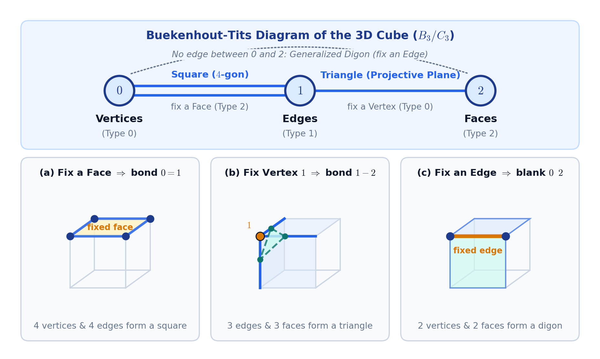
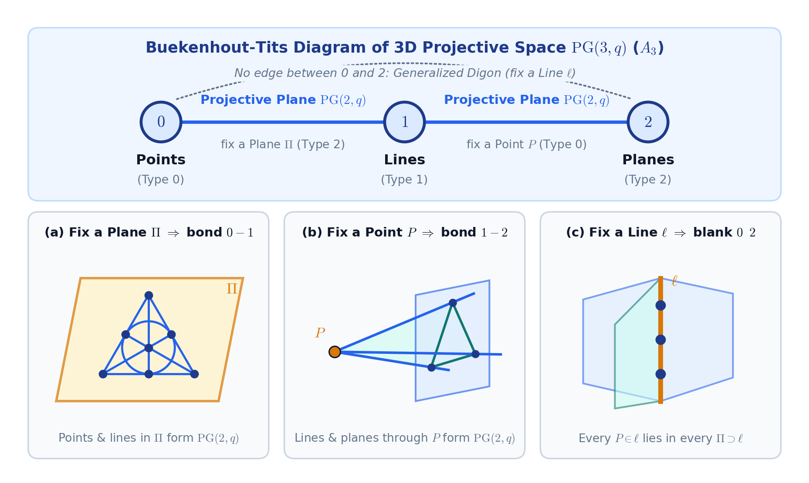
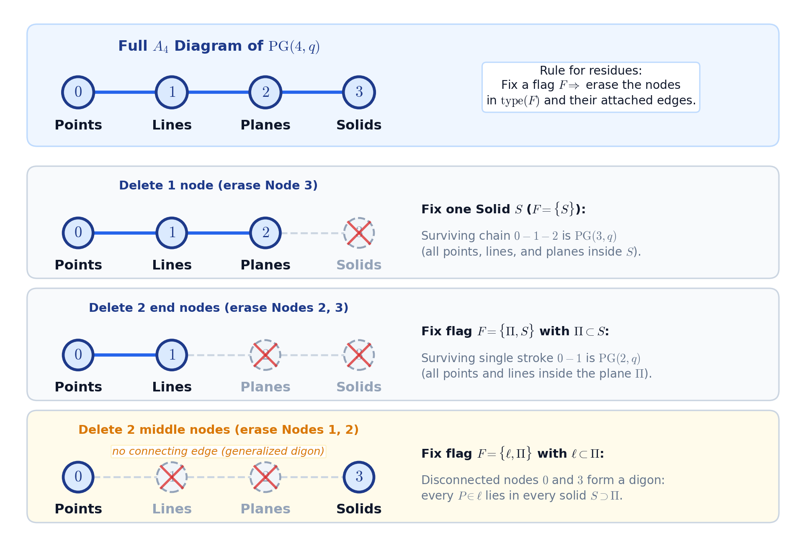
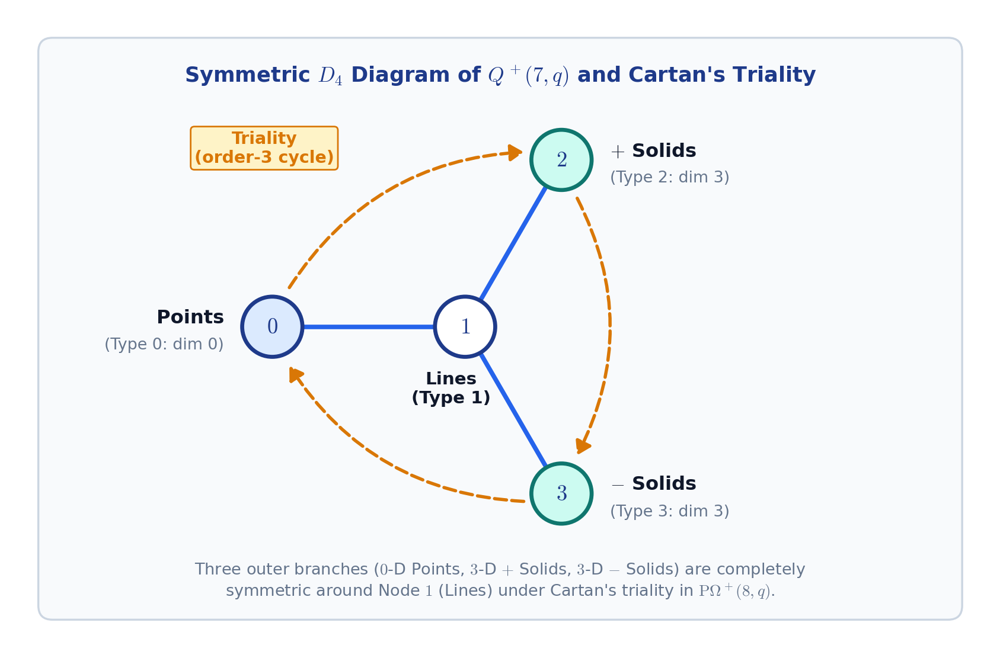
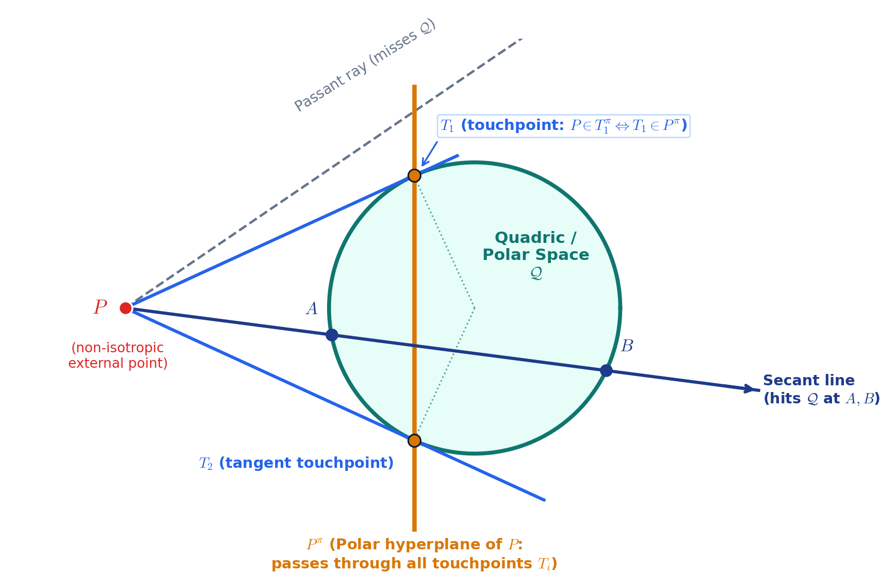
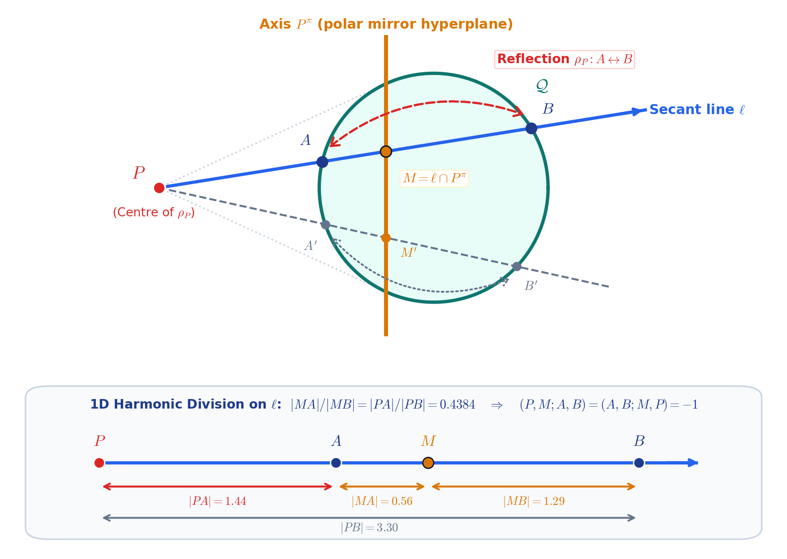
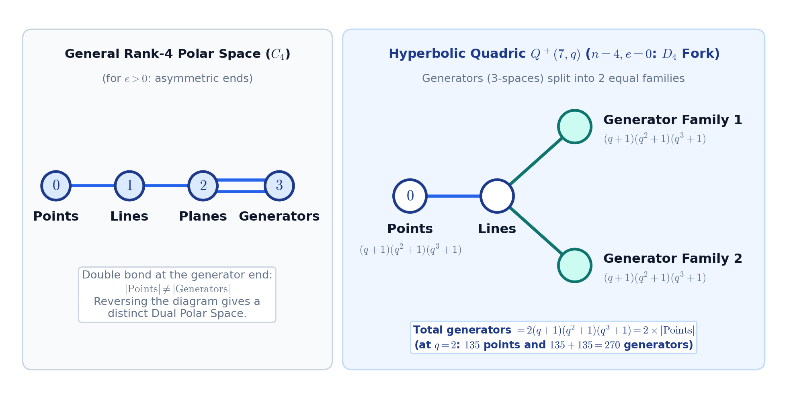
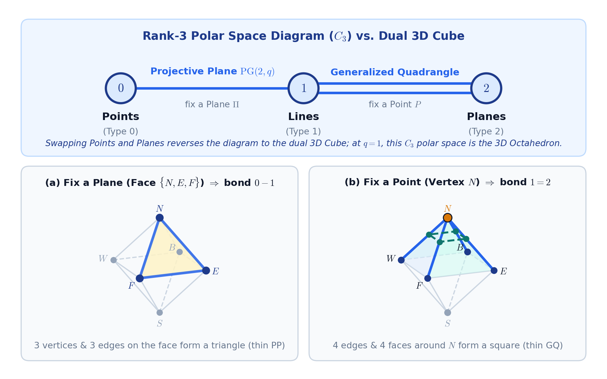
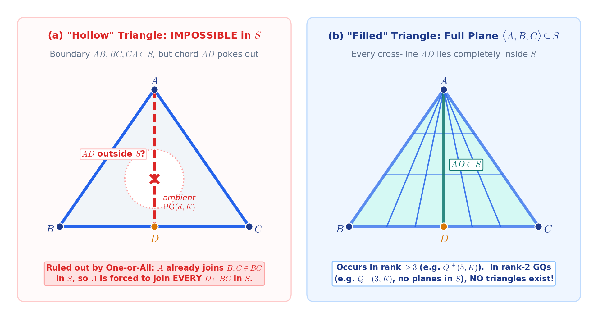

# Preview: Replacement Figures for *Maths 3 - Projective Geometry*

Each entry below pairs the original plain-text diagram from the published notes with its proposed replacement figure and self-contained caption.

---

## 1. How to Build a Diagram: The 3D Cube (lines 1496-1501)

```
   0 (Vertices)          1 (Edges)          2 (Faces)
       o =================== o ----------------- o
          (Square / 4-gon)      (Triangle / PP)

```



*Figure. Buekenhout-Tits ($B_3 / C_3$) diagram of the 3D cube over types $0$ (vertices), $1$ (edges), and $2$ (faces), together with the three rank-$2$ residues that determine its bonds. (a) Fixing a face leaves its $4$ vertices and $4$ edges, which form a square ($4$-gon, double bond between $0$ and $1$). (b) Fixing vertex $1$ leaves the $3$ edges and $3$ faces meeting at that corner, whose cross-section is a triangle (thin projective plane, single bond between $1$ and $2$). (c) Fixing an edge leaves its $2$ endpoint vertices and $2$ incident faces, every vertex lying in every face (generalized digon, no edge between $0$ and $2$).*

---

## 2. How to Build a Diagram: 3D Projective Space $PG(3, q)$ (lines 1517-1522)

```
   0 (Points)            1 (Lines)          2 (Planes)
       o ----------------- o ----------------- o
         (Projective Plane)  (Projective Plane)

```



*Figure. Buekenhout-Tits ($A_3$) diagram of $3$-dimensional projective space $\mathrm{PG}(3, q)$ over types $0$ (points), $1$ (lines), and $2$ (planes), paired with its three rank-$2$ residues. (a) Fixing a plane $\Pi$ leaves the points and lines inside $\Pi$, which form a projective plane $\mathrm{PG}(2, q)$ (illustrated at $q = 2$ by the Fano plane; single bond between $0$ and $1$). (b) Fixing a point $P$ leaves the star of lines and planes through $P$, which also forms $\mathrm{PG}(2, q)$ (single bond between $1$ and $2$). (c) Fixing a line $\ell$ leaves the $q + 1$ points on $\ell$ and the pencil of $q + 1$ planes containing $\ell$, forming a generalized digon (no edge between $0$ and $2$).*

---

## 3. Reading Diagrams by Deleting Nodes (lines 1542-1546)

```
   0 (Points)       1 (Lines)       2 (Planes)       3 (Solids)
       o -------------- o -------------- o -------------- o

```



*Figure. The four-node $A_4$ diagram of $\mathrm{PG}(4, q)$ over types $0$ (points), $1$ (lines), $2$ (planes), and $3$ (solids), showing how erasing the nodes of a fixed flag immediately yields the diagram of its residue. Erasing node $3$ (fixing a solid $S$) leaves the three-node $A_3$ chain of $\mathrm{PG}(3, q)$ inside $S$; erasing nodes $2$ and $3$ (fixing a flag $\{\Pi, S\}$ with $\Pi \subset S$) leaves the single bond $0 - 1$ of $\mathrm{PG}(2, q)$ inside $\Pi$; and erasing the middle nodes $1$ and $2$ (fixing $\{\ell, \Pi\}$ with $\ell \subset \Pi$) leaves disconnected nodes $0$ and $3$, a generalized digon because every point $P \in \ell$ lies in every solid $S \supset \Pi$.*

---

## 4. How Do Diagrams Help? (lines 1600-1608)

```
                    o  (Type 2: + Solids)
                   /
   0 (Points)     1 (Lines)
       o -------- o
                   \
                    o  (Type 3: - Solids)

```



*Figure. Symmetric $D_4$ diagram of the hyperbolic quadric $Q^+(7, q)$ of Witt index $4$ in $\mathrm{PG}(7, q)$. Node $1$ (lines) sits at the central hub, joined by single projective-plane bonds at $120^\circ$ to three outer nodes: node $0$ ($0$-dimensional points) and nodes $2$ and $3$ (the two families of $3$-dimensional solids lying on the quadric). The three-fold rotational symmetry of the diagram makes Cartan's triality visible without coordinates: an order-$3$ outer automorphism of $\mathrm{P}\Omega^+(8, q)$ permutes points, $+$ solids, and $-$ solids cyclically around lines.*

---

## 5. Polarity (lines 2180-2193)

```
                         . T_1 (Tangent touchpoint: P lies in T_1^pi, so T_1 lies in P^pi)
                      . ' |
                   . '    |
                . '     ( | )
       P *----.'-------(  |  )-------> Secant line (hits Q at A and B)
                ' .     ( | )
                   ' .    |   Quadric / Polar Space Q
                      ' . |
                         ' T_2 (Tangent touchpoint)
                          |
                        P^pi (The Polar Hyperplane of P: the flat plane
                              passing through all tangent touchpoints T_i)
```



*Figure. Geometric construction of the polar hyperplane $P^\pi$ of a non-isotropic external point $P$ with respect to a quadric $\mathcal{Q}$ (plotted exactly for $x^2 + y^2 = 1$ and $P = (-2.4, 0)$, giving $P^\pi : x = -5/12$). Rays through $P$ divide into passants missing $\mathcal{Q}$, secants piercing $\mathcal{Q}$ in two points $A$ and $B$, and boundary tangent rays grazing $\mathcal{Q}$ at $T_1$ and $T_2$. Because $T_i^\pi$ is the tangent hyperplane at $T_i$, polarity reciprocity ($P \in T_i^\pi \Leftrightarrow T_i \in P^\pi$) forces $P^\pi$ to slice $\mathcal{Q}$ through the exact locus of tangent touchpoints.*

---

## 6. Polarity: Harmonic Conjugate on a Secant Line (lines 2206-2211)

```
                        | P^pi (Polar Hyperplane)
                        |
      P *-------A-------M-------B------->  Secant line through P
                        |
```



*Figure. Top: every secant line $\ell$ through an external point $P$ meets the quadric $\mathcal{Q}$ at two points $A$ and $B$ and crosses the polar hyperplane $P^\pi$ at $M = \ell \cap P^\pi$; the central reflection $\rho_P$ with centre $P$ and fixed mirror axis $P^\pi$ swaps $A \leftrightarrow B$ along every secant ray, mapping $\mathcal{Q}$ onto itself. Bottom: true arc-length positions along $\ell$ (for $x^2 + y^2 = 1$, $P = (-2.4, 0)$, slope $0.16$), showing that $M$ and $P$ divide the chord $AB$ internally and externally in the same ratio $|MA| / |MB| = |PA| / |PB| \approx 0.4384$, so the cross-ratio satisfies $(P, M; A, B) = (A, B; M, P) = -1$.*

---

## 7. Example: Hyperboloid in 3D Space (lines 2331-2341)

```
         P  (Point on the polar space, outside line L)
        /|\
       / | \
      /  |  \   <-- Out of all points on line L, either:
     /   |   \      (1) P is joined by a line of the polar space
    /    |    \         to AT MOST ONE point Q on L, OR
   *-----Q-----*    (2) P is joined to EVERY point on L.
  Line L (lying inside the polar space)

```


*Figure. The two cases of the Buekenhout-Shult One-or-All axiom for a point $P$ and a line $L$ of a polar space ($P \notin L$). (a) The "One" case on the doubly ruled hyperboloid $Q^+(3, \mathbb{R}) : x^2 + y^2 - z^2 = 1$ (rank $2$): out of all points on a ruling $L \subset Q$, exactly one point $Q \in L$ is joined to $P$ by a line $PQ$ lying completely on the surface (the unique transversal from the opposite regulus), whereas the ambient line $PR$ to any other point $R \in L$ cuts off the surface through the hollow interior. (b) The "All" case in rank $\ge 3$ (such as the Klein quadric $Q^+(5, K)$): when $P$ is collinear inside $\mathcal{Q}$ with every point $Q_i \in L$, the connecting lines sweep out a totally isotropic projective plane $\Pi = P \vee L \cong \mathrm{PG}(2, K)$ contained entirely in $\mathcal{Q}$.*

---

## 8. Number of Maximal Isotropic Subspaces (lines 2977-2984)

```
                      o  (Generator Family 1)
                     /
   0 (Points) o --- o (Lines)
                     \
                      o  (Generator Family 2)

```



*Figure. Left: a general rank-$4$ polar space with $e > 0$ has the asymmetric linear diagram $C_4$, so its point count and generator count differ and reversing the diagram yields a distinct dual polar space. Right: for the hyperbolic quadric $Q^+(7, q)$ ($n = 4, e = 0$), the $3$-dimensional generators split into two equal families of size $(q + 1)(q^2 + 1)(q^3 + 1)$ each, matching the number of points $(q + 1)(q^2 + 1)(q^3 + 1)$ and accounting for the factor of $2$ in the total generator count $2(q + 1)(q^2 + 1)(q^3 + 1)$.*

---

## 9. Polar Spaces Have the Same Diagram ($C_n$) as a Cube (lines 3029-3034)

```
   0 (Points)          1 (Lines)          2 (Planes)
       o ----------------- o ================= o
          (Proj. Plane)      (Gen. Quadrangle)

```



*Figure. Top: the $C_3$ diagram of a rank-$3$ polar space over types $0$ (points), $1$ (lines), and $2$ (planes), which reverses the bond order of the dual 3D cube. Bottom: at $q = 1$, the thin rank-$3$ polar space $x_0 x_1 + x_2 x_3 + x_4 x_5 = 0$ is the regular octahedron on three opposite non-collinear vertex pairs $\{N, S\}$, $\{E, W\}$, and $\{F, B\}$. (a) Fixing a triangular face $\{N, E, F\}$ (a thin plane) leaves $3$ vertices and $3$ edges forming a triangle (single bond $0 - 1$). (b) Fixing vertex $N$ leaves the $4$ edges and $4$ faces meeting at $N$, whose vertex figure is a square (thin generalized quadrangle, double bond $1 = 2$).*

---

## 10. Generalized Quadrangles (`o === o`) (lines 3082-3090)

```
           A
          /|\
         / | \
        /  |  \      <-- Does this interior line AD belong to the polar space S,
       /   |   \         or does it poke out into the ambient space?
      B----D----C

```



*Figure. Resolving whether an interior cross-line $AD$ ($D \in BC \setminus \{B, C\}$) of three polar-space lines $AB, BC, CA \subset S$ can poke out of $S$ into the ambient projective space $\mathrm{PG}(d, K)$. (a) A "hollow" triangle, in which $AB, BC, CA \subset S$ while $AD$ leaves $S$, is impossible in every polar space: because $A$ is already collinear in $S$ with two points $B$ and $C$ on $BC$, the One-or-All axiom forces $A$ to be collinear in $S$ with every point of $BC$. (b) Consequently, any triangle of lines in $S$ automatically fills in to a full projective plane $\langle A, B, C \rangle \subseteq S$ (which occurs in rank $\ge 3$, such as $Q^+(5, K)$, and cannot occur in rank-$2$ generalized quadrangles such as $Q^+(3, K)$, where no planes exist in $S$).*
