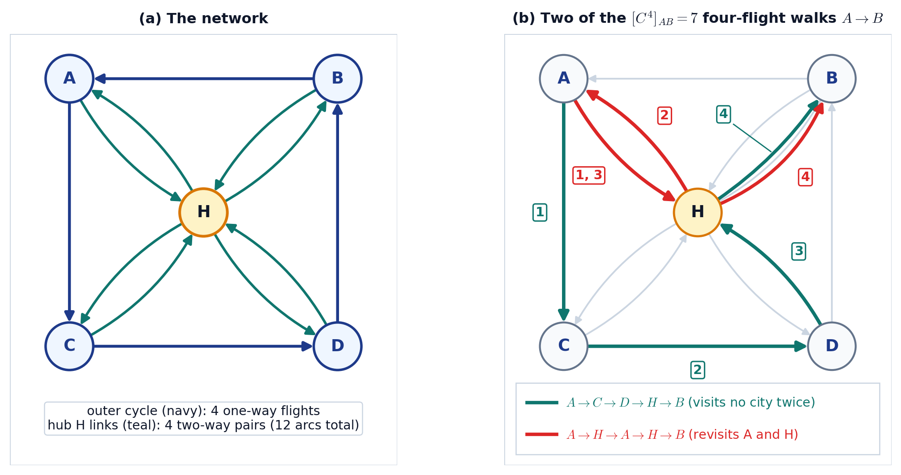
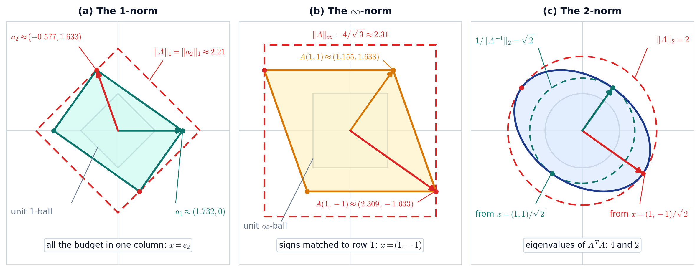
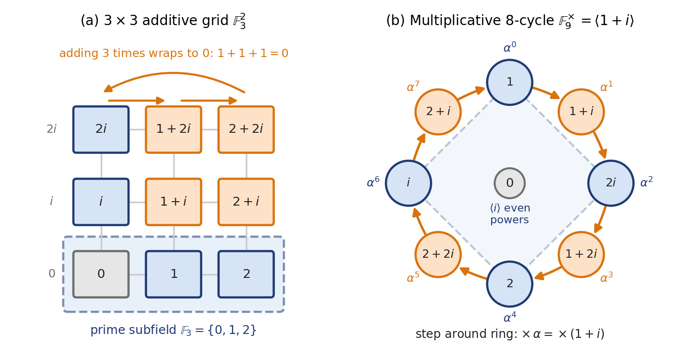

# Maths 0 - Linear & Abstract Algebra

## Vector Norms & Inner Products
The concept of the length of a vector $\mathbf{x}$ in $\mathbb{R}^n$ or $\mathbb{C}^n$ is familiar. This is called the Euclidean norm (or $2$-norm), denoted $\|\mathbf{x}\|_2$ (we use double bars $\|\cdot\|$ to distinguish vector norms from scalar absolute values $|\cdot|$). By Pythagoras' theorem, we know that:

$$\|\mathbf{x}\|_2=\sqrt{\sum_{i=1}^{n}|x_i|^2}$$

But this is not the only kind of norm we could have. We can define a general $p$-norm for any real number $p\ge 1$ by:

$$\|\mathbf{x}\|_p=\left(\sum_{i=1}^{n}|x_i|^p\right)^{1/p}$$

For example, the Manhattan (or taxicab) norm is the case where $p=1$: $\|\mathbf{x}\|_1=\sum_{i=1}^{n}|x_i|$. We can even take the limit $p\to\infty$, where the $\infty$-norm (or max/supremum norm) is defined as:

$$\|\mathbf{x}\|_\infty=\max_{1\le i\le n}|x_i|$$

To prove that $\lim_{p\to\infty}\|\mathbf{x}\|_p=\max_i|x_i|=\|\mathbf{x}\|_\infty$, note first that if $\mathbf{x}=\mathbf{0}$, both sides are trivially $0$. For $\mathbf{x}\neq\mathbf{0}$, relabel the entries of $\mathbf{x}$ by setting $\tilde{x}_1=\max_i|x_i|>0$, and if there are other entries whose magnitudes equal this same maximum, label their magnitudes $\tilde{x}_2,\dots,\tilde{x}_k$ (so $\tilde{x}_1=\dots=\tilde{x}_k$). Label the remaining coordinates $\tilde{x}_{k+1},\dots,\tilde{x}_n$. Consequently, $|\tilde{x}_i/\tilde{x}_1|<1$ for $i=k+1,\dots,n$, so $|\tilde{x}_i/\tilde{x}_1|^p\to 0$ as $p\to\infty$. Since $k^{1/p}\to 1$ as $p\to\infty$, we obtain:

$$\|\mathbf{x}\|_p=\left(\sum_{i=1}^{n}|\tilde{x}_i|^p\right)^{1/p}=\tilde{x}_1\left(k+\left|\frac{\tilde{x}_{k+1}}{\tilde{x}_1}\right|^p+\dots+\left|\frac{\tilde{x}_n}{\tilde{x}_1}\right|^p\right)^{1/p}\xrightarrow{p\to\infty}\tilde{x}_1=\|\mathbf{x}\|_\infty$$

To get a feel for the $1$-, $2$-, and $\infty$-vector norms, it helps to consider the shapes and relative sizes of the unit spheres (hollow unit balls) for each norm in $\mathbb{R}^3$. When we say "spheres" here, they need not be round Euclidean spheres, but are symmetric closed surfaces around the origin. For each $p\in\{1,2,\infty\}$, the unit $p$-sphere is the set of points $S_p=\{\mathbf{x}\in\mathbb{R}^3\mid\|\mathbf{x}\|_p=1\}$ that lie at distance $1$ from the origin measured in the $p$-norm. The respective unit $1$-, $2$-, and $\infty$-spheres in $\mathbb{R}^3$ are the surfaces of a regular octahedron, a round ball, and a cube. 

It is visually evident that the solid unit ball bounded by $S_1$ fits inside that of $S_2$, which in turn fits inside that of $S_\infty$ (touching at the coordinate axes). Notice the inverse relationship between unit ball size and norm value: this geometric nesting means that $\|\mathbf{x}\|_1\ge\|\mathbf{x}\|_2\ge\|\mathbf{x}\|_\infty$ for all $\mathbf{x}\in\mathbb{R}^3$ (and more generally in $\mathbb{F}^n$). For example, the point $\mathbf{x}=(1/3,1/3,1/3)$ sits right on the unit octahedron $S_1$ ($\Vert{}\mathbf{x}\Vert{}_1=1$), which lies strictly inside the Euclidean unit sphere $S_2$ ($\Vert{}\mathbf{x}\Vert{}_2=1/\sqrt{3}<1$).

[Figure 1(a)](#figure-1) draws the same three balls in the plane, where the octahedron, the ball and the cube become a diamond, a circle and a square.

*Figure 1. Unit balls in the plane, the 2D version of the octahedron, ball and cube of $\mathbb{R}^3$. (a) The $1$-norm diamond $|x| + |y| = 1$ sits inside the $2$-norm circle, which sits inside the $\infty$-norm square $\max(|x|, |y|) = 1$; all three touch at $\pm \mathbf{e}_1$ and $\pm \mathbf{e}_2$. The point $\mathbf{v} = (1/2, 1/2)$ lies on the diamond ($\|\mathbf{v}\|_1 = 1$) but inside the circle ($\|\mathbf{v}\|_2 = 1/\sqrt{2} \approx 0.707$): a smaller ball means a larger norm. (b) The $\infty$-norm square of radius $1/2$ fits inside the diamond, touching it at $(\pm 1/2, \pm 1/2)$, and the square of radius $1$ contains it, touching it at $\pm \mathbf{e}_1$ and $\pm \mathbf{e}_2$. So $\|\mathbf{v}\|_\infty \le \|\mathbf{v}\|_1 \le 2\|\mathbf{v}\|_\infty$ for every $\mathbf{v}$ in the plane, the 2D version of $\|\mathbf{v}\|_\infty \le \|\mathbf{v}\|_1 \le 3\|\mathbf{v}\|_\infty$ in $\mathbb{R}^3$.*

We can also see this relative ordering with a concrete example. Take the diagonal vector $\mathbf{x}=(1,1,1)$ in $\mathbb{R}^3$:

$$\|\mathbf{x}\|_1=|1|+|1|+|1|=3$$

$$\|\mathbf{x}\|_2=\sqrt{1^2+1^2+1^2}=\sqrt{3}\approx 1.732$$

$$\|\mathbf{x}\|_\infty=\max(|1|,|1|,|1|)=1$$

Clearly, $\|\mathbf{x}\|_1\ge\|\mathbf{x}\|_2\ge\|\mathbf{x}\|_\infty$ ($3\ge 1.732\ge 1$).

### Where $1$-Norm and $\infty$-Norm Are Used

The $2$-norm dominates classical mechanics and quantum state vectors because it is rotationally/unitarily invariant ($SO(3)$ and $U(n)$ symmetry): physical lengths and kinetic energy $\frac{1}{2}m\|\mathbf{v}\|_2^2$ do not change when we rotate our coordinate axes.

The $1$-norm and $\infty$-norm appear whenever total conserved quantity, worst-case bounds, lattice geometry, or sparsity matter more than rotational symmetry. For example, the $1$-norm is used in statistical mechanics and probability distributions. A probability vector $\mathbf{p}$ over discrete energy microstates (with $p_i\ge 0$) satisfies $\|\mathbf{p}\|_1=\sum_i|p_i|=\sum_i p_i=1$. The distance between two distributions $\mathbf{p}$ and $\mathbf{q}$ is measured by the total variation distance $\frac{1}{2}\|\mathbf{p}-\mathbf{q}\|_1$, which directly quantifies the total probability mass that must be moved to turn one distribution into the other.

Similarly, when calculating the trace distance in quantum mechanics, pure states $|\psi\rangle$ are normalized in the $2$-norm ($\langle\psi\vert{}\psi\rangle=1$), whereas mixed states are described by density matrices $\rho$ whose eigenvalues are probabilities summing to $1$. The physical distinguishability between two mixed states $\rho$ and $\sigma$ is governed by the Schatten $1$-norm (trace distance) $\frac{1}{2}\|\rho-\sigma\|_1$, which equals half the $1$-norm of the eigenvalues of $\rho-\sigma$.

And finally, on a discrete crystal lattice, such as a cubic Ising spin grid or a tight-binding hopping model, the minimum number of nearest-neighbor steps between two sites is the $1$-norm of their displacement vector, not the Euclidean straight-line distance.

Similarly, the $\infty$-norm is used in structural mechanics, electromagnetism, and control systems, where failure is determined by the maximum local stress, peak electric field, or worst-case component tolerance rather than a root-mean-square average across all coordinates.

Another instance in quantum mechanics is for a Hermitian operator $A$ on a finite-dimensional space (such as a Hamiltonian), where the largest possible magnitude of a measurement outcome is its spectral radius (and operator $2$-norm), which equals the $\infty$-norm $\|\boldsymbol{\lambda}\|_\infty=\max_i|\lambda_i|$ of its vector of eigenvalues.

### General Norm & Properties of Norms
Instead of restricting ourselves to $p$-norms, a more general axiomatic definition of a norm is useful. On a vector space $V$ over $\mathbb{F}$ ($\mathbb{R}$ or $\mathbb{C}$), a vector norm is a function mapping vectors to non-negative real numbers such that the following three conditions hold for all vectors $\mathbf{x},\mathbf{y}\in V$ and all scalars $\alpha\in\mathbb{F}$:

Positivity (positive definiteness): $\|\mathbf{x}\|\ge 0$ for all $\mathbf{x}\in V$, and $\|\mathbf{x}\|=0\iff\mathbf{x}=\mathbf{0}$.

Homogeneity (absolute scalability): $\|\alpha\mathbf{x}\|=|\alpha|\,\|\mathbf{x}\|$.

Triangle inequality (subadditivity): $\|\mathbf{x}+\mathbf{y}\|\le\|\mathbf{x}\|+\|\mathbf{y}\|$.

All $p$-norms (for $p\ge 1$) satisfy these three axioms. Proving the triangle inequality for the $2$-norm relies on bounding the inner product via the classic Cauchy-Schwarz (or CBS) inequality, which in component form states:

$$\left|\sum_{i=1}^{n}\bar{x}_i y_i\right|\le\left(\sum_{i=1}^{n}|x_i|^2\right)^{1/2}\left(\sum_{i=1}^{n}|y_i|^2\right)^{1/2}$$

In inner-product and $2$-norm notation (where $\mathbf{x}^*=\bar{\mathbf{x}}^T$ is the conjugate transpose), Cauchy-Schwarz takes the compact form:

$$|\mathbf{x}^*\mathbf{y}|\le\|\mathbf{x}\|_2\|\mathbf{y}\|_2$$

where equality holds if and only if $\mathbf{x}$ and $\mathbf{y}$ are linearly dependent (that is, $\mathbf{x}=\mathbf{0}$, or $\mathbf{y}=\alpha\mathbf{x}$ with $\alpha=\frac{\mathbf{x}^*\mathbf{y}}{\mathbf{x}^*\mathbf{x}}$ when $\mathbf{x}\neq\mathbf{0}$).

More generally, for conjugate exponents $p,q>1$ satisfying $\frac{1}{p}+\frac{1}{q}=1$ (as well as the limiting pair $p=1,q=\infty$), Cauchy-Schwarz generalizes to Hölder's inequality:

$$|\mathbf{x}^*\mathbf{y}|\le\sum_{i=1}^{n}|x_i y_i|\le\|\mathbf{x}\|_p\|\mathbf{y}\|_q=\left(\sum_{i=1}^{n}|x_i|^p\right)^{1/p}\left(\sum_{i=1}^{n}|y_i|^q\right)^{1/q}$$

By this inequality, the $1$-norm and $\infty$-norm are natural duals of each other (just as the $2$-norm is self-dual since $\frac{1}{2}+\frac{1}{2}=1$). Setting $p=1$ and $q=\infty$ gives:

$$|\mathbf{x}^*\mathbf{y}|\le\|\mathbf{x}\|_1\|\mathbf{y}\|_\infty$$

(which reduces to $|\mathbf{x}^T\mathbf{y}|\le\|\mathbf{x}\|_1\|\mathbf{y}\|_\infty$ for real vectors).

Using Hölder's inequality, one proves that $p$-norms ($1\le p<\infty$) satisfy the triangle inequality, a result known in component form as Minkowski's inequality:

$$\left(\sum_{i=1}^{n}|x_i+y_i|^p\right)^{1/p}\le\left(\sum_{i=1}^{n}|x_i|^p\right)^{1/p}+\left(\sum_{i=1}^{n}|y_i|^p\right)^{1/p}$$

Note that we restrict $p$-norms to $p\ge 1$ because for $0<p<1$ the triangle inequality fails (homogeneity still holds). For example, with $p=\frac{1}{2}$, the vectors $(1,0)$ and $(0,1)$ each have norm $1$, but their sum has $\|(1,1)\|_{1/2}=(1+1)^2=4>1+1$.

For any general vector norm, there is an additional useful property derived directly from the triangle inequality called the Backward (or Reverse) Triangle Inequality:

$$\big|\|\mathbf{x}\|-\|\mathbf{y}\|\big|\le\|\mathbf{x}-\mathbf{y}\|$$

### Convergence of Sequences
A sequence of vectors $\{\mathbf{x}_k\}$ in $\mathbb{F}^n$ is said to converge to a limit vector $\mathbf{x}$ (written $\lim_{k\to\infty}\mathbf{x}_k=\mathbf{x}$) with respect to a norm $\|\cdot\|$ provided that for every real $\epsilon>0$ there exists an integer $K(\epsilon)\ge 0$ such that:

$$k>K(\epsilon)\implies\|\mathbf{x}_k-\mathbf{x}\|<\epsilon,\quad\text{or equivalently,}\quad\lim_{k\to\infty}\|\mathbf{x}_k-\mathbf{x}\|=0$$

For example, define the sequence in $\mathbb{R}^2$ by:

$$\mathbf{x}_k=\begin{pmatrix}1+\frac{1}{k}\\2-\frac{1}{k^2}\end{pmatrix}$$

Its first few terms are:

$$\mathbf{x}_1=\begin{pmatrix}2\\1\end{pmatrix},\quad\mathbf{x}_2=\begin{pmatrix}1.5\\1.75\end{pmatrix},\quad\mathbf{x}_3=\begin{pmatrix}1.333\dots\\1.888\dots\end{pmatrix},\dots$$

Here, $[\mathbf{x}_2]_1=1.5$ and $[\mathbf{x}_2]_2=1.75$. As $k\to\infty$, these vectors approach the limit vector $\mathbf{x}=\begin{pmatrix}1\\2\end{pmatrix}$.

On any finite-dimensional vector space $\mathbb{F}^n$, convergence does not depend on which norm we choose: if a sequence converges to $\mathbf{x}$ in one norm, it converges to $\mathbf{x}$ in every norm. For all norms on $\mathbb{F}^n$, the following key facts hold:

Continuity of norms: $\|\mathbf{x}\|$ varies continuously with $\mathbf{x}$ (since $\big|\|\mathbf{x}_k\|-\|\mathbf{x}\|\big|\le\|\mathbf{x}_k-\mathbf{x}\|$ by the backward triangle inequality).

Equivalence of norms on $\mathbb{F}^n$: For every pair of norms $\|\cdot\|_a$ and $\|\cdot\|_b$ on $\mathbb{F}^n$ (not necessarily $p$-norms), there exist positive constants $\alpha>0$ and $\beta>0$ (depending only on the two norms and the dimension $n$) such that:

$$\alpha\le\frac{\|\mathbf{x}\|_a}{\|\mathbf{x}\|_b}\le\beta\quad\text{for all nonzero vectors }\mathbf{x}\in\mathbb{F}^n$$

Equivalently, $\alpha\|\mathbf{v}\|_b\le\|\mathbf{v}\|_a\le\beta\|\mathbf{v}\|_b$ for all $\mathbf{v}\in\mathbb{F}^n$. Applying this to $\mathbf{v}=\mathbf{x}_k-\mathbf{x}$ shows (by the Squeeze Theorem) that $\|\mathbf{x}_k-\mathbf{x}\|_a\to 0$ if and only if $\|\mathbf{x}_k-\mathbf{x}\|_b\to 0$. In other words, convergence in $\mathbb{F}^n$ is norm-independent, as we noted above.

So for example, compare the $1$-norm and $\infty$-norm in $\mathbb{R}^3$. For any vector $\mathbf{v}=(v_1,v_2,v_3)^T$,

$$1\cdot\|\mathbf{v}\|_\infty\le\|\mathbf{v}\|_1\le 3\cdot\|\mathbf{v}\|_\infty$$

Here $\alpha=1$ and $\beta=3$. Because the two norms of the error vector $\mathbf{x}_k-\mathbf{x}$ can never differ by more than a fixed factor of $3$, it is impossible for one to vanish while the other stays bounded away from zero. [Figure 1(b)](#figure-1) shows the same sandwich in the plane, where $\Vert{}\mathbf{v}\Vert{}_\infty\le\Vert{}\mathbf{v}\Vert{}_1\le 2\Vert{}\mathbf{v}\Vert{}_\infty$.

And the last property is coordinate-wise convergence: Let $\{\mathbf{x}_k\}$ be a sequence in $\mathbb{F}^n$, and let the individual coordinates of $\mathbf{x}_k$ be $[\mathbf{x}_k]_i$. The sequence converges in norm to the vector $\mathbf{x}=(x_1,x_2,\dots,x_n)^T$ if and only if it converges coordinate-wise:

$$\lim_{k\to\infty}\mathbf{x}_k=\mathbf{x}\iff\lim_{k\to\infty}[\mathbf{x}_k]_i=x_i\quad\text{for every }i=1,2,\dots,n$$

### Inner Products
The $2$-norm arises naturally from the standard inner product (which over $\mathbb{R}^n$ is called the dot product, and is often referred to simply as the inner product). For two column vectors $\mathbf{x},\mathbf{y}\in\mathbb{C}^n$, the standard inner product is the sum of conjugate-weighted componentwise products given by:

$$\langle\mathbf{x}|\mathbf{y}\rangle=\mathbf{x}^*\mathbf{y}=\sum_{i=1}^{n}\bar{x}_i y_i$$

where $\mathbf{x}^*=\bar{\mathbf{x}}^T$ is the conjugate transpose; when $\mathbf{x},\mathbf{y}\in\mathbb{R}^n$ are real, this reduces to $\mathbf{x}^T\mathbf{y}=\sum_{i=1}^{n}x_i y_i$. We take the conjugate in the left-hand argument $\mathbf{x}$ in order to ensure that vectors with complex components still give non-negative real norms.

Note that the inner product is linear in the right-hand argument $\mathbf{y}$ but it is conjugate linear in the left-hand argument $\mathbf{x}$ due to how we defined the inner product.

If $\mathbf{x}=\mathbf{y}$, this inner product becomes the square of the $2$-norm, so taking its square root gives the $2$-norm:

$$\|\mathbf{x}\|_2=\sqrt{\langle\mathbf{x}|\mathbf{x}\rangle}=\sqrt{\mathbf{x}^*\mathbf{x}}=\sqrt{\sum_{i=1}^{n}|x_i\vert{}^2}$$

The inner product also leads to the idea of orthogonality, which we are familiar with geometrically as perpendicularity from Pythagoras' theorem. Specifically, two vectors $\mathbf{u}$ and $\mathbf{v}$ are defined to be orthogonal if:

$$\langle\mathbf{u}|\mathbf{v}\rangle=\mathbf{u}^*\mathbf{v}=0$$

Over $\mathbb{R}^n$, this is completely equivalent to Pythagoras' theorem (and over $\mathbb{C}^n$, orthogonality implies Pythagoras' theorem):

$$\|\mathbf{u}+\mathbf{v}\|_2^2=\|\mathbf{u}\|_2^2+\|\mathbf{v}\|_2^2$$

In $\mathbb{R}^n$, this allows us to calculate the angle $\theta\in[0,\pi]$ between any two nonzero vectors $\mathbf{u}$ and $\mathbf{v}$. From the Law of Cosines on the triangle formed by $\mathbf{u}$, $\mathbf{v}$, and $\mathbf{u}-\mathbf{v}$, we have:

$$\|\mathbf{u}-\mathbf{v}\|_2^2=\|\mathbf{u}\|_2^2+\|\mathbf{v}\|_2^2-2\|\mathbf{u}\|_2\|\mathbf{v}\|_2\cos\theta$$

Solving for $\cos\theta$ and expanding the squared $2$-norms via the real inner product gives:

$$\cos\theta=\frac{\|\mathbf{u}\|_2^2+\|\mathbf{v}\|_2^2-\|\mathbf{u}-\mathbf{v}\|_2^2}{2\|\mathbf{u}\|_2\|\mathbf{v}\|_2}=\frac{\mathbf{u}^T\mathbf{u}+\mathbf{v}^T\mathbf{v}-(\mathbf{u}-\mathbf{v})^T(\mathbf{u}-\mathbf{v})}{2\|\mathbf{u}\|_2\|\mathbf{v}\|_2}=\frac{2\mathbf{u}^T\mathbf{v}}{2\|\mathbf{u}\|_2\|\mathbf{v}\|_2}=\frac{\mathbf{u}^T\mathbf{v}}{\|\mathbf{u}\|_2\|\mathbf{v}\|_2}$$

This also gives us the geometric way to write the real inner product:

$$\mathbf{u}^T\mathbf{v}=\|\mathbf{u}\|_2\|\mathbf{v}\|_2\cos\theta$$

This matches up directly with the Cauchy-Schwarz inequality, $|\mathbf{u}^T\mathbf{v}|=\|\mathbf{u}\|_2\|\mathbf{v}\|_2|\cos\theta|\le\|\mathbf{u}\|_2\|\mathbf{v}\|_2$, where equality is achieved when the vectors are collinear, that is, parallel ($\theta=0$, $\cos 0=1$) or anti-parallel ($\theta=\pi$, $\cos\pi=-1$, so $|\cos\pi|=1$), or when either vector is $\mathbf{0}$. For all other angles $\theta\in(0,\pi)$, we have $|\cos\theta|<1$, placing us in the strict inequality regime.

To reiterate, when talking about angles and orthogonality, we are strictly working with the $2$-norm (and inner products).

If a set of nonzero vectors are mutually orthogonal, they are called an orthogonal set. If they are also all unit vectors ($\Vert{}\mathbf{q}_i\Vert{}_2=1$), they are called an orthonormal set. An orthogonal set of vectors are linearly independent. A square complex matrix $U\in\mathbb{C}^{n\times n}$ whose columns (and equivalently rows) form an orthonormal set of vectors ($U^*U=UU^*=I$) is called a unitary matrix. If its entries are all real ($Q\in\mathbb{R}^{n\times n}$ with $Q^TQ=QQ^T=I$), it is called an orthogonal matrix, a slightly confusing historical name, since its columns are orthonormal and not merely orthogonal. The identity matrix $I$ is an orthogonal (and unitary) matrix because its columns form the standard orthonormal basis. More generally, any permutation matrix, obtained by permuting the columns (or rows) of $I$, is an orthogonal matrix because reordering an orthonormal set cannot destroy orthonormality.

Finally, the cosine of the angle between vectors in $\mathbb{R}^n$ is important in statistics and data analysis for determining the degree to which data in $\mathbf{x}$ is linearly related to data in $\mathbf{y}$. Specifically, while the raw cosine $\frac{\mathbf{x}^T\mathbf{y}}{\|\mathbf{x}\|_2\|\mathbf{y}\|_2}$ measures pure proportionality ($\mathbf{y}\approx\beta_0\mathbf{x}$), if we first subtract the sample means from each vector, forming the mean-centered vectors $\tilde{\mathbf{x}}=\mathbf{x}-\bar{x}\mathbf{e}$ and $\tilde{\mathbf{y}}=\mathbf{y}-\bar{y}\mathbf{e}$ with $\mathbf{e}=(1,1,\dots,1)^T$, then the cosine of the angle between $\tilde{\mathbf{x}}$ and $\tilde{\mathbf{y}}$ (Pearson's correlation coefficient) measures how close $\mathbf{y}$ is to an affine linear combination $\beta_0\mathbf{x}+\beta_1\mathbf{e}$.

---

**Aside:** The outer product comes from multiplying an $n \times 1$ vector with a $1 \times m$ vector to give an $n \times m$ matrix. Every matrix product is a sum of outer products i.e. the sum of the products of the $i^{th}$ column of one matrix and the $i^{th}$ row of the other. 

---

## Matrix Analysis - First Look
Consider the system of linear equations:

$$\begin{aligned}a_{11}x_1+a_{12}x_2+a_{13}x_3&=y_1\\a_{21}x_1+a_{22}x_2+a_{23}x_3&=y_2\\a_{31}x_1+a_{32}x_2+a_{33}x_3&=y_3\end{aligned}$$

We can write this out as the product of a coefficient matrix $A$ with a column vector $\mathbf{x}$ to give the output vector $\mathbf{y}$ as:

$$\begin{pmatrix}a_{11}&a_{12}&a_{13}\\a_{21}&a_{22}&a_{23}\\a_{31}&a_{32}&a_{33}\end{pmatrix}\begin{pmatrix}x_1\\x_2\\x_3\end{pmatrix}=\begin{pmatrix}y_1\\y_2\\y_3\end{pmatrix}$$

Let the matrix $A$ represent the linear function (transformation) $f$, so $\mathbf{y}=f(\mathbf{x})=A\mathbf{x}$.

Now consider how we would compose $f$ with another linear function $g$ (forming $f\circ g$, where $g$ acts first and $f$ acts second). To keep the intermediate variables distinct, suppose $g$ maps an initial input vector $\mathbf{u}=(u_1,u_2,u_3)^T$ to the intermediate vector $\mathbf{x}=g(\mathbf{u})=B\mathbf{u}$, given by the matrix $B$:

$$\begin{pmatrix}x_1\\x_2\\x_3\end{pmatrix}=\begin{pmatrix}b_{11}&b_{12}&b_{13}\\b_{21}&b_{22}&b_{23}\\b_{31}&b_{32}&b_{33}\end{pmatrix}\begin{pmatrix}u_1\\u_2\\u_3\end{pmatrix}\implies\begin{aligned}x_1&=b_{11}u_1+b_{12}u_2+b_{13}u_3\\x_2&=b_{21}u_1+b_{22}u_2+b_{23}u_3\\x_3&=b_{31}u_1+b_{32}u_2+b_{33}u_3\end{aligned}$$

If we substitute these expressions for $x_1,x_2,x_3$ into the equations for $\mathbf{y}=f(\mathbf{x})=f(g(\mathbf{u}))$ and collect coefficients of $u_1,u_2,u_3$, the first equation becomes:

$$y_1=(a_{11}b_{11}+a_{12}b_{21}+a_{13}b_{31})u_1+(a_{11}b_{12}+a_{12}b_{22}+a_{13}b_{32})u_2+(a_{11}b_{13}+a_{12}b_{23}+a_{13}b_{33})u_3$$

Doing the same for $y_2$ and $y_3$ gives the $(i,j)$-entry of the composite matrix $C=AB$ representing $f\circ g$ as $(AB)_{ij}=\sum_{k=1}^{3}a_{ik}b_{kj}$ (the inner product of row $i$ of $A$ with column $j$ of $B$), which leads directly to the matrix multiplication rules we are already familiar with.

This also gives us an effortless proof of associativity $(AB)C=A(BC)$ in matrix multiplication without index algebra gymnastics. When matrix multiplication is introduced purely as an algebraic recipe $(AB)_{ij}=\sum_k a_{ik}b_{kj}$, proving that $(AB)C=A(BC)$ requires writing out triple sums $\sum_k\sum_\ell a_{ik}b_{k\ell}c_{\ell j}$ and swapping summation order, which hides why it works. 

Once we recognize that matrix multiplication is defined to represent composition of linear maps, associativity becomes immediate with zero algebra: for any three functions $\mathbb{F}^q\xrightarrow{h}\mathbb{F}^n\xrightarrow{g}\mathbb{F}^p\xrightarrow{f}\mathbb{F}^m$ (even nonlinear ones), function composition is automatically associative because both $((f\circ g)\circ h)(\mathbf{w})$ and $(f\circ(g\circ h))(\mathbf{w})$ evaluate to $f(g(h(\mathbf{w})))$ at every input vector $\mathbf{w}$. Since the matrix of a linear map is uniquely determined by its action on the standard basis vectors $\mathbf{e}_j$, the matrices representing $(f\circ g)\circ h$ and $f\circ(g\circ h)$ must be identical: $(AB)C=A(BC)$.

Our composition picture $\mathbf{y}=A(B\mathbf{u})$ also gives a clean column-wise picture. Notice what happens if we plug in the $j$-th standard basis vector $\mathbf{u}=\mathbf{e}_j$ (all zeros except a $1$ in slot $j$):

First, $B\mathbf{e}_j=\mathbf{b}_j$ (extracts the $j$-th column of $B$). Next, applying $A$ gives $(AB)\mathbf{e}_j=A(B\mathbf{e}_j)=A\mathbf{b}_j$. Thus, each column of the product $AB$ is simply $A$ acting on the corresponding column of $B$:

$$AB=\begin{pmatrix}A\mathbf{b}_1&A\mathbf{b}_2&\cdots&A\mathbf{b}_n\end{pmatrix}$$

Because every vector $A\mathbf{b}_j$ is a linear combination of the columns of $A$, this immediately proves a fundamental rank inequality: every column of $AB$ lives inside the column space of $A$ ($\operatorname{Col}(AB)\subseteq\operatorname{Col}(A)$), and by transposing, every row of $AB$ lives inside the row space of $B$, so $\operatorname{rank}(AB)\le\min\big(\operatorname{rank}(A),\operatorname{rank}(B)\big)$.

For a matrix $A\in\mathbb{F}^{m\times p}$ (whose $k$-th column we denote by $A_{*k}\in\mathbb{F}^{m\times 1}$) and a single column vector $\mathbf{x}\in\mathbb{F}^{p\times 1}$, the matrix-vector product $A\mathbf{x}$ is a concise way to represent a linear combination of the columns of $A$:

$$\mathbf{x}=\begin{pmatrix}x_1\\x_2\\\vdots\\x_p\end{pmatrix}\implies A\mathbf{x}=\sum_{k=1}^{p}A_{*k}x_k=A_{*1}x_1+A_{*2}x_2+\dots+A_{*p}x_p$$

This column-combination view provides a direct algebraic way to characterize whether the columns of $A$ are linearly independent or linearly dependent.

Let $A\in\mathbb{F}^{m\times p}$. The indexed family of columns $(A_{*1},A_{*2},\dots,A_{*p})$ of $A$ is linearly independent if and only if $\mathbf{x}=\mathbf{0}_p$ is the only vector in $\mathbb{F}^{p\times 1}$ for which $A\mathbf{x}=\mathbf{0}_m$.

Equivalently, the columns of $A$ are linearly dependent if and only if there exists a nonzero vector $\mathbf{x}\neq\mathbf{0}_p$ in $\mathbb{F}^{p\times 1}$ such that $A\mathbf{x}=\mathbf{0}_m$.
    
Notice how writing $A\mathbf{x}=\sum_{k=1}^p A_{*k}x_k$ shifts our geometric perspective on linear systems:
    
Row picture: Each entry of $A\mathbf{x}=\mathbf{b}$ is the dot product $A_{i*}\mathbf{x}=b_i$, asking for the intersection of $m$ hyperplanes in $\mathbb{F}^p$.
        
Column picture:  $A\mathbf{x}=\mathbf{b}$ asks whether the target vector $\mathbf{b}\in\mathbb{F}^m$ can be built as a linear combination of the $p$ column vectors $A_{*1},\dots,A_{*p}$ in $\mathbb{F}^m$. Together, existence and uniqueness separate cleanly across the columns of $A$:

Existence of a solution to $A\mathbf{x}=\mathbf{b}$ holds for every $\mathbf{b}\in\mathbb{F}^m$ if and only if the columns of $A$ span $\mathbb{F}^m$ (surjectivity).

Uniqueness of the solution holds if and only if the columns of $A$ are linearly independent (injectivity).

Both hold simultaneously ($A$ is invertible) only when $m=p$ and the $p$ columns form a basis for $\mathbb{F}^m$.
        
This also gives us automatic linear dependence for wide matrices ($p>m$). Suppose $A\in\mathbb{F}^{m\times p}$ is a wide rectangular matrix, meaning it has more columns than rows ($p>m$, more unknowns than equations). Because at most $m$ vectors can be linearly independent inside the $m$-dimensional space $\mathbb{F}^{m\times 1}$ (equivalently, Gaussian elimination on $m$ rows can produce at most $m$ pivot columns, leaving at least $p-m\ge 1$ free variables), there is always a nonzero vector $\mathbf{x}\neq\mathbf{0}_p$ satisfying $A\mathbf{x}=\mathbf{0}_m$. Therefore, whenever $p>m$, the columns of $A$ are guaranteed to be linearly dependent.

An important thing to note about $A^{-1}b = x$: Since $Ax = b$, it means that $b$ is the linear combination of the columns of $A$ via the coefficients of $x$. Thus, $x$ represents the vector $b$ when we use the columns of $A$ as the basis vectors. Therefore, multiplication by $A^{-1}$ is a change of basis operation. The column vector $b$ represents the coefficients of a vector in the standard $e_i$ basis, while $A^{-1}b$ gives the coefficients of the same vector in the basis of the columns of $A$.

### More Matrix Multiplication Points!

If $A$ and $B$ are $n \times n$ upper (lower) triangular matrices, then the product $AB$ is also upper (lower) triangular.

An $m \times n$ linear system $A\mathbf{x} = \mathbf{b}$ is said to be consistent when there exists at least one solution for $\mathbf{x}$, i.e., if and only if $\mathbf{b}$ is a linear combination of the columns in $A$.

Matrix multiplication is associative and distributive over addition, but not necessarily commutative. One important caveat from the lack of commutativity (for $n \times n$ matrices $A$ and $B$):

$$(A + B)^2 = \underbrace{(A + B)}(A + B) = \underbrace{(A + B)}A + \underbrace{(A + B)}B = A^2 + BA + AB + B^2,$$

which is not equal to $A^2 + 2AB + B^2$ unless $AB = BA$.

We also have:

$$(AB)^T = B^T A^T \quad (AB)^* = B^* A^*$$

The inverse of a square matrix $A$ is defined to be the matrix $A^{−1}$ such that $A^{−1}A = I_n = AA^{−1}$ , where $I_n$ is the $n \times n$ identity matrix. Matrix inversion is not defined for non-square matrices, and not all square matrices possess an inverse. When it exists, the inverse is unique. Square matrices that fail to have an inverse are said to be singular, while matrices that possess an inverse are called nonsingular.

We also have:

$$(A^{-1})^T = (A^{T})^{-1}, \quad (A^{-1})^* = (A^{*})^{-1}, \quad (A_1...A_k)^{-1} = A_k^{-1}...A_1^{-1}$$

If $A$ is nonsingular (say $n \times n$, with $B$ of size $n \times p$), then $X = A^{-1}B$ is the unique solution for $X$ in $AX = B$: it is a solution because $A(A^{-1}B) = (AA^{-1})B = IB = B$, and $X = A^{-1}B$ is the only solution because if $AY = B$, then multiplication on the left by $A^{-1}$ yields $Y = A^{-1}B = X$.

When $A$ is singular or not square, the equations may or may not be solvable and when solutions exist, they cannot be represented in terms of $A^{−1}$ and they need not be unique.

For $A_{n \times n}$ over a field $\mathbb{F}$, $A_{n \times n}$ is nonsingular if and only if there exists a matrix $X_{n \times n}$ such that $AX = I$ or $XA = I$, and in either case, $X = A^{-1}$.

Each of the following statements is equivalent to saying that $A_{n \times n}$ (over a field $\mathbb{F}$) is nonsingular:

* The $n$ columns in $A$ (taken as an indexed list, without deduplicating repeated columns) are linearly independent.
* The $n$ rows in $A$ (taken as an indexed list, without deduplicating repeated rows) are linearly independent.
* The only vector $\mathbf{x}_{n \times 1}$ for which $A\mathbf{x} = \mathbf{0}$ is $\mathbf{x} = \mathbf{0}$.
* $\det(A) \neq 0$.

In particular, it follows that if $A$ is nonsingular, then every subset of columns and every subset of rows is linearly independent.

A matrix $A_{n \times n} = [a_{ij}]$ (with entries in $\mathbb{R}$ or $\mathbb{C}$) is said to be strictly (row) diagonally dominant whenever

$$\vert{}a_{ii}\vert{} > \sum_{\substack{j=1 \\ j \neq i}}^n \vert{}a_{ij}\vert{} \quad \text{for each } i = 1, 2, \dots, n.$$

All strictly (row) diagonally dominant matrices are nonsingular.

### Example: Network Analysis and Powers of Connectivity (Adjacency) Matrices
A small airline serves five cities, $A$, $B$, $C$, $D$, and $H$, in which $H$ is the "hub city." The routes between the cities are depicted in the diagram below, which is an example of a _directed graph_. The five cities are called the _nodes_ of the graph, and the direct connections (single-flight links) between the nodes are called the _directed edges_ (or _arcs_) of the graph. Matrix powers are natural tools for analyzing such a network.

[Figure 2(a)](#figure-2) shows the network. The outer routes run one way round the square, $B \to A \to C \to D \to B$, and every city has flights both to and from the hub $H$.

*Figure 2. The airline network of the connectivity matrix $\mathbf{C}$. (a) The outer routes run one way round the square ($B \to A \to C \to D \to B$), and the hub $H$ has flights to and from every city, $12$ directed edges in all. (b) Two of the $[\mathbf{C}^4]_{12} = 7$ four-flight walks from $A$ to $B$, with their steps numbered: $A \to C \to D \to H \to B$ visits no city twice, while $A \to H \to A \to H \to B$ flies $A \to H$ twice (steps $1$ and $3$) and so revisits both $A$ and $H$.*

Traveling from city $A$ to city $B$ requires at least two flights (one connection). Flights $(A \to H)$ and $(H \to B)$ provide the minimal number of flights. However, if space on either of these two flights is not available, then a passenger has to take at least three flights. Several questions arise. How many routes from city $A$ to city $B$ require _exactly_ three flights? How many routes require _no more than_ four flights, and so on? Since this network is small, these questions can be answered by "eyeballing" the diagram, but the eyeball method is not effective in larger networks that occur in practice. To see how matrix algebra can be applied, create a _connectivity matrix_ $\mathbf{C} = [c_{ij}]$ (also known as an _adjacency matrix_), identifying cities $A, B, C, D, H$ with indices $1, 2, 3, 4, 5$, respectively, in which

$$c_{ij} = \begin{cases} 1 & \text{if there is a flight from city } i \text{ to city } j, \\ 0 & \text{otherwise.} \end{cases}$$

For our small network, 

$$\mathbf{C} = \begin{array}{cc} & \begin{array}{ccccc} A & B & C & D & H \end{array} \\ \begin{array}{c} A \\ B \\ C \\ D \\ H \end{array} & \begin{pmatrix} 0 & 0 & 1 & 0 & 1 \\ 1 & 0 & 0 & 0 & 1 \\ 0 & 0 & 0 & 1 & 1 \\ 0 & 1 & 0 & 0 & 1 \\ 1 & 1 & 1 & 1 & 0 \end{pmatrix} \end{array}.$$

Matrix $\mathbf{C}$, together with its powers $\mathbf{C}^2, \mathbf{C}^3, \mathbf{C}^4, \dots$, provides all of the information needed to analyze the network. Entry $c_{ik}$ is the number of direct routes from city $i$ to city $k$, and $c_{kj}$ is the number of direct routes from city $k$ to city $j$, so $c_{ik}c_{kj}$ is the number of $2$-flight routes (directed walks of length $2$, which may revisit cities) from city $i$ to city $j$ that have a connection through city $k$. Consequently, the definition of matrix multiplication (see [Matrix Analysis - First Look](#matrix-analysis-first-look)) says that the $(i, j)$-entry in $\mathbf{C}^2 = \mathbf{C}\mathbf{C}$ is

$$[\mathbf{C}^2]_{ij} = \sum_{k=1}^5 c_{ik}c_{kj} = \text{the total number of } 2\text{-flight routes (directed walks) from city } i \text{ to city } j.$$

Similarly, the $(i, j)$-entry in the product $\mathbf{C}^3 = \mathbf{C}\mathbf{C}\mathbf{C}$ is

$$[\mathbf{C}^3]_{ij} = \sum_{k_1, k_2 = 1}^5 c_{ik_1}c_{k_1 k_2}c_{k_2 j} = \text{number of } 3\text{-flight routes (directed walks) from city } i \text{ to city } j,$$

and, in general, for $n \ge 2$,

$$[\mathbf{C}^n]_{ij} = \sum_{k_1, k_2, \dots, k_{n-1}=1}^5 c_{ik_1}c_{k_1 k_2}\cdots c_{k_{n-1}j}$$

is the total number of $n$-flight routes (directed walks) from city $i$ to city $j$. Therefore, the total number of routes (directed walks) from city $i$ to city $j$ that require no more than $n$ flights is given by $[\mathbf{C}]_{ij} + [\mathbf{C}^2]_{ij} + \cdots + [\mathbf{C}^n]_{ij} = [\mathbf{C} + \mathbf{C}^2 + \cdots + \mathbf{C}^n]_{ij}$.

**Problem:** For our small network, how many routes (directed walks) from $A$ to $B$ require _exactly_ four flights, and how many routes from $A$ to $B$ require _no more than_ four flights?

**Solution:** Use the matrix $\mathbf{C}$ above, and compute

$$\mathbf{C}^2 = \begin{pmatrix} 1 & 1 & 1 & 2 & 1 \\ 1 & 1 & 2 & 1 & 1 \\ 1 & 2 & 1 & 1 & 1 \\ 2 & 1 & 1 & 1 & 1 \\ 1 & 1 & 1 & 1 & 4 \end{pmatrix}, \quad \mathbf{C}^3 = \begin{pmatrix} 2 & 3 & 2 & 2 & 5 \\ 2 & 2 & 2 & 3 & 5 \\ 3 & 2 & 2 & 2 & 5 \\ 2 & 2 & 3 & 2 & 5 \\ 5 & 5 & 5 & 5 & 4 \end{pmatrix}, \quad \mathbf{C}^4 = \begin{pmatrix} 8 & 7 & 7 & 7 & 9 \\ 7 & 8 & 7 & 7 & 9 \\ 7 & 7 & 8 & 7 & 9 \\ 7 & 7 & 7 & 8 & 9 \\ 9 & 9 & 9 & 9 & 20 \end{pmatrix},$$

and

$$\mathbf{C} + \mathbf{C}^2 + \mathbf{C}^3 + \mathbf{C}^4 = \begin{pmatrix} 11 & 11 & 11 & 11 & 16 \\ 11 & 11 & 11 & 11 & 16 \\ 11 & 11 & 11 & 11 & 16 \\ 11 & 11 & 11 & 11 & 16 \\ 16 & 16 & 16 & 16 & 28 \end{pmatrix}.$$  

The number of routes (directed walks) from $A$ to $B$ requiring _exactly_ four flights is given by $[\mathbf{C}^4]_{12} = 7$, and there are $[\mathbf{C} + \mathbf{C}^2 + \mathbf{C}^3 + \mathbf{C}^4]_{12} = 11$ routes (directed walks) from $A$ to $B$ that require no more than four flights. The seven 4-flight walks are $A \to C \to D \to H \to B$, $A \to C \to H \to D \to B$, $A \to H \to C \to D \to B$, $A \to H \to A \to H \to B$, $A \to H \to B \to H \to B$, $A \to H \to C \to H \to B$ and $A \to H \to D \to H \to B$. The last four revisit a city, which is why the powers of $\mathbf{C}$ count walks rather than routes that never repeat a city. [Figure 2(b)](#figure-2) highlights one of each kind.

### Block Triangular Matrices

A square matrix $T$ that can be partitioned (for $1 \le r < n$) as

$$T_{n \times n} = \begin{pmatrix} A_{r \times r} & B_{r \times (n-r)} \\ 0_{(n-r) \times r} & C_{(n-r) \times (n-r)} \end{pmatrix}$$

is said to be block upper triangular (and, together with its block lower triangular counterpart having $0$ in the upper-right position, block triangular). If $T$ is the coefficient matrix for a system of linear equations $T\mathbf{x} = \mathbf{b}$, and if $\mathbf{x}$ and $\mathbf{b}$ are conformably partitioned as $\mathbf{x} = \begin{pmatrix} \mathbf{x}_1 \\ \mathbf{x}_2 \end{pmatrix}$ and $\mathbf{b} = \begin{pmatrix} \mathbf{b}_1 \\ \mathbf{b}_2 \end{pmatrix}$ (where $\mathbf{x}_1, \mathbf{b}_1$ are $r \times 1$ and $\mathbf{x}_2, \mathbf{b}_2$ are $(n-r) \times 1$), then block multiplication shows that $T\mathbf{x} = \mathbf{b}$ reduces to the two smaller coupled systems

$$\begin{cases} A\mathbf{x}_1 + B\mathbf{x}_2 = \mathbf{b}_1, \\ C\mathbf{x}_2 = \mathbf{b}_2. \end{cases}$$

If $C\mathbf{x}_2 = \mathbf{b}_2$ is consistent and yields a solution $\mathbf{x}_2$ for which $A\mathbf{x}_1 = \mathbf{b}_1 - B\mathbf{x}_2$ is also consistent (in particular, if $A$ and $C$ are nonsingular, which guarantees a unique solution), then a solution for $\mathbf{x} = \begin{pmatrix} \mathbf{x}_1 \\ \mathbf{x}_2 \end{pmatrix}$ can be obtained by back substitution, which means that $C\mathbf{x}_2 = \mathbf{b}_2$ is first solved for $\mathbf{x}_2$, and $\mathbf{x}_2$ is then substituted "back" into $A\mathbf{x}_1 = \mathbf{b}_1 - B\mathbf{x}_2$, which is solved for $\mathbf{x}_1$. This is an advantage in terms of computational effort.

### The Trace
The trace is the sum of the diagonal elements. It follows the principles of linearity. What's more, cyclic permutation of a product of matrices gives the same trace, i.e.

$$\operatorname{trace}(ABC) = \operatorname{trace}(CAB) = \operatorname{trace}(BCA)$$

but other reorderings in general do not. For example, with $A = \begin{pmatrix} 0 & 1 \\ 0 & 0 \end{pmatrix}$, $B = \begin{pmatrix} 0 & 0 \\ 1 & 0 \end{pmatrix}$ and $C = \begin{pmatrix} 1 & 0 \\ 0 & 0 \end{pmatrix}$, we get $\operatorname{trace}(ABC) = 1$ but $\operatorname{trace}(ACB) = 0$.

### Matrix Inner Product
The standard inner product $\langle \mathbf{x} \mid \mathbf{y} \rangle = \mathbf{x}^* \mathbf{y}$ for column vectors $\mathbf{x}, \mathbf{y} \in \mathbb{F}^{n \times 1}$ (where $\mathbb{F} = \mathbb{R}$ or $\mathbb{C}$) has a natural generalization to matrices, called the standard matrix inner product:

$$\langle A \mid B \rangle = \operatorname{trace}(A^* B)$$

Just as the inner product for vectors is married to the Euclidean vector norm via $\Vert{}\mathbf{x}\Vert{}_2 = \sqrt{\langle \mathbf{x} \mid \mathbf{x} \rangle} = \sqrt{\mathbf{x}^* \mathbf{x}}$, the matrix inner product generates an analogous matrix norm, the Frobenius matrix norm:

$$\Vert{}A\Vert{}_F = \sqrt{\langle A \mid A \rangle} = \sqrt{\operatorname{trace}(A^* A)} = \sqrt{\sum_{i,j} \vert{}a_{ij}\vert{}^2}$$

$$\Vert{}A\Vert{}_F^2 = \sum_{i,j} \vert{}a_{ij}\vert{}^2 = \sum_i \Vert{}A_{i\ast}\Vert{}_2^2 = \sum_j \Vert{}A_{\ast j}\Vert{}_2^2 = \operatorname{trace}(A^* A).$$

The Frobenius matrix norm is just a reinterpretation of the vector $2$-norm because the entries in any matrix can be strung out to form a long row (or column) vector, and computing its Euclidean norm is equivalent to computing the Frobenius matrix norm. For example, by stringing out $A = \begin{pmatrix} 2 & -1 \\ -4 & -2 \end{pmatrix}$ into a four-component vector, the Euclidean norm on $\mathbb{R}^4$ can be applied to write

$$\Vert{}A\Vert{}_F = \bigl(2^2 + (-1)^2 + (-4)^2 + (-2)^2\bigr)^{1/2} = 5.$$

The CBS Inequality holds for matrices:  

$$\vert{}\langle A \mid B \rangle\vert{} \le \Vert{}A\Vert{}_F \Vert{}B\Vert{}_F.$$

There is an additional property for matrices that is not present in vector norms, which is the fourth item in the list below. A matrix norm satisfies the following properties: 

$\Vert{}A\Vert{} \ge 0$ and $\Vert{}A\Vert{} = 0 \iff A = 0$.

$\Vert{}\alpha A\Vert{} = \vert{}\alpha\vert{}\,\Vert{}A\Vert{}$ for all scalars $\alpha \in \mathbb{F}$.

$\Vert{}A + B\Vert{} \le \Vert{}A\Vert{} + \Vert{}B\Vert{}$ for matrices of the same size.

$\Vert{}AB\Vert{} \le \Vert{}A\Vert{}\,\Vert{}B\Vert{}$ for all conformable matrices.

Matrix norms inherit the properties of vector norms:

$$\bigl\vert{}\Vert{}A\Vert{} - \Vert{}B\Vert{}\bigr\vert{} \le \Vert{}A - B\Vert{}.$$

A matrix norm and a family of vector norms are said to be compatible when $\Vert{}A\mathbf{x}\Vert{}_V \le \Vert{}A\Vert{}_M \Vert{}\mathbf{x}\Vert{}_V$ for all $A \in \mathbb{F}^{m \times n}$ and $\mathbf{x} \in \mathbb{F}^{n \times 1}$.

The concept of an induced matrix norm as described below is fundamental to applications where the Frobenius norm may either not be applicable or may not be the best choice for gauging the "magnitude" of a matrix.

Given a vector norm that is valid on $\mathbb{F}^n$ for all finite $n$, the expression

$$\max_{\Vert{}\mathbf{x}\Vert{}=1} \Vert{}A\mathbf{x}\Vert{} = \Vert{}A\Vert{} \quad \text{for } A \in \mathbb{F}^{m \times n},\; \mathbf{x} \in \mathbb{F}^{n \times 1}$$

defines (or induces) a matrix norm on $\mathbb{F}^{m \times n}$ that is compatible with the underlying vector norm. This matrix norm is naturally called an induced matrix norm. If $A$ is square and nonsingular, then

$$\min_{\Vert{}\mathbf{x}\Vert{}=1} \Vert{}A\mathbf{x}\Vert{} = \frac{1}{\Vert{}A^{-1}\Vert{}}.$$

In words, an induced norm $\Vert{}A\Vert{}$ represents the maximum extent to which vectors on the unit sphere are stretched under transformation by $A$, whereas $1/\Vert{}A^{-1}\Vert{}$ represents the minimum scaling factor of vectors on the unit sphere under transformation by a nonsingular matrix $A$ (so smaller $1/\Vert{}A^{-1}\Vert{}$ corresponds to greater shrinkage).

[Figure 3](#figure-3) shows this for the $2$-norm in the plane, with the matrix $A$ of the example below: $A$ stretches the unit circle into an ellipse, whose longest semi-axis is $\Vert{}A\Vert{}_2$ and whose shortest semi-axis is $1/\Vert{}A^{-1}\Vert{}_2$.

*Figure 3. Maximum and minimum stretching in the $2$-norm, for the matrix $A = \frac{1}{\sqrt{3}}\begin{pmatrix} 3 & -1 \\ 0 & \sqrt{8} \end{pmatrix}$ of the example below. In the $2$-norm the unit ball is the circle $\|\mathbf{x}\|_2 = 1$, and its image under $A$ is an ellipse; the two panels share one scale. (a) Eight unit vectors, numbered $1$ to $8$ at $45^\circ$ steps. (b) Their images under $A$, with the same numbers, over the faint unit circle. Vectors $8$ and $4$, $\mathbf{x} = \pm(1, -1)/\sqrt{2}$ (red), are stretched the most: their images $\pm(1.633, -1.155)$ are the ends of the longest semi-axis (half the ellipse's greatest width), of length $\|A\|_2 = 2$, where the ellipse touches the outer dashed circle. Vectors $2$ and $6$, $\mathbf{x} = \pm(1, 1)/\sqrt{2}$ (teal), are stretched the least: their images $\pm(0.816, 1.155)$ are the ends of the shortest semi-axis (half its least width), of length $1/\|A^{-1}\|_2 = \sqrt{2} \approx 1.414$, where the ellipse touches the inner dashed circle. The standard basis vectors $\pm\mathbf{e}_1$ ($1$ and $5$) and $\pm\mathbf{e}_2$ ($3$ and $7$) land in between, at length $\sqrt{3} \approx 1.732$. The two semi-axes are the square roots of the eigenvalues $4$ and $2$ of $A^TA$, as worked out below.*

The matrix norms induced by the vector $1$- and $\infty$-norms are as follows:

$\Vert{}A\Vert{}_1 = \max_{\Vert{}\mathbf{x}\Vert{}_1=1} \Vert{}A\mathbf{x}\Vert{}_1 = \max_j \sum_i \vert{}a_{ij}\vert{} = \text{the largest absolute column sum.}$
    
$\Vert{}A\Vert{}_\infty = \max_{\Vert{}\mathbf{x}\Vert{}_\infty=1} \Vert{}A\mathbf{x}\Vert{}_\infty = \max_i \sum_j \vert{}a_{ij}\vert{} = \text{the largest absolute row sum.}$

In general, given vector norms $\Vert{}\cdot\Vert{}_{(n)}$ and $\Vert{}\cdot\Vert{}_{(m)}$, the induced matrix norm $\Vert{}A\Vert{}_{(m,n)}$ is the smallest real number $C$ for which the following inequality holds for all $x \in \mathbb{C}^n$:

$$\Vert{}Ax\Vert{}_{(m)} \le C\Vert{}x\Vert{}_{(n)}.$$

In other words, $\Vert{}A\Vert{}_{(m,n)}$ is the supremum of the ratios $\Vert{}Ax\Vert{}_{(m)}/\Vert{}x\Vert{}_{(n)}$ over all nonzero vectors. We say that $\Vert{}\cdot\Vert{}_{(m,n)}$ is the matrix norm induced by $\Vert{}\cdot\Vert{}_{(m)}$ and $\Vert{}\cdot\Vert{}_{(n)}$.

Note that in our equations we have only bothered to look at unit vectors because of the linearity of $A$ and the absolute homogeneity of norms ($\Vert{}\alpha y\Vert{} = \vert{}\alpha\vert{}\,\Vert{}y\Vert{}$).

We'll look at an example and then go a little deeper into deriving the two equations above. 

For $A = \frac{1}{\sqrt{3}}\begin{pmatrix} 3 & -1 \\ 0 & \sqrt{8} \end{pmatrix}$, the induced matrix norms $\Vert{}A\Vert{}_1$ and $\Vert{}A\Vert{}_\infty$ are

$$\Vert{}A\Vert{}_1 = \frac{1}{\sqrt{3}} + \frac{\sqrt{8}}{\sqrt{3}} \approx 2.21 \quad \text{(the largest absolute column sum)}$$

and

$$\Vert{}A\Vert{}_\infty = \frac{4}{\sqrt{3}} \approx 2.31 \quad \text{(the largest absolute row sum)}.$$

The Frobenius (or Hilbert-Schmidt) norm is

$$\Vert{}A\Vert{}_F = \sqrt{\operatorname{trace}(A^T A)} = \sqrt{6} \approx 2.45.$$

While $\Vert{}A\Vert{}_1$,  $\Vert{}A\Vert{}_\infty$, and $\Vert{}A\Vert{}_F$ are not equal, they are nevertheless in the same ballpark. The same is true for the induced $2$-norm ($\Vert{}A\Vert{}_2 = \max_{\Vert{}\mathbf{x}\Vert{}_2=1}\Vert{}A\mathbf{x}\Vert{}_2$), which here is $\Vert{}A\Vert{}_2 = 2$. Since $\Vert{}A\mathbf{x}\Vert{}_2^2 = \mathbf{x}^*(A^*A)\mathbf{x}$, and the largest value of $\mathbf{x}^*M\mathbf{x}$ over unit vectors $\mathbf{x}$ for a Hermitian matrix $M$ is its largest eigenvalue, $\Vert{}A\Vert{}_2$ is the square root of the largest eigenvalue of $A^*A$. Here $A^TA = \begin{pmatrix} 3 & -1 \\ -1 & 3 \end{pmatrix}$ has eigenvalues $4$ and $2$, and the smaller one gives the least stretching, $1/\Vert{}A^{-1}\Vert{}_2 = \sqrt{2}$. [Figure 4](#figure-4) shows all three induced norms as the images of the unit balls under $A$. That these norms stay in the same ballpark holds in general, because it can be demonstrated that for all $n \times n$ matrices and distinct norms $i \neq j$, $\Vert{}A\Vert{}_i \le \alpha_{ij} \Vert{}A\Vert{}_j$, where $\alpha_{ij}$ is the $(i, j)$-entry in the following matrix:

$$\begin{array}{c|cccc} & 1 & 2 & \infty & F \\ \hline 1 & \ast & \sqrt{n} & n & \sqrt{n} \\ 2 & \sqrt{n} & \ast & \sqrt{n} & 1 \\ \infty & n & \sqrt{n} & \ast & \sqrt{n} \\ F & \sqrt{n} & \sqrt{n} & \sqrt{n} & \ast \end{array}.$$

*Figure 4. The induced norms of $A = \frac{1}{\sqrt{3}}\begin{pmatrix} 3 & -1 \\ 0 & \sqrt{8} \end{pmatrix}$. Each panel shows a unit ball (faint), its image under $A$, and the dashed ball of radius $\|A\|$ in the same norm, which just touches the image; the three panels share one scale. (a) The $1$-norm diamond maps to the parallelogram with vertices $\pm \mathbf{a}_1$ and $\pm \mathbf{a}_2$, the columns of $A$, where $\mathbf{a}_1 \approx (1.732, 0)$ and $\mathbf{a}_2 \approx (-0.577, 1.633)$. The image reaches furthest at $\pm \mathbf{a}_2$, where the whole budget goes into column $2$: $\|A\|_1 = \|\mathbf{a}_2\|_1 \approx 2.21$. (b) The $\infty$-norm square maps to the parallelogram with vertices $\pm A(1, 1) \approx \pm(1.155, 1.633)$ and $\pm A(1, -1) \approx \pm(2.309, -1.633)$. The corner $\mathbf{x} = (1, -1)$, whose signs match row $1$, reaches $\|A\|_\infty = 4/\sqrt{3} \approx 2.31$. (c) The unit circle maps to an ellipse with semi-axes $\|A\|_2 = 2$, reached from $\mathbf{x} = (1, -1)/\sqrt{2}$, and $1/\|A^{-1}\|_2 = \sqrt{2}$, reached from $\mathbf{x} = (1, 1)/\sqrt{2}$; these are the square roots of the eigenvalues $4$ and $2$ of $A^TA$.*

**Deriving the $p$-norms**.  The notation $\Vert{}A\Vert{}_p = \max_{\Vert{}\mathbf{x}\Vert{}_p=1} \Vert{}A\mathbf{x}\Vert{}_p$ means you test every input vector $\mathbf{x}$ that has unit length in the $p$-norm, multiply it by $A$, measure the $p$-norm of the output $A\mathbf{x}$, and record the largest output length you can produce. Geometrically, $\Vert{}A\Vert{}_p$ is the maximum stretching factor of $A$ in the $p$-norm.

To prove that this maximum over infinitely many vectors collapses to a single formula (a column sum or a row sum), you do two things:

Prove an upper bound: Show $\Vert{}A\mathbf{x}\Vert{}_p \le M$ for every unit vector $\mathbf{x}$.

Prove attainability: Construct one specific unit vector $\mathbf{x}$ that actually hits $\Vert{}A\mathbf{x}\Vert{}_p = M$.

Why $\Vert{}A\Vert{}_1$ Is the Largest Absolute Column Sum: Write $A \in \mathbb{F}^{m \times n}$ in terms of its columns $\mathbf{a}_1, \mathbf{a}_2, \dots, \mathbf{a}_n$:

$$A\mathbf{x} = \sum_{j=1}^n x_j \mathbf{a}_j$$

Think of the constraint $\Vert{}\mathbf{x}\Vert{}_1 = \sum_{j=1}^n \vert{}x_j\vert{} = 1$ as a fixed budget of $1$ that you must split across the columns of $A$.

Apply the triangle inequality and pull out the scalar weights $\vert{}x_j\vert{}$:

$$\Vert{}A\mathbf{x}\Vert{}_1 = \left\Vert{}\sum_{j=1}^n x_j \mathbf{a}_j\right\Vert{}_1 \le \sum_{j=1}^n \vert{}x_j\vert{}\,\Vert{}\mathbf{a}_j\Vert{}_1$$

Here, $\Vert{}\mathbf{a}_j\Vert{}_1 = \sum_{i=1}^m \vert{}a_{ij}\vert{}$ is simply the absolute sum of column $j$. Let $M = \max_j \Vert{}\mathbf{a}_j\Vert{}_1$ be the largest absolute column sum. Since every column satisfies $\Vert{}\mathbf{a}_j\Vert{}_1 \le M$:

$$\Vert{}A\mathbf{x}\Vert{}_1 \le \sum_{j=1}^n \vert{}x_j\vert{}\,M = M \sum_{j=1}^n \vert{}x_j\vert{} = M\,\Vert{}\mathbf{x}\Vert{}_1 = M$$

Intuitively, a weighted average of the column sums cannot exceed the largest column sum.

To hit $M$, put 100% of your budget into the single column that has the largest absolute sum ([Figure 4(a)](#figure-4)). If column $k$ achieves $M$, choose the standard basis vector $\mathbf{x} = \mathbf{e}_k$ (a $1$ in entry $k$ and $0$ everywhere else):

* $\Vert{}\mathbf{e}_k\Vert{}_1 = 1$ (valid unit vector).
* $A\mathbf{e}_k = \mathbf{a}_k$, so $\Vert{}A\mathbf{e}_k\Vert{}_1 = \Vert{}\mathbf{a}_k\Vert{}_1 = M$.

Because no unit vector can beat $M$ and $\mathbf{e}_k$ achieves $M$, we have $\Vert{}A\Vert{}_1 = \max_j \sum_i \vert{}a_{ij}\vert{}$.

Why $\Vert{}A\Vert{}_\infty$ Is the Largest Absolute Row Sum: Now switch to the $\infty$-norm. The constraint $\Vert{}\mathbf{x}\Vert{}_\infty = \max_j \vert{}x_j\vert{} = 1$ means every coordinate of $\mathbf{x}$ satisfies $\vert{}x_j\vert{} \le 1$. You are no longer splitting a budget of $1$; every entry of $\mathbf{x}$ is allowed to be $\pm 1$ simultaneously.

Meanwhile, the output norm $\Vert{}A\mathbf{x}\Vert{}_\infty = \max_i \vert{}(A\mathbf{x})_i\vert{}$ only cares about the single largest entry of the output vector $A\mathbf{x}$. The $i$-th entry of $A\mathbf{x}$ is the dot product of row $i$ with $\mathbf{x}$:

$$(A\mathbf{x})_i = \sum_{j=1}^n a_{ij} x_j$$

For any row $i$, apply the triangle inequality and use $\vert{}x_j\vert{} \le 1$:

$$\vert{}(A\mathbf{x})_i\vert{} = \left\vert{}\sum_{j=1}^n a_{ij} x_j\right\vert{} \le \sum_{j=1}^n \vert{}a_{ij}\vert{}\,\vert{}x_j\vert{} \le \sum_{j=1}^n \vert{}a_{ij}\vert{} \cdot 1 = \sum_{j=1}^n \vert{}a_{ij}\vert{}$$

This says the $i$-th entry of $A\mathbf{x}$ can never exceed the absolute sum of row $i$. Taking the maximum over all rows $i$ gives:

$$\Vert{}A\mathbf{x}\Vert{}_\infty = \max_i \vert{}(A\mathbf{x})_i\vert{} \le \max_i \sum_{j=1}^n \vert{}a_{ij}\vert{} = R$$

Let row $k$ be the row with the largest absolute sum $R$. To make every term in $\sum_{j=1}^n a_{kj} x_j$ add up with zero cancellation, match each $x_j$ to the sign of $a_{kj}$:

$$x_j = \begin{cases} +1 & \text{if } a_{kj} \ge 0 \\ -1 & \text{if } a_{kj} \lt 0 \end{cases}$$

(If $A$ has complex entries, choose $x_j = \overline{a_{kj}}/\vert{}a_{kj}\vert{}$ whenever $a_{kj} \neq 0$, and $x_j = 1$ when $a_{kj} = 0$, so that $a_{kj}x_j = \vert{}a_{kj}\vert{}$.)

This vector sits on a corner of the unit $\infty$-cube ([Figure 4(b)](#figure-4)), so $\Vert{}\mathbf{x}\Vert{}_\infty = 1$. Multiplying row $k$ by this $\mathbf{x}$ produces:

$$\vert{}(A\mathbf{x})_k\vert{} = \left\vert{}\sum_{j=1}^n a_{kj} x_j\right\vert{} = \sum_{j=1}^n \vert{}a_{kj}\vert{} = R$$

Since $\Vert{}A\mathbf{x}\Vert{}_\infty \ge \vert{}(A\mathbf{x})_k\vert{} = R$ and we already showed $\Vert{}A\mathbf{x}\Vert{}_\infty \le R$, we have $\Vert{}A\Vert{}_\infty = \max_i \sum_j \vert{}a_{ij}\vert{}$.

#### Bounding the $p$-norms

Computing matrix $p$-norms with $p \neq 1, \infty$ is difficult, and to approach this problem, we note that inner products can be bounded using $p$-norms and the Hölder inequality and Cauchy–Schwarz inequality.

Here is an example of calculating the 2-Norm of a Row Vector. Consider a matrix $A \in \mathbb{C}^{1 \times n}$ containing a single row. This matrix can be written as $A = \mathbf{a}^*$, where $\mathbf{a} \in \mathbb{C}^n$ is a column vector. The Cauchy–Schwarz inequality allows us to obtain the induced matrix $2$-norm. For any $\mathbf{x} \in \mathbb{C}^n$, we have $\Vert{}A\mathbf{x}\Vert{}_2 = \vert{}\mathbf{a}^* \mathbf{x}\vert{} \le \Vert{}\mathbf{a}\Vert{}_2 \Vert{}\mathbf{x}\Vert{}_2$. This bound is tight: for $\mathbf{a} \neq \mathbf{0}$, observe that $\Vert{}A\mathbf{a}\Vert{}_2 = \Vert{}\mathbf{a}\Vert{}_2^2$, so $\Vert{}A\mathbf{a}\Vert{}_2 / \Vert{}\mathbf{a}\Vert{}_2 = \Vert{}\mathbf{a}\Vert{}_2$ (while if $\mathbf{a} = \mathbf{0}$, then $\Vert{}A\Vert{}_2 = 0 = \Vert{}\mathbf{a}\Vert{}_2$ trivially). Therefore, we have

$$\Vert{}A\Vert{}_2 = \sup_{\mathbf{x} \neq \mathbf{0}} \{\Vert{}A\mathbf{x}\Vert{}_2 / \Vert{}\mathbf{x}\Vert{}_2\} = \Vert{}\mathbf{a}\Vert{}_2.$$

Now an example of calculating the 2-Norm of an Outer Product. More generally, consider the outer product $A = \mathbf{u}\mathbf{v}^*$, where $\mathbf{u} \in \mathbb{C}^m$ is an $m$-vector and $\mathbf{v} \in \mathbb{C}^n$ is an $n$-vector (which has rank one whenever $\mathbf{u} \neq \mathbf{0}$ and $\mathbf{v} \neq \mathbf{0}$). For any $n$-vector $\mathbf{x} \in \mathbb{C}^n$, we can bound $\Vert{}A\mathbf{x}\Vert{}_2$ as follows:

$$\Vert{}A\mathbf{x}\Vert{}_2 = \Vert{}\mathbf{u}\mathbf{v}^* \mathbf{x}\Vert{}_2 = \Vert{}\mathbf{u}\Vert{}_2 \vert{}\mathbf{v}^* \mathbf{x}\vert{} \le \Vert{}\mathbf{u}\Vert{}_2 \Vert{}\mathbf{v}\Vert{}_2 \Vert{}\mathbf{x}\Vert{}_2.$$

Therefore $\Vert{}A\Vert{}_2 \le \Vert{}\mathbf{u}\Vert{}_2 \Vert{}\mathbf{v}\Vert{}_2$. Again, this inequality is an equality: if $\mathbf{v} \neq \mathbf{0}$, consider the case $\mathbf{x} = \mathbf{v}$, which gives $\Vert{}A\mathbf{v}\Vert{}_2 = \Vert{}\mathbf{u}\Vert{}_2 \vert{}\mathbf{v}^* \mathbf{v}\vert{} = \Vert{}\mathbf{u}\Vert{}_2 \Vert{}\mathbf{v}\Vert{}_2^2$ and hence $\Vert{}A\mathbf{v}\Vert{}_2 / \Vert{}\mathbf{v}\Vert{}_2 = \Vert{}\mathbf{u}\Vert{}_2 \Vert{}\mathbf{v}\Vert{}_2$ (and if $\mathbf{v} = \mathbf{0}$, then $\Vert{}A\Vert{}_2 = 0 = \Vert{}\mathbf{u}\Vert{}_2 \Vert{}\mathbf{v}\Vert{}_2$ trivially).

### Matrix Sequences

Just as we saw with vector sequences, the same principles hold for matrix sequences and convergence.

For $A = [a_{ij}] \in \mathbb{F}^{m \times n}$ and a sequence $\{A_k\} \subset \mathbb{F}^{m \times n}$ in which $a_{ij}(k)$ denotes the $(i, j)$-entry in $A_k$, the following statements are true for all matrix norms:

$\Vert{}A\Vert{}$ varies continuously with $A$.

$\Vert{}A_k - A\Vert{} \to 0 \iff a_{ij}(k) \to a_{ij}$ as $k \to \infty$ for each $i$ and $j$, which is what it means to say that $\lim_{k \to \infty} A_k = A$.

If $A$ is a square matrix such that $\Vert{}A\Vert{} < 1$ for some matrix norm, then $A^k \to 0$ as $k \to \infty$, or equivalently,  $[A^k]_{ij} \to 0$ for each $i$ and $j$.

### Unitary and Orthogonal Matrices

For $U \in \mathbb{F}^{n \times n}$ (where $\mathbb{F} = \mathbb{R}$ or $\mathbb{C}$), the following statements are equivalent: 

$U$ is unitary.
    
The columns of $U$ constitute an orthonormal set.
    
The rows of $U$ constitute an orthonormal set.

$U^{-1} = U^* \implies UU^* = I$ ($Q^{-1} = Q^T$ for real orthogonal matrices $Q$). Note that this follows from the previous two sentences. Since they are orthonormal, every column/row dotted with any other column/row gives a 0. It gives a 1 when dotted with itself, which directly leads to $UU^* = I$. In other words, $q_i^* q_j = \delta_{ij}$. The symbol $\delta_{ij}$ is the Kronecker delta, equal to $1$ if $i = j$ and $0$ if $i \neq j$.
    
$\Vert{}U\mathbf{x}\Vert{}_2 = \Vert{}\mathbf{x}\Vert{}_2$ for all $\mathbf{x} \in \mathbb{F}^{n \times 1}$.
   
Note that a product of unitary (or orthogonal) matrices of the same size is also unitary (or orthogonal).

If $U_{m \times m}$ and $V_{n \times n}$ are unitary, then $\Vert{}UAV\Vert{}_F = \Vert{}A\Vert{}_F$ for all $A \in \mathbb{F}^{m \times n}$.

More generally, if the columns of $X_{s \times m}$ and the rows of $Y_{n \times t}$ are each orthonormal sets, then $\Vert{}XAY\Vert{}_F = \Vert{}A\Vert{}_F$ for all $A \in \mathbb{F}^{m \times n}$.

This can be summarized by saying that the Frobenius matrix norm is a unitarily invariant norm.

The fact that unitary matrices $U$ have the property that $\Vert{}U\mathbf{x}\Vert{}_2 = \Vert{}\mathbf{x}\Vert{}_2$ for all $\mathbf{x} \in \mathbb{F}^{n \times 1}$ can be expressed by saying that $U$ is an isometry (a Euclidean-norm-preserving mapping) on $\mathbb{F}^n$.

Real orthogonal matrices represent rotations and reflections (and their compositions) of a vector: pure rotations have $\det(Q) = +1$, while reflections and rotoreflections have $\det(Q) = -1$. Unitary matrices are their complex generalization on $\mathbb{C}^n$, preserving lengths and complex inner products (including complex phase shifts, rotations, and reflections). Thus, harking back tot he change of basis note we mentioned earlier regarding $Ax = b$ and $x = A^{-1}b$, if $A$ is unitary, we have $(Ax)^*(Ay) = x^*y$, which is just a mathematical representation of the preservation of norm.

Matrices for rotation in 2D can be written as a matrix of $\cos\theta$ and $\sin\theta$ with the angle of rotation $\theta$. Below is the counterclockwise rotation by $\theta$; a clockwise rotation is the same matrix with a negative angle, which flips the signs of the $\sin\theta$ entries. Every rotation in the rest of this section uses this one form:

$$R(\theta) = \begin{pmatrix} \cos\theta & -\sin\theta \\ \sin\theta & \cos\theta \end{pmatrix}.$$

Now if we want to extend this to 3D, we can imagine fixing an axis of rotation that corresponds to one of the coordinate axes, say $z$, and rotating around that by $\theta$. The $z$-component of a vector will not change in this case. Thus, the diagonal element for $z$ in the rotation matrix will be $1$, while the plane in which we are rotating, in this case the $xy$-plane, will contain the $\cos\theta$ and $\sin\theta$ elements, while everything else is $0$:

$$R_{xy}(\theta) = \begin{pmatrix} \cos\theta & -\sin\theta & 0 \\ \sin\theta & \cos\theta & 0 \\ 0 & 0 & 1 \end{pmatrix}.$$

Note that if we rotate by the right amount, we can align the vector such that one component, say $y$, will go to $0$. Starting with $\mathbf{v} = \begin{pmatrix} x \\ y \\ z \end{pmatrix}$:

After $R_{xy}(\theta_1)$ (annihilating $y$, with $\cos\theta_1 = \frac{x}{\sqrt{x^2+y^2}}$ and $\sin\theta_1 = -\frac{y}{\sqrt{x^2+y^2}}$):
    
$$\mathbf{v}_1 = R_{xy}(\theta_1)\mathbf{v} = \begin{pmatrix} \sqrt{x^2 + y^2} \\ 0 \\ z \end{pmatrix}$$

The length of the vector, however, stays the same, as a $\sqrt{x^2 + y^2}$ component is introduced in the $x$-position.

The second rotation turns the $xz$-plane and keeps $y$ fixed, so the same $2 \times 2$ block now sits in the rows and columns of $x$ and $z$:

$$R_{xz}(\theta) = \begin{pmatrix} \cos\theta & 0 & -\sin\theta \\ 0 & 1 & 0 \\ \sin\theta & 0 & \cos\theta \end{pmatrix}.$$
    
After $R_{xz}(\theta_2)$ (completing the alignment to the $x$-axis by annihilating $z$, with $\cos\theta_2 = \frac{\sqrt{x^2+y^2}}{\sqrt{x^2+y^2+z^2}}$ and $\sin\theta_2 = -\frac{z}{\sqrt{x^2+y^2+z^2}}$):
    
$$\mathbf{v}_2 = R_{xz}(\theta_2)\mathbf{v}_1 = \begin{pmatrix} \sqrt{x^2 + y^2 + z^2} \\ 0 \\ 0 \end{pmatrix} = \Vert{}\mathbf{v}\Vert{}_2 \mathbf{e}_1$$

Now let's pitch this up to 4D. By the same process, we rotate, let's say, the $xy$-plane, while keeping the $z$ and $w$ coordinate axes fixed. The matrix becomes:

$$R_{xy}(\theta_1) = \begin{pmatrix} \cos\theta_1 & -\sin\theta_1 & 0 & 0 \\ \sin\theta_1 & \cos\theta_1 & 0 & 0 \\ 0 & 0 & 1 & 0 \\ 0 & 0 & 0 & 1 \end{pmatrix}.$$

Starting with $\mathbf{v} = \begin{pmatrix} x \\ y \\ z \\ w \end{pmatrix}$:

After $R_{xy}(\theta_1)$ (annihilating $y$, with $\cos\theta_1 = \frac{x}{\sqrt{x^2+y^2}}$ and $\sin\theta_1 = -\frac{y}{\sqrt{x^2+y^2}}$):
    
$$\mathbf{v}_1 = R_{xy}(\theta_1)\mathbf{v} = \begin{pmatrix} \sqrt{x^2 + y^2} \\ 0 \\ z \\ w \end{pmatrix}$$

Another rotation, this time in the $xw$-plane (keeping the $y$ and $z$ axes fixed), gives:

$$R_{xw}(\theta_2) = \begin{pmatrix} \cos\theta_2 & 0 & 0 & -\sin\theta_2 \\ 0 & 1 & 0 & 0 \\ 0 & 0 & 1 & 0 \\ \sin\theta_2 & 0 & 0 & \cos\theta_2 \end{pmatrix}.$$

Choosing $\theta_2$ appropriately, the $x$-component increases (assuming $w \neq 0$) to $\sqrt{x^2 + y^2 + w^2}$, while the $w$-component goes to $0$.

After $R_{xw}(\theta_2)$ (annihilating $w$, with $\cos\theta_2 = \frac{\sqrt{x^2+y^2}}{\sqrt{x^2+y^2+w^2}}$ and $\sin\theta_2 = -\frac{w}{\sqrt{x^2+y^2+w^2}}$):
    
$$\mathbf{v}_2 = R_{xw}(\theta_2)\mathbf{v}_1 = \begin{pmatrix} \sqrt{x^2 + y^2 + w^2} \\ 0 \\ z \\ 0 \end{pmatrix}$$
    
After $R_{xz}(\theta_3)$ (completing the alignment to the $x$-axis by annihilating $z$, with $\cos\theta_3 = \frac{\sqrt{x^2+y^2+w^2}}{\sqrt{x^2+y^2+z^2+w^2}}$ and $\sin\theta_3 = -\frac{z}{\sqrt{x^2+y^2+z^2+w^2}}$):
    
$$\mathbf{v}_3 = R_{xz}(\theta_3)\mathbf{v}_2 = \begin{pmatrix} \sqrt{x^2 + y^2 + z^2 + w^2} \\ 0 \\ 0 \\ 0 \end{pmatrix} = \Vert{}\mathbf{v}\Vert{}_2 \mathbf{e}_1$$

By this process of composing rotations, which is equivalent to multiplying rotation matrices that represent rotations of planes, we can see that we step by step align a vector $\mathbf{x} \in \mathbb{R}^n$ to a single coordinate axis by a sequence of $n - 1$ plane rotations. Write $R_{ij}$ for a rotation in the plane of coordinates $i$ and $j$: the $2 \times 2$ block of $R(\theta)$ sits in rows and columns $i$ and $j$, and every other coordinate stays fixed, so $R_{xy}$ above is $R_{12}$ and $R_{xw}$ is $R_{14}$. Then there is an orthogonal matrix $R = R_{in} \cdots R_{i,i+1}R_{i,i-1} \cdots R_{i1}$ such that $R\mathbf{x} = \Vert{}\mathbf{x}\Vert{}_2 \mathbf{e}_i$. Note that the length of the vector has not changed at all in this process.

We can reverse this process to construct an orthogonal matrix given a unit vector. Starting with a given vector $\mathbf{x}_1 \in \mathbb{R}^n$ with $\Vert{}\mathbf{x}_1\Vert{}_2 = 1$, we set the first column of the orthogonal matrix as $Q_{\ast 1} = \mathbf{x}_1$. Since $\Vert{}\mathbf{x}_1\Vert{}_2 = 1$, it follows that an orthogonal matrix $R = R_{1n} \cdots R_{13}R_{12}$ can be built from a sequence of plane rotations so that $R\mathbf{x}_1 = \mathbf{e}_1$. This means that $\mathbf{x}_1 = R^T \mathbf{e}_1 = [R^T]_{\ast 1}$, so setting $Q = R^T$ yields an orthogonal matrix that serves the purpose (the transpose of an orthogonal matrix is again orthogonal).

For example, to extend

$$\mathbf{x}_1 = \frac{1}{3}\begin{pmatrix} -1 \\ 2 \\ 0 \\ -2 \end{pmatrix}$$

to a complete orthonormal set (an orthonormal set in $\mathbb{R}^n$ containing $n$ vectors), sequentially annihilate the second and fourth components in $\mathbf{x}_1$ using plane rotations. Each one follows the recipe of the 3D and 4D examples: to zero an entry $b$ against the first entry $a$, take $\cos\theta = a/r$ and $\sin\theta = -b/r$ with $r = \sqrt{a^2 + b^2}$. For $R_{12}$, $a = -\frac{1}{3}$ and $b = \frac{2}{3}$, so $\cos\theta = -\frac{1}{\sqrt{5}}$ and $\sin\theta = -\frac{2}{\sqrt{5}}$; for $R_{14}$, $a = \frac{\sqrt{5}}{3}$ and $b = -\frac{2}{3}$, so $\cos\theta = \frac{\sqrt{5}}{3}$ and $\sin\theta = \frac{2}{3}$:

$$R_{12}\mathbf{x}_1 = \begin{pmatrix} -\frac{1}{\sqrt{5}} & \frac{2}{\sqrt{5}} & 0 & 0 \\ -\frac{2}{\sqrt{5}} & -\frac{1}{\sqrt{5}} & 0 & 0 \\ 0 & 0 & 1 & 0 \\ 0 & 0 & 0 & 1 \end{pmatrix}\frac{1}{3}\begin{pmatrix} -1 \\ 2 \\ 0 \\ -2 \end{pmatrix} = \frac{1}{3}\begin{pmatrix} \sqrt{5} \\ 0 \\ 0 \\ -2 \end{pmatrix}$$

$$R_{14}\bigl(R_{12}\mathbf{x}_1\bigr) = \begin{pmatrix} \frac{\sqrt{5}}{3} & 0 & 0 & -\frac{2}{3} \\ 0 & 1 & 0 & 0 \\ 0 & 0 & 1 & 0 \\ \frac{2}{3} & 0 & 0 & \frac{\sqrt{5}}{3} \end{pmatrix}\frac{1}{3}\begin{pmatrix} \sqrt{5} \\ 0 \\ 0 \\ -2 \end{pmatrix} = \begin{pmatrix} 1 \\ 0 \\ 0 \\ 0 \end{pmatrix}$$

Therefore, the columns of  

$$Q = (R_{14}R_{12})^T = R_{12}^T R_{14}^T = \begin{pmatrix} -\frac{1}{3} & -\frac{2}{\sqrt{5}} & 0 & -\frac{2}{3\sqrt{5}} \\ \frac{2}{3} & -\frac{1}{\sqrt{5}} & 0 & \frac{4}{3\sqrt{5}} \\ 0 & 0 & 1 & 0 \\ -\frac{2}{3} & 0 & 0 & \frac{\sqrt{5}}{3} \end{pmatrix}$$

constitute a complete orthonormal set containing the specified vector $\mathbf{x}_1$.

Extending a unit vector $\mathbf{x}_1$ to $Q = R^T$ produces _one_ orthogonal matrix with first column $\mathbf{x}_1$, never the only one: for $n = 2$ the second column can be either of the two unit vectors perpendicular to $\mathbf{x}_1$, and for $n \ge 3$ there are infinitely many choices. Every orthogonal matrix with first column $\mathbf{x}_1$ has the form
    
$$\widetilde{Q} = Q \begin{pmatrix} 1 & 0 \\ 0 & W \end{pmatrix}, \qquad W \in O(n - 1),$$
    
reflecting the freedom to rotate or reflect the remaining $n - 1$ orthonormal basis vectors inside the orthogonal complement $\mathbf{x}_1^\perp$. 

Moving from 3D to 4D reveals a geometric truth hidden in 3D: a simple rotation is defined by the 2D plane it rotates, not by a fixed axis. Only in 3D does the orthogonal complement of a 2D plane happen to be a 1D line ("axis of rotation"). In 4D, the complement of a 2D plane is another 2D plane, so you can compose an $xy$-plane rotation by $\theta_1$ and a commuting $zw$-plane rotation by $\theta_2$ into a double rotation that fixes no nonzero vector at all (every vector moves). 

The plane rotations $R_{ij}$ used here are Givens rotations ($\det = +1$). They excel at zeroing selective entries (e.g., in sparse, banded, or Hessenberg matrices) because each $R_{ij}$ modifies only rows $i$ and $j$. Notice in the example that $R_{13}$ was skipped simply because the 3rd component of $\mathbf{x}_1$ was already $0$.
        
For a dense vector, zeroing $n - 1$ components in a single step is done with a Householder reflection $H_{\mathbf{u}} = I - 2\frac{\mathbf{u}\mathbf{u}^T}{\mathbf{u}^T \mathbf{u}}$ (where $\mathbf{u} = \mathbf{x} \mp \Vert{}\mathbf{x}\Vert{}_2 \mathbf{e}_1$, with $\det(H_{\mathbf{u}}) = -1$), which requires half the flops of chaining $n - 1$ Givens rotations and is the workhorse of dense $QR$ factorization.
        
For complex vectors  $\mathbf{x} \in \mathbb{C}^n$, real $\cos\theta, \sin\theta$ cannot cancel complex phase differences; a complex Givens rotation uses a $2 \times 2$ block $\begin{pmatrix} c & -\bar{s} \\ s & \bar{c} \end{pmatrix} \in SU(2)$ with $\vert{}c\vert{}^2 + \vert{}s\vert{}^2 = 1$.

### Projections

Consider a unit vector $\mathbf{u} \in \mathbb{R}^n$ and another arbitrary vector $\mathbf{x} \in \mathbb{R}^n$. Let's say we want to find out how much of $\mathbf{x}$ lies in the direction of $\mathbf{u}$. Assume that $\mathbf{u}$ is one of the standard basis vectors, i.e., $\mathbf{e}_i$. Finding out how much of $\mathbf{x}$ lies along $\mathbf{u}$ is just the same as figuring out the $i$-th component of $\mathbf{x}$. We could extract the $i$-th component of $\mathbf{x}$ if we had a matrix that had a $1$ at the $i$-th diagonal element and $0$ everywhere else. We could then multiply this matrix by $\mathbf{x}$ to get a vector with just the $i$-th component (and zeros elsewhere). How do we construct this matrix? Well, look no further than $\mathbf{u}\mathbf{u}^T$! Denoting $\mathbf{u}\mathbf{u}^T$ by $P_i$, we call $P_i$ the projection matrix for the $i$-th component.  

Even if we assume that $\mathbf{u}$ is not aligned with a coordinate axis (and is not necessarily a unit vector, as long as $\mathbf{u} \neq \mathbf{0}$), we now know that we can always bring in some orthogonal matrix to rotate the coordinates to align with $\mathbf{u}$. So whether $\mathbf{u}$ aligns with a coordinate axis or not is really a moot point. 

To prove this, let $\hat{\mathbf{u}} = \mathbf{u}/\Vert{}\mathbf{u}\Vert{}_2$, and let $Q$ be an orthogonal matrix aligning $\hat{\mathbf{u}}$ with $\mathbf{e}_i$, so $Q\hat{\mathbf{u}} = \mathbf{e}_i$ (equivalently,  $Q^T \mathbf{e}_i = \hat{\mathbf{u}}$). Transforming to the rotated frame, applying $P_i = \mathbf{e}_i \mathbf{e}_i^T$, and rotating back yields   

$$P_{\mathbf{u}} = Q^T (\mathbf{e}_i \mathbf{e}_i^T) Q = (Q^T \mathbf{e}_i)(Q^T \mathbf{e}_i)^T = \hat{\mathbf{u}}\hat{\mathbf{u}}^T = \frac{\mathbf{u}\mathbf{u}^T}{\mathbf{u}^T \mathbf{u}}.$$

(which reduces to $\mathbf{u}\mathbf{u}^T$ when $\Vert{}\mathbf{u}\Vert{}_2 = 1$).  

Note that $P_{\mathbf{u}}$ is idempotent, so $P_{\mathbf{u}}^2 = P_{\mathbf{u}}$. This is only to be expected. Once you take a projection along $\mathbf{u}$, taking another projection along $\mathbf{u}$ of that projection doesn't change the vector. Also, it is symmetric:  $P_{\mathbf{u}}^T = P_{\mathbf{u}}$.  

Applying this projection matrix to a vector $\mathbf{x}$ gives us $\frac{\mathbf{u}^T \mathbf{x}}{\mathbf{u}^T \mathbf{u}}\mathbf{u}$ as the projection or "component" of $\mathbf{x}$ along $\mathbf{u}$. We can therefore split $\mathbf{x}$ as 

$$\mathbf{x} = P_{\mathbf{u}} \mathbf{x} + (\mathbf{x} - P_{\mathbf{u}} \mathbf{x}),$$

where $P_{\mathbf{u}} \mathbf{x}$ is the component along $\mathbf{u}$ and $\mathbf{x} - P_{\mathbf{u}} \mathbf{x}$ is the component orthogonal to $\mathbf{u}$.  

We can see that $P_{\mathbf{u}} \mathbf{x} \perp (\mathbf{x} - P_{\mathbf{u}} \mathbf{x})$ by calculating the inner product $\langle P_{\mathbf{u}} \mathbf{x} \mid (I - P_{\mathbf{u}})\mathbf{x} \rangle$, which works out to $\mathbf{x}^T P_{\mathbf{u}}^T(I - P_{\mathbf{u}})\mathbf{x}$, and by applying the symmetry and idempotence of $P_{\mathbf{u}}$, we get $\mathbf{x}^T(P_{\mathbf{u}} - P_{\mathbf{u}}^2)\mathbf{x} = 0$. 

The length of this projection is  

$$\Vert{}P_{\mathbf{u}} \mathbf{x}\Vert{}_2 = \left\Vert{}\frac{\mathbf{u}^T \mathbf{x}}{\mathbf{u}^T \mathbf{u}}\mathbf{u}\right\Vert{}_2 = \frac{\vert{}\mathbf{u}^T \mathbf{x}\vert{}}{\Vert{}\mathbf{u}\Vert{}_2^2}\Vert{}\mathbf{u}\Vert{}_2 = \frac{\vert{}\mathbf{u}^T \mathbf{x}\vert{}}{\Vert{}\mathbf{u}\Vert{}_2} = \frac{\vert{}\langle \mathbf{u} \mid \mathbf{x} \rangle\vert{}}{\Vert{}\mathbf{u}\Vert{}_2},$$

which, when $\mathbf{u}$ is a unit vector ($\Vert{}\mathbf{u}\Vert{}_2 = 1$), simplifies to $\Vert{}\mathbf{u}\mathbf{u}^T \mathbf{x}\Vert{}_2 = \vert{}\mathbf{u}^T \mathbf{x}\vert{}\,\Vert{}\mathbf{u}\Vert{}_2 = \vert{}\mathbf{u}^T \mathbf{x}\vert{} = \vert{}\langle \mathbf{u} \mid \mathbf{x} \rangle\vert{}$.

The component orthogonal to the projection,  $\mathbf{x} - P_{\mathbf{u}} \mathbf{x}$, can be seen as the projection onto the hyperplane $\mathbf{u}^\perp$. The hyperplane $\mathbf{u}^\perp$ is called the orthogonal complement of $\mathbf{u}$, which is defined to be the set $\mathbf{u}^\perp = \{\mathbf{v} \in \mathbb{R}^n \mid \langle \mathbf{u} \mid \mathbf{v} \rangle = 0\}$ consisting of all vectors $\mathbf{v}$ that are orthogonal to $\mathbf{u}$.  

Factoring $\mathbf{x}$ out of $\mathbf{x} - P_{\mathbf{u}} \mathbf{x} = (I - P_{\mathbf{u}})\mathbf{x}$, we can define the orthogonal projector onto the hyperplane $\mathbf{u}^\perp$, which is the orthogonal complement of $\mathbf{u}$, as $I - P_{\mathbf{u}} = I - \frac{\mathbf{u}\mathbf{u}^T}{\mathbf{u}^T \mathbf{u}}$ (or $I - \mathbf{u}\mathbf{u}^T$ when $\mathbf{u}$ is a unit vector).

Note that if the projection matrix is only idempotent and not symmetric, it defines a general (possibly oblique) projector. In general, any square matrix with $P^2 = P$ is called a projector. It splits every $\mathbf{x}$ as $\mathbf{x} = P\mathbf{x} + (I - P)\mathbf{x}$, where $P\mathbf{x}$ lies in the range of $P$ (the set of all its outputs) and $(I - P)\mathbf{x}$ lies in its null space (the vectors it sends to $\mathbf{0}$), so $P$ projects onto its range along its null space. It is an orthogonal projector exactly when it is also symmetric ($P^T = P$), which makes the range and the null space perpendicular. Otherwise the "complementary" component $(I - P)\mathbf{x}$ is no longer orthogonal to the projection $P\mathbf{x}$. For example, $P = \begin{pmatrix} 1 & 1 \\ 0 & 0 \end{pmatrix}$ satisfies $P^2 = P$; its range is the $x$-axis and its null space is the line $y = -x$, at $45^\circ$ to it, so $P$ projects onto the $x$-axis along that line rather than perpendicularly.
        
Every nonzero orthogonal projector has induced $2$-norm $\Vert{}P\Vert{}_2 = 1$ (it never stretches any vector). Every genuinely oblique projector stretches some vectors: $\Vert{}P\Vert{}_2 = \frac{1}{\sin\theta} > 1$, where $\theta \in (0, \pi/2)$ is the smallest angle between its range and its null space. In the example, $\theta = 45^\circ$, so $\Vert{}P\Vert{}_2 = \sqrt{2}$: the unit vector $\mathbf{x} = (1/\sqrt{2}, 1/\sqrt{2})$ is sent to $P\mathbf{x} = (\sqrt{2}, 0)$. For this $\mathbf{x}$ the two pieces $P\mathbf{x}$ and $(I - P)\mathbf{x}$ meet at $135^\circ$, not $90^\circ$ ([Figure 5(c)](#figure-5)).

Over $\mathbb{C}^n$, in the projection, we replace transpose with conjugate transpose and get the Hermitian rank-$1$ projector $P_{\mathbf{u}} = \frac{\mathbf{u}\mathbf{u}^*}{\mathbf{u}^* \mathbf{u}}$ (which in Dirac ket-bra notation is simply $\vert{}u\rangle\langle u\vert{}$ for normalized $\vert{}u\rangle$, with $I - \vert{}u\rangle\langle u\vert{}$ projecting onto the orthogonal complement).
        
To project orthogonally onto a $k$-dimensional subspace $W \subseteq \mathbb{F}^n$: if $\{\mathbf{q}_1, \dots, \mathbf{q}_k\}$ is an orthonormal basis of $W$ arranged as the columns of $Q \in \mathbb{F}^{n \times k}$, then $P_W = QQ^* = \sum_{j=1}^k \mathbf{q}_j \mathbf{q}_j^*$ is the sum of mutually orthogonal rank-$1$ projectors ($\mathbf{q}_i \mathbf{q}_i^* \mathbf{q}_j \mathbf{q}_j^* = 0$ for $i \neq j$). If instead $W = \operatorname{col}(A)$ for an arbitrary full-column-rank matrix $A \in \mathbb{F}^{n \times k}$, then $P_W = A(A^* A)^{-1}A^*$, which directly generalizes $\frac{\mathbf{u}\mathbf{u}^*}{\mathbf{u}^* \mathbf{u}}$.
        
If we combine what we have just seen about orthogonality and projections, given an orthonormal set $\{q_1, \dots, q_n\} \subset \mathbb{C}^m$ and an arbitrary vector $v \in \mathbb{C}^m$ decomposed as $v = r + \sum_{i=1}^n (q_i^* v)q_i$ (where $r = v - \sum_{i=1}^n (q_i^* v)q_i$ is the residual orthogonal to each $q_i$):If $\{q_i\}$ is a basis (hence an orthonormal basis) for $\mathbb{C}^m$, then $n$ must be equal to $m$ and $r$ must be the zero vector, so $v$ is completely decomposed into $m$ orthogonal components in the directions of the $q_i$:   

$$v = \sum_{i=1}^m (q_i^* v)q_i = \sum_{i=1}^m (q_i q_i^*)v.$$

Now let's consider reflections. The step from $\mathbf{x}$ to its projection $(I - P_{\mathbf{u}})\mathbf{x}$ on the hyperplane $\mathbf{u}^\perp$ is $-P_{\mathbf{u}} \mathbf{x}$: it removes the $\mathbf{u}$-component. Taking the same step a second time carries $\mathbf{x}$ through the hyperplane to the point just as far on the other side, its mirror image $\mathbf{x} - 2P_{\mathbf{u}} \mathbf{x} = (I - 2P_{\mathbf{u}})\mathbf{x}$ ([Figure 5(a)](#figure-5)). So $I - 2P_{\mathbf{u}}$ reflects every vector across the hyperplane $\mathbf{u}^\perp$, which acts as a mirror. This is the Householder reflector we mentioned earlier:

$$H_{\mathbf{u}} = I - 2P_{\mathbf{u}} = I - 2\frac{\mathbf{u}\mathbf{u}^T}{\mathbf{u}^T \mathbf{u}}.$$

Whereas $I - P_{\mathbf{u}}$ flattens the $\mathbf{u}$-component to $0$ (singular, projecting $\mathbf{x}$ onto the mirror $\mathbf{u}^\perp$),  $H_{\mathbf{u}}$ reflects $\mathbf{x}$ across $\mathbf{u}^\perp$ by reversing its $\mathbf{u}$-component (orthogonal, symmetric, involutory $H_{\mathbf{u}}^2 = H_{\mathbf{u}}^TH_{\mathbf{u}} = I$, with $\det(H_{\mathbf{u}}) = -1$).

*Figure 5. Projection, reflection and an oblique projection in the plane. (a) With unit normal $\mathbf{u} = (1, 2)/\sqrt{5}$, the vector $\mathbf{x} = (3, 1)$ has $\mathbf{u}$-component $P_{\mathbf{u}} \mathbf{x} = (1, 2)$. Subtracting $P_{\mathbf{u}} \mathbf{x}$ once lands on the mirror $\mathbf{u}^\perp$ at $(I - P_{\mathbf{u}})\mathbf{x} = (2, -1)$, at right angles; subtracting it twice crosses the mirror to $H_{\mathbf{u}} \mathbf{x} = (I - 2P_{\mathbf{u}})\mathbf{x} = (1, -3)$, on the dashed circle of radius $\|\mathbf{x}\|_2 = \sqrt{10}$. (b) For $\mathbf{x} = (3, 4)$, the choice $\mathbf{u} = \mathbf{x} - 5\mathbf{e}_1 = (-2, 4)$ gives a mirror along $(2, 1)$, the perpendicular bisector of $\mathbf{x}$ and $5\mathbf{e}_1$, so $H_{\mathbf{u}} \mathbf{x} = 5\mathbf{e}_1$. The other sign, $\mathbf{u}' = \mathbf{x} + 5\mathbf{e}_1 = (8, 4)$, gives the perpendicular mirror along $(-1, 2)$ and sends $\mathbf{x}$ to $-5\mathbf{e}_1$. (c) The oblique projector $P = \begin{pmatrix} 1 & 1 \\ 0 & 0 \end{pmatrix}$ projects onto its range, the $x$-axis, along its null space, the line $y = -x$, which meets the range at $45^\circ$. It sends the unit vector $\mathbf{x} = (1/\sqrt{2}, 1/\sqrt{2})$ to $P\mathbf{x} = (\sqrt{2}, 0)$, outside the unit circle, whereas the orthogonal projection lands at $(1/\sqrt{2}, 0)$. The pieces $P\mathbf{x}$ and $(I - P)\mathbf{x}$ meet at $135^\circ$, and $\|P\|_2 = \sqrt{2} = 1/\sin 45^\circ$.*

Just as plane rotations can be used to rotate any nonzero $\mathbf{x} \in \mathbb{R}^n$ onto the $i$-th coordinate axis, reflectors can also accomplish the same task. For a given $\mathbf{0} \neq \mathbf{x} \in \mathbb{R}^n$, the trick is to find the correct nonzero $\mathbf{u}$ that has the appropriate orthogonal complement $\mathbf{u}^\perp$ so that when $\mathbf{x} \neq \Vert{}\mathbf{x}\Vert{}_2 \mathbf{e}_i$ is reflected about $\mathbf{u}^\perp$, the result is $\Vert{}\mathbf{x}\Vert{}_2 \mathbf{e}_i$. To find such a $\mathbf{u}$, reverse-engineer the situation by observing that  

$$H_{\mathbf{u}} \mathbf{x} = \left(I - 2\frac{\mathbf{u}\mathbf{u}^T}{\mathbf{u}^T \mathbf{u}}\right)\mathbf{x} = \Vert{}\mathbf{x}\Vert{}_2 \mathbf{e}_i \implies \mathbf{x} - \alpha \mathbf{u} = \Vert{}\mathbf{x}\Vert{}_2 \mathbf{e}_i \implies \mathbf{u} = \frac{\mathbf{x} - \Vert{}\mathbf{x}\Vert{}_2 \mathbf{e}_i}{\alpha},$$

where $\alpha = 2\mathbf{u}^T \mathbf{x} / \mathbf{u}^T \mathbf{u}$ (which is nonzero because $\mathbf{x} \neq \Vert{}\mathbf{x}\Vert{}_2 \mathbf{e}_i$). This means that $\mathbf{u} \in \operatorname{span}(\mathbf{x} - \Vert{}\mathbf{x}\Vert{}_2 \mathbf{e}_i)$. In fact, any nonzero vector in $\operatorname{span}(\mathbf{x} - \Vert{}\mathbf{x}\Vert{}_2 \mathbf{e}_i)$ will suffice. Reflecting to $-\Vert{}\mathbf{x}\Vert{}_2 \mathbf{e}_i$ instead works the same way with $\mathbf{u} = \mathbf{x} + \Vert{}\mathbf{x}\Vert{}_2 \mathbf{e}_i$, whose mirror is perpendicular to the first one ([Figure 5(b)](#figure-5)); these are the two signs in $\mathbf{u} = \mathbf{x} \mp \Vert{}\mathbf{x}\Vert{}_2 \mathbf{e}_1$ mentioned earlier. In floating-point arithmetic, we pick the sign that avoids subtracting two nearly equal numbers in entry $i$, that is, $u_i = x_i + \operatorname{sign}(x_i)\Vert{}\mathbf{x}\Vert{}_2$.

Note that nothing in the construction is special to $\mathbf{e}_i$. Given _any_ two distinct vectors $\mathbf{x}, \mathbf{y} \in \mathbb{R}^n$ with $\Vert{}\mathbf{x}\Vert{}_2 = \Vert{}\mathbf{y}\Vert{}_2$, setting $\mathbf{u} = \mathbf{x} - \mathbf{y}$ gives the unique Householder reflector $H_{\mathbf{u}} = I - 2\frac{\mathbf{u}\mathbf{u}^T}{\mathbf{u}^T \mathbf{u}}$ satisfying $H_{\mathbf{u}} \mathbf{x} = \mathbf{y}$ (and by involutivity $H_{\mathbf{u}}^2 = I$, also $H_{\mathbf{u}} \mathbf{y} = \mathbf{x}$). Geometrically,  $\mathbf{u}^\perp$ is the perpendicular bisector hyperplane of $\mathbf{x}$ and $\mathbf{y}$.

### Row Operations & Eliminations

As we said right at the beginning of this section, matrices (specifically, augmented matrices $[A \mid b]$) can be seen as the representation of a set of linear equations. Row operations via Gaussian elimination or Gauss–Jordan elimination provide a straightforward way to find any solutions to a set of linear equations.

Gaussian elimination is the process of starting from the top row and sequentially eliminating all elements of the first column below the top row, by scaling the top row and subtracting it from each of the other rows (swapping with a lower row first if the top-left entry is $0$, or moving to the next column if the entire column is $0$). More generally, in the clean case with nonzero diagonal entries, we want to take the $i$-th row and ensure all items in the $i$-th column under the element at $(i, i)$ are $0$ (using row swaps if necessary). This ensures that we end up with an upper triangular matrix (or, more generally, a row echelon form). When the system is consistent and has full column rank (no free variables), this means we will have an equation with just one variable, an equation with just this variable and another, and so on. Solving for these via back substitution gives us the full solution. Note that in row echelon form, the first nonzero entry from the left in each nonzero row is called a pivot.

Similarly, in Gauss–Jordan elimination, we also scale each pivot row so that every pivot is $1$ and make all other items in each pivot column $0$ (both above and below the pivot). When the system is consistent and has full column rank (no free variables), we end up with a series of equations, each with only one (and a different) variable, which literally hands us the solution without any further back substitution (when free variables are present, each pivot variable is instead expressed directly in terms of the free variables).

You might end up in situations where not all column vectors of the coefficient matrix are linearly independent. This means that some columns are in fact linear combinations of other columns, which produces free variables in the system (so a consistent system has infinitely many solutions rather than variables that can simply be dropped; redundant _equations_, by contrast, correspond to linearly dependent rows and reduce to $0 = 0$). In such cases, instead of a clean upper triangular matrix that cuts cleanly along the main diagonal, we get a stepped pattern called a row echelon form. Some of the diagonal elements (which would have been the pivots in the clean case) will be $0$. Together, all columns that contain a pivot (the pivot or basic columns) form a linearly independent set (both in the echelon form and in the original matrix). Any non-pivot column can be written as a linear combination of the pivot columns to its left (or is the zero column if there are no pivot columns to its left).

Any finite sequence of elementary row operations is represented by $PA$ for a nonsingular $P$, and any finite sequence of elementary column operations is represented by $AQ$ for a nonsingular $Q$. The converse also holds. Left-multiplication by nonsingular $P$ is exact: it produces precisely the matrices reachable from $A$ by elementary row operations, and right-multiplication by nonsingular $Q$ produces precisely those reachable by elementary column operations.

### Matrix Rank

The rank of an $m \times n$ matrix $A$ (over a field $\mathbb{F}$) is the number of basic columns (the maximum number of linearly independent columns) of $A$, which is equal to the maximum number of linearly independent rows of $A$, which is equal to the number of nonzero rows of a row echelon form $E$ of $A$. Row operations and column operations do not change the rank. A row operation replaces $A$ by $PA$ with $P$ nonsingular, and since $P$ can be undone, the columns of $PA$ satisfy exactly the same linear relations as the columns of $A$; in the same way, a column operation keeps every linear relation among the rows.

A few other properties of the rank ($r = \operatorname{rank}(A)$):

-   $r \le \min(m, n)$. If $r = m$ (or $n$), the matrix is said to have full row (column) rank. In the full column rank case, since all columns are linearly independent, the only vector $\mathbf{x}$ for which $A\mathbf{x} = \mathbf{0}$ is $\mathbf{x} = \mathbf{0}$.
-   A square matrix of dimension $n \times n$ is nonsingular iff $r = n$.
-   Since row and column operations do not affect rank, $\operatorname{rank}(PA) = \operatorname{rank}(AQ) = \operatorname{rank}(A)$ for any conformable nonsingular matrices $P$ ($m \times m$) and $Q$ ($n \times n$). This also means if $PAQ = B$ for nonsingular $P$ and $Q$, then $\operatorname{rank}(A) = \operatorname{rank}(B)$. The converse is also true for matrices of the same size: if $A, B \in \mathbb{F}^{m \times n}$ satisfy $\operatorname{rank}(A) = \operatorname{rank}(B)$, then it is possible to find nonsingular $P$ and $Q$ such that $PAQ = B$, because row and column operations bring each of them to the same matrix $\begin{pmatrix} I_r & 0 \\ 0 & 0 \end{pmatrix}$. It may or may not be possible to find a nonsingular $Q$ such that $AQ = B$ or a nonsingular $P$ such that $PA = B$. For example, $A = \begin{pmatrix} 1 & 0 \\ 0 & 0 \end{pmatrix}$ and $B = \begin{pmatrix} 0 & 0 \\ 1 & 0 \end{pmatrix}$ both have rank $1$, and swapping the rows gives $PA = B$, but every $AQ$ has a zero second row, so $AQ = B$ is impossible.
-   $\operatorname{rank}(A) = \operatorname{rank}(A^T) = \operatorname{rank}(A^*)$ (with $A^*$ defined for $\mathbb{F} = \mathbb{R}$ or $\mathbb{C}$).
-   $\operatorname{rank}(AB) \le \min\{\operatorname{rank}(A), \operatorname{rank}(B)\}$ for conformable matrices $A$ and $B$, since every column of $AB$ is a combination of the columns of $A$, and every row of $AB$ is a combination of the rows of $B$.
-   For $A \in \mathbb{F}^{m \times n}$ with $\mathbb{F} = \mathbb{R}$ or $\mathbb{C}$, $\operatorname{rank}(A^*A) = \operatorname{rank}(A) = \operatorname{rank}(AA^*)$. This means $AA^*\mathbf{x} = \mathbf{0} \iff A^*\mathbf{x} = \mathbf{0}$ (for $\mathbf{x} \in \mathbb{F}^m$), and $A^*A\mathbf{x} = \mathbf{0} \iff A\mathbf{x} = \mathbf{0}$ (for $\mathbf{x} \in \mathbb{F}^n$). Both come from one line: if $A^*A\mathbf{x} = \mathbf{0}$, then $\Vert{}A\mathbf{x}\Vert{}_2^2 = \mathbf{x}^*A^*A\mathbf{x} = 0$, so $A\mathbf{x} = \mathbf{0}$ (for $AA^*$, put $A^*$ in place of $A$). This is where $\mathbb{R}$ or $\mathbb{C}$ is needed: over the two-element field $\mathbb{F}_2$, the column $\mathbf{a} = (1, 1)^T$ has rank $1$, but $\mathbf{a}^T\mathbf{a} = 1 + 1 = 0$.

For $A \neq 0$, $\operatorname{rank}(A)$ is the size of a maximal nonsingular submatrix of $A$, i.e., any $r \times r$ submatrix (where $r = \operatorname{rank}(A)$) that lies on the intersection of $r$ linearly independent rows and $r$ linearly independent columns in $A$.

For example, if

$$A = \begin{pmatrix} 1 & 2 & 1 \\ 2 & 4 & 1 \\ 3 & 6 & 1 \end{pmatrix},$$

then $\operatorname{rank}(A) = 2$, because the second column is twice the first, and the first and third columns are not multiples of each other. This means that a maximal nonsingular submatrix is of size $2 \times 2$, and one of them lies on the intersection of two independent rows and two independent columns. It is evident that $\{A_{1\ast}, A_{2\ast}\}$ and $\{A_{\ast 1}, A_{\ast 3}\}$ are respective independent sets of rows and columns (we write $A_{i\ast}$ for row $i$ of $A$ and $A_{\ast j}$ for column $j$), so

$$B = A[1, 2 \mid 1, 3] = \begin{pmatrix} 1 & 1 \\ 2 & 1 \end{pmatrix},$$

the submatrix in rows $1, 2$ and columns $1, 3$ of $A$, is a maximal nonsingular submatrix of $A$ ($\det B = -1$).

A corollary of this is that if $B_{k \times k} = A[i_1, i_2, \dots, i_k \mid j_1, j_2, \dots, j_k]$ is a nonsingular submatrix of $A_{m \times n}$, then the rows $\{A_{i_1\ast}, A_{i_2\ast}, \dots, A_{i_k\ast}\}$ and columns $\{A_{\ast j_1}, A_{\ast j_2}, \dots, A_{\ast j_k}\}$ are each linearly independent sets. Intuitively this makes sense: a linear relation among the full rows (or columns) would also hold among their $k$ entries inside $B$, and those are linearly independent because $B$ is nonsingular.

**Full-rank factorization:** For each $A \in \mathbb{F}^{m \times n}$ with $\operatorname{rank}(A) = r > 0$, there are matrices $B_{m \times r}$ and $C_{r \times n}$ (non-unique) such that $A = BC$ and $\operatorname{rank}(B) = \operatorname{rank}(C) = r$. This is called a full-rank factorization of $A$ because $B$ has full column rank, and $C$ has full row rank.

A particular full-rank factorization is obtained by taking $B$ to be the matrix containing the $r$ basic columns in $A$ and letting $C$ be the matrix composed of the $r$ nonzero rows in $E_A$, the reduced row echelon form (RREF) of $A$, which is the form Gauss–Jordan elimination produces. For the example above, the basic columns are columns $1$ and $3$, and

$$E_A = \begin{pmatrix} 1 & 2 & 0 \\ 0 & 0 & 1 \\ 0 & 0 & 0 \end{pmatrix},$$

so

$$A = \begin{pmatrix} 1 & 2 & 1 \\ 2 & 4 & 1 \\ 3 & 6 & 1 \end{pmatrix} = \begin{pmatrix} 1 & 1 \\ 2 & 1 \\ 3 & 1 \end{pmatrix}\begin{pmatrix} 1 & 2 & 0 \\ 0 & 0 & 1 \end{pmatrix},$$

where the first factor holds the basic columns of $A$ and the second the nonzero rows of $E_A$.

Decomposing (or factoring) a matrix into a product of simpler matrices is fundamental for revealing aspects of the data contained in the matrix or for gaining a theoretical or computational advantage.

Matrices for which $\operatorname{rank}(A_{m \times n}) = 1$ (over $\mathbb{F} = \mathbb{R}$ or $\mathbb{C}$) have simple full-rank factorizations because $E_A$ has exactly one nonzero row, call it $\mathbf{d}^*$, and $A$ has exactly one basic column, call it $\mathbf{c}$, so $A = \mathbf{c}\mathbf{d}^*$ is a full-rank factorization. In fact, $\operatorname{rank}(A) = 1$ if and only if $A = \mathbf{c}\mathbf{d}^*$, an outer product of two nonzero column vectors $\mathbf{c} \in \mathbb{F}^m$ and $\mathbf{d} \in \mathbb{F}^n$ (over a general field $\mathbb{F}$, $A = \mathbf{c}\mathbf{d}^T$).

Outer products (met in [Inner Products](#inner-products)) occur frequently throughout matrix algebra because every conformable matrix product $B_{m \times p}C_{p \times n}$ can be expanded as a sum of outer products involving the columns of $B$ and the rows of $C$ by writing

$$BC = \sum_{k=1}^p B_{\ast k} C_{k\ast}.$$

Consequently, if $\operatorname{rank}(A_{m \times n}) = r > 0$ and $A = B_{m \times r}C_{r \times n}$ is a full-rank factorization, then

$$A = \sum_{k=1}^r B_{\ast k} C_{k\ast},$$

which means that every rank-$r$ matrix is a sum of $r$ rank-one matrices, that is, $r$ outer products.

For a full-rank factorization $A = BC$ over $\mathbb{R}$ or $\mathbb{C}$, $(B^*B)_{r \times r}$ and $(CC^*)_{r \times r}$ are both nonsingular. This follows from the last property in the list above: $\operatorname{rank}(B^*B) = \operatorname{rank}(B) = r$ and $\operatorname{rank}(CC^*) = \operatorname{rank}(C) = r$. It is also not unexpected. Consider $C \in \mathbb{F}^{r \times n}$ with $\operatorname{rank}(C) = r$. As a system $C\mathbf{x} = \mathbf{b}$, there are $r$ independent equations and $n$ unknowns. In the composition $CC^*$, the matrix $C^*$ acts first, and $C$ acts second. Writing $\mathbf{x} = C^*\mathbf{y}$ parameterizes $\mathbf{x}$ using only $r$ variables $\mathbf{y}$, which now needs only those $r$ independent equations to be uniquely solved. Nothing is lost by this choice: if $C\mathbf{z} = \mathbf{0}$, then $\mathbf{z}^*C^*\mathbf{y} = (C\mathbf{z})^*\mathbf{y} = 0$, so every $C^*\mathbf{y}$ is orthogonal to every solution of $C\mathbf{z} = \mathbf{0}$, and $C$ can send $C^*\mathbf{y}$ to $\mathbf{0}$ only if $C^*\mathbf{y}$ is orthogonal to itself, that is, $C^*\mathbf{y} = \mathbf{0}$, which forces $\mathbf{y} = \mathbf{0}$ because the $r$ columns of $C^*$ are linearly independent. The same holds for $B^*B = B^*(B^*)^*$, with $B^*$ in the place of $C$.

### General Linear Systems

Earlier we looked at how a square matrix can be seen as solving for a system of linear equations. The more general case is to analyze a system of the form $A_{m \times n}\mathbf{x}_{n \times 1} = \mathbf{b}_{m \times 1}$ of $m$ linear equations in $n$ unknowns. Unlike nonsingular systems, a general rectangular or singular system may have infinitely many solutions, or it may have no solution at all. So, before analyzing solutions, it must first be established that there are indeed solutions to analyze. This is the issue of consistency.

Before going into this, let's take a look at something that will be handy down the road.

#### Pseudoinverse

Let $A \in \mathbb{F}^{m \times n}$ (with $\mathbb{F} = \mathbb{R}$ or $\mathbb{C}$) have $\operatorname{rank}(A_{m \times n}) = r > 0$, and let $A = B_{m \times r}C_{r \times n}$ be a full-rank factorization so that $B^*B$ and $CC^*$ are $r \times r$ nonsingular matrices. The $n \times m$ matrix

$$A^\dagger = C^*(CC^*)^{-1}(B^*B)^{-1}B^*$$

is called the pseudoinverse (or alternately, the Moore–Penrose inverse) of $A$ (and for $A = 0_{m \times n}$, i.e., $r = 0$, the pseudoinverse is defined as $0^\dagger = 0_{n \times m}$). While $B$ and $C$ need not be unique, $A^\dagger$ is uniquely determined by $A$.

Equivalently (for any $A \in \mathbb{F}^{m \times n}$, including $A = 0$), the pseudoinverse $A^\dagger \in \mathbb{F}^{n \times m}$ is the unique solution for $X$ in the four Penrose equations:

$$AXA = A, \quad XAX = X, \quad (AX)^* = AX, \quad (XA)^* = XA.$$

#### Properties of the Pseudoinverse $A^\dagger$

Let $A \in \mathbb{C}^{m \times n}$ have rank $r > 0$ with full-rank factorization $A = BC$, so that its pseudoinverse is $A^\dagger = C^*(CC^*)^{-1}(B^*B)^{-1}B^*$. Then:

-   $A^\dagger = A^{-1}$ when $A$ is square and nonsingular, because we can take $B = I$ and $C = A$ to write

    $$A^\dagger = A^*(AA^*)^{-1} = A^*(A^*)^{-1}A^{-1} = A^{-1}.$$

    Note that the reverse-order law cannot be applied to $C^*(CC^*)^{-1}$ and $(B^*B)^{-1}B^*$ when $B$ and $C$ are not square.

-   $AA^\dagger \neq I_m$ and $A^\dagger A \neq I_n$ in general, but rather (for $A \neq 0$)

    $$A^\dagger A = C^*(CC^*)^{-1}C \quad \text{and} \quad AA^\dagger = B(B^*B)^{-1}B^*.$$

    These are the orthogonal projectors onto $\operatorname{col}(A^*)$ and $\operatorname{col}(A)$. For example, $AA^\dagger$ is the formula $P_W = A(A^*A)^{-1}A^*$ from [Projections](#projections) with the full-column-rank $B$ in place of $A$, and $\operatorname{col}(B) = \operatorname{col}(A)$.

-   $A^\dagger = C^\dagger B^\dagger$, because $B = BI_{r \times r}$ and $C = I_{r \times r}C$ are respective full-rank factorizations of $B$ and $C$, so

    $$B^\dagger = (B^*B)^{-1}B^* \quad \text{and} \quad C^\dagger = C^*(CC^*)^{-1}.$$

-   $B^\dagger B = I_r = CC^\dagger$, while $BB^\dagger = AA^\dagger$ and $C^\dagger C = A^\dagger A$.

-   When $A$ has full column rank or full row rank, the formula simplifies:

    $$A^\dagger = \begin{cases} (A^*A)^{-1}A^* & \text{when } \operatorname{rank}(A_{m \times n}) = n, \\ A^*(AA^*)^{-1} & \text{when } \operatorname{rank}(A_{m \times n}) = m, \end{cases}$$

    and in general (for any rank, including $A = 0$),

    $$A^\dagger = (A^*A)^\dagger A^* = A^*(AA^*)^\dagger.$$

-   $\operatorname{rank}(A^\dagger) = \operatorname{rank}(A)$, because (using $A^\dagger A A^\dagger = A^\dagger$ and $A A^\dagger A = A$)

    $$\operatorname{rank}(A^\dagger) = \operatorname{rank}(A^\dagger A A^\dagger) \le \operatorname{rank}(A) = \operatorname{rank}(A A^\dagger A) \le \operatorname{rank}(A^\dagger).$$

-   $A^\dagger A A^* = A^* = A^* A A^\dagger$. For $A \neq 0$, this follows because $B^\dagger = (B^*B)^{-1}B^*$ and $C^\dagger = C^*(CC^*)^{-1}$ imply that $B^* B B^\dagger = B^*$ and $C^\dagger C C^* = C^*$, and since $A^\dagger A = C^\dagger C$ and $BB^\dagger = AA^\dagger$,

    $$A^\dagger A A^* = C^\dagger C C^* B^* = C^* B^* = A^* \quad \text{and} \quad A^* A A^\dagger = C^* B^* B B^\dagger = C^* B^* = A^*.$$

-   $\mathbf{p} = A^\dagger \mathbf{b}$ is one solution to $A\mathbf{x} = \mathbf{b}$ when this equation is consistent, because if $\mathbf{b} = A\mathbf{x}$ for some $\mathbf{x}$ (and $A \neq 0$, while $A = 0$ forces $\mathbf{b} = \mathbf{0}$ and holds trivially), then using $B^\dagger B = I_r$ and $BB^\dagger = AA^\dagger$ yields

    $$\mathbf{b} = A\mathbf{x} = BC\mathbf{x} = B(B^\dagger B)C\mathbf{x} = BB^\dagger(A\mathbf{x}) = BB^\dagger \mathbf{b} = AA^\dagger \mathbf{b} = A\mathbf{p}.$$

#### Consistency of Generalized Linear Systems

A linear system $A\mathbf{x} = \mathbf{b}$ is consistent when it possesses at least one solution, and it is inconsistent if no solution exists. We already said in [More Matrix Multiplication Points!](#more-matrix-multiplication-points) that a linear system is consistent iff $\mathbf{b}$ is a linear combination of the columns of $A$. But we can say a few more things too.

First, note that the number of columns represents the number of unknowns to solve for (not necessarily linearly independent), and the number of rows represents the number of equations (again, not necessarily linearly independent) we have at hand to solve for the unknowns.

Geometrically, in $\mathbb{R}^2$, a linear equation in two variables is a line (provided not all coefficients are zero). A set of equations therefore has a solution if and only if all the lines representing the equations meet at at least one point. In $\mathbb{R}^3$, a linear equation in three variables is a plane (provided not all coefficients are zero), and a consistent system of equations requires that all planes representing the equations meet at at least one point. We can't extend this visualization beyond 3D. In general, Gaussian elimination is a better alternative to figure these things out.

Consider an augmented matrix $[A \mid \mathbf{b}]$. Suppose that somewhere in the process of reducing $[A \mid \mathbf{b}]$ to $[E \mid \mathbf{c}]$ a row appears in which the only nonzero entry is on the right-hand side, i.e., the $\mathbf{b}$ (and $\mathbf{c}$) column. If this occurs in the $i$-th row, then the $i$-th equation of the associated system is

$$0x_1 + 0x_2 + \cdots + 0x_n = \alpha.$$

For $\alpha \neq 0$, this equation has no solution, and hence the original system must also be inconsistent. Note that if $\alpha = 0$ (a row of all zeros), this does not mean inconsistency. Another way to see consistency is to recall again that $\mathbf{b}$ must be a linear combination of the columns of $A$. This means $\mathbf{b}$ is a non-basic column of $[A \mid \mathbf{b}]$. This also means that $\operatorname{rank}([A \mid \mathbf{b}]) = \operatorname{rank}(A)$.

#### Homogeneous Equations & the Kernel

We now look at homogeneous equations, i.e., the special case where $\mathbf{b} = \mathbf{0}$. Consistency is never an issue here because $\mathbf{x} = \mathbf{0}$ (called the trivial solution) always satisfies $A\mathbf{x} = \mathbf{0}$.

The set of all possible solutions for $A\mathbf{x} = \mathbf{0}$ is called the nullspace or kernel of $A$ and is denoted by $N(A)$ or $\ker(A)$. Note that $\mathbf{0} \in N(A)$ for all matrices $A$.

How do we check if non-trivial solutions exist? Gaussian elimination is the answer. Note that when the augmented matrix $[A \mid \mathbf{0}]$ is row-reduced to an echelon form, the zero column on the right-hand side is not altered by elementary row operations, so every echelon form derived from $[A \mid \mathbf{0}]$ must have the form $[E \mid \mathbf{0}]$, where $E$ is in echelon form. The last column of zeros is excess baggage, so there is no need to carry it along from step to step. Just reduce the coefficient matrix $A$ to a row echelon form, or more specifically to the reduced row echelon form $E_A$.

We can look at an example. To find all solutions to the homogeneous system

$$\begin{aligned} x_1 + 2x_2 + 2x_3 + 3x_4 &= 0, \\ 2x_1 + 4x_2 + x_3 + 3x_4 &= 0, \\ 3x_1 + 6x_2 + x_3 + 4x_4 &= 0, \end{aligned}$$

or equivalently, to determine the nullspace $N(A)$ of

$$A = \begin{pmatrix} 1 & 2 & 2 & 3 \\ 2 & 4 & 1 & 3 \\ 3 & 6 & 1 & 4 \end{pmatrix},$$

reduce $A$ to an echelon form, either reduced or unreduced. We will generally use the reduced row echelon form $E_A$:

$$A = \begin{pmatrix} 1 & 2 & 2 & 3 \\ 2 & 4 & 1 & 3 \\ 3 & 6 & 1 & 4 \end{pmatrix} \longrightarrow \begin{pmatrix} 1 & 2 & 2 & 3 \\ 0 & 0 & -3 & -3 \\ 0 & 0 & -5 & -5 \end{pmatrix} \longrightarrow \begin{pmatrix} 1 & 2 & 0 & 1 \\ 0 & 0 & 1 & 1 \\ 0 & 0 & 0 & 0 \end{pmatrix} = E_A.$$

Hence the original system is equivalent to the reduced system

$$\begin{aligned} x_1 + 2x_2 + x_4 &= 0, \\ x_3 + x_4 &= 0. \end{aligned}$$

Since there are four unknowns (or variables) but only two nonzero equations, it is impossible to extract a unique solution for each variable. The best that can be done is to solve for two of the variables in terms of the others. Rather than making an arbitrary choice of which variables to solve for, adopt the following convention.

When $A$ is $m \times n$ with $\operatorname{rank}(A) = r$, solve the reduced homogeneous system $E_A \mathbf{x} = \mathbf{0}$ for the $r$ basic (or pivot) variables in terms of the $n - r$ non-basic (non-pivot) variables. The $n - r$ non-basic variables are hereafter called the free variables because their values are not determinable: they are allowed to vary "freely" over $\mathbb{F}$.

Going back to our example, $x_2$ and $x_4$ are the free variables, and we write:

$$\begin{aligned} x_1 &= -2x_2 - x_4, \\ x_3 &= -x_4. \end{aligned}$$

As the free variables $x_2$ and $x_4$ range over all possible values, we get all possible solutions of $A\mathbf{x} = \mathbf{0}$, that is, they determine the nullspace $N(A)$ of $A$.

It is more convenient to express any $\mathbf{x} \in N(A)$ as a linear combination obtained by separating the coefficients of the free variables into distinct columns as shown below:

$$\mathbf{x} = \begin{pmatrix} x_1 \\ x_2 \\ x_3 \\ x_4 \end{pmatrix} = \begin{pmatrix} -2x_2 - x_4 \\ x_2 \\ -x_4 \\ x_4 \end{pmatrix} = x_2 \begin{pmatrix} -2 \\ 1 \\ 0 \\ 0 \end{pmatrix} + x_4 \begin{pmatrix} -1 \\ 0 \\ -1 \\ 1 \end{pmatrix}.$$

We can now see that every vector in $N(A)$ (i.e., every homogeneous solution) is a linear combination of the two particular homogeneous solutions

$$\mathbf{h}_1 = \begin{pmatrix} -2 \\ 1 \\ 0 \\ 0 \end{pmatrix} \quad \text{and} \quad \mathbf{h}_2 = \begin{pmatrix} -1 \\ 0 \\ -1 \\ 1 \end{pmatrix}.$$

As $x_2$ and $x_4$ vary, the vectors $\mathbf{h}_1$ and $\mathbf{h}_2$ span the whole nullspace. Since they are also linearly independent (as noted below), they form a basis of the nullspace.

The formal way to represent all possible solutions to the homogeneous system $A\mathbf{x} = \mathbf{0}$ is to use set notation to write

$$N(A) = \{\mathbf{x} \mid \mathbf{x} = x_2 \mathbf{h}_1 + x_4 \mathbf{h}_2, \text{ where } x_2, x_4 \in \mathbb{F}\} = \operatorname{span}\{\mathbf{h}_1, \mathbf{h}_2\}.$$

Note that the spanning vectors of the nullspace constructed this way are linearly independent. Each vector has a $1$ in one particular (free-variable) component, and that particular component is $0$ for all other basis vectors. So they are always linearly independent.

Over $\mathbb{R}$ (or $\mathbb{C}$), when $r < n$, this also means we can construct a basis for the nullspace of $n - r$ orthonormal vectors. Given a basis for $N(A)$, we can construct an orthonormal basis using the Gram–Schmidt process, which we will detail later. But for now, starting from a single nonzero $\mathbf{x}_1 \in N(A)$ (for real $A$; over $\mathbb{C}$, replace transposes with conjugate transposes $\mathbf{x}_k^*$), we can do something quite similar in the following way:

To construct $\mathbf{x}_2$ (when $n - r \ge 2$), use $E_A = \begin{pmatrix} C \\ 0 \end{pmatrix}$, where $C_{r \times n}$ contains the $r$ nonzero rows in $E_A$, and remember that $N(A) = N(C)$, since row operations do not change the solutions of $A\mathbf{x} = \mathbf{0}$ and zero rows add no equations. Solve the $(r + 1) \times n$ system of homogeneous equations

$$\begin{pmatrix} C \\ \mathbf{x}_1^T \end{pmatrix} \mathbf{x} = \mathbf{0}$$

for a nonzero solution $\mathbf{x}_2$. Thus $\mathbf{x}_2 \in N(A)$, and $\mathbf{x}_2 \perp \mathbf{x}_1$ because $\langle \mathbf{x}_1 \mid \mathbf{x}_2 \rangle = \mathbf{x}_1^T \mathbf{x}_2 = 0$. The next vector in the sequence is similarly constructed by solving the $(r + 2) \times n$ system

$$\begin{pmatrix} C \\ \mathbf{x}_1^T \\ \mathbf{x}_2^T \end{pmatrix} \mathbf{x} = \mathbf{0}$$

for a nonzero $\mathbf{x}_3$ so that $\mathbf{x}_3 \in N(C) = N(A)$, $\mathbf{x}_3 \perp \mathbf{x}_1$, and $\mathbf{x}_3 \perp \mathbf{x}_2$. Repeat the process until an orthogonal set $\{\mathbf{x}_1, \mathbf{x}_2, \dots, \mathbf{x}_{n-r}\} \subset N(A)$ is obtained, and then normalize each vector.

Note that over a finite field, this construction breaks down because nonzero isotropic vectors ($\mathbf{x}_1^T \mathbf{x}_1 = 0$) exist, allowing $\mathbf{x}_1^T$ to lie inside $\operatorname{row}(C)$ (the span of the rows of $C$) or allowing $\mathbf{x}_2 = \mathbf{x}_1$ to solve $\mathbf{x}_1^T \mathbf{x} = 0$.

Ignore finite fields for now and let's focus on reals! Here's an example. If

$$A = \begin{pmatrix} 1 & 2 & 2 & 3 \\ 2 & 4 & 1 & 3 \\ 3 & 6 & 1 & 4 \end{pmatrix}$$

is from the example above, then $\operatorname{rank}(A) = 2$. To construct an orthonormal spanning set for $N(A)$ containing $n - r = 2$ vectors, start with $\mathbf{x}_1 = \begin{pmatrix} -2 \\ 1 \\ 0 \\ 0 \end{pmatrix}$ and

$$E_A = \begin{pmatrix} 1 & 2 & 0 & 1 \\ 0 & 0 & 1 & 1 \\ 0 & 0 & 0 & 0 \end{pmatrix} = \begin{pmatrix} C \\ 0 \end{pmatrix},$$

and solve

$$\begin{pmatrix} C \\ \mathbf{x}_1^T \end{pmatrix} \mathbf{x} = \begin{pmatrix} 1 & 2 & 0 & 1 \\ 0 & 0 & 1 & 1 \\ -2 & 1 & 0 & 0 \end{pmatrix} \mathbf{x} = \mathbf{0}$$

for

$$\mathbf{x}_2 = \begin{pmatrix} -1/5 \\ -2/5 \\ -1 \\ 1 \end{pmatrix}.$$

Thus $\{\mathbf{x}_1, \mathbf{x}_2\} \subset N(A)$ is an orthogonal spanning set for $N(A)$. Finish the process by normalizing each vector: $\Vert{}\mathbf{x}_1\Vert{}_2 = \sqrt{5}$ and $\Vert{}\mathbf{x}_2\Vert{}_2 = \sqrt{55}/5$, so $\frac{1}{\sqrt{5}}(-2, 1, 0, 0)^T$ and $\frac{1}{\sqrt{55}}(-1, -2, -5, 5)^T$ form an orthonormal basis of $N(A)$.

Now what happens when the nullspace contains only the trivial solution $\mathbf{0}$, i.e., $N(A) = \{\mathbf{0}\}$? This means $\operatorname{rank}(A) = n$ and the columns in $A$ are linearly independent. For square matrices, this means $A$ is nonsingular (and note that over $\mathbb{R}$ or $\mathbb{C}$, $N(A) = N(A^*A)$ and $N(A^*) = N(AA^*)$ hold for _every_ matrix $A$, so when $A$ is square and nonsingular all four nullspaces equal $\{\mathbf{0}\}$).

#### Nonhomogeneous Equations

Now back to nonhomogeneous equations. Having dealt with homogeneous equations, the same processes hold for nonhomogeneous equations. For a consistent set of equations $A\mathbf{x} = \mathbf{b}$, the solution set is an affine space of homogeneous solutions translated by a particular solution $\mathbf{p}$ (satisfying $A\mathbf{p} = \mathbf{b}$), i.e., the solution set is

$$\mathbf{p} + N(A) = \{\mathbf{x} \mid \mathbf{x} = \mathbf{p} + x_{f_1} \mathbf{h}_1 + \cdots + x_{f_{n-r}} \mathbf{h}_{n-r}, \; x_{f_i} \in \mathbb{F}\},$$

where $\mathbf{p} \in \mathbb{F}^n$ is formed from the constants in $\mathbf{c}$ (that $\mathbf{b}$ reduces to after reducing $[A \mid \mathbf{b}]$ to RREF $[E_A \mid \mathbf{c}]$) placed in the pivot-variable positions, with $0$ in all free-variable positions. Equivalently, $\mathbf{p}$ is the particular solution of $A\mathbf{x} = \mathbf{b}$ produced when the free variables are all set to $0$.

---

**Aside:** The affine solution set $\mathbf{p} + N(A)$ is a coset in the quotient vector space $\mathbb{F}^n / N(A)$, and the linear map $A$ induces an isomorphism $\mathbb{F}^n / N(A) \xrightarrow{\sim} \operatorname{col}(A)$ sending $\mathbf{p} + N(A) \mapsto \mathbf{b}$ (First Isomorphism Theorem). Setting free variables to $0$ produces _one_ convenient particular solution $\mathbf{p}$, but any particular solution $\mathbf{p}'$ generates the exact same coset ($\mathbf{p}' + N(A) = \mathbf{p} + N(A)$ since $\mathbf{p}' - \mathbf{p} \in N(A)$). Connecting back to the [pseudoinverse](#pseudoinverse), among all points in the affine space $\mathbf{p} + N(A)$, the pseudoinverse solution $\mathbf{p}_{\min} = A^\dagger \mathbf{b}$ is the unique particular solution orthogonal to $N(A)$ (i.e., lying in $\operatorname{col}(A^*)$, which for real $A$ is the row space $\operatorname{row}(A)$), and hence the closest point in $\mathbf{p} + N(A)$ to the origin.

---

A consistent nonhomogeneous set of equations $A\mathbf{x} = \mathbf{b}$ has a unique solution exactly when $A\mathbf{x} = \mathbf{0}$ has only the trivial solution, which means $N(A) = \{\mathbf{0}\}$ and $\operatorname{rank}(A) = n$. When $A$ is square, a unique solution exists if and only if $A$ is nonsingular, in which case the unique solution is $\mathbf{x} = A^{-1}\mathbf{b}$.

Note that when $A$ has full row rank, $A\mathbf{x} = \mathbf{b}$ is consistent for every $\mathbf{b}$, because $\operatorname{rank}([A \mid \mathbf{b}])$ cannot exceed $m = \operatorname{rank}(A)$. If moreover $n > m$, that is, there are more columns than rows, then we have more unknowns than equations to constrain them, so there are $n - m \ge 1$ free variables and, over $\mathbb{R}$ or $\mathbb{C}$, infinitely many solutions.

#### Kronecker Product

Also known as the Tensor Product or Direct Product, the Kronecker Product is a "different" kind of matrix multiplication, where $A_{m \times n} = [a_{ij}]$ and $B_{p \times q}$ result in the $mp \times nq$ matrix given by:

$$A \otimes B = \begin{pmatrix} a_{11}B & a_{12}B & \cdots & a_{1n}B \\ a_{21}B & a_{22}B & \cdots & a_{2n}B \\ \vdots & \vdots & \ddots & \vdots \\ a_{m1}B & a_{m2}B & \cdots & a_{mn}B \end{pmatrix}.$$

Here are a few properties of the Kronecker Product for conformable matrices and any scalar $\alpha$:

-   $A \otimes (B \otimes C) = (A \otimes B) \otimes C$.
-   $A \otimes (B + C) = (A \otimes B) + (A \otimes C)$.
-   $(A + B) \otimes C = (A \otimes C) + (B \otimes C)$.
-   $(A \otimes B)(C \otimes D) = (AC) \otimes (BD)$.
-   $\alpha(A \otimes B) = (\alpha A) \otimes B = A \otimes (\alpha B)$.
-   $(A \otimes B)^* = A^* \otimes B^*$.
-   $\operatorname{rank}(A \otimes B) = [\operatorname{rank}(A)][\operatorname{rank}(B)]$.

Assume $A$ is $m \times m$ and $B$ is $n \times n$ for the following:

-   $(A \otimes I_n)(I_m \otimes B) = A \otimes B = (I_m \otimes B)(A \otimes I_n)$.
-   $\operatorname{trace}(A \otimes B) = [\operatorname{trace}(A)][\operatorname{trace}(B)]$.
-   $\det(A \otimes B) = [\det(A)]^n[\det(B)]^m$.
-   $(A \otimes B)^{-1} = A^{-1} \otimes B^{-1}$ for nonsingular matrices $A$ and $B$.
-   $(A \otimes B)^\dagger = A^\dagger \otimes B^\dagger$ in general (even when $A$ and $B$ are singular, and in fact even when they are rectangular).
-   If $A$ and $B$ are unitary, then $A \otimes B$ is unitary.

A related aspect is the $\operatorname{vec}$ operator, which stacks all columns of a matrix into a single column vector. For $X \in \mathbb{F}^{m \times n}$, the column vector $\operatorname{vec}(X) \in \mathbb{F}^{mn \times 1}$ is defined to be

$$\operatorname{vec}(X) = \begin{pmatrix} X_{\ast 1} \\ X_{\ast 2} \\ \vdots \\ X_{\ast n} \end{pmatrix}.$$

Note that some texts define $\operatorname{vec}$ as moving row-wise through a matrix and stacking the elements, in which case some of its properties need to be rearranged.

For $A_{m \times m}$, $B_{n \times n}$, and $X_{m \times n}$, the following properties hold:

$$\operatorname{vec}(A_{m \times m}X_{m \times n}) = (I_n \otimes A)\operatorname{vec}(X),$$

$$\operatorname{vec}(X_{m \times n}B_{n \times n}) = (B^T \otimes I_m)\operatorname{vec}(X),$$

$$\operatorname{vec}(AX + XB) = \bigl((I_n \otimes A) + (B^T \otimes I_m)\bigr)\operatorname{vec}(X).$$

For a proof of the first one (the second follows by a similar block multiplication, and the third follows by adding the first two using the linearity of $\operatorname{vec}$), see that:

$$(I_n \otimes A)\operatorname{vec}(X) = \begin{pmatrix} A & 0 & \cdots & 0 \\ 0 & A & \cdots & 0 \\ \vdots & \vdots & \ddots & \vdots \\ 0 & 0 & \cdots & A \end{pmatrix} \begin{pmatrix} X_{\ast 1} \\ X_{\ast 2} \\ \vdots \\ X_{\ast n} \end{pmatrix} = \begin{pmatrix} AX_{\ast 1} \\ AX_{\ast 2} \\ \vdots \\ AX_{\ast n} \end{pmatrix} = \begin{pmatrix} (AX)_{\ast 1} \\ (AX)_{\ast 2} \\ \vdots \\ (AX)_{\ast n} \end{pmatrix} = \operatorname{vec}(AX).$$

One of the most important functions of the $\operatorname{vec}$ operator arises when we are faced with an equation like $AX + XB = C$ (a Sylvester equation), where the lack of commutativity between $X$ and $A$ or $B$ (and, when $m \neq n$, the fact that $A$ and $B$ do not even have the same dimensions) means we cannot "factor out" $X$ and so are unable to solve for it easily. But we can circumvent this by using the fact that $\operatorname{vec}(AX + XB) = \bigl((I_n \otimes A) + (B^T \otimes I_m)\bigr)\operatorname{vec}(X)$.

Look at this example. To solve $AX + XB = C$ for $A = \begin{pmatrix} 1 & 1 \\ 1 & 2 \end{pmatrix}$, $B = \begin{pmatrix} 1 & 1 \\ 0 & 0 \end{pmatrix}$, and $C = \begin{pmatrix} 1 & 0 \\ 0 & 1 \end{pmatrix}$, convert the matrix equation into a $4 \times 4$ linear system $M\mathbf{x} = \mathbf{c}$ with $\mathbf{x} = \operatorname{vec}(X)$ and $\mathbf{c} = \operatorname{vec}(C)$, where

$$M = (I_n \otimes A) + (B^T \otimes I_m) = \begin{pmatrix} 2 & 1 & 0 & 0 \\ 1 & 3 & 0 & 0 \\ 1 & 0 & 1 & 1 \\ 0 & 1 & 1 & 2 \end{pmatrix}, \quad \mathbf{x} = \begin{pmatrix} x_{11} \\ x_{21} \\ x_{12} \\ x_{22} \end{pmatrix}, \quad \text{and} \quad \mathbf{c} = \begin{pmatrix} 1 \\ 0 \\ 0 \\ 1 \end{pmatrix},$$

to obtain the solution as $\mathbf{x} = \frac{1}{5}\begin{pmatrix} 3 \\ -1 \\ -12 \\ 9 \end{pmatrix}$, or equivalently $X = \frac{1}{5}\begin{pmatrix} 3 & -12 \\ -1 & 9 \end{pmatrix}$.

## Matrix Analysis - More Stuff!

## Sets, Operations & Relations

### A Bit About Proofs & Logic

The main strategies in proofs are by:

Counterexample, where given a general statement $P$, to show that $P$ is true it is necessary to give a general proof; but to show that $P$ is false, we have to give one specific instance in which it fails.

Contradiction, where to prove that $P$ is true, we assume it is false and then show some contradiction. For e.g. if $n \in \mathbb{N}$, $2n$ must be even. Let's assume $2n$ is odd. Then $2n = 2m + 1$ for some $m \in \mathbb{N}$, which implies $n-m = \frac{1}{2}$, i.e. an integer is a fraction, which is a contradiction!

Contrapositive. The contrapositive of the statement ‘if $P$, then $Q$’ is the statement ‘if not $Q$, then not $P$’. They are logically equivalent. We can prove this if it is more convenient.

Induction. Prove a statement $P(n)$ for $n=0$. Then show that if $P(n)$ is assumed true, $P(n+1)$ is true. A variation is the Strong Induction principle where we assume $P(m)$ is true for all $m<n$ and then show that it must hold for $P(n)$ also. For example, you could use this to prove that any natural number greater than 1 has a prime factor.

Now for Logical Conditions. We say that $P$ is a sufficient condition for $Q$ if the truth of $P$ implies the truth of $Q$; that is, $P$ implies $Q$, which is the same as "if $P$, then $Q$", or "$Q$ if $P$".

We say that $P$ is a necessary condition for $Q$ if the truth of $P$ is implied by the truth of $Q$, that is, $Q$ implies $P$. (This is the converse of the statement that $P$ implies $Q$.) We also say "$Q$ only if $P$".

We say that $P$ is a necessary and sufficient condition if both the above hold true.

AND ($\land$), OR ($\lor$) and NOT ($\neg$) to combine conditions should be familiar from Boolean operations.

### Sets

A set is a collection of objects. That definition doesn't help much because what is a collection?! No wonder then that the word "set" has 430 definitions in the Oxford Dictionary, which makes it one of the longest entries. But our definition is something we can more or less grasp, so we won't belabour the point. Let's move on.

Unions, intersections and difference i.e. elements of $A$ not in $B$, correspond to the logical operations OR, AND and NOT. The symmetric difference of two sets is any element that is in only one of $A$ or $B$. This corresponds to XOR. We can write, $A \Delta B = (A \setminus B) \cup (B \setminus A) = (A \cup B) \setminus (A \cap B)$.

The Cartesian Product $A \times B$ is the set of all ordered pairs with first element in $A$ and second element in $B$. You could extend this to a product of $n$ sets as well. The name ‘Cartesian’ commemorates Descartes, who unified algebra and geometry by the insight that the Euclidean plane (a geometric object) is essentially the same as the set $\mathbb{R} \times \mathbb{R} = \mathbb{R}^2$: each point of the plane can be represented by its Cartesian coordinates, which are an ordered pair $(x, y)$ of real numbers.

The number of elements in a set $A$ is called the cardinality of $A$, and written as $\vert{}A\vert{}$. Note that $\vert{}A \cup B\vert{} = \vert{}A\vert{} + \vert{}B\vert{} - \vert{}A \cap B\vert{}$ and $\vert{}A \times B\vert{} = \vert{}A\vert{} \cdot \vert{}B\vert{}$.

The set of all subsets of a set $A$, including $A$ and the empty set, is called the Power Set of $A$.

Surprisingly, you can use logical operations to prove stuff about sets. We already mentioned how unions, intersections etc. are related to logical operations. Now let us say we want to prove: $A \cap (B \cup C) = (A \cap B) \cup (A \cap C)$. This will follow if we can show that the two propositions $p \land (q \lor r)$ and $(p \land q) \lor (p \land r)$ are equivalent. We could just write down the truth tables of both the logical expressions and see if they are equivalent.

### Operations & Relations

A binary operation is a mapping from $A \times A$ to $A$ i.e. it takes two elements of set $A$ and outputs one element. Addition and multiplication are examples. You can have n-ary operations.

A binary relation is a mapping from $A \times A$ to an output that is either true or false. Greater than and less than are examples. Equivalently, a relation $R$ on $A$ is the subset $R \subseteq A \times A$ of pairs for which the output is true, and we write $(a, b) \in R$ when $a$ is related to $b$.

An equivalence relation is a binary relation $R$ on $A$ that is reflexive, or $(a,a) \in R$ for all $a \in A$; symmetric i.e. if $(a, b) \in R$ then $(b, a) \in R$; transitive i.e. if $(a, b) \in R$ and $(b, c) \in R$ then $(a, c) \in R$.

The relation mod 4 between two numbers is an equivalence relation.

An equivalence relation results in a partition of the set $A$. A partition is a set of subsets of $A$ where none of them is empty and each element of $A$ lies in only one of these subsets. Thus the equivalence relation between $a$ and $b$ essentially comes down to are we or are we not in the same subset of the partition. The subsets are called equivalence classes.

A non-constant polynomial with coefficients in a field $F$ (such as $\mathbb{R}$ or $\mathbb{C}$; fields are [defined below](#establishing-more-mathematical-properties)) is called irreducible over $F$ if it cannot be written as the product of two polynomials of smaller degree with coefficients in $F$. So irreducibility depends on the field: $x^2 + 1$ is irreducible over $\mathbb{R}$, but over $\mathbb{C}$ it factors as $(x - i)(x + i)$. Any linear polynomial is obviously irreducible. Irreducible polynomials play a similar role to prime numbers: any non-constant polynomial can be factorised into irreducible polynomials. With coefficients in a field, the factors are unique up to their order and up to multiplying them by non-zero constants, just as the prime factors of an integer are unique up to order and sign. For example, $x^2 - 1 = (x - 1)(x + 1) = (2x - 2)(\tfrac{1}{2}x + \tfrac{1}{2})$ is the same factorisation twice.

## Rings & Fields

Rings were originally conceptualized to help solve Fermat's Last Theorem, but we don't need to bother about that now. As a starting point, you can picture a ring as literally a ring or a circular series of numbers that wraps around after reaching a particular point. (This is only a motivating picture; the actual definition comes [below](#the-algebraic-rules), and many rings do not wrap around at all.) You know this for modulo functions already, such as modulo 4 where the remainders are $\{0, 1, 2, 3\}$. Then all the integers wrap around again. So modular arithmetic isn't a separate thing from the integers. A lot of our work with rings is via modular arithmetic, modulo functions, and their algebras. But rings in abstract algebra are not exclusively about modular arithmetic.  

Even the integers $\mathbb{Z}$ are a ring. They don't wrap around, but you could look at it as an infinitely large ring. In fact, modern geometry and algebra view $\mathbb{Z}$ as the "parent ring" from which every other ring inherits its basic characteristics. Every modular ring $\mathbb{Z}/n\mathbb{Z}$ (the integers mod $n$; the slash notation for a quotient ring is explained in [the intuitive picture](#the-intuitive-picture) below) is a slice of the infinite integers. You create them by taking the infinite ring $\mathbb{Z}$ and collapsing it at a certain interval $n$. We can also go the other way around and attempt to construct an "infinitely large ring" using a concept called the inverse limit. We chain together larger and larger modular rings, looking at $\mathbb{Z}/2\mathbb{Z}$, then $\mathbb{Z}/4\mathbb{Z}$, then $\mathbb{Z}/8\mathbb{Z}$, and so on out to infinity. You don't quite get $\mathbb{Z}$, but you get a closely related infinite ring called the $2$-adic integers (a specific instance of the $p$-adic integers, $\mathbb{Z}_p$). In these rings, numbers can be infinitely long, effectively allowing you to work with modular arithmetic at an infinite scale.  

### The Intuitive Picture

Let us build up what goes into a ring step-by-step. Start with the full ring $R = \mathbb{Z}$. Imagine an infinite tape measure marked with ticks at $\dots, -2, -1, 0, 1, 2, \dots$. Addition ($a + b$) is about shifting along the tape. Multiplication ($a \cdot b$) is about scaling the tape. $0$ is the anchor point (origin).

Now we want to build up the rules for mathematics in this ring. For example, how do I add, multiply and whatnot. The rules for addition are pretty straightforward and similar to integers. In terms of the intuitive picture, we'll focus a bit more on other properties, such as multiplication, division and prime numbers, that might trip people up.

Let's say you take a circle that is 4 units in circumference and wrap all your integers around that circle. You keep lapping around again and again. So modular arithmetic is kind of like going in circles, while the integers are like going to infinity. It's very spiritual!

Now when you keep wrapping around the circle, you will see that numbers start to cluster up one above the other. $\{\dots, -8, -4, \mathbf{0}, 4, 8, 12, \dots\}$ would be one stack. Similarly, $\{\dots, -7, -3, \mathbf{1}, 5, 9, \dots\}$ etc. You would get 4 such stacks. Each of these stacks is now called a coset. Together the cosets form a partition, which is a very literal description: all the integers will be present in exactly one coset. We say they are in an equivalence relation, which is also pretty much what it says. They are equivalent for all practical purposes while working in this ring. This process is technically called gluing i.e. you say this set of points from the integers are all equivalent in the new ring of stacks (the quotient ring, defined below). You glued them together into one thing! They are also called equivalence classes and are subsets of the main ring. Only one of them, the stack of $0$ (which is $4\mathbb{Z}$ itself), is a subring (a subset that is itself a ring under the same addition and multiplication; more on subrings below). The other stacks do not contain $0$ and are not closed under addition: $1 + 1 = 2$ is not in the stack of $1$.

$I = 4\mathbb{Z} = \{\dots, -8, -4, \mathbf{0}, 4, 8, 12, \dots\}$ is a bit special. These are the numbers that stack with $0$. They are equivalent to it. This set (subring actually) of numbers is called an ideal. The most important thing is, if you multiply any integer by any element in this stack, the result is also found in this stack. Nothing surprising here. The stack is all the multiples of 4. $4$ multiplied by an integer will be a multiple of $4$ and so it will be part of the stack.

But conceptually, as far as the ring goes, this entire set, i.e. every number in the ideal, functions in multiplication like a $0$ does among integers. You multiply any number by $0$, you end up with a $0$. This is called the Absorption Property. We have therefore recreated a property of multiplication in the integers in such a way that it will work in a ring.

Now, pick up the entire $I$ and shift it to the right by 1, then 2, then 3.

Shift by $0$ (This is called the zero coset / The Ideal itself): $0 + I = \{\dots, -8, -4, \mathbf{0}, 4, 8, \dots\}$

Shift by $1$ (The coset $1 + I$): $1 + I = \{\dots, -7, -3, \mathbf{1}, 5, 9, \dots\}$

Shift by $2$ (The coset $2 + I$): $2 + I = \{\dots, -6, -2, \mathbf{2}, 6, 10, \dots\}$

Shift by $3$ (The coset $3 + I$): $3 + I = \{\dots, -5, -1, \mathbf{3}, 7, 11, \dots\}$

Shift by $4$: $4 + I = \{\dots, -4, 0, \mathbf{4}, 8, 12, \dots\} = 0 + I$

Shifting by $4$ just lands the grid back on top of itself. So what we have here is the 4 cosets (the 4 parts of the partition) we talked about earlier. Since we have a $0$ coset, we can also see that the other cosets are essentially just the remainders we get when we divide an integer by the modulus, in this case: $4$. Any integer with the same remainder gets bracketed into the same coset or equivalence class i.e. the $k$-coset consists of all elements $a$ where $a - k$ is in the ideal, which means for any two elements $a$ and $b$ in the same coset, $a - b \in I$.  

The set of 4 cosets (think of them as co-sets) is called a quotient or factor ring $R/I$. Why they are not called the remainder ring is a bit confusing because that is what they are built from, but never mind. 

The set of 4 cosets is a ring in the sense that they satisfy all the rules of addition and multiplication we expect from a ring (we'll talk about that next). The elements of this quotient ring $R/I$ are not individual numbers; they are the 4 distinct stacks of overlapping points (the cosets). 

### The Algebraic Rules

It's good to have the intuitive picture in your head, but the algebraic rules given below make it easy to manipulate and work with rings.

A ring is a set where we define an addition and a multiplication operation. Addition must be closed, commutative and associative. There is a zero and every element in $R$ has an additive inverse. Regarding multiplication, we require closure and the operation should be associative. Multiplication and addition should together follow the Distributive Law on both sides: $a(b + c) = ab + ac$ and $(a + b)c = ac + bc$ (we need both, because multiplication need not be commutative). 

Note that the familiar addition and multiplication we already know are just special cases. We could redefine them however we want provided they follow the above rules.

In our definition of a ring, we required neither the multiplicative identity nor inverse, nor even that multiplication be commutative. Some conventions require a ring to have a multiplicative identity. Rings without an identity are termed rng, without the $i$. If the identity is present, it becomes a ring (with the $i$). We won't bother with that here. Note that any rng can be shown to be a subring (without the identity of course) of a r**i**ng.  

**Examples of Rings:** Natural numbers are not a ring as they do not contain negative integers and so the positive integers have no additive inverse. The integers however form a ring. $n\mathbb{Z}$ for some $n \in \mathbb{N}$ is also a ring, as is the set of all polynomials with coefficients in $R$, for any ring $R$. Note that, with integer coefficients, a set with an upper limit $d \geq 1$ on the degree of polynomials allowed is not a ring as the multiplication operation will result in a polynomial of higher degree ($x^d \cdot x = x^{d+1}$), which means we have no closure. With the limit $d = 0$ we just get the constant polynomials, which do form a ring (we use them below).

The Cancellation Law holds for rings. If $a + c = b + c$, then $a = b$.

A subring of $R$ is a subset $S \subseteq R$ which itself forms a ring (using the same operations as those in $R$). You need not check all the axioms of a ring to determine if a subset is a ring. A non-empty subset $S$ of a ring $R$ is a subring provided that, for all $a, b \in S$, we have $a - b \in S$ and $ab \in S$.

If you are asked to prove that something is a ring, it is usually much easier to recognise that it is a subset of a structure known to be a ring, and then apply the subring tests.

### Intuition Redux

The set of 4 cosets we talked about earlier is a ring because we used the ideal to partition the ring. Note that you could make cosets using any subring, but the set of cosets becomes a ring only when the subring used in partitioning is an ideal.  

Why do we care so much about the ideal and this absorption property? Because it ensures that multiplication results in the same result irrespective of which integer you use from a coset. So $6 \times 5 = 30 \equiv 2 \pmod{4}$, which is what you get when you do $2 \times 1$ or $10 \times 9$. As mentioned, the ideal includes all the multiples of the number you used while wrapping around ($4$ in our case). That ensures that any two numbers of the type $x + 4k$ and $y + 4l$ (any members of the classes of $x$ and $y$, for integers $k$ and $l$), when multiplied, result in $(x + 4k)(y + 4l) = xy + 4(xl + ky) + 16kl$. Since we then take modulo 4 of this product, we are left with $xy$ always, irrespective of which numbers from an equivalence class were multiplied. The mathematics of multiplication is consistent. You can treat all numbers in an equivalence class as the same. So you have ensured one criterion needed to create a ring.  

That's nice but how do we know this wouldn't hold if I used a subring other than an ideal to create my coset partitions? With integers, every subring is an ideal so we can't investigate this property. But let's look at a ring where subrings and ideals are different: the polynomial ring $\mathbb{R}[x]$ or the ring $\mathbb{Z}[x]$ of polynomials in one variable with integer coefficients.  

Consider the ring $\mathbb{Z}[x]$ (polynomials with integer coefficients).

Let $S$ be the subring of constant polynomials:  

$$S = \mathbb{Z} = \{\dots, -2, -1, 0, 1, 2, \dots\} \subset \mathbb{Z}[x]$$

$S$ is a genuine subring because you can add two integers: you get an integer. You can multiply two integers: you get an integer. It has $0$ and $1$.  

Now, when we "glue" this subring $S$ to zero, every integer becomes zero. Now let's multiply some polynomial $x$ by "two zeroes" $0$ and $5$. $0 \cdot x = \mathbf{0}$ and $5 \cdot x = \mathbf{5x}$. Both of these should give the same result up to equivalence class i.e. their difference must be in the glued set $S$. But $5x - 0 = 5x$ which is not an integer and so not in $S$. Multiplication is broken. You can't multiply with certainty.

The failure happened because an element inside our glued set ($5 \in S$), when multiplied by an element outside ($x \in \mathbb{Z}[x]$), escaped outside the glued set ($5x \notin S$). Looking back at our previous example where we multiplied integers using the glued set $4\mathbb{Z}$, we saw that the multiplication results in terms like $16kl$ and $4(xl + ky)$, which need to be "cancelled out" so that every product of the equivalence classes results in $xy$. What does cancelling out mean? It means they go to $0$ or that they should fall into the ideal.

[Figure 6](#figure-6) puts the two examples side by side: on the left, the four stacks of the circle of circumference $4$, where a product lands in the same stack whichever representatives we pick; on the right, the constant polynomials glued to $0$ inside $\mathbb{Z}[x]$, where multiplying by $x$ sends $5$ out of the glued set.

![Integers wrapped round a circle of circumference 4 into four coset stacks, beside the constants glued to 0 in Z[x], where 5x escapes the glued set](figures/maths0_ring_circle_ideal.png)

*Figure 6. Why the glued set must be an ideal. (a) Wrapping $\mathbb{Z}$ round a circle of circumference $4$ sorts the integers into the four stacks (cosets) of $I = 4\mathbb{Z}$; products of representatives from the stacks of $2$ and $1$, such as $2 \times 1$, $6 \times 5$ and $10 \times 9$, all land in the stack of $2$. (b) In $\mathbb{Z}[x]$, gluing the subring $S = \mathbb{Z}$ of constants to $0$ makes $0$ and $5$ equivalent, but $0 \cdot x = 0$ stays in $S$ while $5 \cdot x = 5x$ does not, so the product depends on the representative.*

### Algebra Redux

So to rigorously define an ideal, an ideal is a subring $S$ of $R$ such that if $s \in S$, then $sr \in S$ and $rs \in S$ for all $r \in R$. This is kind of like a "0" because anything multiplied by 0 is 0.

An ideal acts like a black hole. It can pull all elements of $R$ into itself by multiplication. When you quotient out by $I$, every element in $I$ collapses into the additive identity $0$. An ideal allows you to kill information and compress the ring into a smaller quotient ring $R/I$. Ideals are the algebra of $0$ leading to collapsing and singularities.

You needn't write out the entire set of elements in an ideal. Most times, you can just specify the generators like so $\langle g_1, g_2 \rangle$. Then start adding up linear combinations of the generators to generate your entire ideal. 

$$\langle g_1, g_2 \rangle = \{ r_1 g_1 + r_2 g_2 \mid r_1, r_2 \in R \}$$

This will ensure closure when any element of the ideal is multiplied by some element of $R$. This formula needs $R$ to be commutative and to have an identity $1$, so that each generator $g_i = 1 \cdot g_i$ is included; in $2\mathbb{Z}$, which has no $1$, it would give $\{2r \mid r \in 2\mathbb{Z}\} = 4\mathbb{Z}$, which misses the generator $2$ itself. 

**Example:** For our previous examples with integers and $4\mathbb{Z}$, the ideal is simply written as $\langle 4 \rangle$, which is equivalent to $\{\dots, -8, -4, \mathbf{0}, 4, 8, \dots\}$.

Now for something more complicated, $\langle 1, x \rangle$ is an ideal of the ring of polynomials, but it is the trivial ideal: the entire polynomial ring itself, because it contains $1$. Any ideal containing the identity $1$ absorbs everything:

$$\forall f(x) \in R[x], \quad f(x) = f(x) \cdot 1 \in \langle 1, x \rangle \implies \langle 1, x \rangle = R[x]$$

Quotienting out by $\langle 1, x \rangle$ sets $1 = 0$, collapsing the entire ring into the zero ring $\{0\}$.

To get a non-trivial factor ring, an ideal cannot contain any units (elements with a multiplicative inverse, which needs the ring to have an identity $1$; more on units [below](#establishing-more-mathematical-properties)): a unit $u$ in the ideal would put $u^{-1}u = 1$ in it. In $\mathbb{R}[x]$ the units are exactly the non-zero constants, but in $\mathbb{Z}[x]$ the constant $2$ is not a unit, and $\langle 2 \rangle$ does give a non-trivial quotient. In $R = \mathbb{R}[x]$, the ideal generated by the single polynomial $x$:

$$\langle x \rangle = \{ f(x) \cdot x \mid f(x) \in \mathbb{R}[x] \} = \{ a_1 x + a_2 x^2 + \dots + a_n x^n \}$$

This contains every polynomial with no constant term. Multiply any polynomial without a constant term by any arbitrary polynomial, the product has no constant term, so it stays trapped inside $\langle x \rangle$.

In the quotient ring $\mathbb{R}[x]/\langle x \rangle$, we declare $x = 0$. Every polynomial $a_0 + a_1 x + a_2 x^2$ collapses down to just its constant term, so $\mathbb{R}[x]/\langle x \rangle \cong \mathbb{R}$. (The symbol $\cong$ means "is isomorphic to": the two rings are the same up to renaming their elements, as [defined below](#establishing-more-mathematical-properties).)

Another example: $\langle x^2 + 1 \rangle$, the quotient ring of which generates the complex numbers. 

$$\langle x^2 + 1 \rangle = \{ f(x)(x^2 + 1) \mid f(x) \in \mathbb{R}[x] \}$$

This contains every polynomial that has $(x^2 + 1)$ as a factor (i.e., polynomials where $f(i) = 0$ and $f(-i) = 0$). If in $\mathbb{R}[x]/\langle x^2 + 1 \rangle$, we declare $x^2 + 1 = 0 \implies x^2 = -1$, then the quotient ring is essentially the remainders we get when a polynomial is divided by $x^2 + 1$. Such a remainder is at most of degree 1. 

$$r(x) = ax + b \quad (a, b \in \mathbb{R})$$

Just replace $x$ by $i$ and you are looking at a complex number!

A third example is a multi-generator ideal in two variables: $\langle x, y \rangle$.

In $R = \mathbb{R}[x, y]$:

$$\langle x, y \rangle = \{ p(x,y) \cdot x + q(x,y) \cdot y \mid p, q \in \mathbb{R}[x, y] \}$$

This contains all polynomials whose constant term is $0$. Setting both $x = 0$ and $y = 0$ gives us a quotient ring which is just the constants: $\mathbb{R}[x, y]/\langle x, y \rangle \cong \mathbb{R}$.

### Establishing More Mathematical Properties

So we've figured out how to do consistent multiplication. Now we need to work towards consistency in division. The first step is to eliminate zero divisors, i.e., some non-zero element $k \in R$ such that $k \cdot a = 0$ for some non-zero $a \in R$. Ideally, you don't want multiplication going to $0$ when two non-zero numbers are multiplied. Additionally, it's nice to have commutation in multiplication. If a ring has no zero divisors and is commutative, the ring is called an Integral Domain (here we also need the ring to have an identity $1 \neq 0$; otherwise $2\mathbb{Z}$ and the zero ring $\{0\}$ would count).

Now, with the integers, every integer has a unique set of prime factors. A ring which has this property (unique up to ordering and multiplication by units) is a Unique Factorization Domain (UFD; like the PIDs below, a UFD is an integral domain, so it has the identity $1$ that units need). From a UFD we move up to a Principal Ideal Domain (PID). A PID is one where every ideal is principal, i.e., it has only one generator. PIDs have some nice properties not found in UFDs. For example, GCDs are linear combinations. In a PID, every non-zero prime ideal (an ideal $P \neq R$ such that whenever a product $ab$ lies in $P$, $a$ or $b$ already lies in $P$) is automatically a maximal ideal (an ideal $I \neq R$ with no ideal strictly between $I$ and $R$). We look at both more closely below. This means if you quotient a PID by a non-zero prime ideal, you are guaranteed to get a field. The zero ideal has to be left out: in $\mathbb{Z}$ it is prime, but $\mathbb{Z}/\{0\} = \mathbb{Z}$ is not a field. PIDs also have some nice properties when it comes to modules, which are like vector spaces but with scalars from a ring instead of a field: every module over a PID that is generated by finitely many elements splits into cyclic modules (modules generated by a single element). This is how abelian groups generated by finitely many elements are classified, since they are the modules over the PID $\mathbb{Z}$.

Upgrading to a field means every non-zero element is invertible. Actually, if a ring has a (multiplicative) identity $1 \neq 0$, and every non-zero element has a (multiplicative) inverse, it is called a Division ring. (The condition $1 \neq 0$ just rules out the zero ring $\{0\}$.) If a division ring is also commutative, it is a field.

Since every non-zero element of a field has an inverse, say $a^{-1}$, it means multiplying any other element by this inverse gives a valid element of the field. This is the same as saying dividing an element by another non-zero element gives another element of the field. So every non-zero element divides every other element without leaving a remainder. Because of this property, fields allow for the definition of Vector Spaces. You can divide by scalars, talk about exact dimensions, find bases, and solve systems of linear equations without worrying about remainders or fractions.

Note that a field has only two ideals, both trivial:  $\{0\}$ and the entire field. Because every non-zero element has an inverse, any ideal containing a non-zero element will swallow the whole ring. To see why, let's say an ideal has a non-zero element. That element has an inverse in the field. Applying the definition of an ideal, we multiply these two and the product, i.e.,  $1$, must be in the ideal. So $1$ is in the ideal, which means any element of the field multiplied by $1$, i.e., that element itself, must also be in the ideal.

Let's see what it takes to replicate all this mathematics in a ring. But first, in standard school arithmetic, we know that a prime number has only $1$ and itself as factors. They are irreducible into smaller factors. We also know that if a prime $p$ divides a product $ab$, i.e.,  $p \mid ab$, then at least one of $p \mid a$ and $p \mid b$ holds true. These two definitions are collapsed into the same definition.

However, this doesn't always hold in a ring. An element $p$ that is non-zero and not itself a unit is irreducible if it cannot be factored into two non-units:  $p = ab \implies a \text{ is a unit or } b \text{ is a unit}$. This is the familiar notion. Wait a minute! What is a unit?

In elementary arithmetic and geometry, the word "unit" is commonly used in two ways:

The unit scale / unit length: The minimal step ($1$) used to measure or generate all other integers via repeated addition ($1 + 1 + 1 = 3$).

The multiplicative identity: The number $1$, which leaves other numbers unchanged under multiplication ($x \cdot 1 = x$).

When algebraists generalized arithmetic to arbitrary rings, they already had standard terms for those concepts: the additive generator and the multiplicative identity. The word unit was repurposed to mean any element that possesses a multiplicative inverse within the ring:  $u \cdot v = 1$. (So units, and the associates, irreducible and prime elements built from them below, only make sense in a ring with an identity $1$.)

In $\mathbb{Z}$, the only numbers with multiplicative inverses happen to be $1$ and $-1$. Because $\pm 1$ also happen to be the numbers that generate the ticks on the tape by addition, everyday intuition conflates the two ideas. In a general ring, however, elements can have multiplicative inverses without having anything to do with a "step size": In $\mathbb{Z}_{12}$ (the integers mod $12$; from here on $\mathbb{Z}_n$ means the integers mod $n$, that is, the quotient ring $\mathbb{Z}/n\mathbb{Z}$, not the $p$-adic integers $\mathbb{Z}_p$ mentioned earlier), the number $5$ is a unit because $5 \times 5 = 25 \equiv 1 \pmod{12}$. It has an exact inverse ($5^{-1} = 5$), yet it is not a "minimal step size" in the geometric sense.

In modern algebra: the Unity / Identity is the single element $1$. The Unit: any element that can be divided by (has an inverse that lands back in $1$).

In a finite ring with an identity $1$, every non-zero element is either a unit or a zero divisor. This also means that if you take a unit and multiply it by all the elements in the ring, the set of products will cover all the elements of the ring.

If two elements of a ring $a$ and $b$ are related such that $a = u \cdot b$ where $u$ is a unit (i.e., it has an inverse),  $a$ and $b$ are called associates. This will be important in terms of factorization as we'll see below. Now you see why units are called units. They are similar to $1$ in integers in that if we multiply some element of a ring by a unit, it lands up at some equivalent element called its associate.

Now getting back to primes and irreducibles, in a commutative ring with $1$, a non-zero non-unit element $p$ is irreducible if it cannot be factored into two non-units: $p = ab \implies a \text{ is a unit or } b \text{ is a unit}$. A non-zero non-unit element $p$ is prime if: $p \mid ab \implies p \mid a \quad \text{or} \quad p \mid b$. Whenever $p$ divides a product, it must divide at least one of the factors. (Units are left out on purpose, just as $1$ is not a prime number: a unit $u$ would pass both tests, since $u = ab$ forces $a$ and $b$ to be units, and $u$ divides everything.) 

In terms of ideals, this means the principal ideal $\langle p \rangle$ is a prime ideal: $ab \in \langle p \rangle \implies a \in \langle p \rangle \text{ or } b \in \langle p \rangle$.

Now what does unique factorization entail in a ring? A UFD means that every non-zero, non-unit element $x$ can be written as a product of irreducibles, and that factorization is unique up to the order of factors and multiplication by units (being associates is an equivalence relation, so this again sorts the elements into equivalence classes, as modulo did above; but the classes are different: in $\mathbb{Z}$, the classes of associates are the pairs $\{n, -n\}$, not the remainder classes). 

Formally, if $x$ is factored into irreducibles in two ways:

$$x = p_1 p_2 \dots p_r = q_1 q_2 \dots q_s$$

then the number of factors is the same: $r = s$. After reordering, each $p_i$ is an associate (is in an equivalence relation) of $q_i$ (meaning $p_i = u_i q_i$ for some unit $u_i$). The "Prime" Property is what proves this uniqueness.

To prove that the two factorizations are identical:

$$p_1 p_2 \dots p_r = q_1 q_2 \dots q_s$$

You start with the first irreducible building block, $p_1$.

Clearly, $p_1$ divides the left side, so:

$$p_1 \mid (q_1 q_2 \dots q_s)$$

Now you want to cancel $p_1$ with one of the factors on the right.

**If $p_1$ is PRIME:**

By definition of prime, $p_1 \mid (AB) \implies p_1 \mid A \text{ or } p_1 \mid B$.

Extending this to $s$ terms, $p_1$ must divide at least one specific $q_j$.

Since $q_j$ is irreducible, its only divisors are units and associates. Therefore, $p_1$ and $q_j$ must be associates:

$$q_j = u \cdot p_1$$

You cancel $p_1$ from both sides, leaving a smaller equation. (Cancelling a non-zero factor is allowed in an integral domain: $ab = ac$ with $a \neq 0$ gives $a(b - c) = 0$, so $b = c$ because there are no zero divisors. In $\mathbb{Z}_6$, which has zero divisors, it fails: $2 \cdot 1 = 2 \cdot 4$.) By induction, every factor matches up.

**If $p_1$ is ONLY IRREDUCIBLE (Not Prime):**

Knowing that $p_1 \mid (q_1 \cdots q_s)$ does NOT guarantee that $p_1$ divides any individual $q_j$!

It could divide the whole product without dividing any piece.

In short: We factor into irreducibles (unbreakable blocks), but we need those blocks to be prime (divisibility-passing) so that the factorization is guaranteed to be unique.

This is a UFD. We'll skip looking at what it takes to jump to a PID and just look at what is needed to go from PID to a field. To build a field out of a PID, you quotient by a principal ideal $I = \langle p \rangle$.

In any commutative ring with an identity $1$ (without one this fails: $4\mathbb{Z}$ is a maximal ideal of $2\mathbb{Z}$, but in $2\mathbb{Z}/4\mathbb{Z}$ we have $2 \cdot 2 = 4 \equiv 0$, so it is not a field): $R/I \text{ is a field} \iff I \text{ is a }\textbf{maximal ideal}$

"Maximal" means there is no other ideal strictly squeezed between $I$ and $R$:

$$I \subseteq J \subseteq R \implies J = I \quad \text{or} \quad J = R$$

Now translate that into the language of a PID, where every ideal is generated by a single element ($I = \langle p \rangle$ and $J = \langle d \rangle$):

$$\langle p \rangle \subseteq \langle d \rangle \iff d \mid p$$

Therefore, saying $\langle p \rangle$ is maximal means: If $d$ divides $p$, then either $\langle d \rangle = \langle p \rangle$ ($d$ is an associate of $p$) or $\langle d \rangle = R$ ($d$ is a unit).

But that is the definition of an irreducible (or prime) element! In a PID, for a non-zero ideal: 

$$\text{Maximal Ideal} \iff \text{Prime Ideal} \iff \text{Generated by an Irreducible Element}$$

This also leads to the condition that a field has only two ideals, both trivial: 0 and the entire field. 

Two rings are isomorphic i.e. essentially the same for the purposes of algebra if we can set up a map between their elements in such a way that addition and multiplication correspond; that is, if $a$ corresponds to $a'$ and $b$ to $b'$, then $a + b$ corresponds to $a' + b'$ and $ab$ to $a'b'$.

A weaker condition is a homomorphism. We define a homomorphism from a ring $R$ to a ring $S$ to be a function or map $\theta : R \to S$ which satisfies $\theta(a + b) = \theta(a) + \theta(b)$ and $\theta(ab) = \theta(a)\theta(b)$ for all $a, b \in R$. Note that the addition and multiplication on the left of these equations are the operations in $R$, while those on the right are the operations in $S$. If a homomorphism is bijective, it becomes an isomorphism. A homomorphism is in some way a preservation of the shape of the ring.

Let $\theta : R \to S$ be a homomorphism of rings. The image of $\theta$ is $\text{Im}(\theta) = \{s \in S : s = \theta(r) \text{ for some } r \in R\}$, and the kernel of $\theta$ is $\ker(\theta) = \{r \in R : \theta(r) = 0\}$.

$\text{Im}(\theta)$ is a subring of $S$. $\ker(\theta)$ is a subring of $R$ which has the additional property that, for any $x \in \ker(\theta)$ and $r \in R$, we have $rx \in \ker(\theta)$ and $xr \in \ker(\theta)$. Two elements of $R$ are mapped to the same element of $S$ under $\theta$ if and only if they lie in the same coset of $\ker(\theta)$.

The kernel of a homomorphism $\theta : R \to S$ is an ideal of $R$. $\text{Im}(\theta)$ is a subring of $S$; $R/\ker(\theta) \cong \text{Im}(\theta)$. This is the first isomorphism theorem.

### Homomorphisms and Isomorphisms

Remember back when we took the modulo 4, i.e., we wrapped the integers around the circle. We ended up with the ideal, i.e., all the numbers stacked over $0$. And we got the quotient ring which consisted of the equivalence classes of the remainders. We can generalize this to a map $\phi$, instead of restricting it to just modulo functions.

Let's first define a ring homomorphism. $\phi: R \to S$ is a structure-preserving map:

$$\phi(a + b) = \phi(a) + \phi(b) \quad \text{and} \quad \phi(ab) = \phi(a)\phi(b)$$

We define $\ker(\phi) = \{k \in R \mid \phi(k) = 0_S\}$ and the image of $\phi$, denoted $\operatorname{im}(\phi)$ (or $\phi(R)$), is the set of all elements in the target ring $S$ that are actually reached by applying $\phi$ to the elements of the source ring $R$:

$$\operatorname{im}(\phi) = \{\phi(r) \mid r \in R\} = \{s \in S \mid \exists r \in R \text{ such that } \phi(r) = s\}$$

Our earlier modulo operation was actually a homomorphism (well, actually a surjective homomorphism, or epimorphism), where $R$ was $\mathbb{Z}$ and $S$ was $\mathbb{Z}_4$.

The kernel should remind you of the ideal. It is the set of all elements that get crushed to zero in $S$.

And when does $\phi$ send two different elements $x, y \in R$ to the exact same value in $S$?

$$\phi(x) = \phi(y) \iff \phi(x) - \phi(y) = 0_S \iff \phi(x - y) = 0_S \iff x - y \in \ker(\phi)$$

The map $\phi$ is literally grouping the elements of $R$ into bundles (cosets) based on $\ker(\phi)$. So the way $\phi(x)$ groups elements should remind you of the quotient ring.

This is the content of the **First Isomorphism Theorem for Rings**, which states:

If $\phi: R \to S$ is a ring homomorphism, then:

$\ker(\phi)$ is an ideal of $R$.

The image $\operatorname{im}(\phi)$ is a subring of $S$.

$R/\ker(\phi) \cong \operatorname{im}(\phi)$.

Now let's look at the **Second Isomorphism Theorem**. Structurally, the theorem is equivalent to what we have in arithmetic. For two integers $a$ and $b$, $a \cdot b = \operatorname{lcm}(a, b) \cdot \gcd(a, b)$. In the isomorphism relation below, the left side's numerator is the $\gcd$ and the right side's denominator is the $\operatorname{lcm}$.

Let $R$ be a ring, $S$ a subring of $R$, and $I$ an ideal of $R$. Then:

The sum $S + I = \{s + i \mid s \in S, i \in I\}$ is a subring of $R$.

The intersection $S \cap I$ is an ideal of $S$.

$(S + I) / I \cong S / (S \cap I)$

Let's look at an example. $R = \mathbb{Z}$, with the ideal grid $I = 6\mathbb{Z} = \{\dots, -12, -6, 0, 6, 12, \dots\}$. So $R/I = \mathbb{Z}_6$.

Now introduce a subring $S$. Let $S = 2\mathbb{Z} = \{\dots, -4, -2, 0, 2, 4, 6, \dots\}$ (all even numbers).

The left side of the isomorphism: $(S + I)/I$ involves expanding $S$ by $I$ and then quotienting by $I$. One reason we would want to do this is because some elements of $I$ might not be in $S$, so by adding $I$, we take care of this issue.

What is $S + I$? Add any multiple of $6$ to any even number. Since multiples of $6$ are already even, $S + I$ is just all even numbers: $S + I = 2\mathbb{Z}$.

Modding out by $I = 6\mathbb{Z}$ gives $\{0, 2, 4\}$. So $(S + I)/I$ is the 3-element sub-dial inside the 6-hour clock: $\{[0], [2], [4]\}$.

The Right side: $S / (S \cap I)$. Look only at the subring $S = 2\mathbb{Z}$, what part of $I = 6\mathbb{Z}$ lives inside $S$? $6\mathbb{Z}$ itself! So if we quotient by this, what do we get: $0 \pmod 6$, $2 \pmod 6$, and $4 \pmod 6$.

What this means is, the elements of $I$ that don't belong to $S$ contribute nothing to $S$, so modding out by the whole ideal $I$ has the exact same effect as modding out only by the shared overlap $S \cap I$. The only algebraic issue is that you cannot technically form the quotient $S/I$ unless $I$ is entirely contained within $S$ (it must be an ideal of $S$). By adding $I$ to $S$ on the left (creating $S+I$), or taking the intersection on the right ($S \cap I$), we ensure the quotient fractions are perfectly legal. In our example, $I = 6\mathbb{Z}$ happens to lie inside $S$ already, so $S + I = S$, $S \cap I = I$, and both sides are simply $2\mathbb{Z}/6\mathbb{Z}$. To see the theorem do real work, take $I = 3\mathbb{Z}$ instead: then $S + I = \mathbb{Z}$ (because $1 = 3 - 2$) and $S \cap I = 6\mathbb{Z}$, so the theorem says $\mathbb{Z}/3\mathbb{Z} \cong 2\mathbb{Z}/6\mathbb{Z}$, even though $S/I$ itself cannot be formed.

Now for the **Third Isomorphism Theorem**. Structurally, this is like the fraction rule in elementary arithmetic:

$$\frac{a/c}{b/c} = \frac{a}{b}$$

The theorem states: Let $R$ be a ring, and let $I$ and $J$ be ideals of $R$ with $I \subseteq J \subseteq R$. Then:

$J / I$ is an ideal of the quotient ring $R / I$.

$(R / I) \,/\, (J / I) \cong R / J$

Here's an example. Let the tape be $R = \mathbb{Z}$. Choose $I = 12\mathbb{Z}$. Choose a wider seam that contains $I$: $J = 4\mathbb{Z}$ (every multiple of $12$ is a multiple of $4$, so $12\mathbb{Z} \subseteq 4\mathbb{Z}$).

Now compare the two ways of reducing the tape. The direct fold ($R / J$) gives $\{0, 1, 2, 3\}$.

Now for $(R / I) \,/\, (J / I)$. First, $R/I$ gives $\{0, 1, 2, \dots, 11\}$. And now for $J/I$, which is just $\{[0], [4], [8]\}$. Because $J$ is an ideal in the original ring, this subset of ticks forms a legitimate ideal inside the 12-hour ring.

Now glue the $R / I$, i.e., $\{0, 1, 2, \dots, 11\}$, together along the markers $\{0, 4, 8\}$. $0, 4, 8$ fuse into a single zero point. $1, 5, 9$ fuse together into $[1]$. $2, 6, 10$ fuse together into $[2]$. $3, 7, 11$ fuse together into $[3]$. So both sides of the isomorphism are the same.

[Figure 7](#figure-7) shows the integer tape marked at $12\mathbb{Z}$ and $4\mathbb{Z}$, comparing the two-stage collapse through the 12-hour clock with the direct fold onto the 4-hour clock.

*Figure 7. Folding the integer tape $R = \mathbb{Z}$ along the nested ideals $I = 12\mathbb{Z} \subseteq J = 4\mathbb{Z}$. (a) Folding first at $12\mathbb{Z}$ gives the 12-hour clock $R/I$, where $J/I = \{[0], [4], [8]\}$ and its three cosets form four inscribed triangles that collapse to the 4-hour clock $(R/I)/(J/I)$. (b) Folding the tape directly every $4$ steps gives the same 4-hour clock $R/J$.*

Note that when we talk about quotienting and we have glued together a finite number of elements like above, how do we take the remainder; which number do we divide by? The answer is: we don't divide, we shift. Shifting is what taking remainders is. You do not need two separate mental procedures: coset shifting is the geometric definition of remainder arithmetic. In any quotient ring $R/K$, the cosets are generated by taking the base zero-set $K$ and shifting it across the ring: $x + K = \{x + k \mid k \in K\}$

These isomorphism theorems were first published by Emmy Noether. There is no standard agreement on the numbering of the above theorems.

### Let's Build A Field!

A finite field can only have a prime-power number of elements. However, there's a bit of a catch when dealing with when the power is anything other than $1$.  Let's actually construct the field $\mathbb{F}_9 = \mathbb{F}_{3^2}$ (so $q = 3$ and $q^2 = 9$).

The integers modulo $9$ ($\mathbb{Z}_9 = \{0, 1, \dots, 8\}$) are NOT a field because $9$ is not a prime number ($9 = 3 \times 3$). In a field, every non-zero element must have a multiplicative inverse, and two non-zero elements can never multiply to give $0$. Look at what happens in $\mathbb{Z}_9$ when you multiply $3 \times 3$:

$$3 \times 3 = 9 \equiv 0 \pmod 9$$

The number $3$ is a "zero divisor" and has no multiplicative inverse ($1/3$ does not exist mod $9$). Division fails.

When the size is a prime power $p^n$, you must build $\mathbb{F}_{p^n}$ as an $n$-dimensional vector space over the prime field $\mathbb{F}_p$ (the integers mod $p$, the smallest field sitting inside $\mathbb{F}_{p^n}$) by adjoining a root of a degree-$n$ polynomial that is irreducible over $\mathbb{F}_p$, the exact same way you build the 2-dimensional complex numbers $\mathbb{C}$ from the real numbers $\mathbb{R}$ by adjoining $i = \sqrt{-1}$.    

Since $x^2 + 1 = 0$ has no solution in $\mathbb{F}_3 = \{0, 1, 2\}$ (plugging in $0, 1, 2$ gives $0^2+1=1$,  $1^2+1=2$,  $2^2+1 = 5 \equiv 2 \neq 0$), we invent a symbol $i$ satisfying $i^2 = -1 \equiv 2 \pmod 3$. Then the $9$ elements of the field $\mathbb{F}_9$ are all combinations $a + bi$ where $a, b \in \{0, 1, 2\}$, with all arithmetic done modulo $3$:

$$0, \quad 1, \quad 2, \quad i, \quad 1+i, \quad 2+i, \quad 2i, \quad 1+2i, \quad 2+2i$$

In this system, every single non-zero element can be divided cleanly, and because it is built over $\mathbb{F}_3$, adding anything to itself $3$ times gives $0$ ($\text{Char } \mathbb{F}_9 = 3$).

[Figure 8](#figure-8) shows the nine elements of $\mathbb{F}_9$ as a $3 \times 3$ additive grid and as a single multiplicative 8-cycle of powers of $1 + i$.

*Figure 8. The finite field $\mathbb{F}_9 = \mathbb{F}_3(i)$ with $i^2 = 2$. (a) The $3 \times 3$ additive grid over the prime subfield $\mathbb{F}_3 = \{0, 1, 2\}$, where adding $1$ three times wraps back to $0$. (b) The eight non-zero elements as the powers of $\alpha = 1 + i$ (in the language of the next chapter, the multiplicative group $\mathbb{F}_9^\times$ is the cyclic group $C_8$); the adjoined root $i = \alpha^6$ reaches only the four even powers, whereas $1 + i$ cycles through all eight non-zero elements.*

### Fermat's Little Theorem

This theorem comes in handy in many prime power fields like the one we just saw. If $p$ is a prime number, then for any integer $a$:

$$a^p \equiv a \pmod p$$

And if $a$ is not divisible by $p$ ($a \not\equiv 0 \pmod p$), we can divide both sides by $a$ to get:

$$a^{p-1} \equiv 1 \pmod p$$

In the language of finite fields, this says that for every element $a \in \mathbb{F}_p$, raising $a$ to the $p$-th power does nothing at all ($a^p = a$). In our previous example with $p = 3$, this is why $0^3 = 0$,  $1^3 = 1$, and $2^3 = 8 \equiv 2 \pmod 3$. We will see that this will be very useful in building things like [hermitian spaces in projective geometry](maths_3_projective_geometry.md#example-building-a-hermitian-form-over-pg2-9), where the Frobenius map $\sigma(x) = x^3$ will leave the "real" part $a \in \mathbb{F}_3$ completely fixed while flipping $i^3 = i^2 \cdot i = -i$.

---

## References

- Matrix Analysis and Applied Linear Algebra, 2nd ed. by Carl Meyer

- An Introduction to Tensors and Group Theory for Physicists, 2nd ed. by Nadir Jeevanjee

- [Numerical Linear Algebra](https://www.stat.uchicago.edu/~lekheng/courses/309/books/Trefethen-Bau.pdf) by Trefethen-Bau

- Introduction to Algebra by PJ Cameron

**What to study for linear algebra**

| Order | Book | Sections | What to study |
| --- | --- | --- | --- |
| 1 | Meyer | §§1.4, 1.6, 1.10 | Inner products, orthogonality, unitary matrices |
| 2 | Meyer | §§2.4–2.5, 2.7 | Rank, linear systems, Kronecker products |
| 3 | Jeevanjee | §§2.4–2.7 + Ch. 2 Epilogue | Linear operators, dual spaces, Hermitian forms, bras and kets |
| 4 | Meyer | §§3.1–3.4 | Eigenvalues, diagonalization, matrix functions, normal operators, spectral theorem |
| 5 | Meyer | §§3.5–3.6 | SVD, positive-definite matrices, quadratic forms |
| 6 | Meyer | §§4.1–4.3 | Subspaces, kernels, images, orthogonal complements, projections |
| 7 | Meyer | §§4.5–4.7 | Coordinates, change of basis, complementary subspaces |
| 8 | Meyer | §§5.1–5.2, 5.4 | Abstract inner-product spaces, Gram–Schmidt, Fourier expansions |
| 9 | Jeevanjee | §§3.1–3.5 | Tensors, change of basis, tensor products |
| 10 | Jeevanjee | §3.7 | Tensor products in quantum physics |
| 11 | Jeevanjee | §§3.8–3.9 | Symmetric and antisymmetric tensors |

For Meyer Chapters 1–2, skim the unlisted sections as needed for continuity. You already know much of the elementary material.

After Step 11, your finite-dimensional linear algebra foundation for QM and QIT should be substantially complete.

In particular, you should understand the mathematics underlying observables, projective measurements, density matrices, composite quantum systems, and operator decompositions.

Next is Lie groups and representations for QM and particle physics. Continue with Jeevanjee, but don't repeat the elementary finite-group representation theory you've already studied.

| Order | Jeevanjee sections | Topics |
| --- | --- | --- |
| 12 | §4.1, §4.3 | Motivation; groups appearing in physics |
| 13 | §§4.5–4.7 | Lie groups, Lie algebras, generators, commutators |
| 14 | §5.1, §§5.4–5.5 | Quantum symmetries, tensor-product representations |
| 15 | §§5.6–5.9 | Equivalence, irreducibility, representations of \(SU(2)\) and \(SO(3)\) |
| 16 | §§6.1–6.2 | Tensor operators, selection rules, Wigner–Eckart theorem |

You can skim §§5.6–5.8 where they overlap with James–Liebeck.

This is the material most directly useful for angular momentum, spin, addition of angular momenta, and quantum symmetries.

Postpone Jeevanjee §§5.10–5.12 and §6.3 until you study relativistic QM, QFT, and particle physics. They introduce Lorentz-group representations and Dirac bilinears.

Trefethen & Bau is optional, but worthwhile. Insert these lectures alongside the corresponding Meyer topics.

| Trefethen & Bau | Read after | Why |
| --- | --- | --- |
| Lectures 2–3 | Meyer §1.10 | Orthogonal/unitary geometry and norms |
| Lectures 4–5 | Meyer §3.5 | A particularly illuminating geometric treatment of SVD |
| Lecture 6 | Meyer §4.3 | Geometry of projectors |
| Lecture 12 | Meyer §3.6 | Conditioning and sensitivity |
| Lecture 24 | Meyer §3.4 | Further perspective on eigenvalue problems |

The strongest recommendation here is Lectures 4–6. The others are useful but not essential. You can omit the extensive numerical algorithms, floating-point analysis, and iterative methods for now.

