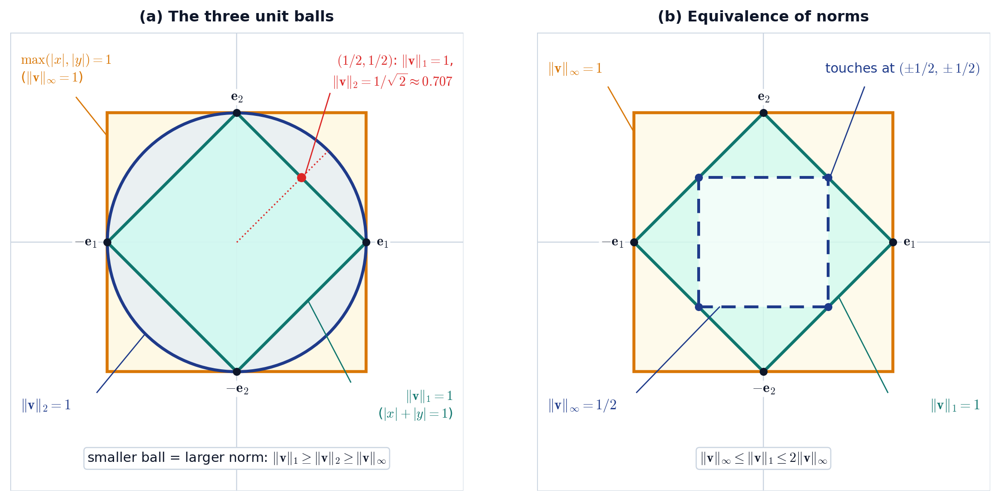
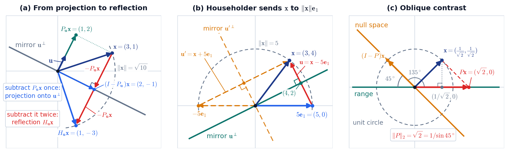
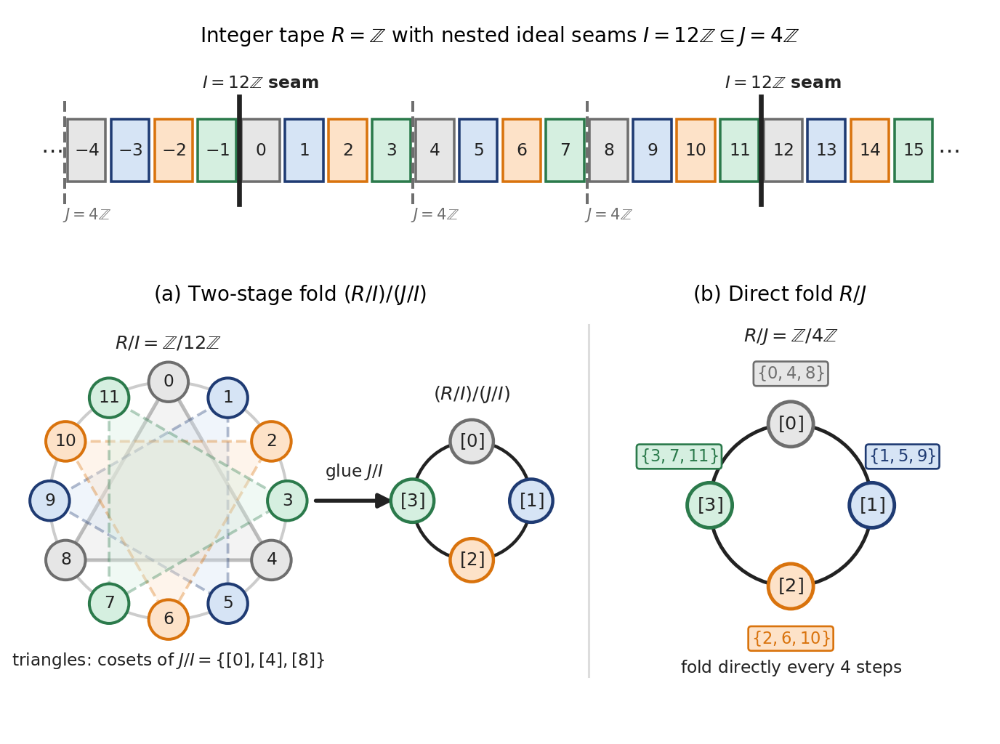

# Maths 0 - Linear & Abstract Algebra

## Vectors: Conceptual Overview

Before we could define an abstract vector space, we needed a candidate set $V$. Initially, this set, whatever it was (a set of $n$-tuples of numbers, or matrices, or functions, etc.), had no structure at all; it was just a set with elements. This is the first level of our hierarchy. To construct a vector space, we needed to combine this set with some notion of addition (really, just some map $+: V \times V \to V$) along with some notion of scalar multiplication (really, just some map $\mathbb{F} \times V \to V$, where $\mathbb{F}$ is the scalar field, e.g., $\mathbb{R}$ or $\mathbb{C}$) that satisfied the vector space axioms. These notions are additional structure that one adds to $V$, and one calls the result a "vector space" only if those specific notions are compatible with the vector space axioms. Vector spaces are the second level of our hierarchy.

That last paragraph might seem pedantic. If $V = \mathbb{R}^n$, for instance, do we really consider the notion of addition of vectors to be extra structure? What else could addition be, in this case? Is it really useful or necessary to separate the set $V$ from the obvious addition operation it carries? These questions may be reasonable for $\mathbb{R}^n$, but it's important to note that there are plenty of sets for which no useful or intuitive notion of addition exists. Consider the set

$$S^2 = \{(x, y, z) \in \mathbb{R}^3 \mid x^2 + y^2 + z^2 = 1\},$$

which is, of course, nothing but the 2-D surface of a unit sphere in $\mathbb{R}^3$. This is a perfectly well-defined and intuitive set, but there is no meaningful way to perform addition on this set. If you wanted to add the North Pole $N = (0, 0, 1)$ to the South Pole $S = (0, 0, -1)$, what should the resulting point of $S^2$ be? Note that we cannot simply add $N$ to $S$ as vectors in $\mathbb{R}^3$ because the resulting point, the origin $O$, is not in $S^2$.

Thus not all sets are cut out to be vector spaces, and even though the operations of addition and scalar multiplication may seem trivial or obvious in familiar examples such as $\mathbb{R}^n$, they really do confer a significant amount of non-trivial structure on a space. This structure is manifest in all the constructions and definitions one then proceeds to make: linear independence, span, basis sets, linear operators, dual spaces, etc.

Note that none of these notions requires an inner product; the former exist completely independently of the latter. With an inner product, though, one may then speak of orthogonality, inner-product length of vectors, and the like (while general norms can exist without an inner product, and orthogonality can be defined using more general bilinear or Hermitian forms, an inner product provides these together). Thus, inner product spaces constitute the third level of our hierarchy. To be sure, once one introduces this third level of structure, there is then interplay between the levels (for example, mutually orthogonal nonzero vectors are linearly independent), but you don't need an inner product to know what linear independence means. Furthermore, level three of the hierarchy is rich enough that for a given set $V$ with a given vector space structure, there can be multiple meaningful notions of an inner product. A good example of this is the vector space $P(\mathbb{R})$ of polynomials of one real variable, which has many different inner products, many of which have direct applications to quantum mechanics!

This means that one cannot ask in general whether the polynomials $2x$ and $4x^2 - 2$ are orthogonal; the question is only meaningful once an inner product on $P(\mathbb{R})$ is specified. For example, with the integral inner products of [Nondegenerate Hermitian Forms](#nondegenerate-hermitian-forms) and weight $W(x) = 1$, they are orthogonal on the interval $[-1, 1]$, where their product is an odd function, but not on $[0, 2]$, where $\int_0^2 2x(4x^2 - 2)\,dx = 24$. Once an inner product is chosen, however, one can then speak of orthogonality, length, and (for real inner products) the angle between vectors, notions that a bare vector space or a mere set does not have. A norm alone would give lengths, but not orthogonality or angles.

## Vector Norms & Inner Products
The concept of the length of a vector $\mathbf{x}$ in $\mathbb{R}^n$ or $\mathbb{C}^n$ is familiar. This is called the Euclidean norm (or $2$-norm), denoted $\|\mathbf{x}\|_2$ (we use double bars $\|\cdot\|$ to distinguish vector norms from scalar absolute values $|\cdot|$). By Pythagoras' theorem, we know that:

$$\|\mathbf{x}\|_2=\sqrt{\sum_{i=1}^{n}|x_i|^2}$$

But this is not the only kind of norm we could have. We can define a general $p$-norm for any real number $p\ge 1$ by:

$$\|\mathbf{x}\|_p=\left(\sum_{i=1}^{n}|x_i|^p\right)^{1/p}$$

For example, the Manhattan (or taxicab) norm is the case where $p=1$: $\|\mathbf{x}\|_1=\sum_{i=1}^{n}|x_i|$. We can even take the limit $p\to\infty$, where the $\infty$-norm (or max/supremum norm) is defined as:

$$\|\mathbf{x}\|_\infty=\max_{1\le i\le n}|x_i|$$

To prove that $\lim_{p\to\infty}\|\mathbf{x}\|_p=\max_i|x_i|=\|\mathbf{x}\|_\infty$, note first that if $\mathbf{x}=\mathbf{0}$, both sides are trivially $0$. For $\mathbf{x}\neq\mathbf{0}$, relabel the entries of $\mathbf{x}$ by setting $\tilde{x}_1=\max_i|x_i|>0$, and if there are other entries whose magnitudes equal this same maximum, label their magnitudes $\tilde{x}_2,\dots,\tilde{x}_k$ (so $\tilde{x}_1=\dots=\tilde{x}_k$). Label the remaining coordinates $\tilde{x}_{k+1},\dots,\tilde{x}_n$. Consequently, $|\tilde{x}_i/\tilde{x}_1|<1$ for $i=k+1,\dots,n$, so $|\tilde{x}_i/\tilde{x}_1|^p\to 0$ as $p\to\infty$. Since $k^{1/p}\to 1$ as $p\to\infty$, we obtain:

$$\|\mathbf{x}\|_p=\left(\sum_{i=1}^{n}|\tilde{x}_i|^p\right)^{1/p}=\tilde{x}_1\left(k+\left|\frac{\tilde{x}_{k+1}}{\tilde{x}_1}\right|^p+\dots+\left|\frac{\tilde{x}_n}{\tilde{x}_1}\right|^p\right)^{1/p}\xrightarrow{p\to\infty}\tilde{x}_1=\|\mathbf{x}\|_\infty$$

To get a feel for the $1$-, $2$-, and $\infty$-vector norms, it helps to consider the shapes and relative sizes of the unit spheres (hollow unit balls) for each norm in $\mathbb{R}^3$. When we say "spheres" here, they need not be round Euclidean spheres, but are symmetric closed surfaces around the origin. For each $p\in\{1,2,\infty\}$, the unit $p$-sphere is the set of points $S_p=\{\mathbf{x}\in\mathbb{R}^3\mid\|\mathbf{x}\|_p=1\}$ that lie at distance $1$ from the origin measured in the $p$-norm. The respective unit $1$-, $2$-, and $\infty$-spheres in $\mathbb{R}^3$ are the surfaces of a regular octahedron, a round ball, and a cube. 

It is visually evident that the solid unit ball bounded by $S_1$ fits inside that of $S_2$, which in turn fits inside that of $S_\infty$ (touching at the coordinate axes). Notice the inverse relationship between unit ball size and norm value: this geometric nesting means that $\|\mathbf{x}\|_1\ge\|\mathbf{x}\|_2\ge\|\mathbf{x}\|_\infty$ for all $\mathbf{x}\in\mathbb{R}^3$ (and more generally in $\mathbb{F}^n$). For example, the point $\mathbf{x}=(1/3,1/3,1/3)$ sits right on the unit octahedron $S_1$ ($\Vert{}\mathbf{x}\Vert{}_1=1$), which lies strictly inside the Euclidean unit sphere $S_2$ ($\Vert{}\mathbf{x}\Vert{}_2=1/\sqrt{3}<1$).

[Figure 1(a)](#figure-1) draws the same three balls in the plane, where the octahedron, the ball and the cube become a diamond, a circle and a square.

*Figure 1. Unit balls in the plane, the 2D version of the octahedron, ball and cube of $\mathbb{R}^3$. (a) The $1$-norm diamond $|x| + |y| = 1$ sits inside the $2$-norm circle, which sits inside the $\infty$-norm square $\max(|x|, |y|) = 1$; all three touch at $\pm \mathbf{e}_1$ and $\pm \mathbf{e}_2$. The point $\mathbf{v} = (1/2, 1/2)$ lies on the diamond ($\|\mathbf{v}\|_1 = 1$) but inside the circle ($\|\mathbf{v}\|_2 = 1/\sqrt{2} \approx 0.707$): a smaller ball means a larger norm. (b) The $\infty$-norm square of radius $1/2$ fits inside the diamond, touching it at $(\pm 1/2, \pm 1/2)$, and the square of radius $1$ contains it, touching it at $\pm \mathbf{e}_1$ and $\pm \mathbf{e}_2$. So $\|\mathbf{v}\|_\infty \le \|\mathbf{v}\|_1 \le 2\|\mathbf{v}\|_\infty$ for every $\mathbf{v}$ in the plane, the 2D version of $\|\mathbf{v}\|_\infty \le \|\mathbf{v}\|_1 \le 3\|\mathbf{v}\|_\infty$ in $\mathbb{R}^3$.*

We can also see this relative ordering with a concrete example. Take the diagonal vector $\mathbf{x}=(1,1,1)$ in $\mathbb{R}^3$:

$$\|\mathbf{x}\|_1=|1|+|1|+|1|=3$$

$$\|\mathbf{x}\|_2=\sqrt{1^2+1^2+1^2}=\sqrt{3}\approx 1.732$$

$$\|\mathbf{x}\|_\infty=\max(|1|,|1|,|1|)=1$$

Clearly, $\|\mathbf{x}\|_1\ge\|\mathbf{x}\|_2\ge\|\mathbf{x}\|_\infty$ ($3\ge 1.732\ge 1$).

### Where $1$-Norm and $\infty$-Norm Are Used

The $2$-norm dominates classical mechanics and quantum state vectors because it is rotationally/unitarily invariant ($SO(3)$ and $U(n)$ symmetry): physical lengths and kinetic energy $\frac{1}{2}m\|\mathbf{v}\|_2^2$ do not change when we rotate our coordinate axes.

The $1$-norm and $\infty$-norm appear whenever total conserved quantity, worst-case bounds, lattice geometry, or sparsity matter more than rotational symmetry. For example, the $1$-norm is used in statistical mechanics and probability distributions. A probability vector $\mathbf{p}$ over discrete energy microstates (with $p_i\ge 0$) satisfies $\|\mathbf{p}\|_1=\sum_i|p_i|=\sum_i p_i=1$. The distance between two distributions $\mathbf{p}$ and $\mathbf{q}$ is measured by the total variation distance $\frac{1}{2}\|\mathbf{p}-\mathbf{q}\|_1$, which directly quantifies the total probability mass that must be moved to turn one distribution into the other.

Similarly, when calculating the trace distance in quantum mechanics, pure states $|\psi\rangle$ are normalized in the $2$-norm ($\langle\psi\vert{}\psi\rangle=1$), whereas mixed states are described by density matrices $\rho$ whose eigenvalues are probabilities summing to $1$. The physical distinguishability between two mixed states $\rho$ and $\sigma$ is governed by the Schatten $1$-norm (trace distance) $\frac{1}{2}\|\rho-\sigma\|_1$, which equals half the $1$-norm of the eigenvalues of $\rho-\sigma$.

And finally, on a discrete crystal lattice, such as a cubic Ising spin grid or a tight-binding hopping model, the minimum number of nearest-neighbor steps between two sites is the $1$-norm of their displacement vector, not the Euclidean straight-line distance.

Similarly, the $\infty$-norm is used in structural mechanics, electromagnetism, and control systems, where failure is determined by the maximum local stress, peak electric field, or worst-case component tolerance rather than a root-mean-square average across all coordinates.

Another instance in quantum mechanics is for a Hermitian operator $A$ on a finite-dimensional space (such as a Hamiltonian), where the largest possible magnitude of a measurement outcome is its spectral radius (and operator $2$-norm), which equals the $\infty$-norm $\|\boldsymbol{\lambda}\|_\infty=\max_i|\lambda_i|$ of its vector of eigenvalues.

### General Norm & Properties of Norms
Instead of restricting ourselves to $p$-norms, a more general axiomatic definition of a norm is useful. On a vector space $V$ over $\mathbb{F}$ ($\mathbb{R}$ or $\mathbb{C}$), a vector norm is a function mapping vectors to non-negative real numbers such that the following three conditions hold for all vectors $\mathbf{x},\mathbf{y}\in V$ and all scalars $\alpha\in\mathbb{F}$:

Positivity (positive definiteness): $\|\mathbf{x}\|\ge 0$ for all $\mathbf{x}\in V$, and $\|\mathbf{x}\|=0\iff\mathbf{x}=\mathbf{0}$.

Homogeneity (absolute scalability): $\|\alpha\mathbf{x}\|=|\alpha|\,\|\mathbf{x}\|$.

Triangle inequality (subadditivity): $\|\mathbf{x}+\mathbf{y}\|\le\|\mathbf{x}\|+\|\mathbf{y}\|$.

All $p$-norms (for $p\ge 1$) satisfy these three axioms. Proving the triangle inequality for the $2$-norm relies on bounding the inner product via the classic Cauchy-Schwarz (or CBS) inequality, which in component form states:

$$\left|\sum_{i=1}^{n}\bar{x}_i y_i\right|\le\left(\sum_{i=1}^{n}|x_i|^2\right)^{1/2}\left(\sum_{i=1}^{n}|y_i|^2\right)^{1/2}$$

In inner-product and $2$-norm notation (where $\mathbf{x}^*=\bar{\mathbf{x}}^T$ is the conjugate transpose), Cauchy-Schwarz takes the compact form:

$$|\mathbf{x}^*\mathbf{y}|\le\|\mathbf{x}\|_2\|\mathbf{y}\|_2$$

where equality holds if and only if $\mathbf{x}$ and $\mathbf{y}$ are linearly dependent (that is, $\mathbf{x}=\mathbf{0}$, or $\mathbf{y}=\alpha\mathbf{x}$ with $\alpha=\frac{\mathbf{x}^*\mathbf{y}}{\mathbf{x}^*\mathbf{x}}$ when $\mathbf{x}\neq\mathbf{0}$).

More generally, for conjugate exponents $p,q>1$ satisfying $\frac{1}{p}+\frac{1}{q}=1$ (as well as the limiting pair $p=1,q=\infty$), Cauchy-Schwarz generalizes to Hölder's inequality:

$$|\mathbf{x}^*\mathbf{y}|\le\sum_{i=1}^{n}|x_i y_i|\le\|\mathbf{x}\|_p\|\mathbf{y}\|_q=\left(\sum_{i=1}^{n}|x_i|^p\right)^{1/p}\left(\sum_{i=1}^{n}|y_i|^q\right)^{1/q}$$

By this inequality, the $1$-norm and $\infty$-norm are natural duals of each other (just as the $2$-norm is self-dual since $\frac{1}{2}+\frac{1}{2}=1$). Setting $p=1$ and $q=\infty$ gives:

$$|\mathbf{x}^*\mathbf{y}|\le\|\mathbf{x}\|_1\|\mathbf{y}\|_\infty$$

(which reduces to $|\mathbf{x}^T\mathbf{y}|\le\|\mathbf{x}\|_1\|\mathbf{y}\|_\infty$ for real vectors).

Using Hölder's inequality, one proves that $p$-norms ($1\le p<\infty$) satisfy the triangle inequality, a result known in component form as Minkowski's inequality:

$$\left(\sum_{i=1}^{n}|x_i+y_i|^p\right)^{1/p}\le\left(\sum_{i=1}^{n}|x_i|^p\right)^{1/p}+\left(\sum_{i=1}^{n}|y_i|^p\right)^{1/p}$$

Note that we restrict $p$-norms to $p\ge 1$ because for $0<p<1$ the triangle inequality fails (homogeneity still holds). For example, with $p=\frac{1}{2}$, the vectors $(1,0)$ and $(0,1)$ each have norm $1$, but their sum has $\|(1,1)\|_{1/2}=(1+1)^2=4>1+1$.

For any general vector norm, there is an additional useful property derived directly from the triangle inequality called the Backward (or Reverse) Triangle Inequality:

$$\big|\|\mathbf{x}\|-\|\mathbf{y}\|\big|\le\|\mathbf{x}-\mathbf{y}\|$$

### Convergence of Sequences
A sequence of vectors $\{\mathbf{x}_k\}$ in $\mathbb{F}^n$ is said to converge to a limit vector $\mathbf{x}$ (written $\lim_{k\to\infty}\mathbf{x}_k=\mathbf{x}$) with respect to a norm $\|\cdot\|$ provided that for every real $\epsilon>0$ there exists an integer $K(\epsilon)\ge 0$ such that:

$$k>K(\epsilon)\implies\|\mathbf{x}_k-\mathbf{x}\|<\epsilon,\quad\text{or equivalently,}\quad\lim_{k\to\infty}\|\mathbf{x}_k-\mathbf{x}\|=0$$

For example, define the sequence in $\mathbb{R}^2$ by:

$$\mathbf{x}_k=\begin{pmatrix}1+\frac{1}{k}\\2-\frac{1}{k^2}\end{pmatrix}$$

Its first few terms are:

$$\mathbf{x}_1=\begin{pmatrix}2\\1\end{pmatrix},\quad\mathbf{x}_2=\begin{pmatrix}1.5\\1.75\end{pmatrix},\quad\mathbf{x}_3=\begin{pmatrix}1.333\dots\\1.888\dots\end{pmatrix},\dots$$

Here, $[\mathbf{x}_2]_1=1.5$ and $[\mathbf{x}_2]_2=1.75$. As $k\to\infty$, these vectors approach the limit vector $\mathbf{x}=\begin{pmatrix}1\\2\end{pmatrix}$.

On any finite-dimensional vector space $\mathbb{F}^n$, convergence does not depend on which norm we choose: if a sequence converges to $\mathbf{x}$ in one norm, it converges to $\mathbf{x}$ in every norm. For all norms on $\mathbb{F}^n$, the following key facts hold:

Continuity of norms: $\|\mathbf{x}\|$ varies continuously with $\mathbf{x}$ (since $\big|\|\mathbf{x}_k\|-\|\mathbf{x}\|\big|\le\|\mathbf{x}_k-\mathbf{x}\|$ by the backward triangle inequality).

Equivalence of norms on $\mathbb{F}^n$: For every pair of norms $\|\cdot\|_a$ and $\|\cdot\|_b$ on $\mathbb{F}^n$ (not necessarily $p$-norms), there exist positive constants $\alpha>0$ and $\beta>0$ (depending only on the two norms and the dimension $n$) such that:

$$\alpha\le\frac{\|\mathbf{x}\|_a}{\|\mathbf{x}\|_b}\le\beta\quad\text{for all nonzero vectors }\mathbf{x}\in\mathbb{F}^n$$

Equivalently, $\alpha\|\mathbf{v}\|_b\le\|\mathbf{v}\|_a\le\beta\|\mathbf{v}\|_b$ for all $\mathbf{v}\in\mathbb{F}^n$. Applying this to $\mathbf{v}=\mathbf{x}_k-\mathbf{x}$ shows (by the Squeeze Theorem) that $\|\mathbf{x}_k-\mathbf{x}\|_a\to 0$ if and only if $\|\mathbf{x}_k-\mathbf{x}\|_b\to 0$. In other words, convergence in $\mathbb{F}^n$ is norm-independent, as we noted above.

So for example, compare the $1$-norm and $\infty$-norm in $\mathbb{R}^3$. For any vector $\mathbf{v}=(v_1,v_2,v_3)^T$,

$$1\cdot\|\mathbf{v}\|_\infty\le\|\mathbf{v}\|_1\le 3\cdot\|\mathbf{v}\|_\infty$$

Here $\alpha=1$ and $\beta=3$. Because the two norms of the error vector $\mathbf{x}_k-\mathbf{x}$ can never differ by more than a fixed factor of $3$, it is impossible for one to vanish while the other stays bounded away from zero. [Figure 1(b)](#figure-1) shows the same sandwich in the plane, where $\Vert{}\mathbf{v}\Vert{}_\infty\le\Vert{}\mathbf{v}\Vert{}_1\le 2\Vert{}\mathbf{v}\Vert{}_\infty$.

And the last property is coordinate-wise convergence: Let $\{\mathbf{x}_k\}$ be a sequence in $\mathbb{F}^n$, and let the individual coordinates of $\mathbf{x}_k$ be $[\mathbf{x}_k]_i$. The sequence converges in norm to the vector $\mathbf{x}=(x_1,x_2,\dots,x_n)^T$ if and only if it converges coordinate-wise:

$$\lim_{k\to\infty}\mathbf{x}_k=\mathbf{x}\iff\lim_{k\to\infty}[\mathbf{x}_k]_i=x_i\quad\text{for every }i=1,2,\dots,n$$

### Inner Products
The $2$-norm arises naturally from the standard inner product (which over $\mathbb{R}^n$ is called the dot product, and is often referred to simply as the inner product). For two column vectors $\mathbf{x},\mathbf{y}\in\mathbb{C}^n$, the standard inner product is the sum of conjugate-weighted componentwise products given by:

$$\langle\mathbf{x}|\mathbf{y}\rangle=\mathbf{x}^*\mathbf{y}=\sum_{i=1}^{n}\bar{x}_i y_i$$

where $\mathbf{x}^*=\bar{\mathbf{x}}^T$ is the conjugate transpose; when $\mathbf{x},\mathbf{y}\in\mathbb{R}^n$ are real, this reduces to $\mathbf{x}^T\mathbf{y}=\sum_{i=1}^{n}x_i y_i$. We take the conjugate in the left-hand argument $\mathbf{x}$ in order to ensure that vectors with complex components still give non-negative real norms.

Note that the inner product is linear in the right-hand argument $\mathbf{y}$ but it is conjugate linear in the left-hand argument $\mathbf{x}$ due to how we defined the inner product.

If $\mathbf{x}=\mathbf{y}$, this inner product becomes the square of the $2$-norm, so taking its square root gives the $2$-norm:

$$\|\mathbf{x}\|_2=\sqrt{\langle\mathbf{x}|\mathbf{x}\rangle}=\sqrt{\mathbf{x}^*\mathbf{x}}=\sqrt{\sum_{i=1}^{n}|x_i\vert{}^2}$$

The inner product also leads to the idea of orthogonality, which we are familiar with geometrically as perpendicularity from Pythagoras' theorem. Specifically, two vectors $\mathbf{u}$ and $\mathbf{v}$ are defined to be orthogonal if:

$$\langle\mathbf{u}|\mathbf{v}\rangle=\mathbf{u}^*\mathbf{v}=0$$

Over $\mathbb{R}^n$, this is completely equivalent to Pythagoras' theorem (and over $\mathbb{C}^n$, orthogonality implies Pythagoras' theorem):

$$\|\mathbf{u}+\mathbf{v}\|_2^2=\|\mathbf{u}\|_2^2+\|\mathbf{v}\|_2^2$$

In $\mathbb{R}^n$, this allows us to calculate the angle $\theta\in[0,\pi]$ between any two nonzero vectors $\mathbf{u}$ and $\mathbf{v}$. From the Law of Cosines on the triangle formed by $\mathbf{u}$, $\mathbf{v}$, and $\mathbf{u}-\mathbf{v}$, we have:

$$\|\mathbf{u}-\mathbf{v}\|_2^2=\|\mathbf{u}\|_2^2+\|\mathbf{v}\|_2^2-2\|\mathbf{u}\|_2\|\mathbf{v}\|_2\cos\theta$$

Solving for $\cos\theta$ and expanding the squared $2$-norms via the real inner product gives:

$$\cos\theta=\frac{\|\mathbf{u}\|_2^2+\|\mathbf{v}\|_2^2-\|\mathbf{u}-\mathbf{v}\|_2^2}{2\|\mathbf{u}\|_2\|\mathbf{v}\|_2}=\frac{\mathbf{u}^T\mathbf{u}+\mathbf{v}^T\mathbf{v}-(\mathbf{u}-\mathbf{v})^T(\mathbf{u}-\mathbf{v})}{2\|\mathbf{u}\|_2\|\mathbf{v}\|_2}=\frac{2\mathbf{u}^T\mathbf{v}}{2\|\mathbf{u}\|_2\|\mathbf{v}\|_2}=\frac{\mathbf{u}^T\mathbf{v}}{\|\mathbf{u}\|_2\|\mathbf{v}\|_2}$$

This also gives us the geometric way to write the real inner product:

$$\mathbf{u}^T\mathbf{v}=\|\mathbf{u}\|_2\|\mathbf{v}\|_2\cos\theta$$

This matches up directly with the Cauchy-Schwarz inequality, $|\mathbf{u}^T\mathbf{v}|=\|\mathbf{u}\|_2\|\mathbf{v}\|_2|\cos\theta|\le\|\mathbf{u}\|_2\|\mathbf{v}\|_2$, where equality is achieved when the vectors are collinear, that is, parallel ($\theta=0$, $\cos 0=1$) or anti-parallel ($\theta=\pi$, $\cos\pi=-1$, so $|\cos\pi|=1$), or when either vector is $\mathbf{0}$. For all other angles $\theta\in(0,\pi)$, we have $|\cos\theta|<1$, placing us in the strict inequality regime.

To reiterate, when talking about angles and orthogonality, we are strictly working with the $2$-norm (and inner products).

If a set of nonzero vectors are mutually orthogonal, they are called an orthogonal set. If they are also all unit vectors ($\Vert{}\mathbf{q}_i\Vert{}_2=1$), they are called an orthonormal set. An orthogonal set of vectors are linearly independent. A square complex matrix $U\in\mathbb{C}^{n\times n}$ whose columns (and equivalently rows) form an orthonormal set of vectors ($U^*U=UU^*=I$) is called a unitary matrix. If its entries are all real ($Q\in\mathbb{R}^{n\times n}$ with $Q^TQ=QQ^T=I$), it is called an orthogonal matrix, a slightly confusing historical name, since its columns are orthonormal and not merely orthogonal. The identity matrix $I$ is an orthogonal (and unitary) matrix because its columns form the standard orthonormal basis. More generally, any permutation matrix, obtained by permuting the columns (or rows) of $I$, is an orthogonal matrix because reordering an orthonormal set cannot destroy orthonormality.

Finally, the cosine of the angle between vectors in $\mathbb{R}^n$ is important in statistics and data analysis for determining the degree to which data in $\mathbf{x}$ is linearly related to data in $\mathbf{y}$. Specifically, while the raw cosine $\frac{\mathbf{x}^T\mathbf{y}}{\|\mathbf{x}\|_2\|\mathbf{y}\|_2}$ measures pure proportionality ($\mathbf{y}\approx\beta_0\mathbf{x}$), if we first subtract the sample means from each vector, forming the mean-centered vectors $\tilde{\mathbf{x}}=\mathbf{x}-\bar{x}\mathbf{e}$ and $\tilde{\mathbf{y}}=\mathbf{y}-\bar{y}\mathbf{e}$ with $\mathbf{e}=(1,1,\dots,1)^T$, then the cosine of the angle between $\tilde{\mathbf{x}}$ and $\tilde{\mathbf{y}}$ (Pearson's correlation coefficient) measures how close $\mathbf{y}$ is to an affine linear combination $\beta_0\mathbf{x}+\beta_1\mathbf{e}$.

---

**Aside:** The outer product comes from multiplying an $n \times 1$ vector with a $1 \times m$ vector to give an $n \times m$ matrix. Every matrix product is a sum of outer products i.e. the sum of the products of the $i^{th}$ column of one matrix and the $i^{th}$ row of the other. 

---

### Nondegenerate Hermitian Forms
An inner product (which induces a norm via $\Vert{}v\Vert{}=\sqrt{(v\vert{}v)}$) is a special case of a nondegenerate Hermitian form. A nondegenerate Hermitian form on a complex vector space $V$ is a $\mathbb{C}$-valued function which assigns to an ordered pair of vectors $v, w \in V$ a scalar, denoted $(v\vert{}w)$, having the following properties:

1.  $(v\vert{}w_1 + cw_2) = (v\vert{}w_1) + c(v\vert{}w_2)$ for all $v, w_1, w_2 \in V$ and $c \in \mathbb{C}$ (linearity in the second argument).
2.  $(v\vert{}w) = \overline{(w\vert{}v)}$ for all $v, w \in V$ (Hermiticity; the bar denotes complex conjugation).
3.  For each $v \in V$ with $v \neq 0$, there exists $w \in V$ such that $(v\vert{}w) \neq 0$ (nondegeneracy).

Condition 3 is equivalent to the property that $(v\vert{}w) = (u\vert{}w)$ for all $w \in V$ iff $v = u$. To see the forward direction, suppose Condition 3 holds and $(v\vert{}w) = (u\vert{}w)$ for all $w \in V$; then by additivity in the first argument (which follows from Properties 1 and 2), $(v - u\vert{}w) = (v\vert{}w) - (u\vert{}w) = 0$ for all $w \in V$, so Condition 3 forces $v - u = 0$, i.e., $v = u$. Conversely, suppose that Condition 3 is violated, so that there exists $v \in V$ with $v \neq 0$ such that $(v\vert{}w) = 0$ for all $w \in V$. Then for any $u \in V$, the distinct vectors $u$ and $u + v$ are indistinguishable:

$$(v + u\vert{}w) = (v\vert{}w) + (u\vert{}w) = (u\vert{}w) \quad \text{for all } w \in V.$$

If the Hermitian form is such that $(v\vert{}v) > 0$ for all $v \neq 0$ (note that $(v\vert{}v)$ is always real by Property 2, and this condition automatically implies Condition 3), then we say it is positive definite. Such a form is called an inner product, and a vector space with such a Hermitian form is called an inner product space.

On a real vector space, the same definition applies with real scalars $c$ and real values. The bar in Property 2 then does nothing, so the form is symmetric, $(v\vert{}w) = (w\vert{}v)$, and linear in both arguments (bilinear). The Minkowski metric on $\mathbb{R}^4$ is a nondegenerate form of this kind, but it is not an inner product. For $v_1 = (x_1, y_1, z_1, t_1)$ and $v_2 = (x_2, y_2, z_2, t_2)$,

$$\eta(v_1, v_2) \equiv x_1 x_2 + y_1 y_2 + z_1 z_2 - t_1 t_2.$$

The form $\eta$ is clearly linear in both its arguments (i.e., it's bilinear) and symmetric, and hence satisfies conditions 1 and 2. It also satisfies condition 3: for $v = (x, y, z, t) \neq 0$, take $w = (x, y, z, -t)$, so that $\eta(v, w) = x^2 + y^2 + z^2 + t^2 > 0$. Notice that for the nonzero vector $v = (1, 0, 0, 1)$, $\eta(v, v) = 0$, so $\eta$ is not positive definite, and hence not an inner product.

The Minkowski metric can be written in components as a matrix, $\eta_{ij} \equiv \eta(e_i, e_j)$, which in the standard basis is $\operatorname{diag}(1, 1, 1, -1)$.

A vector space can carry more than one inner product. Consider the vector space $P(\mathbb{R})$ of polynomials of arbitrary degree with real coefficients, $f(x) = c_0 + c_1x + c_2x^2 + \dots + c_nx^n$.

An obvious (ordered) basis for this space would be $\mathcal{B} = (1, x, x^2, x^3, \dots)$, but this doesn't necessarily turn out to be the most useful choice. Instead, it's more convenient to choose an orthonormal basis. This leads immediately to a conundrum, however: what inner product do we use to define orthonormality? It turns out that a very useful family of inner products is given by

$$(f \mid g) \equiv \int_a^b f(x)g(x)W(x)\,dx, \qquad f, g \in P(\mathbb{R}),$$

where $W(x)$ is a nonnegative weight function on an interval $(a, b)$ (or $[a, b]$, with $a < b$; $a$ may be $-\infty$ and $b$ may be $+\infty$) that is strictly positive on a set of positive measure (for instance, $W(x) > 0$ on $(a, b)$) and satisfies $\int_a^b \vert{}x\vert{}^k W(x)\,dx < \infty$ for all integers $k \ge 0$. Different choices of integration range and weight function $W(x)$ generally give different inner products and different orthonormal bases. (Not always: since $(x^j \mid x^k) = \int_a^b x^{j+k}W(x)\,dx$, two choices give the same inner product exactly when all these moments agree.) (One can obtain these bases by applying the Gram–Schmidt process to the ordered basis $\mathcal{B} = (1, x, x^2, x^3, \dots)$: take $1, x, x^2, \dots$ in turn, subtract from each its components along the polynomials already found, and normalize. We'll cover this in more detail later.) Amazingly, these orthonormal bases turn out to be (up to normalization) the various orthogonal polynomials (Legendre for $W(x) = 1$ on $[-1, 1]$, Hermite for $W(x) = e^{-x^2}$ on the whole real line, Laguerre for $W(x) = e^{-x}$ on $[0, \infty)$, etc.) one meets in studying the various differential equations that arise in electrostatics and quantum mechanics.

As an example, let the integration range be $[-1, 1]$ and $W(x) = 1$. Applying Gram–Schmidt to the ordered set $S = (1, x, x^2, x^3) \subset \mathcal{B}$ yields (up to normalization) the first four Legendre polynomials:

$$\begin{aligned} P_0(x) &= 1, \\ P_1(x) &= x, \\ P_2(x) &= \frac{1}{2}(3x^2 - 1), \\ P_3(x) &= \frac{1}{2}(5x^3 - 3x). \end{aligned}$$

## Matrix Analysis - First Look
In general, the discussions here are for the real and complex fields. We do not consider finite fields unless explicitly stated.

Consider the system of linear equations:

$$\begin{aligned}a_{11}x_1+a_{12}x_2+a_{13}x_3&=y_1\\a_{21}x_1+a_{22}x_2+a_{23}x_3&=y_2\\a_{31}x_1+a_{32}x_2+a_{33}x_3&=y_3\end{aligned}$$

We can write this out as the product of a coefficient matrix $A$ with a column vector $\mathbf{x}$ to give the output vector $\mathbf{y}$ as:

$$\begin{pmatrix}a_{11}&a_{12}&a_{13}\\a_{21}&a_{22}&a_{23}\\a_{31}&a_{32}&a_{33}\end{pmatrix}\begin{pmatrix}x_1\\x_2\\x_3\end{pmatrix}=\begin{pmatrix}y_1\\y_2\\y_3\end{pmatrix}$$

Let the matrix $A$ represent the linear function (transformation) $f$, so $\mathbf{y}=f(\mathbf{x})=A\mathbf{x}$.

Now consider how we would compose $f$ with another linear function $g$ (forming $f\circ g$, where $g$ acts first and $f$ acts second). To keep the intermediate variables distinct, suppose $g$ maps an initial input vector $\mathbf{u}=(u_1,u_2,u_3)^T$ to the intermediate vector $\mathbf{x}=g(\mathbf{u})=B\mathbf{u}$, given by the matrix $B$:

$$\begin{pmatrix}x_1\\x_2\\x_3\end{pmatrix}=\begin{pmatrix}b_{11}&b_{12}&b_{13}\\b_{21}&b_{22}&b_{23}\\b_{31}&b_{32}&b_{33}\end{pmatrix}\begin{pmatrix}u_1\\u_2\\u_3\end{pmatrix}\implies\begin{aligned}x_1&=b_{11}u_1+b_{12}u_2+b_{13}u_3\\x_2&=b_{21}u_1+b_{22}u_2+b_{23}u_3\\x_3&=b_{31}u_1+b_{32}u_2+b_{33}u_3\end{aligned}$$

If we substitute these expressions for $x_1,x_2,x_3$ into the equations for $\mathbf{y}=f(\mathbf{x})=f(g(\mathbf{u}))$ and collect coefficients of $u_1,u_2,u_3$, the first equation becomes:

$$y_1=(a_{11}b_{11}+a_{12}b_{21}+a_{13}b_{31})u_1+(a_{11}b_{12}+a_{12}b_{22}+a_{13}b_{32})u_2+(a_{11}b_{13}+a_{12}b_{23}+a_{13}b_{33})u_3$$

Doing the same for $y_2$ and $y_3$ gives the $(i,j)$-entry of the composite matrix $C=AB$ representing $f\circ g$ as $(AB)_{ij}=\sum_{k=1}^{3}a_{ik}b_{kj}$ (the inner product of row $i$ of $A$ with column $j$ of $B$), which leads directly to the matrix multiplication rules we are already familiar with.

This also gives us an effortless proof of associativity $(AB)C=A(BC)$ in matrix multiplication without index algebra gymnastics. When matrix multiplication is introduced purely as an algebraic recipe $(AB)_{ij}=\sum_k a_{ik}b_{kj}$, proving that $(AB)C=A(BC)$ requires writing out triple sums $\sum_k\sum_\ell a_{ik}b_{k\ell}c_{\ell j}$ and swapping summation order, which hides why it works. 

Once we recognize that matrix multiplication is defined to represent composition of linear maps, associativity becomes immediate with zero algebra: for any three functions $\mathbb{F}^q\xrightarrow{h}\mathbb{F}^n\xrightarrow{g}\mathbb{F}^p\xrightarrow{f}\mathbb{F}^m$ (even nonlinear ones), function composition is automatically associative because both $((f\circ g)\circ h)(\mathbf{w})$ and $(f\circ(g\circ h))(\mathbf{w})$ evaluate to $f(g(h(\mathbf{w})))$ at every input vector $\mathbf{w}$. Since the matrix of a linear map is uniquely determined by its action on the standard basis vectors $\mathbf{e}_j$, the matrices representing $(f\circ g)\circ h$ and $f\circ(g\circ h)$ must be identical: $(AB)C=A(BC)$.

Our composition picture $\mathbf{y}=A(B\mathbf{u})$ also gives a clean column-wise picture. Notice what happens if we plug in the $j$-th standard basis vector $\mathbf{u}=\mathbf{e}_j$ (all zeros except a $1$ in slot $j$): $B\mathbf{e}_j=\mathbf{b}_j$ is the $j$-th column of $B$, so the columns of a matrix are exactly what it does to the standard basis vectors ([Matrix Rank](#matrix-rank) uses this to find the columns of $AB$). In the other direction, for a matrix $A\in\mathbb{F}^{m\times p}$ (whose $k$-th column we denote by $A_{*k}\in\mathbb{F}^{m\times 1}$) and a single column vector $\mathbf{x}\in\mathbb{F}^{p\times 1}$, the matrix-vector product $A\mathbf{x}$ is a concise way to represent a linear combination of the columns of $A$:

$$\mathbf{x}=\begin{pmatrix}x_1\\x_2\\\vdots\\x_p\end{pmatrix}\implies A\mathbf{x}=\sum_{k=1}^{p}A_{*k}x_k=A_{*1}x_1+A_{*2}x_2+\dots+A_{*p}x_p$$

This column-combination view provides a direct algebraic way to characterize whether the columns of $A$ are linearly independent or linearly dependent.

Let $A\in\mathbb{F}^{m\times p}$. The indexed family of columns $(A_{*1},A_{*2},\dots,A_{*p})$ of $A$ is linearly independent if and only if $\mathbf{x}=\mathbf{0}_p$ is the only vector in $\mathbb{F}^{p\times 1}$ for which $A\mathbf{x}=\mathbf{0}_m$.

Equivalently, the columns of $A$ are linearly dependent if and only if there exists a nonzero vector $\mathbf{x}\neq\mathbf{0}_p$ in $\mathbb{F}^{p\times 1}$ such that $A\mathbf{x}=\mathbf{0}_m$.
    
Notice how writing $A\mathbf{x}=\sum_{k=1}^p A_{*k}x_k$ shifts our geometric perspective on linear systems:
    
Row picture: Each entry of $A\mathbf{x}=\mathbf{b}$ is the dot product $A_{i*}\mathbf{x}=b_i$, asking for the intersection of $m$ hyperplanes in $\mathbb{F}^p$.
        
Column picture:  $A\mathbf{x}=\mathbf{b}$ asks whether the target vector $\mathbf{b}\in\mathbb{F}^m$ can be built as a linear combination of the $p$ column vectors $A_{*1},\dots,A_{*p}$ in $\mathbb{F}^m$. Together, existence and uniqueness separate cleanly across the columns of $A$:

Existence of a solution to $A\mathbf{x}=\mathbf{b}$ holds for every $\mathbf{b}\in\mathbb{F}^m$ if and only if the columns of $A$ span $\mathbb{F}^m$ (surjectivity).

Uniqueness of the solution holds if and only if the columns of $A$ are linearly independent (injectivity).

Both hold simultaneously ($A$ is invertible) only when $m=p$ and the $p$ columns form a basis for $\mathbb{F}^m$.
        
This also gives us automatic linear dependence for wide matrices ($p>m$). Suppose $A\in\mathbb{F}^{m\times p}$ is a wide rectangular matrix, meaning it has more columns than rows ($p>m$, more unknowns than equations). Because at most $m$ vectors can be linearly independent inside the $m$-dimensional space $\mathbb{F}^{m\times 1}$ (equivalently, Gaussian elimination on $m$ rows can produce at most $m$ pivot columns, leaving at least $p-m\ge 1$ free variables), there is always a nonzero vector $\mathbf{x}\neq\mathbf{0}_p$ satisfying $A\mathbf{x}=\mathbf{0}_m$. Therefore, whenever $p>m$, the columns of $A$ are guaranteed to be linearly dependent.

An important thing to note about $A^{-1}b = x$: Since $Ax = b$, it means that $b$ is the linear combination of the columns of $A$ via the coefficients of $x$. Thus, $x$ represents the vector $b$ when we use the columns of $A$ as the basis vectors. Therefore, multiplication by $A^{-1}$ is a change of basis operation. The column vector $b$ represents the coefficients of a vector in the standard $e_i$ basis, while $A^{-1}b$ gives the coefficients of the same vector in the basis of the columns of $A$.

### More Matrix Multiplication Points!

If $A$ and $B$ are $n \times n$ upper (lower) triangular matrices, then the product $AB$ is also upper (lower) triangular.

An $m \times n$ linear system $A\mathbf{x} = \mathbf{b}$ is said to be consistent when there exists at least one solution for $\mathbf{x}$, i.e., if and only if $\mathbf{b}$ is a linear combination of the columns in $A$.

Matrix multiplication is associative and distributive over addition, but not necessarily commutative. One important caveat from the lack of commutativity (for $n \times n$ matrices $A$ and $B$):

$$(A + B)^2 = \underbrace{(A + B)}(A + B) = \underbrace{(A + B)}A + \underbrace{(A + B)}B = A^2 + BA + AB + B^2,$$

which is not equal to $A^2 + 2AB + B^2$ unless $AB = BA$.

We also have:

$$(AB)^T = B^T A^T \quad (AB)^* = B^* A^*$$

The inverse of a square matrix $A$ is defined to be the matrix $A^{−1}$ such that $A^{−1}A = I_n = AA^{−1}$ , where $I_n$ is the $n \times n$ identity matrix. Matrix inversion is not defined for non-square matrices, and not all square matrices possess an inverse. When it exists, the inverse is unique. Square matrices that fail to have an inverse are said to be singular, while matrices that possess an inverse are called nonsingular.

We also have:

$$(A^{-1})^T = (A^{T})^{-1}, \quad (A^{-1})^* = (A^{*})^{-1}, \quad (A_1...A_k)^{-1} = A_k^{-1}...A_1^{-1}$$

If $A$ is nonsingular (say $n \times n$, with $B$ of size $n \times p$), then $X = A^{-1}B$ is the unique solution for $X$ in $AX = B$: it is a solution because $A(A^{-1}B) = (AA^{-1})B = IB = B$, and $X = A^{-1}B$ is the only solution because if $AY = B$, then multiplication on the left by $A^{-1}$ yields $Y = A^{-1}B = X$.

When $A$ is singular or not square, the equations may or may not be solvable and when solutions exist, they cannot be represented in terms of $A^{−1}$ and they need not be unique.

For $A_{n \times n}$ over a field $\mathbb{F}$, $A_{n \times n}$ is nonsingular if and only if there exists a matrix $X_{n \times n}$ such that $AX = I$ or $XA = I$, and in either case, $X = A^{-1}$.

Each of the following statements is equivalent to saying that $A_{n \times n}$ (over a field $\mathbb{F}$) is nonsingular:

* The $n$ columns in $A$ (taken as an indexed list, without deduplicating repeated columns) are linearly independent.
* The $n$ rows in $A$ (taken as an indexed list, without deduplicating repeated rows) are linearly independent.
* The only vector $\mathbf{x}_{n \times 1}$ for which $A\mathbf{x} = \mathbf{0}$ is $\mathbf{x} = \mathbf{0}$.
* $\det(A) \neq 0$.

In particular, it follows that if $A$ is nonsingular, then every subset of columns and every subset of rows is linearly independent.

A matrix $A_{n \times n} = [a_{ij}]$ (with entries in $\mathbb{R}$ or $\mathbb{C}$) is said to be strictly (row) diagonally dominant whenever

$$\vert{}a_{ii}\vert{} > \sum_{\substack{j=1 \\ j \neq i}}^n \vert{}a_{ij}\vert{} \quad \text{for each } i = 1, 2, \dots, n.$$

All strictly (row) diagonally dominant matrices are nonsingular.

### Example: Network Analysis and Powers of Connectivity (Adjacency) Matrices
A small airline serves five cities, $A$, $B$, $C$, $D$, and $H$, in which $H$ is the "hub city." The routes between the cities are depicted in the diagram below, which is an example of a _directed graph_. The five cities are called the _nodes_ of the graph, and the direct connections (single-flight links) between the nodes are called the _directed edges_ (or _arcs_) of the graph. Matrix powers are natural tools for analyzing such a network.

[Figure 2(a)](#figure-2) shows the network. The outer routes run one way round the square, $B \to A \to C \to D \to B$, and every city has flights both to and from the hub $H$.

*Figure 2. The airline network of the connectivity matrix $\mathbf{C}$. (a) The outer routes run one way round the square ($B \to A \to C \to D \to B$), and the hub $H$ has flights to and from every city, $12$ directed edges in all. (b) Two of the $[\mathbf{C}^4]_{12} = 7$ four-flight walks from $A$ to $B$, with their steps numbered: $A \to C \to D \to H \to B$ visits no city twice, while $A \to H \to A \to H \to B$ flies $A \to H$ twice (steps $1$ and $3$) and so revisits both $A$ and $H$.*

Traveling from city $A$ to city $B$ requires at least two flights (one connection). Flights $(A \to H)$ and $(H \to B)$ provide the minimal number of flights. However, if space on either of these two flights is not available, then a passenger has to take at least three flights. Several questions arise. How many routes from city $A$ to city $B$ require _exactly_ three flights? How many routes require _no more than_ four flights, and so on? Since this network is small, these questions can be answered by "eyeballing" the diagram, but the eyeball method is not effective in larger networks that occur in practice. To see how matrix algebra can be applied, create a _connectivity matrix_ $\mathbf{C} = [c_{ij}]$ (also known as an _adjacency matrix_), identifying cities $A, B, C, D, H$ with indices $1, 2, 3, 4, 5$, respectively, in which

$$c_{ij} = \begin{cases} 1 & \text{if there is a flight from city } i \text{ to city } j, \\ 0 & \text{otherwise.} \end{cases}$$

For our small network, 

$$\mathbf{C} = \begin{array}{cc} & \begin{array}{ccccc} A & B & C & D & H \end{array} \\ \begin{array}{c} A \\ B \\ C \\ D \\ H \end{array} & \begin{pmatrix} 0 & 0 & 1 & 0 & 1 \\ 1 & 0 & 0 & 0 & 1 \\ 0 & 0 & 0 & 1 & 1 \\ 0 & 1 & 0 & 0 & 1 \\ 1 & 1 & 1 & 1 & 0 \end{pmatrix} \end{array}.$$

Matrix $\mathbf{C}$, together with its powers $\mathbf{C}^2, \mathbf{C}^3, \mathbf{C}^4, \dots$, provides all of the information needed to analyze the network. Entry $c_{ik}$ is the number of direct routes from city $i$ to city $k$, and $c_{kj}$ is the number of direct routes from city $k$ to city $j$, so $c_{ik}c_{kj}$ is the number of $2$-flight routes (directed walks of length $2$, which may revisit cities) from city $i$ to city $j$ that have a connection through city $k$. Consequently, the definition of matrix multiplication (see [Matrix Analysis - First Look](#matrix-analysis-first-look)) says that the $(i, j)$-entry in $\mathbf{C}^2 = \mathbf{C}\mathbf{C}$ is

$$[\mathbf{C}^2]_{ij} = \sum_{k=1}^5 c_{ik}c_{kj} = \text{the total number of } 2\text{-flight routes (directed walks) from city } i \text{ to city } j.$$

Similarly, the $(i, j)$-entry in the product $\mathbf{C}^3 = \mathbf{C}\mathbf{C}\mathbf{C}$ is

$$[\mathbf{C}^3]_{ij} = \sum_{k_1, k_2 = 1}^5 c_{ik_1}c_{k_1 k_2}c_{k_2 j} = \text{number of } 3\text{-flight routes (directed walks) from city } i \text{ to city } j,$$

and, in general, for $n \ge 2$,

$$[\mathbf{C}^n]_{ij} = \sum_{k_1, k_2, \dots, k_{n-1}=1}^5 c_{ik_1}c_{k_1 k_2}\cdots c_{k_{n-1}j}$$

is the total number of $n$-flight routes (directed walks) from city $i$ to city $j$. Therefore, the total number of routes (directed walks) from city $i$ to city $j$ that require no more than $n$ flights is given by $[\mathbf{C}]_{ij} + [\mathbf{C}^2]_{ij} + \cdots + [\mathbf{C}^n]_{ij} = [\mathbf{C} + \mathbf{C}^2 + \cdots + \mathbf{C}^n]_{ij}$.

**Problem:** For our small network, how many routes (directed walks) from $A$ to $B$ require _exactly_ four flights, and how many routes from $A$ to $B$ require _no more than_ four flights?

**Solution:** Use the matrix $\mathbf{C}$ above, and compute

$$\mathbf{C}^2 = \begin{pmatrix} 1 & 1 & 1 & 2 & 1 \\ 1 & 1 & 2 & 1 & 1 \\ 1 & 2 & 1 & 1 & 1 \\ 2 & 1 & 1 & 1 & 1 \\ 1 & 1 & 1 & 1 & 4 \end{pmatrix}, \quad \mathbf{C}^3 = \begin{pmatrix} 2 & 3 & 2 & 2 & 5 \\ 2 & 2 & 2 & 3 & 5 \\ 3 & 2 & 2 & 2 & 5 \\ 2 & 2 & 3 & 2 & 5 \\ 5 & 5 & 5 & 5 & 4 \end{pmatrix}, \quad \mathbf{C}^4 = \begin{pmatrix} 8 & 7 & 7 & 7 & 9 \\ 7 & 8 & 7 & 7 & 9 \\ 7 & 7 & 8 & 7 & 9 \\ 7 & 7 & 7 & 8 & 9 \\ 9 & 9 & 9 & 9 & 20 \end{pmatrix},$$

and

$$\mathbf{C} + \mathbf{C}^2 + \mathbf{C}^3 + \mathbf{C}^4 = \begin{pmatrix} 11 & 11 & 11 & 11 & 16 \\ 11 & 11 & 11 & 11 & 16 \\ 11 & 11 & 11 & 11 & 16 \\ 11 & 11 & 11 & 11 & 16 \\ 16 & 16 & 16 & 16 & 28 \end{pmatrix}.$$  

The number of routes (directed walks) from $A$ to $B$ requiring _exactly_ four flights is given by $[\mathbf{C}^4]_{12} = 7$, and there are $[\mathbf{C} + \mathbf{C}^2 + \mathbf{C}^3 + \mathbf{C}^4]_{12} = 11$ routes (directed walks) from $A$ to $B$ that require no more than four flights. The seven 4-flight walks are $A \to C \to D \to H \to B$, $A \to C \to H \to D \to B$, $A \to H \to C \to D \to B$, $A \to H \to A \to H \to B$, $A \to H \to B \to H \to B$, $A \to H \to C \to H \to B$ and $A \to H \to D \to H \to B$. The last four revisit a city, which is why the powers of $\mathbf{C}$ count walks rather than routes that never repeat a city. [Figure 2(b)](#figure-2) highlights one of each kind.

### Block Triangular Matrices

A square matrix $T$ that can be partitioned (for $1 \le r < n$) as

$$T_{n \times n} = \begin{pmatrix} A_{r \times r} & B_{r \times (n-r)} \\ 0_{(n-r) \times r} & C_{(n-r) \times (n-r)} \end{pmatrix}$$

is said to be block upper triangular (and, together with its block lower triangular counterpart having $0$ in the upper-right position, block triangular). If $T$ is the coefficient matrix for a system of linear equations $T\mathbf{x} = \mathbf{b}$, and if $\mathbf{x}$ and $\mathbf{b}$ are conformably partitioned as $\mathbf{x} = \begin{pmatrix} \mathbf{x}_1 \\ \mathbf{x}_2 \end{pmatrix}$ and $\mathbf{b} = \begin{pmatrix} \mathbf{b}_1 \\ \mathbf{b}_2 \end{pmatrix}$ (where $\mathbf{x}_1, \mathbf{b}_1$ are $r \times 1$ and $\mathbf{x}_2, \mathbf{b}_2$ are $(n-r) \times 1$), then block multiplication shows that $T\mathbf{x} = \mathbf{b}$ reduces to the two smaller coupled systems

$$\begin{cases} A\mathbf{x}_1 + B\mathbf{x}_2 = \mathbf{b}_1, \\ C\mathbf{x}_2 = \mathbf{b}_2. \end{cases}$$

If $C\mathbf{x}_2 = \mathbf{b}_2$ is consistent and yields a solution $\mathbf{x}_2$ for which $A\mathbf{x}_1 = \mathbf{b}_1 - B\mathbf{x}_2$ is also consistent (in particular, if $A$ and $C$ are nonsingular, which guarantees a unique solution), then a solution for $\mathbf{x} = \begin{pmatrix} \mathbf{x}_1 \\ \mathbf{x}_2 \end{pmatrix}$ can be obtained by back substitution, which means that $C\mathbf{x}_2 = \mathbf{b}_2$ is first solved for $\mathbf{x}_2$, and $\mathbf{x}_2$ is then substituted "back" into $A\mathbf{x}_1 = \mathbf{b}_1 - B\mathbf{x}_2$, which is solved for $\mathbf{x}_1$. This is an advantage in terms of computational effort.

### The Trace
The trace is the sum of the diagonal elements. It follows the principles of linearity. What's more, cyclic permutation of a product of matrices gives the same trace, i.e.

$$\operatorname{trace}(ABC) = \operatorname{trace}(CAB) = \operatorname{trace}(BCA)$$

but other reorderings in general do not. For example, with $A = \begin{pmatrix} 0 & 1 \\ 0 & 0 \end{pmatrix}$, $B = \begin{pmatrix} 0 & 0 \\ 1 & 0 \end{pmatrix}$ and $C = \begin{pmatrix} 1 & 0 \\ 0 & 0 \end{pmatrix}$, we get $\operatorname{trace}(ABC) = 1$ but $\operatorname{trace}(ACB) = 0$.

### Matrix Inner Product
The standard inner product $\langle \mathbf{x} \mid \mathbf{y} \rangle = \mathbf{x}^* \mathbf{y}$ for column vectors $\mathbf{x}, \mathbf{y} \in \mathbb{F}^{n \times 1}$ (where $\mathbb{F} = \mathbb{R}$ or $\mathbb{C}$) has a natural generalization to matrices, called the standard matrix inner product:

$$\langle A \mid B \rangle = \operatorname{trace}(A^* B)$$

Just as the inner product for vectors is married to the Euclidean vector norm via $\Vert{}\mathbf{x}\Vert{}_2 = \sqrt{\langle \mathbf{x} \mid \mathbf{x} \rangle} = \sqrt{\mathbf{x}^* \mathbf{x}}$, the matrix inner product generates an analogous matrix norm, the Frobenius matrix norm:

$$\Vert{}A\Vert{}_F = \sqrt{\langle A \mid A \rangle} = \sqrt{\operatorname{trace}(A^* A)} = \sqrt{\sum_{i,j} \vert{}a_{ij}\vert{}^2}$$

$$\Vert{}A\Vert{}_F^2 = \sum_{i,j} \vert{}a_{ij}\vert{}^2 = \sum_i \Vert{}A_{i\ast}\Vert{}_2^2 = \sum_j \Vert{}A_{\ast j}\Vert{}_2^2 = \operatorname{trace}(A^* A).$$

The Frobenius matrix norm is just a reinterpretation of the vector $2$-norm because the entries in any matrix can be strung out to form a long row (or column) vector, and computing its Euclidean norm is equivalent to computing the Frobenius matrix norm. For example, by stringing out $A = \begin{pmatrix} 2 & -1 \\ -4 & -2 \end{pmatrix}$ into a four-component vector, the Euclidean norm on $\mathbb{R}^4$ can be applied to write

$$\Vert{}A\Vert{}_F = \bigl(2^2 + (-1)^2 + (-4)^2 + (-2)^2\bigr)^{1/2} = 5.$$

The CBS Inequality holds for matrices:  

$$\vert{}\langle A \mid B \rangle\vert{} \le \Vert{}A\Vert{}_F \Vert{}B\Vert{}_F.$$

There is an additional property for matrices that is not present in vector norms, which is the fourth item in the list below. A matrix norm satisfies the following properties: 

$\Vert{}A\Vert{} \ge 0$ and $\Vert{}A\Vert{} = 0 \iff A = 0$.

$\Vert{}\alpha A\Vert{} = \vert{}\alpha\vert{}\,\Vert{}A\Vert{}$ for all scalars $\alpha \in \mathbb{F}$.

$\Vert{}A + B\Vert{} \le \Vert{}A\Vert{} + \Vert{}B\Vert{}$ for matrices of the same size.

$\Vert{}AB\Vert{} \le \Vert{}A\Vert{}\,\Vert{}B\Vert{}$ for all conformable matrices.

Matrix norms inherit the properties of vector norms:

$$\bigl\vert{}\Vert{}A\Vert{} - \Vert{}B\Vert{}\bigr\vert{} \le \Vert{}A - B\Vert{}.$$

A matrix norm and a family of vector norms are said to be compatible when $\Vert{}A\mathbf{x}\Vert{}_V \le \Vert{}A\Vert{}_M \Vert{}\mathbf{x}\Vert{}_V$ for all $A \in \mathbb{F}^{m \times n}$ and $\mathbf{x} \in \mathbb{F}^{n \times 1}$.

The concept of an induced matrix norm as described below is fundamental to applications where the Frobenius norm may either not be applicable or may not be the best choice for gauging the "magnitude" of a matrix.

Given a vector norm that is valid on $\mathbb{F}^n$ for all finite $n$, the expression

$$\max_{\Vert{}\mathbf{x}\Vert{}=1} \Vert{}A\mathbf{x}\Vert{} = \Vert{}A\Vert{} \quad \text{for } A \in \mathbb{F}^{m \times n},\; \mathbf{x} \in \mathbb{F}^{n \times 1}$$

defines (or induces) a matrix norm on $\mathbb{F}^{m \times n}$ that is compatible with the underlying vector norm. This matrix norm is naturally called an induced matrix norm. If $A$ is square and nonsingular, then

$$\min_{\Vert{}\mathbf{x}\Vert{}=1} \Vert{}A\mathbf{x}\Vert{} = \frac{1}{\Vert{}A^{-1}\Vert{}}.$$

In words, an induced norm $\Vert{}A\Vert{}$ represents the maximum extent to which vectors on the unit sphere are stretched under transformation by $A$, whereas $1/\Vert{}A^{-1}\Vert{}$ represents the minimum scaling factor of vectors on the unit sphere under transformation by a nonsingular matrix $A$ (so smaller $1/\Vert{}A^{-1}\Vert{}$ corresponds to greater shrinkage).

[Figure 3](#figure-3) shows this for the $2$-norm in the plane, with the matrix $A$ of the example below: $A$ stretches the unit circle into an ellipse, whose longest semi-axis is $\Vert{}A\Vert{}_2$ and whose shortest semi-axis is $1/\Vert{}A^{-1}\Vert{}_2$.

*Figure 3. Maximum and minimum stretching in the $2$-norm, for the matrix $A = \frac{1}{\sqrt{3}}\begin{pmatrix} 3 & -1 \\ 0 & \sqrt{8} \end{pmatrix}$ of the example below. In the $2$-norm the unit ball is the circle $\|\mathbf{x}\|_2 = 1$, and its image under $A$ is an ellipse; the two panels share one scale. (a) Eight unit vectors, numbered $1$ to $8$ at $45^\circ$ steps. (b) Their images under $A$, with the same numbers, over the faint unit circle. Vectors $8$ and $4$, $\mathbf{x} = \pm(1, -1)/\sqrt{2}$ (red), are stretched the most: their images $\pm(1.633, -1.155)$ are the ends of the longest semi-axis (half the ellipse's greatest width), of length $\|A\|_2 = 2$, where the ellipse touches the outer dashed circle. Vectors $2$ and $6$, $\mathbf{x} = \pm(1, 1)/\sqrt{2}$ (teal), are stretched the least: their images $\pm(0.816, 1.155)$ are the ends of the shortest semi-axis (half its least width), of length $1/\|A^{-1}\|_2 = \sqrt{2} \approx 1.414$, where the ellipse touches the inner dashed circle. The standard basis vectors $\pm\mathbf{e}_1$ ($1$ and $5$) and $\pm\mathbf{e}_2$ ($3$ and $7$) land in between, at length $\sqrt{3} \approx 1.732$. The two semi-axes are the square roots of the eigenvalues $4$ and $2$ of $A^TA$, as worked out below.*

The matrix norms induced by the vector $1$- and $\infty$-norms are as follows:

$\Vert{}A\Vert{}_1 = \max_{\Vert{}\mathbf{x}\Vert{}_1=1} \Vert{}A\mathbf{x}\Vert{}_1 = \max_j \sum_i \vert{}a_{ij}\vert{} = \text{the largest absolute column sum.}$
    
$\Vert{}A\Vert{}_\infty = \max_{\Vert{}\mathbf{x}\Vert{}_\infty=1} \Vert{}A\mathbf{x}\Vert{}_\infty = \max_i \sum_j \vert{}a_{ij}\vert{} = \text{the largest absolute row sum.}$

In general, given vector norms $\Vert{}\cdot\Vert{}_{(n)}$ and $\Vert{}\cdot\Vert{}_{(m)}$, the induced matrix norm $\Vert{}A\Vert{}_{(m,n)}$ is the smallest real number $C$ for which the following inequality holds for all $x \in \mathbb{C}^n$:

$$\Vert{}Ax\Vert{}_{(m)} \le C\Vert{}x\Vert{}_{(n)}.$$

In other words, $\Vert{}A\Vert{}_{(m,n)}$ is the supremum of the ratios $\Vert{}Ax\Vert{}_{(m)}/\Vert{}x\Vert{}_{(n)}$ over all nonzero vectors. We say that $\Vert{}\cdot\Vert{}_{(m,n)}$ is the matrix norm induced by $\Vert{}\cdot\Vert{}_{(m)}$ and $\Vert{}\cdot\Vert{}_{(n)}$.

Note that in our equations we have only bothered to look at unit vectors because of the linearity of $A$ and the absolute homogeneity of norms ($\Vert{}\alpha y\Vert{} = \vert{}\alpha\vert{}\,\Vert{}y\Vert{}$).

We'll look at an example and then go a little deeper into deriving the two equations above. 

For $A = \frac{1}{\sqrt{3}}\begin{pmatrix} 3 & -1 \\ 0 & \sqrt{8} \end{pmatrix}$, the induced matrix norms $\Vert{}A\Vert{}_1$ and $\Vert{}A\Vert{}_\infty$ are

$$\Vert{}A\Vert{}_1 = \frac{1}{\sqrt{3}} + \frac{\sqrt{8}}{\sqrt{3}} \approx 2.21 \quad \text{(the largest absolute column sum)}$$

and

$$\Vert{}A\Vert{}_\infty = \frac{4}{\sqrt{3}} \approx 2.31 \quad \text{(the largest absolute row sum)}.$$

The Frobenius (or Hilbert-Schmidt) norm is

$$\Vert{}A\Vert{}_F = \sqrt{\operatorname{trace}(A^T A)} = \sqrt{6} \approx 2.45.$$

While $\Vert{}A\Vert{}_1$,  $\Vert{}A\Vert{}_\infty$, and $\Vert{}A\Vert{}_F$ are not equal, they are nevertheless in the same ballpark. The same is true for the induced $2$-norm ($\Vert{}A\Vert{}_2 = \max_{\Vert{}\mathbf{x}\Vert{}_2=1}\Vert{}A\mathbf{x}\Vert{}_2$), which here is $\Vert{}A\Vert{}_2 = 2$. Since $\Vert{}A\mathbf{x}\Vert{}_2^2 = \mathbf{x}^*(A^*A)\mathbf{x}$, and the largest value of $\mathbf{x}^*M\mathbf{x}$ over unit vectors $\mathbf{x}$ for a Hermitian matrix $M$ is its largest eigenvalue, $\Vert{}A\Vert{}_2$ is the square root of the largest eigenvalue of $A^*A$. Here $A^TA = \begin{pmatrix} 3 & -1 \\ -1 & 3 \end{pmatrix}$ has eigenvalues $4$ and $2$, and the smaller one gives the least stretching, $1/\Vert{}A^{-1}\Vert{}_2 = \sqrt{2}$. [Figure 4](#figure-4) shows all three induced norms as the images of the unit balls under $A$. That these norms stay in the same ballpark holds in general, because it can be demonstrated that for all $n \times n$ matrices and distinct norms $i \neq j$, $\Vert{}A\Vert{}_i \le \alpha_{ij} \Vert{}A\Vert{}_j$, where $\alpha_{ij}$ is the $(i, j)$-entry in the following matrix:

$$\begin{array}{c|cccc} & 1 & 2 & \infty & F \\ \hline 1 & \ast & \sqrt{n} & n & \sqrt{n} \\ 2 & \sqrt{n} & \ast & \sqrt{n} & 1 \\ \infty & n & \sqrt{n} & \ast & \sqrt{n} \\ F & \sqrt{n} & \sqrt{n} & \sqrt{n} & \ast \end{array}.$$

*Figure 4. The induced norms of $A = \frac{1}{\sqrt{3}}\begin{pmatrix} 3 & -1 \\ 0 & \sqrt{8} \end{pmatrix}$. Each panel shows a unit ball (faint), its image under $A$, and the dashed ball of radius $\|A\|$ in the same norm, which just touches the image; the three panels share one scale. (a) The $1$-norm diamond maps to the parallelogram with vertices $\pm \mathbf{a}_1$ and $\pm \mathbf{a}_2$, the columns of $A$, where $\mathbf{a}_1 \approx (1.732, 0)$ and $\mathbf{a}_2 \approx (-0.577, 1.633)$. The image reaches furthest at $\pm \mathbf{a}_2$, where the whole budget goes into column $2$: $\|A\|_1 = \|\mathbf{a}_2\|_1 \approx 2.21$. (b) The $\infty$-norm square maps to the parallelogram with vertices $\pm A(1, 1) \approx \pm(1.155, 1.633)$ and $\pm A(1, -1) \approx \pm(2.309, -1.633)$. The corner $\mathbf{x} = (1, -1)$, whose signs match row $1$, reaches $\|A\|_\infty = 4/\sqrt{3} \approx 2.31$. (c) The unit circle maps to an ellipse with semi-axes $\|A\|_2 = 2$, reached from $\mathbf{x} = (1, -1)/\sqrt{2}$, and $1/\|A^{-1}\|_2 = \sqrt{2}$, reached from $\mathbf{x} = (1, 1)/\sqrt{2}$; these are the square roots of the eigenvalues $4$ and $2$ of $A^TA$.*

**Deriving the $p$-norms**.  The notation $\Vert{}A\Vert{}_p = \max_{\Vert{}\mathbf{x}\Vert{}_p=1} \Vert{}A\mathbf{x}\Vert{}_p$ means you test every input vector $\mathbf{x}$ that has unit length in the $p$-norm, multiply it by $A$, measure the $p$-norm of the output $A\mathbf{x}$, and record the largest output length you can produce. Geometrically, $\Vert{}A\Vert{}_p$ is the maximum stretching factor of $A$ in the $p$-norm.

To prove that this maximum over infinitely many vectors collapses to a single formula (a column sum or a row sum), you do two things:

Prove an upper bound: Show $\Vert{}A\mathbf{x}\Vert{}_p \le M$ for every unit vector $\mathbf{x}$.

Prove attainability: Construct one specific unit vector $\mathbf{x}$ that actually hits $\Vert{}A\mathbf{x}\Vert{}_p = M$.

Why $\Vert{}A\Vert{}_1$ Is the Largest Absolute Column Sum: Write $A \in \mathbb{F}^{m \times n}$ in terms of its columns $\mathbf{a}_1, \mathbf{a}_2, \dots, \mathbf{a}_n$:

$$A\mathbf{x} = \sum_{j=1}^n x_j \mathbf{a}_j$$

Think of the constraint $\Vert{}\mathbf{x}\Vert{}_1 = \sum_{j=1}^n \vert{}x_j\vert{} = 1$ as a fixed budget of $1$ that you must split across the columns of $A$.

Apply the triangle inequality and pull out the scalar weights $\vert{}x_j\vert{}$:

$$\Vert{}A\mathbf{x}\Vert{}_1 = \left\Vert{}\sum_{j=1}^n x_j \mathbf{a}_j\right\Vert{}_1 \le \sum_{j=1}^n \vert{}x_j\vert{}\,\Vert{}\mathbf{a}_j\Vert{}_1$$

Here, $\Vert{}\mathbf{a}_j\Vert{}_1 = \sum_{i=1}^m \vert{}a_{ij}\vert{}$ is simply the absolute sum of column $j$. Let $M = \max_j \Vert{}\mathbf{a}_j\Vert{}_1$ be the largest absolute column sum. Since every column satisfies $\Vert{}\mathbf{a}_j\Vert{}_1 \le M$:

$$\Vert{}A\mathbf{x}\Vert{}_1 \le \sum_{j=1}^n \vert{}x_j\vert{}\,M = M \sum_{j=1}^n \vert{}x_j\vert{} = M\,\Vert{}\mathbf{x}\Vert{}_1 = M$$

Intuitively, a weighted average of the column sums cannot exceed the largest column sum.

To hit $M$, put 100% of your budget into the single column that has the largest absolute sum ([Figure 4(a)](#figure-4)). If column $k$ achieves $M$, choose the standard basis vector $\mathbf{x} = \mathbf{e}_k$ (a $1$ in entry $k$ and $0$ everywhere else):

* $\Vert{}\mathbf{e}_k\Vert{}_1 = 1$ (valid unit vector).
* $A\mathbf{e}_k = \mathbf{a}_k$, so $\Vert{}A\mathbf{e}_k\Vert{}_1 = \Vert{}\mathbf{a}_k\Vert{}_1 = M$.

Because no unit vector can beat $M$ and $\mathbf{e}_k$ achieves $M$, we have $\Vert{}A\Vert{}_1 = \max_j \sum_i \vert{}a_{ij}\vert{}$.

Why $\Vert{}A\Vert{}_\infty$ Is the Largest Absolute Row Sum: Now switch to the $\infty$-norm. The constraint $\Vert{}\mathbf{x}\Vert{}_\infty = \max_j \vert{}x_j\vert{} = 1$ means every coordinate of $\mathbf{x}$ satisfies $\vert{}x_j\vert{} \le 1$. You are no longer splitting a budget of $1$; every entry of $\mathbf{x}$ is allowed to be $\pm 1$ simultaneously.

Meanwhile, the output norm $\Vert{}A\mathbf{x}\Vert{}_\infty = \max_i \vert{}(A\mathbf{x})_i\vert{}$ only cares about the single largest entry of the output vector $A\mathbf{x}$. The $i$-th entry of $A\mathbf{x}$ is the dot product of row $i$ with $\mathbf{x}$:

$$(A\mathbf{x})_i = \sum_{j=1}^n a_{ij} x_j$$

For any row $i$, apply the triangle inequality and use $\vert{}x_j\vert{} \le 1$:

$$\vert{}(A\mathbf{x})_i\vert{} = \left\vert{}\sum_{j=1}^n a_{ij} x_j\right\vert{} \le \sum_{j=1}^n \vert{}a_{ij}\vert{}\,\vert{}x_j\vert{} \le \sum_{j=1}^n \vert{}a_{ij}\vert{} \cdot 1 = \sum_{j=1}^n \vert{}a_{ij}\vert{}$$

This says the $i$-th entry of $A\mathbf{x}$ can never exceed the absolute sum of row $i$. Taking the maximum over all rows $i$ gives:

$$\Vert{}A\mathbf{x}\Vert{}_\infty = \max_i \vert{}(A\mathbf{x})_i\vert{} \le \max_i \sum_{j=1}^n \vert{}a_{ij}\vert{} = R$$

Let row $k$ be the row with the largest absolute sum $R$. To make every term in $\sum_{j=1}^n a_{kj} x_j$ add up with zero cancellation, match each $x_j$ to the sign of $a_{kj}$:

$$x_j = \begin{cases} +1 & \text{if } a_{kj} \ge 0 \\ -1 & \text{if } a_{kj} \lt 0 \end{cases}$$

(If $A$ has complex entries, choose $x_j = \overline{a_{kj}}/\vert{}a_{kj}\vert{}$ whenever $a_{kj} \neq 0$, and $x_j = 1$ when $a_{kj} = 0$, so that $a_{kj}x_j = \vert{}a_{kj}\vert{}$.)

This vector sits on a corner of the unit $\infty$-cube ([Figure 4(b)](#figure-4)), so $\Vert{}\mathbf{x}\Vert{}_\infty = 1$. Multiplying row $k$ by this $\mathbf{x}$ produces:

$$\vert{}(A\mathbf{x})_k\vert{} = \left\vert{}\sum_{j=1}^n a_{kj} x_j\right\vert{} = \sum_{j=1}^n \vert{}a_{kj}\vert{} = R$$

Since $\Vert{}A\mathbf{x}\Vert{}_\infty \ge \vert{}(A\mathbf{x})_k\vert{} = R$ and we already showed $\Vert{}A\mathbf{x}\Vert{}_\infty \le R$, we have $\Vert{}A\Vert{}_\infty = \max_i \sum_j \vert{}a_{ij}\vert{}$.

#### Bounding the $p$-norms

Computing matrix $p$-norms with $p \neq 1, \infty$ is difficult, and to approach this problem, we note that inner products can be bounded using $p$-norms and the Hölder inequality and Cauchy–Schwarz inequality.

Here is an example of calculating the 2-Norm of a Row Vector. Consider a matrix $A \in \mathbb{C}^{1 \times n}$ containing a single row. This matrix can be written as $A = \mathbf{a}^*$, where $\mathbf{a} \in \mathbb{C}^n$ is a column vector. The Cauchy–Schwarz inequality allows us to obtain the induced matrix $2$-norm. For any $\mathbf{x} \in \mathbb{C}^n$, we have $\Vert{}A\mathbf{x}\Vert{}_2 = \vert{}\mathbf{a}^* \mathbf{x}\vert{} \le \Vert{}\mathbf{a}\Vert{}_2 \Vert{}\mathbf{x}\Vert{}_2$. This bound is tight: for $\mathbf{a} \neq \mathbf{0}$, observe that $\Vert{}A\mathbf{a}\Vert{}_2 = \Vert{}\mathbf{a}\Vert{}_2^2$, so $\Vert{}A\mathbf{a}\Vert{}_2 / \Vert{}\mathbf{a}\Vert{}_2 = \Vert{}\mathbf{a}\Vert{}_2$ (while if $\mathbf{a} = \mathbf{0}$, then $\Vert{}A\Vert{}_2 = 0 = \Vert{}\mathbf{a}\Vert{}_2$ trivially). Therefore, we have

$$\Vert{}A\Vert{}_2 = \sup_{\mathbf{x} \neq \mathbf{0}} \{\Vert{}A\mathbf{x}\Vert{}_2 / \Vert{}\mathbf{x}\Vert{}_2\} = \Vert{}\mathbf{a}\Vert{}_2.$$

Now an example of calculating the 2-Norm of an Outer Product. More generally, consider the outer product $A = \mathbf{u}\mathbf{v}^*$, where $\mathbf{u} \in \mathbb{C}^m$ is an $m$-vector and $\mathbf{v} \in \mathbb{C}^n$ is an $n$-vector (which has rank one whenever $\mathbf{u} \neq \mathbf{0}$ and $\mathbf{v} \neq \mathbf{0}$). For any $n$-vector $\mathbf{x} \in \mathbb{C}^n$, we can bound $\Vert{}A\mathbf{x}\Vert{}_2$ as follows:

$$\Vert{}A\mathbf{x}\Vert{}_2 = \Vert{}\mathbf{u}\mathbf{v}^* \mathbf{x}\Vert{}_2 = \Vert{}\mathbf{u}\Vert{}_2 \vert{}\mathbf{v}^* \mathbf{x}\vert{} \le \Vert{}\mathbf{u}\Vert{}_2 \Vert{}\mathbf{v}\Vert{}_2 \Vert{}\mathbf{x}\Vert{}_2.$$

Therefore $\Vert{}A\Vert{}_2 \le \Vert{}\mathbf{u}\Vert{}_2 \Vert{}\mathbf{v}\Vert{}_2$. Again, this inequality is an equality: if $\mathbf{v} \neq \mathbf{0}$, consider the case $\mathbf{x} = \mathbf{v}$, which gives $\Vert{}A\mathbf{v}\Vert{}_2 = \Vert{}\mathbf{u}\Vert{}_2 \vert{}\mathbf{v}^* \mathbf{v}\vert{} = \Vert{}\mathbf{u}\Vert{}_2 \Vert{}\mathbf{v}\Vert{}_2^2$ and hence $\Vert{}A\mathbf{v}\Vert{}_2 / \Vert{}\mathbf{v}\Vert{}_2 = \Vert{}\mathbf{u}\Vert{}_2 \Vert{}\mathbf{v}\Vert{}_2$ (and if $\mathbf{v} = \mathbf{0}$, then $\Vert{}A\Vert{}_2 = 0 = \Vert{}\mathbf{u}\Vert{}_2 \Vert{}\mathbf{v}\Vert{}_2$ trivially).

### Matrix Sequences

Just as we saw with vector sequences, the same principles hold for matrix sequences and convergence.

For $A = [a_{ij}] \in \mathbb{F}^{m \times n}$ and a sequence $\{A_k\} \subset \mathbb{F}^{m \times n}$ in which $a_{ij}(k)$ denotes the $(i, j)$-entry in $A_k$, the following statements are true for all matrix norms:

$\Vert{}A\Vert{}$ varies continuously with $A$.

$\Vert{}A_k - A\Vert{} \to 0 \iff a_{ij}(k) \to a_{ij}$ as $k \to \infty$ for each $i$ and $j$, which is what it means to say that $\lim_{k \to \infty} A_k = A$.

If $A$ is a square matrix such that $\Vert{}A\Vert{} < 1$ for some matrix norm, then $A^k \to 0$ as $k \to \infty$, or equivalently,  $[A^k]_{ij} \to 0$ for each $i$ and $j$.

### Row Operations & Eliminations

As we said right at the beginning of this section, matrices (specifically, augmented matrices $[A \mid b]$) can be seen as the representation of a set of linear equations. Row operations via Gaussian elimination or Gauss–Jordan elimination provide a straightforward way to find any solutions to a set of linear equations.

Gaussian elimination is the process of starting from the top row and sequentially eliminating all elements of the first column below the top row, by scaling the top row and subtracting it from each of the other rows (swapping with a lower row first if the top-left entry is $0$, or moving to the next column if the entire column is $0$). More generally, in the clean case with nonzero diagonal entries, we want to take the $i$-th row and ensure all items in the $i$-th column under the element at $(i, i)$ are $0$ (using row swaps if necessary). This ensures that we end up with an upper triangular matrix (or, more generally, a row echelon form). When the system is consistent and has full column rank (no free variables), this means we will have an equation with just one variable, an equation with just this variable and another, and so on. Solving for these via back substitution gives us the full solution. Note that in row echelon form, the first nonzero entry from the left in each nonzero row is called a pivot.

Similarly, in Gauss–Jordan elimination, we also scale each pivot row so that every pivot is $1$ and make all other items in each pivot column $0$ (both above and below the pivot). When the system is consistent and has full column rank (no free variables), we end up with a series of equations, each with only one (and a different) variable, which literally hands us the solution without any further back substitution (when free variables are present, each pivot variable is instead expressed directly in terms of the free variables).

You might end up in situations where not all column vectors of the coefficient matrix are linearly independent. This means that some columns are in fact linear combinations of other columns, which produces free variables in the system (so a consistent system has infinitely many solutions rather than variables that can simply be dropped; redundant _equations_, by contrast, correspond to linearly dependent rows and reduce to $0 = 0$). In such cases, instead of a clean upper triangular matrix that cuts cleanly along the main diagonal, we get a stepped pattern called a row echelon form. Some of the diagonal elements (which would have been the pivots in the clean case) will be $0$. Together, all columns that contain a pivot (the pivot or basic columns) form a linearly independent set (both in the echelon form and in the original matrix). Any non-pivot column can be written as a linear combination of the pivot columns to its left (or is the zero column if there are no pivot columns to its left).

Any finite sequence of elementary row operations is represented by $PA$ for a nonsingular $P$, and any finite sequence of elementary column operations is represented by $AQ$ for a nonsingular $Q$. The converse also holds. Left-multiplication by nonsingular $P$ is exact: it produces precisely the matrices reachable from $A$ by elementary row operations, and right-multiplication by nonsingular $Q$ produces precisely those reachable by elementary column operations.

For a block matrix $\begin{pmatrix} A & B \\ C & D \end{pmatrix}$ with square blocks $A$ and $D$, whenever $A$ is invertible, block Gaussian elimination (subtracting $CA^{-1}$ times the first block row from the second, which clears $C$) gives the exact factorization:

$$\begin{pmatrix} A & B \\ C & D \end{pmatrix} = \begin{pmatrix} I & 0 \\ CA^{-1} & I \end{pmatrix}\begin{pmatrix} A & B \\ 0 & D - CA^{-1}B \end{pmatrix}.$$

When $D$ is invertible, subtracting $BD^{-1}$ times the second block row from the first clears $B$ instead and gives a similar factorization with $A - BD^{-1}C$:

$$\begin{pmatrix} A & B \\ C & D \end{pmatrix} = \begin{pmatrix} I & BD^{-1} \\ 0 & I \end{pmatrix}\begin{pmatrix} A - BD^{-1}C & 0 \\ C & D \end{pmatrix}.$$

The matrices $D - CA^{-1}B$ and $A - BD^{-1}C$ are the Schur complements of $A$ and of $D$.

### Matrix Rank

The rank of an $m \times n$ matrix $A$ (over a field $\mathbb{F}$) is the number of basic columns (the maximum number of linearly independent columns) of $A$, which is equal to the maximum number of linearly independent rows of $A$, which is equal to the number of nonzero rows of a row echelon form $E$ of $A$. Row operations and column operations do not change the rank. A row operation replaces $A$ by $PA$ with $P$ nonsingular, and since $P$ can be undone, the columns of $PA$ satisfy exactly the same linear relations as the columns of $A$; in the same way, a column operation keeps every linear relation among the rows.

A few other properties of the rank ($r = \operatorname{rank}(A)$):

-   $r \le \min(m, n)$. If $r = m$ (or $n$), the matrix is said to have full row (column) rank. In the full column rank case, since all columns are linearly independent, the only vector $\mathbf{x}$ for which $A\mathbf{x} = \mathbf{0}$ is $\mathbf{x} = \mathbf{0}$.
-   A square matrix of dimension $n \times n$ is nonsingular iff $r = n$.
-   Since row and column operations do not affect rank, $\operatorname{rank}(PA) = \operatorname{rank}(AQ) = \operatorname{rank}(A)$ for any conformable nonsingular matrices $P$ ($m \times m$) and $Q$ ($n \times n$). This also means if $PAQ = B$ for nonsingular $P$ and $Q$, then $\operatorname{rank}(A) = \operatorname{rank}(B)$. The converse is also true for matrices of the same size: if $A, B \in \mathbb{F}^{m \times n}$ satisfy $\operatorname{rank}(A) = \operatorname{rank}(B)$, then it is possible to find nonsingular $P$ and $Q$ such that $PAQ = B$, because row and column operations bring each of them to the same matrix $\begin{pmatrix} I_r & 0 \\ 0 & 0 \end{pmatrix}$. It may or may not be possible to find a nonsingular $Q$ such that $AQ = B$ or a nonsingular $P$ such that $PA = B$. For example, $A = \begin{pmatrix} 1 & 0 \\ 0 & 0 \end{pmatrix}$ and $B = \begin{pmatrix} 0 & 0 \\ 1 & 0 \end{pmatrix}$ both have rank $1$, and swapping the rows gives $PA = B$, but every $AQ$ has a zero second row, so $AQ = B$ is impossible.
-   $\operatorname{rank}(A) = \operatorname{rank}(A^T) = \operatorname{rank}(A^*)$ (with $A^*$ defined for $\mathbb{F} = \mathbb{R}$ or $\mathbb{C}$).
-   $\operatorname{rank}(AB) \le \min\{\operatorname{rank}(A), \operatorname{rank}(B)\}$ for conformable matrices $A$ and $B$. To see this, write $\mathbf{b}_1, \dots, \mathbf{b}_k$ for the columns of $B \in \mathbb{F}^{n \times k}$, so that $B\mathbf{e}_j = \mathbf{b}_j$ for each standard basis vector $\mathbf{e}_j$. Applying $A$ gives $(AB)\mathbf{e}_j=A(B\mathbf{e}_j)=A\mathbf{b}_j$. Thus, each column of the product $AB$ is simply $A$ acting on the corresponding column of $B$: $AB=\begin{pmatrix}A\mathbf{b}_1&A\mathbf{b}_2&\cdots&A\mathbf{b}_k\end{pmatrix}$. Because every vector $A\mathbf{b}_j$ is a linear combination of the columns of $A$, every column of $AB$ lives inside the column space of $A$ ($\operatorname{Col}(AB)\subseteq\operatorname{Col}(A)$), and by transposing, every row of $AB$ lives inside the row space of $B$, so $\operatorname{rank}(AB)\le\min\big(\operatorname{rank}(A),\operatorname{rank}(B)\big)$.
-   For $A \in \mathbb{F}^{m \times n}$ with $\mathbb{F} = \mathbb{R}$ or $\mathbb{C}$, $\operatorname{rank}(A^*A) = \operatorname{rank}(A) = \operatorname{rank}(AA^*)$. This means $AA^*\mathbf{x} = \mathbf{0} \iff A^*\mathbf{x} = \mathbf{0}$ (for $\mathbf{x} \in \mathbb{F}^m$), and $A^*A\mathbf{x} = \mathbf{0} \iff A\mathbf{x} = \mathbf{0}$ (for $\mathbf{x} \in \mathbb{F}^n$). Both come from one line: if $A^*A\mathbf{x} = \mathbf{0}$, then $\Vert{}A\mathbf{x}\Vert{}_2^2 = \mathbf{x}^*A^*A\mathbf{x} = 0$, so $A\mathbf{x} = \mathbf{0}$ (for $AA^*$, put $A^*$ in place of $A$). This is where $\mathbb{R}$ or $\mathbb{C}$ is needed: over the two-element field $\mathbb{F}_2$, the column $\mathbf{a} = (1, 1)^T$ has rank $1$, but $\mathbf{a}^T\mathbf{a} = 1 + 1 = 0$.

For $A \neq 0$, $\operatorname{rank}(A)$ is the size of a maximal nonsingular submatrix of $A$, i.e., any $r \times r$ submatrix (where $r = \operatorname{rank}(A)$) that lies on the intersection of $r$ linearly independent rows and $r$ linearly independent columns in $A$.

For example, if

$$A = \begin{pmatrix} 1 & 2 & 1 \\ 2 & 4 & 1 \\ 3 & 6 & 1 \end{pmatrix},$$

then $\operatorname{rank}(A) = 2$, because the second column is twice the first, and the first and third columns are not multiples of each other. This means that a maximal nonsingular submatrix is of size $2 \times 2$, and one of them lies on the intersection of two independent rows and two independent columns. It is evident that $\{A_{1\ast}, A_{2\ast}\}$ and $\{A_{\ast 1}, A_{\ast 3}\}$ are respective independent sets of rows and columns (we write $A_{i\ast}$ for row $i$ of $A$ and $A_{\ast j}$ for column $j$), so

$$B = A[1, 2 \mid 1, 3] = \begin{pmatrix} 1 & 1 \\ 2 & 1 \end{pmatrix},$$

the submatrix in rows $1, 2$ and columns $1, 3$ of $A$, is a maximal nonsingular submatrix of $A$ ($\det B = -1$).

A corollary of this is that if $B_{k \times k} = A[i_1, i_2, \dots, i_k \mid j_1, j_2, \dots, j_k]$ is a nonsingular submatrix of $A_{m \times n}$, then the rows $\{A_{i_1\ast}, A_{i_2\ast}, \dots, A_{i_k\ast}\}$ and columns $\{A_{\ast j_1}, A_{\ast j_2}, \dots, A_{\ast j_k}\}$ are each linearly independent sets. Intuitively this makes sense: a linear relation among the full rows (or columns) would also hold among their $k$ entries inside $B$, and those are linearly independent because $B$ is nonsingular.

**Full-rank factorization:** For each $A \in \mathbb{F}^{m \times n}$ with $\operatorname{rank}(A) = r > 0$, there are matrices $B_{m \times r}$ and $C_{r \times n}$ (non-unique) such that $A = BC$ and $\operatorname{rank}(B) = \operatorname{rank}(C) = r$. This is called a full-rank factorization of $A$ because $B$ has full column rank, and $C$ has full row rank.

A particular full-rank factorization is obtained by taking $B$ to be the matrix containing the $r$ basic columns in $A$ and letting $C$ be the matrix composed of the $r$ nonzero rows in $E_A$, the reduced row echelon form (RREF) of $A$, which is the form Gauss–Jordan elimination produces. For the example above, the basic columns are columns $1$ and $3$, and

$$E_A = \begin{pmatrix} 1 & 2 & 0 \\ 0 & 0 & 1 \\ 0 & 0 & 0 \end{pmatrix},$$

so

$$A = \begin{pmatrix} 1 & 2 & 1 \\ 2 & 4 & 1 \\ 3 & 6 & 1 \end{pmatrix} = \begin{pmatrix} 1 & 1 \\ 2 & 1 \\ 3 & 1 \end{pmatrix}\begin{pmatrix} 1 & 2 & 0 \\ 0 & 0 & 1 \end{pmatrix},$$

where the first factor holds the basic columns of $A$ and the second the nonzero rows of $E_A$.

Decomposing (or factoring) a matrix into a product of simpler matrices is fundamental for revealing aspects of the data contained in the matrix or for gaining a theoretical or computational advantage.

Matrices for which $\operatorname{rank}(A_{m \times n}) = 1$ (over $\mathbb{F} = \mathbb{R}$ or $\mathbb{C}$) have simple full-rank factorizations because $E_A$ has exactly one nonzero row, call it $\mathbf{d}^*$, and $A$ has exactly one basic column, call it $\mathbf{c}$, so $A = \mathbf{c}\mathbf{d}^*$ is a full-rank factorization. In fact, $\operatorname{rank}(A) = 1$ if and only if $A = \mathbf{c}\mathbf{d}^*$, an outer product of two nonzero column vectors $\mathbf{c} \in \mathbb{F}^m$ and $\mathbf{d} \in \mathbb{F}^n$ (over a general field $\mathbb{F}$, $A = \mathbf{c}\mathbf{d}^T$).

Outer products (met in [Inner Products](#inner-products)) occur frequently throughout matrix algebra because every conformable matrix product $B_{m \times p}C_{p \times n}$ can be expanded as a sum of outer products involving the columns of $B$ and the rows of $C$ by writing

$$BC = \sum_{k=1}^p B_{\ast k} C_{k\ast}.$$

Consequently, if $\operatorname{rank}(A_{m \times n}) = r > 0$ and $A = B_{m \times r}C_{r \times n}$ is a full-rank factorization, then

$$A = \sum_{k=1}^r B_{\ast k} C_{k\ast},$$

which means that every rank-$r$ matrix is a sum of $r$ rank-one matrices, that is, $r$ outer products.

For a full-rank factorization $A = BC$ over $\mathbb{R}$ or $\mathbb{C}$, $(B^*B)_{r \times r}$ and $(CC^*)_{r \times r}$ are both nonsingular. This follows from the last property in the list above: $\operatorname{rank}(B^*B) = \operatorname{rank}(B) = r$ and $\operatorname{rank}(CC^*) = \operatorname{rank}(C) = r$. It is also not unexpected. Consider $C \in \mathbb{F}^{r \times n}$ with $\operatorname{rank}(C) = r$. As a system $C\mathbf{x} = \mathbf{b}$, there are $r$ independent equations and $n$ unknowns. In the composition $CC^*$, the matrix $C^*$ acts first, and $C$ acts second. Writing $\mathbf{x} = C^*\mathbf{y}$ parameterizes $\mathbf{x}$ using only $r$ variables $\mathbf{y}$, which now needs only those $r$ independent equations to be uniquely solved. Nothing is lost by this choice: if $C\mathbf{z} = \mathbf{0}$, then $\mathbf{z}^*C^*\mathbf{y} = (C\mathbf{z})^*\mathbf{y} = 0$, so every $C^*\mathbf{y}$ is orthogonal to every solution of $C\mathbf{z} = \mathbf{0}$, and $C$ can send $C^*\mathbf{y}$ to $\mathbf{0}$ only if $C^*\mathbf{y}$ is orthogonal to itself, that is, $C^*\mathbf{y} = \mathbf{0}$, which forces $\mathbf{y} = \mathbf{0}$ because the $r$ columns of $C^*$ are linearly independent. The same holds for $B^*B = B^*(B^*)^*$, with $B^*$ in the place of $C$.

### Rank, Nullity & Range

For vector spaces $N$ and $M$ over a field $\mathbb{F}$, $f: N \to M$ is a linear function (or a linear mapping) when $f(x + y) = f(x) + f(y)$ for all $x, y \in N$ and $f(\alpha x) = \alpha f(x)$ for all $x \in N$ and $\alpha \in \mathbb{F}$.

The range of $f$ is $R(f) = \{f(x) \mid x \in N\} \subseteq M$, the subspace of all "images" as $x$ varies freely over $N$.

The nullspace of $f$ is $N(f) = \{x \in N \mid f(x) = 0\} \subseteq N$, the subspace of all vectors that map to $0 \in M$.

If $\dim N$ is finite, then $\dim R(f) + \dim N(f) = \dim N$.

The dimension $\dim R(f)$ is called the rank of $f$, and $\dim N(f)$ its nullity, so rank plus nullity is the dimension of the domain of $f$. In loose terms, this "rank-plus-nullity" theorem is analogous to a conservation law in the sense that it says there is only a limited amount of "stuff" to go around, and a balance must always be maintained. The more "stuff" packed into $R(f)$, the less there can be in $N(f)$, and vice versa.

If $g: N \to P$ and $f: P \to M$ are linear, then the composition $fg: N \to M$ defined by $(fg)(x) = f(g(x))$ is also linear. Since $R(fg) \subseteq R(f)$, $\operatorname{rank}(fg) \le \operatorname{rank}(f)$. And $R(fg) = f(R(g))$, so applying rank-plus-nullity to the restriction of $f$ to $R(g)$ (when dimensions are finite) gives $\operatorname{rank}(fg) \le \dim R(g) = \operatorname{rank}(g)$. So the rank of a composition cannot exceed the rank of either function: $\operatorname{rank}(fg) \le \min\{\operatorname{rank}(f), \operatorname{rank}(g)\}$.

#### Rank, Nullity & Range For Matrices
Among the most fundamental linear functions $f: \mathbb{F}^n \to \mathbb{F}^m$ are those defined by a given matrix $A \in \mathbb{F}^{m \times n}$ via the mapping $f(\mathbf{x}) = A\mathbf{x}$. This therefore means that $A$ generates a subspace of $\mathbb{F}^m$ by means of its range $R(f) = R(A)$, which is the space spanned by the columns of $A$.

The nullspace of the linear function $f(\mathbf{x}) = A_{m \times n}\mathbf{x}$ is the nullspace of $A$, defined by $N(A) = \{\mathbf{x} \in \mathbb{F}^n \mid A\mathbf{x} = \mathbf{0}\}$ (i.e., all solutions of the homogeneous system, studied in [Homogeneous Equations & the Kernel](#homogeneous-equations-the-kernel)). When $r = \operatorname{rank}(A) < n$, this space has basis $\{\mathbf{h}_1, \mathbf{h}_2, \dots, \mathbf{h}_{n-r}\}$, where the $\mathbf{h}_i$'s are the vectors in the general solution of $A\mathbf{x} = \mathbf{0}$ obtained by row-reducing $A$ to reduced row echelon form and solving for the $r$ basic variables in terms of the $n - r$ free variables (when $r = n$, $N(A) = \{\mathbf{0}\}$).

If we include the range and nullspace of $A^*$ (over $\mathbb{F} = \mathbb{R}$ or $\mathbb{C}$), we end up with the four fundamental subspaces: $R(A)$, $N(A)$, $R(A^*)$, and $N(A^*)$. $R(A)$ is also called the column space of $A$ because it is the space spanned by the columns of $A$. Similarly, $R(A^T)$ is called the row space of $A$ (it is spanned by the rows of $A$, written as column vectors in $\mathbb{F}^n$). The nullspace of $A^T$ is called the left-hand nullspace because $A^T \mathbf{y} = \mathbf{0} \iff \mathbf{y}^T A = \mathbf{0}^T$ (left-hand homogeneous solutions).

Note that for complex matrices, $R(A^*) = \overline{R(A^T)}$ (the bar on top means we take the complex conjugate of every element) and $N(A^*) = \overline{N(A^T)}$, so $R(A^T) = R(B^T)$ iff $R(A^*) = R(B^*)$, and similarly $N(A^T) = N(B^T)$ iff $N(A^*) = N(B^*)$. Under the standard Euclidean/Hermitian inner product, $R(A^*)$ is orthogonal to $N(A)$ (in fact, $R(A^*) = N(A)^\perp$) and $R(A)$ is orthogonal to $N(A^*)$ (in fact, $R(A) = N(A^*)^\perp$).

#### Properties of Rank & Range in Matrices

Let $E_A$ denote the unique reduced row echelon form (RREF) of $A$, write $A \stackrel{\text{row}}{\sim} B$ when $A$ and $B$ are row equivalent ($B = PA$ for some nonsingular $P$), and write $A \stackrel{\text{col}}{\sim} B$ when $A$ and $B$ are column equivalent ($B = AQ$ for some nonsingular $Q$). For matrices $A, B \in \mathbb{F}^{m \times n}$ ($\mathbb{F} = \mathbb{R}$ or $\mathbb{C}$),

$$R(A) = R(B) \iff N(A^*) = N(B^*) \iff A \stackrel{\text{col}}{\sim} B \iff E_{A^T} = E_{B^T}.$$

Respectively replacing $A$ and $B$ by $A^*$ and $B^*$ (and using that $E_{\bar{A}} = \overline{E_A}$) yields

$$R(A^*) = R(B^*) \iff N(A) = N(B) \iff A \stackrel{\text{row}}{\sim} B \iff E_A = E_B.$$

This also gives us: two sets of rows $\{\mathbf{a}_1, \mathbf{a}_2, \dots, \mathbf{a}_r\}$ and $\{\mathbf{b}_1, \mathbf{b}_2, \dots, \mathbf{b}_s\}$ in $\mathbb{F}^{1 \times n}$ span the same subspace if and only if the nonzero rows of $E_A$ agree with the nonzero rows of $E_B$, where $A \in \mathbb{F}^{r \times n}$ and $B \in \mathbb{F}^{s \times n}$ are the matrices containing the $\mathbf{a}_i$'s and $\mathbf{b}_i$'s as rows. Since the rank counts both the linearly independent columns and the linearly independent rows ([Matrix Rank](#matrix-rank)),

$$\dim R(A) = \operatorname{rank}(A) = \dim R(A^T) = \dim R(A^*).$$

**Rank-plus-nullity for Matrices:** For $A \in \mathbb{F}^{m \times n}$, $\dim R(A) + \dim N(A) = n$.

For all matrices $A_{m \times n}$ and $B_{n \times p}$, an elementary but useful observation is that

$$R(AB) \subseteq R(A) \qquad \text{and} \qquad N(AB) \supseteq N(B).$$

The following statements are true for all $A \in \mathbb{F}^{m \times n}$ over $\mathbb{F} = \mathbb{R}$ or $\mathbb{C}$:

$$R(A^*A) = R(A^*), \quad R(AA^*) = R(A), \quad N(A^*A) = N(A), \quad \text{and} \quad N(AA^*) = N(A^*).$$

Essentially, $A^*$ never annihilates any nonzero vector that lies in $R(A)$ (since $R(A) \cap N(A^*) = \{\mathbf{0}\}$), so $A^*A\mathbf{x} = \mathbf{0}$ can happen only when $A\mathbf{x} = \mathbf{0}$ already; symmetrically, $A$ never annihilates any nonzero vector in $R(A^*)$, so $AA^*\mathbf{y} = \mathbf{0} \iff A^*\mathbf{y} = \mathbf{0}$.

As we saw in [Matrix Rank](#matrix-rank), these nullspace identities need $\mathbb{R}$ or $\mathbb{C}$ and can fail over finite fields. Over $\mathbb{R}$ or $\mathbb{C}$, the proof uses positive definiteness of the standard inner product: $A^*A\mathbf{x} = \mathbf{0} \implies \mathbf{x}^*A^*A\mathbf{x} = \|A\mathbf{x}\|_2^2 = 0 \implies A\mathbf{x} = \mathbf{0}.$ Over a finite field (or over $\mathbb{C}$ using the unconjugated transpose $A^T$ instead of $A^*$), nonzero isotropic (self-orthogonal) vectors exist and can break the identity. For example, over $\mathbb{C}$, $A = \begin{pmatrix} 1 & i \end{pmatrix}$ has $\operatorname{rank}(A) = 1$ yet $AA^T = (0)$ has rank $0$; over $\mathbb{F}_2$, $A = \begin{pmatrix} 1 & 1 \\ 1 & 1 \end{pmatrix}$ has $\operatorname{rank}(A) = 1$ yet $A^T A = 0$.

For $A \in \mathbb{F}^{m \times n}$ and $B \in \mathbb{F}^{n \times p}$,

$$\operatorname{rank}(AB) = \operatorname{rank}(B) - \dim\bigl(N(A) \cap R(B)\bigr).$$

Intuitively, this makes sense. The quantity $\operatorname{rank}(B)$ is the dimension of the image $R(B)$ of $B$. Now transform vectors $B\mathbf{x} \in R(B)$ using $A$ (i.e., consider the restriction $A|_{R(B)}: R(B) \to R(AB)$). Any vector $B\mathbf{x} \in R(B)$ that lies in the nullspace of $A$ is mapped to $0$ and drops out of the range of $AB$, and such vectors form precisely the subspace $N(A) \cap R(B)$. Applying rank-plus-nullity to $A|_{R(B)}$ yields the rank formula above.

From this we also get: let $A \in \mathbb{F}^{m \times n}$ and $B \in \mathbb{F}^{n \times p}$.

If $\operatorname{rank}(B_{n \times p}) = n$, then $R(AB) = R(A)$ (and $\operatorname{rank}(AB) = \operatorname{rank}(A)$).

If $\operatorname{rank}(A_{m \times n}) = n$, then $N(AB) = N(B)$ (and $\operatorname{rank}(AB) = \operatorname{rank}(B)$).

Indeed, if $\operatorname{rank}(B_{n \times p}) = n$, then $B$ has full row rank so $R(B) = \mathbb{F}^n$, giving $R(AB) = A(R(B)) = A(\mathbb{F}^n) = R(A)$. If $\operatorname{rank}(A_{m \times n}) = n$, then $N(A) = \{\mathbf{0}\}$, so $N(A) \cap R(B) = \{\mathbf{0}\}$ and $AB\mathbf{x} = \mathbf{0} \iff B\mathbf{x} = \mathbf{0}$, giving $N(AB) = N(B)$.

This also lets us establish a lower bound on the rank of $AB$ (Sylvester's rank inequality) to complement the upper bound $\min\{\operatorname{rank}(A), \operatorname{rank}(B)\}$. Since $N(A) \cap R(B) \subseteq N(A)$, whose dimension is $n - \operatorname{rank}(A)$, the rank formula gives

$$\operatorname{rank}(AB) \ge \operatorname{rank}(A) + \operatorname{rank}(B) - n.$$

This is a special case of the sharper Frobenius rank inequality for any conformable product $ABC$:

$$\operatorname{rank}(ABC) \ge \operatorname{rank}(AB) + \operatorname{rank}(BC) - \operatorname{rank}(B).$$

The proof uses the rank formula $\operatorname{rank}(XY) = \operatorname{rank}(Y) - \dim(N(X) \cap R(Y))$ twice, with $X = A$ and $Y = BC$, and with $X = A$ and $Y = B$. Since $R(BC) \subseteq R(B)$, we have $N(A) \cap R(BC) \subseteq N(A) \cap R(B)$, giving

$$\operatorname{rank}(BC) - \operatorname{rank}(ABC) = \dim\bigl(N(A) \cap R(BC)\bigr) \le \dim\bigl(N(A) \cap R(B)\bigr) = \operatorname{rank}(B) - \operatorname{rank}(AB).$$

Taking the middle factor to be $I_n$, that is, applying it to $AI_nB$, recovers Sylvester's inequality immediately.

In a complementary fashion, we can get bounds and formulas for the nullity. The rank-plus-nullity theorem expresses the nullity of $AB$ in terms of $\operatorname{rank}(AB)$. The next theorem presents another formula for the nullity of $AB$ along with bounds on the nullity of a product.

For $A \in \mathbb{F}^{m \times n}$ and $B \in \mathbb{F}^{n \times p}$, if $\nu(X) = \dim N(X)$ denotes nullity, then

$$\nu(AB) = \nu(B) + \dim\bigl(N(A) \cap R(B)\bigr).$$

If $A$ and $B$ are both $n \times n$, then

$$\max\{\nu(A), \nu(B)\} \le \nu(AB) \le \nu(A) + \nu(B).$$

Unlike for products, there is no convenient general formula for the rank of a sum. Each of the following is true for every $A, B \in \mathbb{F}^{m \times n}$:

-   $R(A + B) \subseteq R(A) + R(B)$,
-   $\operatorname{rank}(A + B) \le \operatorname{rank}(A) + \operatorname{rank}(B)$,
-   $|\operatorname{rank}(A) - \operatorname{rank}(B)| \le \operatorname{rank}(A \pm B)$,
-   If $\operatorname{rank}(A) = r$ and $\operatorname{rank}(B) = k$, then $|r - k| \le \operatorname{rank}(A + B) \le r + k$.

Now we come to rank-one updates $A + \mathbf{c}\mathbf{d}^*$, which arise when an existing $m \times n$ matrix $A$ is modified by a rank-one matrix $\mathbf{c}\mathbf{d}^*$ (for instance, when new data alters a single row, column, or entry of a system, or a matrix is updated from a single new outer product).

For $A \in \mathbb{F}^{m \times n}$ ($\mathbb{F} = \mathbb{R}$ or $\mathbb{C}$) with $\operatorname{rank}(A) = r$ and column vectors $\mathbf{c} \in \mathbb{F}^{m \times 1}$ and $\mathbf{d} \in \mathbb{F}^{n \times 1}$,

$$\operatorname{rank}(A + \mathbf{c}\mathbf{d}^*) = \begin{cases} r + 1 & \iff \mathbf{c} \notin R(A) \text{ and } \mathbf{d} \notin R(A^*), \\ r & \iff \bigl(\mathbf{c} \in R(A) \text{ xor } \mathbf{d} \in R(A^*)\bigr) \text{ or } \bigl(\mathbf{c} \in R(A),\, \mathbf{d} \in R(A^*), \text{ and } \alpha \neq 0\bigr), \\ r - 1 & \iff \mathbf{c} \in R(A),\, \mathbf{d} \in R(A^*), \text{ and } \alpha = 0, \end{cases}$$

where $\alpha = 1 + \mathbf{d}^* A^\dagger \mathbf{c}$ (in which $A^\dagger$ is the [Moore–Penrose pseudoinverse](#pseudoinverse) of $A$) and "xor" denotes exclusive or (exactly one of the two conditions holds).

### Projections

Consider a unit vector $\mathbf{u} \in \mathbb{R}^n$ and another arbitrary vector $\mathbf{x} \in \mathbb{R}^n$. Let's say we want to find out how much of $\mathbf{x}$ lies in the direction of $\mathbf{u}$. Assume that $\mathbf{u}$ is one of the standard basis vectors, i.e., $\mathbf{e}_i$. Finding out how much of $\mathbf{x}$ lies along $\mathbf{u}$ is just the same as figuring out the $i$-th component of $\mathbf{x}$. We could extract the $i$-th component of $\mathbf{x}$ if we had a matrix that had a $1$ at the $i$-th diagonal element and $0$ everywhere else. We could then multiply this matrix by $\mathbf{x}$ to get a vector with just the $i$-th component (and zeros elsewhere). How do we construct this matrix? Well, look no further than $\mathbf{u}\mathbf{u}^T$! Denoting $\mathbf{u}\mathbf{u}^T$ by $P_i$, we call $P_i$ the projection matrix for the $i$-th component.  

Even if we assume that $\mathbf{u}$ is not aligned with a coordinate axis (and is not necessarily a unit vector, as long as $\mathbf{u} \neq \mathbf{0}$), we now know that we can always bring in some orthogonal matrix to rotate the coordinates to align with $\mathbf{u}$. So whether $\mathbf{u}$ aligns with a coordinate axis or not is really a moot point. 

To prove this, let $\hat{\mathbf{u}} = \mathbf{u}/\Vert{}\mathbf{u}\Vert{}_2$, and let $Q$ be an [orthogonal matrix](#unitary-matrices) ($Q^TQ = I$) aligning $\hat{\mathbf{u}}$ with $\mathbf{e}_i$, so $Q\hat{\mathbf{u}} = \mathbf{e}_i$ (equivalently,  $Q^T \mathbf{e}_i = \hat{\mathbf{u}}$). Transforming to the rotated frame, applying $P_i = \mathbf{e}_i \mathbf{e}_i^T$, and rotating back yields   

$$P_{\mathbf{u}} = Q^T (\mathbf{e}_i \mathbf{e}_i^T) Q = (Q^T \mathbf{e}_i)(Q^T \mathbf{e}_i)^T = \hat{\mathbf{u}}\hat{\mathbf{u}}^T = \frac{\mathbf{u}\mathbf{u}^T}{\mathbf{u}^T \mathbf{u}}.$$

(which reduces to $\mathbf{u}\mathbf{u}^T$ when $\Vert{}\mathbf{u}\Vert{}_2 = 1$).  

Note that $P_{\mathbf{u}}$ is idempotent, so $P_{\mathbf{u}}^2 = P_{\mathbf{u}}$. This is only to be expected. Once you take a projection along $\mathbf{u}$, taking another projection along $\mathbf{u}$ of that projection doesn't change the vector. Also, it is symmetric:  $P_{\mathbf{u}}^T = P_{\mathbf{u}}$.  

Applying this projection matrix to a vector $\mathbf{x}$ gives us $\frac{\mathbf{u}^T \mathbf{x}}{\mathbf{u}^T \mathbf{u}}\mathbf{u}$ as the projection or "component" of $\mathbf{x}$ along $\mathbf{u}$. We can therefore split $\mathbf{x}$ as 

$$\mathbf{x} = P_{\mathbf{u}} \mathbf{x} + (\mathbf{x} - P_{\mathbf{u}} \mathbf{x}),$$

where $P_{\mathbf{u}} \mathbf{x}$ is the component along $\mathbf{u}$ and $\mathbf{x} - P_{\mathbf{u}} \mathbf{x}$ is the component orthogonal to $\mathbf{u}$.  

We can see that $P_{\mathbf{u}} \mathbf{x} \perp (\mathbf{x} - P_{\mathbf{u}} \mathbf{x})$ by calculating the inner product $\langle P_{\mathbf{u}} \mathbf{x} \mid (I - P_{\mathbf{u}})\mathbf{x} \rangle$, which works out to $\mathbf{x}^T P_{\mathbf{u}}^T(I - P_{\mathbf{u}})\mathbf{x}$, and by applying the symmetry and idempotence of $P_{\mathbf{u}}$, we get $\mathbf{x}^T(P_{\mathbf{u}} - P_{\mathbf{u}}^2)\mathbf{x} = 0$. 

The length of this projection is  

$$\Vert{}P_{\mathbf{u}} \mathbf{x}\Vert{}_2 = \left\Vert{}\frac{\mathbf{u}^T \mathbf{x}}{\mathbf{u}^T \mathbf{u}}\mathbf{u}\right\Vert{}_2 = \frac{\vert{}\mathbf{u}^T \mathbf{x}\vert{}}{\Vert{}\mathbf{u}\Vert{}_2^2}\Vert{}\mathbf{u}\Vert{}_2 = \frac{\vert{}\mathbf{u}^T \mathbf{x}\vert{}}{\Vert{}\mathbf{u}\Vert{}_2} = \frac{\vert{}\langle \mathbf{u} \mid \mathbf{x} \rangle\vert{}}{\Vert{}\mathbf{u}\Vert{}_2},$$

which, when $\mathbf{u}$ is a unit vector ($\Vert{}\mathbf{u}\Vert{}_2 = 1$), simplifies to $\Vert{}\mathbf{u}\mathbf{u}^T \mathbf{x}\Vert{}_2 = \vert{}\mathbf{u}^T \mathbf{x}\vert{}\,\Vert{}\mathbf{u}\Vert{}_2 = \vert{}\mathbf{u}^T \mathbf{x}\vert{} = \vert{}\langle \mathbf{u} \mid \mathbf{x} \rangle\vert{}$.

The component orthogonal to the projection,  $\mathbf{x} - P_{\mathbf{u}} \mathbf{x}$, can be seen as the projection onto the hyperplane $\mathbf{u}^\perp$. The hyperplane $\mathbf{u}^\perp$ is called the orthogonal complement of $\mathbf{u}$, which is defined to be the set $\mathbf{u}^\perp = \{\mathbf{v} \in \mathbb{R}^n \mid \langle \mathbf{u} \mid \mathbf{v} \rangle = 0\}$ consisting of all vectors $\mathbf{v}$ that are orthogonal to $\mathbf{u}$.  

Factoring $\mathbf{x}$ out of $\mathbf{x} - P_{\mathbf{u}} \mathbf{x} = (I - P_{\mathbf{u}})\mathbf{x}$, we can define the orthogonal projector onto the hyperplane $\mathbf{u}^\perp$, which is the orthogonal complement of $\mathbf{u}$, as $I - P_{\mathbf{u}} = I - \frac{\mathbf{u}\mathbf{u}^T}{\mathbf{u}^T \mathbf{u}}$ (or $I - \mathbf{u}\mathbf{u}^T$ when $\mathbf{u}$ is a unit vector).

Note that if the projection matrix is only idempotent and not symmetric, it defines a general (possibly oblique) projector. In general, any square matrix with $P^2 = P$ is called a projector. It splits every $\mathbf{x}$ as $\mathbf{x} = P\mathbf{x} + (I - P)\mathbf{x}$, where $P\mathbf{x}$ lies in the range of $P$ (the set of all its outputs) and $(I - P)\mathbf{x}$ lies in its null space (the vectors it sends to $\mathbf{0}$), so $P$ projects onto its range along its null space. It is an orthogonal projector exactly when it is also symmetric ($P^T = P$), which makes the range and the null space perpendicular. Otherwise the "complementary" component $(I - P)\mathbf{x}$ is no longer orthogonal to the projection $P\mathbf{x}$. For example, $P = \begin{pmatrix} 1 & 1 \\ 0 & 0 \end{pmatrix}$ satisfies $P^2 = P$; its range is the $x$-axis and its null space is the line $y = -x$, at $45^\circ$ to it, so $P$ projects onto the $x$-axis along that line rather than perpendicularly.

You should notice that if $P$ is a projector, $I — P$ is also a projector, called the complementary projector projecting onto the null space of $P$
        
Every nonzero orthogonal projector has induced $2$-norm $\Vert{}P\Vert{}_2 = 1$ (it never stretches any vector). Every genuinely oblique projector stretches some vectors: $\Vert{}P\Vert{}_2 = \frac{1}{\sin\theta} > 1$, where $\theta \in (0, \pi/2)$ is the smallest angle between its range and its null space. In the example, $\theta = 45^\circ$, so $\Vert{}P\Vert{}_2 = \sqrt{2}$: the unit vector $\mathbf{x} = (1/\sqrt{2}, 1/\sqrt{2})$ is sent to $P\mathbf{x} = (\sqrt{2}, 0)$. For this $\mathbf{x}$ the two pieces $P\mathbf{x}$ and $(I - P)\mathbf{x}$ meet at $135^\circ$, not $90^\circ$ ([Figure 5(c)](#figure-5)).

Over $\mathbb{C}^n$, in the projection, we replace transpose with conjugate transpose and get the Hermitian rank-$1$ projector $P_{\mathbf{u}} = \frac{\mathbf{u}\mathbf{u}^*}{\mathbf{u}^* \mathbf{u}}$ (which in Dirac ket-bra notation is simply $\vert{}u\rangle\langle u\vert{}$ for normalized $\vert{}u\rangle$, with $I - \vert{}u\rangle\langle u\vert{}$ projecting onto the orthogonal complement).
        
To project orthogonally onto a $k$-dimensional subspace $W \subseteq \mathbb{F}^n$: if $\{\mathbf{q}_1, \dots, \mathbf{q}_k\}$ is an orthonormal basis of $W$ arranged as the columns of $Q \in \mathbb{F}^{n \times k}$, then $P_W = QQ^* = \sum_{j=1}^k \mathbf{q}_j \mathbf{q}_j^*$ is the sum of mutually orthogonal rank-$1$ projectors ($\mathbf{q}_i \mathbf{q}_i^* \mathbf{q}_j \mathbf{q}_j^* = 0$ for $i \neq j$). If instead $W = \operatorname{col}(A)$ for an arbitrary full-column-rank matrix $A \in \mathbb{F}^{n \times k}$, then $P_W = A(A^* A)^{-1}A^*$, which directly generalizes $\frac{\mathbf{u}\mathbf{u}^*}{\mathbf{u}^* \mathbf{u}}$.
        
If we combine what we have just seen about orthogonality and projections, given an orthonormal set $\{q_1, \dots, q_n\} \subset \mathbb{C}^m$ and an arbitrary vector $v \in \mathbb{C}^m$ decomposed as $v = r + \sum_{i=1}^n (q_i^* v)q_i$ (where $r = v - \sum_{i=1}^n (q_i^* v)q_i$ is the residual orthogonal to each $q_i$):If $\{q_i\}$ is a basis (hence an orthonormal basis) for $\mathbb{C}^m$, then $n$ must be equal to $m$ and $r$ must be the zero vector, so $v$ is completely decomposed into $m$ orthogonal components in the directions of the $q_i$:   

$$v = \sum_{i=1}^m (q_i^* v)q_i = \sum_{i=1}^m (q_i q_i^*)v.$$

#### Complementary Subspaces
A projector $P \in \mathbb{C}^{m \times m}$ separates $\mathbb{C}^m$ into two complementary subspaces:  $\operatorname{range}(P)$ and $\operatorname{null}(P)$. Conversely, let $S_1$ and $S_2$ be two subspaces of $\mathbb{C}^m$ such that $S_1 \cap S_2 = \{0\}$ and $S_1 + S_2 = \mathbb{C}^m$, where $S_1 + S_2$ denotes the sum (span) of $S_1$ and $S_2$, that is, the set of vectors $s_1 + s_2$ with $s_1 \in S_1$ and $s_2 \in S_2$. (Such subspaces are said to be complementary subspaces.) Then there is a unique projector $P$ such that $\operatorname{range}(P) = S_1$ and $\operatorname{null}(P) = S_2$. We say that $P$ is the projector onto $S_1$ along $S_2$. This projector and its complement $I - P$ provide the unique solution to the following problem:

  

Given $v \in \mathbb{C}^m$, find vectors $v_1 \in S_1$ and $v_2 \in S_2$ such that $v_1 + v_2 = v$.

  

The projection $Pv$ gives $v_1$, and the complementary projection $(I - P)v$ gives $v_2$. These vectors are unique because any other solution $(v_1, v_2)$ can be written (setting $v_3 = v_1 - Pv$) in the form

  

$$(Pv + v_3) + \bigl((I - P)v - v_3\bigr) = v,$$

where $v_3 = v_1 - Pv \in S_1$ and $v_3 = (I - P)v - v_2 \in S_2$, so $v_3 \in S_1 \cap S_2 = \{0\}$, i.e.,  $v_3 = 0$.

  

If $M$ is a subspace of $\mathbb{F}^n$ ($\mathbb{F} = \mathbb{R}$ or $\mathbb{C}$, with the standard inner product), then $M + M^\perp = \mathbb{F}^n$ and $M \cap M^\perp = \{0\}$. This realization is denoted by writing

  

$$\mathbb{F}^n = M \oplus M^\perp,$$

in which case $\mathbb{F}^n$ is said to be the orthogonal direct sum of $M$ and $M^\perp$.

  

A projector $P$ onto $S_1$ along $S_2$ is an orthogonal projector (meaning $S_2 = S_1^\perp$) if and only if $P = P^*$ (i.e.,  $P$ is Hermitian). A unitary eigendecomposition—which is simultaneously a full SVD—of such a projector can be constructed as follows. Let $\{q_1, q_2, \dots, q_m\}$ be an orthonormal basis for $\mathbb{C}^m$, where $\{q_1, \dots, q_n\}$ is an orthonormal basis for $S_1$ and $\{q_{n+1}, \dots, q_m\}$ is an orthonormal basis for $S_2 = S_1^\perp$. For $1 \le j \le n$, we have $Pq_j = q_j$, and for $n < j \le m$, we have $Pq_j = 0$. Now let $Q$ be the $m \times m$ unitary matrix whose $j$-th column is $q_j$. We then have

  

$$PQ = \begin{bmatrix} q_1 & \cdots & q_n & 0 & \cdots & 0 \end{bmatrix},$$

so that

  

$$Q^*PQ = \begin{pmatrix} I_n & 0 \\ 0 & 0 \end{pmatrix} = \Sigma,$$

a diagonal matrix with ones in the first $n$ diagonal entries and zeros everywhere else (giving $P = Q\Sigma Q^*$).

  

Since an orthogonal projector has some singular values equal to zero (except in the trivial case $P = I_m$), it is natural to drop the last $m - n$ ("silent") columns of $Q$ and use the reduced rather than the full SVD. Letting $\hat{Q} = [q_1 \mid \cdots \mid q_n] \in \mathbb{C}^{m \times n}$ denote the matrix formed by the first $n$ orthonormal columns (for $n \ge 1$; if $n = 0$,  $P = 0$), we obtain as we saw

  

$$P = \hat{Q}\hat{Q}^*,$$

where the columns of $\hat{Q}$ are orthonormal.

  

An orthogonal projector onto a nonzero subspace $S_1 \subseteq \mathbb{C}^m$ can also be constructed beginning with an arbitrary basis, not necessarily orthogonal. Let $A \in \mathbb{C}^{m \times n}$ be the matrix whose columns form a basis for $S_1$ (so the columns of $A$ are linearly independent and $A^*A$ is nonsingular). Then

  

$$P = A(A^*A)^{-1}A^*$$

is the orthogonal projector onto $S_1 = R(A)$.

If $M$ is an $r$-dimensional subspace of $\mathbb{F}^n$ ($\mathbb{F} = \mathbb{R}$ or $\mathbb{C}$,  $r \ge 1$), and if the columns of $W_{n \times r}$ form an orthonormal basis for $M$, then the orthogonal projector $P_M = WW^*$ is unique (independent of the choice of orthonormal basis; for $r = 0$,  $P_{\{0\}} = 0$). Moreover, each $v \in \mathbb{F}^n$ has a unique resolution into orthogonal components $v = m + w$, where $m = P_M v \in M$ and $w = (I - P_M)v \in M^\perp$.

  

The following properties hold for subspaces $M, N \subseteq \mathbb{F}^n$ ($\mathbb{F} = \mathbb{R}$ or $\mathbb{C}$):

  

-   $\dim M^\perp = n - \dim M$,
    
-   $(M^\perp)^\perp = M$,
    
-   $M \subseteq N \implies N^\perp \subseteq M^\perp$,
    
-   $(M + N)^\perp = M^\perp \cap N^\perp$,
    
-   $(M \cap N)^\perp = M^\perp + N^\perp$.
    

The range of a matrix and the nullspace of its conjugate transpose offer a straightforward orthogonal decomposition. For every $A \in \mathbb{F}^{m \times n}$ ($\mathbb{F} = \mathbb{R}$ or $\mathbb{C}$),

  

$$R(A)^\perp = N(A^*) \qquad \text{and} \qquad R(A^*)^\perp = N(A).$$

By virtue of the orthogonal direct-sum decomposition $\mathbb{F}^k = M \oplus M^\perp$, this means that

  

$$\mathbb{F}^m = R(A) \oplus N(A^*) \qquad \text{and} \qquad \mathbb{F}^n = R(A^*) \oplus N(A).$$

#### URV Factorization
Vector space decompositions via direct sums of subspaces are generally tied to matrix factorizations. Let us see what happens for orthogonal decompositions.

  

Let $A \in \mathbb{F}^{m \times n}$ ($\mathbb{F} = \mathbb{R}$ or $\mathbb{C}$). If $\operatorname{rank}(A) = r$, and if

  

$$\begin{aligned} B_{R(A)} &= \{u_1, u_2, \dots, u_r\}, & B_{N(A^*)} &= \{u_{r+1}, u_{r+2}, \dots, u_m\}, \\ B_{R(A^*)} &= \{v_1, v_2, \dots, v_r\}, & B_{N(A)} &= \{v_{r+1}, v_{r+2}, \dots, v_n\} \end{aligned}$$

are respective orthonormal bases for $R(A)$,  $N(A^*)$,  $R(A^*)$, and $N(A)$, then

  

$$B_M = B_{R(A)} \cup B_{N(A^*)} = \{u_1, u_2, \dots, u_m\}$$

and

  

$$B_N = B_{R(A^*)} \cup B_{N(A)} = \{v_1, v_2, \dots, v_n\}$$

are orthonormal bases for $\mathbb{F}^m$ and $\mathbb{F}^n$, respectively. Forming the unitary (or real orthogonal) matrices

  

$$U_{m \times m} = \begin{bmatrix} u_1 & u_2 & \cdots & u_m \end{bmatrix} \qquad \text{and} \qquad V_{n \times n} = \begin{bmatrix} v_1 & v_2 & \cdots & v_n \end{bmatrix},$$

we obtain (since $u_i^* A v_j = 0$ whenever $i > r$, as $u_i \in N(A^*) = R(A)^\perp$, or whenever $j > r$, as $v_j \in N(A)$):

  

$$A = URV^* = U\begin{pmatrix} C_{r \times r} & 0 \\ 0 & 0 \end{pmatrix}V^*,$$

where $c_{ij} = u_i^* A v_j$ for $1 \le i, j \le r$ (with the corresponding zero blocks absent if $r = m$ or $r = n$, and $A = 0$ if $r = 0$). Note that $C$ is nonsingular because it is $r \times r$ and

  

$$\operatorname{rank}(C) = \operatorname{rank}\begin{pmatrix} C & 0 \\ 0 & 0 \end{pmatrix} = \operatorname{rank}(U^*AV) = \operatorname{rank}(A) = r.$$

This is called a URV factorization of $A$.

  

The first $r$ columns of $U$ are an orthonormal basis for $R(A)$. The last $m - r$ columns of $U$ are an orthonormal basis for $N(A^*)$. The first $r$ columns of $V$ are an orthonormal basis for $R(A^*)$. The last $n - r$ columns of $V$ are an orthonormal basis for $N(A)$.

  

Every collection of orthonormal bases for the four fundamental subspaces of $A$ produces a URV factorization. The singular value decomposition

  

$$A = U\begin{pmatrix} D_{r \times r} & 0 \\ 0 & 0 \end{pmatrix}V^*, \qquad \text{where } r = \operatorname{rank}(A),$$

is a special URV factorization in which $C = D = \operatorname{diag}(\sigma_1, \dots, \sigma_r)$ is the diagonal matrix of nonzero singular values, and $U$ and $V$ are unitary matrices whose columns are singular vectors. Recall that the first $r$ left singular vectors $\{u_1, u_2, \dots, u_r\}$ form an orthonormal basis for $R(A)$, while $\{u_{r+1}, u_{r+2}, \dots, u_m\}$ form an orthonormal basis for $N(A^*)$. Similarly, the first $r$ right singular vectors $\{v_1, v_2, \dots, v_r\}$ form an orthonormal basis for $R(A^*)$, and $\{v_{r+1}, v_{r+2}, \dots, v_n\}$ form an orthonormal basis for $N(A)$.

  

The singular-vector bases forming $U$ and $V$ are not just any orthonormal bases for the respective fundamental subspaces. The development of the SVD shows that they are "special" in the following sense:

  

-   $B_{R(A^*)} = \{v_1, v_2, \dots, v_r\}$ is an orthonormal set of eigenvectors for $A^*A$ associated with the $r$ nonzero (strictly positive) eigenvalues $\sigma_1^2, \dots, \sigma_r^2$ of $A^*A$.
    
-   $B_{N(A)} = \{v_{r+1}, v_{r+2}, \dots, v_n\}$ can be any orthonormal basis for $N(A)$.
    
-   $B_{R(A)} = \{u_1, u_2, \dots, u_r\}$ is an orthonormal basis for $R(A)$ determined by $u_i = Av_i / \|Av_i\|_2 = Av_i / \sigma_i$ for $1 \le i \le r$.
    
-   $B_{N(A^*)} = \{u_{r+1}, u_{r+2}, \dots, u_m\}$ can be any orthonormal basis for $N(A^*)$.
    

Using the Moore–Penrose pseudoinverse $A^\dagger \in \mathbb{F}^{n \times m}$ of $A \in \mathbb{F}^{m \times n}$, the orthogonal projectors onto the four fundamental subspaces are given by

  

$$P_{R(A)} = AA^\dagger, \qquad P_{N(A^*)} = I_m - AA^\dagger, \qquad P_{R(A^*)} = A^\dagger A, \qquad P_{N(A)} = I_n - A^\dagger A,$$

and $R(A^\dagger) = R(A^*)$.

  

In particular, if $\operatorname{rank}(A_{m \times n}) = n$ (full column rank), then $A^\dagger = (A^*A)^{-1}A^*$, in which case the orthogonal projector onto $R(A)$ becomes

  

$$P_{R(A)} = A(A^*A)^{-1}A^*.$$

Moreover, if $\operatorname{rank}(A_{m \times n}) = r > 0$, and if $B_{m \times r}$ is the matrix containing the $r$ basic (linearly independent pivot) columns of $A$, then $P_{R(A)} = P_{R(B)} = BB^\dagger = B(B^*B)^{-1}B^*$.

  

The URV factorization can turn out to be a unitary similarity transformation ($A = URU^*$) when $U = V$ and $A$ is square. For a square matrix $A \in \mathbb{F}^{n \times n}$ ($\mathbb{F} = \mathbb{R}$ or $\mathbb{C}$) with $\operatorname{rank}(A) = r$, the following statements are equivalent:

  

-   $A = U\begin{pmatrix} C_{r \times r} & 0 \\ 0 & 0 \end{pmatrix}U^*$, with $U$ unitary and $\operatorname{rank}(C) = r$ (i.e.,  $C$ nonsingular).
    
-   $R(A) \perp N(A)$.
    
-   $R(A) = R(A^*)$.
    
-   $N(A) = N(A^*)$.
    
-   $AA^\dagger = A^\dagger A$.
    

A square matrix $A$ satisfying any of these equivalent conditions is called an $\mathrm{EP}_r$ matrix (or EP matrix for short). Alternately,  $A$ can be called an RPN matrix, which is short for "range perpendicular to nullspace."

Every normal matrix ($A^*A = AA^*$) is an EP matrix (since $N(A) = N(A^*)$ for any normal matrix, as $\Vert{}Ax\Vert{}_2 = \Vert{}A^*x\Vert{}_2$), and every nonsingular matrix is trivially EP ($R(A) = R(A^*) = \mathbb{F}^n$). However, EP is strictly more general than normal: any $A = U\begin{pmatrix} C & 0 \\ 0 & 0 \end{pmatrix}U^*$ with $C$ nonsingular and **non-normal** is EP without being normal. Notice how compactly the five conditions tie together:

$$AA^\dagger = A^\dagger A \iff P_{R(A)} = P_{R(A^*)} \iff R(A) = R(A^*) \iff N(A^*) = N(A) \iff R(A) \perp N(A)$$

(the last equivalence uses $R(A) \perp N(A) \iff R(A) \subseteq N(A)^\perp = R(A^*)$ together with $\dim R(A) = \dim R(A^*) = r$).

From any URV factorization $A = U\begin{pmatrix} C & 0 \\ 0 & 0 \end{pmatrix}V^*$ with $C_{r \times r}$ nonsingular, the unique Moore–Penrose pseudoinverse is immediately
    
$$A^\dagger = V\begin{pmatrix} C^{-1} & 0 \\ 0 & 0 \end{pmatrix}U^*,$$
    
and in the SVD ($C = D = \operatorname{diag}(\sigma_1, \dots, \sigma_r)$),  $A^\dagger = V\begin{pmatrix} D^{-1} & 0 \\ 0 & 0 \end{pmatrix}U^*$. Multiplying out $AA^\dagger = U\begin{pmatrix} I_r & 0 \\ 0 & 0 \end{pmatrix}U^*$ and $A^\dagger A = V\begin{pmatrix} I_r & 0 \\ 0 & 0 \end{pmatrix}V^*$ gives an immediate proof of all four projector formulas ($P_{R(A)}, P_{N(A^*)}, P_{R(A^*)}, P_{N(A)}$) and $R(A^\dagger) = R(A^*)$.
    
 #### Alternate Projections
If $M, N \subseteq \mathbb{F}^n$ ($\mathbb{F} = \mathbb{R}$ or $\mathbb{C}$) are subspaces, and if $P = P_M$ and $Q = P_N$ are the respective orthogonal projectors onto $M$ and $N$, then the orthogonal projector onto $M \cap N$ is given by

  

$$P_{M \cap N} = \lim_{k\to\infty} (PQ)^k.$$

This limit result generalizes to any finite number $s$ of subspaces $M_1, \dots, M_s$:  $P_{M_1 \cap \cdots \cap M_s} = \lim_{k\to\infty}(P_1 P_2 \cdots P_s)^k$.

  

For two orthogonal projectors $P$ and $Q$, the product $PQ$ is similar to a diagonal matrix, and $PQ$ has real eigenvalues $0 \le \lambda_i \le 1$ for $i = 1, 2, \dots, n$. Moreover,

$$N(I - PQ) = R(P) \cap R(Q) = N(I - QP).$$

When $P = P_M$ and $Q = P_N$ commute,  $PQ$ is itself Hermitian and idempotent ($(PQ)^2 = P^2 Q^2 = PQ$,  $(PQ)^* = QP = PQ$), so the limit collapses at step $k = 1$: $P_{M \cap N} = PQ.$

Equivalently,  $PQ = QP$ iff all nonzero principal angles between $M$ and $N$ equal $\pi/2$ (meaning $(M \cap (M \cap N)^\perp) \perp (N \cap (M \cap N)^\perp)$). In that case,  $P + Q - PQ = P_{M + N}$ is also the orthogonal projector onto $M + N$.

#### Reflections

Now let's consider reflections. The step from $\mathbf{x}$ to its projection $(I - P_{\mathbf{u}})\mathbf{x}$ on the hyperplane $\mathbf{u}^\perp$ is $-P_{\mathbf{u}} \mathbf{x}$: it removes the $\mathbf{u}$-component. Taking the same step a second time carries $\mathbf{x}$ through the hyperplane to the point just as far on the other side, its mirror image $\mathbf{x} - 2P_{\mathbf{u}} \mathbf{x} = (I - 2P_{\mathbf{u}})\mathbf{x}$ ([Figure 5(a)](#figure-5)). So $I - 2P_{\mathbf{u}}$ reflects every vector across the hyperplane $\mathbf{u}^\perp$, which acts as a mirror. This is the Householder reflector we mentioned earlier:

$$H_{\mathbf{u}} = I - 2P_{\mathbf{u}} = I - 2\frac{\mathbf{u}\mathbf{u}^T}{\mathbf{u}^T \mathbf{u}}.$$

Whereas $I - P_{\mathbf{u}}$ flattens the $\mathbf{u}$-component to $0$ (singular, projecting $\mathbf{x}$ onto the mirror $\mathbf{u}^\perp$),  $H_{\mathbf{u}}$ reflects $\mathbf{x}$ across $\mathbf{u}^\perp$ by reversing its $\mathbf{u}$-component (orthogonal, symmetric, involutory $H_{\mathbf{u}}^2 = H_{\mathbf{u}}^TH_{\mathbf{u}} = I$, with $\det(H_{\mathbf{u}}) = -1$).

*Figure 5. Projection, reflection and an oblique projection in the plane. (a) With unit normal $\mathbf{u} = (1, 2)/\sqrt{5}$, the vector $\mathbf{x} = (3, 1)$ has $\mathbf{u}$-component $P_{\mathbf{u}} \mathbf{x} = (1, 2)$. Subtracting $P_{\mathbf{u}} \mathbf{x}$ once lands on the mirror $\mathbf{u}^\perp$ at $(I - P_{\mathbf{u}})\mathbf{x} = (2, -1)$, at right angles; subtracting it twice crosses the mirror to $H_{\mathbf{u}} \mathbf{x} = (I - 2P_{\mathbf{u}})\mathbf{x} = (1, -3)$, on the dashed circle of radius $\|\mathbf{x}\|_2 = \sqrt{10}$. (b) For $\mathbf{x} = (3, 4)$, the choice $\mathbf{u} = \mathbf{x} - 5\mathbf{e}_1 = (-2, 4)$ gives a mirror along $(2, 1)$, the perpendicular bisector of $\mathbf{x}$ and $5\mathbf{e}_1$, so $H_{\mathbf{u}} \mathbf{x} = 5\mathbf{e}_1$. The other sign, $\mathbf{u}' = \mathbf{x} + 5\mathbf{e}_1 = (8, 4)$, gives the perpendicular mirror along $(-1, 2)$ and sends $\mathbf{x}$ to $-5\mathbf{e}_1$. (c) The oblique projector $P = \begin{pmatrix} 1 & 1 \\ 0 & 0 \end{pmatrix}$ projects onto its range, the $x$-axis, along its null space, the line $y = -x$, which meets the range at $45^\circ$. It sends the unit vector $\mathbf{x} = (1/\sqrt{2}, 1/\sqrt{2})$ to $P\mathbf{x} = (\sqrt{2}, 0)$, outside the unit circle, whereas the orthogonal projection lands at $(1/\sqrt{2}, 0)$. The pieces $P\mathbf{x}$ and $(I - P)\mathbf{x}$ meet at $135^\circ$, and $\|P\|_2 = \sqrt{2} = 1/\sin 45^\circ$.*

Just as plane rotations can be used to rotate any nonzero $\mathbf{x} \in \mathbb{R}^n$ onto the $i$-th coordinate axis, reflectors can also accomplish the same task. For a given $\mathbf{0} \neq \mathbf{x} \in \mathbb{R}^n$, the trick is to find the correct nonzero $\mathbf{u}$ that has the appropriate orthogonal complement $\mathbf{u}^\perp$ so that when $\mathbf{x} \neq \Vert{}\mathbf{x}\Vert{}_2 \mathbf{e}_i$ is reflected about $\mathbf{u}^\perp$, the result is $\Vert{}\mathbf{x}\Vert{}_2 \mathbf{e}_i$. To find such a $\mathbf{u}$, reverse-engineer the situation by observing that  

$$H_{\mathbf{u}} \mathbf{x} = \left(I - 2\frac{\mathbf{u}\mathbf{u}^T}{\mathbf{u}^T \mathbf{u}}\right)\mathbf{x} = \Vert{}\mathbf{x}\Vert{}_2 \mathbf{e}_i \implies \mathbf{x} - \alpha \mathbf{u} = \Vert{}\mathbf{x}\Vert{}_2 \mathbf{e}_i \implies \mathbf{u} = \frac{\mathbf{x} - \Vert{}\mathbf{x}\Vert{}_2 \mathbf{e}_i}{\alpha},$$

where $\alpha = 2\mathbf{u}^T \mathbf{x} / \mathbf{u}^T \mathbf{u}$ (which is nonzero because $\mathbf{x} \neq \Vert{}\mathbf{x}\Vert{}_2 \mathbf{e}_i$). This means that $\mathbf{u} \in \operatorname{span}(\mathbf{x} - \Vert{}\mathbf{x}\Vert{}_2 \mathbf{e}_i)$. In fact, any nonzero vector in $\operatorname{span}(\mathbf{x} - \Vert{}\mathbf{x}\Vert{}_2 \mathbf{e}_i)$ will suffice. Reflecting to $-\Vert{}\mathbf{x}\Vert{}_2 \mathbf{e}_i$ instead works the same way with $\mathbf{u} = \mathbf{x} + \Vert{}\mathbf{x}\Vert{}_2 \mathbf{e}_i$, whose mirror is perpendicular to the first one ([Figure 5(b)](#figure-5)); these are the two signs in $\mathbf{u} = \mathbf{x} \mp \Vert{}\mathbf{x}\Vert{}_2 \mathbf{e}_1$ mentioned earlier. In floating-point arithmetic, we pick the sign that avoids subtracting two nearly equal numbers in entry $i$, that is, $u_i = x_i + \operatorname{sign}(x_i)\Vert{}\mathbf{x}\Vert{}_2$.

Note that nothing in the construction is special to $\mathbf{e}_i$. Given _any_ two distinct vectors $\mathbf{x}, \mathbf{y} \in \mathbb{R}^n$ with $\Vert{}\mathbf{x}\Vert{}_2 = \Vert{}\mathbf{y}\Vert{}_2$, setting $\mathbf{u} = \mathbf{x} - \mathbf{y}$ gives the unique Householder reflector $H_{\mathbf{u}} = I - 2\frac{\mathbf{u}\mathbf{u}^T}{\mathbf{u}^T \mathbf{u}}$ satisfying $H_{\mathbf{u}} \mathbf{x} = \mathbf{y}$ (and by involutivity $H_{\mathbf{u}}^2 = I$, also $H_{\mathbf{u}} \mathbf{y} = \mathbf{x}$). Geometrically,  $\mathbf{u}^\perp$ is the perpendicular bisector hyperplane of $\mathbf{x}$ and $\mathbf{y}$.

### General Linear Systems

Earlier we looked at how a square matrix can be seen as solving for a system of linear equations. The more general case is to analyze a system of the form $A_{m \times n}\mathbf{x}_{n \times 1} = \mathbf{b}_{m \times 1}$ of $m$ linear equations in $n$ unknowns. Unlike nonsingular systems, a general rectangular or singular system may have infinitely many solutions, or it may have no solution at all. So, before analyzing solutions, it must first be established that there are indeed solutions to analyze. This is the issue of consistency.

Before going into this, let's take a look at something that will be handy down the road.

#### Pseudoinverse

Let $A \in \mathbb{F}^{m \times n}$ (with $\mathbb{F} = \mathbb{R}$ or $\mathbb{C}$) have $\operatorname{rank}(A_{m \times n}) = r > 0$, and let $A = B_{m \times r}C_{r \times n}$ be a full-rank factorization so that $B^*B$ and $CC^*$ are $r \times r$ nonsingular matrices. The $n \times m$ matrix

$$A^\dagger = C^*(CC^*)^{-1}(B^*B)^{-1}B^*$$

is called the pseudoinverse (or alternately, the Moore–Penrose inverse) of $A$ (and for $A = 0_{m \times n}$, i.e., $r = 0$, the pseudoinverse is defined as $0^\dagger = 0_{n \times m}$). While $B$ and $C$ need not be unique, $A^\dagger$ is uniquely determined by $A$.

Equivalently (for any $A \in \mathbb{F}^{m \times n}$, including $A = 0$), the pseudoinverse $A^\dagger \in \mathbb{F}^{n \times m}$ is the unique solution for $X$ in the four Penrose equations:

$$AXA = A, \quad XAX = X, \quad (AX)^* = AX, \quad (XA)^* = XA.$$

#### Properties of the Pseudoinverse $A^\dagger$

Let $A \in \mathbb{C}^{m \times n}$ have rank $r > 0$ with full-rank factorization $A = BC$, so that its pseudoinverse is $A^\dagger = C^*(CC^*)^{-1}(B^*B)^{-1}B^*$. Then:

-   $A^\dagger = A^{-1}$ when $A$ is square and nonsingular, because we can take $B = I$ and $C = A$ to write

    $$A^\dagger = A^*(AA^*)^{-1} = A^*(A^*)^{-1}A^{-1} = A^{-1}.$$

    Note that the reverse-order law cannot be applied to $C^*(CC^*)^{-1}$ and $(B^*B)^{-1}B^*$ when $B$ and $C$ are not square.

-   $AA^\dagger \neq I_m$ and $A^\dagger A \neq I_n$ in general, but rather (for $A \neq 0$)

    $$A^\dagger A = C^*(CC^*)^{-1}C \quad \text{and} \quad AA^\dagger = B(B^*B)^{-1}B^*.$$

    These are the orthogonal projectors onto $\operatorname{col}(A^*)$ and $\operatorname{col}(A)$. For example, $AA^\dagger$ is the formula $P_W = A(A^*A)^{-1}A^*$ from [Projections](#projections) with the full-column-rank $B$ in place of $A$, and $\operatorname{col}(B) = \operatorname{col}(A)$.

-   $A^\dagger = C^\dagger B^\dagger$, because $B = BI_{r \times r}$ and $C = I_{r \times r}C$ are respective full-rank factorizations of $B$ and $C$, so

    $$B^\dagger = (B^*B)^{-1}B^* \quad \text{and} \quad C^\dagger = C^*(CC^*)^{-1}.$$

-   $B^\dagger B = I_r = CC^\dagger$, while $BB^\dagger = AA^\dagger$ and $C^\dagger C = A^\dagger A$.

-   When $A$ has full column rank or full row rank, the formula simplifies:

    $$A^\dagger = \begin{cases} (A^*A)^{-1}A^* & \text{when } \operatorname{rank}(A_{m \times n}) = n, \\ A^*(AA^*)^{-1} & \text{when } \operatorname{rank}(A_{m \times n}) = m, \end{cases}$$

    and in general (for any rank, including $A = 0$),

    $$A^\dagger = (A^*A)^\dagger A^* = A^*(AA^*)^\dagger.$$

-   $\operatorname{rank}(A^\dagger) = \operatorname{rank}(A)$, because (using $A^\dagger A A^\dagger = A^\dagger$ and $A A^\dagger A = A$)

    $$\operatorname{rank}(A^\dagger) = \operatorname{rank}(A^\dagger A A^\dagger) \le \operatorname{rank}(A) = \operatorname{rank}(A A^\dagger A) \le \operatorname{rank}(A^\dagger).$$

-   $A^\dagger A A^* = A^* = A^* A A^\dagger$. For $A \neq 0$, this follows because $B^\dagger = (B^*B)^{-1}B^*$ and $C^\dagger = C^*(CC^*)^{-1}$ imply that $B^* B B^\dagger = B^*$ and $C^\dagger C C^* = C^*$, and since $A^\dagger A = C^\dagger C$ and $BB^\dagger = AA^\dagger$,

    $$A^\dagger A A^* = C^\dagger C C^* B^* = C^* B^* = A^* \quad \text{and} \quad A^* A A^\dagger = C^* B^* B B^\dagger = C^* B^* = A^*.$$

-   $\mathbf{p} = A^\dagger \mathbf{b}$ is one solution to $A\mathbf{x} = \mathbf{b}$ when this equation is consistent, because if $\mathbf{b} = A\mathbf{x}$ for some $\mathbf{x}$ (and $A \neq 0$, while $A = 0$ forces $\mathbf{b} = \mathbf{0}$ and holds trivially), then using $B^\dagger B = I_r$ and $BB^\dagger = AA^\dagger$ yields

    $$\mathbf{b} = A\mathbf{x} = BC\mathbf{x} = B(B^\dagger B)C\mathbf{x} = BB^\dagger(A\mathbf{x}) = BB^\dagger \mathbf{b} = AA^\dagger \mathbf{b} = A\mathbf{p}.$$

#### Consistency of Generalized Linear Systems

A linear system $A\mathbf{x} = \mathbf{b}$ is consistent when it possesses at least one solution, and it is inconsistent if no solution exists. We already said in [More Matrix Multiplication Points!](#more-matrix-multiplication-points) that a linear system is consistent iff $\mathbf{b}$ is a linear combination of the columns of $A$. But we can say a few more things too.

First, note that the number of columns represents the number of unknowns to solve for (not necessarily linearly independent), and the number of rows represents the number of equations (again, not necessarily linearly independent) we have at hand to solve for the unknowns.

Geometrically, in $\mathbb{R}^2$, a linear equation in two variables is a line (provided not all coefficients are zero). A set of equations therefore has a solution if and only if all the lines representing the equations meet at at least one point. In $\mathbb{R}^3$, a linear equation in three variables is a plane (provided not all coefficients are zero), and a consistent system of equations requires that all planes representing the equations meet at at least one point. We can't extend this visualization beyond 3D. In general, Gaussian elimination is a better alternative to figure these things out.

Consider an augmented matrix $[A \mid \mathbf{b}]$. Suppose that somewhere in the process of reducing $[A \mid \mathbf{b}]$ to $[E \mid \mathbf{c}]$ a row appears in which the only nonzero entry is on the right-hand side, i.e., the $\mathbf{b}$ (and $\mathbf{c}$) column. If this occurs in the $i$-th row, then the $i$-th equation of the associated system is

$$0x_1 + 0x_2 + \cdots + 0x_n = \alpha.$$

For $\alpha \neq 0$, this equation has no solution, and hence the original system must also be inconsistent. Note that if $\alpha = 0$ (a row of all zeros), this does not mean inconsistency. Another way to see consistency is to recall again that $\mathbf{b}$ must be a linear combination of the columns of $A$. This means $\mathbf{b}$ is a non-basic column of $[A \mid \mathbf{b}]$. This also means that $\operatorname{rank}([A \mid \mathbf{b}]) = \operatorname{rank}(A)$.

#### Homogeneous Equations & the Kernel

We now look at homogeneous equations, i.e., the special case where $\mathbf{b} = \mathbf{0}$. Consistency is never an issue here because $\mathbf{x} = \mathbf{0}$ (called the trivial solution) always satisfies $A\mathbf{x} = \mathbf{0}$.

The set of all possible solutions for $A\mathbf{x} = \mathbf{0}$ is called the nullspace or kernel of $A$ and is denoted by $N(A)$ or $\ker(A)$. Note that $\mathbf{0} \in N(A)$ for all matrices $A$.

How do we check if non-trivial solutions exist? Gaussian elimination is the answer. Note that when the augmented matrix $[A \mid \mathbf{0}]$ is row-reduced to an echelon form, the zero column on the right-hand side is not altered by elementary row operations, so every echelon form derived from $[A \mid \mathbf{0}]$ must have the form $[E \mid \mathbf{0}]$, where $E$ is in echelon form. The last column of zeros is excess baggage, so there is no need to carry it along from step to step. Just reduce the coefficient matrix $A$ to a row echelon form, or more specifically to the reduced row echelon form $E_A$.

We can look at an example. To find all solutions to the homogeneous system

$$\begin{aligned} x_1 + 2x_2 + 2x_3 + 3x_4 &= 0, \\ 2x_1 + 4x_2 + x_3 + 3x_4 &= 0, \\ 3x_1 + 6x_2 + x_3 + 4x_4 &= 0, \end{aligned}$$

or equivalently, to determine the nullspace $N(A)$ of

$$A = \begin{pmatrix} 1 & 2 & 2 & 3 \\ 2 & 4 & 1 & 3 \\ 3 & 6 & 1 & 4 \end{pmatrix},$$

reduce $A$ to an echelon form, either reduced or unreduced. We will generally use the reduced row echelon form $E_A$:

$$A = \begin{pmatrix} 1 & 2 & 2 & 3 \\ 2 & 4 & 1 & 3 \\ 3 & 6 & 1 & 4 \end{pmatrix} \longrightarrow \begin{pmatrix} 1 & 2 & 2 & 3 \\ 0 & 0 & -3 & -3 \\ 0 & 0 & -5 & -5 \end{pmatrix} \longrightarrow \begin{pmatrix} 1 & 2 & 0 & 1 \\ 0 & 0 & 1 & 1 \\ 0 & 0 & 0 & 0 \end{pmatrix} = E_A.$$

Hence the original system is equivalent to the reduced system

$$\begin{aligned} x_1 + 2x_2 + x_4 &= 0, \\ x_3 + x_4 &= 0. \end{aligned}$$

Since there are four unknowns (or variables) but only two nonzero equations, it is impossible to extract a unique solution for each variable. The best that can be done is to solve for two of the variables in terms of the others. Rather than making an arbitrary choice of which variables to solve for, adopt the following convention.

When $A$ is $m \times n$ with $\operatorname{rank}(A) = r$, solve the reduced homogeneous system $E_A \mathbf{x} = \mathbf{0}$ for the $r$ basic (or pivot) variables in terms of the $n - r$ non-basic (non-pivot) variables. The $n - r$ non-basic variables are hereafter called the free variables because their values are not determinable: they are allowed to vary "freely" over $\mathbb{F}$.

Going back to our example, $x_2$ and $x_4$ are the free variables, and we write:

$$\begin{aligned} x_1 &= -2x_2 - x_4, \\ x_3 &= -x_4. \end{aligned}$$

As the free variables $x_2$ and $x_4$ range over all possible values, we get all possible solutions of $A\mathbf{x} = \mathbf{0}$, that is, they determine the nullspace $N(A)$ of $A$.

It is more convenient to express any $\mathbf{x} \in N(A)$ as a linear combination obtained by separating the coefficients of the free variables into distinct columns as shown below:

$$\mathbf{x} = \begin{pmatrix} x_1 \\ x_2 \\ x_3 \\ x_4 \end{pmatrix} = \begin{pmatrix} -2x_2 - x_4 \\ x_2 \\ -x_4 \\ x_4 \end{pmatrix} = x_2 \begin{pmatrix} -2 \\ 1 \\ 0 \\ 0 \end{pmatrix} + x_4 \begin{pmatrix} -1 \\ 0 \\ -1 \\ 1 \end{pmatrix}.$$

We can now see that every vector in $N(A)$ (i.e., every homogeneous solution) is a linear combination of the two particular homogeneous solutions

$$\mathbf{h}_1 = \begin{pmatrix} -2 \\ 1 \\ 0 \\ 0 \end{pmatrix} \quad \text{and} \quad \mathbf{h}_2 = \begin{pmatrix} -1 \\ 0 \\ -1 \\ 1 \end{pmatrix}.$$

As $x_2$ and $x_4$ vary, the vectors $\mathbf{h}_1$ and $\mathbf{h}_2$ span the whole nullspace. Since they are also linearly independent (as noted below), they form a basis of the nullspace.

The formal way to represent all possible solutions to the homogeneous system $A\mathbf{x} = \mathbf{0}$ is to use set notation to write

$$N(A) = \{\mathbf{x} \mid \mathbf{x} = x_2 \mathbf{h}_1 + x_4 \mathbf{h}_2, \text{ where } x_2, x_4 \in \mathbb{F}\} = \operatorname{span}\{\mathbf{h}_1, \mathbf{h}_2\}.$$

Note that the spanning vectors of the nullspace constructed this way are linearly independent. Each vector has a $1$ in one particular (free-variable) component, and that particular component is $0$ for all other basis vectors. So they are always linearly independent.

Over $\mathbb{R}$ (or $\mathbb{C}$), when $r < n$, this also means we can construct a basis for the nullspace of $n - r$ orthonormal vectors. Given a basis for $N(A)$, we can construct an orthonormal basis using the Gram–Schmidt process, which we will detail later. But for now, starting from a single nonzero $\mathbf{x}_1 \in N(A)$ (for real $A$; over $\mathbb{C}$, replace transposes with conjugate transposes $\mathbf{x}_k^*$), we can do something quite similar in the following way:

To construct $\mathbf{x}_2$ (when $n - r \ge 2$), use $E_A = \begin{pmatrix} C \\ 0 \end{pmatrix}$, where $C_{r \times n}$ contains the $r$ nonzero rows in $E_A$, and remember that $N(A) = N(C)$, since row operations do not change the solutions of $A\mathbf{x} = \mathbf{0}$ and zero rows add no equations. Solve the $(r + 1) \times n$ system of homogeneous equations

$$\begin{pmatrix} C \\ \mathbf{x}_1^T \end{pmatrix} \mathbf{x} = \mathbf{0}$$

for a nonzero solution $\mathbf{x}_2$. Thus $\mathbf{x}_2 \in N(A)$, and $\mathbf{x}_2 \perp \mathbf{x}_1$ because $\langle \mathbf{x}_1 \mid \mathbf{x}_2 \rangle = \mathbf{x}_1^T \mathbf{x}_2 = 0$. The next vector in the sequence is similarly constructed by solving the $(r + 2) \times n$ system

$$\begin{pmatrix} C \\ \mathbf{x}_1^T \\ \mathbf{x}_2^T \end{pmatrix} \mathbf{x} = \mathbf{0}$$

for a nonzero $\mathbf{x}_3$ so that $\mathbf{x}_3 \in N(C) = N(A)$, $\mathbf{x}_3 \perp \mathbf{x}_1$, and $\mathbf{x}_3 \perp \mathbf{x}_2$. Repeat the process until an orthogonal set $\{\mathbf{x}_1, \mathbf{x}_2, \dots, \mathbf{x}_{n-r}\} \subset N(A)$ is obtained, and then normalize each vector.

Note that over a finite field, this construction breaks down because nonzero isotropic vectors ($\mathbf{x}_1^T \mathbf{x}_1 = 0$) exist, allowing $\mathbf{x}_1^T$ to lie inside $\operatorname{row}(C)$ (the span of the rows of $C$) or allowing $\mathbf{x}_2 = \mathbf{x}_1$ to solve $\mathbf{x}_1^T \mathbf{x} = 0$.

Ignore finite fields for now and let's focus on reals! Here's an example. If

$$A = \begin{pmatrix} 1 & 2 & 2 & 3 \\ 2 & 4 & 1 & 3 \\ 3 & 6 & 1 & 4 \end{pmatrix}$$

is from the example above, then $\operatorname{rank}(A) = 2$. To construct an orthonormal spanning set for $N(A)$ containing $n - r = 2$ vectors, start with $\mathbf{x}_1 = \begin{pmatrix} -2 \\ 1 \\ 0 \\ 0 \end{pmatrix}$ and

$$E_A = \begin{pmatrix} 1 & 2 & 0 & 1 \\ 0 & 0 & 1 & 1 \\ 0 & 0 & 0 & 0 \end{pmatrix} = \begin{pmatrix} C \\ 0 \end{pmatrix},$$

and solve

$$\begin{pmatrix} C \\ \mathbf{x}_1^T \end{pmatrix} \mathbf{x} = \begin{pmatrix} 1 & 2 & 0 & 1 \\ 0 & 0 & 1 & 1 \\ -2 & 1 & 0 & 0 \end{pmatrix} \mathbf{x} = \mathbf{0}$$

for

$$\mathbf{x}_2 = \begin{pmatrix} -1/5 \\ -2/5 \\ -1 \\ 1 \end{pmatrix}.$$

Thus $\{\mathbf{x}_1, \mathbf{x}_2\} \subset N(A)$ is an orthogonal spanning set for $N(A)$. Finish the process by normalizing each vector: $\Vert{}\mathbf{x}_1\Vert{}_2 = \sqrt{5}$ and $\Vert{}\mathbf{x}_2\Vert{}_2 = \sqrt{55}/5$, so $\frac{1}{\sqrt{5}}(-2, 1, 0, 0)^T$ and $\frac{1}{\sqrt{55}}(-1, -2, -5, 5)^T$ form an orthonormal basis of $N(A)$.

Now what happens when the nullspace contains only the trivial solution $\mathbf{0}$, i.e., $N(A) = \{\mathbf{0}\}$? This means $\operatorname{rank}(A) = n$ and the columns in $A$ are linearly independent. For square matrices, this means $A$ is nonsingular (and note that over $\mathbb{R}$ or $\mathbb{C}$, $N(A) = N(A^*A)$ and $N(A^*) = N(AA^*)$ hold for _every_ matrix $A$, so when $A$ is square and nonsingular all four nullspaces equal $\{\mathbf{0}\}$).

#### Nonhomogeneous Equations

Now back to nonhomogeneous equations. Having dealt with homogeneous equations, the same processes hold for nonhomogeneous equations. For a consistent set of equations $A\mathbf{x} = \mathbf{b}$, the solution set is an affine space of homogeneous solutions translated by a particular solution $\mathbf{p}$ (satisfying $A\mathbf{p} = \mathbf{b}$), i.e., the solution set is

$$\mathbf{p} + N(A) = \{\mathbf{x} \mid \mathbf{x} = \mathbf{p} + x_{f_1} \mathbf{h}_1 + \cdots + x_{f_{n-r}} \mathbf{h}_{n-r}, \; x_{f_i} \in \mathbb{F}\},$$

where $\mathbf{p} \in \mathbb{F}^n$ is formed from the constants in $\mathbf{c}$ (that $\mathbf{b}$ reduces to after reducing $[A \mid \mathbf{b}]$ to RREF $[E_A \mid \mathbf{c}]$) placed in the pivot-variable positions, with $0$ in all free-variable positions. Equivalently, $\mathbf{p}$ is the particular solution of $A\mathbf{x} = \mathbf{b}$ produced when the free variables are all set to $0$.

---

**Aside:** The affine solution set $\mathbf{p} + N(A)$ is a coset in the quotient vector space $\mathbb{F}^n / N(A)$, and the linear map $A$ induces an isomorphism $\mathbb{F}^n / N(A) \xrightarrow{\sim} \operatorname{col}(A)$ sending $\mathbf{p} + N(A) \mapsto \mathbf{b}$ (First Isomorphism Theorem). Setting free variables to $0$ produces _one_ convenient particular solution $\mathbf{p}$, but any particular solution $\mathbf{p}'$ generates the exact same coset ($\mathbf{p}' + N(A) = \mathbf{p} + N(A)$ since $\mathbf{p}' - \mathbf{p} \in N(A)$). Connecting back to the [pseudoinverse](#pseudoinverse), among all points in the affine space $\mathbf{p} + N(A)$, the pseudoinverse solution $\mathbf{p}_{\min} = A^\dagger \mathbf{b}$ is the unique particular solution orthogonal to $N(A)$ (i.e., lying in $\operatorname{col}(A^*)$, which for real $A$ is the row space $\operatorname{row}(A)$), and hence the closest point in $\mathbf{p} + N(A)$ to the origin.

---

A consistent nonhomogeneous set of equations $A\mathbf{x} = \mathbf{b}$ has a unique solution exactly when $A\mathbf{x} = \mathbf{0}$ has only the trivial solution, which means $N(A) = \{\mathbf{0}\}$ and $\operatorname{rank}(A) = n$. When $A$ is square, a unique solution exists if and only if $A$ is nonsingular, in which case the unique solution is $\mathbf{x} = A^{-1}\mathbf{b}$.

Note that when $A$ has full row rank, $A\mathbf{x} = \mathbf{b}$ is consistent for every $\mathbf{b}$, because $\operatorname{rank}([A \mid \mathbf{b}])$ cannot exceed $m = \operatorname{rank}(A)$. If moreover $n > m$, that is, there are more columns than rows, then we have more unknowns than equations to constrain them, so there are $n - m \ge 1$ free variables and, over $\mathbb{R}$ or $\mathbb{C}$, infinitely many solutions.

#### Kronecker Product

Also known as the Tensor Product or Direct Product, the Kronecker Product is a "different" kind of matrix multiplication, where $A_{m \times n} = [a_{ij}]$ and $B_{p \times q}$ result in the $mp \times nq$ matrix given by:

$$A \otimes B = \begin{pmatrix} a_{11}B & a_{12}B & \cdots & a_{1n}B \\ a_{21}B & a_{22}B & \cdots & a_{2n}B \\ \vdots & \vdots & \ddots & \vdots \\ a_{m1}B & a_{m2}B & \cdots & a_{mn}B \end{pmatrix}.$$

Here are a few properties of the Kronecker Product for conformable matrices and any scalar $\alpha$:

-   $A \otimes (B \otimes C) = (A \otimes B) \otimes C$.
-   $A \otimes (B + C) = (A \otimes B) + (A \otimes C)$.
-   $(A + B) \otimes C = (A \otimes C) + (B \otimes C)$.
-   $(A \otimes B)(C \otimes D) = (AC) \otimes (BD)$.
-   $\alpha(A \otimes B) = (\alpha A) \otimes B = A \otimes (\alpha B)$.
-   $(A \otimes B)^* = A^* \otimes B^*$.
-   $\operatorname{rank}(A \otimes B) = [\operatorname{rank}(A)][\operatorname{rank}(B)]$.

Assume $A$ is $m \times m$ and $B$ is $n \times n$ for the following:

-   $(A \otimes I_n)(I_m \otimes B) = A \otimes B = (I_m \otimes B)(A \otimes I_n)$.
-   $\operatorname{trace}(A \otimes B) = [\operatorname{trace}(A)][\operatorname{trace}(B)]$.
-   $\det(A \otimes B) = [\det(A)]^n[\det(B)]^m$.
-   $(A \otimes B)^{-1} = A^{-1} \otimes B^{-1}$ for nonsingular matrices $A$ and $B$.
-   $(A \otimes B)^\dagger = A^\dagger \otimes B^\dagger$ in general (even when $A$ and $B$ are singular, and in fact even when they are rectangular).
-   If $A$ and $B$ are [unitary](#unitary-matrices), then $A \otimes B$ is unitary.

A related aspect is the $\operatorname{vec}$ operator, which stacks all columns of a matrix into a single column vector. For $X \in \mathbb{F}^{m \times n}$, the column vector $\operatorname{vec}(X) \in \mathbb{F}^{mn \times 1}$ is defined to be

$$\operatorname{vec}(X) = \begin{pmatrix} X_{\ast 1} \\ X_{\ast 2} \\ \vdots \\ X_{\ast n} \end{pmatrix}.$$

Note that some texts define $\operatorname{vec}$ as moving row-wise through a matrix and stacking the elements, in which case some of its properties need to be rearranged.

For $A_{m \times m}$, $B_{n \times n}$, and $X_{m \times n}$, the following properties hold:

$$\operatorname{vec}(A_{m \times m}X_{m \times n}) = (I_n \otimes A)\operatorname{vec}(X),$$

$$\operatorname{vec}(X_{m \times n}B_{n \times n}) = (B^T \otimes I_m)\operatorname{vec}(X),$$

$$\operatorname{vec}(AX + XB) = \bigl((I_n \otimes A) + (B^T \otimes I_m)\bigr)\operatorname{vec}(X).$$

For a proof of the first one (the second follows by a similar block multiplication, and the third follows by adding the first two using the linearity of $\operatorname{vec}$), see that:

$$(I_n \otimes A)\operatorname{vec}(X) = \begin{pmatrix} A & 0 & \cdots & 0 \\ 0 & A & \cdots & 0 \\ \vdots & \vdots & \ddots & \vdots \\ 0 & 0 & \cdots & A \end{pmatrix} \begin{pmatrix} X_{\ast 1} \\ X_{\ast 2} \\ \vdots \\ X_{\ast n} \end{pmatrix} = \begin{pmatrix} AX_{\ast 1} \\ AX_{\ast 2} \\ \vdots \\ AX_{\ast n} \end{pmatrix} = \begin{pmatrix} (AX)_{\ast 1} \\ (AX)_{\ast 2} \\ \vdots \\ (AX)_{\ast n} \end{pmatrix} = \operatorname{vec}(AX).$$

One of the most important functions of the $\operatorname{vec}$ operator arises when we are faced with an equation like $AX + XB = C$ (a Sylvester equation), where the lack of commutativity between $X$ and $A$ or $B$ (and, when $m \neq n$, the fact that $A$ and $B$ do not even have the same dimensions) means we cannot "factor out" $X$ and so are unable to solve for it easily. But we can circumvent this by using the fact that $\operatorname{vec}(AX + XB) = \bigl((I_n \otimes A) + (B^T \otimes I_m)\bigr)\operatorname{vec}(X)$.

Look at this example. To solve $AX + XB = C$ for $A = \begin{pmatrix} 1 & 1 \\ 1 & 2 \end{pmatrix}$, $B = \begin{pmatrix} 1 & 1 \\ 0 & 0 \end{pmatrix}$, and $C = \begin{pmatrix} 1 & 0 \\ 0 & 1 \end{pmatrix}$, convert the matrix equation into a $4 \times 4$ linear system $M\mathbf{x} = \mathbf{c}$ with $\mathbf{x} = \operatorname{vec}(X)$ and $\mathbf{c} = \operatorname{vec}(C)$, where

$$M = (I_n \otimes A) + (B^T \otimes I_m) = \begin{pmatrix} 2 & 1 & 0 & 0 \\ 1 & 3 & 0 & 0 \\ 1 & 0 & 1 & 1 \\ 0 & 1 & 1 & 2 \end{pmatrix}, \quad \mathbf{x} = \begin{pmatrix} x_{11} \\ x_{21} \\ x_{12} \\ x_{22} \end{pmatrix}, \quad \text{and} \quad \mathbf{c} = \begin{pmatrix} 1 \\ 0 \\ 0 \\ 1 \end{pmatrix},$$

to obtain the solution as $\mathbf{x} = \frac{1}{5}\begin{pmatrix} 3 \\ -1 \\ -12 \\ 9 \end{pmatrix}$, or equivalently $X = \frac{1}{5}\begin{pmatrix} 3 & -12 \\ -1 & 9 \end{pmatrix}$.

### Linear Operators
A linear operator on a vector space $V$ is a function $T$ from $V$ to itself that is linear: $T(u + w) = T(u) + T(w)$ and $T(cw) = cT(w)$ for all vectors $u, w \in V$ and all scalars $c$. We write its value at $v$ as either $T(v)$ or $Tv$.

Here are a couple of examples of linear operators, on the space of infinitely differentiable complex-valued functions $f$ of a real variable $x$ (both operators send such a function to another one):

$$(\hat{x}f)(x) = xf(x)$$

$$(\hat{p}f)(x) = -i\frac{\partial f}{\partial x}(x)$$

These are linear since, for any functions $f, g$ in their domains and any scalar $c$,

$$(\hat{x}(f + g))(x) = x(f + g)(x) = xf(x) + xg(x) = (\hat{x}f)(x) + (\hat{x}g)(x)$$

$$(\hat{x}(cf))(x) = x(cf(x)) = c(xf(x)) = c(\hat{x}f)(x),$$

and similarly for $\hat{p}$,

$$(\hat{p}(f + g))(x) = -i\frac{\partial(f + g)}{\partial x}(x) = -i\frac{\partial f}{\partial x}(x) - i\frac{\partial g}{\partial x}(x) = (\hat{p}f)(x) + (\hat{p}g)(x)$$

$$(\hat{p}(cf))(x) = -i\frac{\partial(cf)}{\partial x}(x) = c\left(-i\frac{\partial f}{\partial x}(x)\right) = c(\hat{p}f)(x).$$

These represent the position and momentum operators $\hat{x}$ and $\hat{p}$ in quantum mechanics, in units with $\hbar = 1$ (in general, $\hat{p} = -i\hbar\,\partial/\partial x$).

Once a basis of vectors is fixed, linear operators can be represented by matrices, and changing the basis changes their matrix representations. Now let $V$ be $n$-dimensional (unlike the function space above), with an ordered basis $\mathcal{B} = (e_1, \dots, e_n)$, and write a vector as $v = \sum_{i=1}^n v^i e_i$, with its components $v^i$ labelled by upper indices (not powers). Linearity gives

$$T(v) = T\left(\sum_{i=1}^n v^i e_i\right) = \sum_{i=1}^n v^i T(e_i) = \sum_{i,j=1}^n v^i T_i{}^j e_j,$$

where the numbers (scalars) $T_i{}^j$, the components of $T$ with respect to $\mathcal{B}$, are defined for each $i = 1, \dots, n$ by

$$T(e_i) = \sum_{j=1}^n T_i{}^j e_j.$$

Note that $T_i{}^j = T(e_i)^j$, the $j$-th component of the vector $T(e_i)$ with respect to $\mathcal{B}$. In fact, writing $[v]_{\mathcal{B}} = (v^1, \dots, v^n)^T$ for the column of components of $v$, we can define the matrix of $T$ in the basis $\mathcal{B}$, denoted $[T]_{\mathcal{B}}$, as the unique $n \times n$ matrix satisfying the matrix equation

$$[T(v)]_{\mathcal{B}} = [T]_{\mathcal{B}}[v]_{\mathcal{B}} \quad \text{for all } v \in V,$$

where the product on the right-hand side is given by the usual matrix multiplication. We then have

$$[T]_{\mathcal{B}} = \begin{pmatrix} T_1{}^1 & T_2{}^1 & \dots & T_n{}^1 \\ T_1{}^2 & T_2{}^2 & \dots & T_n{}^2 \\ \vdots & \vdots & \ddots & \vdots \\ T_1{}^n & T_2{}^n & \dots & T_n{}^n \end{pmatrix}.$$

Note that the $i$-th column holds the components of the vector $Te_i$, so the entry in row $j$ and column $i$ is $T_i{}^j$: the lower index labels the column.

A close relative of the linear operator is the dual vector. A dual vector on $V$ is a linear map $f: V \to \mathbb{F}$ from $V$ to the scalars (also called a linear functional, or a covector). It is not a linear operator, because its output is a scalar and not a vector in $V$. The dual vectors on $V$ form a vector space of their own, the dual space $V^*$, with the usual addition and scalar multiplication of functions. Given an ordered basis $(e_1, \dots, e_n)$ of $V$, the dual basis $(e^1, \dots, e^n)$ of $V^*$ is defined by $e^i(e_j) = \delta^i{}_j$, so $e^i(v) = v^i$ reads off the $i$-th component of $v$. The $e^i$ form a basis of $V^*$, since every $f \in V^*$ equals $\sum_i f(e_i)\,e^i$ (both sides agree on every $e_j$), so $V^*$ also has dimension $n$.

We will use this opportunity to show an interesting behaviour of the dual vector, specifically the dual vector that acts on matrices (instead of on a column vector) and gives a scalar. Here, the vector space is the space of $m\times n$ matrices, $V=\mathbb{F}^{m\times n}$, whose standard basis consists of the matrix units $E_{kl}=\mathbf{e}_k\mathbf{e}_l^*$ (a $1$ in row $k$, column $l$, and $0$ elsewhere).

If $f^{ij}$ is the dual basis vector corresponding to $E_{ij}$, then: $f^{ij}(E_{kl})=\delta^i_k\delta^j_l$. It acts as the $(i,j)$-coordinate extractor on the space of matrices, in the same way that $\mathbf{e}^i(\mathbf{v})=v^i$ extracts the $i$-th coordinate of a column vector.

There are 3 equivalent ways to write these dual vectors. As a row-column sandwich: $f^{ij}(A)=\mathbf{e}_i^* A \mathbf{e}_j$.

The row vector on the left must have $1$ in the $i$-th position and the column vector on the right must have $1$ in the $j$-th position.

It can also be written in trace form, as a [Frobenius inner product](#matrix-inner-product). The sandwich $\mathbf{e}_i^* A\mathbf{e}_j$ is a $1 \times 1$ matrix, which equals its own trace, so using the cyclic property of the trace, $\operatorname{trace}(\mathbf{e}_i^* A\mathbf{e}_j)=\operatorname{trace}(\mathbf{e}_j\mathbf{e}_i^* A)$, and $E_{ij}^*=\mathbf{e}_j\mathbf{e}_i^*$, we have:

$$f^{ij}(A)=\operatorname{trace}(E_{ij}^* A)=\langle E_{ij} \mid A\rangle$$

The third way views $A$ as a linear map $\mathbb{F}^n\to\mathbb{F}^m$: $f^{ij}$ first feeds the basis vector $\mathbf{e}_j$ into $A$ and then applies the dual basis vector $\mathbf{e}^i$ to the output: $f^{ij}(A)=\mathbf{e}^i(A\mathbf{e}_j)$.

Note that dual vectors and a [nondegenerate Hermitian form](#nondegenerate-hermitian-forms) (or, over $\mathbb{R}$, a nondegenerate symmetric bilinear form) are related. A Hermitian form with the first vector set to $v$ is equivalent to the dual vector $\tilde{v}$ such that their action on any vector $w \in V$ gives the same scalar: $(v\vert{}w) = \tilde{v}(w)$.

We therefore get a map $L: V \to V^*$, $v \mapsto \tilde{v}$, from the vector space $V$ to the dual vector space $V^*$ (note that $L$ is conjugate-linear over $\mathbb{C}$, and linear over $\mathbb{R}$). The dual vector $\tilde{v}$ is called the metric dual of $v$. Nondegeneracy makes $L$ one-to-one: if $\tilde{v} = \tilde{u}$, then $(v\vert{}w) = (u\vert{}w)$ for every $w$, which forces $v = u$ (the equivalent form of Property 3 shown in [Nondegenerate Hermitian Forms](#nondegenerate-hermitian-forms)). When $V$ is finite-dimensional, $V^*$ has the same dimension as $V$, so $L$ is also onto, and therefore invertible. Note that given a basis $\{e_i\}$ of $V$, we now have two sets of dual vectors. One set is the canonical dual basis $\{e^i\}$, defined by $e^i(e_j) = \delta^i{}_j$. The other is the set of metric duals $\{\tilde{e}_i\}$, defined by $\tilde{e}_i(e_j) = (e_i\vert{}e_j)$, which might very well not be $\delta_{ij}$ depending on how we define the metric, i.e., the Hermitian-form (or inner-product) values between the basis vectors. The dual basis vectors $e^i$, by contrast, do not depend on the Hermitian form or inner product.

In fact, we can derive a relationship between the components of the metric dual $\tilde{v}$ (in $\{e^i\}$) and the components of $v = \sum_j v^j e_j$ (in $\{e_i\}$) as:

$$\tilde{v}_i = \tilde{v}(e_i) = (v\vert{}e_i) = \sum_j \overline{v^j}(e_j\vert{}e_i) = \sum_j \overline{v^j} g_{ji},$$

where $g_{ij} = (e_i\vert{}e_j)$ is the $(i,j)$-component of the Hermitian form (metric), thus explaining why this dual vector is known as the "metric" dual. For a real symmetric metric (where $\overline{v^j} = v^j$ and $g_{ji} = g_{ij}$), this simplifies to $v_i = \tilde{v}(e_i) = \sum_j g_{ij} v^j$. This is the common formula we encounter, for example, in general relativity, while converting between vectors and dual vectors. In fact, the dual basis vector $e^i$ coincides with the metric dual $\tilde{e}_i$ of $e_i$ when the basis is orthonormal with respect to the metric, i.e., $(e_i\vert{}e_j) = \delta_{ij}$ (or plain old $e_i \cdot e_j = \delta_{ij}$ in $\mathbb{R}^n$).

The components $v^i$ of $v$ and $v_i$ (or $\tilde{v}_i$) of $\tilde{v}$ are probably familiar as the contravariant components of $v$ and covariant components of $v$, respectively. The familiar process of "raising" and "lowering" indices is just the application of the map $L$ (and its inverse $L^{-1}$) in components.

## Matrix Analysis - More Stuff!
### Properties of Determinants

Determinants are only defined for square matrices. The formula to calculate the determinant of an $n \times n$ matrix $A = [a_{ij}]$ is given by:

$$\det(A) = \sum_{p} \sigma(p)\,a_{1 p_1} a_{2 p_2} \cdots a_{n p_n},$$

where $p = (p_1, \dots, p_n)$ ranges over all $n!$ permutations of the standard order $(1, 2, \dots, n)$, $\sigma(p)$ is $+1$ if the permutation can be reached from the standard order with an even number of 2-element swaps and $-1$ otherwise, and $a_{ij}$ is the $(i, j)$-th element of the matrix.

This formula is the scalar coefficient produced by the wedge product of the columns (or rows) of $A$ (specifically, $A_{\ast 1} \wedge \cdots \wedge A_{\ast n} = \det(A)(\mathbf{e}_1 \wedge \cdots \wedge \mathbf{e}_n)$), and that is no coincidence, as over $\mathbb{R}$ the determinant is simply the signed volume of the parallelepiped formed by the column or row vectors of $A$. The wedge product of vectors works like the wedge product of 1-forms in [Maths 1](maths_1_differential_geometry.md#2-forms): it is linear in each factor and is $0$ when two factors are equal, so it changes sign when two factors are swapped. Writing row $i$ as $\sum_j a_{ij}\mathbf{e}_j$ and multiplying out $A_{1\ast} \wedge \cdots \wedge A_{n\ast}$, every term with a repeated $\mathbf{e}_j$ vanishes, and the term for a permutation $p$ is $a_{1p_1} \cdots a_{np_n}\,\mathbf{e}_{p_1} \wedge \cdots \wedge \mathbf{e}_{p_n} = \sigma(p)\,a_{1p_1} \cdots a_{np_n}\,\mathbf{e}_1 \wedge \cdots \wedge \mathbf{e}_n$, because each swap that sorts $(p_1, \dots, p_n)$ back into the standard order flips the sign. For the columns, the same expansion gives $\sum_p \sigma(p)\,a_{p_1 1} \cdots a_{p_n n}$, which is the same number, because a permutation and its inverse have the same sign (this is the rule $\det(A^T) = \det(A)$ below).

From this, we can see that if a row is a linear combination of the other rows (or a column of the other columns), the determinant is $0$: expanding that factor of the wedge product by linearity leaves only terms with a repeated factor (over $\mathbb{R}$, the parallelepiped is flat and its volume is also $0$). Conversely, if $A$ is nonsingular, then $\det(A)\det(A^{-1}) = \det(I) = 1$ by the product rule below, so $\det(A) \neq 0$. So a square matrix (over a field) is nonsingular iff its determinant is nonzero.

We also know the volume of a parallelepiped (with fixed side lengths) is maximized when all sides are mutually orthogonal, and so for $A \in \mathbb{C}^{n \times n}$ (or $\mathbb{R}^{n \times n}$) we have Hadamard's inequality for the determinant:

$$\vert{}\det(A)\vert{} \le \prod_{k=1}^n \Vert{}\mathbf{x}_k\Vert{}_2 = \prod_{j=1}^n \left(\sum_{i=1}^n \vert{}a_{ij}\vert{}^2\right)^{1/2},$$

where $\mathbf{x}_1, \dots, \mathbf{x}_n$ are the column vectors of $A$, and equality holds if and only if the columns are mutually orthogonal or at least one column is zero.

A few more basic properties (for $n \times n$ matrices $A$ and $B$) include:

-   $\det(A) = a_{11}a_{22}\cdots a_{nn}$ for upper or lower triangular matrices.
-   $\det(A^T) = \det(A)$.
-   $\det(AB) = \det(A)\det(B)$.
-   For $n > 1$, the determinant function is not linear, i.e., $\det(A + B) \neq \det(A) + \det(B)$ in most cases.

Interchanging two rows or two columns flips the sign of the determinant. Scaling one row/column by a scalar $\alpha$ scales the determinant by $\alpha$. Adding $\alpha$ times a row/column to another row/column does NOT change the determinant.

In fact, the determinant is the unique function $D: \mathbb{F}^{n \times n} \to \mathbb{F}$ of the $n$ columns (or rows) that is:

-   **Multilinear**: linear in each column separately when the other $n - 1$ columns are held fixed.
-   **Alternating**: $D(A) = 0$ whenever two columns are equal. This forces a sign flip when two columns are swapped (expand $D$ with both columns equal to $\mathbf{u} + \mathbf{v}$). The converse fails over a field such as $\mathbb{F}_2$, where $-1 = 1$ and a sign flip changes nothing, which is why the definition asks for $0$ on equal columns rather than for sign flips.
-   **Normalized**: $D(I_n) = 1$.

To see why these pin $D$ down, expand each column as $A_{\ast j} = \sum_i a_{ij}\mathbf{e}_i$. Multilinearity turns $D(A)$ into a sum of terms $a_{i_1 1} \cdots a_{i_n n}\,D(\mathbf{e}_{i_1}, \dots, \mathbf{e}_{i_n})$. The alternating property kills every term with a repeated $\mathbf{e}_i$ and turns each of the remaining $n!$ terms into $\pm D(I_n)$, so $D(A) = \det(A)\,D(I_n) = \det(A)$.

This characterization explains two facts at once:

-   Why $\det(\alpha A) = \alpha^n \det(A)$ (scaling all $n$ columns pulls out $\alpha$ once per column) and why $\det(A + B)$ expands into a sum of $2^n$ mixed-column determinants rather than just $\det(A) + \det(B)$.
-   Why $\det(A)$ is the unique eigenvalue of the induced map $\Lambda^n A$ on the $1$-dimensional top exterior power $\Lambda^n(\mathbb{F}^n)$ (the multiples of $\mathbf{e}_1 \wedge \cdots \wedge \mathbf{e}_n$; $\Lambda^n A$ sends $\mathbf{v}_1 \wedge \cdots \wedge \mathbf{v}_n$ to $A\mathbf{v}_1 \wedge \cdots \wedge A\mathbf{v}_n$, so it sends $\mathbf{e}_1 \wedge \cdots \wedge \mathbf{e}_n$ to $A_{\ast 1} \wedge \cdots \wedge A_{\ast n} = \det(A)\,\mathbf{e}_1 \wedge \cdots \wedge \mathbf{e}_n$), giving a coordinate-free proof of $\det(AB) = \det(A)\det(B)$ via $\Lambda^n(AB) = (\Lambda^n A)(\Lambda^n B)$.

Gaussian elimination with row interchanges factors any nonsingular $n \times n$ matrix $A$ as $PA = LU$, where the permutation matrix $P$ records the row interchanges, $U$ is the upper triangular matrix that elimination ends with (its diagonal elements are the pivots), and $L$ is lower triangular with diagonal elements $1$ (below the diagonal it holds the multipliers used in the elimination). Thus, from the product rule for determinants and the rule for determinants of triangular matrices, we can see that:

$$\det(A) = \pm u_{11}u_{22}\cdots u_{nn},$$

where $u_{ii}$ are the pivots and the sign is $+1$ for an even number of row interchanges and $-1$ for an odd number.

In block matrices, if $A$ and $C$ are square, then

$$\det\begin{pmatrix} A & B \\ 0 & C \end{pmatrix} = \det(A)\det(C).$$

From the [block factorization and Schur complements](#row-operations-eliminations) we get from Gaussian elimination, we can give the more general rule

$$\det\begin{pmatrix} A & B \\ C & D \end{pmatrix} = \begin{cases} \det(A)\det(D - CA^{-1}B) & \text{when } A^{-1} \text{ exists,} \\ \det(D)\det(A - BD^{-1}C) & \text{when } D^{-1} \text{ exists.} \end{cases}$$

Applying this identity, in both of its cases, to the $(n + 1) \times (n + 1)$ block matrix $\begin{pmatrix} A & \mathbf{c} \\ -\mathbf{d}^T & 1 \end{pmatrix}$, with $A$ nonsingular and $\mathbf{c}, \mathbf{d} \in \mathbb{F}^n$, gives

$$\det\begin{pmatrix} A & \mathbf{c} \\ -\mathbf{d}^T & 1 \end{pmatrix} = \det(A)(1 + \mathbf{d}^T A^{-1}\mathbf{c}) = \det(1)\det(A + \mathbf{c}\mathbf{d}^T),$$

so we get the formulas

$$\det(I + \mathbf{c}\mathbf{d}^T) = 1 + \mathbf{d}^T\mathbf{c}, \qquad \det(A + \mathbf{c}\mathbf{d}^T) = \det(A)(1 + \mathbf{d}^T A^{-1}\mathbf{c}),$$

where the first is the case $A = I$.

Replacing $\mathbf{c}$ and $\mathbf{d}^T$ by rectangular $n \times k$ and $k \times n$ matrices $U$ and $V$ (and the $1$ by $I_k$) immediately yields the rank-$k$ Sylvester / Weinstein–Aronszajn determinant identity, the first formula below. Replacing $U$ by $UC$ for a nonsingular $k \times k$ matrix $C$ (with $A$ nonsingular) gives the second:

$$\det(I_n + UV) = \det(I_k + VU), \qquad \det(A + UCV) = \det(A)\det(C)\det(C^{-1} + VA^{-1}U).$$

The famous Cramer's Rule follows from the $A + \mathbf{c}\mathbf{d}^T$ rule: the solution for the $i$-th unknown in a nonsingular system $A_{n \times n}\mathbf{x} = \mathbf{b}$ is

$$x_i = \frac{\det(A_i)}{\det(A)},$$

where $A_i = [A_{\ast 1} \mid \cdots \mid A_{\ast(i-1)} \mid \mathbf{b} \mid A_{\ast(i+1)} \mid \cdots \mid A_{\ast n}]$. That is, $A_i$ is identical to $A$ except that column $A_{\ast i}$ has been replaced by $\mathbf{b}$.

To prove this, note that $A_i$ comes from $A$ by subtracting $A_{\ast i}$ from column $i$ and adding $\mathbf{b}$ to it:

$$A_i = A + (\mathbf{b} - A_{\ast i})\mathbf{e}_i^T,$$

where $\mathbf{e}_i$ is the $i$-th standard basis (unit) vector. Then apply the determinant rule to yield

$$\det(A_i) = \det(A)\bigl(1 + \mathbf{e}_i^T A^{-1}(\mathbf{b} - A_{\ast i})\bigr) = \det(A)\bigl(1 + \mathbf{e}_i^T(\mathbf{x} - \mathbf{e}_i)\bigr) = \det(A)(1 + x_i - 1) = \det(A)x_i.$$

Thus $x_i = \det(A_i)/\det(A)$.

#### Minors & Cofactors
A $k \times k$ minor determinant (or simply a minor) of $A_{m \times n}$ is the determinant of any $k \times k$ submatrix of $A$. A $k \times k$ principal minor of a square matrix $A$ is a minor lying on the intersection of $k$ rows (say the $p$-th, $q$-th, etc.) and their matching columns (the $p$-th, $q$-th, etc.). The $k \times k$ leading principal minor is the principal minor lying on the intersection of the first $k$ rows and columns.

As we have seen [earlier](#matrix-rank), the rank of $A$ is equal to the size of a largest nonsingular square submatrix, which means the rank is equal to the size of a largest nonzero minor (with $\operatorname{rank}(0) = 0$ when no nonzero minor exists).

While $A_{n \times n}$ has minor determinants of various sizes, the $(n - 1) \times (n - 1)$ minors (for $n \ge 2$) are especially significant. For each position $(i, j)$ in $A_{n \times n}$, the $(i, j)$-cofactor is defined to be

$$\mathring{A}_{ij} = (-1)^{i+j} M_{ij},$$

where $M_{ij}$ is the $(n - 1) \times (n - 1)$ minor obtained by deleting the $i$-th row and $j$-th column of $A$ (with the convention $\mathring{A}_{11} = 1$ for $n = 1$). The matrix of cofactors is denoted by $\mathring{A}$.

The cofactors of a square matrix $A$ appear naturally in the definition of $\det(A)$. For example, the determinant of a general $3 \times 3$ matrix is, by definition,

$$\begin{aligned} \begin{vmatrix} a_{11} & a_{12} & a_{13} \\ a_{21} & a_{22} & a_{23} \\ a_{31} & a_{32} & a_{33} \end{vmatrix} &= a_{11}a_{22}a_{33} + a_{12}a_{23}a_{31} + a_{13}a_{21}a_{32} - a_{11}a_{23}a_{32} - a_{12}a_{21}a_{33} - a_{13}a_{22}a_{31} \\ &= a_{11}(a_{22}a_{33} - a_{23}a_{32}) + a_{12}(a_{23}a_{31} - a_{21}a_{33}) + a_{13}(a_{21}a_{32} - a_{22}a_{31}) \\ &= a_{11}\mathring{A}_{11} + a_{12}\mathring{A}_{12} + a_{13}\mathring{A}_{13}. \end{aligned}$$

Because this expression is in terms of the entries of the first row along with the corresponding cofactors, it is called the cofactor expansion of $\det(A)$ in terms of the first row. Notice that over $\mathbb{R}$, this expansion simply amounts to the inner product of the first row of $A$ with the cofactors for the first row (over $\mathbb{C}$, it is the unconjugated sum of products $\sum_j a_{1j}\mathring{A}_{1j}$, not the Hermitian inner product). It should be clear that there is nothing special about the first row of $A$. That is, it's just as easy to write an expression similar to this in which entries from any other row or column appear: for any row $i$ and any column $j$,

$$\det(A) = \sum_{k=1}^n a_{ik}\mathring{A}_{ik} = \sum_{k=1}^n a_{kj}\mathring{A}_{kj}.$$

This is useful to calculate determinants when one particular row (or column) has several $0$s, in which case the cofactor expansion along that row (or column) can be used.

$\mathring{A}^T$, the transpose of the matrix of cofactors, is more useful than $\mathring{A}$ itself. It is called the adjugate.

If $A$ is nonsingular, then $A^{-1} = \dfrac{\mathring{A}^T}{\det(A)}$, and thus $(A^{-1})_{ij} = \dfrac{\mathring{A}_{ji}}{\det(A)}$.

We also have the more general rule

$$A\mathring{A}^T = \mathring{A}^T A = \det(A)I_n,$$

which holds for every square matrix, even singular ones.

#### Determinants of Hermitian & Unitary Matrices
Over $\mathbb{C}$, $\det(A^*) = \overline{\det(A)}$, so [Hermitian](#hermitian-unitary-and-orthogonal-matrices) matrices ($A^* = A$) always have real determinants ($\det(A) = \det(A^*) = \overline{\det(A)}$), and unitary matrices ($U^*U = I$) satisfy $\vert{}\det(U)\vert{} = 1$ (since $\vert{}\det(U)\vert{}^2 = \overline{\det(U)}\det(U) = \det(U^*U) = \det(I) = 1$). For any square matrix, $\det(A) = \prod_{i=1}^n \lambda_i$ (the product of all eigenvalues counting algebraic multiplicity).

**Sylvester's Criterion**: A Hermitian matrix $A \in \mathbb{C}^{n \times n}$ is positive definite (that is, $\mathbf{x}^*A\mathbf{x} > 0$ for every nonzero $\mathbf{x} \in \mathbb{C}^n$) if and only if all $n$ of its leading principal minors are strictly positive.

#### Jacobi's Formula (The Derivative of $\det$)

Differentiating $\det(A)$ with respect to entry $a_{ij}$ via the $i$-th row cofactor expansion $\det(A) = \sum_k a_{ik}\mathring{A}_{ik}$ gives $\frac{\partial \det(A)}{\partial a_{ij}} = \mathring{A}_{ij}$, because the cofactors $\mathring{A}_{ik}$ are built from the other rows and do not involve $a_{ij}$. This means the cofactor matrix $\mathring{A}$ is literally the matrix gradient of $\det$! By the chain rule, for any smooth matrix path $A(t)$,

$$\frac{d}{dt}\det(A(t)) = \operatorname{trace}\!\left(\mathring{A}(t)^T \frac{dA}{dt}\right) = \det(A(t))\operatorname{trace}\!\left(A(t)^{-1}\frac{dA}{dt}\right)$$

(with the second equality when $A(t)$ is nonsingular, using $\mathring{A}^T = \det(A)A^{-1}$). Setting $A(t) = e^{tX}$, the matrix exponential $e^{tX} = \sum_{k \ge 0} t^kX^k/k!$, for which $dA/dt = Xe^{tX}$ and $A(t)^{-1} = e^{-tX}$, gives $\frac{d}{dt}\det(e^{tX}) = \det(e^{tX})\operatorname{trace}(e^{-tX}Xe^{tX}) = \operatorname{trace}(X)\det(e^{tX})$ by the cyclic property of the trace. Since $e^{0X} = I$ has determinant $1$, this means $\det(e^{tX}) = e^{t\operatorname{trace}(X)}$, and $t = 1$ gives $\det(e^X) = e^{\operatorname{trace}(X)}$. In General Relativity, let $g = \det(g_{\mu\nu})$ be the determinant of the spacetime metric (it is negative), let $g^{\mu\nu}$ be the inverse metric, and sum over repeated indices. Jacobi's formula gives $\delta g = g\,g^{\mu\nu}\delta g_{\mu\nu}$, so $\delta\sqrt{-g} = -\delta g/(2\sqrt{-g}) = \frac{1}{2}\sqrt{-g}\,g^{\mu\nu}\delta g_{\mu\nu}$, the metric-volume variation used to derive Einstein's field equations from the Einstein–Hilbert action.

### Eigenvalues & Eigenvectors

We've seen general linear systems and how matrices can help in finding their solutions. Now let's look at linear differential equations. For example:

$$\begin{aligned} u_1' &= \frac{du_1}{dt} = 7u_1 - 4u_2, \\ u_2' &= \frac{du_2}{dt} = 5u_1 - 2u_2. \end{aligned}$$

These can be written as:

$$\mathbf{u}' = A\mathbf{u},$$

where $\mathbf{u} = \begin{pmatrix} u_1 \\ u_2 \end{pmatrix}$ and $A = \begin{pmatrix} 7 & -4 \\ 5 & -2 \end{pmatrix}$.

Because solutions of a single equation $u' = \lambda u$ have the form $u = \alpha e^{\lambda t}$, it is natural to seek solutions to the system of equations above that also have the form $u_1 = \alpha_1 e^{\lambda t}$ and $u_2 = \alpha_2 e^{\lambda t}$. Substituting these into the system of equations above and dividing out $e^{\lambda t} \neq 0$, we have:

$$\begin{aligned} \alpha_1 \lambda e^{\lambda t} &= 7\alpha_1 e^{\lambda t} - 4\alpha_2 e^{\lambda t} \\ \alpha_2 \lambda e^{\lambda t} &= 5\alpha_1 e^{\lambda t} - 2\alpha_2 e^{\lambda t} \end{aligned} \implies \begin{aligned} \alpha_1 \lambda &= 7\alpha_1 - 4\alpha_2 \\ \alpha_2 \lambda &= 5\alpha_1 - 2\alpha_2 \end{aligned} \implies \begin{pmatrix} 7 & -4 \\ 5 & -2 \end{pmatrix}\begin{pmatrix} \alpha_1 \\ \alpha_2 \end{pmatrix} = \lambda\begin{pmatrix} \alpha_1 \\ \alpha_2 \end{pmatrix}.$$

We write this as $A\mathbf{x} = \lambda \mathbf{x}$, where $\mathbf{x} = \begin{pmatrix} \alpha_1 \\ \alpha_2 \end{pmatrix}$.

We'd like to find the $\lambda$ and $\mathbf{x}$ that solve this (apart from the trivial $\mathbf{x} = \mathbf{0}$). Thus we need nonzero vectors in the kernel (nullspace) of $A - \lambda I$, and these exist iff $A - \lambda I$ is singular, that is, iff its [determinant](#properties-of-determinants) is $0$.

The scalar $\lambda$ and a corresponding nonzero vector $\mathbf{x}$ are called an eigenvalue and an eigenvector, respectively, and together $(\lambda, \mathbf{x})$ is called an eigenpair. The set of all distinct eigenvalues is called the spectrum of $A$, denoted $\sigma(A)$. The space spanned by all eigenvectors associated with $\lambda$, i.e., $N(A - \lambda I)$, is called the eigenspace of $A$ associated with $\lambda$; its dimension is $n - r$ (so it contains at most $n - r$ linearly independent eigenvectors, and any basis of it has exactly $n - r$), where $r = \operatorname{rank}(A - \lambda I)$.

Nonzero vectors $\mathbf{y}$ satisfying $\mathbf{y}^T(A - \lambda I) = \mathbf{0}^T$ (or $\mathbf{y}^*(A - \lambda I) = \mathbf{0}^T$ over $\mathbb{C}$) are called left-hand eigenvectors of $A$. If $A\mathbf{x} = \lambda \mathbf{x}$ and $\mathbf{y}^* A = \mu \mathbf{y}^*$ with $\lambda \neq \mu$, then

$$\mu(\mathbf{y}^* \mathbf{x}) = (\mathbf{y}^* A)\mathbf{x} = \mathbf{y}^*(A\mathbf{x}) = \lambda(\mathbf{y}^* \mathbf{x}) \implies (\mu - \lambda)(\mathbf{y}^* \mathbf{x}) = 0 \implies \mathbf{y}^* \mathbf{x} = 0.$$

Thus left and right eigenvectors corresponding to distinct eigenvalues are automatically orthogonal.

Geometrically (for real $A$ and real eigenvalues), eigenvectors stay along the same line under transformation by $A$: they only stretch or shrink by $\vert{}\lambda\vert{}$ (keeping their direction if $\lambda > 0$, reversing it if $\lambda < 0$, or collapsing to $\mathbf{0}$ if $\lambda = 0$). Finding the eigenvalues comes down to writing out the determinant of $A - \lambda I$ as a polynomial in $\lambda$. This polynomial $p(\lambda)$ is called the characteristic polynomial of $A$. Setting this to $0$ gives the characteristic equation. Solve this equation to find all eigenvalues, and then plug each of those into $A\mathbf{x} = \lambda \mathbf{x}$ to find the corresponding eigenvectors.

Solving for our example above:

$$p(\lambda) = \det(A - \lambda I) = \begin{vmatrix} 7 - \lambda & -4 \\ 5 & -2 - \lambda \end{vmatrix} = \lambda^2 - 5\lambda + 6 = (\lambda - 2)(\lambda - 3).$$

For $\lambda = 2$:

$$A - 2I = \begin{pmatrix} 5 & -4 \\ 5 & -4 \end{pmatrix} \longrightarrow \begin{pmatrix} 1 & -4/5 \\ 0 & 0 \end{pmatrix} \implies \begin{cases} x_1 = (4/5)x_2 \\ x_2 \text{ is free} \end{cases} \implies N(A - 2I) = \left\{\mathbf{x} \;\middle\vert{}\; \mathbf{x} = \alpha\begin{pmatrix} 4/5 \\ 1 \end{pmatrix},\; \alpha \in \mathbb{F}\right\}.$$

For $\lambda = 3$:

$$A - 3I = \begin{pmatrix} 4 & -4 \\ 5 & -5 \end{pmatrix} \longrightarrow \begin{pmatrix} 1 & -1 \\ 0 & 0 \end{pmatrix} \implies \begin{cases} x_1 = x_2 \\ x_2 \text{ is free} \end{cases} \implies N(A - 3I) = \left\{\mathbf{x} \;\middle\vert{}\; \mathbf{x} = \beta\begin{pmatrix} 1 \\ 1 \end{pmatrix},\; \beta \in \mathbb{F}\right\}.$$

In other words, the eigenvectors of $A$ associated with $\lambda = 2$ are all nonzero multiples of $\mathbf{x} = \begin{pmatrix} 4/5 \\ 1 \end{pmatrix}$, and the eigenvectors associated with $\lambda = 3$ are all nonzero multiples of $\mathbf{y} = \begin{pmatrix} 1 \\ 1 \end{pmatrix}$.

Note that we did not find one unique eigenvector for each eigenvalue, but rather every nonzero multiple of the chosen basis vector is an eigenvector. You could thus normalize the eigenvectors for convenience, such as to get an orthonormal basis in certain situations, which we will explore shortly.

Two fundamental solutions to the system of differential equations are thus given by:

$$\mathbf{u}^{(1)}(t) = e^{\lambda_1 t}\mathbf{x} = e^{2t}\begin{pmatrix} 4/5 \\ 1 \end{pmatrix} \quad \text{and} \quad \mathbf{u}^{(2)}(t) = e^{\lambda_2 t}\mathbf{y} = e^{3t}\begin{pmatrix} 1 \\ 1 \end{pmatrix}.$$

It turns out that all other solutions are linear combinations of these two.

The characteristic equation of an $n \times n$ matrix will be of degree $n$. Over $\mathbb{C}$, there are $n$ roots (counted with multiplicity) and thus $n$ eigenvalues, which could repeat. Interestingly enough, the Cayley–Hamilton theorem states that the matrix $A$ itself satisfies its characteristic equation, i.e., $p(A) = 0$. Writing $p(\lambda) = a_n\lambda^n + \cdots + a_1\lambda + a_0$, for nonsingular $A$ (so that $a_0 = p(0) = \det(A) \neq 0$) this means that $A^{-1}$ can be written as a polynomial in $A$ because

$$\begin{aligned} a_n A^n + \cdots + a_1 A + a_0 I = 0 &\implies a_n A^n + \cdots + a_1 A = -a_0 I \\ &\implies a_n A^{n-1} + \cdots + a_1 I = -a_0 A^{-1} \\ &\implies A^{-1} = -\frac{1}{a_0}(a_n A^{n-1} + \cdots + a_1 I). \end{aligned}$$

Solving higher-order polynomials can be a real pain, but sometimes a standard result from elementary algebra helps: it states that if the coefficients $\alpha_i$ in $\lambda^n + \alpha_{n-1}\lambda^{n-1} + \cdots + \alpha_1\lambda + \alpha_0 = 0$ are integers (with $\alpha_0 \neq 0$), then every integer solution (in fact, every rational solution) is a factor of $\alpha_0$. So for $\lambda^3 - 4\lambda^2 - 3\lambda + 18 = 0$, this means that all integer eigenvalues must be contained in the set $S = \{\pm 1, \pm 2, \pm 3, \pm 6, \pm 9, \pm 18\}$. Very often, in problems such as in graph theory, we may already know in advance that the eigenvalues must be integers, and this mechanism can then be used to test and arrive at the eigenvalues and eigenvectors.

The number of times an eigenvalue $\lambda$ repeats as a root of the characteristic polynomial is called its algebraic multiplicity, denoted $\operatorname{alg\,mult}_A(\lambda)$. The maximal number of linearly independent eigenvectors associated with $\lambda$, i.e., $\dim N(A - \lambda I)$, is called its geometric multiplicity, denoted $\operatorname{geo\,mult}_A(\lambda)$. An eigenvalue $\lambda$ is called a simple eigenvalue whenever $\operatorname{alg\,mult}_A(\lambda) = 1$. It is called semisimple when $\operatorname{alg\,mult}_A(\lambda) = \operatorname{geo\,mult}_A(\lambda)$.

The spectral radius of $A \in \mathbb{F}^{n \times n}$ is defined to be the number $\rho(A) = \max_{\lambda \in \sigma(A)} \vert{}\lambda\vert{}$, i.e., the radius of the smallest circle centered at the origin in the complex plane that contains all of the eigenvalues of $A$. An obvious upper bound to the spectral radius and thus every eigenvalue is $\vert{}\lambda\vert{} \le \Vert{}A\Vert{}_\star$ for every induced (or submultiplicative) matrix norm $\Vert{}\cdot\Vert{}_\star$. For any matrix norm induced by a vector norm $\Vert{}\cdot\Vert{}_\star$ (and any eigenvector $\mathbf{x} \neq \mathbf{0}$, so $\Vert{}\mathbf{x}\Vert{}_\star > 0$), this holds because:

$$\lambda \mathbf{x} = A\mathbf{x} \implies \vert{}\lambda\vert{}\,\Vert{}\mathbf{x}\Vert{}_\star = \Vert{}\lambda \mathbf{x}\Vert{}_\star = \Vert{}A\mathbf{x}\Vert{}_\star \le \Vert{}A\Vert{}_\star \Vert{}\mathbf{x}\Vert{}_\star \implies \vert{}\lambda\vert{} \le \Vert{}A\Vert{}_\star.$$

Gelfand's formula makes this exact in the limit, for every matrix norm:

$$\rho(A) = \lim_{k \to \infty} \|A^k\|^{1/k}.$$

Separately, $\rho(A)$ is the infimum of $\|A\|$ over all induced matrix norms: no induced norm of $A$ is below $\rho(A)$, and some come arbitrarily close to it.

Consequently, $A^k \to 0$ as $k \to \infty$ if and only if $\rho(A) < 1$.

#### Some Properties of Eigenvalues

Note that we have only been talking about square matrices here. Rectangular matrices do not have eigenvalues. They have [singular values](#singular-value-decomposition), which we look at later.

For an $n \times n$ matrix $A$ with eigenvalues $\lambda_1, \dots, \lambda_n \in \mathbb{C}$ (counted with algebraic multiplicity):

-   $\operatorname{trace}(A) = \lambda_1 + \lambda_2 + \cdots + \lambda_n$.
-   $\det(A) = \lambda_1 \lambda_2 \cdots \lambda_n$.
-   Eigenvalues could be complex even if all elements of the matrix are real. But when $A$ is real, non-real eigenvalues occur in complex conjugate pairs (with equal multiplicities).
-   Nonsingular matrices cannot have $0$ as an eigenvalue. Thus, $A$ is singular if and only if $A$ has a zero eigenvalue.
-   The eigenvalues of triangular and diagonal matrices are simply the diagonal entries.
-   If $A$ is real and symmetric or complex and Hermitian, all eigenvalues must be real numbers. We look at [Hermitian matrices](#hermitian-matrices) shortly.
-   $1 \le \operatorname{geo\,mult}_A(\lambda) \le \operatorname{alg\,mult}_A(\lambda)$ for every $\lambda \in \sigma(A)$.
-   The eigenvalues of a [projector](#projections) can only be $0$ and $1$: vectors in its image are fixed, and vectors in its kernel are sent to $\mathbf{0}$ (for an orthogonal projector, the kernel is the orthogonal complement of the image). So the trace of a projector, the sum of its eigenvalues, equals its rank, the dimension of its image.
-   Let $\mathbf{j}$ be the column vector with every entry $1$, and $J = \mathbf{j}\mathbf{j}^T$ the square matrix with every entry $1$. For any $\mathbf{x}$, $J\mathbf{x} = (x_1 + \dots + x_n)\mathbf{j}$, so $J$ has eigenvalue $n$ on $\mathbf{j}$, and eigenvalue $0$ on the $(n-1)$-dimensional space $\mathbf{j}^\perp$ of vectors whose entries sum to zero. Note that $J^2 = nJ$.
-   Matrices of the form $aI + bJ$ come up constantly, in [incidence geometry](maths_4_incidence_geometry.md) for instance, and their eigenvalues can be read off: $a + nb$ once for the eigenvector $\mathbf{j}$ (which is also an eigenvector of $I$), and $a$ with multiplicity $n - 1$, for $\mathbf{j}^\perp$. Hence $\det(aI + bJ) = (a + nb)\,a^{n-1}$.
-   Related to $J$ are the permutation matrices. A permutation matrix $P$ has exactly one $1$ in each row and each column, and $0$ elsewhere. It is orthogonal, meaning $P^T = P^{-1}$, and $PJ = JP = J$. Renumbering the rows and columns of $A$ by the same permutation replaces $A$ by the similar matrix $P^TAP$, with the same eigenvalues. $P$ commutes with $A$ exactly when $P^TAP = A$.

#### Similarity & Diagonalization

In many physical problems, reducing a square matrix $A$ to the simplest possible form, especially a diagonal form, by what is called a similarity transformation can greatly simplify the process of solving or understanding the equations.

Two $n \times n$ matrices $A$ and $B$ are said to be similar whenever there exists a nonsingular matrix $P$ such that $P^{-1}AP = B$. The product $P^{-1}AP$ is called a similarity transformation of $A$. A matrix is said to be diagonalizable when it is similar to some diagonal matrix $D$.

Eigenvalues (together with their algebraic and geometric multiplicities), and thus the trace and determinant, are invariant under similarity, i.e., they are the same for $A$ and $B$ above.

When $A = PDP^{-1}$ is diagonalizable, the columns $\mathbf{x}_1, \dots, \mathbf{x}_n$ of $P$ are right eigenvectors of $A$ ($AP = PD$), and the rows $\mathbf{y}_1^*, \dots, \mathbf{y}_n^*$ of $P^{-1}$ are the corresponding left eigenvectors ($P^{-1}A = DP^{-1}$). Because $P^{-1}P = I$, they satisfy $\mathbf{y}_i^* \mathbf{x}_j = \delta_{ij}$: the two sets form biorthogonal dual bases. Biorthogonality is a property of two sets of vectors where each vector in one set is orthogonal to every vector in the other set except its matching partner.

#### Which Matrices Are Diagonalizable

Not all square matrices are diagonalizable. An $n \times n$ matrix $A$ is diagonalizable iff it has a linearly independent set of $n$ eigenvectors, in which case we say that $A$ has a _complete_ linearly independent set of eigenvectors. Over $\mathbb{C}$ (or whenever all eigenvalues of $A$ lie in $\mathbb{F}$), this holds iff $\operatorname{alg\,mult}_A(\lambda) = \operatorname{geo\,mult}_A(\lambda)$ for each $\lambda \in \sigma(A)$, because otherwise there aren't a sufficient number of independent eigenvectors to form a complete basis. Alternatively, we can say all eigenvalues (in $\mathbb{C}$) must be semisimple for $A$ to be diagonalizable over $\mathbb{C}$.

There is a polynomial in $A$ that gives a clean condition for diagonalizability. First, evaluating a polynomial $q(\lambda) = c_0 + c_1\lambda + \dots + c_m\lambda^m$ at a square matrix gives $q(A) = c_0 I + c_1 A + \dots + c_m A^m$. If $A\mathbf{v} = \lambda\mathbf{v}$, then $A^k\mathbf{v} = \lambda^k\mathbf{v}$ for every $k$, so $q(A)\mathbf{v} = q(\lambda)\mathbf{v}$: $q(A)$ has the eigenvalues $q(\lambda)$ on the same eigenvectors as $A$.

The minimal polynomial of $A$ is the monic polynomial $m_A$ (leading coefficient $1$) of least degree with $m_A(A) = 0$. It divides every polynomial that sends $A$ to $0$, including the characteristic polynomial (by Cayley–Hamilton). Its roots are exactly the eigenvalues: if $A\mathbf{v} = \lambda\mathbf{v}$ with $\mathbf{v} \neq \mathbf{0}$, then $\mathbf{0} = m_A(A)\mathbf{v} = m_A(\lambda)\mathbf{v}$, so $m_A(\lambda) = 0$; conversely, every root of $m_A$ is a root of the characteristic polynomial, which $m_A$ divides.

As an example, take

$$A = \begin{pmatrix} 0 & 1 & 1 \\ 1 & 0 & 1 \\ 1 & 1 & 0 \end{pmatrix}.$$

To find the minimal polynomial, note that since $A$ is not a multiple of $I$, no polynomial of degree $1$ sends $A$ to $0$. Let's look at degree $2$. $A^2$ has diagonal entries $2$ and off-diagonal entries $1$, so $A^2 = A + 2I$, and $m_A(\lambda) = \lambda^2 - \lambda - 2 = (\lambda - 2)(\lambda + 1)$.

The minimal polynomial has degree $2$, though $A$ is $3 \times 3$ and its characteristic polynomial $\det(A - \lambda I) = -(\lambda - 2)(\lambda + 1)^2$ has degree $3$.

The minimal polynomial characterizes diagonalizability cleanly over any field $\mathbb{F}$: $A$ is diagonalizable over $\mathbb{F}$ if and only if $m_A(\lambda)$ splits into distinct linear factors over $\mathbb{F}$ (as was the case in this example). The reason, when $m_A$ has distinct roots $\lambda_1, \dots, \lambda_s$ in $\mathbb{F}$, is a set of projectors built from $A$:

$$E_i = \prod_{l \neq i} \frac{A - \lambda_l I}{\lambda_i - \lambda_l},$$

the Lagrange polynomial that is $1$ at $\lambda_i$ and $0$ at the other roots, evaluated at $A$. These add up to $I$, as the polynomials add up to $1$, and $(A - \lambda_i I)E_i$ is a multiple of $m_A(A) = 0$, so each $E_i$ maps into the eigenspace of $\lambda_i$; since the $E_i$ add up to $I$, the eigenspaces fill the space. A repeated root signals failure: $M = \begin{pmatrix} 1 & 1 \\ 0 & 1 \end{pmatrix}$ has $m_M(\lambda) = (\lambda - 1)^2$, since $(M - I)^2 = 0 \neq M - I$, and its only eigenvectors are the multiples of $(1, 0)^T$. So does a missing root: over $\mathbb{R}$, the rotation by $90^\circ$ has minimal polynomial $\lambda^2 + 1$, with no real roots. For a real symmetric matrix, $m_A(\lambda) = \prod_i (\lambda - \lambda_i)$ over its distinct eigenvalues, so the degree of $m_A$ is the number of distinct eigenvalues, and the $E_i$ are exactly the orthogonal projectors onto the eigenspaces. In the example, $E_2 = (A + I)/3$ and $E_{-1} = (2I - A)/3$.

Nonzero nilpotent matrices form a significant class of non-diagonalizable matrices. Nilpotent matrices ($N$) are square matrices that satisfy $N^k = 0$ for some positive integer $k$; the smallest such positive integer $k$ (so $N^k = 0$ and $N^{k-1} \neq 0$ for $k \ge 2$, or $k = 1$ for $N = 0$) is called the nilpotent index. Some common nilpotent matrices are strictly upper (or lower) triangular matrices (i.e., their diagonal elements are $0$); for such $n \times n$ matrices, $N^n = 0$ (so their nilpotent index is at most $n$). That nilpotent matrices are not diagonalizable (except for the trivial $0$ matrix) can be easily seen by contradiction. Suppose $N \neq 0$ and for some nonsingular $P$, we have $P^{-1}NP = D$ with $D$ diagonal. Then:

$$D^k = (P^{-1}NP)^k = (P^{-1}NP)(P^{-1}NP)\cdots(P^{-1}NP) = P^{-1}N^k P = 0.$$

Since $D$ is diagonal, every diagonal entry satisfies $d_i^k = 0$, so $D = 0$ and hence $N = PDP^{-1} = 0$, a contradiction.

Note that all square matrices over $\mathbb{C}$ can be triangularized by a similarity transformation, and importantly by a similarity transformation using a [unitary matrix](#unitary-matrices), i.e., a matrix $U$ that satisfies $UU^* = I$ (so $U^{-1} = U^*$). Formally, for each square matrix $A \in \mathbb{C}^{n \times n}$, there exists a unitary matrix $U$ such that $U^* A U = T$ is upper triangular (Schur's triangularization theorem; written as $A = UTU^*$, it is called the Schur decomposition). The matrices $U$ and $T$ are not unique, but the diagonal entries of $T$ must be the eigenvalues of $A$. This follows from the property that a triangular matrix's eigenvalues are its diagonal elements, and that similarity transformations preserve eigenvalues.

An interesting way to decompose any matrix is as follows. Every $A \in \mathbb{C}^{n \times n}$ is uniquely expressible as $A = S + P$, where $S$ is diagonalizable, $P$ is nilpotent, and $SP = PS$ (called the Jordan–Chevalley decomposition). Thus diagonalizable and nilpotent matrices are not merely two examples: they are the two commuting building blocks of every linear operator over $\mathbb{C}$.

Separately, using the Schur decomposition we have $A = UTU^*$ where $U$ is unitary and $T = D + N$ is upper triangular, with $D$ diagonal and $N$ strictly upper triangular. Since the Frobenius norm is unitarily invariant and $D$ and $N$ occupy disjoint entries (so they are orthogonal in the Frobenius inner product, $\operatorname{trace}(D^*N) = 0$), we have

$$\Vert{}A\Vert{}_F^2 = \Vert{}UTU^*\Vert{}_F^2 = \Vert{}D + N\Vert{}_F^2 = \Vert{}D\Vert{}_F^2 + \Vert{}N\Vert{}_F^2.$$

Note that unlike the Jordan–Chevalley decomposition, the Schur split $A = UDU^* + UNU^*$ generally does *not* satisfy $(UDU^*)(UNU^*) = (UNU^*)(UDU^*)$, so $UDU^*$ and $UNU^*$ are generally *not* the Jordan–Chevalley components $S$ and $P$.

#### Functions of Diagonalizable Matrices

As we saw, $A$ satisfies its characteristic equation, so every power $A^k$ with $k \ge n$ is a combination of $I, A, \dots, A^{n-1}$. Since many functions can be written as infinite series expansions in terms of powers of the variable, we can look at how some of these functions, such as $e^A$, $\sin A$, or $\ln A$, can be expressed with the matrix $A$ as a variable.

Note that we do not simply replace the elements of $A$ with, for example, $\sin(a_{ij})$ to get $\sin A$. If we did this, the familiar properties such as $\sin^2 A + \cos^2 A = I$ would not hold. Instead, as we indicated above, we express them as infinite series expansions.

For example, consider the exponential function

$$e^z = \sum_{k=0}^\infty \frac{z^k}{k!} = 1 + z + \frac{z^2}{2!} + \frac{z^3}{3!} + \cdots.$$

Formally replacing the scalar argument $z$ by a square matrix $A$ ($z^0 = 1$ is replaced with $A^0 = I$) results in the infinite series of matrices

$$e^A = I + A + \frac{A^2}{2!} + \frac{A^3}{3!} + \cdots,$$

called the matrix exponential.

This is an infinite series, and so we have to consider whether it converges and what the entries converge to when we sum infinitely many terms. But if $A$ is diagonalizable, we can do something like this:

$$A = PDP^{-1} = P\operatorname{diag}(\lambda_1, \dots, \lambda_n)P^{-1},$$

and

$$A^k = PD^k P^{-1} = P\operatorname{diag}(\lambda_1^k, \dots, \lambda_n^k)P^{-1},$$

so (by continuity of left and right multiplication by $P$ and $P^{-1}$, since the scalar series for each $e^{\lambda_i}$ converges)

$$e^A = \sum_{k=0}^\infty \frac{A^k}{k!} = \sum_{k=0}^\infty \frac{PD^k P^{-1}}{k!} = P\left(\sum_{k=0}^\infty \frac{D^k}{k!}\right)P^{-1} = P\operatorname{diag}(e^{\lambda_1}, \dots, e^{\lambda_n})P^{-1}.$$

So if $A$ is diagonalizable, the infinite series is not needed to define $e^A$. Instead, define $e^D = \operatorname{diag}(e^{\lambda_1}, e^{\lambda_2}, \dots, e^{\lambda_n})$, and set

$$e^A = Pe^D P^{-1} = P\operatorname{diag}(e^{\lambda_1}, e^{\lambda_2}, \dots, e^{\lambda_n})P^{-1}.$$

This gives the solution of the system $\mathbf{u}' = A\mathbf{u}$ we started with: with initial condition $\mathbf{u}(0) = \mathbf{u}_0$, it is $\mathbf{u}(t) = e^{At}\mathbf{u}_0$ (because $\frac{d}{dt}e^{At} = Ae^{At}$, as listed below). When $A$ is diagonalizable as $A = PDP^{-1}$ (with $P = [\mathbf{v}_1 \mid \cdots \mid \mathbf{v}_n]$ holding the eigenvectors), substituting $\mathbf{u}(t) = P\mathbf{y}(t)$ transforms the coupled system $\mathbf{u}' = A\mathbf{u}$ into $n$ completely decoupled scalar equations:

$$\mathbf{y}' = D\mathbf{y} \implies y_j'(t) = \lambda_j y_j(t) \implies \mathbf{u}(t) = P e^{Dt} P^{-1} \mathbf{u}_0 = \sum_{j=1}^n c_j e^{\lambda_j t} \mathbf{v}_j,$$

where $c_1, \dots, c_n$ are the components of $P^{-1}\mathbf{u}_0$, the initial vector written in the eigenvector basis.

When $A$ is not diagonalizable (such a matrix is called defective), its Jordan–Chevalley decomposition has a nonzero nilpotent part $N$ (written $P$ in that section; $P$ here is the eigenvector matrix) alongside the diagonalizable part $S$, so $A = S + N$. Because $S$ and $N$ commute, $e^{At} = e^{St}e^{Nt}$, and $e^{Nt} = I + Nt + \frac{t^2}{2!}N^2 + \cdots + \frac{t^{k-1}}{(k-1)!}N^{k-1}$ (with $k$ the nilpotent index of $N$) stops after finitely many terms, so it is a polynomial in $t$. In place of the missing eigenvectors, the solution therefore picks up terms of the form $t^m e^{\lambda t}$ with $m < k$, called secular terms, which grow like a power of $t$ on top of the exponential.

The eigenvalues also tell us about the stability of the solution: as $t \to \infty$, does it converge, blow up, or keep oscillating? For diagonalizable $A$:

-   If $\operatorname{Re}(\lambda_i) < 0$ for all $i$, then $e^{At} \to 0$ and $\mathbf{u}(t) \to \mathbf{0}$ as $t \to \infty$. This is a stable system, and $A$ is called a stable matrix.
-   If $\operatorname{Re}(\lambda_i) > 0$ for some $i$, then components of $\mathbf{u}(t)$ can become unbounded, and the system and $A$ are said to be unstable.
-   If $\operatorname{Re}(\lambda_i) \le 0$ for each $i$, then the components of $\mathbf{u}(t)$ remain bounded, but some can oscillate indefinitely when an eigenvalue has $\operatorname{Re}(\lambda_i) = 0$ and $\operatorname{Im}(\lambda_i) \neq 0$. This is called a semistable situation.

This idea that we applied to exponents generalizes to any (single-valued) function $f(z)$ that is defined on the eigenvalues of $A$ by setting

$$f(A) = Pf(D)P^{-1} = P\operatorname{diag}(f(\lambda_1), f(\lambda_2), \dots, f(\lambda_n))P^{-1}.$$

Note that though $P$ is not unique, $f(A)$ is in fact completely independent of the choice of $P$. We can now apply the same logic to any function that has a power series expansion.

Let $\lambda_1, \dots, \lambda_k$ be the distinct eigenvalues of a diagonalizable matrix $A$, with multiplicities $m_1, \dots, m_k$, grouped in $D = \operatorname{diag}(\lambda_1 I_{m_1}, \dots, \lambda_k I_{m_k})$ so that $A = PDP^{-1}$. If $f(z) = \sum_{m=0}^\infty c_m(z - z_0)^m$ converges when $\vert{}z - z_0\vert{} < r$, and $\vert{}\lambda_i - z_0\vert{} < r$ for each $i$, then

$$\sum_{m=0}^\infty c_m(A - z_0 I)^m = f(A) = P\begin{pmatrix} f(\lambda_1)I_{m_1} & 0 & \cdots & 0 \\ 0 & f(\lambda_2)I_{m_2} & \cdots & 0 \\ \vdots & \vdots & \ddots & \vdots \\ 0 & 0 & \cdots & f(\lambda_k)I_{m_k} \end{pmatrix}P^{-1}.$$

Which scalar identities of functions survive for matrices, and which break?

-   **Single-matrix identities always survive**: Because all powers of a single matrix $A$ commute, identities like $\sin^2 A + \cos^2 A = I$, $e^{sA}e^{tA} = e^{(s+t)A}$, $(e^A)^{-1} = e^{-A}$, and $\frac{d}{dt}e^{tA} = Ae^{tA} = e^{tA}A$ hold for every square matrix $A$ (giving $\mathbf{u}(t) = e^{tA}\mathbf{u}(0)$ as the exact general solution to $\mathbf{u}' = A\mathbf{u}$).
-   **Determinant–trace identity**: $\det(e^A) = e^{\operatorname{trace}(A)}$ holds for all $A \in \mathbb{C}^{n \times n}$ (visible directly from $e^A = P\operatorname{diag}(e^{\lambda_1}, \dots, e^{\lambda_n})P^{-1}$ for diagonalizable $A$, and via Schur triangularization in general). In particular, $e^A$ is _always_ nonsingular.
-   **Two-matrix identities need commutativity**: $e^{A + B} = e^A e^B$ holds when $AB = BA$, but can fail when $AB \neq BA$.
-   **Matrix logarithm ($\ln A$)**: A matrix $A \in \mathbb{C}^{n \times n}$ has a complex logarithm (a matrix $X$ with $e^X = A$) iff $A$ is nonsingular: $e^X$ is always nonsingular, as above, and every nonsingular $A$ has a logarithm; it has a unique principal logarithm (with eigenvalues having imaginary parts in $(-\pi, \pi)$) when $A$ has no eigenvalues on $(-\infty, 0]$.

**Example 1:** Suppose that the population migration between two geographical regions, say the North and the South, is as follows. Each year, $50\%$ of the population in the North migrates to the South, while only $25\%$ of the population in the South moves to the North. If this migration pattern continues, will the population in the North continually shrink until the entire population is eventually in the South, and if so, how long will this take? Or will the population distribution somehow stabilize before the North is completely deserted?

Let $n_0$ and $s_0$ be the respective initial proportions of the population in the North and South (with $n_0, s_0 \ge 0$ and $n_0 + s_0 = 1$), and let $n_k$ and $s_k$ denote the respective proportions of the total population in the North and South at the end of year $k$. Assuming a closed population (no external migration or net population change), $n_k + s_k = 1$ holds for every $k \ge 0$. The migration pattern dictates that the fractions of the population in each region at the end of year $k + 1$ are governed by a system of two difference equations,

$$\begin{aligned} n_{k+1} &= n_k(0.5) + s_k(0.25), \\ s_{k+1} &= n_k(0.5) + s_k(0.75), \end{aligned}$$

that can be written in matrix form as

$$\begin{pmatrix} n_{k+1} & s_{k+1} \end{pmatrix} = \begin{pmatrix} n_k & s_k \end{pmatrix}\begin{pmatrix} 0.5 & 0.5 \\ 0.25 & 0.75 \end{pmatrix} \iff \mathbf{p}_{k+1}^T = \mathbf{p}_k^T T.$$

The row vector $\mathbf{p}_0^T = \begin{pmatrix} n_0 & s_0 \end{pmatrix}$ is the initial population distribution, and the vectors $\mathbf{p}_k^T = \begin{pmatrix} n_k & s_k \end{pmatrix}$ and $\mathbf{p}_{k+1}^T = \begin{pmatrix} n_{k+1} & s_{k+1} \end{pmatrix}$ are the respective population distributions at the end of years $k$ and $k + 1$. The matrix

$$T = \begin{pmatrix} 0.5 & 0.5 \\ 0.25 & 0.75 \end{pmatrix}$$

(with rows and columns corresponding to North ($N$) and South ($S$), so that entry $t_{ij}$ is the fraction moving from region $i$ to region $j$) is called the transition matrix. Starting with $\mathbf{p}_0^T$ and iteratively applying $\mathbf{p}_{k+1}^T = \mathbf{p}_k^T T$ produces the infinite sequence

$$\mathbf{p}_1^T = \mathbf{p}_0^T T, \quad \mathbf{p}_2^T = \mathbf{p}_1^T T = \mathbf{p}_0^T T^2, \quad \mathbf{p}_3^T = \mathbf{p}_2^T T = \mathbf{p}_0^T T^3, \quad \dots, \quad \mathbf{p}_k^T = \mathbf{p}_0^T T^k, \quad \dots$$

This shows that the powers of $T$ determine how the two populations evolve. The long-run (or limiting) population distribution is $\mathbf{p}_\infty^T = \lim_{k\to\infty} \mathbf{p}_k^T$. Provided $\lim_{k\to\infty} T^k$ exists, we write

$$\mathbf{p}_\infty^T = \lim_{k\to\infty} \mathbf{p}_k^T = \lim_{k\to\infty} \mathbf{p}_0^T T^k = \mathbf{p}_0^T \left(\lim_{k\to\infty} T^k\right).$$

For $T = \begin{pmatrix} 1/2 & 1/2 \\ 1/4 & 3/4 \end{pmatrix}$, direct computation yields $\sigma(T) = \{1, 1/4\}$, so $\rho(T) = 1$, and $\lambda = 1$ is the only eigenvalue on the unit circle (and is simple, hence semisimple). Therefore, by the criterion stated after this example, $\lim_{k\to\infty} T^k$ must exist. We evaluate the limit by computing respective right eigenvectors for $\lambda_1 = 1$ and $\lambda_2 = 1/4$ as $\mathbf{x}_1 = \begin{pmatrix} 1 \\ 1 \end{pmatrix}$ and $\mathbf{x}_2 = \begin{pmatrix} -2 \\ 1 \end{pmatrix}$, and setting $P = [\mathbf{x}_1 \mid \mathbf{x}_2] = \begin{pmatrix} 1 & -2 \\ 1 & 1 \end{pmatrix}$. This ensures that $T = P\begin{pmatrix} 1 & 0 \\ 0 & 1/4 \end{pmatrix}P^{-1}$ and $T^k = P\begin{pmatrix} 1^k & 0 \\ 0 & (1/4)^k \end{pmatrix}P^{-1}$. Therefore,

$$\begin{aligned} \lim_{k\to\infty} T^k &= \lim_{k\to\infty} P\begin{pmatrix} 1^k & 0 \\ 0 & (1/4)^k \end{pmatrix}P^{-1} = P\begin{pmatrix} 1 & 0 \\ 0 & 0 \end{pmatrix}P^{-1} \\ &= \begin{pmatrix} 1 & -2 \\ 1 & 1 \end{pmatrix}\begin{pmatrix} 1 & 0 \\ 0 & 0 \end{pmatrix}\begin{pmatrix} 1/3 & 2/3 \\ -1/3 & 1/3 \end{pmatrix} = \begin{pmatrix} 1/3 & 2/3 \\ 1/3 & 2/3 \end{pmatrix}. \end{aligned}$$

Substituting this limit back into the expression for $\mathbf{p}_\infty^T$ and using $n_0 + s_0 = 1$ gives

$$\mathbf{p}_\infty^T = \mathbf{p}_0^T \left(\lim_{k\to\infty} T^k\right) = \begin{pmatrix} n_0 & s_0 \end{pmatrix}\begin{pmatrix} 1/3 & 2/3 \\ 1/3 & 2/3 \end{pmatrix} = \begin{pmatrix} \dfrac{n_0 + s_0}{3} & \dfrac{2(n_0 + s_0)}{3} \end{pmatrix} = \begin{pmatrix} 1/3 & 2/3 \end{pmatrix}.$$

Thus, regardless of the initial population distribution, the North is never deserted; instead, the distribution stabilizes with $1/3$ of the population in the North and $2/3$ in the South.

For any square matrix $T \in \mathbb{C}^{n \times n}$, the limit $\lim_{k\to\infty} T^k$ exists if and only if one of the following holds:

-   **Convergent to zero**: $\rho(T) < 1$ (in which case $\lim_{k\to\infty} T^k = 0$).
-   **Semiconvergent**: $\rho(T) = 1$, $\lambda = 1$ is the only eigenvalue on the unit circle ($\vert{}\lambda\vert{} = 1 \implies \lambda = 1$), and $\lambda = 1$ is semisimple.

**Example 2:** Consider two cells (each of unit volume) that are both devoid of a particular compound. A unit amount of the compound is injected into the first cell at time $t = 0$, and as time proceeds, the compound diffuses according to the following assumption.

At each moment of time, the rate (amount per second) of diffusion from one cell to the other is proportional to the concentration (amount per unit volume) of the compound in the cell giving up the compound: say the rate of diffusion from cell $1$ to cell $2$ is $\alpha$ times the concentration in cell $1$, and the rate of diffusion from cell $2$ to cell $1$ is $\beta$ times the concentration in cell $2$. Assume $\alpha, \beta > 0$.

**Question.** What is the concentration of the compound in each cell at any given time $t$, and, in the long run, what are the steady-state concentrations?

**Answer.** If $u_k = u_k(t)$ denotes the concentration of the compound in cell $k$ at time $t$ (which numerically equals the amount in cell $k$, since each cell has unit volume), then the statements in the above assumption are translated as follows:

$$\begin{aligned} \frac{du_1}{dt} &= \text{rate in} - \text{rate out} = \beta u_2 - \alpha u_1, \quad \text{where } u_1(0) = 1, \\ \frac{du_2}{dt} &= \text{rate in} - \text{rate out} = \alpha u_1 - \beta u_2, \quad \text{where } u_2(0) = 0. \end{aligned}$$

In matrix notation, this system is $\mathbf{u}' = A\mathbf{u}$ with $\mathbf{u}(0) = \mathbf{c}$, where

$$A = \begin{pmatrix} -\alpha & \beta \\ \alpha & -\beta \end{pmatrix}, \qquad \mathbf{u} = \begin{pmatrix} u_1 \\ u_2 \end{pmatrix}, \qquad \text{and} \qquad \mathbf{c} = \begin{pmatrix} 1 \\ 0 \end{pmatrix}.$$

To determine the matrix exponential $e^{At}$ (using $f(z) = e^{zt}$ for fixed $t$), we compute eigenpairs $(\lambda_1, \mathbf{x}_1)$ and $(\lambda_2, \mathbf{x}_2)$ of $A$, and then set $P = [\mathbf{x}_1 \mid \mathbf{x}_2]$ to compute

$$e^{At} = P\begin{pmatrix} f(\lambda_1) & 0 \\ 0 & f(\lambda_2) \end{pmatrix}P^{-1} = P\begin{pmatrix} e^{\lambda_1 t} & 0 \\ 0 & e^{\lambda_2 t} \end{pmatrix}P^{-1}.$$

The characteristic equation for $A$ is $\lambda^2 + (\alpha + \beta)\lambda = 0$, so the eigenvalues are $\lambda_1 = 0$ and $\lambda_2 = -(\alpha + \beta)$. Because $\alpha, \beta > 0$, these two eigenvalues are distinct, so $A$ is diagonalizable. Computing eigenvectors by solving $(A - \lambda_1 I)\mathbf{x}_1 = \mathbf{0}$ and $(A - \lambda_2 I)\mathbf{x}_2 = \mathbf{0}$ yields $\mathbf{x}_1 = \begin{pmatrix} \beta/\alpha \\ 1 \end{pmatrix}$ and $\mathbf{x}_2 = \begin{pmatrix} -1 \\ 1 \end{pmatrix}$. Consequently, $P = \begin{pmatrix} \beta/\alpha & -1 \\ 1 & 1 \end{pmatrix}$ and $P^{-1} = (1 + \beta/\alpha)^{-1}\begin{pmatrix} 1 & 1 \\ -1 & \beta/\alpha \end{pmatrix}$, so that

$$\begin{aligned} e^{At} &= P\begin{pmatrix} e^{\lambda_1 t} & 0 \\ 0 & e^{\lambda_2 t} \end{pmatrix}P^{-1} = \frac{\alpha}{\alpha + \beta}\begin{pmatrix} \beta/\alpha & -1 \\ 1 & 1 \end{pmatrix}\begin{pmatrix} 1 & 0 \\ 0 & e^{-(\alpha + \beta)t} \end{pmatrix}\begin{pmatrix} 1 & 1 \\ -1 & \beta/\alpha \end{pmatrix} \\ &= \frac{1}{\alpha + \beta}\left[\begin{pmatrix} \beta & \beta \\ \alpha & \alpha \end{pmatrix} + e^{-(\alpha + \beta)t}\begin{pmatrix} \alpha & -\beta \\ -\alpha & \beta \end{pmatrix}\right]. \end{aligned}$$

Since $\sum_{k=0}^\infty z^k/k!$ converges to $e^z$ for all $z \in \mathbb{C}$ (and in particular all $z \in \mathbb{R}$), it follows that

$$\sum_{k=0}^\infty \frac{(At)^k}{k!} \quad \text{converges to} \quad e^{At} = \frac{1}{\alpha + \beta}\left[\begin{pmatrix} \beta & \beta \\ \alpha & \alpha \end{pmatrix} + e^{-(\alpha + \beta)t}\begin{pmatrix} \alpha & -\beta \\ -\alpha & \beta \end{pmatrix}\right].$$

Therefore, the unique solution to $\mathbf{u}' = A\mathbf{u}$ with $\mathbf{u}(0) = \mathbf{c}$ is

$$\mathbf{u}(t) = e^{At}\mathbf{c} = \frac{1}{\alpha + \beta}\left[\begin{pmatrix} \beta & \beta \\ \alpha & \alpha \end{pmatrix} + e^{-(\alpha + \beta)t}\begin{pmatrix} \alpha & -\beta \\ -\alpha & \beta \end{pmatrix}\right]\begin{pmatrix} 1 \\ 0 \end{pmatrix},$$

so that

$$u_1(t) = \frac{\beta}{\alpha + \beta} + \frac{\alpha}{\alpha + \beta}e^{-(\alpha + \beta)t} \qquad \text{and} \qquad u_2(t) = \frac{\alpha}{\alpha + \beta}\left(1 - e^{-(\alpha + \beta)t}\right).$$

In the long run, since $\alpha + \beta > 0$ implies $e^{-(\alpha + \beta)t} \to 0$ as $t \to \infty$, the concentration in each cell stabilizes:

$$\lim_{t\to\infty} u_1(t) = \frac{\beta}{\alpha + \beta} \qquad \text{and} \qquad \lim_{t\to\infty} u_2(t) = \frac{\alpha}{\alpha + \beta}.$$

### Hermitian, Unitary and Orthogonal Matrices
We've got a whole section for these kinds of matrices because they are quite important in quantum information theory and quantum mechanics.

A square matrix $A$ is Hermitian if $A^* = A$, skew-Hermitian if $A^* = -A$, and unitary if $A^*A = I$. These are different classes, though they overlap ($I$ is both Hermitian and unitary), and all three belong to a broader family called normal matrices, which satisfy $A^*A = AA^*$. We start with normal matrices in general, then look at Hermitian, unitary (and their real special case, orthogonal) and positive definite matrices.

#### Normal Matrices in General
A matrix is normal ($A^*A = AA^*$) if and only if it has a complete set of orthonormal eigenvectors (this is the spectral theorem, proved under [Hermitian Matrices](#hermitian-matrices) below). Note that orthonormality is stronger than linear independence: every diagonalizable matrix has $n$ linearly independent eigenvectors, but only a normal one has $n$ orthonormal ones. Equivalently, a normal matrix is unitarily similar to a diagonal matrix: $U^*AU = D$, where $U$ is unitary and $D$ is diagonal with the eigenvalues of $A$ as its diagonal elements. The columns $\mathbf{u}_1, \dots, \mathbf{u}_n$ of $U$ are orthonormal eigenvectors of $A$. Since each $\mathbf{u}_r$ is normalized ($\Vert{}\mathbf{u}_r\Vert{}_2 = 1$), $\mathbf{u}_r \mathbf{u}_r^*$ is the [orthogonal projector](#projections) onto $\operatorname{span}\{\mathbf{u}_r\}$.

The eigenvalues of a normal matrix are at least as spread out as its diagonal entries: $\max_{i,j}\vert{}a_{ii}-a_{jj}\vert{}\le\max_{i,j}\vert{}\lambda_i-\lambda_j\vert{}$. This is because each diagonal entry $a_{ii} = \sum_j \vert{}u_{ij}\vert{}^2\lambda_j$ is a weighted average of the eigenvalues (the weights are the squared magnitudes of row $i$ of $U$, which sum to $1$), and two weighted averages are never farther apart than the two farthest eigenvalues.

Grouping the orthonormal eigenvectors according to the $k$ distinct eigenvalues $\lambda_1, \dots, \lambda_k$ of $A$, we can write:

$$A = \sum_{i=1}^k \lambda_i G_i,$$

where $G_i = U_i U_i^*$, with $U_i$ being the matrix whose columns are the orthonormal eigenvectors in $U$ corresponding to $\lambda_i$ (so $G_i$ is the orthogonal projector onto the eigenspace $N(A - \lambda_i I)$). Each $G_i$ is called a spectral projector and satisfies $G_i^2 = G_i$ (as with any projector, it is idempotent), $G_i^* = G_i$ (it is Hermitian, hence an orthogonal projector), $G_i G_j = 0$ (due to orthogonality of distinct eigenspaces) for $i \neq j$, and $\sum_{i=1}^k G_i = I$. This is the completely coordinate-free spectral decomposition, and for $k \ge 2$ the $G_i$ are the Lagrange projectors we saw under [Which Matrices Are Diagonalizable](#which-matrices-are-diagonalizable):

$$G_i = \prod_{j \neq i}\frac{A - \lambda_j I}{\lambda_i - \lambda_j}$$

(with $G_1 = I$ when $k = 1$).

Every (single-valued) function $f$ defined on the spectrum $\sigma(A)$ reduces to a finite polynomial $p(A)$ of degree $< k$ and can be written as

$$f(A) = \sum_{i=1}^k f(\lambda_i)G_i.$$

If $A$ is normal and $AB = BA$ (even if $B$ is _not_ normal), then automatically $A^*B = BA^*$ (Fuglede's theorem). Here is why: by the formula above with $f(z) = \bar{z}$, $A^* = \sum_{i=1}^k \bar{\lambda}_i G_i$, and each $G_i$ is a polynomial in $A$, so $A^*$ is a polynomial in $A$ and commutes with every matrix that commutes with $A$.

A matrix $A$ with eigenvalues $\lambda_1, \lambda_2, \dots, \lambda_n$ (counted with algebraic multiplicity) is normal if and only if $\Vert{}A\Vert{}_F^2 = \sum_{i=1}^n \vert{}\lambda_i\vert{}^2$. The forward direction of the proof follows from unitary diagonalizability ($A = UDU^*$), since the Frobenius norm is unitarily invariant and the squared Frobenius norm of a diagonal matrix is simply the sum of the squared magnitudes of its diagonal elements. Conversely, writing the Schur decomposition $A = U(D + N)U^*$ gives $\Vert{}A\Vert{}_F^2 = \Vert{}D\Vert{}_F^2 + \Vert{}N\Vert{}_F^2 = \sum_{i=1}^n \vert{}\lambda_i\vert{}^2 + \Vert{}N\Vert{}_F^2$, so $\Vert{}A\Vert{}_F^2 = \sum_{i=1}^n \vert{}\lambda_i\vert{}^2$ forces $\Vert{}N\Vert{}_F = 0$, hence $N = 0$ and $A = UDU^*$ is normal.

If $AB = BA$ (normality is not needed for this), then $B$ leaves every eigenspace $E_i = N(A - \lambda_i I)$ of $A$ invariant: if $\mathbf{v}$ is in $E_i$, then so is $B\mathbf{v}$, because $A\mathbf{v} = \lambda_i \mathbf{v} \implies A(B\mathbf{v}) = B(A\mathbf{v}) = \lambda_i (B\mathbf{v})$.

Normal matrices $A, B \in \mathbb{C}^{n \times n}$ can be simultaneously diagonalized by the same unitary matrix $W$ if and only if $AB = BA$, i.e., they commute.

In such a case, the eigenvalues of $A$ and $B$ need not be the same, but their eigenvectors are tied together. Suppose $\lambda_i$ is a simple eigenvalue of $A$, so its eigenspace $E_i$ is $1$-dimensional. As we saw above, $B$ maps $E_i$ into itself, and the only way to do that to a $1$-dimensional space is to scale its vectors. So the eigenvector of $A$ spanning $E_i$ is also an eigenvector of $B$. Thus the eigenvectors of the simple eigenvalues of $A$ are shared with $B$, and if all eigenvalues of $A$ are simple, $A$ and $B$ share all their eigenvectors.

Furthermore, each column $\mathbf{u}_k$ of $W$ is an eigenvector of both matrices, with a definite eigenvalue pair: $A\mathbf{u}_k = \lambda_k\mathbf{u}_k$ and $B\mathbf{u}_k = \mu_k\mathbf{u}_k$. Consequently, for any two-variable polynomial $p(x,y)$:

$$p(A,B)\mathbf{u}_k=p(\lambda_k,\mu_k)\mathbf{u}_k$$

In particular, the eigenvalues of $A+B$ are $\lambda_k+\mu_k$ and the eigenvalues of $AB$ are $\lambda_k\mu_k$ (matching index $k$ to index $k$). For non-commuting matrices, the eigenvalues of $A+B$ and $AB$ generally cannot be computed from the eigenvalues of $A$ and $B$ alone.

#### Hermitian Matrices
If $A$ is real and symmetric or complex and Hermitian, all eigenvalues must be real numbers. We can arrive at this via the spectral theorem, which we prove from Schur triangularization. The spectral theorem is the crown jewel of finite-dimensional linear algebra.

Let $A$ be normal ($A^* A = A A^*$), and let $T = U^* A U$ be its Schur triangular form. Then $T^* T = U^* A^* UU^* A U = U^* A^* A U = U^* A A^* U= U^* A U U^* A^* U = TT^*$. So $T$ is also normal.

Comparing the $(1, 1)$ diagonal entry of $T^* T$ and $T T^*$ gives $|t_{11}|^2 = |t_{11}|^2 + \sum_{j=2}^n |t_{1j}|^2$, forcing $t_{1j} = 0$ for all $j \ge 2$. Inducting down the rows forces every off-diagonal entry of $T$ to vanish, so $T$ is diagonal.

Thus $A \in \mathbb{C}^{n \times n}$ is unitarily diagonalizable and admits an orthonormal basis of eigenvectors if and only if $A$ is normal ($A^* A = A A^*$); the converse direction is direct, since $A = UDU^*$ gives $A^*A = UD^*DU^* = UDD^*U^* = AA^*$. In particular, for Hermitian $A$, $T^* = T$ immediately forces every diagonal entry (eigenvalue) to be real.

Geometrically, the spectral theorem says that every real symmetric linear transformation is just a pure stretch or shrink (with a flip for a negative eigenvalue) along a set of perpendicular axes. There is no hidden shearing or rotation.

Note that real skew-symmetric and skew-Hermitian matrices are normal and have pure imaginary eigenvalues.

Hermitian matrices $A, B \in \mathbb{C}^{n \times n}$ can be simultaneously diagonalized by the same unitary matrix if and only if the product $AB$ is also Hermitian. Indeed, because $A^* = A$ and $B^* = B$, we have $(AB)^* = B^*A^* = BA$, so $AB$ is Hermitian ($(AB)^* = AB$) if and only if $AB = BA$. Thus they can be simultaneously unitarily diagonalized if and only if they commute and, equivalently, if and only if $AB$ is Hermitian.

#### Unitary Matrices

For $U \in \mathbb{F}^{n \times n}$ (where $\mathbb{F} = \mathbb{R}$ or $\mathbb{C}$), the following statements are equivalent:

-   $U$ is unitary.
-   The columns of $U$ constitute an orthonormal set.
-   The rows of $U$ constitute an orthonormal set.
-   $U^{-1} = U^* \implies UU^* = I$ ($Q^{-1} = Q^T$ for real orthogonal matrices $Q$). Note that this follows from the previous two sentences. Since they are orthonormal, every column/row dotted with any other column/row gives a 0. It gives a 1 when dotted with itself, which directly leads to $UU^* = I$. In other words, $\mathbf{q}_i^* \mathbf{q}_j = \delta_{ij}$. The symbol $\delta_{ij}$ is the Kronecker delta, equal to $1$ if $i = j$ and $0$ if $i \neq j$.
-   $\Vert{}U\mathbf{x}\Vert{}_2 = \Vert{}\mathbf{x}\Vert{}_2$ for all $\mathbf{x} \in \mathbb{F}^{n \times 1}$.

Note that a product of unitary (or orthogonal) matrices of the same size is also unitary (or orthogonal).

If $U_{m \times m}$ and $V_{n \times n}$ are unitary, then $\Vert{}UAV\Vert{}_F = \Vert{}A\Vert{}_F$ for all $A \in \mathbb{F}^{m \times n}$.

More generally, if the columns of $X_{s \times m}$ and the rows of $Y_{n \times t}$ are each orthonormal sets, then $\Vert{}XAY\Vert{}_F = \Vert{}A\Vert{}_F$ for all $A \in \mathbb{F}^{m \times n}$.

This can be summarized by saying that the Frobenius matrix norm is a unitarily invariant norm.

The fact that unitary matrices $U$ have the property that $\Vert{}U\mathbf{x}\Vert{}_2 = \Vert{}\mathbf{x}\Vert{}_2$ for all $\mathbf{x} \in \mathbb{F}^{n \times 1}$ can be expressed by saying that $U$ is an isometry (a Euclidean-norm-preserving mapping) on $\mathbb{F}^n$.

Real orthogonal matrices represent rotations and reflections (and their compositions) of a vector: pure rotations have $\det(Q) = +1$, while reflections and rotoreflections have $\det(Q) = -1$. Unitary matrices are their complex generalization on $\mathbb{C}^n$, preserving lengths and complex inner products (including complex phase shifts, rotations, and reflections). Thus, harking back to the change of basis note we mentioned earlier regarding $A\mathbf{x} = \mathbf{b}$ and $\mathbf{x} = A^{-1}\mathbf{b}$, if $A$ is unitary, we have $(A\mathbf{x})^*(A\mathbf{y}) = \mathbf{x}^*\mathbf{y}$, which is just a mathematical representation of the preservation of inner products (and hence of norms).

Matrices for rotation in 2D can be written as a matrix of $\cos\theta$ and $\sin\theta$ with the angle of rotation $\theta$. Below is the counterclockwise rotation by $\theta$; a clockwise rotation is the same matrix with a negative angle, which flips the signs of the $\sin\theta$ entries. Every rotation in the rest of this section uses this one form:

$$R(\theta) = \begin{pmatrix} \cos\theta & -\sin\theta \\ \sin\theta & \cos\theta \end{pmatrix}.$$

Now if we want to extend this to 3D, we can imagine fixing an axis of rotation that corresponds to one of the coordinate axes, say $z$, and rotating around that by $\theta$. The $z$-component of a vector will not change in this case. Thus, the diagonal element for $z$ in the rotation matrix will be $1$, while the plane in which we are rotating, in this case the $xy$-plane, will contain the $\cos\theta$ and $\sin\theta$ elements, while everything else is $0$:

$$R_{xy}(\theta) = \begin{pmatrix} \cos\theta & -\sin\theta & 0 \\ \sin\theta & \cos\theta & 0 \\ 0 & 0 & 1 \end{pmatrix}.$$

Note that if we rotate by the right amount, we can align the vector such that one component, say $y$, will go to $0$. Starting with $\mathbf{v} = \begin{pmatrix} x \\ y \\ z \end{pmatrix}$:

After $R_{xy}(\theta_1)$ (annihilating $y$, with $\cos\theta_1 = \frac{x}{\sqrt{x^2+y^2}}$ and $\sin\theta_1 = -\frac{y}{\sqrt{x^2+y^2}}$):

$$\mathbf{v}_1 = R_{xy}(\theta_1)\mathbf{v} = \begin{pmatrix} \sqrt{x^2 + y^2} \\ 0 \\ z \end{pmatrix}$$

The length of the vector, however, stays the same, as a $\sqrt{x^2 + y^2}$ component is introduced in the $x$-position.

The second rotation turns the $xz$-plane and keeps $y$ fixed, so the same $2 \times 2$ block now sits in the rows and columns of $x$ and $z$:

$$R_{xz}(\theta) = \begin{pmatrix} \cos\theta & 0 & -\sin\theta \\ 0 & 1 & 0 \\ \sin\theta & 0 & \cos\theta \end{pmatrix}.$$

After $R_{xz}(\theta_2)$ (completing the alignment to the $x$-axis by annihilating $z$, with $\cos\theta_2 = \frac{\sqrt{x^2+y^2}}{\sqrt{x^2+y^2+z^2}}$ and $\sin\theta_2 = -\frac{z}{\sqrt{x^2+y^2+z^2}}$):

$$\mathbf{v}_2 = R_{xz}(\theta_2)\mathbf{v}_1 = \begin{pmatrix} \sqrt{x^2 + y^2 + z^2} \\ 0 \\ 0 \end{pmatrix} = \Vert{}\mathbf{v}\Vert{}_2 \mathbf{e}_1$$

Now let's pitch this up to 4D. By the same process, we rotate, let's say, the $xy$-plane, while keeping the $z$ and $w$ coordinate axes fixed. The matrix becomes:

$$R_{xy}(\theta_1) = \begin{pmatrix} \cos\theta_1 & -\sin\theta_1 & 0 & 0 \\ \sin\theta_1 & \cos\theta_1 & 0 & 0 \\ 0 & 0 & 1 & 0 \\ 0 & 0 & 0 & 1 \end{pmatrix}.$$

Starting with $\mathbf{v} = \begin{pmatrix} x \\ y \\ z \\ w \end{pmatrix}$:

After $R_{xy}(\theta_1)$ (annihilating $y$, with $\cos\theta_1 = \frac{x}{\sqrt{x^2+y^2}}$ and $\sin\theta_1 = -\frac{y}{\sqrt{x^2+y^2}}$):

$$\mathbf{v}_1 = R_{xy}(\theta_1)\mathbf{v} = \begin{pmatrix} \sqrt{x^2 + y^2} \\ 0 \\ z \\ w \end{pmatrix}$$

Another rotation, this time in the $xw$-plane (keeping the $y$ and $z$ axes fixed), gives:

$$R_{xw}(\theta_2) = \begin{pmatrix} \cos\theta_2 & 0 & 0 & -\sin\theta_2 \\ 0 & 1 & 0 & 0 \\ 0 & 0 & 1 & 0 \\ \sin\theta_2 & 0 & 0 & \cos\theta_2 \end{pmatrix}.$$

Choosing $\theta_2$ appropriately, the $x$-component increases (assuming $w \neq 0$) to $\sqrt{x^2 + y^2 + w^2}$, while the $w$-component goes to $0$.

After $R_{xw}(\theta_2)$ (annihilating $w$, with $\cos\theta_2 = \frac{\sqrt{x^2+y^2}}{\sqrt{x^2+y^2+w^2}}$ and $\sin\theta_2 = -\frac{w}{\sqrt{x^2+y^2+w^2}}$):

$$\mathbf{v}_2 = R_{xw}(\theta_2)\mathbf{v}_1 = \begin{pmatrix} \sqrt{x^2 + y^2 + w^2} \\ 0 \\ z \\ 0 \end{pmatrix}$$

After $R_{xz}(\theta_3)$ (completing the alignment to the $x$-axis by annihilating $z$, with $\cos\theta_3 = \frac{\sqrt{x^2+y^2+w^2}}{\sqrt{x^2+y^2+z^2+w^2}}$ and $\sin\theta_3 = -\frac{z}{\sqrt{x^2+y^2+z^2+w^2}}$):

$$\mathbf{v}_3 = R_{xz}(\theta_3)\mathbf{v}_2 = \begin{pmatrix} \sqrt{x^2 + y^2 + z^2 + w^2} \\ 0 \\ 0 \\ 0 \end{pmatrix} = \Vert{}\mathbf{v}\Vert{}_2 \mathbf{e}_1$$

By this process of composing rotations, which is equivalent to multiplying rotation matrices that represent rotations of planes, we can see that we step by step align a vector $\mathbf{x} \in \mathbb{R}^n$ to a single coordinate axis by a sequence of $n - 1$ plane rotations. Write $R_{ij}$ for a rotation in the plane of coordinates $i$ and $j$: the $2 \times 2$ block of $R(\theta)$ sits in rows and columns $i$ and $j$, and every other coordinate stays fixed, so $R_{xy}$ above is $R_{12}$ and $R_{xw}$ is $R_{14}$. Then there is an orthogonal matrix $R = R_{in} \cdots R_{i,i+1}R_{i,i-1} \cdots R_{i1}$ such that $R\mathbf{x} = \Vert{}\mathbf{x}\Vert{}_2 \mathbf{e}_i$. Note that the length of the vector has not changed at all in this process.

We can reverse this process to construct an orthogonal matrix given a unit vector. Starting with a given vector $\mathbf{x}_1 \in \mathbb{R}^n$ with $\Vert{}\mathbf{x}_1\Vert{}_2 = 1$, we set the first column of the orthogonal matrix as $Q_{\ast 1} = \mathbf{x}_1$. Since $\Vert{}\mathbf{x}_1\Vert{}_2 = 1$, it follows that an orthogonal matrix $R = R_{1n} \cdots R_{13}R_{12}$ can be built from a sequence of plane rotations so that $R\mathbf{x}_1 = \mathbf{e}_1$. This means that $\mathbf{x}_1 = R^T \mathbf{e}_1 = [R^T]_{\ast 1}$, so setting $Q = R^T$ yields an orthogonal matrix that serves the purpose (the transpose of an orthogonal matrix is again orthogonal).

For example, to extend

$$\mathbf{x}_1 = \frac{1}{3}\begin{pmatrix} -1 \\ 2 \\ 0 \\ -2 \end{pmatrix}$$

to a complete orthonormal set (an orthonormal set in $\mathbb{R}^n$ containing $n$ vectors), sequentially annihilate the second and fourth components in $\mathbf{x}_1$ using plane rotations. Each one follows the recipe of the 3D and 4D examples: to zero an entry $b$ against the first entry $a$, take $\cos\theta = a/r$ and $\sin\theta = -b/r$ with $r = \sqrt{a^2 + b^2}$. For $R_{12}$, $a = -\frac{1}{3}$ and $b = \frac{2}{3}$, so $\cos\theta = -\frac{1}{\sqrt{5}}$ and $\sin\theta = -\frac{2}{\sqrt{5}}$; for $R_{14}$, $a = \frac{\sqrt{5}}{3}$ and $b = -\frac{2}{3}$, so $\cos\theta = \frac{\sqrt{5}}{3}$ and $\sin\theta = \frac{2}{3}$:

$$R_{12}\mathbf{x}_1 = \begin{pmatrix} -\frac{1}{\sqrt{5}} & \frac{2}{\sqrt{5}} & 0 & 0 \\ -\frac{2}{\sqrt{5}} & -\frac{1}{\sqrt{5}} & 0 & 0 \\ 0 & 0 & 1 & 0 \\ 0 & 0 & 0 & 1 \end{pmatrix}\frac{1}{3}\begin{pmatrix} -1 \\ 2 \\ 0 \\ -2 \end{pmatrix} = \frac{1}{3}\begin{pmatrix} \sqrt{5} \\ 0 \\ 0 \\ -2 \end{pmatrix}$$

$$R_{14}\bigl(R_{12}\mathbf{x}_1\bigr) = \begin{pmatrix} \frac{\sqrt{5}}{3} & 0 & 0 & -\frac{2}{3} \\ 0 & 1 & 0 & 0 \\ 0 & 0 & 1 & 0 \\ \frac{2}{3} & 0 & 0 & \frac{\sqrt{5}}{3} \end{pmatrix}\frac{1}{3}\begin{pmatrix} \sqrt{5} \\ 0 \\ 0 \\ -2 \end{pmatrix} = \begin{pmatrix} 1 \\ 0 \\ 0 \\ 0 \end{pmatrix}$$

Therefore, the columns of

$$Q = (R_{14}R_{12})^T = R_{12}^T R_{14}^T = \begin{pmatrix} -\frac{1}{3} & -\frac{2}{\sqrt{5}} & 0 & -\frac{2}{3\sqrt{5}} \\ \frac{2}{3} & -\frac{1}{\sqrt{5}} & 0 & \frac{4}{3\sqrt{5}} \\ 0 & 0 & 1 & 0 \\ -\frac{2}{3} & 0 & 0 & \frac{\sqrt{5}}{3} \end{pmatrix}$$

constitute a complete orthonormal set containing the specified vector $\mathbf{x}_1$.

Extending a unit vector $\mathbf{x}_1$ to $Q = R^T$ produces _one_ orthogonal matrix with first column $\mathbf{x}_1$, never the only one: for $n = 2$ the second column can be either of the two unit vectors perpendicular to $\mathbf{x}_1$, and for $n \ge 3$ there are infinitely many choices. Every orthogonal matrix with first column $\mathbf{x}_1$ has the form

$$\widetilde{Q} = Q \begin{pmatrix} 1 & 0 \\ 0 & W \end{pmatrix}, \qquad W \in O(n - 1),$$

reflecting the freedom to rotate or reflect the remaining $n - 1$ orthonormal basis vectors inside the orthogonal complement $\mathbf{x}_1^\perp$.

Moving from 3D to 4D reveals a geometric truth hidden in 3D: a simple rotation is defined by the 2D plane it rotates, not by a fixed axis. Only in 3D does the orthogonal complement of a 2D plane happen to be a 1D line ("axis of rotation"). In 4D, the complement of a 2D plane is another 2D plane, so you can compose an $xy$-plane rotation by $\theta_1$ and a commuting $zw$-plane rotation by $\theta_2$ into a double rotation that fixes no nonzero vector at all (every vector moves).

The plane rotations $R_{ij}$ used here are Givens rotations ($\det = +1$). They excel at zeroing selective entries (e.g., in sparse, banded, or Hessenberg matrices) because each $R_{ij}$ modifies only rows $i$ and $j$. Notice in the example that $R_{13}$ was skipped simply because the 3rd component of $\mathbf{x}_1$ was already $0$.

For a dense vector, zeroing $n - 1$ components in a single step is done with a Householder reflection $H_{\mathbf{u}} = I - 2\frac{\mathbf{u}\mathbf{u}^T}{\mathbf{u}^T \mathbf{u}}$ (where $\mathbf{u} = \mathbf{x} \mp \Vert{}\mathbf{x}\Vert{}_2 \mathbf{e}_1$, with $\det(H_{\mathbf{u}}) = -1$), which requires half the flops of chaining $n - 1$ Givens rotations and is the workhorse of dense $QR$ factorization.

For complex vectors $\mathbf{x} \in \mathbb{C}^n$, real $\cos\theta, \sin\theta$ cannot cancel complex phase differences; a complex Givens rotation uses a $2 \times 2$ block $\begin{pmatrix} c & -\bar{s} \\ s & \bar{c} \end{pmatrix} \in SU(2)$ with $\vert{}c\vert{}^2 + \vert{}s\vert{}^2 = 1$.

#### Positive Definite Matrices

Let $A$ be an $n \times n$ square matrix that is real and symmetric or complex and Hermitian. Each of the following statements is equivalent to saying that $A$ is positive definite:

-   $\mathbf{x}^*A\mathbf{x} > 0$ for every nonzero vector $\mathbf{x} \in \mathbb{C}^n$ (or $\mathbf{x} \in \mathbb{R}^n$ when $A$ is real symmetric).
-   All eigenvalues of $A$ are positive. ($A$ is positive semidefinite when $\mathbf{x}^*A\mathbf{x} \ge 0$ for every $\mathbf{x}$; its eigenvalues are nonnegative.)
-   $A$ has an $LU$ factorization (without row interchanges, with $L$ unit lower triangular) and an $LDU$ (specifically $LDL^*$) factorization where all pivots are positive.
-   $A = B^*B$ for some nonsingular $n \times n$ matrix $B$ (or, more generally, some $m \times n$ matrix $B$ with full column rank $n$). (If $A$ is positive semidefinite, $A = B^*B$ for some matrix $B$, which automatically satisfies $\operatorname{rank}(B) = \operatorname{rank}(A)$.)
-   Every principal submatrix of $A$ is positive definite; equivalently, all principal minors of $A$ are positive; equivalently, all leading principal minors of $A$ are positive ([Sylvester's criterion](#determinants-of-hermitian-unitary-matrices)). (For positive semidefinite matrices, all principal minors are nonnegative; note that nonnegativity of the leading principal minors alone is not sufficient.)

Furthermore, if $A$ is positive definite (respectively, positive semidefinite), then it has a unique positive definite (respectively, positive semidefinite) square root $B$ such that $B^2 = A$. (Conversely, if $A = B^2$ for a positive definite matrix $B$, then $A$ is positive definite.)

A matrix $A$ is called negative definite (respectively, negative semidefinite) when $A$ is real and symmetric or complex and Hermitian and $-A$ is positive definite (respectively, positive semidefinite). If a symmetric or Hermitian matrix $A$ is neither positive semidefinite nor negative semidefinite (i.e., $\mathbf{x}^*A\mathbf{x}$ takes both strictly positive and strictly negative values, or equivalently $A$ has at least one positive and at least one negative eigenvalue), it is called an indefinite matrix.

Two matrices $A, B \in \mathbb{R}^{n \times n}$ are said to be congruent to each other when $C^T A C = B$ for some nonsingular $C \in \mathbb{R}^{n \times n}$. We write $A \cong B$ to denote congruence.

The inertia of a real and symmetric matrix $A$ is defined to be the triple $(p, q, z)$ in which $p$, $q$, and $z$ are the respective numbers of its positive, negative, and zero eigenvalues, counting algebraic multiplicities. When $A, B \in \mathbb{R}^{n \times n}$ are symmetric, $A \cong B$ if and only if $A$ and $B$ have the same inertia. This is called Sylvester's Law of Inertia.

If $A, B \in \mathbb{R}^{n \times n}$ are symmetric matrices such that $A$ is positive definite, then they are simultaneously diagonalizable by the same congruence matrix, i.e., there is a nonsingular matrix $C \in \mathbb{R}^{n \times n}$ such that $C^T A C$ and $C^T B C$ are both diagonal (in fact, $C$ can be chosen so that $C^T A C = I$ and $C^T B C$ is diagonal, though the two diagonals are not necessarily equal).

Orthogonal projectors are an example of positive semidefinite matrices: since $E = E^T = E^2$, we have $\mathbf{x}^T E \mathbf{x} = \mathbf{x}^T E^T E \mathbf{x} = \Vert{}E\mathbf{x}\Vert{}_2^2 \ge 0$.

#### Comparing Different Types of Normal Matrices
Because $A = UDU^*$, every major subclass of normal matrices is characterized purely by where its eigenvalues lie in $\mathbb{C}$:

| Subclass of Normal Matrices | Algebraic Condition | Spectrum Location in $\mathbb{C}$ |
| --- | --- | --- |
| Hermitian | $A^* = A$ | Real axis $\mathbb{R}$ |
| Positive semidefinite / definite | $A^* = A$, $\mathbf{x}^*A\mathbf{x} \ge 0$ (or $> 0$) | $[0, \infty)$ or $(0, \infty)$ |
| Skew-Hermitian | $A^* = -A$ | Imaginary axis $i\mathbb{R}$ |
| Unitary | $A^*A = I$ | Unit circle $\{z \in \mathbb{C} : \vert{}z\vert{} = 1\}$ |
| Orthogonal projector | $A^2 = A = A^*$ | $\{0, 1\}$ |
| Hermitian involution (reflector) | $A^2 = I, \; A^* = A$ | $\{-1, 1\}$ |

When trying to decide what's true about normal matrices and what's not, it helps to think in terms of the following associations:

-   Conjugate transpose $\longleftrightarrow$ complex conjugation ($\bar{z}$).
-   Hermitian matrices $\longleftrightarrow$ Real numbers ($z = \bar{z}$).
-   Skew-Hermitian matrices $\longleftrightarrow$ Purely imaginary numbers ($z = -\bar{z}$).
-   Unitary matrices $\longleftrightarrow$ Points on the unit circle ($z = e^{i\theta}$ for $\theta \in \mathbb{R}$, i.e., $\vert{}z\vert{} = 1$).
-   Positive semidefinite / definite matrices $\longleftrightarrow$ Nonnegative / strictly positive reals ($z \ge 0$ / $z > 0$).

Under this dictionary, the polar decomposition $A = UP$ ($U$ unitary, $P = (A^*A)^{1/2}$ positive semidefinite) is the exact matrix counterpart of scalar polar form $z = e^{i\theta}r$.

The Hermitian/skew-Hermitian split $A = \frac{A + A^*}{2} + \frac{A - A^*}{2}$ mirrors $z = \operatorname{Re}(z) + i\operatorname{Im}(z)$.

For example, the complex function $f(z) = (1 - z)(1 + z)^{-1}$ maps the imaginary axis in the complex plane to points on the unit circle because $\vert{}f(z)\vert{}^2 = 1$ whenever $z = -\bar{z}$ (and $1 + z \neq 0$ on the imaginary axis). It is therefore not surprising to find that if $A \in \mathbb{C}^{n \times n}$ is skew-Hermitian (or $A \in \mathbb{R}^{n \times n}$ is real skew-symmetric), then $I + A$ is nonsingular and $f(A) = (I - A)(I + A)^{-1} = (I + A)^{-1}(I - A)$ is unitary or real orthogonal, respectively (this is the Cayley transform: $f(A) = Uf(D)U^*$ is normal, and its eigenvalues $f(\lambda_i)$ lie on the unit circle, so it is unitary).

We can also characterize the largest and smallest eigenvalues variationally (equivalently, giving sharp upper and lower bounds on the Rayleigh quotient $\mathbf{x}^*A\mathbf{x} / \mathbf{x}^*\mathbf{x}$). If $A \in \mathbb{C}^{n \times n}$ is Hermitian (or $A \in \mathbb{R}^{n \times n}$ is real symmetric) with eigenvalues $\lambda_1 \ge \lambda_2 \ge \cdots \ge \lambda_n$, then $\lambda_1 = \max_{\Vert{}\mathbf{x}\Vert{}_2=1} \mathbf{x}^*A\mathbf{x}$ and $\lambda_n = \min_{\Vert{}\mathbf{x}\Vert{}_2=1} \mathbf{x}^*A\mathbf{x}$. This can also be written as

$$\lambda_1 = \max_{\mathbf{x} \neq \mathbf{0}} \frac{\mathbf{x}^*A\mathbf{x}}{\mathbf{x}^*\mathbf{x}} \quad \text{and} \quad \lambda_n = \min_{\mathbf{x} \neq \mathbf{0}} \frac{\mathbf{x}^*A\mathbf{x}}{\mathbf{x}^*\mathbf{x}}.$$

Geometrically, for a unit vector $\mathbf{x}$, $\mathbf{x}^*A\mathbf{x}$ is the signed component of $A\mathbf{x}$ along $\mathbf{x}$, so $\lambda_1$ and $\lambda_n$ are its extreme signed radial stretches. When $A$ is positive definite, the image $\{A\mathbf{x} : \Vert{}\mathbf{x}\Vert{}_2 = 1\}$ of the unit sphere is a hyperellipsoid whose $n$ principal semi-axes have lengths $\lambda_1, \dots, \lambda_n$; for a general Hermitian matrix with possibly negative eigenvalues, the semi-axis lengths of $\{A\mathbf{x} : \Vert{}\mathbf{x}\Vert{}_2 = 1\}$ are instead the magnitudes $\vert{}\lambda_i\vert{}$.

In the quantum mechanics variational principle, for a Hermitian Hamiltonian $\hat{H}$, the Rayleigh quotient $\frac{\langle\psi\vert{}\hat{H}\vert{}\psi\rangle}{\langle\psi\vert{}\psi\rangle}$ is the energy expectation value, so $\lambda_{\min} = \min_{\psi \neq 0} \frac{\langle\psi\vert{}\hat{H}\vert{}\psi\rangle}{\langle\psi\vert{}\psi\rangle}$ guarantees that any trial state gives an upper bound on the exact ground-state energy $E_0$.

### Singular Value Decomposition

The singular value decomposition (SVD) is a form of matrix factorization. Many problems of linear algebra can be better understood if we first ask the question: what if we take the SVD?

#### A Geometric Observation

The SVD is motivated by the following geometric fact: the image of the unit sphere $S = \{\mathbf{x} \in \mathbb{R}^n : \Vert{}\mathbf{x}\Vert{}_2 = 1\}$ when transformed by any $m \times n$ real matrix $A$ is a hyperellipse (more precisely, a hyperellipsoid surface when $A$ has full column rank $n$, and a filled/degenerate $r$-dimensional hyperellipsoid when $\operatorname{rank}(A) = r < n$) $AS \subset \mathbb{R}^m$. The SVD is applicable to both real and complex matrices. However, in describing the geometric interpretation, we assume the matrix is real (and for the initial development below, we assume $m \ge n$).

The term "hyperellipse" is just the $m$-dimensional generalization of an ellipse. We may define a hyperellipse in $\mathbb{R}^m$ as the image obtained by stretching the unit sphere in $\mathbb{R}^m$ by some nonnegative factors $\sigma_1, \dots, \sigma_m \ge 0$ (possibly zero) in some mutually orthogonal directions $\mathbf{u}_1, \dots, \mathbf{u}_m \in \mathbb{R}^m$. For convenience, let us take the $\mathbf{u}_i$ to be unit vectors. The vectors $\{\sigma_i \mathbf{u}_i\}$ are the principal semiaxes of the hyperellipse, with lengths $\sigma_i$. If $A$ has rank $r$, exactly $r$ of the lengths will turn out to be nonzero; in general $r \le \min(m, n)$, and in particular, if $m \ge n$, at most $n$ of them will be nonzero. The unit vectors $\mathbf{u}_i$ are called the left singular vectors of $A$. Under the assumption $m \ge n$, the $n$ lengths $\sigma_1, \dots, \sigma_n$ (more generally, the $\min(m, n)$ lengths) are called the singular values of $A$, conventionally ordered in non-increasing order ($\sigma_1 \ge \sigma_2 \ge \cdots \ge \sigma_n \ge 0$). Thus the vector $\sigma_i \mathbf{u}_i$ is the $i$-th largest principal semiaxis of $AS$.

Now assume $A \in \mathbb{C}^{m \times n}$ ($m \ge n$) has full column rank ($r = n$), so all $n$ singular values $\sigma_1, \dots, \sigma_n$ are strictly positive. We define the $n$ right singular vectors of $A$. These are the unit vectors $\{\mathbf{v}_1, \mathbf{v}_2, \dots, \mathbf{v}_n\} \subset S$ (which turn out to be mutually orthogonal) that are the preimages of the principal semiaxes of $AS$, numbered and sign-matched so that $A\mathbf{v}_i = \sigma_i \mathbf{u}_i$.

This collection of vector equations can be expressed as a matrix equation, $AV = U\Sigma$, where $\Sigma$ is an $n \times n$ diagonal matrix with positive real diagonal entries $\sigma_1, \dots, \sigma_n$, $U$ is an $m \times n$ matrix with orthonormal columns $\mathbf{u}_1, \dots, \mathbf{u}_n$, and $V$ is an $n \times n$ matrix with orthonormal columns $\mathbf{v}_1, \dots, \mathbf{v}_n$. (We haven't proven that the $\mathbf{v}_i$ are orthonormal; we will do so shortly.) Thus $V$ is unitary, and we can multiply on the right by its inverse $V^*$ to obtain:

$$A = U\Sigma V^*.$$

This factorization of $A$ is called a reduced singular value decomposition, or reduced SVD of $A$.

#### Full SVD

In most applications, the SVD is used in exactly the form just described. However, for completeness, let's look at the full SVD (continuing with $m \ge n$). The idea is as follows. The columns of $U$ are $n$ orthonormal vectors in the $m$-dimensional space $\mathbb{C}^m$. Unless $m = n$, they do not form a basis of $\mathbb{C}^m$, nor is $U$ a unitary matrix. However, by adjoining an additional $m - n$ orthonormal columns that are orthogonal to the columns of $U$ (i.e., an orthonormal basis for $\operatorname{col}(U)^\perp$), $U$ can be extended to a unitary matrix. Let us do this in an arbitrary fashion, and call the result $\hat{U}$.

If $U$ is replaced by $\hat{U}$, then $\Sigma$ will have to change too. For the product to remain unaltered, the last $m - n$ columns of $\hat{U}$ should be multiplied by zero. Accordingly, append $m - n$ rows of zeros below $\Sigma$ to form $\hat{\Sigma}$. We now have a new factorization, the full SVD of $A$.

$$A = \hat{U}\hat{\Sigma}V^*.$$

Here $\hat{U}$ is $m \times m$ and unitary, $V$ is $n \times n$ and unitary, and $\hat{\Sigma}$ is $m \times n$ and diagonal ($\hat{\Sigma}_{ij} = 0$ for $i \neq j$) with nonnegative real entries on its main diagonal (strictly positive in the full column rank case, with the appended $m - n$ rows all zero). (When $m < n$, the roles reverse symmetrically: there are $m$ singular values, $\hat{\Sigma}$ is padded on the right with $n - m$ columns of zeros, and $V$ is extended by $n - m$ orthonormal columns.)

We can now discard the simplifying assumption that $A$ has full column rank. If $A$ is rank-deficient ($\operatorname{rank}(A) = r < \min(m, n)$), the factorization is still valid. All that changes is that now only $r$ of the left singular vectors (and $r$ of the right singular vectors) of $A$ are determined by the geometry of the hyperellipse. To construct the unitary matrix $\hat{U}$, we introduce $m - r$ instead of just $m - n$ additional orthonormal columns (forming an orthonormal basis of $\operatorname{col}(A)^\perp$). The matrix $V$ will also need $n - r$ additional orthonormal columns (forming an orthonormal basis of $N(A)$) to extend the $r$ columns determined by the geometry. The matrix $\hat{\Sigma}$ will now have $r$ positive diagonal entries, with the remaining $\min(m, n) - r$ (equal to $n - r$ when $m \ge n$) diagonal entries equal to zero. By the same token, the reduced SVD also makes sense for matrices $A$ of less than full rank.

Note that in the full SVD $A = \hat{U}\hat{\Sigma}V^*$, the diagonal matrix $\hat{\Sigma}$ has the same shape as $A$ even when $A$ is not square, whereas $\hat{U}$ and $V$ are always square unitary matrices. It has the block form

$$\hat{\Sigma} = \begin{pmatrix} \Sigma_r & 0 \\ 0 & 0 \end{pmatrix}, \qquad \Sigma_r = \operatorname{diag}(\sigma_1, \dots, \sigma_r),$$

where the zero blocks fill out the $m \times n$ shape (some of them are empty when $r = m$ or $r = n$).

Geometrically (over $\mathbb{R}$; more generally, with unitary isometries over $\mathbb{C}$), the unitary map $V^*$ preserves the unit sphere (as expected for a unitary matrix), the diagonal matrix $\hat{\Sigma}$ maps and stretches the sphere into a hyperellipse aligned with the canonical basis $\{\mathbf{e}_1, \mathbf{e}_2, \dots, \mathbf{e}_m\}$ of $\mathbb{R}^m$ (along the first $\min(m, n)$ axes), and the final unitary map $\hat{U}$ rotates or reflects the hyperellipse without changing its shape.

#### Properties of SVD
Every matrix $A \in \mathbb{C}^{m \times n}$ has a singular value decomposition.

The singular values $\sigma_1 \ge \sigma_2 \ge \cdots \ge \sigma_{\min(m,n)} \ge 0$ (counted with multiplicity) are uniquely determined, and if $A$ is square and the $\sigma_i$ are distinct, the left and right singular vectors $\mathbf{u}_i$ and $\mathbf{v}_i$ are uniquely determined up to complex signs. "Up to complex signs" means up to a factor $e^{i\theta_i}$ of absolute value $1$ (over $\mathbb{R}$, a sign $\pm 1$): for $\sigma_i > 0$, any other choice of the pair is $(e^{i\theta_i}\mathbf{u}_i, e^{i\theta_i}\mathbf{v}_i)$, with the same factor on both, so that $A\mathbf{v}_i = \sigma_i\mathbf{u}_i$ still holds.

Multiplying $A = \hat{U}\hat{\Sigma}V^*$ on the left or right by $A^* = V\hat{\Sigma}^*\hat{U}^*$ yields the eigendecompositions of two Hermitian positive semidefinite matrices:

$$A^*A = V(\hat{\Sigma}^*\hat{\Sigma})V^*, \qquad AA^* = \hat{U}(\hat{\Sigma}\hat{\Sigma}^*)\hat{U}^*.$$

These are eigendecompositions. In the first, $V$ is unitary and $\hat{\Sigma}^*\hat{\Sigma}$ is the $n \times n$ diagonal matrix with diagonal entries $\sigma_1^2, \sigma_2^2, \dots$ (padded with zeros when $m < n$), so the right singular vectors $\mathbf{v}_1, \dots, \mathbf{v}_n$ are orthonormal eigenvectors of the Hermitian matrix $A^*A$, with eigenvalues $\sigma_i^2$. In the same way, the left singular vectors $\mathbf{u}_1, \dots, \mathbf{u}_m$ are orthonormal eigenvectors of $AA^*$. So the singular values are $\sigma_i = \sqrt{\lambda_i(A^*A)}$, and the nonzero ones are also $\sqrt{\lambda_i(AA^*)}$.

This also keeps the promise to show that the $\mathbf{v}_i$ can be taken orthonormal (we cannot simply assume it, since that is what made $V$ unitary above), and it gives a way to compute an SVD. Take orthonormal eigenvectors $\mathbf{v}_1, \dots, \mathbf{v}_n$ of $A^*A$, which exist because $A^*A$ is Hermitian (by the spectral theorem), with eigenvalues $\lambda_1 \ge \cdots \ge \lambda_n \ge 0$. Set $\sigma_i = \sqrt{\lambda_i}$, and for each $\sigma_i > 0$ set $\mathbf{u}_i = A\mathbf{v}_i/\sigma_i$. These $\mathbf{u}_i$ are orthonormal, because $\mathbf{u}_i^*\mathbf{u}_j = \mathbf{v}_i^*A^*A\mathbf{v}_j/(\sigma_i\sigma_j) = \lambda_j\mathbf{v}_i^*\mathbf{v}_j/(\sigma_i\sigma_j) = \delta_{ij}$, and $A\mathbf{v}_i = \sigma_i\mathbf{u}_i$ holds by construction; extend them to an orthonormal basis of $\mathbb{C}^m$ to get $\hat{U}$. Computing the $\mathbf{u}_i$ separately, as eigenvectors of $AA^*$, does not work in general: each is fixed only up to a factor $e^{i\theta}$, and those factors must match $A\mathbf{v}_i = \sigma_i\mathbf{u}_i$.

For $A \in \mathbb{C}^{m \times n}$ (or $\mathbb{R}^{m \times n}$),

$$\operatorname{rank}(A^*A) = \operatorname{rank}(AA^*) = \operatorname{rank}(A) = r.$$

Both $A^*A$ and $AA^*$ have real, nonnegative eigenvalues and the exact same positive eigenvalues (with the same algebraic multiplicities). The number of zero eigenvalues differs if $m \neq n$ ($A^*A$ has $n - r$ zero eigenvalues, while $AA^*$ has $m - r$).

If $A \in \mathbb{C}^{n \times n}$ is normal ($A = Q\Lambda Q^*$), then $\sigma_i = \vert{}\lambda_i\vert{}$ (converting $Q\Lambda Q^*$ into an SVD by absorbing the complex phase $\lambda_i/\vert{}\lambda_i\vert{}$ into the columns of $U$). For non-normal matrices, singular values and eigenvalue magnitudes can be completely different: $A = \begin{pmatrix}0 & 100 \\ 0 & 0\end{pmatrix}$ has $\lambda_1 = \lambda_2 = 0$, yet $\sigma_1 = 100, \sigma_2 = 0$.

For any $A \in \mathbb{C}^{m \times n}$ of rank $r$ with full SVD $A = \hat{U}\hat{\Sigma}V^*$, the columns of $\hat{U}$ and $V$ partition cleanly into orthonormal bases for all four fundamental subspaces:

| Subspace | Ambient Space | Dimension | Orthonormal Basis from SVD |
| --- | --- | --- | --- |
| Column space $\operatorname{col}(A)$ | $\mathbb{C}^m$ | $r$ | $\{\mathbf{u}_1, \dots, \mathbf{u}_r\}$ |
| Left nullspace $N(A^*) = \operatorname{col}(A)^\perp$ | $\mathbb{C}^m$ | $m - r$ | $\{\mathbf{u}_{r+1}, \dots, \mathbf{u}_m\}$ |
| Row space $\operatorname{row}(A) = \operatorname{col}(A^*)$ | $\mathbb{C}^n$ | $r$ | $\{\mathbf{v}_1, \dots, \mathbf{v}_r\}$ |
| Nullspace $N(A) = \operatorname{row}(A)^\perp$ | $\mathbb{C}^n$ | $n - r$ | $\{\mathbf{v}_{r+1}, \dots, \mathbf{v}_n\}$ |

Expanding the compact SVD (the reduced SVD keeping only the $r$ columns with $\sigma_i > 0$) expresses $A$ as a sum of $r$ mutually orthogonal rank-$1$ outer products:

$$A = \sum_{i=1}^r \sigma_i \mathbf{u}_i \mathbf{v}_i^*.$$

Truncating after $k < r$ terms to $A_k = \sum_{i=1}^k \sigma_i \mathbf{u}_i \mathbf{v}_i^*$ produces the best rank-$k$ approximation to $A$ in every unitarily invariant norm (the Eckart–Young–Mirsky theorem), with exact errors:

$$\min_{\operatorname{rank}(B) \le k}\Vert{}A - B\Vert{}_2 = \Vert{}A - A_k\Vert{}_2 = \sigma_{k+1}, \qquad \min_{\operatorname{rank}(B) \le k}\Vert{}A - B\Vert{}_F = \Vert{}A - A_k\Vert{}_F = \sqrt{\sum_{i=k+1}^r \sigma_i^2}.$$

This has a geometric meaning. Going back to our hyperellipsoid, what is the best approximation of a hyperellipsoid by a line segment? Take the line segment to be the longest axis. What is the best approximation by a two-dimensional ellipsoid? Take the ellipsoid spanned by the longest and the second-longest axis. Continuing in this fashion, at each step we improve the approximation by adding into our approximation the largest axis of the hyperellipsoid not yet included. After $r$ steps, we have captured all of $A$.

#### Condition Number & Errors
We can view a problem as a function $f: X \to Y$ from a normed vector space $X$ of data to a normed vector space $Y$ of solutions. This function $f$ is usually nonlinear (even in linear algebra), but most of the time it is at least continuous. Typically, we shall be concerned with the behavior of a problem $f$ at a particular data point $x \in X$ (the behavior may vary greatly from one point to another).

A well-conditioned problem is one with the property that all small perturbations of $x$ lead to only small changes in $f(x)$ (at least around the data point of interest). An ill-conditioned problem is one with the property that some small perturbation of $x$ leads to a large change in $f(x)$.

The meaning of "small" and "large" in these statements depends on the application. In particular, sometimes it is most appropriate to measure perturbations on an absolute scale, and sometimes it is most appropriate to measure them relative to the norm of the object being perturbed.

Let $\delta x$ denote a small perturbation of $x$, and write $\delta f = f(x + \delta x) - f(x)$. The absolute condition number $\hat{\kappa} = \hat{\kappa}(x)$ of the problem $f$ at $x$ is defined as

$$\hat{\kappa} = \sup_{\delta x} \frac{\Vert{}\delta f\Vert{}}{\Vert{}\delta x\Vert{}},$$

with the understanding that $\delta x$ and $\delta f$ are infinitesimal ($\delta x \neq 0$).

If $f$ is differentiable (between finite-dimensional spaces $X = \mathbb{F}^n$ and $Y = \mathbb{F}^m$, where $\mathbb{F} = \mathbb{R}$ or $\mathbb{C}$), we can evaluate the condition number by means of the derivative of $f$. Let $J(x)$ be the $m \times n$ matrix whose $(i, j)$-entry is the partial derivative $\partial f_i / \partial x_j$ evaluated at $x$, known as the Jacobian of $f$ at $x$. The definition of the derivative gives us, to first order, $\delta f \approx J(x)\delta x$, in the sense that $\Vert{}\delta f - J(x)\delta x\Vert{}/\Vert{}\delta x\Vert{} \to 0$ as $\Vert{}\delta x\Vert{} \to 0$. The absolute condition number becomes

$$\hat{\kappa} = \Vert{}J(x)\Vert{},$$

where $\Vert{}J(x)\Vert{}$ represents the operator norm of $J(x)$ induced by the norms on $X$ and $Y$.

When we are concerned with relative changes, we need the notion of relative condition. For $x \neq 0$ and $f(x) \neq 0$, the relative condition number $\kappa = \kappa(x)$ is defined by

$$\kappa = \sup_{\delta x} \left(\frac{\Vert{}\delta f\Vert{}}{\Vert{}f(x)\Vert{}} \Big/ \frac{\Vert{}\delta x\Vert{}}{\Vert{}x\Vert{}}\right).$$

If $f$ is differentiable (with $x \neq 0$ and $f(x) \neq 0$), we can express this quantity in terms of the Jacobian:

$$\kappa = \frac{\Vert{}J(x)\Vert{}}{\Vert{}f(x)\Vert{}/\Vert{}x\Vert{}} = \frac{\Vert{}J(x)\Vert{}\,\Vert{}x\Vert{}}{\Vert{}f(x)\Vert{}}.$$

**Example 1.** Consider the problem of computing $f(x) = \sqrt{x}$ for $x > 0$. The Jacobian of $f: x \mapsto \sqrt{x}$ is the derivative $J(x) = f'(x) = 1/(2\sqrt{x})$, so we have the relative condition number:

$$\kappa = \frac{\Vert{}J(x)\Vert{}}{\Vert{}f(x)\Vert{}/\Vert{}x\Vert{}} = \frac{1/(2\sqrt{x})}{\sqrt{x}/x} = \frac{1}{2}.$$

This is a well-conditioned problem.

**Example 2.** Consider the problem of obtaining the scalar $f(\mathbf{x}) = x_1 - x_2$ from the vector $\mathbf{x} = (x_1, x_2)^T \in \mathbb{C}^2$ (assuming $x_1 \neq x_2$ so that $f(\mathbf{x}) \neq 0$ and $\mathbf{x} \neq \mathbf{0}$). For simplicity, we use the $\infty$-norm on the data space $\mathbb{C}^2$ (and the modulus $\vert{}\cdot\vert{}$ on $\mathbb{C}$). The Jacobian of $f$ is

$$J = \begin{bmatrix} \dfrac{\partial f}{\partial x_1} & \dfrac{\partial f}{\partial x_2} \end{bmatrix} = \begin{bmatrix} 1 & -1 \end{bmatrix},$$

with induced operator norm $\Vert{}J\Vert{}_\infty = \vert{}1\vert{} + \vert{}-1\vert{} = 2$. The relative condition number is thus

$$\kappa = \frac{\Vert{}J\Vert{}_\infty}{\vert{}f(\mathbf{x})\vert{}/\Vert{}\mathbf{x}\Vert{}_\infty} = \frac{2}{\vert{}x_1 - x_2\vert{}/\max\{\vert{}x_1\vert{}, \vert{}x_2\vert{}\}} = \frac{2\max\{\vert{}x_1\vert{}, \vert{}x_2\vert{}\}}{\vert{}x_1 - x_2\vert{}}.$$

This quantity is large when $\vert{}x_1 - x_2\vert{} \ll \max\{\vert{}x_1\vert{}, \vert{}x_2\vert{}\}$. This makes sense: for example, if $x_1 = 10$ and $x_2$ shifts from $10.01$ to $10.02$, the input changes by about $0.1\%$, but the output $x_1 - x_2$ doubles, from $-0.01$ to $-0.02$.

Ironically, the problem of computing the eigenvalues of a non-normal (in particular, nonsymmetric) matrix is often ill-conditioned. One can see this by comparing the two matrices

$$\begin{bmatrix} 1 & 1000 \\ 0 & 1 \end{bmatrix} \qquad \text{and} \qquad \begin{bmatrix} 1 & 1000 \\ 0.001 & 1 \end{bmatrix},$$

whose eigenvalues are $1, 1$ (multiplicity $2$) and $0, 2$, respectively: a relative perturbation of order $10^{-6}$ in the matrix shifts the eigenvalues by $1$. On the other hand, if a matrix $A$ is real symmetric or complex Hermitian (more generally, if it is normal), then its eigenvalues are well-conditioned in the absolute sense (specifically, $\vert{}\delta\lambda\vert{} \le \Vert{}\delta A\Vert{}_2$ in the $2$-norm, and small relative to $\Vert{}A\Vert{}_2$, though individual eigenvalues with $\vert{}\lambda\vert{} \ll \Vert{}A\Vert{}_2$ can still have large relative sensitivity).

Fix $A \in \mathbb{C}^{m \times n}$ and consider the problem of computing $A\mathbf{x}$ from input $\mathbf{x} \in \mathbb{C}^n$ (with $\mathbf{x} \neq \mathbf{0}$ and $A\mathbf{x} \neq \mathbf{0}$); that is, we are going to determine a relative condition number corresponding to perturbations of $\mathbf{x}$ but not $A$. Working directly from the definition of $\kappa$, with $\Vert{}\cdot\Vert{}$ denoting an arbitrary vector norm (on $\mathbb{C}^n$ and $\mathbb{C}^m$) and the corresponding induced matrix norm, we find

$$\kappa = \sup_{\delta \mathbf{x} \neq \mathbf{0}} \left(\frac{\Vert{}A(\mathbf{x} + \delta \mathbf{x}) - A\mathbf{x}\Vert{}}{\Vert{}A\mathbf{x}\Vert{}} \Big/ \frac{\Vert{}\delta \mathbf{x}\Vert{}}{\Vert{}\mathbf{x}\Vert{}}\right) = \sup_{\delta \mathbf{x} \neq \mathbf{0}} \left(\frac{\Vert{}A\,\delta \mathbf{x}\Vert{}}{\Vert{}\delta \mathbf{x}\Vert{}} \cdot \frac{\Vert{}\mathbf{x}\Vert{}}{\Vert{}A\mathbf{x}\Vert{}}\right),$$

that is,

$$\kappa = \Vert{}A\Vert{}\frac{\Vert{}\mathbf{x}\Vert{}}{\Vert{}A\mathbf{x}\Vert{}}$$

(a special case of the Jacobian formula $\kappa = \frac{\Vert{}J(\mathbf{x})\Vert{}\Vert{}\mathbf{x}\Vert{}}{\Vert{}f(\mathbf{x})\Vert{}}$, since $J(\mathbf{x}) = A$ and $f(\mathbf{x}) = A\mathbf{x}$). This is an exact formula for $\kappa$, dependent on both $A$ and $\mathbf{x}$.

Suppose in the above calculation that $A$ happens to be square and nonsingular. Then we can use the fact that $\Vert{}\mathbf{x}\Vert{}/\Vert{}A\mathbf{x}\Vert{} = \Vert{}A^{-1}(A\mathbf{x})\Vert{}/\Vert{}A\mathbf{x}\Vert{} \le \Vert{}A^{-1}\Vert{}$ to loosen this formula to a bound independent of $\mathbf{x}$:

$$\kappa \le \Vert{}A\Vert{}\Vert{}A^{-1}\Vert{},$$

with equality attained for any nonzero $\mathbf{x}$ such that $\mathbf{y} = A\mathbf{x}$ maximizes $\Vert{}A^{-1}\mathbf{y}\Vert{}/\Vert{}\mathbf{y}\Vert{}$. Next we look at the $2$-norm, where this bound is expressed through the extremal singular values.

The condition number is tied to the extremal singular values. Just as we found the largest and smallest eigenvalues of a Hermitian matrix via the Rayleigh quotient, we can also find expressions for the extremal singular values:

If $\sigma_1$ is the largest singular value of $A \in \mathbb{C}^{m \times n}$, then

$$\sigma_1^2 = \max_{\Vert{}\mathbf{x}\Vert{}_2=1} \mathbf{x}^*A^*A\mathbf{x} = \max_{\Vert{}\mathbf{x}\Vert{}_2=1} \Vert{}A\mathbf{x}\Vert{}_2^2,$$

or equivalently (for any $m \times n$ matrix, where $\mathbf{v}_1$ is the first right singular vector of $A$),

$$\sigma_1 = \max_{\Vert{}\mathbf{x}\Vert{}_2=1} \Vert{}A\mathbf{x}\Vert{}_2 = \Vert{}A\mathbf{v}_1\Vert{}_2 = \Vert{}A\Vert{}_2.$$

Similarly, for the smallest singular value (assuming $m \ge n$, with $\mathbf{v}_n$ the $n$-th right singular vector of $A$), we have

$$\sigma_n = \min_{\Vert{}\mathbf{x}\Vert{}_2=1} \Vert{}A\mathbf{x}\Vert{}_2 = \Vert{}A\mathbf{v}_n\Vert{}_2,$$

and when $A$ is square and nonsingular,

$$\sigma_n = \min_{\Vert{}\mathbf{x}\Vert{}_2=1} \Vert{}A\mathbf{x}\Vert{}_2 = \Vert{}A\mathbf{v}_n\Vert{}_2 = \frac{1}{\Vert{}A^{-1}\Vert{}_2}.$$

Going back to our hyperellipsoid geometric picture, for a square nonsingular matrix $A \in \mathbb{C}^{n \times n}$, the degree of distortion of the unit sphere under transformation by $A$ is measured by the $2$-norm condition number, the bound $\Vert{}A\Vert{}\Vert{}A^{-1}\Vert{}$ from above taken in the $2$-norm:

$$\kappa_2(A) = \Vert{}A\Vert{}_2\Vert{}A^{-1}\Vert{}_2 = \frac{\sigma_1}{\sigma_n} \ge 1.$$

We have $\kappa_2(A) = 1$ if and only if $A$ is a nonzero scalar multiple of a unitary matrix (i.e., $A = cU$ with $c \neq 0$ and $U$ unitary, so all singular values are equal and positive: $\sigma_1 = \cdots = \sigma_n = \vert{}c\vert{} > 0$).

The condition number controls how errors propagate. Suppose the right-hand side of a nonsingular system $A\mathbf{x} = \mathbf{b}$ (with $\mathbf{b} \neq \mathbf{0}$, hence $\mathbf{x} \neq \mathbf{0}$) is perturbed, for example by a measurement error $\mathbf{e}$, so that we solve $A\tilde{\mathbf{x}} = \mathbf{b} - \mathbf{e} = \tilde{\mathbf{b}}$ instead. Subtracting $A\tilde{\mathbf{x}} = \mathbf{b} - \mathbf{e}$ from $A\mathbf{x} = \mathbf{b}$ gives $A(\mathbf{x} - \tilde{\mathbf{x}}) = \mathbf{e}$, so $\mathbf{x} - \tilde{\mathbf{x}} = A^{-1}\mathbf{e}$.

Applying submultiplicativity to both equations yields

$$\Vert{}\mathbf{x} - \tilde{\mathbf{x}}\Vert{} \le \Vert{}A^{-1}\Vert{}\Vert{}\mathbf{e}\Vert{}, \quad \Vert{}\mathbf{b}\Vert{} \le \Vert{}A\Vert{}\Vert{}\mathbf{x}\Vert{} \implies \frac{\Vert{}\mathbf{x} - \tilde{\mathbf{x}}\Vert{}}{\Vert{}\mathbf{x}\Vert{}} \le \Vert{}A\Vert{}\Vert{}A^{-1}\Vert{}\frac{\Vert{}\mathbf{e}\Vert{}}{\Vert{}\mathbf{b}\Vert{}},$$

and symmetrically $\Vert{}\mathbf{e}\Vert{} \le \Vert{}A\Vert{}\Vert{}\mathbf{x} - \tilde{\mathbf{x}}\Vert{}$, $\Vert{}\mathbf{x}\Vert{} \le \Vert{}A^{-1}\Vert{}\Vert{}\mathbf{b}\Vert{}$ gives the lower bound.

Thus the relative change in the solution is bounded above and below as:

$$\kappa_2^{-1}\frac{\Vert{}\mathbf{e}\Vert{}_2}{\Vert{}\mathbf{b}\Vert{}_2} \le \frac{\Vert{}\mathbf{x} - \tilde{\mathbf{x}}\Vert{}_2}{\Vert{}\mathbf{x}\Vert{}_2} \le \kappa_2\frac{\Vert{}\mathbf{e}\Vert{}_2}{\Vert{}\mathbf{b}\Vert{}_2}.$$

Notice two important facts:

-   This proof works for every induced matrix norm $\Vert{}\cdot\Vert{}$, defining the general condition number $\kappa(A) = \Vert{}A\Vert{}\Vert{}A^{-1}\Vert{}$.
-   In the $2$-norm, both bounds are sharp: using the SVD $A = U\Sigma V^*$, the upper bound $\kappa_2\frac{\Vert{}\mathbf{e}\Vert{}_2}{\Vert{}\mathbf{b}\Vert{}_2}$ is attained precisely when $\mathbf{b}$ aligns with $\mathbf{u}_1$ (so $\mathbf{x} = A^{-1}\mathbf{b}$ is compressed by $1/\sigma_1$) while $\mathbf{e}$ aligns with $\mathbf{u}_n$ (so $A^{-1}\mathbf{e}$ is magnified by $1/\sigma_n$). Swapping the alignments ($\mathbf{b} \parallel \mathbf{u}_n$, $\mathbf{e} \parallel \mathbf{u}_1$) attains the lower bound $\kappa_2^{-1}\frac{\Vert{}\mathbf{e}\Vert{}_2}{\Vert{}\mathbf{b}\Vert{}_2}$.

In practice, $A$ itself is also rounded or measured with an error $E$, so we solve $(A + E)\tilde{\mathbf{x}} = \mathbf{b}$ instead. Subtracting this from $A\mathbf{x} = \mathbf{b}$ gives $A(\mathbf{x} - \tilde{\mathbf{x}}) = E\tilde{\mathbf{x}}$, so $\mathbf{x} - \tilde{\mathbf{x}} = A^{-1}E\tilde{\mathbf{x}}$, and taking norms gives the exact bound

$$\frac{\Vert{}\mathbf{x} - \tilde{\mathbf{x}}\Vert{}_2}{\Vert{}\tilde{\mathbf{x}}\Vert{}_2} \le \kappa_2(A)\frac{\Vert{}E\Vert{}_2}{\Vert{}A\Vert{}_2}$$

whenever $A + E$ is nonsingular. If the perturbation is small enough that $\kappa_2(A)\frac{\Vert{}E\Vert{}_2}{\Vert{}A\Vert{}_2} < 1$, then $A + E$ is guaranteed to be nonsingular and the relative error with respect to the exact solution $\mathbf{x}$ satisfies

$$\frac{\Vert{}\mathbf{x} - \tilde{\mathbf{x}}\Vert{}_2}{\Vert{}\mathbf{x}\Vert{}_2} \le \frac{\kappa_2(A)}{1 - \kappa_2(A)\frac{\Vert{}E\Vert{}_2}{\Vert{}A\Vert{}_2}}\frac{\Vert{}E\Vert{}_2}{\Vert{}A\Vert{}_2}.$$

When $A \in \mathbb{C}^{m \times n}$ is rectangular (or rank-deficient, with $r = \operatorname{rank}(A) > 0$), replacing $A^{-1}$ with the Moore–Penrose pseudoinverse $A^\dagger$ yields the generalized $2$-norm condition number

$$\kappa_2(A) = \Vert{}A\Vert{}_2\Vert{}A^\dagger\Vert{}_2 = \frac{\sigma_1}{\sigma_r} \ge 1,$$

which governs the sensitivity of the minimum-norm least-squares problem $\min_{\mathbf{x}} \Vert{}A\mathbf{x} - \mathbf{b}\Vert{}_2$.

Using SVD, all standard spectral norms and conditioning quantities read off directly:

-   $\Vert{}A\Vert{}_2 = \sigma_1$ (as we saw above), $\Vert{}A\Vert{}_F = \sqrt{\sum_{i=1}^r \sigma_i^2}$, and nuclear (trace) norm $\Vert{}A\Vert{}_* = \sum_{i=1}^r \sigma_i$.
-   For square $A$: $\vert{}\det(A)\vert{} = \prod_{i=1}^n \sigma_i$; if $A$ is nonsingular, $\Vert{}A^{-1}\Vert{}_2 = 1/\sigma_n$, the $2$-norm condition number is $\kappa_2(A) = \sigma_1/\sigma_n$ (as we saw above), and $\sigma_n$ equals the exact $2$-norm distance from $A$ to the nearest singular matrix.
-   The SVD of the [Moore–Penrose pseudoinverse](#pseudoinverse) of $A$ is: $A^\dagger = V\hat{\Sigma}^\dagger\hat{U}^* = \sum_{i=1}^r \sigma_i^{-1} \mathbf{v}_i \mathbf{u}_i^*$ (inverting each nonzero $\sigma_i$ and transposing $\hat{\Sigma}$).
-   For $A \in \mathbb{C}^{m \times n}$ ($m \ge n$) with reduced SVD $A = U\Sigma V^*$, inserting $V^*V = I_n$ gives $A = (UV^*)(V\Sigma V^*) = QP$, where $Q = UV^*$ has orthonormal columns (unitary when $m = n$) and $P = V\Sigma V^* = (A^*A)^{1/2}$ is Hermitian positive semidefinite. This is the polar decomposition we saw under [Comparing Different Types of Normal Matrices](#comparing-different-types-of-normal-matrices) (written $A = UP$ there), the matrix counterpart of the polar form $z = e^{i\theta}r$, now read off from the SVD. If $A$ is nonsingular, then $P$ is positive definite and the polar decomposition is unique. For square $A$, $A$ is normal if and only if $PQ = QP$.

#### Quantum physics & Entanglement
In quantum physics, the SVD tells us how to go about the Schmidt decomposition of entangled states: A pure state of a bipartite quantum system $\vert{}\psi\rangle = \sum_{i=1}^m \sum_{j=1}^n c_{ij}\vert{}i\rangle_A \otimes \vert{}j\rangle_B \in \mathcal{H}_A \otimes \mathcal{H}_B$ is encoded by its coefficient matrix $C = [c_{ij}] \in \mathbb{C}^{m \times n}$. Taking the SVD $C = \hat{U}\hat{\Sigma}V^*$ yields the Schmidt decomposition $\vert{}\psi\rangle = \sum_{k=1}^r \sigma_k \vert{}\tilde{u}_k\rangle_A \otimes \vert{}\tilde{v}_k\rangle_B$, where $\vert{}\tilde{u}_k\rangle_A = \sum_i \hat{U}_{ik}\vert{}i\rangle_A$ and $\vert{}\tilde{v}_k\rangle_B = \sum_j \overline{V_{jk}}\vert{}j\rangle_B$ are built from the $k$-th columns of $\hat{U}$ and $V$ (so each family is orthonormal): the state is separable (unentangled) if and only if $r = \operatorname{rank}(C) = 1$, and the squared singular values $\sigma_k^2$ (summing to $1$ for a normalized state) are the eigenvalues of the reduced density matrices $\rho_A = CC^*$ and $\rho_B = C^T\overline{C}$, determining the entanglement entropy $S = -\sum_{k=1}^r \sigma_k^2 \ln(\sigma_k^2)$.

### Odds & Ends
#### The Gram matrix
The Gram matrix of vectors $\mathbf{v}_1, \dots, \mathbf{v}_m$ in $\mathbb{R}^n$ is the $m \times m$ matrix $G$ with $G_{il} = \langle \mathbf{v}_i, \mathbf{v}_l \rangle = \mathbf{v}_i^T\mathbf{v}_l$. If the $\mathbf{v}_i$ are the columns of a matrix $V$, then $G = V^TV$. So $G$ is symmetric, positive semidefinite ($\mathbf{x}^TG\mathbf{x} = \Vert{}V\mathbf{x}\Vert{}_2^2$), and of rank equal to the dimension of the span of the $\mathbf{v}_i$. It records the vectors up to rotation: their lengths and angles, nothing else.

Conversely, every positive semidefinite matrix $M$ of rank $r$ is a Gram matrix of vectors in $\mathbb{R}^r$. Write $M = \sum_i \lambda_i \mathbf{u}_i\mathbf{u}_i^T$ over an orthonormal basis of eigenvectors $\mathbf{u}_i$ (the spectral theorem), with exactly $r$ of the $\lambda_i$ positive and the rest $0$. Stack the $r$ rows $\sqrt{\lambda_i}\, \mathbf{u}_i^T$ with $\lambda_i > 0$ into a matrix $B$; then $M = B^TB$, the Gram matrix of the columns of $B$.

For example, three unit vectors in the plane at $120^\circ$ to each other have inner products $1$ and $\cos 120^\circ = -\tfrac12$, so their Gram matrix is

$$\begin{pmatrix} 1 & -\tfrac12 & -\tfrac12 \\ -\tfrac12 & 1 & -\tfrac12 \\ -\tfrac12 & -\tfrac12 & 1 \end{pmatrix} = \tfrac32\, E_{-1},$$

of rank $2$, as it must be for vectors in a plane. Here $E_{-1} = (2I - A)/3$ is the projector from the [minimal polynomial example](#which-matrices-are-diagonalizable), with diagonal entries $2/3$ and off-diagonal entries $-1/3$.

Read backwards, the projector $E_{-1}$ is a configuration of three vectors at $120^\circ$. Project the three standard basis vectors $\mathbf{e}_i$ onto the plane $x_1 + x_2 + x_3 = 0$: the Gram matrix of the projections is $E_{-1}$ itself, because, writing $E = E_{-1}$, $\langle E\mathbf{e}_i, E\mathbf{e}_l\rangle = (E^TE)_{il} = E_{il}$. This is the idea behind the absolute bound for [strongly regular graphs](maths_4_incidence_geometry.md#the-adjacency-matrix-of-a-strongly-regular-graph). A small eigenspace must hold one vector per vertex with only a few different angles between them, and there is a limit: $\mathbb{R}^m$ holds at most $m(m+3)/2$ unit vectors with only two different angles between them.

#### Hadamard or Schur Product
The entrywise product of two matrices of the same shape multiplies them entry by entry: $(B \circ C)_{il} = B_{il} C_{il}$. It is also called the Hadamard or Schur product. The Schur product theorem says that the entrywise product of two positive semidefinite matrices is positive semidefinite. We use Gram matrices to prove this: write $B$ as the Gram matrix of vectors $\mathbf{u}_i$ and $C$ as the Gram matrix of vectors $\mathbf{w}_i$; then $B \circ C$ is the Gram matrix of the [tensor (Kronecker) products](#kronecker-product) $\mathbf{u}_i \otimes \mathbf{w}_i$, because

$$\langle \mathbf{u} \otimes \mathbf{w},\, \mathbf{u}' \otimes \mathbf{w}' \rangle = \langle \mathbf{u}, \mathbf{u}' \rangle \langle \mathbf{w}, \mathbf{w}' \rangle,$$

and a Gram matrix is positive semidefinite. For instance, $E_{-1} \circ E_{-1}$ has diagonal entries $4/9$ and off-diagonal entries $1/9$, so it equals $\tfrac13 I + \tfrac19 J$, with eigenvalues $\tfrac13 + \tfrac39 = \tfrac23$ once and $\tfrac13$ twice, both positive, as the theorem promises. For symmetric $B$ and $C$, the sum of all the entries of $B \circ C$ is $\operatorname{trace}(BC)$. For $E_{-1} \circ E_{-1}$ both sides equal $2$.

## Tensors
A tensor (specifically a covariant or Cartesian tensor in a Euclidean vector space; more generally, a map taking both vectors and covectors, the dual vectors of [Linear Operators](#linear-operators)) is a multilinear function that takes a certain number of vectors as input and outputs a scalar; multilinear means linear in each input when the other inputs are held fixed. The number of input vectors is called the rank (or order) of a tensor (not to be confused with the [rank of a matrix](#matrix-rank)). Since a tensor is multilinear, it means we can break down the output of a tensor into components, i.e., as a sum of scaled versions of what the tensor does to the basis vectors of a vector space. For example, say we have a rank-2 tensor acting on the vectors:

$$\mathbf{v} = v_x\hat{\mathbf{x}} + v_y\hat{\mathbf{y}} + v_z\hat{\mathbf{z}}$$

$$\mathbf{w} = w_x\hat{\mathbf{x}} + w_y\hat{\mathbf{y}} + w_z\hat{\mathbf{z}}.$$

Then we have

$$\begin{aligned} T(\mathbf{v}, \mathbf{w}) &= T(v_x\hat{\mathbf{x}} + v_y\hat{\mathbf{y}} + v_z\hat{\mathbf{z}},\; w_x\hat{\mathbf{x}} + w_y\hat{\mathbf{y}} + w_z\hat{\mathbf{z}}) \\ &= v_x T(\hat{\mathbf{x}},\; w_x\hat{\mathbf{x}} + w_y\hat{\mathbf{y}} + w_z\hat{\mathbf{z}}) + v_y T(\hat{\mathbf{y}},\; w_x\hat{\mathbf{x}} + w_y\hat{\mathbf{y}} + w_z\hat{\mathbf{z}}) \\ &\quad + v_z T(\hat{\mathbf{z}},\; w_x\hat{\mathbf{x}} + w_y\hat{\mathbf{y}} + w_z\hat{\mathbf{z}}) \\ &= v_x w_x T(\hat{\mathbf{x}}, \hat{\mathbf{x}}) + v_x w_y T(\hat{\mathbf{x}}, \hat{\mathbf{y}}) + v_x w_z T(\hat{\mathbf{x}}, \hat{\mathbf{z}}) + v_y w_x T(\hat{\mathbf{y}}, \hat{\mathbf{x}}) + v_y w_y T(\hat{\mathbf{y}}, \hat{\mathbf{y}}) \\ &\quad + v_y w_z T(\hat{\mathbf{y}}, \hat{\mathbf{z}}) + v_z w_x T(\hat{\mathbf{z}}, \hat{\mathbf{x}}) + v_z w_y T(\hat{\mathbf{z}}, \hat{\mathbf{y}}) + v_z w_z T(\hat{\mathbf{z}}, \hat{\mathbf{z}}). \end{aligned}$$

We define the components of $T$ as $T_{xx} = T(\hat{\mathbf{x}}, \hat{\mathbf{x}})$, $T_{xy} = T(\hat{\mathbf{x}}, \hat{\mathbf{y}})$, $T_{yx} = T(\hat{\mathbf{y}}, \hat{\mathbf{x}})$, and so on. This then gives

$$\begin{aligned} T(\mathbf{v}, \mathbf{w}) &= v_x w_x T_{xx} + v_x w_y T_{xy} + v_x w_z T_{xz} + v_y w_x T_{yx} + v_y w_y T_{yy} \\ &\quad + v_y w_z T_{yz} + v_z w_x T_{zx} + v_z w_y T_{zy} + v_z w_z T_{zz}. \end{aligned}$$

Let's look at the Levi-Civita tensor as an example. This is a rank-3 tensor which takes 3 input vectors and outputs the signed volume of the parallelepiped formed by those 3 vectors, i.e., $(\mathbf{u} \times \mathbf{v}) \cdot \mathbf{w}$.

Due to multilinearity, we can figure out the output of the tensor on any 3 vectors if we know how it behaves with the basis vectors, which will then form the components of the tensor. Accordingly, we say the components of the tensor in a right-handed orthonormal $\{\hat{\mathbf{i}}, \hat{\mathbf{j}}, \hat{\mathbf{k}}\}$ basis are $+1$ for any ordered triples that are cyclic permutations of $(\hat{\mathbf{i}}, \hat{\mathbf{j}}, \hat{\mathbf{k}})$ such as $(\hat{\mathbf{k}}, \hat{\mathbf{i}}, \hat{\mathbf{j}})$, $-1$ for any that are cyclic permutations of $(\hat{\mathbf{j}}, \hat{\mathbf{i}}, \hat{\mathbf{k}})$ (i.e., odd/anti-cyclic permutations of $(\hat{\mathbf{i}}, \hat{\mathbf{j}}, \hat{\mathbf{k}})$), and $0$ otherwise (e.g., for $(\hat{\mathbf{i}}, \hat{\mathbf{i}}, \hat{\mathbf{j}})$).

The $+1$, $-1$, and $0$ components are simply the signed volumes we get with the appropriate parallelepipeds, such as $(\hat{\mathbf{i}} \times \hat{\mathbf{j}}) \cdot \hat{\mathbf{k}}$, $(\hat{\mathbf{j}} \times \hat{\mathbf{i}}) \cdot \hat{\mathbf{k}}$, or $(\hat{\mathbf{i}} \times \hat{\mathbf{i}}) \cdot \hat{\mathbf{j}}$. Note that the tensor exists independently of any basis vectors. It evaluates any ordered triple of 3 input vectors. But the component values will depend on the basis. For the Levi-Civita tensor, every right-handed orthonormal basis gives the same values $+1$, $-1$ and $0$, because rotations preserve signed volume, but a left-handed orthonormal basis flips all their signs, and in general they are multiplied by the signed volume of the new basis vectors.

We can also arrive at how the components change when a basis changes. Say we switch to a new set of basis vectors $\{\hat{\mathbf{x}}', \hat{\mathbf{y}}', \hat{\mathbf{z}}'\}$ which are related to the old basis vectors by

$$\begin{aligned} \hat{\mathbf{x}}' &= A_{x'x}\hat{\mathbf{x}} + A_{x'y}\hat{\mathbf{y}} + A_{x'z}\hat{\mathbf{z}}, \\ \hat{\mathbf{y}}' &= A_{y'x}\hat{\mathbf{x}} + A_{y'y}\hat{\mathbf{y}} + A_{y'z}\hat{\mathbf{z}}, \\ \hat{\mathbf{z}}' &= A_{z'x}\hat{\mathbf{x}} + A_{z'y}\hat{\mathbf{y}} + A_{z'z}\hat{\mathbf{z}}. \end{aligned}$$

This does not affect the action of $T$, since $T$ exists independently of any basis, but if we'd like to compute the value of $T(\mathbf{v}, \mathbf{w})$ in terms of the new components $(v_{x'}, v_{y'}, v_{z'})$ and $(w_{x'}, w_{y'}, w_{z'})$ of $\mathbf{v}$ and $\mathbf{w}$, then we'll need to know what the new components $\{T_{x'x'}, T_{x'y'}, T_{x'z'}, \dots\}$ look like. Computing $T_{x'x'}$, for instance, gives

$$\begin{aligned} T_{x'x'} &= T(\hat{\mathbf{x}}', \hat{\mathbf{x}}') \\ &= T(A_{x'x}\hat{\mathbf{x}} + A_{x'y}\hat{\mathbf{y}} + A_{x'z}\hat{\mathbf{z}},\; A_{x'x}\hat{\mathbf{x}} + A_{x'y}\hat{\mathbf{y}} + A_{x'z}\hat{\mathbf{z}}) \\ &= A_{x'x}A_{x'x}T_{xx} + A_{x'y}A_{x'x}T_{yx} + A_{x'z}A_{x'x}T_{zx} + A_{x'x}A_{x'y}T_{xy} \\ &\quad + A_{x'y}A_{x'y}T_{yy} + A_{x'z}A_{x'y}T_{zy} + A_{x'x}A_{x'z}T_{xz} + A_{x'y}A_{x'z}T_{yz} + A_{x'z}A_{x'z}T_{zz}. \end{aligned}$$

In Einstein summation notation (an index repeated once up and once down is summed over), writing the basis change as $\hat{\mathbf{e}}_{i'} = A^k{}_{i'}\hat{\mathbf{e}}_k$ (with $A^k{}_{i'} \equiv A_{i'k}$), this can be written as

$$T_{i'j'} = A^k{}_{i'} A^l{}_{j'} T_{kl}$$

A rank-2 tensor can also be written using a linear operator acting on one vector, paired via the dot product with the other vector acting as a linear functional; alternatively, fixing one input vector of a rank-2 tensor directly turns it into a linear functional on the other vector. For example, think of the dot product. This is a rank-2 tensor. If we fix one vector, then it becomes a linear functional that takes another vector as an input (the metric dual of [Linear Operators](#linear-operators)).

Recall from [Linear Operators](#linear-operators) that a linear operator $R$ on $V$ takes a vector as input and outputs another vector in the same space, while preserving vector addition and scalar multiplication.

To see how to convert between a rank-2 tensor and a linear operator on a real inner product space using the dot product, take a look at:

$$T_R(\mathbf{v}, \mathbf{w}) = \mathbf{v} \cdot (R\mathbf{w}).$$

First, $R$ transforms $\mathbf{w}$ into a new vector $R\mathbf{w}$. Then, taking the dot product with $\mathbf{v}$ extracts a scalar (if $\mathbf{v}$ is a unit vector, this scalar is literally the component of $R\mathbf{w}$ along $\mathbf{v}$). Because $R$ is linear and the dot product is linear in each argument, $T_R(\mathbf{v}, \mathbf{w})$ is linear in $\mathbf{v}$ and linear in $\mathbf{w}$ separately.

In an orthonormal basis $\{\mathbf{e}_1, \mathbf{e}_2, \mathbf{e}_3\}$, both descriptions have the exact same $3 \times 3$ array of components:

$$T_{ij} = T_R(\mathbf{e}_i, \mathbf{e}_j) = \mathbf{e}_i \cdot (R\mathbf{e}_j) = R_{ij},$$

where $R_{ij}$, the $i$-th component of $R\mathbf{e}_j$, is the entry in row $i$ and column $j$ of the matrix of $R$ (written $R_j{}^i$ in [Linear Operators](#linear-operators)).

Some concrete physics examples include the inertia tensor $I$: as a linear operator, $I$ takes the angular velocity vector $\boldsymbol{\omega}$ and outputs the angular momentum vector $\mathbf{L} = I\boldsymbol{\omega}$ (which generally differs from $\boldsymbol{\omega}$ in direction, as well as magnitude and units). As the bilinear form $T_I(\mathbf{v}, \mathbf{w}) = \mathbf{v} \cdot (I\mathbf{w})$, feeding in $\boldsymbol{\omega}$ twice gives $T_I(\boldsymbol{\omega}, \boldsymbol{\omega}) = \boldsymbol{\omega} \cdot (I\boldsymbol{\omega}) = 2K$, twice the rotational kinetic energy.

Another example is the Cauchy stress tensor $\sigma$: as a linear operator, $\sigma$ takes a unit normal vector $\mathbf{n}$ to a surface inside a material and outputs the traction (force-per-area) vector $\mathbf{t} = \sigma\mathbf{n}$ acting on that surface. As a bilinear form, $T_\sigma(\mathbf{v}, \mathbf{n}) = \mathbf{v} \cdot (\sigma\mathbf{n})$ gives the component of that traction along a chosen unit direction $\mathbf{v}$.

The exact same equivalence extends to rank-3 tensors, except that having three slots gives four equivalent ways to view the same object (assuming a real inner product / dot product on $V$).

It could be a trilinear form that takes 3 vectors and outputs a scalar. Or it could be a bilinear map that takes in two vectors and outputs one vector, which is then dotted with the third vector to give a scalar. The Levi-Civita tensor is an example of this. As a bilinear map, it is the cross product $B(\mathbf{v}, \mathbf{w}) = \mathbf{v} \times \mathbf{w}$. Turning it into a trilinear form via the dot product gives the scalar triple product $T(\mathbf{u}, \mathbf{v}, \mathbf{w}) = \mathbf{u} \cdot (\mathbf{v} \times \mathbf{w})$.

Or, the rank-3 tensor could be a linear map where you give a vector as an input, which then results in a rank-2 tensor (and not a scalar as earlier, though the rank-2 tensor can itself always take the two other vector inputs and output a scalar). Or it takes a rank-2 tensor as an input and outputs a vector (and again, not a scalar).

The piezoelectric tensor ($d_{ijk}$) is an example. In a piezoelectric crystal (in an orthonormal basis), applying mechanical stress (a rank-2 tensor $\sigma_{jk}$) induces an electric polarization vector: $P_i = \sum_{j,k} d_{ijk}\sigma_{jk}$. Conversely, applying an electric field vector $E_i$ induces a rank-2 mechanical strain tensor: $\varepsilon_{jk} = \sum_i d_{ijk}E_i$. Both effects are governed by the exact same rank-3 tensor $d_{ijk}$, simply contracted with different slots.

## Sets, Operations & Relations

### A Bit About Proofs & Logic

The main strategies in proofs are by:

Counterexample, where given a general statement $P$, to show that $P$ is true it is necessary to give a general proof; but to show that $P$ is false, we have to give one specific instance in which it fails.

Contradiction, where to prove that $P$ is true, we assume it is false and then show some contradiction. For e.g. if $n \in \mathbb{N}$, $2n$ must be even. Let's assume $2n$ is odd. Then $2n = 2m + 1$ for some $m \in \mathbb{N}$, which implies $n-m = \frac{1}{2}$, i.e. an integer is a fraction, which is a contradiction!

Contrapositive. The contrapositive of the statement ‘if $P$, then $Q$’ is the statement ‘if not $Q$, then not $P$’. They are logically equivalent. We can prove this if it is more convenient.

Induction. Prove a statement $P(n)$ for $n=0$. Then show that if $P(n)$ is assumed true, $P(n+1)$ is true. A variation is the Strong Induction principle where we assume $P(m)$ is true for all $m<n$ and then show that it must hold for $P(n)$ also. For example, you could use this to prove that any natural number greater than 1 has a prime factor.

Now for Logical Conditions. We say that $P$ is a sufficient condition for $Q$ if the truth of $P$ implies the truth of $Q$; that is, $P$ implies $Q$, which is the same as "if $P$, then $Q$", or "$Q$ if $P$".

We say that $P$ is a necessary condition for $Q$ if the truth of $P$ is implied by the truth of $Q$, that is, $Q$ implies $P$. (This is the converse of the statement that $P$ implies $Q$.) We also say "$Q$ only if $P$".

We say that $P$ is a necessary and sufficient condition if both the above hold true.

AND ($\land$), OR ($\lor$) and NOT ($\neg$) to combine conditions should be familiar from Boolean operations.

### Sets

A set is a collection of objects. That definition doesn't help much because what is a collection?! No wonder then that the word "set" has 430 definitions in the Oxford Dictionary, which makes it one of the longest entries. But our definition is something we can more or less grasp, so we won't belabour the point. Let's move on.

Unions, intersections and difference i.e. elements of $A$ not in $B$, correspond to the logical operations OR, AND and NOT. The symmetric difference of two sets is any element that is in only one of $A$ or $B$. This corresponds to XOR. We can write, $A \Delta B = (A \setminus B) \cup (B \setminus A) = (A \cup B) \setminus (A \cap B)$.

The Cartesian Product $A \times B$ is the set of all ordered pairs with first element in $A$ and second element in $B$. You could extend this to a product of $n$ sets as well. The name ‘Cartesian’ commemorates Descartes, who unified algebra and geometry by the insight that the Euclidean plane (a geometric object) is essentially the same as the set $\mathbb{R} \times \mathbb{R} = \mathbb{R}^2$: each point of the plane can be represented by its Cartesian coordinates, which are an ordered pair $(x, y)$ of real numbers.

The number of elements in a set $A$ is called the cardinality of $A$, and written as $\vert{}A\vert{}$. Note that $\vert{}A \cup B\vert{} = \vert{}A\vert{} + \vert{}B\vert{} - \vert{}A \cap B\vert{}$ and $\vert{}A \times B\vert{} = \vert{}A\vert{} \cdot \vert{}B\vert{}$.

The set of all subsets of a set $A$, including $A$ and the empty set, is called the Power Set of $A$.

Surprisingly, you can use logical operations to prove stuff about sets. We already mentioned how unions, intersections etc. are related to logical operations. Now let us say we want to prove: $A \cap (B \cup C) = (A \cap B) \cup (A \cap C)$. This will follow if we can show that the two propositions $p \land (q \lor r)$ and $(p \land q) \lor (p \land r)$ are equivalent. We could just write down the truth tables of both the logical expressions and see if they are equivalent.

### Operations & Relations

A binary operation is a mapping from $A \times A$ to $A$ i.e. it takes two elements of set $A$ and outputs one element. Addition and multiplication are examples. You can have n-ary operations.

A binary relation is a mapping from $A \times A$ to an output that is either true or false. Greater than and less than are examples. Equivalently, a relation $R$ on $A$ is the subset $R \subseteq A \times A$ of pairs for which the output is true, and we write $(a, b) \in R$ when $a$ is related to $b$.

An equivalence relation is a binary relation $R$ on $A$ that is reflexive, or $(a,a) \in R$ for all $a \in A$; symmetric i.e. if $(a, b) \in R$ then $(b, a) \in R$; transitive i.e. if $(a, b) \in R$ and $(b, c) \in R$ then $(a, c) \in R$.

The relation mod 4 between two numbers is an equivalence relation.

An equivalence relation results in a partition of the set $A$. A partition is a set of subsets of $A$ where none of them is empty and each element of $A$ lies in only one of these subsets. Thus the equivalence relation between $a$ and $b$ essentially comes down to are we or are we not in the same subset of the partition. The subsets are called equivalence classes.

A non-constant polynomial with coefficients in a field $F$ (such as $\mathbb{R}$ or $\mathbb{C}$; fields are [defined below](#establishing-more-mathematical-properties)) is called irreducible over $F$ if it cannot be written as the product of two polynomials of smaller degree with coefficients in $F$. So irreducibility depends on the field: $x^2 + 1$ is irreducible over $\mathbb{R}$, but over $\mathbb{C}$ it factors as $(x - i)(x + i)$. Any linear polynomial is obviously irreducible. Irreducible polynomials play a similar role to prime numbers: any non-constant polynomial can be factorised into irreducible polynomials. With coefficients in a field, the factors are unique up to their order and up to multiplying them by non-zero constants, just as the prime factors of an integer are unique up to order and sign. For example, $x^2 - 1 = (x - 1)(x + 1) = (2x - 2)(\tfrac{1}{2}x + \tfrac{1}{2})$ is the same factorisation twice.

## Rings & Fields

Rings were originally conceptualized to help solve Fermat's Last Theorem, but we don't need to bother about that now. As a starting point, you can picture a ring as literally a ring or a circular series of numbers that wraps around after reaching a particular point. (This is only a motivating picture; the actual definition comes [below](#the-algebraic-rules), and many rings do not wrap around at all.) You know this for modulo functions already, such as modulo 4 where the remainders are $\{0, 1, 2, 3\}$. Then all the integers wrap around again. So modular arithmetic isn't a separate thing from the integers. A lot of our work with rings is via modular arithmetic, modulo functions, and their algebras. But rings in abstract algebra are not exclusively about modular arithmetic.  

Even the integers $\mathbb{Z}$ are a ring. They don't wrap around, but you could look at it as an infinitely large ring. In fact, modern geometry and algebra view $\mathbb{Z}$ as the "parent ring" from which every other ring inherits its basic characteristics. Every modular ring $\mathbb{Z}/n\mathbb{Z}$ (the integers mod $n$; the slash notation for a quotient ring is explained in [the intuitive picture](#the-intuitive-picture) below) is a slice of the infinite integers. You create them by taking the infinite ring $\mathbb{Z}$ and collapsing it at a certain interval $n$. We can also go the other way around and attempt to construct an "infinitely large ring" using a concept called the inverse limit. We chain together larger and larger modular rings, looking at $\mathbb{Z}/2\mathbb{Z}$, then $\mathbb{Z}/4\mathbb{Z}$, then $\mathbb{Z}/8\mathbb{Z}$, and so on out to infinity. You don't quite get $\mathbb{Z}$, but you get a closely related infinite ring called the $2$-adic integers (a specific instance of the $p$-adic integers, $\mathbb{Z}_p$). In these rings, numbers can be infinitely long, effectively allowing you to work with modular arithmetic at an infinite scale.  

### The Intuitive Picture

Let us build up what goes into a ring step-by-step. Start with the full ring $R = \mathbb{Z}$. Imagine an infinite tape measure marked with ticks at $\dots, -2, -1, 0, 1, 2, \dots$. Addition ($a + b$) is about shifting along the tape. Multiplication ($a \cdot b$) is about scaling the tape. $0$ is the anchor point (origin).

Now we want to build up the rules for mathematics in this ring. For example, how do I add, multiply and whatnot. The rules for addition are pretty straightforward and similar to integers. In terms of the intuitive picture, we'll focus a bit more on other properties, such as multiplication, division and prime numbers, that might trip people up.

Let's say you take a circle that is 4 units in circumference and wrap all your integers around that circle. You keep lapping around again and again. So modular arithmetic is kind of like going in circles, while the integers are like going to infinity. It's very spiritual!

Now when you keep wrapping around the circle, you will see that numbers start to cluster up one above the other. $\{\dots, -8, -4, \mathbf{0}, 4, 8, 12, \dots\}$ would be one stack. Similarly, $\{\dots, -7, -3, \mathbf{1}, 5, 9, \dots\}$ etc. You would get 4 such stacks. Each of these stacks is now called a coset. Together the cosets form a partition, which is a very literal description: all the integers will be present in exactly one coset. We say they are in an equivalence relation, which is also pretty much what it says. They are equivalent for all practical purposes while working in this ring. This process is technically called gluing i.e. you say this set of points from the integers are all equivalent in the new ring of stacks (the quotient ring, defined below). You glued them together into one thing! They are also called equivalence classes and are subsets of the main ring. Only one of them, the stack of $0$ (which is $4\mathbb{Z}$ itself), is a subring (a subset that is itself a ring under the same addition and multiplication; more on subrings below). The other stacks do not contain $0$ and are not closed under addition: $1 + 1 = 2$ is not in the stack of $1$.

$I = 4\mathbb{Z} = \{\dots, -8, -4, \mathbf{0}, 4, 8, 12, \dots\}$ is a bit special. These are the numbers that stack with $0$. They are equivalent to it. This set (subring actually) of numbers is called an ideal. The most important thing is, if you multiply any integer by any element in this stack, the result is also found in this stack. Nothing surprising here. The stack is all the multiples of 4. $4$ multiplied by an integer will be a multiple of $4$ and so it will be part of the stack.

But conceptually, as far as the ring goes, this entire set, i.e. every number in the ideal, functions in multiplication like a $0$ does among integers. You multiply any number by $0$, you end up with a $0$. This is called the Absorption Property. We have therefore recreated a property of multiplication in the integers in such a way that it will work in a ring.

Now, pick up the entire $I$ and shift it to the right by 1, then 2, then 3.

Shift by $0$ (This is called the zero coset / The Ideal itself): $0 + I = \{\dots, -8, -4, \mathbf{0}, 4, 8, \dots\}$

Shift by $1$ (The coset $1 + I$): $1 + I = \{\dots, -7, -3, \mathbf{1}, 5, 9, \dots\}$

Shift by $2$ (The coset $2 + I$): $2 + I = \{\dots, -6, -2, \mathbf{2}, 6, 10, \dots\}$

Shift by $3$ (The coset $3 + I$): $3 + I = \{\dots, -5, -1, \mathbf{3}, 7, 11, \dots\}$

Shift by $4$: $4 + I = \{\dots, -4, 0, \mathbf{4}, 8, 12, \dots\} = 0 + I$

Shifting by $4$ just lands the grid back on top of itself. So what we have here is the 4 cosets (the 4 parts of the partition) we talked about earlier. Since we have a $0$ coset, we can also see that the other cosets are essentially just the remainders we get when we divide an integer by the modulus, in this case: $4$. Any integer with the same remainder gets bracketed into the same coset or equivalence class i.e. the $k$-coset consists of all elements $a$ where $a - k$ is in the ideal, which means for any two elements $a$ and $b$ in the same coset, $a - b \in I$.  

The set of 4 cosets (think of them as co-sets) is called a quotient or factor ring $R/I$. Why they are not called the remainder ring is a bit confusing because that is what they are built from, but never mind. 

The set of 4 cosets is a ring in the sense that they satisfy all the rules of addition and multiplication we expect from a ring (we'll talk about that next). The elements of this quotient ring $R/I$ are not individual numbers; they are the 4 distinct stacks of overlapping points (the cosets). 

### The Algebraic Rules

It's good to have the intuitive picture in your head, but the algebraic rules given below make it easy to manipulate and work with rings.

A ring is a set where we define an addition and a multiplication operation. Addition must be closed, commutative and associative. There is a zero and every element in $R$ has an additive inverse. Regarding multiplication, we require closure and the operation should be associative. Multiplication and addition should together follow the Distributive Law on both sides: $a(b + c) = ab + ac$ and $(a + b)c = ac + bc$ (we need both, because multiplication need not be commutative). 

Note that the familiar addition and multiplication we already know are just special cases. We could redefine them however we want provided they follow the above rules.

In our definition of a ring, we required neither the multiplicative identity nor inverse, nor even that multiplication be commutative. Some conventions require a ring to have a multiplicative identity. Rings without an identity are termed rng, without the $i$. If the identity is present, it becomes a ring (with the $i$). We won't bother with that here. Note that any rng can be shown to be a subring (without the identity of course) of a r**i**ng.  

**Examples of Rings:** Natural numbers are not a ring as they do not contain negative integers and so the positive integers have no additive inverse. The integers however form a ring. $n\mathbb{Z}$ for some $n \in \mathbb{N}$ is also a ring, as is the set of all polynomials with coefficients in $R$, for any ring $R$. Note that, with integer coefficients, a set with an upper limit $d \geq 1$ on the degree of polynomials allowed is not a ring as the multiplication operation will result in a polynomial of higher degree ($x^d \cdot x = x^{d+1}$), which means we have no closure. With the limit $d = 0$ we just get the constant polynomials, which do form a ring (we use them below).

The Cancellation Law holds for rings. If $a + c = b + c$, then $a = b$.

A subring of $R$ is a subset $S \subseteq R$ which itself forms a ring (using the same operations as those in $R$). You need not check all the axioms of a ring to determine if a subset is a ring. A non-empty subset $S$ of a ring $R$ is a subring provided that, for all $a, b \in S$, we have $a - b \in S$ and $ab \in S$.

If you are asked to prove that something is a ring, it is usually much easier to recognise that it is a subset of a structure known to be a ring, and then apply the subring tests.

### Intuition Redux

The set of 4 cosets we talked about earlier is a ring because we used the ideal to partition the ring. Note that you could make cosets using any subring, but the set of cosets becomes a ring only when the subring used in partitioning is an ideal.  

Why do we care so much about the ideal and this absorption property? Because it ensures that multiplication results in the same result irrespective of which integer you use from a coset. So $6 \times 5 = 30 \equiv 2 \pmod{4}$, which is what you get when you do $2 \times 1$ or $10 \times 9$. As mentioned, the ideal includes all the multiples of the number you used while wrapping around ($4$ in our case). That ensures that any two numbers of the type $x + 4k$ and $y + 4l$ (any members of the classes of $x$ and $y$, for integers $k$ and $l$), when multiplied, result in $(x + 4k)(y + 4l) = xy + 4(xl + ky) + 16kl$. Since we then take modulo 4 of this product, we are left with $xy$ always, irrespective of which numbers from an equivalence class were multiplied. The mathematics of multiplication is consistent. You can treat all numbers in an equivalence class as the same. So you have ensured one criterion needed to create a ring.  

That's nice but how do we know this wouldn't hold if I used a subring other than an ideal to create my coset partitions? With integers, every subring is an ideal so we can't investigate this property. But let's look at a ring where subrings and ideals are different: the polynomial ring $\mathbb{R}[x]$ or the ring $\mathbb{Z}[x]$ of polynomials in one variable with integer coefficients.  

Consider the ring $\mathbb{Z}[x]$ (polynomials with integer coefficients).

Let $S$ be the subring of constant polynomials:  

$$S = \mathbb{Z} = \{\dots, -2, -1, 0, 1, 2, \dots\} \subset \mathbb{Z}[x]$$

$S$ is a genuine subring because you can add two integers: you get an integer. You can multiply two integers: you get an integer. It has $0$ and $1$.  

Now, when we "glue" this subring $S$ to zero, every integer becomes zero. Now let's multiply some polynomial $x$ by "two zeroes" $0$ and $5$. $0 \cdot x = \mathbf{0}$ and $5 \cdot x = \mathbf{5x}$. Both of these should give the same result up to equivalence class i.e. their difference must be in the glued set $S$. But $5x - 0 = 5x$ which is not an integer and so not in $S$. Multiplication is broken. You can't multiply with certainty.

The failure happened because an element inside our glued set ($5 \in S$), when multiplied by an element outside ($x \in \mathbb{Z}[x]$), escaped outside the glued set ($5x \notin S$). Looking back at our previous example where we multiplied integers using the glued set $4\mathbb{Z}$, we saw that the multiplication results in terms like $16kl$ and $4(xl + ky)$, which need to be "cancelled out" so that every product of the equivalence classes results in $xy$. What does cancelling out mean? It means they go to $0$ or that they should fall into the ideal.

[Figure 6](#figure-6) puts the two examples side by side: on the left, the four stacks of the circle of circumference $4$, where a product lands in the same stack whichever representatives we pick; on the right, the constant polynomials glued to $0$ inside $\mathbb{Z}[x]$, where multiplying by $x$ sends $5$ out of the glued set.

![Integers wrapped round a circle of circumference 4 into four coset stacks, beside the constants glued to 0 in Z[x], where 5x escapes the glued set](figures/maths0_ring_circle_ideal.png)

*Figure 6. Why the glued set must be an ideal. (a) Wrapping $\mathbb{Z}$ round a circle of circumference $4$ sorts the integers into the four stacks (cosets) of $I = 4\mathbb{Z}$; products of representatives from the stacks of $2$ and $1$, such as $2 \times 1$, $6 \times 5$ and $10 \times 9$, all land in the stack of $2$. (b) In $\mathbb{Z}[x]$, gluing the subring $S = \mathbb{Z}$ of constants to $0$ makes $0$ and $5$ equivalent, but $0 \cdot x = 0$ stays in $S$ while $5 \cdot x = 5x$ does not, so the product depends on the representative.*

### Algebra Redux

So to rigorously define an ideal, an ideal is a subring $S$ of $R$ such that if $s \in S$, then $sr \in S$ and $rs \in S$ for all $r \in R$. This is kind of like a "0" because anything multiplied by 0 is 0.

An ideal acts like a black hole. It can pull all elements of $R$ into itself by multiplication. When you quotient out by $I$, every element in $I$ collapses into the additive identity $0$. An ideal allows you to kill information and compress the ring into a smaller quotient ring $R/I$. Ideals are the algebra of $0$ leading to collapsing and singularities.

You needn't write out the entire set of elements in an ideal. Most times, you can just specify the generators like so $\langle g_1, g_2 \rangle$. Then start adding up linear combinations of the generators to generate your entire ideal. 

$$\langle g_1, g_2 \rangle = \{ r_1 g_1 + r_2 g_2 \mid r_1, r_2 \in R \}$$

This will ensure closure when any element of the ideal is multiplied by some element of $R$. This formula needs $R$ to be commutative and to have an identity $1$, so that each generator $g_i = 1 \cdot g_i$ is included; in $2\mathbb{Z}$, which has no $1$, it would give $\{2r \mid r \in 2\mathbb{Z}\} = 4\mathbb{Z}$, which misses the generator $2$ itself. 

**Example:** For our previous examples with integers and $4\mathbb{Z}$, the ideal is simply written as $\langle 4 \rangle$, which is equivalent to $\{\dots, -8, -4, \mathbf{0}, 4, 8, \dots\}$.

Now for something more complicated, $\langle 1, x \rangle$ is an ideal of the ring of polynomials, but it is the trivial ideal: the entire polynomial ring itself, because it contains $1$. Any ideal containing the identity $1$ absorbs everything:

$$\forall f(x) \in R[x], \quad f(x) = f(x) \cdot 1 \in \langle 1, x \rangle \implies \langle 1, x \rangle = R[x]$$

Quotienting out by $\langle 1, x \rangle$ sets $1 = 0$, collapsing the entire ring into the zero ring $\{0\}$.

To get a non-trivial factor ring, an ideal cannot contain any units (elements with a multiplicative inverse, which needs the ring to have an identity $1$; more on units [below](#establishing-more-mathematical-properties)): a unit $u$ in the ideal would put $u^{-1}u = 1$ in it. In $\mathbb{R}[x]$ the units are exactly the non-zero constants, but in $\mathbb{Z}[x]$ the constant $2$ is not a unit, and $\langle 2 \rangle$ does give a non-trivial quotient. In $R = \mathbb{R}[x]$, the ideal generated by the single polynomial $x$:

$$\langle x \rangle = \{ f(x) \cdot x \mid f(x) \in \mathbb{R}[x] \} = \{ a_1 x + a_2 x^2 + \dots + a_n x^n \}$$

This contains every polynomial with no constant term. Multiply any polynomial without a constant term by any arbitrary polynomial, the product has no constant term, so it stays trapped inside $\langle x \rangle$.

In the quotient ring $\mathbb{R}[x]/\langle x \rangle$, we declare $x = 0$. Every polynomial $a_0 + a_1 x + a_2 x^2$ collapses down to just its constant term, so $\mathbb{R}[x]/\langle x \rangle \cong \mathbb{R}$. (The symbol $\cong$ means "is isomorphic to": the two rings are the same up to renaming their elements, as [defined below](#establishing-more-mathematical-properties).)

Another example: $\langle x^2 + 1 \rangle$, the quotient ring of which generates the complex numbers. 

$$\langle x^2 + 1 \rangle = \{ f(x)(x^2 + 1) \mid f(x) \in \mathbb{R}[x] \}$$

This contains every polynomial that has $(x^2 + 1)$ as a factor (i.e., polynomials where $f(i) = 0$ and $f(-i) = 0$). If in $\mathbb{R}[x]/\langle x^2 + 1 \rangle$, we declare $x^2 + 1 = 0 \implies x^2 = -1$, then the quotient ring is essentially the remainders we get when a polynomial is divided by $x^2 + 1$. Such a remainder is at most of degree 1. 

$$r(x) = ax + b \quad (a, b \in \mathbb{R})$$

Just replace $x$ by $i$ and you are looking at a complex number!

A third example is a multi-generator ideal in two variables: $\langle x, y \rangle$.

In $R = \mathbb{R}[x, y]$:

$$\langle x, y \rangle = \{ p(x,y) \cdot x + q(x,y) \cdot y \mid p, q \in \mathbb{R}[x, y] \}$$

This contains all polynomials whose constant term is $0$. Setting both $x = 0$ and $y = 0$ gives us a quotient ring which is just the constants: $\mathbb{R}[x, y]/\langle x, y \rangle \cong \mathbb{R}$.

### Establishing More Mathematical Properties

So we've figured out how to do consistent multiplication. Now we need to work towards consistency in division. The first step is to eliminate zero divisors, i.e., some non-zero element $k \in R$ such that $k \cdot a = 0$ for some non-zero $a \in R$. Ideally, you don't want multiplication going to $0$ when two non-zero numbers are multiplied. Additionally, it's nice to have commutation in multiplication. If a ring has no zero divisors and is commutative, the ring is called an Integral Domain (here we also need the ring to have an identity $1 \neq 0$; otherwise $2\mathbb{Z}$ and the zero ring $\{0\}$ would count).

Now, with the integers, every integer has a unique set of prime factors. A ring which has this property (unique up to ordering and multiplication by units) is a Unique Factorization Domain (UFD; like the PIDs below, a UFD is an integral domain, so it has the identity $1$ that units need). From a UFD we move up to a Principal Ideal Domain (PID). A PID is one where every ideal is principal, i.e., it has only one generator. PIDs have some nice properties not found in UFDs. For example, GCDs are linear combinations. In a PID, every non-zero prime ideal (an ideal $P \neq R$ such that whenever a product $ab$ lies in $P$, $a$ or $b$ already lies in $P$) is automatically a maximal ideal (an ideal $I \neq R$ with no ideal strictly between $I$ and $R$). We look at both more closely below. This means if you quotient a PID by a non-zero prime ideal, you are guaranteed to get a field. The zero ideal has to be left out: in $\mathbb{Z}$ it is prime, but $\mathbb{Z}/\{0\} = \mathbb{Z}$ is not a field. PIDs also have some nice properties when it comes to modules, which are like vector spaces but with scalars from a ring instead of a field: every module over a PID that is generated by finitely many elements splits into cyclic modules (modules generated by a single element). This is how abelian groups generated by finitely many elements are classified, since they are the modules over the PID $\mathbb{Z}$.

Upgrading to a field means every non-zero element is invertible. Actually, if a ring has a (multiplicative) identity $1 \neq 0$, and every non-zero element has a (multiplicative) inverse, it is called a Division ring. (The condition $1 \neq 0$ just rules out the zero ring $\{0\}$.) If a division ring is also commutative, it is a field.

Since every non-zero element of a field has an inverse, say $a^{-1}$, it means multiplying any other element by this inverse gives a valid element of the field. This is the same as saying dividing an element by another non-zero element gives another element of the field. So every non-zero element divides every other element without leaving a remainder. Because of this property, fields allow for the definition of Vector Spaces. You can divide by scalars, talk about exact dimensions, find bases, and solve systems of linear equations without worrying about remainders or fractions.

Note that a field has only two ideals, both trivial:  $\{0\}$ and the entire field. Because every non-zero element has an inverse, any ideal containing a non-zero element will swallow the whole ring. To see why, let's say an ideal has a non-zero element. That element has an inverse in the field. Applying the definition of an ideal, we multiply these two and the product, i.e.,  $1$, must be in the ideal. So $1$ is in the ideal, which means any element of the field multiplied by $1$, i.e., that element itself, must also be in the ideal.

Let's see what it takes to replicate all this mathematics in a ring. But first, in standard school arithmetic, we know that a prime number has only $1$ and itself as factors. They are irreducible into smaller factors. We also know that if a prime $p$ divides a product $ab$, i.e.,  $p \mid ab$, then at least one of $p \mid a$ and $p \mid b$ holds true. These two definitions are collapsed into the same definition.

However, this doesn't always hold in a ring. An element $p$ that is non-zero and not itself a unit is irreducible if it cannot be factored into two non-units:  $p = ab \implies a \text{ is a unit or } b \text{ is a unit}$. This is the familiar notion. Wait a minute! What is a unit?

In elementary arithmetic and geometry, the word "unit" is commonly used in two ways:

The unit scale / unit length: The minimal step ($1$) used to measure or generate all other integers via repeated addition ($1 + 1 + 1 = 3$).

The multiplicative identity: The number $1$, which leaves other numbers unchanged under multiplication ($x \cdot 1 = x$).

When algebraists generalized arithmetic to arbitrary rings, they already had standard terms for those concepts: the additive generator and the multiplicative identity. The word unit was repurposed to mean any element that possesses a multiplicative inverse within the ring:  $u \cdot v = 1$. (So units, and the associates, irreducible and prime elements built from them below, only make sense in a ring with an identity $1$.)

In $\mathbb{Z}$, the only numbers with multiplicative inverses happen to be $1$ and $-1$. Because $\pm 1$ also happen to be the numbers that generate the ticks on the tape by addition, everyday intuition conflates the two ideas. In a general ring, however, elements can have multiplicative inverses without having anything to do with a "step size": In $\mathbb{Z}_{12}$ (the integers mod $12$; from here on $\mathbb{Z}_n$ means the integers mod $n$, that is, the quotient ring $\mathbb{Z}/n\mathbb{Z}$, not the $p$-adic integers $\mathbb{Z}_p$ mentioned earlier), the number $5$ is a unit because $5 \times 5 = 25 \equiv 1 \pmod{12}$. It has an exact inverse ($5^{-1} = 5$), yet it is not a "minimal step size" in the geometric sense.

In modern algebra: the Unity / Identity is the single element $1$. The Unit: any element that can be divided by (has an inverse that lands back in $1$).

In a finite ring with an identity $1$, every non-zero element is either a unit or a zero divisor. This also means that if you take a unit and multiply it by all the elements in the ring, the set of products will cover all the elements of the ring.

If two elements of a ring $a$ and $b$ are related such that $a = u \cdot b$ where $u$ is a unit (i.e., it has an inverse),  $a$ and $b$ are called associates. This will be important in terms of factorization as we'll see below. Now you see why units are called units. They are similar to $1$ in integers in that if we multiply some element of a ring by a unit, it lands up at some equivalent element called its associate.

Now getting back to primes and irreducibles, in a commutative ring with $1$, a non-zero non-unit element $p$ is irreducible if it cannot be factored into two non-units: $p = ab \implies a \text{ is a unit or } b \text{ is a unit}$. A non-zero non-unit element $p$ is prime if: $p \mid ab \implies p \mid a \quad \text{or} \quad p \mid b$. Whenever $p$ divides a product, it must divide at least one of the factors. (Units are left out on purpose, just as $1$ is not a prime number: a unit $u$ would pass both tests, since $u = ab$ forces $a$ and $b$ to be units, and $u$ divides everything.) 

In terms of ideals, this means the principal ideal $\langle p \rangle$ is a prime ideal: $ab \in \langle p \rangle \implies a \in \langle p \rangle \text{ or } b \in \langle p \rangle$.

Now what does unique factorization entail in a ring? A UFD means that every non-zero, non-unit element $x$ can be written as a product of irreducibles, and that factorization is unique up to the order of factors and multiplication by units (being associates is an equivalence relation, so this again sorts the elements into equivalence classes, as modulo did above; but the classes are different: in $\mathbb{Z}$, the classes of associates are the pairs $\{n, -n\}$, not the remainder classes). 

Formally, if $x$ is factored into irreducibles in two ways:

$$x = p_1 p_2 \dots p_r = q_1 q_2 \dots q_s$$

then the number of factors is the same: $r = s$. After reordering, each $p_i$ is an associate (is in an equivalence relation) of $q_i$ (meaning $p_i = u_i q_i$ for some unit $u_i$). The "Prime" Property is what proves this uniqueness.

To prove that the two factorizations are identical:

$$p_1 p_2 \dots p_r = q_1 q_2 \dots q_s$$

You start with the first irreducible building block, $p_1$.

Clearly, $p_1$ divides the left side, so:

$$p_1 \mid (q_1 q_2 \dots q_s)$$

Now you want to cancel $p_1$ with one of the factors on the right.

**If $p_1$ is PRIME:**

By definition of prime, $p_1 \mid (AB) \implies p_1 \mid A \text{ or } p_1 \mid B$.

Extending this to $s$ terms, $p_1$ must divide at least one specific $q_j$.

Since $q_j$ is irreducible, its only divisors are units and associates. Therefore, $p_1$ and $q_j$ must be associates:

$$q_j = u \cdot p_1$$

You cancel $p_1$ from both sides, leaving a smaller equation. (Cancelling a non-zero factor is allowed in an integral domain: $ab = ac$ with $a \neq 0$ gives $a(b - c) = 0$, so $b = c$ because there are no zero divisors. In $\mathbb{Z}_6$, which has zero divisors, it fails: $2 \cdot 1 = 2 \cdot 4$.) By induction, every factor matches up.

**If $p_1$ is ONLY IRREDUCIBLE (Not Prime):**

Knowing that $p_1 \mid (q_1 \cdots q_s)$ does NOT guarantee that $p_1$ divides any individual $q_j$!

It could divide the whole product without dividing any piece.

In short: We factor into irreducibles (unbreakable blocks), but we need those blocks to be prime (divisibility-passing) so that the factorization is guaranteed to be unique.

This is a UFD. We'll skip looking at what it takes to jump to a PID and just look at what is needed to go from PID to a field. To build a field out of a PID, you quotient by a principal ideal $I = \langle p \rangle$.

In any commutative ring with an identity $1$ (without one this fails: $4\mathbb{Z}$ is a maximal ideal of $2\mathbb{Z}$, but in $2\mathbb{Z}/4\mathbb{Z}$ we have $2 \cdot 2 = 4 \equiv 0$, so it is not a field): $R/I \text{ is a field} \iff I \text{ is a }\textbf{maximal ideal}$

"Maximal" means there is no other ideal strictly squeezed between $I$ and $R$:

$$I \subseteq J \subseteq R \implies J = I \quad \text{or} \quad J = R$$

Now translate that into the language of a PID, where every ideal is generated by a single element ($I = \langle p \rangle$ and $J = \langle d \rangle$):

$$\langle p \rangle \subseteq \langle d \rangle \iff d \mid p$$

Therefore, saying $\langle p \rangle$ is maximal means: If $d$ divides $p$, then either $\langle d \rangle = \langle p \rangle$ ($d$ is an associate of $p$) or $\langle d \rangle = R$ ($d$ is a unit).

But that is the definition of an irreducible (or prime) element! In a PID, for a non-zero ideal: 

$$\text{Maximal Ideal} \iff \text{Prime Ideal} \iff \text{Generated by an Irreducible Element}$$

This also leads to the condition that a field has only two ideals, both trivial: 0 and the entire field. 

Two rings are isomorphic i.e. essentially the same for the purposes of algebra if we can set up a map between their elements in such a way that addition and multiplication correspond; that is, if $a$ corresponds to $a'$ and $b$ to $b'$, then $a + b$ corresponds to $a' + b'$ and $ab$ to $a'b'$.

A weaker condition is a homomorphism. We define a homomorphism from a ring $R$ to a ring $S$ to be a function or map $\theta : R \to S$ which satisfies $\theta(a + b) = \theta(a) + \theta(b)$ and $\theta(ab) = \theta(a)\theta(b)$ for all $a, b \in R$. Note that the addition and multiplication on the left of these equations are the operations in $R$, while those on the right are the operations in $S$. If a homomorphism is bijective, it becomes an isomorphism. A homomorphism is in some way a preservation of the shape of the ring.

Let $\theta : R \to S$ be a homomorphism of rings. The image of $\theta$ is $\text{Im}(\theta) = \{s \in S : s = \theta(r) \text{ for some } r \in R\}$, and the kernel of $\theta$ is $\ker(\theta) = \{r \in R : \theta(r) = 0\}$.

$\text{Im}(\theta)$ is a subring of $S$. $\ker(\theta)$ is a subring of $R$ which has the additional property that, for any $x \in \ker(\theta)$ and $r \in R$, we have $rx \in \ker(\theta)$ and $xr \in \ker(\theta)$. Two elements of $R$ are mapped to the same element of $S$ under $\theta$ if and only if they lie in the same coset of $\ker(\theta)$.

The kernel of a homomorphism $\theta : R \to S$ is an ideal of $R$. $\text{Im}(\theta)$ is a subring of $S$; $R/\ker(\theta) \cong \text{Im}(\theta)$. This is the first isomorphism theorem.

### Homomorphisms and Isomorphisms

Remember back when we took the modulo 4, i.e., we wrapped the integers around the circle. We ended up with the ideal, i.e., all the numbers stacked over $0$. And we got the quotient ring which consisted of the equivalence classes of the remainders. We can generalize this to a map $\phi$, instead of restricting it to just modulo functions.

Let's first define a ring homomorphism. $\phi: R \to S$ is a structure-preserving map:

$$\phi(a + b) = \phi(a) + \phi(b) \quad \text{and} \quad \phi(ab) = \phi(a)\phi(b)$$

We define $\ker(\phi) = \{k \in R \mid \phi(k) = 0_S\}$ and the image of $\phi$, denoted $\operatorname{im}(\phi)$ (or $\phi(R)$), is the set of all elements in the target ring $S$ that are actually reached by applying $\phi$ to the elements of the source ring $R$:

$$\operatorname{im}(\phi) = \{\phi(r) \mid r \in R\} = \{s \in S \mid \exists r \in R \text{ such that } \phi(r) = s\}$$

Our earlier modulo operation was actually a homomorphism (well, actually a surjective homomorphism, or epimorphism), where $R$ was $\mathbb{Z}$ and $S$ was $\mathbb{Z}_4$.

The kernel should remind you of the ideal. It is the set of all elements that get crushed to zero in $S$.

And when does $\phi$ send two different elements $x, y \in R$ to the exact same value in $S$?

$$\phi(x) = \phi(y) \iff \phi(x) - \phi(y) = 0_S \iff \phi(x - y) = 0_S \iff x - y \in \ker(\phi)$$

The map $\phi$ is literally grouping the elements of $R$ into bundles (cosets) based on $\ker(\phi)$. So the way $\phi(x)$ groups elements should remind you of the quotient ring.

This is the content of the **First Isomorphism Theorem for Rings**, which states:

If $\phi: R \to S$ is a ring homomorphism, then:

$\ker(\phi)$ is an ideal of $R$.

The image $\operatorname{im}(\phi)$ is a subring of $S$.

$R/\ker(\phi) \cong \operatorname{im}(\phi)$.

Now let's look at the **Second Isomorphism Theorem**. Structurally, the theorem is equivalent to what we have in arithmetic. For two integers $a$ and $b$, $a \cdot b = \operatorname{lcm}(a, b) \cdot \gcd(a, b)$. In the isomorphism relation below, the left side's numerator is the $\gcd$ and the right side's denominator is the $\operatorname{lcm}$.

Let $R$ be a ring, $S$ a subring of $R$, and $I$ an ideal of $R$. Then:

The sum $S + I = \{s + i \mid s \in S, i \in I\}$ is a subring of $R$.

The intersection $S \cap I$ is an ideal of $S$.

$(S + I) / I \cong S / (S \cap I)$

Let's look at an example. $R = \mathbb{Z}$, with the ideal grid $I = 6\mathbb{Z} = \{\dots, -12, -6, 0, 6, 12, \dots\}$. So $R/I = \mathbb{Z}_6$.

Now introduce a subring $S$. Let $S = 2\mathbb{Z} = \{\dots, -4, -2, 0, 2, 4, 6, \dots\}$ (all even numbers).

The left side of the isomorphism: $(S + I)/I$ involves expanding $S$ by $I$ and then quotienting by $I$. One reason we would want to do this is because some elements of $I$ might not be in $S$, so by adding $I$, we take care of this issue.

What is $S + I$? Add any multiple of $6$ to any even number. Since multiples of $6$ are already even, $S + I$ is just all even numbers: $S + I = 2\mathbb{Z}$.

Modding out by $I = 6\mathbb{Z}$ gives $\{0, 2, 4\}$. So $(S + I)/I$ is the 3-element sub-dial inside the 6-hour clock: $\{[0], [2], [4]\}$.

The Right side: $S / (S \cap I)$. Look only at the subring $S = 2\mathbb{Z}$, what part of $I = 6\mathbb{Z}$ lives inside $S$? $6\mathbb{Z}$ itself! So if we quotient by this, what do we get: $0 \pmod 6$, $2 \pmod 6$, and $4 \pmod 6$.

What this means is, the elements of $I$ that don't belong to $S$ contribute nothing to $S$, so modding out by the whole ideal $I$ has the exact same effect as modding out only by the shared overlap $S \cap I$. The only algebraic issue is that you cannot technically form the quotient $S/I$ unless $I$ is entirely contained within $S$ (it must be an ideal of $S$). By adding $I$ to $S$ on the left (creating $S+I$), or taking the intersection on the right ($S \cap I$), we ensure the quotient fractions are perfectly legal. In our example, $I = 6\mathbb{Z}$ happens to lie inside $S$ already, so $S + I = S$, $S \cap I = I$, and both sides are simply $2\mathbb{Z}/6\mathbb{Z}$. To see the theorem do real work, take $I = 3\mathbb{Z}$ instead: then $S + I = \mathbb{Z}$ (because $1 = 3 - 2$) and $S \cap I = 6\mathbb{Z}$, so the theorem says $\mathbb{Z}/3\mathbb{Z} \cong 2\mathbb{Z}/6\mathbb{Z}$, even though $S/I$ itself cannot be formed.

Now for the **Third Isomorphism Theorem**. Structurally, this is like the fraction rule in elementary arithmetic:

$$\frac{a/c}{b/c} = \frac{a}{b}$$

The theorem states: Let $R$ be a ring, and let $I$ and $J$ be ideals of $R$ with $I \subseteq J \subseteq R$. Then:

$J / I$ is an ideal of the quotient ring $R / I$.

$(R / I) \,/\, (J / I) \cong R / J$

Here's an example. Let the tape be $R = \mathbb{Z}$. Choose $I = 12\mathbb{Z}$. Choose a wider seam that contains $I$: $J = 4\mathbb{Z}$ (every multiple of $12$ is a multiple of $4$, so $12\mathbb{Z} \subseteq 4\mathbb{Z}$).

Now compare the two ways of reducing the tape. The direct fold ($R / J$) gives $\{0, 1, 2, 3\}$.

Now for $(R / I) \,/\, (J / I)$. First, $R/I$ gives $\{0, 1, 2, \dots, 11\}$. And now for $J/I$, which is just $\{[0], [4], [8]\}$. Because $J$ is an ideal in the original ring, this subset of ticks forms a legitimate ideal inside the 12-hour ring.

Now glue the $R / I$, i.e., $\{0, 1, 2, \dots, 11\}$, together along the markers $\{0, 4, 8\}$. $0, 4, 8$ fuse into a single zero point. $1, 5, 9$ fuse together into $[1]$. $2, 6, 10$ fuse together into $[2]$. $3, 7, 11$ fuse together into $[3]$. So both sides of the isomorphism are the same.

[Figure 7](#figure-7) shows the integer tape marked at $12\mathbb{Z}$ and $4\mathbb{Z}$, comparing the two-stage collapse through the 12-hour clock with the direct fold onto the 4-hour clock.

*Figure 7. Folding the integer tape $R = \mathbb{Z}$ along the nested ideals $I = 12\mathbb{Z} \subseteq J = 4\mathbb{Z}$. (a) Folding first at $12\mathbb{Z}$ gives the 12-hour clock $R/I$, where $J/I = \{[0], [4], [8]\}$ and its three cosets form four inscribed triangles that collapse to the 4-hour clock $(R/I)/(J/I)$. (b) Folding the tape directly every $4$ steps gives the same 4-hour clock $R/J$.*

Note that when we talk about quotienting and we have glued together a finite number of elements like above, how do we take the remainder; which number do we divide by? The answer is: we don't divide, we shift. Shifting is what taking remainders is. You do not need two separate mental procedures: coset shifting is the geometric definition of remainder arithmetic. In any quotient ring $R/K$, the cosets are generated by taking the base zero-set $K$ and shifting it across the ring: $x + K = \{x + k \mid k \in K\}$

These isomorphism theorems were first published by Emmy Noether. There is no standard agreement on the numbering of the above theorems.

### Let's Build A Field!

A finite field can only have a prime-power number of elements. However, there's a bit of a catch when dealing with when the power is anything other than $1$.  Let's actually construct the field $\mathbb{F}_9 = \mathbb{F}_{3^2}$ (so $q = 3$ and $q^2 = 9$).

The integers modulo $9$ ($\mathbb{Z}_9 = \{0, 1, \dots, 8\}$) are NOT a field because $9$ is not a prime number ($9 = 3 \times 3$). In a field, every non-zero element must have a multiplicative inverse, and two non-zero elements can never multiply to give $0$. Look at what happens in $\mathbb{Z}_9$ when you multiply $3 \times 3$:

$$3 \times 3 = 9 \equiv 0 \pmod 9$$

The number $3$ is a "zero divisor" and has no multiplicative inverse ($1/3$ does not exist mod $9$). Division fails.

When the size is a prime power $p^n$, you must build $\mathbb{F}_{p^n}$ as an $n$-dimensional vector space over the prime field $\mathbb{F}_p$ (the integers mod $p$, the smallest field sitting inside $\mathbb{F}_{p^n}$) by adjoining a root of a degree-$n$ polynomial that is irreducible over $\mathbb{F}_p$, the exact same way you build the 2-dimensional complex numbers $\mathbb{C}$ from the real numbers $\mathbb{R}$ by adjoining $i = \sqrt{-1}$.    

Since $x^2 + 1 = 0$ has no solution in $\mathbb{F}_3 = \{0, 1, 2\}$ (plugging in $0, 1, 2$ gives $0^2+1=1$,  $1^2+1=2$,  $2^2+1 = 5 \equiv 2 \neq 0$), we invent a symbol $i$ satisfying $i^2 = -1 \equiv 2 \pmod 3$. Then the $9$ elements of the field $\mathbb{F}_9$ are all combinations $a + bi$ where $a, b \in \{0, 1, 2\}$, with all arithmetic done modulo $3$:

$$0, \quad 1, \quad 2, \quad i, \quad 1+i, \quad 2+i, \quad 2i, \quad 1+2i, \quad 2+2i$$

In this system, every single non-zero element can be divided cleanly, and because it is built over $\mathbb{F}_3$, adding anything to itself $3$ times gives $0$ ($\text{Char } \mathbb{F}_9 = 3$).

[Figure 8](#figure-8) shows the nine elements of $\mathbb{F}_9$ as a $3 \times 3$ additive grid and as a single multiplicative 8-cycle of powers of $1 + i$.

*Figure 8. The finite field $\mathbb{F}_9 = \mathbb{F}_3(i)$ with $i^2 = 2$. (a) The $3 \times 3$ additive grid over the prime subfield $\mathbb{F}_3 = \{0, 1, 2\}$, where adding $1$ three times wraps back to $0$. (b) The eight non-zero elements as the powers of $\alpha = 1 + i$ (in the language of the next chapter, the multiplicative group $\mathbb{F}_9^\times$ is the cyclic group $C_8$); the adjoined root $i = \alpha^6$ reaches only the four even powers, whereas $1 + i$ cycles through all eight non-zero elements.*

### Fermat's Little Theorem

This theorem comes in handy in many prime power fields like the one we just saw. If $p$ is a prime number, then for any integer $a$:

$$a^p \equiv a \pmod p$$

And if $a$ is not divisible by $p$ ($a \not\equiv 0 \pmod p$), we can divide both sides by $a$ to get:

$$a^{p-1} \equiv 1 \pmod p$$

In the language of finite fields, this says that for every element $a \in \mathbb{F}_p$, raising $a$ to the $p$-th power does nothing at all ($a^p = a$). In our previous example with $p = 3$, this is why $0^3 = 0$,  $1^3 = 1$, and $2^3 = 8 \equiv 2 \pmod 3$. We will see that this will be very useful in building things like [hermitian spaces in projective geometry](maths_3_projective_geometry.md#example-building-a-hermitian-form-over-pg2-9), where the Frobenius map $\sigma(x) = x^3$ will leave the "real" part $a \in \mathbb{F}_3$ completely fixed while flipping $i^3 = i^2 \cdot i = -i$.

---

## References

- Matrix Analysis and Applied Linear Algebra, 2nd ed. by Carl Meyer

- An Introduction to Tensors and Group Theory for Physicists, 2nd ed. by Nadir Jeevanjee

- [Numerical Linear Algebra](https://www.stat.uchicago.edu/~lekheng/courses/309/books/Trefethen-Bau.pdf) by Trefethen-Bau

- Introduction to Algebra by PJ Cameron

**What to study for linear algebra**

| Order | Book | Sections | What to study |
| --- | --- | --- | --- |
| 1 | Meyer | §§1.4, 1.6, 1.10 | Inner products, orthogonality, unitary matrices |
| 2 | Meyer | §§2.4–2.5, 2.7 | Rank, linear systems, Kronecker products |
| 3 | Jeevanjee | §§2.4–2.7 + Ch. 2 Epilogue | Linear operators, dual spaces, Hermitian forms, bras and kets |
| 4 | Meyer | §§3.1–3.4 | Eigenvalues, diagonalization, matrix functions, normal operators, spectral theorem |
| 5 | Meyer | §§3.5–3.6 | SVD, positive-definite matrices, quadratic forms |
| 6 | Meyer | §§4.1–4.3 | Subspaces, kernels, images, orthogonal complements, projections |
| 7 | Meyer | §§4.5–4.7 | Coordinates, change of basis, complementary subspaces |
| 8 | Meyer | §§5.1–5.2, 5.4 | Abstract inner-product spaces, Gram–Schmidt, Fourier expansions |
| 9 | Jeevanjee | §§3.1–3.5 | Tensors, change of basis, tensor products |
| 10 | Jeevanjee | §3.7 | Tensor products in quantum physics |
| 11 | Jeevanjee | §§3.8–3.9 | Symmetric and antisymmetric tensors |

For Meyer Chapters 1–2, skim the unlisted sections as needed for continuity. You already know much of the elementary material.

After Step 11, your finite-dimensional linear algebra foundation for QM and QIT should be substantially complete.

In particular, you should understand the mathematics underlying observables, projective measurements, density matrices, composite quantum systems, and operator decompositions.

Next is Lie groups and representations for QM and particle physics. Continue with Jeevanjee, but don't repeat the elementary finite-group representation theory you've already studied.

| Order | Jeevanjee sections | Topics |
| --- | --- | --- |
| 12 | §4.1, §4.3 | Motivation; groups appearing in physics |
| 13 | §§4.5–4.7 | Lie groups, Lie algebras, generators, commutators |
| 14 | §5.1, §§5.4–5.5 | Quantum symmetries, tensor-product representations |
| 15 | §§5.6–5.9 | Equivalence, irreducibility, representations of \(SU(2)\) and \(SO(3)\) |
| 16 | §§6.1–6.2 | Tensor operators, selection rules, Wigner–Eckart theorem |

You can skim §§5.6–5.8 where they overlap with James–Liebeck.

This is the material most directly useful for angular momentum, spin, addition of angular momenta, and quantum symmetries.

Postpone Jeevanjee §§5.10–5.12 and §6.3 until you study relativistic QM, QFT, and particle physics. They introduce Lorentz-group representations and Dirac bilinears.

Trefethen & Bau is optional, but worthwhile. Insert these lectures alongside the corresponding Meyer topics.

| Trefethen & Bau | Read after | Why |
| --- | --- | --- |
| Lectures 2–3 | Meyer §1.10 | Orthogonal/unitary geometry and norms |
| Lectures 4–5 | Meyer §3.5 | A particularly illuminating geometric treatment of SVD |
| Lecture 6 | Meyer §4.3 | Geometry of projectors |
| Lecture 12 | Meyer §3.6 | Conditioning and sensitivity |
| Lecture 24 | Meyer §3.4 | Further perspective on eigenvalue problems |

The strongest recommendation here is Lectures 4–6. The others are useful but not essential. You can omit the extensive numerical algorithms, floating-point analysis, and iterative methods for now.

