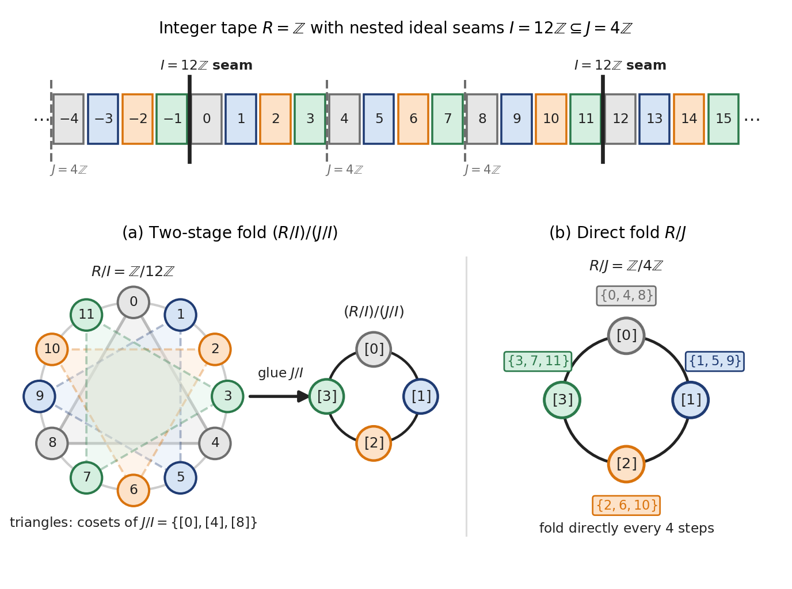
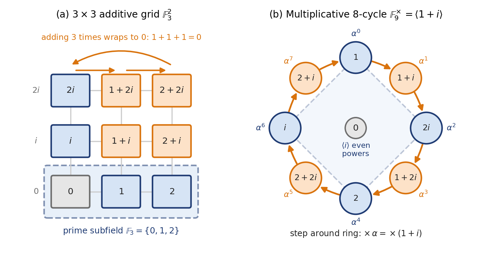

# Maths 0 - Vector Calculus, Linear Algebra, Rings & Fields

## A Bit About Proofs & Logic

The main strategies in proofs are by:

Counterexample, where given a general statement $P$, to show that $P$ is true it is necessary to give a general proof; but to show that $P$ is false, we have to give one specific instance in which it fails.

Contradiction, where to prove that $P$ is true, we assume it is false and then show some contradiction. For e.g. if $n \in \mathbb{N}$, $2n$ must be even. Let's assume $2n$ is odd. Then $2n = 2m + 1$ for some $m \in \mathbb{N}$, which implies $n-m = \frac{1}{2}$, i.e. an integer is a fraction, which is a contradiction!

Contrapositive. The contrapositive of the statement ‘if $P$, then $Q$’ is the statement ‘if not $Q$, then not $P$’. They are logically equivalent. We can prove this if it is more convenient.

Induction. Prove a statement $P(n)$ for $n=0$. Then show that if $P(n)$ is assumed true, $P(n+1)$ is true. A variation is the Strong Induction principle where we assume $P(m)$ is true for all $m<n$ and then show that it must hold for $P(n)$ also. For example, you could use this to prove that any natural number greater than 1 has a prime factor.

Now for Logical Conditions. We say that $P$ is a sufficient condition for $Q$ if the truth of $P$ implies the truth of $Q$; that is, $P$ implies $Q$, which is the same as "if $P$, then $Q$", or "$Q$ if $P$".

We say that $P$ is a necessary condition for $Q$ if the truth of $P$ is implied by the truth of $Q$, that is, $Q$ implies $P$. (This is the converse of the statement that $P$ implies $Q$.) We also say "$Q$ only if $P$".

We say that $P$ is a necessary and sufficient condition if both the above hold true.

AND ($\land$), OR ($\lor$) and NOT ($\neg$) to combine conditions should be familiar from Boolean operations.

## Sets, Operations & Relations

### Sets

A set is a collection of objects. That definition doesn't help much because what is a collection?! No wonder then that the word "set" has 430 definitions in the Oxford Dictionary, which makes it one of the longest entries. But our definition is something we can more or less grasp, so we won't belabour the point. Let's move on.

Unions, intersections and difference i.e. elements of $A$ not in $B$, correspond to the logical operations OR, AND and NOT. The symmetric difference of two sets is any element that is in only one of $A$ or $B$. This corresponds to XOR. We can write, $A \Delta B = (A \setminus B) \cup (B \setminus A) = (A \cup B) \setminus (A \cap B)$.

The Cartesian Product $A \times B$ is the set of all ordered pairs with first element in $A$ and second element in $B$. You could extend this to a product of $n$ sets as well. The name ‘Cartesian’ commemorates Descartes, who unified algebra and geometry by the insight that the Euclidean plane (a geometric object) is essentially the same as the set $\mathbb{R} \times \mathbb{R} = \mathbb{R}^2$: each point of the plane can be represented by its Cartesian coordinates, which are an ordered pair $(x, y)$ of real numbers.

The number of elements in a set $A$ is called the cardinality of $A$, and written as $\vert{}A\vert{}$. Note that $\vert{}A \cup B\vert{} = \vert{}A\vert{} + \vert{}B\vert{} - \vert{}A \cap B\vert{}$ and $\vert{}A \times B\vert{} = \vert{}A\vert{} \cdot \vert{}B\vert{}$.

The set of all subsets of a set $A$, including $A$ and the empty set, is called the Power Set of $A$.

Surprisingly, you can use logical operations to prove stuff about sets. We already mentioned how unions, intersections etc. are related to logical operations. Now let us say we want to prove: $A \cap (B \cup C) = (A \cap B) \cup (A \cap C)$. This will follow if we can show that the two propositions $p \land (q \lor r)$ and $(p \land q) \lor (p \land r)$ are equivalent. We could just write down the truth tables of both the logical expressions and see if they are equivalent.

### Operations & Relations

A binary operation is a mapping from $A \times A$ to $A$ i.e. it takes two elements of set $A$ and outputs one element. Addition and multiplication are examples. You can have n-ary operations.

A binary relation is a mapping from $A \times A$ to an output that is either true or false. Greater than and less than are examples. Equivalently, a relation $R$ on $A$ is the subset $R \subseteq A \times A$ of pairs for which the output is true, and we write $(a, b) \in R$ when $a$ is related to $b$.

An equivalence relation is a binary relation $R$ on $A$ that is reflexive, or $(a,a) \in R$ for all $a \in A$; symmetric i.e. if $(a, b) \in R$ then $(b, a) \in R$; transitive i.e. if $(a, b) \in R$ and $(b, c) \in R$ then $(a, c) \in R$.

The relation mod 4 between two numbers is an equivalence relation.

An equivalence relation results in a partition of the set $A$. A partition is a set of subsets of $A$ where none of them is empty and each element of $A$ lies in only one of these subsets. Thus the equivalence relation between $a$ and $b$ essentially comes down to are we or are we not in the same subset of the partition. The subsets are called equivalence classes.

A non-constant polynomial with coefficients in a field $F$ (such as $\mathbb{R}$ or $\mathbb{C}$; fields are [defined below](#establishing-more-mathematical-properties)) is called irreducible over $F$ if it cannot be written as the product of two polynomials of smaller degree with coefficients in $F$. So irreducibility depends on the field: $x^2 + 1$ is irreducible over $\mathbb{R}$, but over $\mathbb{C}$ it factors as $(x - i)(x + i)$. Any linear polynomial is obviously irreducible. Irreducible polynomials play a similar role to prime numbers: any non-constant polynomial can be factorised into irreducible polynomials. With coefficients in a field, the factors are unique up to their order and up to multiplying them by non-zero constants, just as the prime factors of an integer are unique up to order and sign. For example, $x^2 - 1 = (x - 1)(x + 1) = (2x - 2)(\tfrac{1}{2}x + \tfrac{1}{2})$ is the same factorisation twice.

## Rings & Fields

Rings were originally conceptualized to help solve Fermat's Last Theorem, but we don't need to bother about that now. As a starting point, you can picture a ring as literally a ring or a circular series of numbers that wraps around after reaching a particular point. (This is only a motivating picture; the actual definition comes [below](#the-algebraic-rules), and many rings do not wrap around at all.) You know this for modulo functions already, such as modulo 4 where the remainders are $\{0, 1, 2, 3\}$. Then all the integers wrap around again. So modular arithmetic isn't a separate thing from the integers. A lot of our work with rings is via modular arithmetic, modulo functions, and their algebras. But rings in abstract algebra are not exclusively about modular arithmetic.  

Even the integers $\mathbb{Z}$ are a ring. They don't wrap around, but you could look at it as an infinitely large ring. In fact, modern geometry and algebra view $\mathbb{Z}$ as the "parent ring" from which every other ring inherits its basic characteristics. Every modular ring $\mathbb{Z}/n\mathbb{Z}$ (the integers mod $n$; the slash notation for a quotient ring is explained in [the intuitive picture](#the-intuitive-picture) below) is a slice of the infinite integers. You create them by taking the infinite ring $\mathbb{Z}$ and collapsing it at a certain interval $n$. We can also go the other way around and attempt to construct an "infinitely large ring" using a concept called the inverse limit. We chain together larger and larger modular rings, looking at $\mathbb{Z}/2\mathbb{Z}$, then $\mathbb{Z}/4\mathbb{Z}$, then $\mathbb{Z}/8\mathbb{Z}$, and so on out to infinity. You don't quite get $\mathbb{Z}$, but you get a closely related infinite ring called the $2$-adic integers (a specific instance of the $p$-adic integers, $\mathbb{Z}_p$). In these rings, numbers can be infinitely long, effectively allowing you to work with modular arithmetic at an infinite scale.  

### The Intuitive Picture

Let us build up what goes into a ring step-by-step. Start with the full ring $R = \mathbb{Z}$. Imagine an infinite tape measure marked with ticks at $\dots, -2, -1, 0, 1, 2, \dots$. Addition ($a + b$) is about shifting along the tape. Multiplication ($a \cdot b$) is about scaling the tape. $0$ is the anchor point (origin).

Now we want to build up the rules for mathematics in this ring. For example, how do I add, multiply and whatnot. The rules for addition are pretty straightforward and similar to integers. In terms of the intuitive picture, we'll focus a bit more on other properties, such as multiplication, division and prime numbers, that might trip people up.

Let's say you take a circle that is 4 units in circumference and wrap all your integers around that circle. You keep lapping around again and again. So modular arithmetic is kind of like going in circles, while the integers are like going to infinity. It's very spiritual!

Now when you keep wrapping around the circle, you will see that numbers start to cluster up one above the other. $\{\dots, -8, -4, \mathbf{0}, 4, 8, 12, \dots\}$ would be one stack. Similarly, $\{\dots, -7, -3, \mathbf{1}, 5, 9, \dots\}$ etc. You would get 4 such stacks. Each of these stacks is now called a coset. Together the cosets form a partition, which is a very literal description: all the integers will be present in exactly one coset. We say they are in an equivalence relation, which is also pretty much what it says. They are equivalent for all practical purposes while working in this ring. This process is technically called gluing i.e. you say this set of points from the integers are all equivalent in the new ring of stacks (the quotient ring, defined below). You glued them together into one thing! They are also called equivalence classes and are subsets of the main ring. Only one of them, the stack of $0$ (which is $4\mathbb{Z}$ itself), is a subring (a subset that is itself a ring under the same addition and multiplication; more on subrings below). The other stacks do not contain $0$ and are not closed under addition: $1 + 1 = 2$ is not in the stack of $1$.

$I = 4\mathbb{Z} = \{\dots, -8, -4, \mathbf{0}, 4, 8, 12, \dots\}$ is a bit special. These are the numbers that stack with $0$. They are equivalent to it. This set (subring actually) of numbers is called an ideal. The most important thing is, if you multiply any integer by any element in this stack, the result is also found in this stack. Nothing surprising here. The stack is all the multiples of 4. $4$ multiplied by an integer will be a multiple of $4$ and so it will be part of the stack.

But conceptually, as far as the ring goes, this entire set, i.e. every number in the ideal, functions in multiplication like a $0$ does among integers. You multiply any number by $0$, you end up with a $0$. This is called the Absorption Property. We have therefore recreated a property of multiplication in the integers in such a way that it will work in a ring.

Now, pick up the entire $I$ and shift it to the right by 1, then 2, then 3.

Shift by $0$ (This is called the zero coset / The Ideal itself): $0 + I = \{\dots, -8, -4, \mathbf{0}, 4, 8, \dots\}$

Shift by $1$ (The coset $1 + I$): $1 + I = \{\dots, -7, -3, \mathbf{1}, 5, 9, \dots\}$

Shift by $2$ (The coset $2 + I$): $2 + I = \{\dots, -6, -2, \mathbf{2}, 6, 10, \dots\}$

Shift by $3$ (The coset $3 + I$): $3 + I = \{\dots, -5, -1, \mathbf{3}, 7, 11, \dots\}$

Shift by $4$: $4 + I = \{\dots, -4, 0, \mathbf{4}, 8, 12, \dots\} = 0 + I$

Shifting by $4$ just lands the grid back on top of itself. So what we have here is the 4 cosets (the 4 parts of the partition) we talked about earlier. Since we have a $0$ coset, we can also see that the other cosets are essentially just the remainders we get when we divide an integer by the modulus, in this case: $4$. Any integer with the same remainder gets bracketed into the same coset or equivalence class i.e. the $k$-coset consists of all elements $a$ where $a - k$ is in the ideal, which means for any two elements $a$ and $b$ in the same coset, $a - b \in I$.  

The set of 4 cosets (think of them as co-sets) is called a quotient or factor ring $R/I$. Why they are not called the remainder ring is a bit confusing because that is what they are built from, but never mind. 

The set of 4 cosets is a ring in the sense that they satisfy all the rules of addition and multiplication we expect from a ring (we'll talk about that next). The elements of this quotient ring $R/I$ are not individual numbers; they are the 4 distinct stacks of overlapping points (the cosets). 

### The Algebraic Rules

It's good to have the intuitive picture in your head, but the algebraic rules given below make it easy to manipulate and work with rings.

A ring is a set where we define an addition and a multiplication operation. Addition must be closed, commutative and associative. There is a zero and every element in $R$ has an additive inverse. Regarding multiplication, we require closure and the operation should be associative. Multiplication and addition should together follow the Distributive Law on both sides: $a(b + c) = ab + ac$ and $(a + b)c = ac + bc$ (we need both, because multiplication need not be commutative). 

Note that the familiar addition and multiplication we already know are just special cases. We could redefine them however we want provided they follow the above rules.

In our definition of a ring, we required neither the multiplicative identity nor inverse, nor even that multiplication be commutative. Some conventions require a ring to have a multiplicative identity. Rings without an identity are termed rng, without the $i$. If the identity is present, it becomes a ring (with the $i$). We won't bother with that here. Note that any rng can be shown to be a subring (without the identity of course) of a r**i**ng.  

**Examples of Rings:** Natural numbers are not a ring as they do not contain negative integers and so the positive integers have no additive inverse. The integers however form a ring. $n\mathbb{Z}$ for some $n \in \mathbb{N}$ is also a ring, as is the set of all polynomials with coefficients in $R$, for any ring $R$. Note that, with integer coefficients, a set with an upper limit $d \geq 1$ on the degree of polynomials allowed is not a ring as the multiplication operation will result in a polynomial of higher degree ($x^d \cdot x = x^{d+1}$), which means we have no closure. With the limit $d = 0$ we just get the constant polynomials, which do form a ring (we use them below).

The Cancellation Law holds for rings. If $a + c = b + c$, then $a = b$.

A subring of $R$ is a subset $S \subseteq R$ which itself forms a ring (using the same operations as those in $R$). You need not check all the axioms of a ring to determine if a subset is a ring. A non-empty subset $S$ of a ring $R$ is a subring provided that, for all $a, b \in S$, we have $a - b \in S$ and $ab \in S$.

If you are asked to prove that something is a ring, it is usually much easier to recognise that it is a subset of a structure known to be a ring, and then apply the subring tests.

### Intuition Redux

The set of 4 cosets we talked about earlier is a ring because we used the ideal to partition the ring. Note that you could make cosets using any subring, but the set of cosets becomes a ring only when the subring used in partitioning is an ideal.  

Why do we care so much about the ideal and this absorption property? Because it ensures that multiplication results in the same result irrespective of which integer you use from a coset. So $6 \times 5 = 30 \equiv 2 \pmod{4}$, which is what you get when you do $2 \times 1$ or $10 \times 9$. As mentioned, the ideal includes all the multiples of the number you used while wrapping around ($4$ in our case). That ensures that any two numbers of the type $x + 4k$ and $y + 4l$ (any members of the classes of $x$ and $y$, for integers $k$ and $l$), when multiplied, result in $(x + 4k)(y + 4l) = xy + 4(xl + ky) + 16kl$. Since we then take modulo 4 of this product, we are left with $xy$ always, irrespective of which numbers from an equivalence class were multiplied. The mathematics of multiplication is consistent. You can treat all numbers in an equivalence class as the same. So you have ensured one criterion needed to create a ring.  

That's nice but how do we know this wouldn't hold if I used a subring other than an ideal to create my coset partitions? With integers, every subring is an ideal so we can't investigate this property. But let's look at a ring where subrings and ideals are different: the polynomial ring $\mathbb{R}[x]$ or the ring $\mathbb{Z}[x]$ of polynomials in one variable with integer coefficients.  

Consider the ring $\mathbb{Z}[x]$ (polynomials with integer coefficients).

Let $S$ be the subring of constant polynomials:  

$$S = \mathbb{Z} = \{\dots, -2, -1, 0, 1, 2, \dots\} \subset \mathbb{Z}[x]$$

$S$ is a genuine subring because you can add two integers: you get an integer. You can multiply two integers: you get an integer. It has $0$ and $1$.  

Now, when we "glue" this subring $S$ to zero, every integer becomes zero. Now let's multiply some polynomial $x$ by "two zeroes" $0$ and $5$. $0 \cdot x = \mathbf{0}$ and $5 \cdot x = \mathbf{5x}$. Both of these should give the same result up to equivalence class i.e. their difference must be in the glued set $S$. But $5x - 0 = 5x$ which is not an integer and so not in $S$. Multiplication is broken. You can't multiply with certainty.

The failure happened because an element inside our glued set ($5 \in S$), when multiplied by an element outside ($x \in \mathbb{Z}[x]$), escaped outside the glued set ($5x \notin S$). Looking back at our previous example where we multiplied integers using the glued set $4\mathbb{Z}$, we saw that the multiplication results in terms like $16kl$ and $4(xl + ky)$, which need to be "cancelled out" so that every product of the equivalence classes results in $xy$. What does cancelling out mean? It means they go to $0$ or that they should fall into the ideal.

[Figure 1](#figure-1) puts the two examples side by side: on the left, the four stacks of the circle of circumference $4$, where a product lands in the same stack whichever representatives we pick; on the right, the constant polynomials glued to $0$ inside $\mathbb{Z}[x]$, where multiplying by $x$ sends $5$ out of the glued set.

![Integers wrapped round a circle of circumference 4 into four coset stacks, beside the constants glued to 0 in Z[x], where 5x escapes the glued set](figures/maths0_ring_circle_ideal.png)

*Figure 1. Why the glued set must be an ideal. (a) Wrapping $\mathbb{Z}$ round a circle of circumference $4$ sorts the integers into the four stacks (cosets) of $I = 4\mathbb{Z}$; products of representatives from the stacks of $2$ and $1$, such as $2 \times 1$, $6 \times 5$ and $10 \times 9$, all land in the stack of $2$. (b) In $\mathbb{Z}[x]$, gluing the subring $S = \mathbb{Z}$ of constants to $0$ makes $0$ and $5$ equivalent, but $0 \cdot x = 0$ stays in $S$ while $5 \cdot x = 5x$ does not, so the product depends on the representative.*

### Algebra Redux

So to rigorously define an ideal, an ideal is a subring $S$ of $R$ such that if $s \in S$, then $sr \in S$ and $rs \in S$ for all $r \in R$. This is kind of like a "0" because anything multiplied by 0 is 0.

An ideal acts like a black hole. It can pull all elements of $R$ into itself by multiplication. When you quotient out by $I$, every element in $I$ collapses into the additive identity $0$. An ideal allows you to kill information and compress the ring into a smaller quotient ring $R/I$. Ideals are the algebra of $0$ leading to collapsing and singularities.

You needn't write out the entire set of elements in an ideal. Most times, you can just specify the generators like so $\langle g_1, g_2 \rangle$. Then start adding up linear combinations of the generators to generate your entire ideal. 

$$\langle g_1, g_2 \rangle = \{ r_1 g_1 + r_2 g_2 \mid r_1, r_2 \in R \}$$

This will ensure closure when any element of the ideal is multiplied by some element of $R$. This formula needs $R$ to be commutative and to have an identity $1$, so that each generator $g_i = 1 \cdot g_i$ is included; in $2\mathbb{Z}$, which has no $1$, it would give $\{2r \mid r \in 2\mathbb{Z}\} = 4\mathbb{Z}$, which misses the generator $2$ itself. 

**Example:** For our previous examples with integers and $4\mathbb{Z}$, the ideal is simply written as $\langle 4 \rangle$, which is equivalent to $\{\dots, -8, -4, \mathbf{0}, 4, 8, \dots\}$.

Now for something more complicated, $\langle 1, x \rangle$ is an ideal of the ring of polynomials, but it is the trivial ideal: the entire polynomial ring itself, because it contains $1$. Any ideal containing the identity $1$ absorbs everything:

$$\forall f(x) \in R[x], \quad f(x) = f(x) \cdot 1 \in \langle 1, x \rangle \implies \langle 1, x \rangle = R[x]$$

Quotienting out by $\langle 1, x \rangle$ sets $1 = 0$, collapsing the entire ring into the zero ring $\{0\}$.

To get a non-trivial factor ring, an ideal cannot contain any units (elements with a multiplicative inverse, which needs the ring to have an identity $1$; more on units [below](#establishing-more-mathematical-properties)): a unit $u$ in the ideal would put $u^{-1}u = 1$ in it. In $\mathbb{R}[x]$ the units are exactly the non-zero constants, but in $\mathbb{Z}[x]$ the constant $2$ is not a unit, and $\langle 2 \rangle$ does give a non-trivial quotient. In $R = \mathbb{R}[x]$, the ideal generated by the single polynomial $x$:

$$\langle x \rangle = \{ f(x) \cdot x \mid f(x) \in \mathbb{R}[x] \} = \{ a_1 x + a_2 x^2 + \dots + a_n x^n \}$$

This contains every polynomial with no constant term. Multiply any polynomial without a constant term by any arbitrary polynomial, the product has no constant term, so it stays trapped inside $\langle x \rangle$.

In the quotient ring $\mathbb{R}[x]/\langle x \rangle$, we declare $x = 0$. Every polynomial $a_0 + a_1 x + a_2 x^2$ collapses down to just its constant term, so $\mathbb{R}[x]/\langle x \rangle \cong \mathbb{R}$. (The symbol $\cong$ means "is isomorphic to": the two rings are the same up to renaming their elements, as [defined below](#establishing-more-mathematical-properties).)

Another example: $\langle x^2 + 1 \rangle$, the quotient ring of which generates the complex numbers. 

$$\langle x^2 + 1 \rangle = \{ f(x)(x^2 + 1) \mid f(x) \in \mathbb{R}[x] \}$$

This contains every polynomial that has $(x^2 + 1)$ as a factor (i.e., polynomials where $f(i) = 0$ and $f(-i) = 0$). If in $\mathbb{R}[x]/\langle x^2 + 1 \rangle$, we declare $x^2 + 1 = 0 \implies x^2 = -1$, then the quotient ring is essentially the remainders we get when a polynomial is divided by $x^2 + 1$. Such a remainder is at most of degree 1. 

$$r(x) = ax + b \quad (a, b \in \mathbb{R})$$

Just replace $x$ by $i$ and you are looking at a complex number!

A third example is a multi-generator ideal in two variables: $\langle x, y \rangle$.

In $R = \mathbb{R}[x, y]$:

$$\langle x, y \rangle = \{ p(x,y) \cdot x + q(x,y) \cdot y \mid p, q \in \mathbb{R}[x, y] \}$$

This contains all polynomials whose constant term is $0$. Setting both $x = 0$ and $y = 0$ gives us a quotient ring which is just the constants: $\mathbb{R}[x, y]/\langle x, y \rangle \cong \mathbb{R}$.

### Establishing More Mathematical Properties

So we've figured out how to do consistent multiplication. Now we need to work towards consistency in division. The first step is to eliminate zero divisors, i.e., some non-zero element $k \in R$ such that $k \cdot a = 0$ for some non-zero $a \in R$. Ideally, you don't want multiplication going to $0$ when two non-zero numbers are multiplied. Additionally, it's nice to have commutation in multiplication. If a ring has no zero divisors and is commutative, the ring is called an Integral Domain (here we also need the ring to have an identity $1 \neq 0$; otherwise $2\mathbb{Z}$ and the zero ring $\{0\}$ would count).

Now, with the integers, every integer has a unique set of prime factors. A ring which has this property (unique up to ordering and multiplication by units) is a Unique Factorization Domain (UFD; like the PIDs below, a UFD is an integral domain, so it has the identity $1$ that units need). From a UFD we move up to a Principal Ideal Domain (PID). A PID is one where every ideal is principal, i.e., it has only one generator. PIDs have some nice properties not found in UFDs. For example, GCDs are linear combinations. In a PID, every non-zero prime ideal (an ideal $P \neq R$ such that whenever a product $ab$ lies in $P$, $a$ or $b$ already lies in $P$) is automatically a maximal ideal (an ideal $I \neq R$ with no ideal strictly between $I$ and $R$). We look at both more closely below. This means if you quotient a PID by a non-zero prime ideal, you are guaranteed to get a field. The zero ideal has to be left out: in $\mathbb{Z}$ it is prime, but $\mathbb{Z}/\{0\} = \mathbb{Z}$ is not a field. PIDs also have some nice properties when it comes to modules, which are like vector spaces but with scalars from a ring instead of a field: every module over a PID that is generated by finitely many elements splits into cyclic modules (modules generated by a single element). This is how abelian groups generated by finitely many elements are classified, since they are the modules over the PID $\mathbb{Z}$.

Upgrading to a field means every non-zero element is invertible. Actually, if a ring has a (multiplicative) identity $1 \neq 0$, and every non-zero element has a (multiplicative) inverse, it is called a Division ring. (The condition $1 \neq 0$ just rules out the zero ring $\{0\}$.) If a division ring is also commutative, it is a field.

Since every non-zero element of a field has an inverse, say $a^{-1}$, it means multiplying any other element by this inverse gives a valid element of the field. This is the same as saying dividing an element by another non-zero element gives another element of the field. So every non-zero element divides every other element without leaving a remainder. Because of this property, fields allow for the definition of Vector Spaces. You can divide by scalars, talk about exact dimensions, find bases, and solve systems of linear equations without worrying about remainders or fractions.

Note that a field has only two ideals, both trivial:  $\{0\}$ and the entire field. Because every non-zero element has an inverse, any ideal containing a non-zero element will swallow the whole ring. To see why, let's say an ideal has a non-zero element. That element has an inverse in the field. Applying the definition of an ideal, we multiply these two and the product, i.e.,  $1$, must be in the ideal. So $1$ is in the ideal, which means any element of the field multiplied by $1$, i.e., that element itself, must also be in the ideal.

Let's see what it takes to replicate all this mathematics in a ring. But first, in standard school arithmetic, we know that a prime number has only $1$ and itself as factors. They are irreducible into smaller factors. We also know that if a prime $p$ divides a product $ab$, i.e.,  $p \mid ab$, then at least one of $p \mid a$ and $p \mid b$ holds true. These two definitions are collapsed into the same definition.

However, this doesn't always hold in a ring. An element $p$ that is non-zero and not itself a unit is irreducible if it cannot be factored into two non-units:  $p = ab \implies a \text{ is a unit or } b \text{ is a unit}$. This is the familiar notion. Wait a minute! What is a unit?

In elementary arithmetic and geometry, the word "unit" is commonly used in two ways:

The unit scale / unit length: The minimal step ($1$) used to measure or generate all other integers via repeated addition ($1 + 1 + 1 = 3$).

The multiplicative identity: The number $1$, which leaves other numbers unchanged under multiplication ($x \cdot 1 = x$).

When algebraists generalized arithmetic to arbitrary rings, they already had standard terms for those concepts: the additive generator and the multiplicative identity. The word unit was repurposed to mean any element that possesses a multiplicative inverse within the ring:  $u \cdot v = 1$. (So units, and the associates, irreducible and prime elements built from them below, only make sense in a ring with an identity $1$.)

In $\mathbb{Z}$, the only numbers with multiplicative inverses happen to be $1$ and $-1$. Because $\pm 1$ also happen to be the numbers that generate the ticks on the tape by addition, everyday intuition conflates the two ideas. In a general ring, however, elements can have multiplicative inverses without having anything to do with a "step size": In $\mathbb{Z}_{12}$ (the integers mod $12$; from here on $\mathbb{Z}_n$ means the integers mod $n$, that is, the quotient ring $\mathbb{Z}/n\mathbb{Z}$, not the $p$-adic integers $\mathbb{Z}_p$ mentioned earlier), the number $5$ is a unit because $5 \times 5 = 25 \equiv 1 \pmod{12}$. It has an exact inverse ($5^{-1} = 5$), yet it is not a "minimal step size" in the geometric sense.

In modern algebra: the Unity / Identity is the single element $1$. The Unit: any element that can be divided by (has an inverse that lands back in $1$).

In a finite ring with an identity $1$, every non-zero element is either a unit or a zero divisor. This also means that if you take a unit and multiply it by all the elements in the ring, the set of products will cover all the elements of the ring.

If two elements of a ring $a$ and $b$ are related such that $a = u \cdot b$ where $u$ is a unit (i.e., it has an inverse),  $a$ and $b$ are called associates. This will be important in terms of factorization as we'll see below. Now you see why units are called units. They are similar to $1$ in integers in that if we multiply some element of a ring by a unit, it lands up at some equivalent element called its associate.

Now getting back to primes and irreducibles, in a commutative ring with $1$, a non-zero non-unit element $p$ is irreducible if it cannot be factored into two non-units: $p = ab \implies a \text{ is a unit or } b \text{ is a unit}$. A non-zero non-unit element $p$ is prime if: $p \mid ab \implies p \mid a \quad \text{or} \quad p \mid b$. Whenever $p$ divides a product, it must divide at least one of the factors. (Units are left out on purpose, just as $1$ is not a prime number: a unit $u$ would pass both tests, since $u = ab$ forces $a$ and $b$ to be units, and $u$ divides everything.) 

In terms of ideals, this means the principal ideal $\langle p \rangle$ is a prime ideal: $ab \in \langle p \rangle \implies a \in \langle p \rangle \text{ or } b \in \langle p \rangle$.

Now what does unique factorization entail in a ring? A UFD means that every non-zero, non-unit element $x$ can be written as a product of irreducibles, and that factorization is unique up to the order of factors and multiplication by units (being associates is an equivalence relation, so this again sorts the elements into equivalence classes, as modulo did above; but the classes are different: in $\mathbb{Z}$, the classes of associates are the pairs $\{n, -n\}$, not the remainder classes). 

Formally, if $x$ is factored into irreducibles in two ways:

$$x = p_1 p_2 \dots p_r = q_1 q_2 \dots q_s$$

then the number of factors is the same: $r = s$. After reordering, each $p_i$ is an associate (is in an equivalence relation) of $q_i$ (meaning $p_i = u_i q_i$ for some unit $u_i$). The "Prime" Property is what proves this uniqueness.

To prove that the two factorizations are identical:

$$p_1 p_2 \dots p_r = q_1 q_2 \dots q_s$$

You start with the first irreducible building block, $p_1$.

Clearly, $p_1$ divides the left side, so:

$$p_1 \mid (q_1 q_2 \dots q_s)$$

Now you want to cancel $p_1$ with one of the factors on the right.

**If $p_1$ is PRIME:**

By definition of prime, $p_1 \mid (AB) \implies p_1 \mid A \text{ or } p_1 \mid B$.

Extending this to $s$ terms, $p_1$ must divide at least one specific $q_j$.

Since $q_j$ is irreducible, its only divisors are units and associates. Therefore, $p_1$ and $q_j$ must be associates:

$$q_j = u \cdot p_1$$

You cancel $p_1$ from both sides, leaving a smaller equation. (Cancelling a non-zero factor is allowed in an integral domain: $ab = ac$ with $a \neq 0$ gives $a(b - c) = 0$, so $b = c$ because there are no zero divisors. In $\mathbb{Z}_6$, which has zero divisors, it fails: $2 \cdot 1 = 2 \cdot 4$.) By induction, every factor matches up.

**If $p_1$ is ONLY IRREDUCIBLE (Not Prime):**

Knowing that $p_1 \mid (q_1 \cdots q_s)$ does NOT guarantee that $p_1$ divides any individual $q_j$!

It could divide the whole product without dividing any piece.

In short: We factor into irreducibles (unbreakable blocks), but we need those blocks to be prime (divisibility-passing) so that the factorization is guaranteed to be unique.

This is a UFD. We'll skip looking at what it takes to jump to a PID and just look at what is needed to go from PID to a field. To build a field out of a PID, you quotient by a principal ideal $I = \langle p \rangle$.

In any commutative ring with an identity $1$ (without one this fails: $4\mathbb{Z}$ is a maximal ideal of $2\mathbb{Z}$, but in $2\mathbb{Z}/4\mathbb{Z}$ we have $2 \cdot 2 = 4 \equiv 0$, so it is not a field): $R/I \text{ is a field} \iff I \text{ is a }\textbf{maximal ideal}$

"Maximal" means there is no other ideal strictly squeezed between $I$ and $R$:

$$I \subseteq J \subseteq R \implies J = I \quad \text{or} \quad J = R$$

Now translate that into the language of a PID, where every ideal is generated by a single element ($I = \langle p \rangle$ and $J = \langle d \rangle$):

$$\langle p \rangle \subseteq \langle d \rangle \iff d \mid p$$

Therefore, saying $\langle p \rangle$ is maximal means: If $d$ divides $p$, then either $\langle d \rangle = \langle p \rangle$ ($d$ is an associate of $p$) or $\langle d \rangle = R$ ($d$ is a unit).

But that is the definition of an irreducible (or prime) element! In a PID, for a non-zero ideal: 

$$\text{Maximal Ideal} \iff \text{Prime Ideal} \iff \text{Generated by an Irreducible Element}$$

This also leads to the condition that a field has only two ideals, both trivial: 0 and the entire field. 

Two rings are isomorphic i.e. essentially the same for the purposes of algebra if we can set up a map between their elements in such a way that addition and multiplication correspond; that is, if $a$ corresponds to $a'$ and $b$ to $b'$, then $a + b$ corresponds to $a' + b'$ and $ab$ to $a'b'$.

A weaker condition is a homomorphism. We define a homomorphism from a ring $R$ to a ring $S$ to be a function or map $\theta : R \to S$ which satisfies $\theta(a + b) = \theta(a) + \theta(b)$ and $\theta(ab) = \theta(a)\theta(b)$ for all $a, b \in R$. Note that the addition and multiplication on the left of these equations are the operations in $R$, while those on the right are the operations in $S$. If a homomorphism is bijective, it becomes an isomorphism. A homomorphism is in some way a preservation of the shape of the ring.

Let $\theta : R \to S$ be a homomorphism of rings. The image of $\theta$ is $\text{Im}(\theta) = \{s \in S : s = \theta(r) \text{ for some } r \in R\}$, and the kernel of $\theta$ is $\ker(\theta) = \{r \in R : \theta(r) = 0\}$.

$\text{Im}(\theta)$ is a subring of $S$. $\ker(\theta)$ is a subring of $R$ which has the additional property that, for any $x \in \ker(\theta)$ and $r \in R$, we have $rx \in \ker(\theta)$ and $xr \in \ker(\theta)$. Two elements of $R$ are mapped to the same element of $S$ under $\theta$ if and only if they lie in the same coset of $\ker(\theta)$.

The kernel of a homomorphism $\theta : R \to S$ is an ideal of $R$. $\text{Im}(\theta)$ is a subring of $S$; $R/\ker(\theta) \cong \text{Im}(\theta)$. This is the first isomorphism theorem.

### Homomorphisms and Isomorphisms

Remember back when we took the modulo 4, i.e., we wrapped the integers around the circle. We ended up with the ideal, i.e., all the numbers stacked over $0$. And we got the quotient ring which consisted of the equivalence classes of the remainders. We can generalize this to a map $\phi$, instead of restricting it to just modulo functions.

Let's first define a ring homomorphism. $\phi: R \to S$ is a structure-preserving map:

$$\phi(a + b) = \phi(a) + \phi(b) \quad \text{and} \quad \phi(ab) = \phi(a)\phi(b)$$

We define $\ker(\phi) = \{k \in R \mid \phi(k) = 0_S\}$ and the image of $\phi$, denoted $\operatorname{im}(\phi)$ (or $\phi(R)$), is the set of all elements in the target ring $S$ that are actually reached by applying $\phi$ to the elements of the source ring $R$:

$$\operatorname{im}(\phi) = \{\phi(r) \mid r \in R\} = \{s \in S \mid \exists r \in R \text{ such that } \phi(r) = s\}$$

Our earlier modulo operation was actually a homomorphism (well, actually a surjective homomorphism, or epimorphism), where $R$ was $\mathbb{Z}$ and $S$ was $\mathbb{Z}_4$.

The kernel should remind you of the ideal. It is the set of all elements that get crushed to zero in $S$.

And when does $\phi$ send two different elements $x, y \in R$ to the exact same value in $S$?

$$\phi(x) = \phi(y) \iff \phi(x) - \phi(y) = 0_S \iff \phi(x - y) = 0_S \iff x - y \in \ker(\phi)$$

The map $\phi$ is literally grouping the elements of $R$ into bundles (cosets) based on $\ker(\phi)$. So the way $\phi(x)$ groups elements should remind you of the quotient ring.

This is the content of the **First Isomorphism Theorem for Rings**, which states:

If $\phi: R \to S$ is a ring homomorphism, then:

$\ker(\phi)$ is an ideal of $R$.

The image $\operatorname{im}(\phi)$ is a subring of $S$.

$R/\ker(\phi) \cong \operatorname{im}(\phi)$.

Now let's look at the **Second Isomorphism Theorem**. Structurally, the theorem is equivalent to what we have in arithmetic. For two integers $a$ and $b$, $a \cdot b = \operatorname{lcm}(a, b) \cdot \gcd(a, b)$. In the isomorphism relation below, the left side's numerator is the $\gcd$ and the right side's denominator is the $\operatorname{lcm}$.

Let $R$ be a ring, $S$ a subring of $R$, and $I$ an ideal of $R$. Then:

The sum $S + I = \{s + i \mid s \in S, i \in I\}$ is a subring of $R$.

The intersection $S \cap I$ is an ideal of $S$.

$(S + I) / I \cong S / (S \cap I)$

Let's look at an example. $R = \mathbb{Z}$, with the ideal grid $I = 6\mathbb{Z} = \{\dots, -12, -6, 0, 6, 12, \dots\}$. So $R/I = \mathbb{Z}_6$.

Now introduce a subring $S$. Let $S = 2\mathbb{Z} = \{\dots, -4, -2, 0, 2, 4, 6, \dots\}$ (all even numbers).

The left side of the isomorphism: $(S + I)/I$ involves expanding $S$ by $I$ and then quotienting by $I$. One reason we would want to do this is because some elements of $I$ might not be in $S$, so by adding $I$, we take care of this issue.

What is $S + I$? Add any multiple of $6$ to any even number. Since multiples of $6$ are already even, $S + I$ is just all even numbers: $S + I = 2\mathbb{Z}$.

Modding out by $I = 6\mathbb{Z}$ gives $\{0, 2, 4\}$. So $(S + I)/I$ is the 3-element sub-dial inside the 6-hour clock: $\{[0], [2], [4]\}$.

The Right side: $S / (S \cap I)$. Look only at the subring $S = 2\mathbb{Z}$, what part of $I = 6\mathbb{Z}$ lives inside $S$? $6\mathbb{Z}$ itself! So if we quotient by this, what do we get: $0 \pmod 6$, $2 \pmod 6$, and $4 \pmod 6$.

What this means is, the elements of $I$ that don't belong to $S$ contribute nothing to $S$, so modding out by the whole ideal $I$ has the exact same effect as modding out only by the shared overlap $S \cap I$. The only algebraic issue is that you cannot technically form the quotient $S/I$ unless $I$ is entirely contained within $S$ (it must be an ideal of $S$). By adding $I$ to $S$ on the left (creating $S+I$), or taking the intersection on the right ($S \cap I$), we ensure the quotient fractions are perfectly legal. In our example, $I = 6\mathbb{Z}$ happens to lie inside $S$ already, so $S + I = S$, $S \cap I = I$, and both sides are simply $2\mathbb{Z}/6\mathbb{Z}$. To see the theorem do real work, take $I = 3\mathbb{Z}$ instead: then $S + I = \mathbb{Z}$ (because $1 = 3 - 2$) and $S \cap I = 6\mathbb{Z}$, so the theorem says $\mathbb{Z}/3\mathbb{Z} \cong 2\mathbb{Z}/6\mathbb{Z}$, even though $S/I$ itself cannot be formed.

Now for the **Third Isomorphism Theorem**. Structurally, this is like the fraction rule in elementary arithmetic:

$$\frac{a/c}{b/c} = \frac{a}{b}$$

The theorem states: Let $R$ be a ring, and let $I$ and $J$ be ideals of $R$ with $I \subseteq J \subseteq R$. Then:

$J / I$ is an ideal of the quotient ring $R / I$.

$(R / I) \,/\, (J / I) \cong R / J$

Here's an example. Let the tape be $R = \mathbb{Z}$. Choose $I = 12\mathbb{Z}$. Choose a wider seam that contains $I$: $J = 4\mathbb{Z}$ (every multiple of $12$ is a multiple of $4$, so $12\mathbb{Z} \subseteq 4\mathbb{Z}$).

Now compare the two ways of reducing the tape. The direct fold ($R / J$) gives $\{0, 1, 2, 3\}$.

Now for $(R / I) \,/\, (J / I)$. First, $R/I$ gives $\{0, 1, 2, \dots, 11\}$. And now for $J/I$, which is just $\{[0], [4], [8]\}$. Because $J$ is an ideal in the original ring, this subset of ticks forms a legitimate ideal inside the 12-hour ring.

Now glue the $R / I$, i.e., $\{0, 1, 2, \dots, 11\}$, together along the markers $\{0, 4, 8\}$. $0, 4, 8$ fuse into a single zero point. $1, 5, 9$ fuse together into $[1]$. $2, 6, 10$ fuse together into $[2]$. $3, 7, 11$ fuse together into $[3]$. So both sides of the isomorphism are the same.

[Figure 2](#figure-2) shows the integer tape marked at $12\mathbb{Z}$ and $4\mathbb{Z}$, comparing the two-stage collapse through the 12-hour clock with the direct fold onto the 4-hour clock.

*Figure 2. Folding the integer tape $R = \mathbb{Z}$ along the nested ideals $I = 12\mathbb{Z} \subseteq J = 4\mathbb{Z}$. (a) Folding first at $12\mathbb{Z}$ gives the 12-hour clock $R/I$, where $J/I = \{[0], [4], [8]\}$ and its three cosets form four inscribed triangles that collapse to the 4-hour clock $(R/I)/(J/I)$. (b) Folding the tape directly every $4$ steps gives the same 4-hour clock $R/J$.*

Note that when we talk about quotienting and we have glued together a finite number of elements like above, how do we take the remainder; which number do we divide by? The answer is: we don't divide, we shift. Shifting is what taking remainders is. You do not need two separate mental procedures: coset shifting is the geometric definition of remainder arithmetic. In any quotient ring $R/K$, the cosets are generated by taking the base zero-set $K$ and shifting it across the ring: $x + K = \{x + k \mid k \in K\}$

These isomorphism theorems were first published by Emmy Noether. There is no standard agreement on the numbering of the above theorems.

### Let's Build A Field!

A finite field can only have a prime-power number of elements. However, there's a bit of a catch when dealing with when the power is anything other than $1$.  Let's actually construct the field $\mathbb{F}_9 = \mathbb{F}_{3^2}$ (so $q = 3$ and $q^2 = 9$).

The integers modulo $9$ ($\mathbb{Z}_9 = \{0, 1, \dots, 8\}$) are NOT a field because $9$ is not a prime number ($9 = 3 \times 3$). In a field, every non-zero element must have a multiplicative inverse, and two non-zero elements can never multiply to give $0$. Look at what happens in $\mathbb{Z}_9$ when you multiply $3 \times 3$:

$$3 \times 3 = 9 \equiv 0 \pmod 9$$

The number $3$ is a "zero divisor" and has no multiplicative inverse ($1/3$ does not exist mod $9$). Division fails.

When the size is a prime power $p^n$, you must build $\mathbb{F}_{p^n}$ as an $n$-dimensional vector space over the prime field $\mathbb{F}_p$ (the integers mod $p$, the smallest field sitting inside $\mathbb{F}_{p^n}$) by adjoining a root of a degree-$n$ polynomial that is irreducible over $\mathbb{F}_p$, the exact same way you build the 2-dimensional complex numbers $\mathbb{C}$ from the real numbers $\mathbb{R}$ by adjoining $i = \sqrt{-1}$.    

Since $x^2 + 1 = 0$ has no solution in $\mathbb{F}_3 = \{0, 1, 2\}$ (plugging in $0, 1, 2$ gives $0^2+1=1$,  $1^2+1=2$,  $2^2+1 = 5 \equiv 2 \neq 0$), we invent a symbol $i$ satisfying $i^2 = -1 \equiv 2 \pmod 3$. Then the $9$ elements of the field $\mathbb{F}_9$ are all combinations $a + bi$ where $a, b \in \{0, 1, 2\}$, with all arithmetic done modulo $3$:

$$0, \quad 1, \quad 2, \quad i, \quad 1+i, \quad 2+i, \quad 2i, \quad 1+2i, \quad 2+2i$$

In this system, every single non-zero element can be divided cleanly, and because it is built over $\mathbb{F}_3$, adding anything to itself $3$ times gives $0$ ($\text{Char } \mathbb{F}_9 = 3$).

[Figure 3](#figure-3) shows the nine elements of $\mathbb{F}_9$ as a $3 \times 3$ additive grid and as a single multiplicative 8-cycle of powers of $1 + i$.

*Figure 3. The finite field $\mathbb{F}_9 = \mathbb{F}_3(i)$ with $i^2 = 2$. (a) The $3 \times 3$ additive grid over the prime subfield $\mathbb{F}_3 = \{0, 1, 2\}$, where adding $1$ three times wraps back to $0$. (b) The eight non-zero elements as the powers of $\alpha = 1 + i$ (in the language of the next chapter, the multiplicative group $\mathbb{F}_9^\times$ is the cyclic group $C_8$); the adjoined root $i = \alpha^6$ reaches only the four even powers, whereas $1 + i$ cycles through all eight non-zero elements.*

### Fermat's Little Theorem

This theorem comes in handy in many prime power fields like the one we just saw. If $p$ is a prime number, then for any integer $a$:

$$a^p \equiv a \pmod p$$

And if $a$ is not divisible by $p$ ($a \not\equiv 0 \pmod p$), we can divide both sides by $a$ to get:

$$a^{p-1} \equiv 1 \pmod p$$

In the language of finite fields, this says that for every element $a \in \mathbb{F}_p$, raising $a$ to the $p$-th power does nothing at all ($a^p = a$). In our previous example with $p = 3$, this is why $0^3 = 0$,  $1^3 = 1$, and $2^3 = 8 \equiv 2 \pmod 3$. We will see that this will be very useful in building things like [hermitian spaces in projective geometry](maths_3_projective_geometry.md#example-building-a-hermitian-form-over-pg2-9), where the Frobenius map $\sigma(x) = x^3$ will leave the "real" part $a \in \mathbb{F}_3$ completely fixed while flipping $i^3 = i^2 \cdot i = -i$.

---

## References

- Linear Algebra Done Right by Sheldon Axler
- Introduction to Algebra by PJ Cameron
