# Maths 1 - Differential Geometry
## Vector Calculus

We will do a quick review of vector calculus because it plays an important role in what comes next. Vector calculus developed as part of the effort to determine and describe the behaviour of electrostatic and electrodynamic fields. Thus, whenever we need an example for illustrative purposes in this section, we will fall back on electrostatics with the electric field and electrostatic potential (voltage).

First, a few formulas from electrostatics:

$$\mathbf{F}(\mathbf{r}) = \frac{1}{4\pi \varepsilon_0} \frac{q q_0}{r^2} \hat{\mathbf{r}}$$

where $\mathbf{F}(\mathbf{r})$ is the electrostatic (Coulomb) force exerted by a source charge $q$ on a test charge $q_0$ separated by a distance $r$,  $\varepsilon_0$ is the permittivity of free space (or $\varepsilon$ in a linear dielectric medium), and $\hat{\mathbf{r}}$ is the unit vector pointing radially from the source charge $q$ to the test charge $q_0$.

$$\mathbf{E}(\mathbf{r}) = \frac{\mathbf{F}(\mathbf{r})}{q_0} = \frac{1}{4\pi \varepsilon_0} \frac{q}{r^2} \hat{\mathbf{r}}$$

where $\mathbf{E}(\mathbf{r})$ is the electric field at position $\mathbf{r}$ (defined as the electrostatic force per unit test charge $q_0$).

Note that the electrostatic field follows the principle of superposition, i.e., if there are $N$ point charges in a region, the net electric field at any point in the region is simply the vector sum of the individual electric fields produced by each charge:

$$\mathbf{E}(\mathbf{r}) = \sum_{i=1}^{N} \mathbf{E}_i(\mathbf{r}) = \frac{1}{4\pi \varepsilon_0} \sum_{i=1}^{N} \frac{q_i}{\Vert{}\mathbf{r} - \mathbf{r}_i\Vert{}^2} \hat{\mathbf{r}}_i$$

where $\hat{\mathbf{r}}_i$ is the unit vector pointing from the $i$-th charge, at $\mathbf{r}_i$, to the point $\mathbf{r}$.

### Scalars & Vector Fields

Think of the temperature in the Earth's atmosphere. At every latitude and longitude and at every height in the atmosphere, there is a value for the temperature. The temperature has no direction, i.e., it makes no sense to say the temperature is $25^\circ\text{C}$ East. It only has a value. This is a scalar. And a function that tells us the value of the scalar at every coordinate is called a scalar field $f(x,y,z)$ (for the Cartesian coordinates).

Similarly, think of the wind in the atmosphere. Once again, at every latitude and longitude and at every height in the atmosphere, there is a value for the wind's velocity. But velocity also has a direction. This is a vector. And a function that tells us the magnitude and the direction of the vector at every coordinate is called a vector field $\mathbf{F}(x,y,z)$ (for the Cartesian coordinates).

$$\mathbf{F}(x,y,z)=F_x(x,y,z)\hat{\mathbf{x}}+F_y(x,y,z)\hat{\mathbf{y}}+F_z(x,y,z)\hat{\mathbf{z}}$$

Figure 1 shows a scalar temperature field beside a horizontal wind vector field on the same $10\text{ km} \times 10\text{ km}$ slice, with one wind arrow split into $F_x\hat{\mathbf{x}}$ and $F_y\hat{\mathbf{y}}$.

*Figure 1. A scalar field and a vector field on the same horizontal slice ($0$ to $10\text{ km}$ in $x$ and $y$ at fixed height). (a) Temperature $T(x, y)$ in $^\circ\text{C}$, with isotherms at $15$, $17$, $19$, and $21\,^\circ\text{C}$. Each point has one number, such as $21.9\,^\circ\text{C}$ at $(6.4, 6.2)\text{ km}$ and $15.4\,^\circ\text{C}$ at $(2.2, 2.0)\text{ km}$. (b) Horizontal wind $\mathbf{F}(x, y)$ on a $9 \times 9$ grid (key arrow $5\text{ m/s}$), combining a gentle eastward breeze with a counter-clockwise swirl around a low-pressure centre $\text{L}$ at $(3.8, 5.6)\text{ km}$. We take $F_z = 0\text{ m/s}$ in this slice. An inset magnified three times ($\times 3$) splits the wind vector $\mathbf{F}$ ($4.1\text{ m/s}$) at $(6, 3)\text{ km}$ into $F_x\hat{\mathbf{x}}$ ($F_x = 3.6\text{ m/s}$) and $F_y\hat{\mathbf{y}}$ ($F_y = 1.8\text{ m/s}$), with both components drawn dashed.*

A point that becomes important in things like General Relativity is the fact that a scalar field $f$ is invariant under coordinate transformations: $f'(x',y',z') = f(x,y,z)$. The temperature at a physical point in the atmosphere does not change if you rotate your map axes.
        
But a vector field $\mathbf{F}$ has components that mix linearly according to the rotation matrix $R_{ij}$:
        
$$F'_i(\mathbf{r}')=\sum_{j=1}^3 R_{ij}F_j(\mathbf{r})$$

For example, a vector in the $xy$-plane at 45 degrees to the $x$-axis will have both $x$ and $y$ components. But if we rotate the coordinates by 45 degrees, then the new vector representation will have only an $x$-component. This of course does not mean the vector changed. Only its components as represented in the coordinate system change.

It is worth noting that while a scalar field is simply written as $f(r,\theta,\phi)$, a vector field in spherical coordinates uses local basis vectors $\hat{\mathbf{r}},\hat{\boldsymbol{\theta}},\hat{\boldsymbol{\phi}}$ whose directions themselves change from point to point across the Earth. This position-dependence of the basis vectors is why taking derivatives ($\nabla\cdot\mathbf{F}$ or later $\nabla\times\mathbf{F}$) in spherical coordinates introduces extra scale factors compared to Cartesian coordinates. A scale factor converts a step in a coordinate into a physical distance: moving by $d\theta$ in spherical coordinates covers a distance $r\,d\theta$, not $d\theta$, so the scale factor of $\theta$ is $r$.

### Intuition of Vector Calculus
Before going further, let's briefly look at what is coming up. Given a scalar field, we will be interested in how this field changes over the region of interest, i.e., the rates of change along the coordinate axes. This is given by the gradient of the scalar field. Since this rate of change has a magnitude and a direction (the direction of steepest increase) at every point, the gradient will be a vector field. Of course, a vector field need not necessarily only come via taking the gradient of a scalar field. It can exist all by itself as well.

Given a vector field, whether the gradient of a scalar field or otherwise, we will be interested in whether there are any sources or sinks for this field in the region of interest, i.e., does anything cause the flux or the "volume of flow" of a field to increase or decrease at a point. This will lead us to the divergence, which looks at every point and assesses whether the net "outflow" of the field is greater than, less than, or equal to the net "inflow". Since this is only a value and has no direction, the divergence becomes a scalar field.

Given a vector field, we are also interested in how the vector field behaves over a closed loop. Does its line integral add up to $0$ or not? This leads us to the curl, which will link back to the gradient again (since the curl of a gradient is always $\mathbf{0}$). Along the way, we see that all of these are tied to each other through certain fundamental relations that also link what happens over the boundary of a region to what happens within the region.

---

**Aside:** In $3\text{D}$ Euclidean space, gradient, curl, and divergence form a chain of differential operators moving from $0\text{D}$ objects (points/scalars) to $1\text{D}$ (curves), $2\text{D}$ (surfaces), and $3\text{D}$ (volumes), called the de Rham complex:

$$\text{Scalar Fields }(\Omega^0)\xrightarrow{\text{grad }(\nabla)}\text{Vector Fields }(\Omega^1)\xrightarrow{\text{curl }(\nabla\times)}\text{Vector Fields }(\Omega^2)\xrightarrow{\text{div }(\nabla\cdot)}\text{Scalar Fields }(\Omega^3)$$

The labels $\Omega^0$ to $\Omega^3$ name the spaces of 0-forms to 3-forms, the [differential forms](#differential-forms) we meet later. For now, read them as quantities that we integrate over points, curves, surfaces and volumes respectively.

Notice how taking two steps in a row in this chain always yields zero.

**Step $1\to 2$:** $\nabla\times(\nabla f)=\mathbf{0}$ (a gradient field has no curl / closed-loop circulation).

**Step $2\to 3$:** $\nabla\cdot(\nabla\times\mathbf{F})=0$ (a curl field has no divergence, so it has no sources or sinks: its field lines never begin or end). Such field lines may close into loops or run off to infinity, but they can also wind around forever without ever closing. Magnetic field lines inside a tokamak fusion reactor do this: each one winds around a doughnut-shaped surface, going around the long way and the short way in a ratio that is not a fraction, so it never returns to its starting point and instead covers the whole surface.

Two steps always giving zero is what makes this chain a complex. On all of 3D space the chain is also exact, which is the converse: every field with zero curl is a gradient, and every field with zero divergence is a curl. Exactness can fail on a region with a hole. The irrotational vortex in [Stokes' Theorem](#stokes-theorem) has zero curl on space minus the $z$-axis but is not a gradient there. Likewise, the point-charge field $\hat{\mathbf{r}}/r^2$ has zero divergence on space minus the origin but is not a curl there, because its flux through any sphere around the origin is $4\pi$, while the flux of a curl through a closed surface is always $0$ (see [Common Identities](#common-identities)).

---

### Gauss's Law 

Gauss's Law states:

$$\oint_S \mathbf{E} \cdot \hat{\mathbf{n}}\, dS = \frac{Q_{\text{enc}}}{\varepsilon_0}$$

where $S = \partial V$ is any closed surface enclosing a volume $\Delta V$,  $\hat{\mathbf{n}}$ is the outward-pointing unit normal vector to the infinitesimal surface area element $dS$,  $Q_{\text{enc}} = \Delta Q$ is the total net charge enclosed within the surface $S$, and $\varepsilon_0$ is the permittivity of free space.

This equation represents the experimental fact that the net electric flux crossing a closed surface is directly proportional to the total charge enclosed by that surface.

The LHS represents the flux of the electric field crossing the closed surface. This is why we have the dot product with the unit normal vector. If the electric field is aligned with the normal vector, the flux through that surface patch is maximum. Otherwise, it diminishes by $\cos\theta$, where $\theta$ is the angle between $\mathbf{E}$ and $\hat{\mathbf{n}}$. Intuitively, this makes sense. Think of what happens when a wind is blowing against us. If we stand facing the wind head-on, our body intercepts the maximum airflow. If we turn our body so its surface normal is at an angle to the wind, our cross-sectional area perpendicular to the wind decreases by $\cos\theta$, intercepting less flow.

### Divergence
We can do something interesting now. Let us write the RHS in terms of the average charge density in the enclosed volume $\Delta V$, which is the net charge per unit volume:

$$\bar{\rho}_{\Delta V} \equiv \frac{\Delta Q}{\Delta V}$$

where $\Delta Q = Q_{\text{enc}}$ is the net charge enclosed within $\Delta V$. Gauss's Law then becomes:

$$\oint_S \mathbf{E} \cdot \hat{\mathbf{n}}\, dS = \frac{\bar{\rho}_{\Delta V} \Delta V}{\varepsilon_0}$$

$$\frac{1}{\Delta V} \oint_S \mathbf{E} \cdot \hat{\mathbf{n}}\, dS = \frac{\bar{\rho}_{\Delta V}}{\varepsilon_0}$$

The LHS has become the outward flux per unit volume (flux density per unit volume or volumetric flux density) in $\Delta V$. Now let us see what happens as we shrink $\Delta V \to 0$ around a point $P$. The average charge density $\bar{\rho}_{\Delta V}$ becomes $\rho(P)$, the volumetric charge density at the point $P$:

$$\operatorname{div}\mathbf{E} \equiv \lim_{\Delta V \to 0} \frac{1}{\Delta V} \oint_S \mathbf{E} \cdot \hat{\mathbf{n}}\, dS = \frac{\rho(P)}{\varepsilon_0}$$

The LHS becomes the net outward flux per unit volume at that point. This is called the divergence of the vector field. Essentially, it tells us the net rate per unit volume at which flux is being generated or absorbed at a point, that is, the difference between how much stuff is flowing out of an infinitesimal volume around the point and how much stuff is flowing in, integrated over all directions rather than along any single direction. Since this is a net scalar flux per unit volume, the divergence is a scalar field.

We represent divergence by $\nabla \cdot$, so the divergence of the electric field becomes $\nabla \cdot \mathbf{E}$. The $\nabla$ notation is not just random. We will see that it "operates" as an "operator" i.e. it can act on fields in its own right. More on this in a little while.

We will first state the formula for the divergence and then see where it comes from. The derivation evaluates the surface integral over the six faces of an infinitesimal coordinate box $\Delta V = \Delta x\, \Delta y\, \Delta z$ and takes the limit as the box shrinks to zero. We do this just below, after the formulas for other coordinate systems.

In Cartesian coordinates $(x, y, z)$, for a vector field $\mathbf{F} = F_x \hat{\mathbf{x}} + F_y \hat{\mathbf{y}} + F_z \hat{\mathbf{z}}$, the divergence is:

$$\nabla \cdot \mathbf{F} = \frac{\partial F_x}{\partial x} + \frac{\partial F_y}{\partial y} + \frac{\partial F_z}{\partial z}$$

Note that though this is usually given as the primary formula for the divergence, this simple sum of partial derivatives only holds in Cartesian coordinates. In curvilinear coordinates, the basis vectors and side lengths vary with position, so we must either convert via the coordinate transformation rules (using scale factors or the metric tensor) or rederive the relation from the shrinking $\Delta V$ definition above. Thus, it is best to think of the divergence geometrically as the net outward flux per unit volume at a point rather than as a fixed coordinate formula.

In cylindrical coordinates $(r, \phi, z)$ and spherical coordinates $(r, \theta, \phi)$, the divergence is given by:

Cylindrical coordinates $(r, \phi, z)$:

$$\nabla \cdot \mathbf{F} = \frac{1}{r}\frac{\partial}{\partial r}(r F_r) + \frac{1}{r}\frac{\partial F_\phi}{\partial \phi} + \frac{\partial F_z}{\partial z} = \frac{\partial F_r}{\partial r} + \frac{F_r}{r} + \frac{1}{r}\frac{\partial F_\phi}{\partial \phi} + \frac{\partial F_z}{\partial z}$$

Spherical coordinates $(r, \theta, \phi)$:

$$\nabla \cdot \mathbf{F} = \frac{1}{r^2} \frac{\partial}{\partial r}(r^2 F_r) + \frac{1}{r \sin\theta} \frac{\partial}{\partial \theta}(\sin\theta\, F_\theta) + \frac{1}{r \sin\theta} \frac{\partial F_\phi}{\partial \phi}$$

In physics and engineering, we can neglect $\frac{F_r}{r}$ in the cylindrical coordinates compared to $\frac{\partial F_r}{\partial r}$ when the characteristic length scale $\Delta r$ over which $F_r$ changes is much smaller than the radius $r_0$ at which we are evaluating the field:

$$\left\vert{}\frac{\partial F_r}{\partial r}\right\vert{} \sim \frac{\vert{}F_r\vert{}}{\Delta r} \gg \frac{\vert{}F_r\vert{}}{r_0} \iff \frac{\Delta r}{r_0} \ll 1$$

We can also drop $\frac{F_r}{r}$ when the radial component of the field is identically zero ($F_r = 0$). Physically, this means the field lines only circulate around the axis ($F_\phi$) or flow parallel to the axis ($F_z$), never crossing between inner and outer radial shells. Because no flux crosses the curved radial walls of the tube, the expanding surface area of those walls does not affect the divergence.

Now let us go back to the Cartesian coordinate formula since it is easy to get an intuitive feel for divergence from it. Let us take a simpler case of 1 dimension, i.e., just the $x$-axis, and ignore the other two. As we saw above, the divergence is the net outward flux per unit volume (or length, in 1D), i.e., we take the difference between the stuff leaving at point $x + \Delta x$ and the stuff entering at point $x$, and divide by $\Delta x$:

$$\frac{F_x(x + \Delta x) - F_x(x)}{\Delta x}$$

If we take the limit $\Delta x \to 0$, this is nothing but the partial derivative with respect to $x$,  $\frac{\partial F_x}{\partial x}$.

Now let us move this over to 3 dimensions. Instead of a single point, consider an infinitesimal cubical box $\Delta V = \Delta x\, \Delta y\, \Delta z$ centered at our point. Suppose there is a vector field $\mathbf{F}$ flowing in and out across the six faces of this tiny box. 

The field $\mathbf{F}$ has $x$,  $y$, and $z$ components ($F_x, F_y, F_z$). Since we are calculating flux across the faces of the box, notice that the net flux out of the two faces parallel to the $yz$-plane (the planes at $x$ and $x + \Delta x$, whose outward normal vectors are $-\hat{\mathbf{x}}$ and $+\hat{\mathbf{x}}$) depends only on $F_x$, the component of $\mathbf{F}$ along $x$. The components $F_y$ and $F_z$ are parallel to the $yz$-plane (perpendicular to the normal vectors $\pm\hat{\mathbf{e}}_x$) and so contribute zero flux across those two faces. Comparing the outflow $F_x(x+\Delta x, y, z)\Delta y\Delta z$ on the right face with the inflow $F_x(x, y, z)\Delta y\Delta z$ on the left face and dividing by the volume $\Delta x \Delta y \Delta z$ gives $\frac{\partial F_x}{\partial x}$. Similarly, we can do the exact same thing with $F_y$ across the two $xz$-faces and $F_z$ across the two $xy$-faces. 

Thus, to find the net outward flux per unit volume, we only need to take the partial derivative of $F_x$ with respect to $x$,  $F_y$ with respect to $y$, and $F_z$ with respect to $z$, and add them together. We need not worry about how $F_x$ changes with $y$ or $z$, and so on (those cross-derivatives instead govern the curl of the field).

### Nabla ($\nabla$)

We can now give a more concrete form to $\nabla$. In three-dimensional Cartesian coordinates, it is the vector differential operator:

$$\nabla=\hat{\mathbf{x}}\frac{\partial}{\partial x}+\hat{\mathbf{y}}\frac{\partial}{\partial y}+\hat{\mathbf{z}}\frac{\partial}{\partial z}$$

Note that while $\nabla$ transforms like a vector under rotations, it is not a true vector on its own: it has no magnitude or direction until it acts on a field, and it does not commute with functions ($\nabla\cdot\mathbf{E}\neq\mathbf{E}\cdot\nabla$).

### Divergence Theorem

Suppose we have a volume. If we split this into infinitesimally small cubic pieces, we see that the net flux through any piece, let's say along the $x$-axis, is given by $\left(F_x\left(x+\frac{\Delta x}{2}\right)-F_x\left(x-\frac{\Delta x}{2}\right)\right)\Delta y\Delta z$. If we look at the piece of volume right next to this, which shares a common face with it, the flux along the $x$-axis through it is $\left(F_x\left(x+\frac{3\Delta x}{2}\right)-F_x\left(x+\frac{\Delta x}{2}\right)\right)\Delta y\Delta z$. Thus, if we add the flux through both volumes, the $F_x\left(x+\frac{\Delta x}{2}\right)$ term cancels out. 

Figure 2 shows how the fluxes through the shared face of two adjacent boxes cancel, leaving only the outer boundary $\partial V$ when a whole volume is tiled by cells.

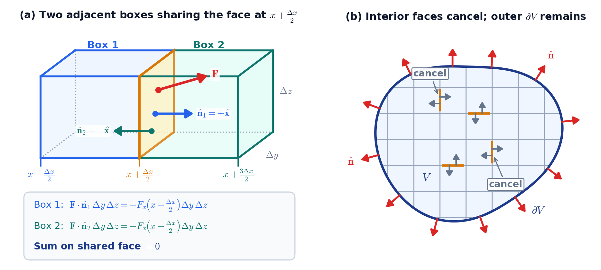

*Figure 2. Cancellation of flux across interior faces in the divergence theorem. (a) Box 1 spans $x - \frac{\Delta x}{2}$ to $x + \frac{\Delta x}{2}$ and Box 2 spans $x + \frac{\Delta x}{2}$ to $x + \frac{3\Delta x}{2}$. On their shared amber face at $x + \frac{\Delta x}{2}$, $\mathbf{F}$ is the same vector for both boxes while the outward normals $\hat{\mathbf{n}}_1 = +\hat{\mathbf{x}}$ and $\hat{\mathbf{n}}_2 = -\hat{\mathbf{x}}$ are opposite, so $+F_x(x + \frac{\Delta x}{2})\Delta y\,\Delta z$ and $-F_x(x + \frac{\Delta x}{2})\Delta y\,\Delta z$ sum to $0$. (b) Cross-section of a volume $V$ cut into small cells. Opposite normal arrows on shared interior faces cancel in pairs, leaving only the outward normals $\hat{\mathbf{n}}$ in red on the outer boundary $\partial V$.*

Extending our picture of the adjacent small cubes to the whole volume iteratively, we can arrive at the fact that the sum of the flux through all these little pieces is just the flux through the closed bounding surface of the entire volume. But what is the sum of the flux through all these little volumes? By the box argument in the [Divergence](#divergence) section, the net outward flux of each little cube is the divergence there multiplied by its volume, $(\nabla\cdot\mathbf{F})\,\Delta V$. Adding these up:

$$\sum_i (\nabla\cdot\mathbf{F})_i\Delta V_i\approx\oint_{\partial V}\mathbf{F}\cdot\hat{\mathbf{n}}\,dS$$

The LHS is the usual approximation of a volume integral. Taking the limit $\Delta V_i\to 0$, we can therefore write the equation in the form commonly referred to as the Divergence Theorem:

$$\iiint_V (\nabla\cdot\mathbf{F})\,dV=\oint_{\partial V}\mathbf{F}\cdot\hat{\mathbf{n}}\,dS$$

The total flux through the closed surface equals the volume integral of the divergence over the entire volume. This is just a "larger" (macroscopic) version of our local formula for divergence, which looks at just a point, an infinitesimally small volume. This formula is quite important because it helps to relate something that operates across a 2D surface to something that operates over a 3D volume. It also provides a relationship between the "bulk" volume and its "boundary" surface. We will encounter something similar later when we look at Stokes' Theorem. These kinds of relations between bulk and boundary are important in various situations including homology and cohomology in mathematics and cochain complexes. We will look at this later.

### Dirac Delta Function

Going back to the divergence formula, in terms of the electrostatic field, we frequently will be interested in situations where there are charges at specific locations and empty space elsewhere, which means the volumetric charge density spikes to infinity (assuming the charge is a point) where the charge is located and zero elsewhere. 

Look at tthe divergence we wrote down in spherical coordinates. The electric field of a single point charge $q$ sitting at the origin is $\mathbf{E} = \frac{q}{4\pi\varepsilon_0} \frac{\hat{\mathbf{r}}}{r^2}$.

At every point $r > 0$, plugging $E_r = \frac{q}{4\pi\varepsilon_0 r^2}$ into the spherical formula $\frac{1}{r^2}\frac{\partial}{\partial r}(r^2 E_r)$ gives $\frac{1}{r^2}\frac{\partial}{\partial r}\left(\frac{q}{4\pi\varepsilon_0}\right) = 0$. That makes physical sense because in the empty space outside the origin ($r > 0$), the charge density is $\rho(\mathbf{r}) = 0$, and every field line that enters a volume element at $r > 0$ also exits it.
    
However, at the origin $r = 0$, $E_r$ blows up as $1/r^2$, and the closed surface integral $\oint_S \mathbf{E}\cdot\hat{\mathbf{n}}\,dS$ over any sphere containing the origin is $\frac{q}{\varepsilon_0} \neq 0$.
    
We use the Dirac Delta function $\delta^3(\mathbf{r})$, which is exactly what we just described, an infinite spike at the point where the charge is located and zero everywhere else. What defines it, though, is its integral: over any volume that contains the origin, $\int \delta^3(\mathbf{r})\,dV = 1$, and over any volume that does not, the integral is $0$. The spike is infinitely tall, but the volume under it is exactly one. This is what lets it describe a finite charge: a point charge $q$ at the origin has charge density $\rho(\mathbf{r}) = q\,\delta^3(\mathbf{r})$, and integrating that density over any volume around the origin gives back exactly $q$. The fundamental formula is given by:
    
$$\nabla \cdot \left(\frac{\hat{\mathbf{r}}}{r^2}\right) = 4\pi \delta^3(\mathbf{r}) \implies \nabla \cdot \mathbf{E} = \frac{q}{\varepsilon_0} \delta^3(\mathbf{r}) = \frac{\rho(\mathbf{r})}{\varepsilon_0}$$

The factor $4\pi$ is exactly what the defining property needs. Integrate both sides of the first equation over a ball of radius $R$ around the origin. On the left, the divergence theorem turns the volume integral into the flux of $\hat{\mathbf{r}}/r^2$ through the sphere of radius $R$, which is $\frac{1}{R^2}\cdot 4\pi R^2 = 4\pi$. On the right, we get $4\pi \int \delta^3(\mathbf{r})\,dV = 4\pi$.

It may be easiest to think of the delta function as the limit of a sequence of steps, each of which is higher and narrower than the previous step, such that the area under the step is always one. Think of a rectangle that 0.5 high and 2 long. It's area is 1. Make it taller and less wide i.e. 1 high and 1 long. Next comes 2 high and 0.5 long, and so on till you get a massive spike of infinitesimal width.

The Dirac delta function can be used to pick out the value of a function at any desired point. For instance:

$$\int_{-\infty}^{\infty} f(x)\,\delta(x)\,dx = \int_{-\infty}^{\infty} f(0)\,\delta(x)\,dx = f(0)\int_{-\infty}^{\infty} \delta(x)\,dx = f(0), \quad (f\text{ continuous at }0)$$

We can shift the “spike” in the delta function as usual, obtaining $\delta(x-a)$. This shifted delta function satisfies

$$\int_{-\infty}^{\infty} f(x)\,\delta(x-a)\,dx = f(a), \quad (f\text{ continuous at }a)$$

The three-dimensional version of the delta function, $\delta^3(\vec{r}-\vec{r}_0)$, is $0$ everywhere except at $\vec{r}=\vec{r}_0$ and satisfies:

$$\int_{\text{all space}} \delta^3(\vec{r}-\vec{r}_0)\,d\tau = 1$$

where $\vec{r}=x\hat{x}+y\hat{y}+z\hat{z}$ is the position vector and $\vec{r}_0=x_0\hat{x}+y_0\hat{y}+z_0\hat{z}$ is the position at which the “peak” of the delta function occurs. In rectangular coordinates, it is just the product of three one-dimensional delta functions:

$$\delta^3(\vec{r}-\vec{r}_0) = \delta(x-x_0)\,\delta(y-y_0)\,\delta(z-z_0)$$

so that:

$$\int_{\text{all space}} \delta^3(\vec{r})\,d\tau = \int_{-\infty}^{\infty}\int_{-\infty}^{\infty}\int_{-\infty}^{\infty} \delta(x)\,\delta(y)\,\delta(z)\,dx\,dy\,dz = 1 \tag{6.5.3}$$

But in orthogonal curvilinear coordinates, with $d\tau=h_u h_v h_w\,du\,dv\,dw$, it has an inverse Jacobian factor in it. Thus, in general,

$$\delta^3(\vec{r}-\vec{r}_0) \neq \delta(u-u_0)\,\delta(v-v_0)\,\delta(w-w_0)$$

but instead:

$$\delta^3(\vec{r}-\vec{r}_0) = \frac{1}{h_u h_v h_w}\,\delta(u-u_0)\,\delta(v-v_0)\,\delta(w-w_0), \quad (h_u h_v h_w \neq 0\text{ at }\vec{r}_0) \tag{6.5.5}$$

In particular, in cylindrical coordinates $(r,\theta,z)$:

$$\delta^3(\vec{r}-\vec{r}_0) = \frac{1}{r}\,\delta(r-r_0)\,\delta(\theta-\theta_0)\,\delta(z-z_0), \quad (r_0 \gt 0) \tag{6.5.6}$$

and in spherical coordinates $(r,\theta,\phi)$:

$$\delta^3(\vec{r}-\vec{r}_0) = \frac{1}{r^2\sin\theta}\,\delta(r-r_0)\,\delta(\theta-\theta_0)\,\delta(\phi-\phi_0), \quad (r_0 \gt 0,\; 0 \lt \theta_0 \lt \pi) \tag{6.5.7}$$

Just as with the delta function in one dimension, when the three-dimensional delta function multiplies a function $f(\vec{r})$ in an integrand over a region containing $\vec{r}_0$, the integral just picks out the value of $f(\vec{r})$ at the point where the delta function has its peak:

$$\int_{\text{all space}} f(\vec{r})\,\delta^3(\vec{r}-\vec{r}_0)\,d\tau = f(\vec{r}_0), \quad (f\text{ continuous at }\vec{r}_0)$$

Note that because $\int \delta(u)\,du = 1$ is dimensionless, any 1D delta function $\delta(u-u_0)$ carries the inverse dimensions of its argument $u$. So $\delta(x-x_0)$ and $\delta(r-r_0)$ have dimensions of $[\text{length}]^{-1}$, whereas $\delta(\theta-\theta_0)$ and $\delta(\phi-\phi_0)$ are dimensionless. Meanwhile, $\delta^3(\vec{r}-\vec{r}_0)$ must have dimensions of $[\text{volume}]^{-1} = [\text{length}]^{-3}$ so that $\int \delta^3\,d\tau = 1$. That immediately tells you $\delta(r-r_0)\,\delta(\theta-\theta_0)\,\delta(z-z_0)$ (dimensions $[\text{length}]^{-2}$) needs a $1/r$ prefactor, and $\delta(r-r_0)\,\delta(\theta-\theta_0)\,\delta(\phi-\phi_0)$ (dimensions $[\text{length}]^{-1}$) needs a $1/r^2$ prefactor.

#### Why $\delta(x)$ cannot be an ordinary function

Most introductory engineering and physics textbooks treat $\delta(x)$ heuristically as an "infinitely tall, infinitely thin spike of area $1$" and state its algebraic rules as recipes. But we need to look at the delta function as a distribution to place them on a proper mathematical foundation.  

Suppose $\delta:\mathbb{R}\to\mathbb{R}$ were an ordinary function with $\delta(x)=0$ for every $x\neq 0$. In both Riemann and Lebesgue integration, changing (or even blowing up) a function at a single isolated point of width zero adds zero area. Thus any such function would satisfy $\int_{-\infty}^{\infty}\delta(x)\,dx=0$, contradicting $\int_{-\infty}^{\infty}\delta(x)\,dx=1$.  

Instead of defining $\delta$ by its value at each point $x$, distribution theory defines it by what it does to smooth functions under an integral. A distribution $T$ is a continuous linear functional: a linear machine that takes a compactly supported smooth test function $\phi(x)$ as input and returns a single number, denoted $\langle T,\phi\rangle$.  

Any ordinary locally integrable function $h(x)$ defines a regular distribution via $\langle h,\phi\rangle=\int_{-\infty}^{\infty}h(x)\phi(x)\,dx$. The Dirac delta is the singular distribution defined directly by the rule:  $\langle\delta,\phi\rangle = \phi(0)$.  

Writing $\int_{-\infty}^{\infty}\delta(x)\phi(x)\,dx=\phi(0)$ is simply convenient integral notation for $\langle\delta,\phi\rangle=\phi(0)$. Two distributions $T_1$ and $T_2$ are equal if and only if $\langle T_1,\phi\rangle=\langle T_2,\phi\rangle$ for every test function $\phi$.

With this perspective, we can now look at the properties of the delta function.

#### Properties of the Dirac Delta Function

$$\delta(x) = \delta(-x)$$

Intuitively, thinking of the delta function as a spike, this makes sense since the function is symmetric about its peak at $x=0$. From the distribution perspective, setting $u=-x \implies du = -dx$, we have $\int_{-\infty}^{\infty}\delta(-x)\phi(x)\,dx=\int_{\infty}^{-\infty}\delta(u)\phi(-u)\,(-du)=\int_{-\infty}^{\infty}\delta(u)\phi(-u)\,du = \phi(0)$.  

Next up, we have:  

$$\delta'(x) = -\delta'(-x)$$

To see this intuitively via the spike perspective, note that the rate of change of the function when $x$ is negative and near $0$ is positive, while it is negative when $x$ is positive and near $0$ (and $0$ elsewhere). Thus the derivative is antisymmetric, which is what this property represents. 

Integration by parts can help us arrive at the next property:  

$$\int_b^c f(x)\,\delta'(x-a)\,dx = -f'(a), \quad b \lt a \lt c,\; f \in C^1\text{ near }a$$

where $C^1$ denotes the class of functions with a continuous first derivative. This property holds because:  

$$\int_b^c f(x)\,\delta'(x-a)\,dx = \Bigl[f(x)\,\delta(x-a)\Bigr]_b^c - \int_b^c f'(x)\,\delta(x-a)\,dx = -f'(a), \quad b \lt a \lt c,\; f \in C^1\text{ near }a$$

since $a$ lies strictly between $b$ and $c$, so $\delta(x-a)=0$ at the endpoints $x=b$ and $x=c$. 

Specifically, set $a=0$ and replace $f(x)$ with $x\phi(x)$ for an arbitrary test function $\phi(x)$ to get $\int_{-\infty}^{\infty}x\,\delta'(x)\phi(x)\,dx = -(x\phi)'(0) = -\phi(0)$, which gives $x\,\delta'(x) = -\delta(x)$. Intuitively, this makes sense since when $x \lt 0$ around $x=0$, the rate of change of the delta function is positive, so multiplying by $x \lt 0$ makes $x\,\delta'(x)$ negative; while when $x \gt 0$ around $x=0$, the rate of change of the delta function is negative, so multiplying by $x \gt 0$ also makes $x\,\delta'(x)$ negative. This explains the minus sign.  

For the next property, see that if we were to shrink or stretch the spike function (for example, at $x=2\epsilon$, we apply the value of the delta function from $x=4\epsilon$, thus shrinking it by a factor of $2$), the area under the spike would halve. Thus, more formally,  

$$\delta(ax) = \frac{1}{\vert a \vert}\,\delta(x), \quad a \neq 0$$

From the distribution perspective, we can test $\delta(ax)$ against an arbitrary $\phi(x)$ and substitute $u=ax$ ($dx=\frac{du}{a}$):  

Case $a\gt 0$: As $x$ runs from $-\infty$ to $+\infty$,  $u$ also runs from $-\infty$ to $+\infty$:  

$$\int_{-\infty}^{\infty}\delta(ax)\phi(x)\,dx = \int_{-\infty}^{\infty}\delta(u)\phi\!\left(\frac{u}{a}\right)\frac{du}{a} = \frac{1}{a}\,\phi(0)$$

Case $a\lt 0$: As $x$ runs from $-\infty$ to $+\infty$,  $u=ax$ runs backward from $+\infty$ to $-\infty$. Flipping the integration limits back to standard order introduces a minus sign:

$$\int_{-\infty}^{\infty}\delta(ax)\phi(x)\,dx = \int_{\infty}^{-\infty}\delta(u)\phi\!\left(\frac{u}{a}\right)\frac{du}{a} = -\frac{1}{a}\int_{-\infty}^{\infty}\delta(u)\phi\!\left(\frac{u}{a}\right)du = \frac{1}{-a}\,\phi(0) = \frac{1}{\lvert a\rvert}\,\phi(0)$$

Both cases combine into $\frac{1}{\lvert a\rvert}\langle\delta,\phi\rangle$, proving $\delta(ax)=\frac{1}{\lvert a\rvert}\,\delta(x)$.

More generally, we can write:

$$\delta\bigl(g(x)\bigr) = \sum_i \frac{1}{\vert g'(x_i) \vert}\,\delta(x-x_i), \quad g(x_i) = 0,\; g'(x_i) \neq 0$$

A few other properties are:

$$\delta(x^2-a^2) = \vert 2a \vert^{-1}\bigl[\delta(x-a) + \delta(x+a)\bigr], \quad a \neq 0$$

$$\delta\bigl((x-a)(x-b)\bigr) = \frac{1}{\vert a-b \vert}\bigl[\delta(x-a) + \delta(x-b)\bigr], \quad a \neq b$$

Both are one-line corollaries of the simple-root formula right above them:

Let $g(x) = (x-a)(x-b)$ with $a \neq b$. Its roots are $x_1 = a$ and $x_2 = b$, and $g'(x) = (x-b) + (x-a) = 2x - a - b$. Evaluating at the roots gives $\lvert g'(a)\rvert = \lvert a-b\rvert$ and $\lvert g'(b)\rvert = \lvert b-a\rvert = \lvert a-b\rvert$, immediately yielding $\frac{1}{\lvert a-b\rvert}\bigl[\delta(x-a)+\delta(x-b)\bigr]$.

Setting $b = -a$ (with $a \neq 0$) turns $(x-a)(x-b)$ into $x^2-a^2$ and $\lvert a-b\rvert$ into $\lvert 2a\rvert$, recovering the previous line automatically.

### Line Integrals

Suppose I have a curved line in a 3D space. Can we calculate the length of this arbitrary curve? Yes, we can simply look at minuscule portions $ds$ of the curve from points $s_1$ to $s_2$, and sum them up. This is the usual trick to arrive at an integral, which gives us the length:

$$\int_{s_1}^{s_2}ds$$

Here,  $s$ is called the arc length parameter, and $ds$ is the infinitesimal arc length element: $ds=\sqrt{dx^2+dy^2+dz^2}$.

Now let's say we had some scalar function $f(x,y,z)$ defined along the curve. We could calculate the integral of this function over the curve with:

$$\int_{s_1}^{s_2}f(x,y,z)\,ds$$

If we write $x$,  $y$, and $z$ in terms of a parameter (usually $s$ itself), this becomes:

$$\int_{s_1}^{s_2}f(x(s),y(s),z(s))\,ds$$

Writing the coordinates in terms of a single parameter is just a fancy way of admitting that the $x$,  $y$, and $z$ that are of interest to us right now, i.e., the $x$,  $y$, and $z$ of the curve, are interdependent on each other's values. In fact, they can all be written in terms of a single variable, which we call a parameter. Choosing $s$ as that parameter makes things a little convenient, but we could just as well have chosen anything. For e.g., we're used to writing a line as $y=mx+c$. Here $y$ is being expressed in terms of $x$, which is the parameter. Thus the coordinates of the line become $(x,mx+c)$. The same technique is being applied in the line integral case.

Can we also integrate over the curve with a vector instead of a scalar? Sure! Let's say a force $\mathbf{F}(x,y,z)$ acts to move something along the path of the line integral/curve. How much work does it do? We know that work for a small step is $\mathbf{F}\cdot d\mathbf{s}$, where $d\mathbf{s}$ is the infinitesimal displacement vector along which the force acts, and we take the dot product between the force and the displacement vectors. Applying this formula to an infinitesimal length, and noting that the displacement vector $d\mathbf{s}=\hat{\mathbf{t}}\,ds$ points along the unit tangent $\hat{\mathbf{t}}$ at every point, we can integrate over the curve to get the work done:

$$\mathcal{W}=\int_{s_1}^{s_2}\mathbf{F}\cdot\hat{\mathbf{t}}\,ds$$

where $\hat{\mathbf{t}}$ is the unit tangent vector at each point of the curve. First, let's figure out the tangent's components. A tangent vector is simply the rate of change of the coordinates of the curve, i.e., how much each of the coordinates changes as we traverse some infinitesimal length of the curve.

Let's look at the $x$-component of the tangent vector first. In the $x$-direction, the change is simply $x(s+\Delta s)-x(s)$, which is the difference in the $x$-coordinates of the two super-close points on the curve, which we then divide by $\Delta s$ to get $\frac{x(s+\Delta s)-x(s)}{\Delta s}$. We can write similar expressions for $y$ and $z$:  $\frac{y(s+\Delta s)-y(s)}{\Delta s}$ and $\frac{z(s+\Delta s)-z(s)}{\Delta s}$. Taking $\Delta s$ to its limit $0$ gives the tangent vector below. It is a unit vector because $s$ measures length along the curve: for a short step, the straight-line distance $\Vert{}\Delta\mathbf{r}\Vert{}$ between the two points is very nearly the arc length $\Delta s$, so the ratio $\Vert{}\Delta\mathbf{r}\Vert{}/\Delta s$ tends to $1$.

$$\hat{\mathbf{t}}=\frac{dx}{ds}\hat{\mathbf{x}}+\frac{dy}{ds}\hat{\mathbf{y}}+\frac{dz}{ds}\hat{\mathbf{z}}$$

If we plug this into our work formula, the $ds$ cancels against the $\frac{1}{ds}$ in each component of $\hat{\mathbf{t}}$ ($F_x\frac{dx}{ds}\,ds = F_x\,dx$, and so on), and we get:

$$\mathcal{W}=\int_{s_1}^{s_2}(F_x\,dx+F_y\,dy+F_z\,dz)$$

where $F_x$,  $F_y$, and $F_z$ are the components of force along those directions. Note once again that the integral is taken over the curve from the start point $s_1$ to the finish point $s_2$.

Now what happens when we take the integral from $s_1$ to $s_2$ over two different paths? Do we get the same amount of work? Well, we know from experience that that is not always the case. If you drag a load of bricks against friction in a straight line over 10 meters, compared to dragging it a kilometer and then finally ending up at the same destination, you clearly have done more work in the second case. So work in general is path-dependent. Or put the other way, work is not always path-independent. 

When can we have some vector field whose integral is path-independent? The fact that the expression involves an integral kind of gives things away. If the vector field is the gradient of some scalar field, let's say $\psi$, then we could informally write the following. (The gradient of $\psi$ is the vector of its partial derivatives, $\nabla\psi = \frac{\partial\psi}{\partial x}\hat{\mathbf{x}} + \frac{\partial\psi}{\partial y}\hat{\mathbf{y}}+\frac{\partial\psi}{\partial z}\hat{\mathbf{z}}$. We look at it properly in [Gradient](#gradient-nabla).)

$$\mathcal{W}=\int_{s_1}^{s_2}\left(\frac{\partial\psi}{\partial x}dx+\frac{\partial\psi}{\partial y}dy+\frac{\partial\psi}{\partial z}dz\right)=\int_{s_1}^{s_2}d\psi=\psi(s_2)-\psi(s_1)$$

Now $\mathcal{W}$ depends only on the values of $\psi$ at $s_2$ and $s_1$. It doesn't care what path $\mathcal{W}$ was evaluated over. Thus, if the path is closed, i.e., the start and end points coincide ($s_1$ and $s_2$ represent the same point in space), we have $\mathcal{W}=0$. This applies in electrostatic fields, where if we measure the potential at some point, then walk around in an electric field and keep "accumulating" potential differences due to the field, and gradually return to that point along some closed path, the potential must obviously equal what we measured initially. Thus, the closed-loop integral works out to zero, and voltage (potential difference) is path-independent. The field $\mathbf{E}$, which we get from $\mathbf{E}=-\left(\frac{\partial\psi}{\partial x}\hat{\mathbf{x}}+\frac{\partial\psi}{\partial y}\hat{\mathbf{y}}+\frac{\partial\psi}{\partial z}\hat{\mathbf{z}}\right)$, is called conservative because its line integral is path-independent (and comes from a single-valued scalar potential), and $\mathbf{E}$ is the negative gradient of the electric potential. We'll get back to the gradient shortly, but first let's examine the closed loop a little more.

Note that the circulation of a vector field $\mathbf{F}$ (often denoted by $\Gamma$) is defined as the line integral of the vector field taken around a closed curve  $C$:

$$\Gamma=\oint_C\mathbf{F}\cdot d\mathbf{s}=\oint_C\mathbf{F}\cdot\hat{\mathbf{t}}\,ds=\oint_C(F_x\,dx+F_y\,dy+F_z\,dz)$$

---

**Aside:** In practice, parameterizing a curve by its exact arc length $s$ is often algebraically difficult (for example, on an ellipse,  $s$ leads to elliptic integrals). If we instead use an arbitrary smooth parameter $t\in[t_1,t_2]$ with position vector $\mathbf{r}(t)=(x(t),y(t),z(t))$, the arc length element is obtained via the Euclidean metric (Pythagorean theorem):
    
$$ds=\sqrt{dx^2+dy^2+dz^2}=\sqrt{\left(\frac{dx}{dt}\right)^2+\left(\frac{dy}{dt}\right)^2+\left(\frac{dz}{dt}\right)^2}\,dt=\left\Vert{}\frac{d\mathbf{r}}{dt}\right\Vert{}dt$$
    
Notice that for a scalar line integral $\int_C f\,ds$, you must explicitly compute the square root speed factor $\left\Vert{}\frac{d\mathbf{r}}{dt}\right\Vert{}$. However, for a _vector_ line integral, the unit tangent is $\hat{\mathbf{t}}=\frac{d\mathbf{r}/dt}{\Vert{}d\mathbf{r}/dt\Vert{}}$, so when you form $d\mathbf{s}=\hat{\mathbf{t}}\,ds$, the speed factors $\left\Vert{}\frac{d\mathbf{r}}{dt}\right\Vert{}$ cancel out cleanly:
   
$$\int_C\mathbf{F}\cdot\hat{\mathbf{t}}\,ds=\int_{t_1}^{t_2}\mathbf{F}(\mathbf{r}(t))\cdot\frac{d\mathbf{r}/dt}{\Vert{}d\mathbf{r}/dt\Vert{}}\left\Vert{}\frac{d\mathbf{r}}{dt}\right\Vert{}dt=\int_{t_1}^{t_2}\mathbf{F}(\mathbf{r}(t))\cdot\frac{d\mathbf{r}}{dt}\,dt$$
    
This also proves that vector line integrals are invariant under any orientation-preserving reparameterization of the curve (and flip sign if the orientation is reversed), whereas scalar line integrals are completely independent of orientation.

### Curl ($\nabla\times$)

As we mentioned, for an electrostatic field, the line integral of $\mathbf{E}$ around a closed loop is $0$. This would be kind of handy in detecting if a given field can actually be an electrostatic field. Just as we did with the divergence, we'll take the line integral over a closed loop and shrink the loop till its area (and perimeter) approaches zero. Dividing by the area of the loop will give us the value of the circulation per unit area at every point, just as we ended up with the divergence (flux per unit volume) at each point earlier. We will call this pointwise circulation density the curl.

Let's take a minuscule rectangle in the $xy$-plane, centered at $(x,y,z)$ and traversed counter-clockwise, as our loop.

Along the two $x$-edges, we find the line integral to be the difference between the values over the two edges. We take the difference because we travel in opposite directions when traversing the two edges (in the $+\hat{\mathbf{x}}$ direction along the bottom edge at $y-\frac{\Delta y}{2}$, and in the $-\hat{\mathbf{x}}$ direction along the top edge at $y+\frac{\Delta y}{2}$):

$$\int_{x\text{-edges}}\mathbf{F}\cdot\hat{\mathbf{t}}\,ds=-\left(F_x\left(x,y+\frac{\Delta y}{2},z\right)-F_x\left(x,y-\frac{\Delta y}{2},z\right)\right)\Delta x=-\frac{F_x\left(x,y+\frac{\Delta y}{2},z\right)-F_x\left(x,y-\frac{\Delta y}{2},z\right)}{\Delta y}\Delta x\Delta y$$

Similarly, along the $y$-edges (moving in the $+\hat{\mathbf{y}}$ direction along the right edge at $x+\frac{\Delta x}{2}$, and in the $-\hat{\mathbf{y}}$ direction along the left edge at $x-\frac{\Delta x}{2}$), we get:

$$\int_{y\text{-edges}}\mathbf{F}\cdot\hat{\mathbf{t}}\,ds=\left(F_y\left(x+\frac{\Delta x}{2},y,z\right)-F_y\left(x-\frac{\Delta x}{2},y,z\right)\right)\Delta y=\frac{F_y\left(x+\frac{\Delta x}{2},y,z\right)-F_y\left(x-\frac{\Delta x}{2},y,z\right)}{\Delta x}\Delta x\Delta y$$

Adding these two up, dividing by the loop area $\Delta S=\Delta x\Delta y$, and noticing that the expressions in the limit are just the partial derivatives with respect to $x$ and $y$, we get the final expression of the line integral per unit area as the loop shrinks to zero. Note that when shrinking the loop, we shrink both $\Delta x$ and $\Delta y$. If we just shrunk $\Delta x$ but kept $\Delta y$ constant, we wouldn't be able to approximate the field along the edges at a single point as we do here:

$$\lim_{\Delta S\to 0}\frac{1}{\Delta S}\oint\mathbf{F}\cdot\hat{\mathbf{t}}\,ds=\frac{\partial F_y}{\partial x}-\frac{\partial F_x}{\partial y}$$

This, however, is just the value in the $xy$-plane. We could do the same for the $xz$- and $yz$-planes and get the following values:

-   In the $yz$-plane:  $\frac{\partial F_z}{\partial y}-\frac{\partial F_y}{\partial z}$
    
-   In the $xz$-plane (oriented with normal $+\hat{\mathbf{y}}$):  $\frac{\partial F_x}{\partial z}-\frac{\partial F_z}{\partial x}$
    
These 3 components are called the curl when put together. Note that a plane's orientation can be uniquely determined by its unit normal vector in 3 dimensions (using the right-hand rule), and so we could say the $xy$-plane corresponds to the $\hat{\mathbf{z}}$ vector, the $xz$-plane corresponds to the $\hat{\mathbf{y}}$ vector, and the $yz$-plane corresponds to the $\hat{\mathbf{x}}$ vector.

Thus, we can write the three components of the infinitesimal closed-loop circulation per unit area at each point as the curl:

$$\nabla\times\mathbf{F}=\left(\frac{\partial F_z}{\partial y}-\frac{\partial F_y}{\partial z}\right)\hat{\mathbf{x}}+\left(\frac{\partial F_x}{\partial z}-\frac{\partial F_z}{\partial x}\right)\hat{\mathbf{y}}+\left(\frac{\partial F_y}{\partial x}-\frac{\partial F_x}{\partial y}\right)\hat{\mathbf{z}}$$

If this curl is zero everywhere (in a simply connected region), we can say the field could be an electrostatic field. In general, such fields are called irrotational. $\text{Curl }\mathbf{F}$ in Cartesian coordinates can be remembered via the mnemonic device of the three-by-three determinant:

$$\nabla\times\mathbf{F}=\begin{vmatrix}\hat{\mathbf{x}} & \hat{\mathbf{y}} & \hat{\mathbf{z}} \\ \frac{\partial}{\partial x} & \frac{\partial}{\partial y} & \frac{\partial}{\partial z} \\ F_x & F_y & F_z\end{vmatrix}$$

Once again, though the above equation is usually given as the formula for curl, it is only valid in Cartesian coordinates. The best way to think of curl is as the pointwise value of the closed-loop line integral per unit area. In cylindrical coordinates $(r,\phi,z)$ and spherical coordinates $(r,\theta,\phi)$, it is given by:

$$\nabla\times\mathbf{F}_{\text{cyl}}=\left(\frac{1}{r}\frac{\partial F_z}{\partial\phi}-\frac{\partial F_\phi}{\partial z}\right)\hat{\mathbf{r}}+\left(\frac{\partial F_r}{\partial z}-\frac{\partial F_z}{\partial r}\right)\hat{\boldsymbol{\phi}}+\frac{1}{r}\left(\frac{\partial(rF_\phi)}{\partial r}-\frac{\partial F_r}{\partial\phi}\right)\hat{\mathbf{z}}$$

$$\nabla\times\mathbf{F}_{\text{sph}}=\frac{1}{r\sin\theta}\left(\frac{\partial(F_\phi\sin\theta)}{\partial\theta}-\frac{\partial F_\theta}{\partial\phi}\right)\hat{\mathbf{r}}+\frac{1}{r}\left(\frac{1}{\sin\theta}\frac{\partial F_r}{\partial\phi}-\frac{\partial(rF_\phi)}{\partial r}\right)\hat{\boldsymbol{\theta}}+\frac{1}{r}\left(\frac{\partial(rF_\theta)}{\partial r}-\frac{\partial F_r}{\partial\theta}\right)\hat{\boldsymbol{\phi}}$$

The typical way to think of curl is as a field that globally rotates (moves in circles), but that's not quite right and can lead us astray. Take for example a field:

$$\mathbf{v}=\hat{\mathbf{y}}v_0 e^{-y^2/h^2}$$

This is a field, let's say of flowing water, that points in the $y$-direction, is maximum at the $x$-axis ($y=0$), does not change along $x$, and reduces as you move away from the $x$-axis along the $y$-direction. If you do the calculations, you will see that the curl is $\mathbf{0}$:

$$\nabla\times\mathbf{v}=\left(\frac{\partial v_y}{\partial x}-\frac{\partial v_x}{\partial y}\right)\hat{\mathbf{z}}=(0-0)\hat{\mathbf{z}}=\mathbf{0}$$

If you placed a little flat paddle wheel in this water flow, it would not rotate.

Now consider:

$$\mathbf{v}=\hat{\mathbf{y}}v_0 e^{-x^2/h^2}$$

This is a field that points in the $y$-direction, is maximum at the $y$-axis ($x=0$), does not change along $y$, but changes along $x$, and reduces as you move away from the $y$-axis along the $x$-direction. If you do the calculations, you will see that the curl is not $\mathbf{0}$:

$$\nabla\times\mathbf{v}=\frac{\partial v_y}{\partial x}\hat{\mathbf{z}}=-\frac{2xv_0}{h^2}e^{-x^2/h^2}\hat{\mathbf{z}}\neq\mathbf{0}\quad(\text{for }x\neq 0)$$

If you placed a little flat paddle wheel in this water flow (away from $x=0$), it would rotate! So what's up here? Notice that in the previous case, the rate of change of the water's velocity is along the direction of flow (which gives a non-zero divergence,  $\nabla\cdot\mathbf{v}\neq 0$, compressing or stretching the fluid, but zero curl). Whereas in our second case, the rate of change of the water's velocity is perpendicular to the flow (a shear flow). Thus, between two adjacent flowing streams of water, the velocity is different, and this induces a differential velocity (shear) between them, which hits the left and right paddles of the wheel with different forces and becomes the curl. 

Later, once we look at the gradient, we will also be able to say that since the gradient of the water's speed ($\nabla\Vert{}\mathbf{v}\Vert{}$) is perpendicular to its flow direction ($\nabla\Vert{}\mathbf{v}\Vert{}\times\hat{\mathbf{y}}\neq\mathbf{0}$), we have a non-zero curl.
      
Now here's another counter-intuitive case that is the converse of the previous one, where curved streamlines have zero curl: a fluid moving in concentric circles can have zero curl. Consider the irrotational vortex (like water draining outside a central vortex core) in cylindrical coordinates:
    
$$\mathbf{v}(r)=\frac{k}{r}\hat{\boldsymbol{\phi}}\quad(r>0)$$
    
Even though all water molecules orbit the $z$-axis in circles, if you compute the $z$-component of the curl using the cylindrical formula above:
    
$$(\nabla\times\mathbf{v})_z=\frac{1}{r}\frac{\partial(r v_\phi)}{\partial r}=\frac{1}{r}\frac{\partial(k)}{\partial r}=0$$
    
Why doesn't a tiny paddle wheel spin as it orbits the origin? Because the inner edge of the paddle wheel (smaller $r$) gets pushed faster in the counter-clockwise direction by the $\frac{1}{r}$ speed profile, while the outer edge (larger $r$) is pushed slower, and the curvature of the circular streamlines tries to turn the wheel the opposite way. At exactly $v_\phi\propto\frac{1}{r}$, these two torques cancel out, so the paddle wheel translates in a circle while keeping its orientation fixed in space (like a cabin on a Ferris wheel).

Figure 3 puts a paddle wheel in each of the three flows: speed changing along the flow, speed changing across the flow, and the $1/r$ vortex.

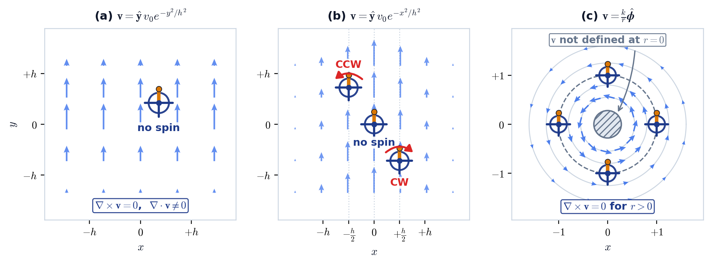

*Figure 3. Testing curl with a $4$-vane paddle wheel ($1$ vane in amber to track orientation). (a) In $\mathbf{v} = \hat{\mathbf{y}}\,v_0 e^{-y^2/h^2}$, speed changes only along the flow, so left and right vanes feel equal push and the wheel does not spin ($\nabla\times\mathbf{v} = \mathbf{0}$, while $\nabla\cdot\mathbf{v} \neq 0$). (b) In $\mathbf{v} = \hat{\mathbf{y}}\,v_0 e^{-x^2/h^2}$, speed peaks on $x = 0$ and changes across the flow, so the wheel spins counter-clockwise at $x = -h/2$, does not spin at $x = 0$, and spins clockwise at $x = +h/2$. (c) In the irrotational vortex $\mathbf{v} = \frac{k}{r}\hat{\boldsymbol{\phi}}$ outside the hatched core around $r = 0$, the faster inner push balances the curvature of the circular streamlines: at $0^\circ$, $90^\circ$, $180^\circ$, and $270^\circ$ on $r = 1$, the amber vane stays pointed straight up ($\nabla\times\mathbf{v} = \mathbf{0}$ for $r > 0$).*

### Stokes' Theorem
Just as our derivation of the divergence led to the Divergence Theorem, our derivation of the curl via the area enclosed by a closed loop shrinking to zero actually tells us how to derive another very important theorem: Stokes' Theorem. We will give the statement followed by the explanation:

$$\iint_S (\nabla \times \mathbf{F}) \cdot \hat{\mathbf{n}}\,dS = \oint_{\partial S} \mathbf{F} \cdot d\mathbf{r}$$

where $S$ is a smooth, orientable open surface, $\partial S$ is its closed boundary curve, $\hat{\mathbf{n}}$ is the unit normal vector on $S$ oriented consistently with the traversal direction of $\partial S$ via the right-hand rule, and $\mathbf{F}$ is a continuously differentiable vector field defined everywhere on $S$. Here "open" means that the surface has an edge, its boundary $\partial S$, unlike a closed surface such as a sphere, which has none. "Orientable" means that we can choose the normal $\hat{\mathbf{n}}$ on one side of the surface consistently everywhere, so that it never flips as we move around. A Möbius strip fails this: carry a normal once around the strip and it comes back pointing the other way. The right-hand rule fixes which way we go around $\partial S$: curl the fingers of the right hand along the direction of travel, and the thumb points along $\hat{\mathbf{n}}$.

Once again, to see how this comes about, analogous to the case of the divergence, look at two tiny adjacent loops that share an edge on the surface. By the same logic as with divergence, when all tiny loops are oriented the same way, the line integrals along every shared interior edge are traversed in opposite directions and cancel out, leaving only the components along the outer boundary $\partial S$ of the surface. Thus, we end up with this equality.

Figure 4 shows how opposite traversals cancel along shared interior edges, first for two loops in the plane and then across a curved dome $S$ over $C$.

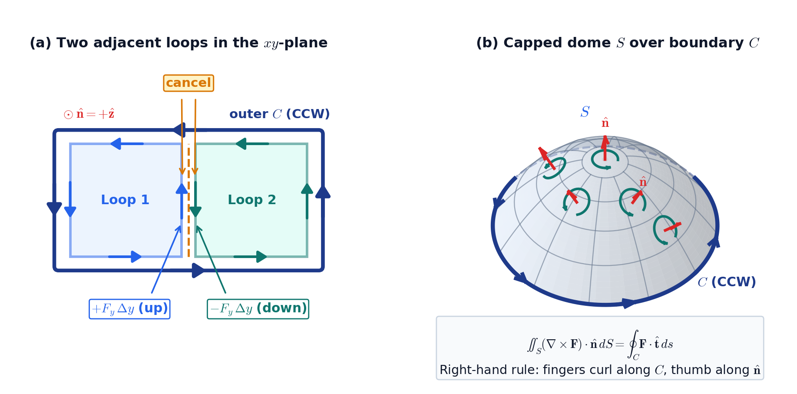

*Figure 4. Cancellation of interior line integrals in Stokes' theorem, $\iint_S (\nabla\times\mathbf{F})\cdot\hat{\mathbf{n}}\,dS = \oint_C \mathbf{F}\cdot\hat{\mathbf{t}}\,ds$. (a) Two adjacent counter-clockwise loops in the $xy$-plane ($\hat{\mathbf{n}} = +\hat{\mathbf{z}}$) traverse their shared vertical edge in opposite directions, so $+F_y\,\Delta y$ and $-F_y\,\Delta y$ sum to $0$ and only the outer boundary $C$ survives. (b) A curved dome $S$ over a closed boundary curve $C$, cut into a mesh of small patches with local counter-clockwise circulation loops and outward normals $\hat{\mathbf{n}}$. Seen from the side that $\hat{\mathbf{n}}$ points to, every patch loop and $C$ turn counter-clockwise by the right-hand rule (fingers curl along $C$, thumb along $\hat{\mathbf{n}}$). Any other cap with the same boundary $C$ gives the same total, provided $\mathbf{F}$ is smooth everywhere between the two caps.*

Now we kind of glossed over a few aspects here. First, for a single closed curve $C$, the surface $S$ needs to be an orientable capping surface whose sole boundary is $C$ ($\partial S = C$), with $\mathbf{F}$ smoothly defined everywhere on $S$. For example, we can take a topological disk (any surface that can be deformed into a flat disc without tearing or gluing) and stretch it out from the closed curve so that it spans the curve completely without any uncounted holes or singularities of $\mathbf{F}$ piercing it. We can then deform this surface whichever way we like, for example into a hemisphere, provided it remains in the domain where $\mathbf{F}$ is smooth and continues to have $C$ as its complete boundary. This ensures that our circulations in the tiny surface loops close up seamlessly across the entire interior and cancel out everywhere except on $C$.

If, for example, there were a hole punctured inside our surface (say, around a region where $\mathbf{F}$ is undefined), then Stokes' Theorem would not hold using only the outer loop $C$ alone, because the tiny loops around the rim of the hole would leave behind an uncancelled inner boundary loop. Let us take a torus-shaped domain (where $\mathbf{F}$ is only defined inside or on the torus, and not in the empty space around it) as an example. If we take a closed loop $C$ going around the central donut hole, there is no way we can make a capping surface inside the torus whose boundary is $C$, because there is an empty hole in the middle that we cannot bridge without leaving the torus. Note also that we cannot use the closed torus surface itself as a capping surface for that single loop, because a closed torus has no boundary at all (and slicing a torus along that loop creates a cylinder with two boundary circles rather than one). Therefore, to guarantee that every closed curve in a space (whether a 3D region or a 2D surface) bounds a valid disk-like capping surface without leaving that space, the space must have no such unbridgeable holes. A space is path-connected if any two of its points can be joined by a path that stays inside it. Path-connected spaces that satisfy this condition are called simply connected. Equivalently, a path-connected space (or surface) is simply connected if any closed curve in it can be continuously shrunk down to a point without leaving the space (something that is impossible on a torus).

The irrotational vortex from the curl section shows what goes wrong without this condition. Its field $\mathbf{v}=\frac{k}{r}\hat{\boldsymbol{\phi}}$ has zero curl everywhere it is defined, that is, everywhere except on the $z$-axis ($r = 0$). Yet its circulation around a circle $C$ of radius $r$ about the axis is not zero. Along the circle, $\mathbf{v}$ points along the direction of travel with constant speed $\frac{k}{r}$, so

$$\oint_C \mathbf{v}\cdot d\mathbf{r} = \frac{k}{r}\cdot 2\pi r = 2\pi k \neq 0$$

This does not contradict Stokes' Theorem. Every capping surface of $C$, whether a flat disc or a hemisphere, is pierced by the $z$-axis, where $\mathbf{v}$ is not defined, so no cap meets the theorem's conditions. The region where $\mathbf{v}$ lives, all of space minus the $z$-axis, is not simply connected: a loop around the axis cannot be shrunk to a point without crossing it. So a field with zero curl everywhere in its domain is guaranteed zero circulation around every loop only when that domain is simply connected. We return to this in the [side quest in vector calculus](#side-quest-in-vector-calculus).

### Gradient ($\nabla$)
We already encountered the gradient when we examined how to arrive at a path-independent line integral. We saw that if a vector field can be written as the gradient of a single-valued scalar potential, then the circulation is $0$, i.e., the line integral over any closed loop in its domain is $0$. Acting on a scalar potential $\psi$, the gradient (built from the del operator $\nabla$) is defined in Cartesian coordinates as:

$$\mathbf{F} = \nabla \psi = \frac{\partial \psi}{\partial x}\hat{\mathbf{x}} + \frac{\partial \psi}{\partial y}\hat{\mathbf{y}} + \frac{\partial \psi}{\partial z}\hat{\mathbf{z}}$$

This is in Cartesian coordinates. We will come to other coordinates shortly.

Essentially, we take the gradient of a scalar potential to get a vector field (note that in physics, electrostatic and gravitational fields include a minus sign by convention, $\mathbf{E} = -\nabla \psi$, so the field points from higher to lower potential). As we saw in [Line Integrals](#line-integrals), the circulation of such a gradient field around any closed loop is zero, so its curl is identically zero (assuming $\psi$ has continuous second partial derivatives). This can be seen quite clearly by simply expanding the curl in terms of the scalar potential, where we get mixed partial derivatives for each coordinate component that cancel out by Clairaut's theorem, which says that when the second partial derivatives are continuous, the order in which we take them does not matter:

$$\nabla \times (\nabla \psi) = \left(\frac{\partial^2 \psi}{\partial y \partial z} - \frac{\partial^2 \psi}{\partial z \partial y}\right)\hat{\mathbf{x}} + \left(\frac{\partial^2 \psi}{\partial z \partial x} - \frac{\partial^2 \psi}{\partial x \partial z}\right)\hat{\mathbf{y}} + \left(\frac{\partial^2 \psi}{\partial x \partial y} - \frac{\partial^2 \psi}{\partial y \partial x}\right)\hat{\mathbf{z}} = \mathbf{0}$$

Let us look at the geometric significance of the gradient. First let us look at the directional derivative of a scalar field $f$ along a path parametrized by arc length $s$. From the multivariable Taylor series, we can see that a small change in $f$ is:

$$\Delta f = \frac{\partial f}{\partial x}\Delta x + \frac{\partial f}{\partial y}\Delta y + \frac{\partial f}{\partial z}\Delta z + \text{higher-order terms}$$

We ignore the higher-order terms as the step shrinks. The directional derivative is the limit of $\frac{\Delta f}{\Delta s}$ as $\Delta s$ tends to zero. Dividing by $\Delta s$ and taking the limit $\Delta s \to 0$, we get:

$$\frac{df}{ds} = \frac{\partial f}{\partial x}\frac{dx}{ds} + \frac{\partial f}{\partial y}\frac{dy}{ds} + \frac{\partial f}{\partial z}\frac{dz}{ds}$$

As we saw in [Line Integrals](#line-integrals), because $s$ is the arc-length parameter, the unit tangent vector to the path is:

$$\hat{\mathbf{t}} = \frac{dx}{ds}\hat{\mathbf{x}} + \frac{dy}{ds}\hat{\mathbf{y}} + \frac{dz}{ds}\hat{\mathbf{z}}$$

So the above expression for the directional derivative looks suspiciously like a dot product of the gradient and the unit tangent vector. In fact, that is exactly what it is:

$$\frac{df}{ds} = \nabla f \cdot \hat{\mathbf{t}}$$

Now see what happens when our path lies on an equipotential surface of $f$ ($f(x,y,z) = \text{constant}$), where the directional derivative along any tangent path on the surface goes to $0$. We find that $\nabla f \cdot \hat{\mathbf{t}} = 0$, meaning the gradient must be perpendicular to every tangent vector of the surface (provided $\nabla f \neq \mathbf{0}$). Thus, we can now say that the gradient is normal to an equipotential surface.

Furthermore, if we look at how to maximize the directional derivative $\frac{df}{ds} = \Vert{}\nabla f\Vert{}\Vert{}\hat{\mathbf{t}}\Vert{}\cos\theta = \Vert{}\nabla f\Vert{}\cos\theta$, we see that this happens when the unit tangent vector aligns with the gradient ($\theta = 0$). Thus, the gradient points in the direction along which the scalar potential $f$ increases at the maximum rate, and its magnitude $\Vert{}\nabla f\Vert{}$ equals that maximum rate of increase.

Figure 5 shows the gradient on an elliptical hill in three views: the steepest uphill tangent on the surface, perpendicularity to contours, and the projections $df/ds = \lVert\nabla f\rVert\cos\theta$ at one point.

*Figure 5. Geometry of the gradient on $f(x, y) = e^{-(x^2/4 + y^2)}$ at $P = (1.2, 0.6)$, where $f(P) = 0.49$ and $\lVert\nabla f(P)\rVert = 0.65$. (a) Surface $z = f(x, y)$ with floor contours and the steepest uphill arrow on the surface at $P$ directly above $\nabla f$. (b) Labelled contours and $\nabla f$ arrows, perpendicular to the contours, longest where contours pack closely, and vanishing at the summit $(0, 0)$. (c) Zoom at $P$ showing the $f = 0.49$ contour, its dashed tangent, $\nabla f(P)$, and five unit vectors $\hat{\mathbf{t}}$ at $\theta = 0^\circ, 45^\circ, 90^\circ, 135^\circ, 180^\circ$ drawn to the same scale. Projecting $\nabla f(P)$ onto each $\hat{\mathbf{t}}$ (dotted line shown for $45^\circ$) gives $df/ds = \nabla f\cdot\hat{\mathbf{t}} = \lVert\nabla f\rVert\cos\theta$ equal to $+0.65$, $+0.46$, $0$, $-0.46$, and $-0.65$.*

Using the above dot product relation in differential form ($df = \nabla f \cdot d\mathbf{r}$) also makes it easy for us to derive and write out the expressions for the gradient in cylindrical and spherical coordinates.

By multivariable calculus, the total differential $df$ in any coordinates $(u_1, u_2, u_3)$ never has scale factors:

$$df = \frac{\partial f}{\partial u_1}du_1 + \frac{\partial f}{\partial u_2}du_2 + \frac{\partial f}{\partial u_3}du_3$$

Meanwhile, the physical infinitesimal displacement vector $d\mathbf{r}$ in orthogonal curvilinear coordinates does carry the geometric arc-length scale factors $(h_1, h_2, h_3)$:

$$d\mathbf{r} = h_1 du_1 \hat{\mathbf{e}}_1 + h_2 du_2 \hat{\mathbf{e}}_2 + h_3 du_3 \hat{\mathbf{e}}_3$$

For example, in spherical coordinates $(r, \theta, \phi)$, moving by $dr$ covers distance $dr$ ($h_r = 1$), swinging polar angle by $d\theta$ covers arc length $r\,d\theta$ ($h_\theta = r$), and swinging azimuthal angle by $d\phi$ at cylindrical radius $r\sin\theta$ covers arc length $r\sin\theta\,d\phi$ ($h_\phi = r\sin\theta$):

$$d\mathbf{r} = dr\,\hat{\mathbf{r}} + r\,d\theta\,\hat{\boldsymbol{\theta}} + r\sin\theta\,d\phi\,\hat{\boldsymbol{\phi}}$$

Let $\nabla f = (\nabla f)_1 \hat{\mathbf{e}}_1 + (\nabla f)_2 \hat{\mathbf{e}}_2 + (\nabla f)_3 \hat{\mathbf{e}}_3$ and take the dot product $\nabla f \cdot d\mathbf{r}$:

$$df = \nabla f \cdot d\mathbf{r} = (\nabla f)_1 h_1 du_1 + (\nabla f)_2 h_2 du_2 + (\nabla f)_3 h_3 du_3$$

Matching coefficients of $du_1, du_2, du_3$ with the total differential $df$ above immediately yields:

$$(\nabla f)_i = \frac{1}{h_i}\frac{\partial f}{\partial u_i}$$

Each partial derivative simply gets divided by the distance scale factor $h_i$ so that every component of $\nabla f$ has consistent physical units of $[\text{change in } f] / [\text{physical length}]$.

Thus we get the gradient in cylindrical coordinates $(r, \phi, z)$:

$$\nabla f = \frac{\partial f}{\partial r}\hat{\mathbf{r}} + \frac{1}{r}\frac{\partial f}{\partial \phi}\hat{\boldsymbol{\phi}} + \frac{\partial f}{\partial z}\hat{\mathbf{z}}$$

and in spherical coordinates $(r, \theta, \phi)$:

$$\nabla f = \frac{\partial f}{\partial r}\hat{\mathbf{r}} + \frac{1}{r}\frac{\partial f}{\partial \theta}\hat{\boldsymbol{\theta}} + \frac{1}{r\sin\theta}\frac{\partial f}{\partial \phi}\hat{\boldsymbol{\phi}}$$

---

**Aside:** This exact difference between $df$ and $\nabla f$ explains why exterior calculus separates the exterior derivative $df$ (a 1-form / covector) from the vector gradient $\nabla f$ (a tangent vector):

The 1-form $df = \frac{\partial f}{\partial x^i}dx^i$ takes an unnormalized tangent vector $\mathbf{v} = \frac{dx^i}{dt}\partial_i$ directly and outputs the rate of change $df(\mathbf{v}) = \frac{\partial f}{\partial x^i}\frac{dx^i}{dt}$ with zero reference to lengths, angles, or a metric tensor. Geometrically, $df$ can be pictured as the stack of infinitesimal equipotential surfaces of $f$, and $df(\mathbf{v})$ simply counts how many equipotential sheets the vector $\mathbf{v}$ pierces per unit parameter.

By contrast, the vector gradient $\nabla f$ requires a metric tensor $g_{ij}$ to convert that stack of sheets into an arrow pointing perpendicular to the sheets. In index notation, $df$ has lower indices ($\partial_j f$), and we must contract with the inverse metric tensor $g^{ij}$ to raise the index into the vector $\nabla f$:

$$(\nabla f)^i = g^{ij}\frac{\partial f}{\partial x^j}$$

In spherical coordinates, the metric is diagonal with $(g_{rr}, g_{\theta\theta}, g_{\phi\phi}) = (1, r^2, r^2\sin^2\theta)$, so the inverse metric is $(g^{rr}, g^{\theta\theta}, g^{\phi\phi}) = \left(1, \frac{1}{r^2}, \frac{1}{r^2\sin^2\theta}\right)$ in the coordinate basis. The coordinate basis vectors $\partial_\theta$ and $\partial_\phi$ are not unit vectors: their lengths are the scale factors $h_\theta = r$ and $h_\phi = r\sin\theta$, so the unit vectors are $\hat{\mathbf{e}}_i = \frac{1}{h_i}\partial_i$. To get the component of $\nabla f$ along $\hat{\boldsymbol{\theta}}$, we therefore multiply the coordinate component $g^{\theta\theta}\partial_\theta f = \frac{1}{r^2}\partial_\theta f$ by the length $r$, which gives $\frac{1}{r}\partial_\theta f$. In the same way, the component along $\hat{\boldsymbol{\phi}}$ is $r\sin\theta \cdot \frac{1}{r^2\sin^2\theta}\partial_\phi f = \frac{1}{r\sin\theta}\partial_\phi f$. These are exactly the factors in the spherical gradient above.

Furthermore, the vector identity $\nabla \times (\nabla \psi) = \mathbf{0}$ is the 3D coordinate translation of the universal exterior derivative rule $d(d\psi) = d^2\psi = 0$.

---

### Poisson's & Laplace's Equations

Now recall the relationship we came to earlier between the divergence of the electric field and the volumetric charge density:

$$\nabla \cdot \mathbf{E} = \frac{\rho}{\varepsilon_0}$$

Let us substitute $\mathbf{E} = -\nabla \psi$ (incorporating the electrostatic minus sign convention). We get:

$$\nabla \cdot (-\nabla \psi) = \frac{\rho}{\varepsilon_0} \implies \nabla \cdot \nabla \psi = -\frac{\rho}{\varepsilon_0}$$

The operator $\nabla \cdot \nabla$ is commonly written as $\nabla^2$, and the equation takes the form that is called Poisson's equation:

$$\nabla^2 \psi = -\frac{\rho}{\varepsilon_0}$$

Here $\nabla^2$ is called the Laplacian. It represents the divergence of the gradient. Think of the gradient $\nabla \psi$ as a vector field that points in the direction of the maximum rate of increase of $\psi$. Now what is the divergence of that? If a whole lot of gradient vectors point inward toward a point, the point is a local peak (high point) of the scalar potential field. That inward flow is convergence, so we find a negative divergence at that point ($\nabla^2 \psi < 0$; strictly, a peak only guarantees $\nabla^2 \psi \le 0$). The converse does not hold: the Laplacian can be negative where there is no peak at all. On the dome $\psi = -(x^2 + y^2)$ of Figure 6(a), $\nabla^2\psi = -4$ everywhere, including all along its slopes, because the gradient arrows shrink as they climb toward the summit, so more flow enters any small region than leaves it. On the flip side, if the gradient vectors point outward away from a point, we are at the bottom of a valley (low point) in the scalar potential, and that outward flow gives a positive divergence ($\nabla^2 \psi > 0$). Thus, the Laplacian represents how much the average value of the scalar field around a point exceeds the value at the point itself (or up to a sign, how much the scalar field at a point deviates from its local average value).

Figure 6 compares $\nabla\psi$ and the circle average $\bar{\psi}_R$ at $R = 0.5$ for a peak, a valley, and a harmonic saddle.

*Figure 6. The Laplacian $\nabla^2\psi = \nabla\cdot(\nabla\psi)$ and the average $\bar{\psi}_R$ around a dashed circle of radius $R = 0.5$ on $-1 \le x, y \le 1$, with $\psi(0, 0) = 0$ in all three cases. (a) Peak $\psi = -(x^2 + y^2)$: $\nabla\psi$ points inward, the four marked neighbours and $\bar{\psi}_R$ equal $-0.25$, and $\nabla^2\psi = -4$. (b) Valley $\psi = x^2 + y^2$: $\nabla\psi$ points outward, the neighbours and $\bar{\psi}_R$ equal $+0.25$, and $\nabla^2\psi = +4$. (c) Saddle $\psi = x^2 - y^2$: inflow near the $y$-axis balances outflow near the $x$-axis, and the marked values $+0.25$ and $-0.25$ average to $0$, so net flux is zero, $\nabla^2\psi = 0$, and the centre value equals the circle average ($\bar{\psi}_R = 0 = \psi(0, 0)$), which is the mean value property for a harmonic $\psi$. In the plane, $\bar{\psi}_R - \psi(\text{centre}) = \frac{R^2}{4}\nabla^2\psi$, exactly for these quadratic potentials and approximately for small $R$ in general; this is the planar version of the $\frac{R^2}{6}\nabla^2\psi$ formula in the aside, which averages over a sphere in three dimensions.*

Now, when we want to evaluate the electrostatic potential (and from it, the field), we usually want to know its value in the empty spaces between charges, i.e., the regions where the charge density is $0$. Accordingly, the RHS of Poisson's equation goes to $0$ and we get what is known as Laplace's equation:

$$\nabla^2 \psi = 0$$

which when expanded in Cartesian coordinates is:

$$\frac{\partial^2 \psi}{\partial x^2} + \frac{\partial^2 \psi}{\partial y^2} + \frac{\partial^2 \psi}{\partial z^2} = 0$$

This is just a single second-order partial differential equation in just one scalar unknown, unlike our earlier $\nabla \cdot \mathbf{E} = \frac{\rho}{\varepsilon_0}$ equation (coupled with $\nabla \times \mathbf{E} = \mathbf{0}$), where $\mathbf{E}$ had 3 unknown scalar components for $x$, $y$, and $z$ that we had to solve for simultaneously.

Laplace's equation is frequently used to solve for the electrostatic potential (and hence the electrostatic field), the gravitational potential, and other such physical potentials. To get a unique solution, we of course need to establish the boundary conditions that hold on the boundary $\partial V$ of our region $V$.

Without boundary conditions, if $\psi_1$ solves the general Poisson equation $\nabla^2\psi = s$, where $s$ is a given source term ($s = -\rho/\varepsilon_0$ in electrostatics), then $\psi_1 + \chi$ is also a solution for any harmonic function $\chi$ ($\nabla^2 \chi = 0$), such as a constant, a linear ramp $ax + by + cz$, or a saddle $x^2 - y^2$. Because $\nabla^2$ is a linear operator, uniqueness of $\nabla^2\psi = s$ reduces to asking whether the difference $u = \psi_1 - \psi_2$ of two solutions (which satisfies $\nabla^2 u = 0$ in $V$ with zero boundary data on $\partial V$) must vanish.

Green's first identity is the divergence theorem applied to the vector field $u\nabla u$. By the product rule, its divergence is $\nabla\cdot(u\nabla u) = \vert{}\nabla u\vert{}^2 + u\nabla^2 u$, and its flux out through the boundary is $u\,\frac{\partial u}{\partial n}$ per unit area. Here $\frac{\partial u}{\partial n} = \nabla u\cdot\hat{\mathbf{n}}$ is the normal derivative, the rate of change of $u$ straight out through the boundary. Applying the identity to the difference $u = \psi_1 - \psi_2$ over a bounded region $V$ (and using $\nabla^2 u = 0$ to drop the volume term $u\nabla^2 u$), we get:

$$\int_V \vert{}\nabla u\vert{}^2\,dV = \oint_{\partial V} u\,\frac{\partial u}{\partial n}\,dA$$

For the right-hand side to vanish (forcing $\nabla u = \mathbf{0}$ everywhere in $V$), the behavior depends on the boundary condition:

**Dirichlet Boundary Conditions ($\psi$ specified on $\partial V$):** **Strictly unique.** On $\partial V$, $u = \psi_1 - \psi_2 = 0$, so the surface integral vanishes, forcing $\nabla u = \mathbf{0}$ (meaning $u$ is constant in $V$). Since $u=0$ on the boundary, $u=0$ everywhere, so $\psi_1 = \psi_2$.
    
**Neumann Boundary Conditions (normal derivative $\frac{\partial\psi}{\partial n}$ specified on $\partial V$):** **Unique only up to an additive constant** (and a solution exists only if the compatibility condition $\int_V s\,dV = \oint_{\partial V}\frac{\partial\psi}{\partial n}\,dA$ holds by the divergence theorem). Here $\frac{\partial u}{\partial n} = 0$ on $\partial V$, which again forces $\nabla u = \mathbf{0}$, so $\psi_1$ and $\psi_2$ can differ by any constant $C$. However, their gradients, which give the physical electric field $\mathbf{E} = -\nabla\psi$, are **strictly unique**.
    
**Mixed or Robin Boundary Conditions:** Specifying $\psi$ on part of the boundary and $\frac{\partial\psi}{\partial n}$ on the rest (or $\alpha\psi + \beta\frac{\partial\psi}{\partial n} = g$ with $\alpha, \beta$ having the same sign) yields a **strictly unique** solution.
    
**Unbounded Domains (e.g., all of $\mathbb{R}^3$):** You must also impose an **asymptotic decay condition at infinity** (such as $\psi(\mathbf{r}) \to 0$ as $r \to \infty$). Without it, adding a uniform background field like $\psi_{\text{hom}} = -E_0 z$ still satisfies $\nabla^2\psi = 0$ across all of $\mathbb{R}^3$.

---

**Aside:** We noted intuitively that $\nabla^2 \psi$ measures how much $\psi$ deviates from its local average. We can make this exact using a 3D Taylor expansion of $\psi$ around a point $\mathbf{r}_0$ averaged over a small sphere of radius $R$ centered at $\mathbf{r}_0$. Because odd-power terms ($x, y, z$) and cross-terms ($xy, yz, zx$) average to zero over a sphere, while $\langle x^2 \rangle = \langle y^2 \rangle = \langle z^2 \rangle = \frac{1}{3}R^2$ on the sphere's surface, the average value $\bar{\psi}_R$ of $\psi$ on the spherical shell of radius $R$ is:

$$\bar{\psi}_R = \psi(\mathbf{r}_0) + \frac{1}{6} R^2 \nabla^2 \psi(\mathbf{r}_0) + \mathcal{O}(R^4)$$

Rearranging gives:

$$\nabla^2 \psi(\mathbf{r}_0) = \lim_{R \to 0} \frac{6}{R^2}\left(\bar{\psi}_R - \psi(\mathbf{r}_0)\right)$$

Look at what happens when $\nabla^2 \psi = 0$ (Laplace's equation). The formula above only tells us that $\bar{\psi}_R$ and $\psi(\mathbf{r}_0)$ agree up to terms of order $R^4$, but the divergence theorem shows that they agree exactly, for every $R$. Grow the sphere by $dR$: every point on it moves straight outward, so $\psi$ there changes by $(\nabla\psi\cdot\hat{\mathbf{n}})\,dR$, and the average changes by the average of $\nabla\psi\cdot\hat{\mathbf{n}}$ over the sphere:

$$\frac{d\bar{\psi}_R}{dR} = \frac{1}{4\pi R^2}\oint_{\text{sphere}} \nabla\psi\cdot\hat{\mathbf{n}}\,dA = \frac{1}{4\pi R^2}\int_{\text{ball}} \nabla^2\psi\,dV$$

The second step is the divergence theorem applied to $\nabla\psi$. When $\nabla^2\psi = 0$ throughout the ball, the right-hand side is $0$, so $\bar{\psi}_R$ does not change as the sphere grows. As $R \to 0$ the average tends to $\psi(\mathbf{r}_0)$, so it equals $\psi(\mathbf{r}_0)$ for every $R$. This is Gauss's Mean Value Theorem: for any harmonic function, the value $\psi(\mathbf{r}_0)$ at the center of any sphere inside the region equals the exact average of $\psi$ over the surface of that sphere.

An immediate physical consequence of the Mean Value Property of Laplace's equation ($\nabla^2 \psi = 0$) is the Maximum Principle: a harmonic function can never have a strict local maximum or local minimum in the interior of a charge-free region (all extrema must occur on the boundary $\partial V$). Why? If $\psi(\mathbf{r}_0)$ were strictly lower than all nearby points, it could not equal the average of $\psi$ over a small sphere around $\mathbf{r}_0$, because every point of that sphere is higher. The second derivatives give a quick check in the common case where they are not zero. If $\psi$ curves up along $x$ and $y$ ($\frac{\partial^2\psi}{\partial x^2}, \frac{\partial^2\psi}{\partial y^2} > 0$), Laplace's equation forces $\frac{\partial^2\psi}{\partial z^2} = -\left(\frac{\partial^2\psi}{\partial x^2} + \frac{\partial^2\psi}{\partial y^2}\right) < 0$, so $\psi$ curves down along $z$ and the critical point is a saddle, not a minimum. This check alone cannot rule out every minimum, because a minimum need not show up in the second derivatives: $x^4 + y^4 + z^4$ has a strict minimum at the origin even though all its second derivatives are zero there. The mean value argument has no such gap, so it is the one that proves the Maximum Principle. Physically, because potential energy $U = q\psi$ has no local minimum in free space, a point charge cannot be held in stable static equilibrium solely by electrostatic forces. This famous result is known as Earnshaw's Theorem.

### Green's Theorem
Let us use the notation $\partial D$ for the oriented curve $C^+$, that is, the boundary curve of a closed surface $D$. Then we can write Green’s theorem as

$$\int_{\partial D} P\,dx + Q\,dy = \iint_D \left(\frac{\partial Q}{\partial x} - \frac{\partial P}{\partial y}\right) dx\,dy, \quad (P, Q \in C^1\text{ on }D,\; \partial D\text{ piecewise }C^1).$$

Green’s theorem is very useful because it relates a line integral around the boundary of a region to an area integral over the interior of the region, and in many cases it is easier to evaluate the line integral than the area integral, or vice versa. For example, if we know that $P$ vanishes on the boundary, we can immediately conclude that $\iint_D (\partial P/\partial y)\,dx\,dy = 0$ even though $\partial P/\partial y$ need not vanish on the interior. 

Note that this looks very similar to the Stoke's Theorem. If we have a vector field with a $x$ component of $P$ and $y$ component $Q$, then the LHS in the above Green's Theorem is just the line integral over a closed loop of some vector field. As we saw in the Stoke's Theorem, this should equal the curl of the vector field over the closed surface bounded by the loop. That is exactly what the RHS is! 

---

### Common Identities

There are several common identities that tie the gradient, curl and divergence together. We'll start with something that ties back to why the curl in our field that varies along the x-axis but not the y-axis is non-zero.

The identity is the product rule for curl of a scalar function $f(x,y,z)$ multiplying a vector field $\mathbf{u}$:
    
$$\nabla\times(f\mathbf{u})=f(\nabla\times\mathbf{u})+(\nabla f)\times\mathbf{u}$$
    
In both of our examples (where velocity varies with y and the other where it varies with x), the flow is $\mathbf{v}=f(x,y)\hat{\mathbf{y}}$, where $\mathbf{u}=\hat{\mathbf{y}}$ is a constant unit vector (so $\nabla\times\hat{\mathbf{y}}=\mathbf{0}$). Thus, the formula simplifies directly to:
    
$$\nabla\times(f\hat{\mathbf{y}})=(\nabla f)\times\hat{\mathbf{y}}$$
    
In the first case,  $f(y)=v_0 e^{-y^2/h^2}$, so the gradient $\nabla f=\frac{\partial f}{\partial y}\hat{\mathbf{y}}$ is parallel to $\hat{\mathbf{y}}$, making the cross product $(\nabla f)\times\hat{\mathbf{y}}=\mathbf{0}$.
        
In the second case,  $f(x)=v_0 e^{-x^2/h^2}$, so the gradient $\nabla f=\frac{\partial f}{\partial x}\hat{\mathbf{x}}$ is perpendicular to $\hat{\mathbf{y}}$, making the cross product $(\nabla f)\times\hat{\mathbf{y}}=\frac{\partial f}{\partial x}(\hat{\mathbf{x}}\times\hat{\mathbf{y}})=\frac{\partial f}{\partial x}\hat{\mathbf{z}}\neq\mathbf{0}$.

The other identities are:

$$\nabla\times(\nabla f)=\mathbf{0}$$

We already saw this one when discussing the gradient. 

$$\nabla\cdot(\nabla\times\mathbf{F})=0$$

This should intuitively make sense. A curl represents the circulation. A circulation is closed in on itself so you expect the "input" flowing in to equal the "output" flowing out of an infinitesimally small surface. Thus, the divergence of a curl is 0.

We can also prove it with the two theorems. Take any closed surface, such as a sphere, and draw a loop $C$ around its middle, cutting it into two caps. Stokes' Theorem applies to each cap, and both caps have the same boundary $C$. But with both normals pointing outward, the right-hand rule sends us around $C$ in opposite directions for the two caps. So the two circulations cancel, and the total flux of $\nabla\times\mathbf{F}$ out of the closed surface is $0$. By the Divergence Theorem, that flux equals $\int_V \nabla\cdot(\nabla\times\mathbf{F})\,dV$ over the enclosed volume $V$. This integral is $0$ for every volume, however small, so the integrand itself must be $0$ everywhere.

$$\nabla(fg)=f\nabla g+g\nabla f$$

$$\nabla(\mathbf{F}\cdot\mathbf{G})=(\mathbf{G}\cdot\nabla)\mathbf{F}+(\mathbf{F}\cdot\nabla)\mathbf{G}+\mathbf{F}\times(\nabla\times\mathbf{G})+\mathbf{G}\times(\nabla\times\mathbf{F})$$

$$\nabla\cdot(f\mathbf{F})=f(\nabla\cdot\mathbf{F})+\mathbf{F}\cdot\nabla f$$

$$\nabla\cdot(\mathbf{F}\times\mathbf{G})=\mathbf{G}\cdot(\nabla\times\mathbf{F})-\mathbf{F}\cdot(\nabla\times\mathbf{G})$$

$$\nabla\times(\mathbf{F}\times\mathbf{G})=(\mathbf{G}\cdot\nabla)\mathbf{F}-(\mathbf{F}\cdot\nabla)\mathbf{G}+\mathbf{F}(\nabla\cdot\mathbf{G})-\mathbf{G}(\nabla\cdot\mathbf{F})$$

$$\nabla\times(\nabla\times\mathbf{F})=\nabla(\nabla\cdot\mathbf{F})-\nabla^2\mathbf{F}$$

Note that the vector Laplacian $\nabla^2\mathbf{F}$ only equals the scalar Laplacian applied to each component $(\nabla^2 F_x,\nabla^2 F_y,\nabla^2 F_z)$ in Cartesian coordinates. In cylindrical or spherical coordinates, the unit basis vectors ($\hat{\mathbf{r}},\hat{\boldsymbol{\theta}},\hat{\boldsymbol{\phi}}$) change direction with position, so differentiating them produces extra cross-terms. In fact, in curvilinear coordinates, this very identity read backwards, $\nabla^2\mathbf{F}\equiv\nabla(\nabla\cdot\mathbf{F})-\nabla\times(\nabla\times\mathbf{F})$, is used as the definition of the vector Laplacian.

---

**Aside:** Instead of memorizing the four-term expansions for $\nabla(\mathbf{F}\cdot\mathbf{G})$ and $\nabla\times(\mathbf{F}\times\mathbf{G})$, you can derive all nine identities in two lines using index notation. Three pieces are needed. The Einstein summation convention says that an index repeated within a term is summed over $1, 2, 3$, so $a_j b_j$ means $a_1 b_1 + a_2 b_2 + a_3 b_3$. The Kronecker delta $\delta_{ij}$ is $1$ when $i = j$ and $0$ otherwise. The Levi-Civita symbol $\varepsilon_{ijk}$ is $+1$ when $ijk$ is an even rearrangement of $123$ (such as $231$), $-1$ for an odd one (such as $213$) and $0$ when an index repeats, so that $(\mathbf{F}\times\mathbf{G})_i = \varepsilon_{ijk}F_j G_k$. The two symbols are linked by the contracted epsilon identity $\varepsilon_{ijk}\varepsilon_{imn}=\delta_{jm}\delta_{kn}-\delta_{jn}\delta_{km}$. Since $\varepsilon_{ijk}$ is unchanged by a cyclic shift of its indices ($\varepsilon_{ijk} = \varepsilon_{kij}$), the identity applies whichever position the shared index occupies, as long as it comes first after the shift. For example, the $i$-th component of $\nabla\times(\mathbf{F}\times\mathbf{G})$ is:

$$[\nabla\times(\mathbf{F}\times\mathbf{G})]_i=\varepsilon_{ijk}\partial_j(\varepsilon_{kmn}F_m G_n)=(\delta_{im}\delta_{jn}-\delta_{in}\delta_{jm})\partial_j(F_m G_n)=\partial_j(F_i G_j)-\partial_j(F_j G_i)$$

Applying the standard Leibniz product rule $\partial_j(AB)=B\partial_j A+A\partial_j B$ immediately yields the four terms:

$$(G_j\partial_j)F_i+F_i(\partial_j G_j)-(F_j\partial_j)G_i-G_i(\partial_j F_j)=[(\mathbf{G}\cdot\nabla)\mathbf{F}+\mathbf{F}(\nabla\cdot\mathbf{G})-(\mathbf{F}\cdot\nabla)\mathbf{G}-\mathbf{G}(\nabla\cdot\mathbf{F})]_i$$

---

## Intuition of Differential Geometry

Before the mathematical formalism of differential geometry, it helps to understand why differential geometry is needed. For example, if we wanted to set up a coordinate system for the surface of the Earth, you could zoom out into space, create a 3D coordinate system and establish the coordinates in that grid for every point on the Earth's surface. But what if I wanted to do the same thing for the universe as a whole, as General Relativity requires? There is no place to zoom out to from the universe. We are forced to figure out how to set up a coordinate system, distance measurement tools and a description of the space from within the space itself.

The "low-hanging fruit" method to do that is to describe each point in terms of its immediate neighbours. That should remind you of differentiation, which is more or less what we do, and the reason for the name differential geometry. Essentially, we will be describing every point on the $n$-dimensional surface by the slope or rate of change of the surface along any $n$ linearly independent directions. This way, I don't need any origin defined for my coordinate grid. After all, what is an origin? It is some arbitrary point that we choose and then go ahead and define every point by the "difference" of that point from the origin along various directions. Instead of an origin, in differential geometry I choose to define my "difference" with respect to my neighbouring points. If I know how each point changes with respect to its neighbour, I can iteratively "walk" point by point everywhere on my surface and map out the whole surface.

This is analogous to the situation where you are plonked onto the Earth's surface without any knowledge of what it actually looks like when you zoom out, and are told to create a description and measure various aspects of the Earth's surface. So let's do exactly that.

We start off at some arbitrary point $p$ on the surface (the fact that it is arbitrary will be important later on. Stay tuned). In the Earth's case, this is a 2D surface: at any point you need two independent coordinates to describe any point in the locality. For the universe as a whole it will be a 4D surface. In general, an $n$-dimensional surface is called a manifold.

I have no measurement scale of meters or centimeters etc. I don't know what the rest of the manifold looks like, except that locally around me, it looks flat. In the kind of differential geometry that is relevant for General Relativity, we assume that any manifold, which may be curved and bumpy on the whole, will be flat locally at every point i.e. whatever point you pick, if you zoom in enough, you will find the manifold looks flat in the locality of the point. Mathematically, this local flat space is the tangent space at that point. That makes sense. The tangents are straight lines at every point, so if the manifold is $n$-dimensional, it would have $n$ linearly independent tangents at every point which form the basis of what is called the Tangent Space at every point.

Back to our point $p$, we use these $n$ linearly independent tangent vectors as the basis of our coordinate system. As mentioned, we don't actually have any measurement scale, so we simply say that each of the tangent vectors are unit vectors, and that now gives us some measurement basis.

But I still only have one tick on my scale. I'd like to be able to have as many ticks as I want so that I can measure anything, no matter how big. So I construct what is called a covector basis, which is a tick counter. These are a set of linear counting machines (think of them as contour lines) designed so that each one outputs the number $1$ when fed its own unit tangent vector and $0$ when fed any of the others. Writing the counters as $dx^\mu$ and the basis vectors as $e_\nu$, this reads $dx^\mu(e_\nu) = \delta^\mu_\nu$, where the Kronecker delta $\delta^\mu_\nu$ is $1$ when $\mu = \nu$ and $0$ otherwise. The $0$ matters as much as the $1$: it is what stops one counter from also counting steps along the other basis vectors. In this local grid, if I feed a vector to the covector machine, it will output the number of ticks for each basis coordinate that the vector covers. I have one tick counter for each basis vector, and so the number of covector bases equals the number of vector bases. These two spaces are called dual spaces. Going back to our contour lines analogy, we measure how many contour lines of some covector basis a vector pierces, and that tells us the length of the vector along that coordinate.

Figure 7 shows these counters for a slanted pair of basis vectors, where it is easy to see why each counter must give $0$ on the other basis vector.

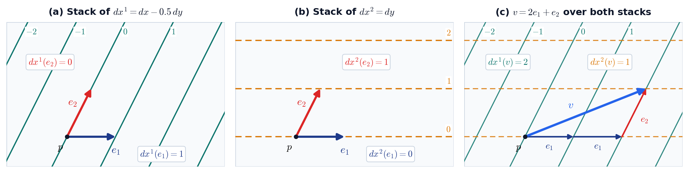

*Figure 7. Tick counters: the dual basis of a slanted basis at $p$. The basis is $e_1 = (1, 0)$ and $e_2 = (0.5, 1)$, and its dual basis is $dx^1 = dx - 0.5\,dy$ and $dx^2 = dy$. (a) The stack of $dx^1$ is its integer level lines $x - 0.5y = n$, which run parallel to $e_2$. The arrow $e_1$ goes from line $0$ to line $1$, so $dx^1(e_1) = 1$, while $e_2$ lies along line $0$, so $dx^1(e_2) = 0$. (b) The stack of $dx^2$ is the lines $y = n$, which run parallel to $e_1$. Now $e_2$ crosses one line and $e_1$ none, so $dx^2(e_2) = 1$ and $dx^2(e_1) = 0$. Together, (a) and (b) say $dx^\mu(e_\nu) = \delta^\mu_\nu$. (c) Take $v = 2e_1 + e_2 = (2.5, 1)$. The two steps along $e_1$ cross two $dx^1$ lines and stay on $dx^2$ line $0$; the step along $e_2$ crosses one $dx^2$ line and stays on $dx^1$ line $2$. So $dx^1(v) = 2$ and $dx^2(v) = 1$: the counters read off the components of $v$.*

To establish geometry, I define the metric tensor at this point. I do this by claiming my chosen basis vectors are perfectly orthogonal, so they don't mix with each other in this local patch. We have already claimed that our unit vectors at this local patch are one unit long, so we include that in our metric definition. By making this claim, I set the dot products of all the basis vectors such that the metric tensor evaluates to the identity matrix, $g_{\mu\nu} = \delta_{\mu\nu}$, on a surface like the Earth's, or to the Minkowski metric, $g_{\mu\nu} = \eta_{\mu\nu}$, in spacetime (where the time basis vector has squared length $-1$).

Now that I have a registry of basis dot product values, I can calculate the dot product of any two vectors, which means I can find the lengths of vectors as well as angles between them.

The choice to define the metric tensor this way is not set in stone. Defining it this way means we have chosen a typical Cartesian coordinate system, the flat, orthogonal x,y (and z and whatever else) that we are used to in most graphs. More rigorously, in 4D this is called a Lorentz Coordinate system.

If I suddenly decide to change my coordinate system at this point to something else, like polar coordinates, I would convert my previous unit distance to this new coordinate system with the help of the Jacobian matrix. My covector machines would also change, and so would my metric tensor, absorbing the geometric stretching via the Jacobian. The metric tensor would not look like a Minkowski metric anymore.

In differential geometric terminology, the choice of the flat orthogonal coordinates at some point is called the Riemann Normal Coordinate (RNC) grid at this location. A theorem of differential geometry says that given any smooth manifold, you can pick any point on it and then choose a coordinate system such that the metric will look Minkowski at that point. Note that we can do the same at every other point, because we said right in the beginning that we work only with manifolds that look locally flat. But a single coordinate grid can't do it for all points at once. In the grid we built at $p$, the metric components at other points will not look like the Minkowski metric, either because the grid gets warped out of shape by the curvature of the space or simply because we have chosen some other coordinate system there. Looking flat at a point is not the same as being flat. At $p$ we can make the metric equal to $\eta_{\mu\nu}$ and its first derivatives zero (see the aside below), but curvature shows up in the second derivatives, and no choice of coordinates removes it.

---

**Aside:** A critical mathematical condition that defines RNCs is that the first derivatives of the metric are strictly zero at $p$ ($\partial_\alpha g_{\mu\nu} = 0$). This is the mathematical embodiment of the Equivalence Principle. It guarantees that locally, you feel no gravitational acceleration (Christoffel symbols vanish). Gravity (curvature) only appears in the second derivatives.

---

Let's take a step back and look at what we've managed so far. We've accurately described each point with respect to its neighbours and we now have a mechanism to measure angles and distances in this local neighbourhood. Now all that's left is to iteratively walk all over my surface and apply this mechanism from neighbouring point to neighbouring point.

So let's move a little to an adjacent point $q$ on my manifold. One point to note is that we assume that our surface doesn't pinch or warp in such a way that it is an n-dimensional surface at one point but an m-dimensional one at some other point. We assume that it covers n dimensions everywhere. That of course doesn't mean that it is flat throughout. It is only flat locally. On the whole, as you step from one local patch to another, you might find you have to twist and turn! 

Now I am faced with a choice. Note that in mathematics, the metric tensor is something that is defined globally across the manifold by the mathematician. They would say, the metric is a Minkowski metric everywhere, or it is the Schwarzschild metric because we are near a black hole. The metric is given to us. In physics, gravity decides the metric. Spacetime is a manifold, and the presence of mass and energy dynamically warps that spacetime. This warping is encoded in the metric tensor (or rather, its deviation from a flat metric). So physics hands us the metric. And this is why we have to make a choice now.

Before I move to the new point $q$, I carry a copy of my grid from the previous point, being careful to keep the vectors parallel to themselves. This is called parallel transport. On a curved surface, "parallel" is not obvious: we need a rule that says how to carry a vector from one point to a neighbouring one, and that rule is the connection we are about to meet. Parallel transport means carrying vectors according to it. At $q$, let us say I choose to look at my new tangent space and then define a new coordinate system here as well along with all the associated machinery. Then I compare it with my copy of the previous grid. This tells me how the old coordinate grid and the new one are related. So I've established a connection between the two points, which also happens to be the correct technical terminology for this sort of thing: an affine connection. 

I could simply declare my new grid at $q$ to be orthonormal, just like I did at the earlier point, without checking it against the grid I carried over. Then the rule for carrying vectors would not respect the metric: a vector carried from $p$ to $q$ could arrive with a different length, or at a different angle to its neighbours, as measured by the metric at $q$. So while I can get along just fine in either local patch separately, my measurements of distances and angles would not agree between patches. This is not what we experience in reality. Making a measurement of the mass of an electron gives the same value everywhere and at all times.

The other choice is I set up my new local coordinate grid at $q$ such that when I create my measurement apparatus with the inner products of the new basis vectors, they are compatible with what I had at $p$. This is called choosing a metric-compatible connection, which is what we usually do in general relativity. In other words, the metric is given at every point, and what we choose is the connection: the compatible choice is the one under which carried vectors keep their lengths and the angles between them. 

**Note:** Hermann Weyl in 1918 constructed a geometry where the metric was not compatible with the connection, meaning lengths changed as they were transported. He showed that you could calculate this change by integrating a vector field along the path, which he brilliantly identified as the electromagnetic vector potential $A_\mu$. Mathematically, it is a beautiful, fully self-consistent system. The reason we reject this framework in General Relativity is because it doesn't match with the reality we see that measurements everywhere and always are the same.

---

**Aside:** If you parallel transport a vector around a closed loop and it returns pointing in a different direction, that discrepancy is the definition of the intrinsic curvature of a space (measured by the Riemann curvature tensor). Think of what would happen if you start at the North Pole holding a spear that points south along the Prime Meridian, and carry it without ever turning it. Walk to the equator along the Prime Meridian, then a quarter of the way around the Earth along the equator, and then north back to the pole along the $90^\circ$ meridian. Back at the pole, the spear points down the $90^\circ$ meridian, turned $90^\circ$ from where it started. On a flat surface it would come back unturned, so this proves that the Earth's surface is curved. The angle is no accident: it equals the area of the triangle you walked around, an eighth of the sphere, $\frac{\pi R^2}{2}$, divided by $R^2$.

---

Note that my metric tensor itself is unchanged. Only its components at this new point have changed because the coordinate basis vectors have been warped. If I choose a metric compatible connection, then the components change in sync with the coordinate basis vectors so that all my measurements are compatible with measurements on the rest of the manifold.

Note that at every point on the manifold, the metric can be made to look flat at that point (but not around it, if the space is curved). This harks back to our point about the Riemann Normal Coordinates: at each point we can choose coordinates that make the metric Minkowski there, but in any one grid the components elsewhere will not look that way.

And going back to our initial point $p$, where we said the point is arbitrary, we could just as well have chosen to start our journey at $q$ or anywhere else for that matter and created the RNC at that point, which ties back to the theorem we mentioned earlier that we can establish a RNC at any point by choosing the right coordinate grid there.

And one last point, the fact that the coordinate grids are connected in such a way that our metric tensor is valid at both points means the connection is metric-compatible. The earlier choice we made of a totally new grid at the new point was not metric-compatible. In General Relativity we almost always use a metric-compatible connection, and more specifically a connection known as the Levi-Civita connection which is also torsion-free.

And that's it. Now you have a mechanism to "connect" any two points of the manifold, and once at a point, to use the metric tensor and the locally flat tangent space to get stuff done.

### An Analogy to Introduce Terminology

Imagine the surface of the Earth. This physical surface is the topological space we are interested in. To start with, all we can see is a 50,000-ft overview. Are there any "holes" in the mountain, i.e. does it happen to be cracked right down to the base?

Now, pick a specific physical location on Earth, such as the exact summit of Mount Everest. Let's call this physical point $p$. Let's say we are interested in the temperature (coz it gets cold up there!). This is a scalar function that we might be interested in. $f(p)$ is the actual, physical temperature you would feel standing at the summit of Everest (say, $-20^\circ\text{C}$). Notice that the temperature $f$ exists completely independently of any maps, grids, or coordinate systems. The function $f$ maps a physical piece of rock ($p \in M$, where $M$ is the underlying topological space) to a real number ($-20 \in \mathbb{R}$).

To do calculus, like calculating the temperature gradient (how fast it gets colder as you walk north), we cannot plug "pieces of rock" into derivatives. We need numbers. So, we introduce a coordinate system, $\phi_\alpha$. Let's say $\phi_\alpha$ is the standard GPS system (Latitude and Longitude). The function $\phi_\alpha$ maps the physical piece of rock to a pair of numbers in $\mathbb{R}^2$: $\phi_\alpha(p) = (27.98^\circ, 86.92^\circ)$.

The inverse function $\phi_\alpha^{-1}$ does the exact opposite. If you feed $\phi_\alpha^{-1}$ the numbers $(27.98^\circ, 86.92^\circ)$, it outputs the physical location: the summit of Mount Everest.

This grid around the locality of Everest's summit is called a chart. Formally, a chart is a pair $(O_\alpha, \phi_\alpha)$: an open set $O_\alpha$ of the space (here, a region around the summit; the aside at the end of this section says why it must be open) and the map $\phi_\alpha$ from it to $\mathbb{R}^n$. We stitch together charts of all other points on the manifold, such as Everest basecamp, the Mariana Trench etc., to get an atlas. The topological space along with the atlas define a manifold, $M$.

Why must charts be local, and why do we need an atlas? If you try to map the entire surface of the Earth using a single 2D grid like latitude and longitude, the mathematics will inevitably break down in two ways:

**Coordinate Singularities:** What is the longitude at the exact North Pole? It is undefined. All longitude lines converge there. If you try to calculate a vector derivative at the pole using spherical coordinates, the equations will output infinity or divide by zero.

**Discontinuities:** At the International Date Line (or the $180^\circ$ meridian), the longitude suddenly jumps from $+180^\circ$ to $-180^\circ$. The coordinate map is torn; it is not continuous.

These are not physical problems with the Earth. This is purely a mathematical failure of the coordinate chart. Topologically, it is impossible to map the surface of a sphere to a flat sheet of paper ($\mathbb{R}^2$) without tearing it or creating a singularity.

Because no single chart can safely cover the entire manifold, you must use a collection of smaller, local charts: a Cartesian grid for the region around Mount Everest, another might be a Cartesian $(x, y)$ grid on a map looking straight down at the North Pole (where the pole is at coordinate $(0,0)$, completely avoiding the spherical coordinate singularity; polar coordinates on that map would not do, because their angle is undefined at the pole, just like longitude), and a third might cover the Pacific Ocean, smoothly bridging the Date Line. An atlas is simply a collection of these local charts that covers the whole manifold, where the transition maps between overlapping charts must be infinitely differentiable (we explain what that means next).

Assume we have two different surveyors mapping the same region of the Earth:

1.  **Surveyor $\alpha$** uses a standard GPS grid: latitude $\theta$ and longitude $\lambda$. Their coordinate chart $\phi_\alpha$ maps a physical piece of rock $p$ to the numbers $(\theta, \lambda)$.
    
2.  **Surveyor $\beta$** uses a flat topographical map grid: Easting $x$ and Northing $y$ (measured in kilometers from a local origin). Their coordinate chart $\phi_\beta$ maps that same physical rock $p$ to the numbers $(x, y)$.
    
Let us say we want to figure out how to go from the GPS grid to the paper map. You start with a pair of numbers from Surveyor $\alpha$'s grid, say $(27.98^\circ, 86.92^\circ)$. You feed these numbers into the inverse map $\phi_\alpha^{-1}$. This takes the numbers and locates the physical piece of rock $p$ on the actual mountain. You immediately feed that physical rock $p$ into $\phi_\beta$. This outputs the coordinates of that rock on Surveyor $\beta$'s grid, say $(596.2, 3094.1)$. Therefore, the combined function $\phi_\beta \circ \phi_\alpha^{-1}$ is the coordinate conversion formula:

$$(x, y) = \phi_\beta(\phi_\alpha^{-1}(\theta, \lambda))$$

Each point on the map corresponds to exactly one GPS coordinate, so the transition map is invertible, i.e., we can go from the map to GPS and vice versa without ambiguity. Both directions are also continuous (nearby points stay nearby), which makes the transition map a homeomorphism. We also say this transition map is perfectly smooth (or $C^\infty$) if the equations calculating $x(\theta, \lambda)$ and $y(\theta, \lambda)$ are infinitely differentiable. There are no sharp corners, tears, or sudden jumps in the mathematical conversion between the two grids. If you were to graph the grid lines of $(\theta, \lambda)$ on top of the $(x, y)$ map, the lines would curve gently and continuously. If the transition map and its inverse are both smooth, the transition map is a diffeomorphism, and the two charts are called smoothly compatible.

Figure 8 shows the two surveyors' charts, the region where they overlap, and the transition map between them.

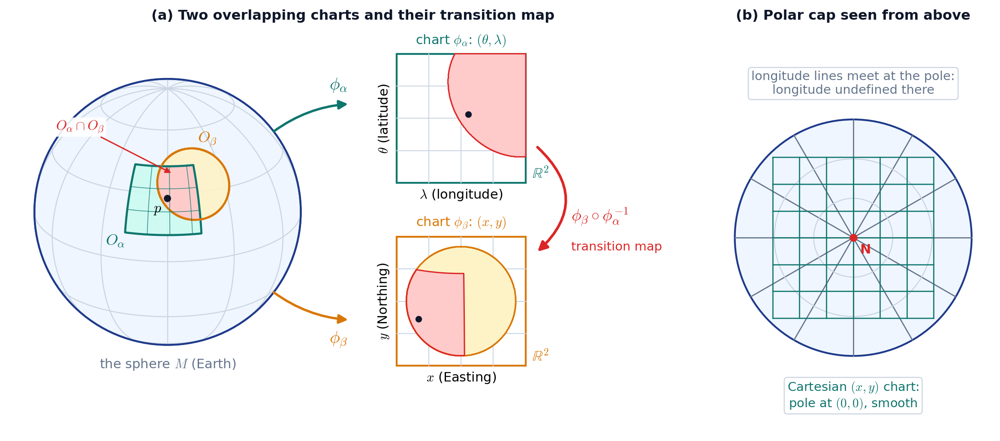

*Figure 8. Charts, their overlap and a transition map. (a) Around Everest ($p$, at $27.98^\circ$ N, $86.92^\circ$ E), surveyor $\alpha$'s latitude–longitude chart covers $O_\alpha$ (teal: latitude $12^\circ$ to $42^\circ$, longitude $68^\circ$ to $102^\circ$). Surveyor $\beta$'s Easting–Northing chart covers $O_\beta$ (amber: a round region of angular radius $16^\circ$). The charts $\phi_\alpha$ and $\phi_\beta$ send these regions to two squares in $\mathbb{R}^2$, and the overlap $O_\alpha\cap O_\beta$ (red) appears in both. The transition map $\phi_\beta\circ\phi_\alpha^{-1}$ takes the red region of the first square to the red region of the second, and sends $p$'s numbers in one chart to $p$'s numbers in the other. (b) Near the North Pole the longitude lines (grey) all meet, so longitude is undefined there. A Cartesian $(x, y)$ grid on a map centred on the pole (teal) covers the pole smoothly, putting it at $(0, 0)$.*

Smooth compatibility is important in physics. If the transition map is not smooth, then Surveyor $\beta$ may calculate a temperature gradient that suddenly spikes to infinity or becomes undefined. Surveyor $\beta$ would conclude there is an unphysical "wall of heat" or a physical singularity on the mountain. But Surveyor $\alpha$ does not see this singularity in their grid. This violates general covariance: physical reality (the temperature on the mountain) cannot have a singularity simply because of the way we drew our map grids. By demanding that $\phi_\beta \circ \phi_\alpha^{-1}$ is $C^\infty$, we mathematically guarantee that all transition derivatives are well-behaved.

Note that we may not actually need the transition to be infinitely differentiable. We may only ever go to the second derivatives of the metric (Riemann curvature tensor) or third derivatives (Bianchi identities), but by demanding that the transition maps are $C^\infty$, we guarantee that the coordinate grid is perfectly smooth at all scales. This allows us to differentiate our equations as many times as we want without ever worrying that a mathematical artifact of the coordinate system will cause a calculation to fail.

The new 2D map grid is a new chart for the Everest summit. And combining all our charts of this type, we have a new atlas. However, when two atlases transition between each other smoothly, we kind of tend to clump them together. We say if every chart in Atlas A is smoothly compatible with every chart in Atlas B, they represent the same differentiable structure. Together, all such atlases where you can transition from one to the other smoothly are called the maximal atlas. Note that smooth compatibility only applies to the specific region where the two charts overlap (the intersection $O_\alpha \cap O_\beta$). The charts do not need to cover the same points, and there will naturally be points exclusive to each chart.

As we said earlier, a topological space + an atlas = a manifold. We can now modify that to say a topological space + a maximal atlas = a smooth manifold, and the maximal atlas is called its smooth structure. Two different maximal atlases can still describe the same smooth manifold, if some map between the spaces (a diffeomorphism) carries one onto the other. Even on $\mathbb{R}$, the single chart $x \mapsto x^3$ generates a maximal atlas different from the usual one, but the map $x \mapsto x^{1/3}$ carries one onto the other. So the interesting count is smooth structures up to diffeomorphism. $\mathbb{R}^n$ has exactly one for every $n \neq 4$. $\mathbb{R}^4$, however, has uncountably many. The sphere $S^7$ has 28 (counted up to orientation-preserving diffeomorphism). These are exotic differentiable structures and are pretty much irrelevant in standard General Relativity.

---

**Aside:** It is important that charts are defined on open sets because standard differential calculus requires the ability to approach a point from any direction. Open sets mathematically guarantee this "wiggle room" around every single point in the chart. Suppose instead that a chart could be a closed set, meaning it includes its boundary edge. You wouldn't be able to approach the points on the boundary from a direction outside the boundary, because all points in that direction are outside the set.

---

## Differential Forms

In the vector calculus section, we looked at work as the dot product of force and displacement. But as we know from Lagrangian and Hamiltonian mechanics, we can arrive at the equations of motion without resorting to force vectors, just working with potential and kinetic energy, or generalized position and conjugate momentum. In conservative situations, we can think of the work done by the system/field as the negative of the change in potential energy,  $-dU$ (or the external work done on the system against the field as $+dU$). We have seen a related energy balance in thermodynamics as well, where the change in internal energy $dU$ is equal to the heat input plus the work done on the system ($dU=\delta Q+\delta W$). In these cases as well, we don't necessarily approach work as force dotted with displacement.  

### 1-Forms
A more general way of looking at the work done while moving along a curve would be to look at the potential energy itself. From multivariable calculus, we know that  

$$dU=\frac{\partial U}{\partial x}\,dx+\frac{\partial U}{\partial y}\,dy+\frac{\partial U}{\partial z}\,dz$$

This is called the total differential of the scalar function $U$ (its [exterior derivative](#the-derivative-of-a-differential-form), which we define properly later). $-dU$ represents the generalized force in the system (whose coefficients $-\frac{\partial U}{\partial x},-\frac{\partial U}{\partial y},-\frac{\partial U}{\partial z}$ are the generalized force components), and evaluating or integrating $-dU$ over a displacement or curve gives the work. We don't need any force vector or a dot product to arrive at this.

In fact, if we take $-dU$ and match it to the final equation we arrived at for the infinitesimal work along a curve,  $F_x\,dx+F_y\,dy+F_z\,dz$, we arrive at the familiar notion that a conservative force is the negative gradient of the potential energy ($\vec{F}=-\nabla U$), and the infinitesimal work is this negative gradient dotted with the infinitesimal displacement vector ($-\nabla U\cdot d\vec{r}$).  

But let's stick to the idea of the total differential for now. Remember that we integrated the above expression for infinitesimal work along a curve. If we now integrate the $-dU$ term above along an oriented curve $C$ from point $1$ to point $2$, we again get the work done by the field along the curve:  

$$\mathcal{W}=U_1-U_2=-\int_{C}\left(\frac{\partial U}{\partial x}\,dx+\frac{\partial U}{\partial y}\,dy+\frac{\partial U}{\partial z}\,dz\right)$$

Now we give the integrand (the full expression inside the integral) a name. We call it a 1-form.  It is a 1-form because each term has exactly one differential ($dx$, $dy$ or $dz$). We will see that a whole lot of things simplify if we can work directly with this 1-form (and more general $k$-forms) instead of having to deal with dot products and what not. 

Note that in writing $dU$ earlier, we needed no concept of a dot product. The connection with the dot product of force and displacement was simply an explanation given to relate this back to a more familiar but limited notion of work. Additionally, we spoke of the conservative force as the negative gradient of the potential energy. In non-conservative systems, there is no scalar potential energy $U$ (so the work 1-form $\omega=F_x\,dx+F_y\,dy+F_z\,dz$ cannot be written as $-dU$), and on general configuration spaces (without a metric if you know what that means), there is no dot product with which to dot a force vector and a displacement vector. Yet looking at work via a general 1-form $\omega$ still makes it possible for us to compute work along any curve (though for non-conservative 1-forms, the integral becomes path-dependent rather than reducing to $U_1-U_2$).  

A 1-form should look pretty familiar. It is just a linear combination of basis covectors (making a 1-form across space a covector field). Feed it a vector to get a scalar. Let's say at a point we have the 1-form $\omega=2\,dx+3\,dy$, then evaluating this on the tangent vector $\langle -1,2\rangle$ and remembering that covectors follow linearity, gives:

$$\omega(\langle -1,2\rangle)=2\cdot dx(\langle -1,2\rangle)+3\cdot dy(\langle -1,2\rangle)$$

$dx$ and $dy$ simply extract the $x$ and $y$ components of the vector, so $dx(\langle -1,2\rangle) = -1$ and $dy(\langle -1,2\rangle) = 2$. So we have:

$$\omega(\langle -1,2\rangle)= 2\cdot(-1)+3\cdot 2=4$$

So a 1-form simply takes a vector, extracts its components along the axes of the coordinate system, multiplies them by a scalar and then sums them. If we were to consider this 1-form in the example as an actual negative potential energy differential $\omega=-dU$ (or if we used $\omega=dU$ to measure the external work $\Delta U$ done against the field), and let's say $\langle -1,2\rangle$ were the displacement vector, then $\omega(\langle -1,2\rangle)=4$ would be the work done in traversing that displacement vector. 

Geometrically, a 1-form at a point can be pictured as a stack of evenly spaced parallel lines (or planes in 3D), the level lines of the linear function it defines on tangent vectors. Evaluating $\omega(\mathbf{v})$ counts the lines the arrow $\mathbf{v}$ crosses, with a sign for direction ($+$ toward higher values, $-$ toward lower values). Figure 9 shows this stack picture first for the constant 1-form $\omega = 2\,dx + 3\,dy$ and then for the position-dependent differential $dU$ of $U = x^2 + y^2$.

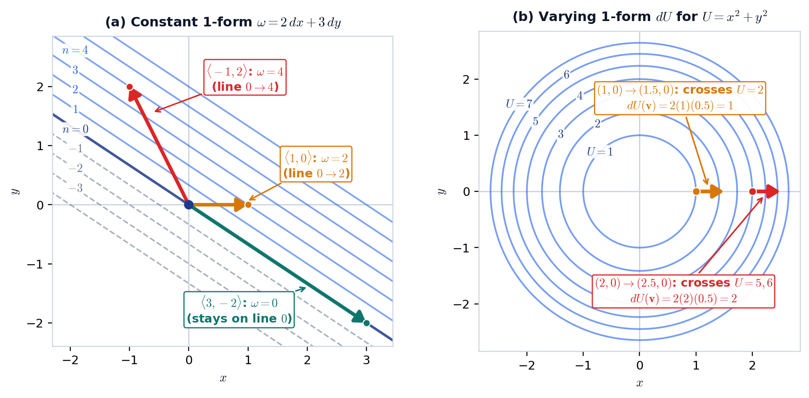

*Figure 9. Picturing a 1-form as a stack of level curves. (a) The constant 1-form $\omega = 2\,dx + 3\,dy$ drawn as the parallel integer level lines $2x + 3y = n$ ($n = -3, \dots, 4$ labelled; $n < 0$ dashed). Starting at the origin on line $0$, the arrow $\langle -1, 2\rangle$ goes from line $0$ to line $4$ ($\omega = 4$), $\langle 1, 0\rangle$ goes from line $0$ to line $2$ ($\omega = 2$), and $\langle 3, -2\rangle$ stays on line $0$ ($\omega = 0$). (b) A 1-form that changes from point to point: $dU = 2x\,dx + 2y\,dy$ for $U = x^2 + y^2$. Here the sheets of $dU$ are the level circles $U = 1, 2, \dots, 7$, which crowd closer together further out. For the same step $\mathbf{v} = \langle 0.5, 0\rangle$, going from $(2, 0)$ to $(2.5, 0)$ crosses the two circles $U = 5$ and $U = 6$, whereas going from $(1, 0)$ to $(1.5, 0)$ crosses only $U = 2$; evaluating $dU(\mathbf{v}) = 2x \cdot 0.5$ at the starting points gives $2$ at $(2, 0)$ and $1$ at $(1, 0)$.*

---

**Aside 1: Why Generalized Force Is Naturally a 1-Form on Configuration Space**

Suppose we have a mechanical system described by generalized coordinates $(q^1,q^2)=(r,\theta)$, where $r$ is a radial distance in meters and $\theta$ is an angle in radians. On this configuration manifold $Q$, a tangent vector $\vec{v}=(\dot{r},\dot{\theta})$ has components with completely different physical units ($\text{m/s}$ and $\text{rad/s}$). What would a naive coordinate "dot product" of two vectors in $(r,\theta)$-space even mean? Adding $(\Delta r)^2+(\Delta\theta)^2$ tries to add $\text{m}^2+\text{rad}^2$, which is physically nonsensical unless we introduce an extra geometric structure (the kinetic-energy metric tensor $g_{ij}$). By contrast, look at the work 1-form:

$$\omega=Q_r\,dr+Q_\theta\,d\theta=F_r\,dr+\tau_\theta\,d\theta$$

Here $F_r$ is radial force in Newtons ($\text{N}$) paired with $dr$ ($\text{m}$), and $\tau_\theta$ is torque in Newton-meters ($\text{N}\cdot\text{m}$) paired with $d\theta$ ($\text{rad}$). Both terms directly have units of Joules, with zero metric tensor or dot product needed. 
    
**Aside 2: Exact vs. Inexact 1-Forms in Thermodynamics ($dU$ vs.  $\delta Q$ and $\delta W$)**

Our thermodynamic comparison in paragraph 1 ($dU=\delta Q+\delta W$) is actually the single cleanest physical showcase of exact versus non-exact 1-forms. On the thermodynamic state space of a gas (say, with state coordinates $(P,V)$ or $(T,V)$):

Internal energy $U(P,V)$ is a state function ($0$-form), so its differential $dU$ is an exact 1-form ($d(dU)=0$, and $\oint_C dU=0$ around every closed cycle).

Reversible mechanical work $\delta W=-P\,dV$ and heat input $\delta Q$ are genuine 1-forms on state space, which is why we can integrate them along any quasi-static process curve $C$, yet they are not exact differentials of any state function:

$$d(\delta W)=d(-P\,dV)=-dP\wedge dV\neq 0$$
        
That is the mathematical reason why thermodynamics uses $\delta W$ and $\delta Q$ instead of $dW$ and $dQ$:  $\delta$ denotes a general (inexact) 1-form, whereas $d$ is reserved for exact 1-forms (exterior derivatives of $0$-forms). And around a closed heat-engine cycle $\partial D$ in the $(P,V)$-plane, [Generalized Stokes' Theorem](#stokes-theorem-but-more-profound) gives the net work extracted as:
        
$$\mathcal{W}_{\text{cycle}}=\oint_{\partial D}P\,dV=\iint_D dP\wedge dV$$

Mind the orientation. Stokes' theorem orients $D$ by $dP\wedge dV$. On the usual diagram, with $V$ across and $P$ up, that orientation runs clockwise, which is the way a heat engine runs, so the work comes out positive.

Figure 10 shows both points: two paths between the same states that need different amounts of work, and the clockwise cycle.

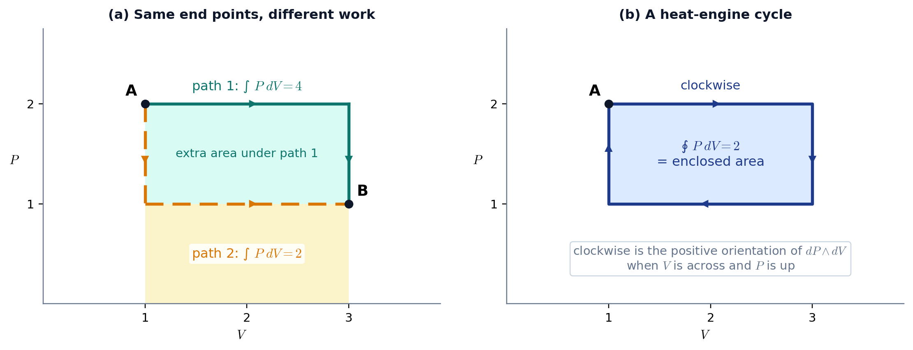

*Figure 10. Work as a 1-form on the $(V, P)$ plane. (a) Two quasi-static paths from $A = (1, 2)$ to $B = (3, 1)$. Path 1 (teal) expands at $P = 2$ and then lowers the pressure, giving $\int P\,dV = 4$. Path 2 (amber, dashed) lowers the pressure first and then expands at $P = 1$, giving $\int P\,dV = 2$. The same end points give different work, so $\delta W = -P\,dV$ is not the differential of any state function. (b) The rectangle cycle $A = (1, 2) \to (3, 2) \to (3, 1) \to (1, 1) \to A$, run clockwise, gives $\oint P\,dV = 2$, the enclosed area. With $V$ across and $P$ up, clockwise is the positive orientation of $dP\wedge dV$, so Stokes' theorem gives $\oint_{\partial D} P\,dV = \iint_D dP\wedge dV = +2$.*

---

### Integrating 1-Forms

We can now look at the same thing we did in the vector calculus section. What if we want to find the work along a curve? We would take the 1-form (which may actually be a function of the coordinates i.e. it varies from point to point), evaluate at a single point to get infinitesimal work on a tangent vector, and integrate along the curve. This is where differential forms really start to shine.

Let's briefly recall how we do single-variable integration. Given a function $f(x)$ to integrate over $[x_1,x_2]$, we divide the interval along the $x$-axis into tiny bins, let's say $n$ bins of equal width $\Delta x=\frac{x_2-x_1}{n}$, then we approximate $f(x)$ within each bin by its value at a sample point $x_i^*$ within that interval, multiply that by the bin width, and then sum over all $n$ intervals. The integral can be obtained by taking the limit as $n\to\infty$:

$$\int_{x_1}^{x_2}f(x)\,dx=\lim_{n\to\infty}\sum_{i=1}^{n}f(x_i^*)\left(\frac{x_2-x_1}{n}\right)$$

This is the usual 1D integral $\int_{x_1}^{x_2}f(x)\,dx$, where our domain of integration is along the flat $x$-axis from $x_1$ to $x_2$. Every infinitesimal step is purely horizontal ($\Delta x$).

But what if our spatial steps are not of equal length or do not lie along a flat axis? For example, maybe we want to integrate a 1-form over a curve $C$, as we saw in the above examples for work, where the 1-form became the integrand itself. Now integration directly via sums over some arbitrary curved domain can be pretty messy. Even on a flat interval, working out an integral directly from the summation definition above (called a Riemann sum) is difficult without the Fundamental Theorem of Calculus. For example, how would we compute $\int_0^1 x^2\,dx$ directly via a Riemann sum?

Divide $[0,1]$ into $n$ equal subintervals of width $\Delta x=\frac{1}{n}$ with right endpoints $x_i^*=\frac{i}{n}$. Set up the sum:

$$S_n=\sum_{i=1}^{n}\left(\frac{i}{n}\right)^2\left(\frac{1}{n}\right)=\frac{1}{n^3}\sum_{i=1}^{n}i^2$$

Here, we are lucky to be able to substitute the closed-form algebraic identity for the sum of the first $n$ squares,  $\sum_{i=1}^{n}i^2=\frac{n(n+1)(2n+1)}{6}$:

$$S_n=\frac{n(n+1)(2n+1)}{6n^3}=\frac{2n^3+3n^2+n}{6n^3}$$

Then we take the limit as $n\to\infty$:

$$\lim_{n\to\infty}\left(\frac{1}{3}+\frac{1}{2n}+\frac{1}{6n^2}\right)=\frac{1}{3}$$

Even for a simple polynomial like $x^2$, we need a special summation identity to collapse the sum before taking the limit (whereas the Fundamental Theorem of Calculus gives $\left[\frac{1}{3}x^3\right]_0^1=\frac{1}{3}$ immediately via antiderivatives). For slightly more involved integrands, especially along a curved path where spatial step sizes vary, there is often no closed-form summation identity at all.

Now let's integrate a 1-form, say $f(x,y)\,dx$, over some curve $M$ defined by the parametrization of a semicircle, $\varphi:[-1,1]\to M$, $\varphi(a)=(\varphi_1(a),\varphi_2(a))=(a,\sqrt{1-a^2})$, where $-1\le a\le 1$.

Now we need to find the new pulled-back 1-form $g(a)\,da$ that will give us the same sum as $f(x,y)\,dx$ over the curve, when we create equal bins over the parametrization variable $a$ and sum over the whole domain $[-1,1]$. Let's call its unknown coefficient function $g(a)$.

The curve $M$ under the map is approximated by a sequence of straight-line segments. As an example, if we are evaluating the interval $a\in[-1,1]$ over four equidistant subintervals, we get four straight-line segments $\Delta\vec{\varphi}_i=\varphi(a_{i+1})-\varphi(a_i)$ on the semicircle as well, but they will not be of equal lengths or slopes.

When we evaluate the 1-form $f(x,y)\,dx$ on the $i$-th segment, $dx$ extracts the horizontal displacement $\Delta x_i=\varphi_1(a_{i+1})-\varphi_1(a_i)$:

$$\sum_i g(a_i)\,\Delta a=\sum_i f(\varphi(a_i))\,\Delta x_i$$

Here $\Delta x_i=\varphi_1(a_{i+1})-\varphi_1(a_i)$ is the signed horizontal projection of the linear approximation of the curve at the $i$-th subinterval.

So we have $g(a_i)\,\Delta a=f(\varphi(a_i))\,\Delta x_i$, and therefore $g(a_i)=\frac{f(\varphi(a_i))\,\Delta x_i}{\Delta a}$.

When we set $\Delta a\to 0$, what do we get? Using $\Delta x_i=\varphi_1(a_{i+1})-\varphi_1(a_i)$ (without absolute value bars, because a 1-form is sensitive to orientation):

$$\lim_{\Delta a\to 0}g(a_i)=\lim_{\Delta a\to 0}\frac{f(\varphi(a_i))\,\Delta x_i}{\Delta a}=\lim_{\Delta a\to 0}f(\varphi(a_i))\frac{\varphi_1(a_{i+1})-\varphi_1(a_i)}{\Delta a}=f(\varphi(a_i))\lim_{\Delta a\to 0}\frac{\varphi_1(a_{i+1})-\varphi_1(a_i)}{\Delta a}$$

Here $\lim_{\Delta a\to 0}\frac{\varphi_1(a_{i+1})-\varphi_1(a_i)}{\Delta a}$ is simply the derivative of $\varphi_1$ at $a_i$, namely $\varphi_1'(a_i)$.

Thus, to correct for the parametrization and change of variables in $f(x,y)\,dx$, we must accommodate the change in projected bin sizes by introducing the signed scaling factor $\varphi_1'(a)$, giving $g(a)\,da=f(\varphi(a))\,\varphi_1'(a)\,da$. 

Note that by contrast, if we were integrating a scalar function $f(x,y)$ with respect to arc length $ds$ using the unsigned chord lengths $L_i=\Vert{}\varphi(a_{i+1})-\varphi(a_i)\Vert{}$, the scaling factor would be the speed $\Vert{}\varphi'(a)\Vert{}$, or $\vert{}\varphi_1'(a)\vert{}$ for a 1D interval.

Our semicircle $\varphi(a)=(a,\sqrt{1-a^2})$ for $a\in[-1,1]$ illustrates why integrating 1-forms is often much cleaner than integrating scalar functions with respect to arc length:

Arc-length integral of a scalar function $\int_M f(x,y)\,ds$:

Here $\varphi'(a)=\left\langle 1,\frac{-a}{\sqrt{1-a^2}}\right\rangle$, so the chord-length scaling factor is the speed:

$$\Vert{}\varphi'(a)\Vert{}=\sqrt{1+\frac{a^2}{1-a^2}}=\frac{1}{\sqrt{1-a^2}}$$

Even for $f(x,y)=1$, we get an improper square-root integral $\int_{-1}^1\frac{1}{\sqrt{1-a^2}}\,da=\pi$ (the length of the unit semicircle).

By contrast, integrating the 1-form $\omega_1=f(x,y)\,dx$:

Because $\varphi_1(a)=a$, the scaling factor is simply $\varphi_1'(a)=1$ everywhere, even though the curve bends and its chord lengths $L_i$ stretch near $a=\pm 1$. All the vertical stretching in $\varphi_2(a)=\sqrt{1-a^2}$ is invisible to $dx$:

$$\int_M f(x,y)\,dx=\int_{-1}^1 f\big(a,\sqrt{1-a^2}\big)\cdot 1\,da$$

Integrating a general 1-form $\omega=f(x,y)\,dx+h(x,y)\,dy$:

By linearity, $dx$ picks up $\varphi_1'(a)$ and $dy$ picks up $\varphi_2'(a)=\frac{-a}{\sqrt{1-a^2}}$:

$$\int_M\big(f(x,y)\,dx+h(x,y)\,dy\big)=\int_{-1}^1\left[f\big(a,\sqrt{1-a^2}\big)\cdot 1+h\big(a,\sqrt{1-a^2}\big)\left(\frac{-a}{\sqrt{1-a^2}}\right)\right]da$$

Notice that $\varphi_2'(a)$ blows up at the endpoints $a=\pm 1$ because the semicircle becomes vertical at $(\pm 1,0)$ (making graph parametrization in $a=x$ singular at the vertical tangents). Switching to the angular parametrization $\tilde{\varphi}(\theta)=(\cos\theta,\sin\theta)$ for $\theta$ running from $\pi$ down to $0$ (moving from $(-1,0)$ to $(1,0)$) has smooth derivatives everywhere ($\tilde{\varphi}_1'(\theta)=-\sin\theta$, $\tilde{\varphi}_2'(\theta)=\cos\theta$) and yields the exact same value.

Figure 11 shows how four equal parameter bins divide the semicircle under $\varphi(a)$ and under $\tilde{\varphi}(\theta)$, comparing the chord lengths with their horizontal and vertical shadows.

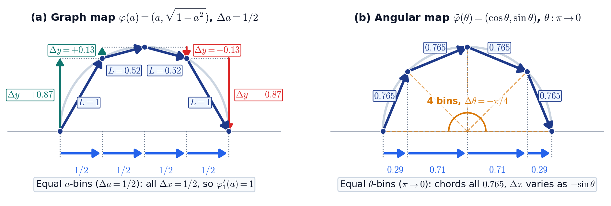

*Figure 11. One-dimensional pull-back on the upper unit semicircle traversed from $(-1, 0)$ to $(1, 0)$. (a) Four equal bins of width $\Delta a = 1/2$ under $\varphi(a) = (a, \sqrt{1 - a^2})$ produce chords of lengths $1, 0.52, 0.52, 1$ (what arc length $ds$ sees) and vertical shadows $\Delta y = +0.87, +0.13, -0.13, -0.87$ that grow steeply near $a = \pm 1$ where $\varphi_2'(a)$ blows up. Yet every chord has the same horizontal shadow $\Delta x = 1/2$, because $dx$ sees only horizontal steps and $\varphi_1'(a) = 1$. (b) Four equal angle bins $\Delta\theta = -\pi/4$ from $\pi$ to $0$ under $\tilde{\varphi}(\theta) = (\cos\theta, \sin\theta)$ give equal chords of length $0.765$, while the horizontal shadows vary across the four bins as $0.29, 0.71, 0.71, 0.29$ because the pull-back factor $\tilde{\varphi}_1'(\theta) = -\sin\theta$ changes from bin to bin.*

---

**Aside:** The factor of $\varphi_1'$ (or more generally $\varphi_i'$ for each coordinate $x^i$) that we are tacking onto the integral when we introduce the parametrization variable is nothing but the signed Jacobian factor that is used in change of variables. For an elementary 1-form $f\,dx^i$, it is simply the derivative of that old coordinate variable with respect to the new parametrization variable. For $k$-forms in $\mathbb{R}^n$, for each basis $k$-form $dx^{i_1}\wedge\dots\wedge dx^{i_k}$, this becomes the corresponding signed $k\times k$ Jacobian determinant (minor) with the various partial derivatives $\frac{\partial x^{i_p}}{\partial u^q}$ as the elements of the determinant (which reduces to the single full Jacobian determinant when $k=n$).

The presence or absence of absolute value bars around the Jacobian factor separates two fundamentally different geometric objects in physics. 

Scalar densities (like mass density $\rho\,ds$, charge density $\lambda\,ds$, or Riemannian volume $\sqrt{\vert{}g\vert{}}\,d^nx$) transform with the absolute value of the Jacobian ($\vert{}\varphi'(a)\vert{}$ or $\vert{}\det(D\varphi)\vert{}$). Reversing our coordinate axis or traversal direction from $[-1,1]$ to $[1,-1]$ must keep the total mass or arc length of the semicircle positive.

Differential forms (like work $\omega=F_x\,dx+F_y\,dy$ or magnetic circulation) transform with the signed Jacobian ($\varphi_1'(a)$ or $\det(D\varphi)$). Traversing the semicircle from left to right ($a:-1\to 1$) versus right to left ($a:1\to -1$) must negate the work done by the field, and it is this exact sign flip without absolute value bars that allows shared interior boundaries to cancel out in Stokes' Theorem.

---
### 2-Forms

Now instead of working with curves, we may want to integrate over surfaces or more generally over k-dimensional surfaces. You can only integrate a $k$-form over a $k$-dimensional domain. A 1-form can only be integrated over a 1D curve, and only a 2-form can be integrated over a 2D surface (like a hemisphere).

Why does integrating a 1-form over a surface fail? Chopping a 2D surface $M$ into tiny patches via a parameterization $\phi(u,v)$ produces tangent parallelograms spanned by two vectors,  $\frac{\partial\phi}{\partial u}\Delta u$ and $\frac{\partial\phi}{\partial v}\Delta v$. A 1-form $\omega_p(\cdot)$ is a function with only one vector input slot, so there is no defined way to feed it a pair of vectors.
    
Even with the Riemann sum, partitioning a 2D parameter region into an $N\times N$ grid creates $N^2$ patches with edge lengths $\Delta u,\Delta v\sim\frac{1}{N}$. A 2-form scales bilinearly as $\Delta u\,\Delta v\sim\frac{1}{N^2}$, so summing $N^2$ terms converges to a finite number. A 1-form scales linearly as $\frac{1}{N}$; summing $N^2$ terms of size $\frac{1}{N}$ diverges like $N\to\infty$.

So what is a 2-form? From the above discussion we understand that it must take 2 vectors and produce a scalar. It has to be linear so we can combine the basic 2-forms into larger sums.

To start with, we will write a 2-form as the wedge product of two 1-forms. We'll define wedge products shortly. We will then look at a few general properties of 2-forms and see that every 2-form can be written as the sum of products of two 1-forms. 

The wedge product $dx \wedge dy$ eats two ordered tangent vectors and outputs the area of the parallelogram they span, with a sign. When the two tangent vectors align with the axis, this is the same as the normal product $dxdy$. Otherwise, they are very different. They look identical on an axis-aligned grid only because the extra geometric information baked into $dx \wedge dy$ happens to vanish on horizontal and vertical rectangles. 

As we saw, in differential forms, $dx$ and $dy$ are not tiny lengths; they are linear functionals (1-forms) that take a tangent vector $\mathbf{u}=(u_x,u_y)$ and extract its components:

$$dx(\mathbf{u})=u_x, \qquad dy(\mathbf{u})=u_y$$

If you form a literal "plain product" of these two 1-forms (the tensor product $dx \otimes dy$), it takes an ordered pair of vectors $(\mathbf{u},\mathbf{v})$ and simply multiplies $u_x$ by $v_y$:

$$(dx \otimes dy)(\mathbf{u},\mathbf{v})=dx(\mathbf{u})\,dy(\mathbf{v})=u_x v_y$$

Compare what happens on two different shapes:

**Axis-aligned rectangle:** Set $\mathbf{u}=(a,0)$ and $\mathbf{v}=(0,b)$. Then $(dx \otimes dy)(\mathbf{u},\mathbf{v})=ab$, which equals the area.
    
**Tilted parallelogram:** Set $\mathbf{u}=(u_x,u_y)$ and $\mathbf{v}=(v_x,v_y)$. Now $u_x v_y$ is _not_ the area of the parallelogram; it is only the area of a rectangle built from $\mathbf{u}$'s shadow on the $x$-axis and $\mathbf{v}$'s shadow on the $y$-axis. If you collapse the parallelogram into a line by setting $\mathbf{u}=\mathbf{v}=(1,1)$, the area is $0$, yet $u_x v_y=1$.

To measure the signed area of a general parallelogram spanned by $\mathbf{u}$ and $\mathbf{v}$ in the $xy$-plane (or the signed area of its projection onto the $xy$-plane in higher dimensions), we must subtract the cross-term $u_y v_x$:

$$dx(\mathbf{u})\,dy(\mathbf{v})-dy(\mathbf{u})\,dx(\mathbf{v})=u_x v_y-u_y v_x=\det\begin{pmatrix}u_x & v_x \\ u_y & v_y\end{pmatrix}$$

This is precisely the definition of the wedge product of two 1-forms evaluated on $(\mathbf{u},\mathbf{v})$: $(dx\wedge dy)(\mathbf{u},\mathbf{v})$. The subtraction is the geometric meaning of the wedge $\wedge$. It turns a naive product of coordinate projections into a determinant.

Think of the formula for the area of a triangle (which is half a parallelogram). Assuming one vertex is at the origin, we take the product of the $y$-component of one of the other points (say $\mathbf{p}$) with the $x$-component of the third remaining point (say $\mathbf{q}$) and subtract that from the product of the $x$-component of $\mathbf{p}$ and the $y$-component of $\mathbf{q}$. Then we divide by $2$ (multiply by one-half) because it is a triangle. Essentially, before dividing by $2$, we form two rectangles and subtract their areas; this is $(dx\wedge dy)(\mathbf{p},\mathbf{q})$, the 2-form $dx\wedge dy$ evaluated on the two side vectors. 

Figure 12 shows why the plain product $u_x v_y$ overcounts the parallelogram spanned by $\mathbf{u} = (3, 1)$ and $\mathbf{v} = (1, 2)$, and how subtracting the corner pieces of the $4 \times 3$ bounding box leaves $u_x v_y - u_y v_x = 5$.

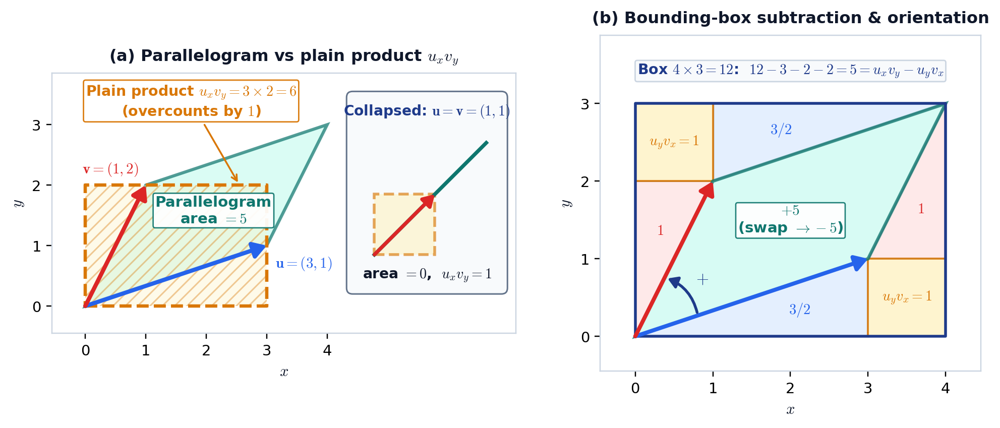

*Figure 12. Signed parallelogram area $(dx\wedge dy)(\mathbf{u}, \mathbf{v}) = u_x v_y - u_y v_x$ for $\mathbf{u} = (3, 1)$ and $\mathbf{v} = (1, 2)$. (a) The parallelogram spanned by $\mathbf{u}$ and $\mathbf{v}$ has area $5$, whereas the dashed plain-product rectangle $u_x \times v_y = 3 \times 2 = 6$ overcounts by $1$. In the inset $\mathbf{u} = \mathbf{v} = (1, 1)$, the parallelogram collapses to a line segment of area $0$ while $u_x v_y = 1$. (b) Enclosing the parallelogram in a $4 \times 3 = 12$ bounding box and removing two right triangles of area $3/2$, two right triangles of area $1$, and two corner rectangles of area $u_y v_x = 1$ leaves $12 - 3 - 2 - 2 = 5 = u_x v_y - u_y v_x$. Turning counterclockwise from $\mathbf{u}$ to $\mathbf{v}$ gives $+5$; swapping $\mathbf{u}$ and $\mathbf{v}$ reverses the orientation and gives $-5$.*

Notice that depending on what is subtracted from what, we can end up with a plus or minus sign for the area. Generally, for ordinary geometric area we take the absolute value. But with $k$-forms, we retain the sign as it provides us with an orientation, which is important when calculating things like work along a curve or flux through a surface.

Swapping the input vectors flips the sign: $(dx\wedge dy)(\mathbf{v},\mathbf{u})=-(dx\wedge dy)(\mathbf{u},\mathbf{v})$, which also happens when swapping the 1-forms in the wedge product, $dx\wedge dy=-dy\wedge dx$. A form $\omega$ that undergoes a sign flip when we swap the order of any two adjacent input vectors ($\omega(\mathbf{v},\mathbf{u})=-\omega(\mathbf{u},\mathbf{v})$) is called an alternating form. 

Furthermore, if we decompose an input vector into a linear combination of vectors (or scale one of the sides of our parallelogram), the signed area distributes linearly over that input while holding the other input vectors fixed. This means the form must be linear in each input slot separately, making it a multilinear form (bilinear in the case of 2-forms). Note also that when simplifying a general 2-form such as $A\,dx\wedge dy+B\,dx\wedge dz$, we can combine scalar coefficients of like basis planes (such as $dx\wedge dy$ with other $dx\wedge dy$ terms), while linearly independent basis 2-forms like $dx\wedge dy$ and $dx\wedge dz$ remain separate components whose scalar outputs only add together after we plug in a pair of vectors $(\mathbf{u},\mathbf{v})$.

#### Properties of $2$-forms
The sign flip also implies that $dx\wedge dx=0$. A few other properties of the wedge product and of multilinear alternating $k$-forms also follow from this definition:

Scalar homogeneity (pulling out constants or functions): $(c\,dx)\wedge dy=dx\wedge(c\,dy)=c\,(dx\wedge dy)$

Distributivity over addition of forms: $(\alpha+\beta)\wedge\gamma=\alpha\wedge\gamma+\beta\wedge\gamma$

Associativity of the wedge product: $(\alpha\wedge\beta)\wedge\gamma=\alpha\wedge(\beta\wedge\gamma)$

Graded anticommutativity (for a $p$-form $\alpha$ and a $q$-form $\beta$):

$\alpha\wedge\beta=(-1)^{pq}(\beta\wedge\alpha)$

Multilinearity in each vector slot separately: $\omega(a\mathbf{u}_1+b\mathbf{u}_2,\mathbf{v})=a\,\omega(\mathbf{u}_1,\mathbf{v})+b\,\omega(\mathbf{u}_2,\mathbf{v})$

Vanishing on linearly dependent vectors (and above the ambient dimension): If $\mathbf{v}_1,\dots,\mathbf{v}_k$ are linearly dependent, then $\omega(\mathbf{v}_1,\dots,\mathbf{v}_k)=0$. Consequently, on $\mathbb{R}^n$, every $k$-form with $k>n$ is identically $0$.

Shear invariance: Adding a scalar multiple of one input vector to another leaves the output unchanged: $\omega(\mathbf{u}+c\mathbf{v},\mathbf{v})=\omega(\mathbf{u},\mathbf{v})+c\,\omega(\mathbf{v},\mathbf{v})=\omega(\mathbf{u},\mathbf{v})$ (think of cosets in group theory! $\omega(\cdot,\mathbf{v})$ takes the same value all along the line $\mathbf{u} + c\mathbf{v}$, which is a coset of the subspace spanned by $\mathbf{v}$. Geometrically, sliding the top edge of the parallelogram along itself is a shear, and a shear leaves the area unchanged.)

#### Geometric Visualization of 2-forms

Notice that when $\mathbf{u}=\frac{\partial\varphi}{\partial s}$ and $\mathbf{v}=\frac{\partial\varphi}{\partial t}$, the partial derivative tangent vectors of a coordinate map $\varphi(s,t)=(x(s,t),y(s,t))$, the determinant above is precisely the Jacobian determinant. Thus, when applying a change of variables in an integral, pulling back the $k$-form via the wedge product generates the signed Jacobian determinant automatically through wedge algebra, rather than requiring us to tack on an external $\vert{}\det(D\varphi)\vert{}$ factor by hand as in ordinary multivariable integration with plain $dx_1 dx_2\dots dx_k$.

For example, for a map $\varphi(u,v)=(x(u,v),y(u,v))$, pulling back $dx\wedge dy$ gives:

$$\varphi^*(dx\wedge dy)=\left(\frac{\partial x}{\partial u}\,du+\frac{\partial x}{\partial v}\,dv\right)\wedge\left(\frac{\partial y}{\partial u}\,du+\frac{\partial y}{\partial v}\,dv\right)$$

Expanding the four terms, the $du\wedge du$ and $dv\wedge dv$ terms vanish, and flipping $dv\wedge du=-du\wedge dv$ leaves:

$$\varphi^*(dx\wedge dy)=\left(\frac{\partial x}{\partial u}\frac{\partial y}{\partial v}-\frac{\partial x}{\partial v}\frac{\partial y}{\partial u}\right)du\wedge dv=\det\begin{pmatrix}\frac{\partial x}{\partial u}&\frac{\partial x}{\partial v}\\\frac{\partial y}{\partial u}&\frac{\partial y}{\partial v}\end{pmatrix}du\wedge dv$$

This generalizes directly to any $k$-form: expanding the wedge product of $k$ pulled-back 1-forms produces the Leibniz permutation sum defining a $k\times k$ determinant.

Let's look at the $2\times 2$ minors in action on a 2D surface in $\mathbb{R}^3$ ($k=2,n=3$). Suppose we integrate a general 2-form $\omega=P\,dy\wedge dz+Q\,dz\wedge dx+R\,dx\wedge dy$ over a parametrized surface $\varphi(u,v)=(x(u,v),y(u,v),z(u,v))$ in $\mathbb{R}^3$. 

Here the full Jacobian matrix $D\varphi$ has 3 rows and 2 columns, and pulling back each basis 2-form extracts one of its three $2\times 2$ minors:

$$\varphi^*\omega=\left[P\,\frac{\partial(y,z)}{\partial(u,v)}+Q\,\frac{\partial(z,x)}{\partial(u,v)}+R\,\frac{\partial(x,y)}{\partial(u,v)}\right]du\wedge dv$$

Notice that those three $2\times 2$ Jacobian determinants are the exact $x,y,z$ components of the surface normal vector $\frac{\partial\vec{\varphi}}{\partial u}\times\frac{\partial\vec{\varphi}}{\partial v}$ from classical vector calculus flux integrals ($\iint_S\vec{F}\cdot\left(\frac{\partial\vec{\varphi}}{\partial u}\times\frac{\partial\vec{\varphi}}{\partial v}\right)du\,dv$), arising naturally as coordinate projections onto the $yz$-,  $zx$-, and $xy$-planes without needing a 3D cross product or dot product.

Figure 13 shows how a small parameter cell $(r, t)$ maps onto the hemisphere $\varphi(r, t) = (r\cos t, r\sin t, \sqrt{1 - r^2})$, why a 2-form evaluates on the tangent arrows $\frac{\partial\varphi}{\partial r}\Delta r$ and $\frac{\partial\varphi}{\partial t}\Delta t$, and how their $xy$-shadow gives $\varphi^*(dx\wedge dy) = r\,dr\wedge dt$.

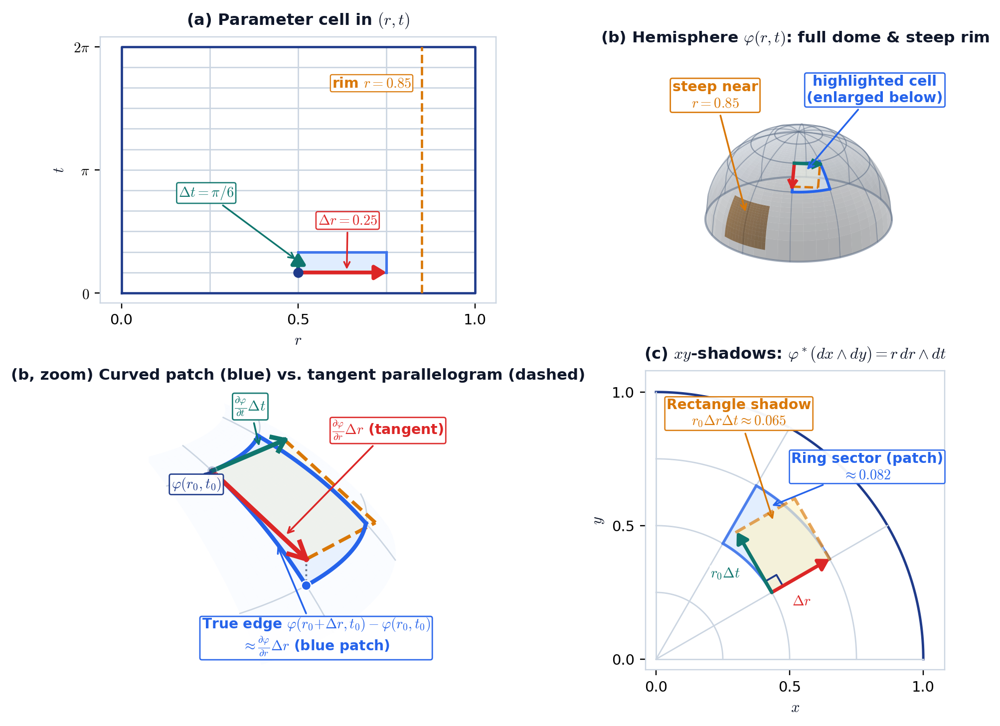

*Figure 13. Two-dimensional pull-back on the upper unit hemisphere $\varphi(r, t) = (r\cos t, r\sin t, \sqrt{1 - r^2})$ for $r \in [0, 1]$ and $t \in [0, 2\pi]$. (a) Parameter grid in $(r, t)$ with highlighted cell $[0.50, 0.75] \times [\pi/6, \pi/3]$ ($\Delta r = 0.25$, $\Delta t = \pi/6$) and a dashed line near the rim at $r = 0.85$. (b) On the hemisphere (shown whole and in an enlarged close-up of the cell), small parameter steps $\Delta r$ and $\Delta t$ from $\varphi(r_0, t_0)$ turn into the tangent arrows $\frac{\partial\varphi}{\partial r}\Delta r$ and $\frac{\partial\varphi}{\partial t}\Delta t$ by the chain rule: for instance, the true radial edge step $\varphi(r_0 + \Delta r, t_0) - \varphi(r_0, t_0)$ (length $0.323$) is approximated by $\frac{\partial\varphi}{\partial r}\Delta r$ (length $0.289$), and the gap shrinks as $\Delta r \to 0$. Those two tangent arrows span a semi-transparent, dashed-outline tangent parallelogram that hugs the blue-edged curved patch, and a 2-form on the surface eats these two arrows. Near the rim ($r = 0.85$), the surface steepens so its 3D area factor $\frac{r}{\sqrt{1 - r^2}}$ grows from $0.58$ (at $r = 0.50$) to $1.61$, whereas its $xy$-shadow factor is just $r$. (c) On the $xy$-plane, the tangent parallelogram's shadow is a rectangle with perpendicular sides $\Delta r$ (radial) and $r_0\Delta t$ (tangential), of area $r_0\,\Delta r\,\Delta t = (dx\wedge dy)\!\left(\frac{\partial\varphi}{\partial r}, \frac{\partial\varphi}{\partial t}\right)\Delta r\,\Delta t = \frac{\pi}{48} \approx 0.065$. Next to it, the curved patch's shadow is the blue ring sector of area $\frac{(r_0 + \Delta r)^2 - r_0^2}{2}\,\Delta t = \frac{5\pi}{192} \approx 0.082$, which agrees to first order as $\Delta r, \Delta t \to 0$. Thus $\varphi^*(dx\wedge dy) = r\,dr\wedge dt$ is the shadow area per unit parameter area (the other two minors are $\frac{r^2\cos t}{\sqrt{1 - r^2}}$ for $dy\wedge dz$ and $\frac{r^2\sin t}{\sqrt{1 - r^2}}$ for $dz\wedge dx$).*

Thus, when evaluated on two vectors, a 2-form simply computes a weighted sum of the signed areas of the projections of the parallelogram they span onto the 2-dimensional coordinate planes in the ambient space, where each projection is multiplied by its corresponding scalar coefficient function. That's a mouthful! What we are saying is, let's say we have a general 2-form over $\mathbb{R}^3$: $\omega=F_x\,dy\wedge dz+F_y\,dz\wedge dx+F_z\,dx\wedge dy$. Now if we feed two tangent vectors $\mathbf{u}$ and $\mathbf{v}$ at a point into it, they span a parallelogram in the ambient 3D space. The basis ("component") 2-forms $dy\wedge dz$, $dz\wedge dx$, and $dx\wedge dy$ measure the signed areas $A_{yz}$, $A_{zx}$, and $A_{xy}$ of this parallelogram as it is projected onto the corresponding coordinate planes. The true unoriented geometric area $A$ of the tilted 3D parallelogram satisfies a planar Pythagorean theorem (the Cauchy-Binet identity):

$$A^2=A_{yz}^2+A_{zx}^2+A_{xy}^2$$

(the 2D analogy of the length of a line segment, $L^2=\Delta x^2+\Delta y^2+\Delta z^2$). Meanwhile, the general 2-form $\omega=F_x\,dy\wedge dz+F_y\,dz\wedge dx+F_z\,dx\wedge dy$ takes the linear combination $F_x A_{yz}+F_y A_{zx}+F_z A_{xy}$, which computes the flux of $\vec{F}$ through the parallelogram by summing the fluxes across its three coordinate-plane shadows. This is called Cauchy's tetrahedron principle, which we explain a bit more now. 

Why must the flux of $\vec{F}$ through a tilted triangle equal the sum of the fluxes through its three coordinate-plane shadows ($F_x A_{yz}+F_y A_{zx}+F_z A_{xy}$)? Slice off a tiny corner tetrahedron of characteristic size $\epsilon$ whose slanted face is our tilted triangle and whose other three orthogonal faces are its shadows on the $yz$-,  $zx$-, and $xy$-planes. By the Divergence Theorem, the net flux leaving all four faces equals $\iiint(\nabla\cdot\vec{F})\,dV$. As we shrink $\epsilon\to 0$, the volume integral of $\nabla\cdot\vec{F}$ scales like $\epsilon^3$, whereas the surface fluxes through the four faces scale like $\epsilon^2$. Dividing by $\epsilon^2$ and taking $\epsilon\to 0$, the $\mathcal{O}(\epsilon)$ volume term vanishes completely. This means that at an infinitesimal scale, whatever fluid or flux enters through the three coordinate-plane shadow faces must exit cleanly through the tilted face without loss or accumulation.

Figure 14 shows how the shadows of a curved octant and a flat triangle on the three coordinate planes combine with $(F_x, F_y, F_z)$ to give the outward flux.

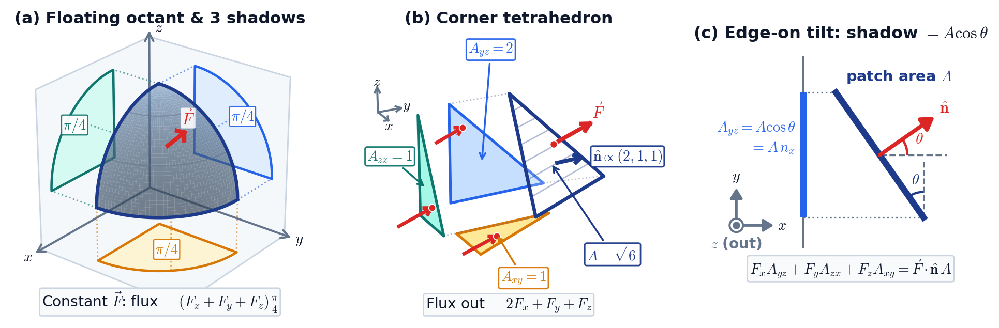

*Figure 14. Coordinate-plane shadows and flux in $\mathbb{R}^3$. (a) The eighth of a unit-radius sphere centred at $(0.6, 0.6, 0.6)$ ($x, y, z \ge 0.6$), floating inside the first-octant room corner, casts quarter-disc shadows of area $\pi/4$ each on the $yz$-wall ($x = 0$), $zx$-wall ($y = 0$), and $xy$-floor ($z = 0$). For a constant field $\vec{F}$, the outward flux through this curved shell is $(F_x + F_y + F_z)\,\frac{\pi}{4}$, which equals $\frac{3\pi}{4} \approx 2.36$ when $\vec{F} = (1, 1, 1)$. Summing the whole shadow areas directly gives the flux only when $\vec{F}$ is constant; for a varying field, the 2-form weights the three shadows of each small patch by $(F_x, F_y, F_z)$ at that patch. (b) Corner tetrahedron with vertices at the origin, $(1, 0, 0)$, $(0, 2, 0)$, and $(0, 0, 2)$ (exploded slightly so all four faces are visible): its right-angled shadow faces have areas $A_{yz} = 2$, $A_{zx} = 1$, and $A_{xy} = 1$, and its hatched slanted face has outward normal $\hat{\mathbf{n}} \propto (2, 1, 1)$ and area $A = \sqrt{2^2 + 1^2 + 1^2} = \sqrt{6} \approx 2.45$. A constant $\vec{F}$ enters through the three shadow faces and leaves through the slanted face with flux $2F_x + F_y + F_z$. (c) Edge-on view down the $z$-axis ($x$ right, $y$ up, $z$ out of the page) of a flat rectangular patch of area $A$ whose unit normal $\hat{\mathbf{n}}$ makes angle $\theta$ with the $x$-axis ($\theta = 35^\circ$ shown): its shadow on the $yz$-plane is $A_{yz} = A\cos\theta = A\,n_x$, which is why $F_x A_{yz} + F_y A_{zx} + F_z A_{xy} = \vec{F}\cdot\hat{\mathbf{n}}\,A$.*

From this geometric visualization, we can see that if we are in $\mathbb{R}^3$, we will have $\binom{3}{2}=3$ 2-dimensional coordinate planes. If we are in an $n$-dimensional ambient space $\mathbb{R}^n$, we will have $\binom{n}{2}=\frac{n(n-1)}{2}$ 2-dimensional coordinate planes, each formed by taking any two of the coordinate axes. When looking at a change of variables (or a surface parametrization $\varphi(u,v)$), each of these $\binom{n}{2}$ basis 2-forms produces its own $2\times 2$ Jacobian determinant, which corresponds to a signed projected area scaling factor and contributes to its respective flux component with its proper sign. This count generalizes immediately to any $k$-form on $\mathbb{R}^n$: choosing $k$ distinct coordinate axes out of $n$ gives $\binom{n}{k}=\frac{n!}{k!(n-k)!}$ independent $k$-dimensional coordinate planes, so the space of $k$-forms at a point has dimension $\binom{n}{k}$.

In particular, every 2-form is a sum of wedge products of 1-forms, as promised at the start of this section. A 2-form is fixed by its values on pairs of basis vectors, because it is bilinear. Writing $\omega_{ij} = \omega(\mathbf{e}_i, \mathbf{e}_j)$, the 2-form $\sum_{i<j}\omega_{ij}\,dx^i\wedge dx^j$ gives the same values on every pair of basis vectors, so it is $\omega$.

The general rule for the sign of a wedge product of 1-forms is as follows: fix an agreed reference ordering of the coordinate axes (say $x_1,x_2,\dots,x_n$). Provided no coordinate differential is repeated (if any $dx^i$ appears twice, the wedge product is $0$), any wedge product of distinct coordinate 1-forms can be brought to the reference order by swapping two 1-forms at a time. Each swap flips the sign. Thus, an even number of swaps gives a $+$ sign, while an odd number of swaps gives a $-$ sign (this is the sign, or parity, of the permutation). As an example, consider $dx\wedge dy\wedge dz$ as the agreed reference order: $dy\wedge dx\wedge dz$ requires one swap ($x\leftrightarrow y$) and therefore gets a minus sign ($-dx\wedge dy\wedge dz$), while $dy\wedge dz\wedge dx$ (or $dz\wedge dx\wedge dy$) requires two swaps and therefore gets a plus sign ($+dx\wedge dy\wedge dz$).

Our counting argument above explains a few things about electromagnetism.  In $\mathbb{R}^3$:  $\binom{3}{1}=3$ (1-forms) and $\binom{3}{2}=3$ (2-forms). Because $\binom{3}{1}=\binom{3}{2}=3$, classical vector calculus gets away with disguising both 1-forms (like $\vec{E}$ in work $\int\vec{E}\cdot d\vec{r}$) and 2-forms (like $\vec{B}$ in magnetic flux $\iint\vec{B}\cdot d\vec{A}$) as 3-component vector fields.
    
In 4D Minkowski spacetime $(t,x,y,z)$:  $\binom{4}{1}=4$, whereas $\binom{4}{2}=\frac{4\times 3}{2}=6$. A 2-form in 4D has $6$ independent coordinate-plane components: three space-time planes ($dx\wedge dt,dy\wedge dt,dz\wedge dt$) carrying the $3$ components of the electric field $\vec{E}$, and three space-space planes ($dy\wedge dz,dz\wedge dx,dx\wedge dy$) carrying the $3$ components of the magnetic field $\vec{B}$:
    
$$F=E_x\,dx\wedge dt+E_y\,dy\wedge dt+E_z\,dz\wedge dt+B_x\,dy\wedge dz+B_y\,dz\wedge dx+B_z\,dx\wedge dy$$
    
Because $6\neq 4$, the electromagnetic field $F$ in 4D spacetime cannot be written as a 4-vector; it is intrinsically a 2-form.

### Integrating $k$-forms

Since we've already looked at the Jacobian and pullback, it is straightforward to integrate a 2-form over a curved surface $S\subset\mathbb{R}^3$ using an orientation-preserving parametrization $\varphi:D\subset\mathbb{R}^2\to S$, given by $\varphi(u,v)=(x(u,v),y(u,v),z(u,v))$. As before, pulling back via $\varphi$ introduces the signed $2\times 2$ Jacobian determinants for each coordinate plane so that projected bin areas and orientation are maintained.

For $\omega=R(x,y,z)\,dx\wedge dy+P(x,y,z)\,dy\wedge dz+Q(x,y,z)\,dz\wedge dx$ (the same letters as before: $P$ goes with $dy\wedge dz$, $Q$ with $dz\wedge dx$ and $R$ with $dx\wedge dy$), pulling $\omega$ back to the parameter domain $D$ gives:

$$\varphi^*\omega=\left[R(\varphi(u,v))\det\begin{pmatrix}\frac{\partial x}{\partial u}&\frac{\partial x}{\partial v}\\\frac{\partial y}{\partial u}&\frac{\partial y}{\partial v}\end{pmatrix}+P(\varphi(u,v))\det\begin{pmatrix}\frac{\partial y}{\partial u}&\frac{\partial y}{\partial v}\\\frac{\partial z}{\partial u}&\frac{\partial z}{\partial v}\end{pmatrix}+Q(\varphi(u,v))\det\begin{pmatrix}\frac{\partial z}{\partial u}&\frac{\partial z}{\partial v}\\\frac{\partial x}{\partial u}&\frac{\partial x}{\partial v}\end{pmatrix}\right]du\wedge dv$$

Integrating $\omega$ over $S$ then reduces to an ordinary double integral over the flat parameter domain $D$:

$$\int_S\omega=\int_D\varphi^*\omega=\iint_D\left[R(\varphi(u,v))\frac{\partial(x,y)}{\partial(u,v)}+P(\varphi(u,v))\frac{\partial(y,z)}{\partial(u,v)}+Q(\varphi(u,v))\frac{\partial(z,x)}{\partial(u,v)}\right]du\,dv$$

Note that in the RHS, we have a double integral over $du\,dv$, instead of $du \wedge dv$. We can make this substitution because $D$ carries the standard orientation of $\mathbb{R}^2$: a Riemann sum cuts it into axis-aligned rectangles, and on such a rectangle $du\wedge dv$ gives $+\Delta u\,\Delta v$, the same as the plain product. If $D$ carried the opposite orientation, the integral would pick up a minus sign.

We can generalize this to $k$-forms on an oriented $k$-dimensional manifold $M\subset\mathbb{R}^n$ parametrized by $\varphi:D\subset\mathbb{R}^k\to M$, where $\varphi(u^1,\dots,u^k)=(x^1(\mathbf{u}),\dots,x^n(\mathbf{u}))$. Writing a general $k$-form as a sum over strictly increasing coordinate indices $1\le i_1<i_2<\dots<i_k\le n$,

$$\omega=\sum_{1\le i_1<\dots<i_k\le n}f_{i_1\dots i_k}(\mathbf{x})\,dx^{i_1}\wedge\dots\wedge dx^{i_k}$$

its integral over $M$ pulls back to an ordinary $k$-fold integral over $D$ where each term picks up its corresponding $k\times k$ Jacobian determinant:

$$\int_M \omega = \int_D \varphi^*\omega = \int \cdots \int_D \left( \sum_{1 \le i_1 < \dots < i_k \le n} f_{i_1 \dots i_k}(\varphi(\mathbf{u})) \, \det \begin{pmatrix} \frac{\partial x^{i_1}}{\partial u^1} & \cdots & \frac{\partial x^{i_1}}{\partial u^k} \\ \vdots & \ddots & \vdots \\ \frac{\partial x^{i_k}}{\partial u^1} & \cdots & \frac{\partial x^{i_k}}{\partial u^k} \end{pmatrix} \right) du^1 \dots du^k$$

Equivalently, in compact coordinate-free form, this is simply the $k$-form evaluated directly on the $k$ coordinate tangent vectors of the parametrization:

$$\int_M\omega=\int\cdots\int_D\omega_{\varphi(\mathbf{u})}\left(\frac{\partial\varphi}{\partial u^1},\frac{\partial\varphi}{\partial u^2},\dots,\frac{\partial\varphi}{\partial u^k}\right)du^1\dots du^k$$

Note that there are two ways to compute the same pullback: wedge substitution vs. tangent vectors. The typical way is via tangent vectors, as in the formula: compute the $k$ tangent vectors $\mathbf{v}_q=\frac{\partial\varphi}{\partial u^q}$ for $q=1,\dots,k$, plug them straight into $\omega_{\varphi(\mathbf{u})}(\mathbf{v}_1,\dots,\mathbf{v}_k)$, and integrate over $D$. 

The other way is to simply replace each $x^i$ by $x^i(\mathbf{u})$ and expand $dx^i=\sum_{q=1}^k\frac{\partial x^i}{\partial u^q}\,du^q$ directly using wedge rules ($du^q\wedge du^q=0$ and $du^2\wedge du^1=-du^1\wedge du^2$). When $\omega$ only has one or two terms, expanding wedges by hand is usually much faster than writing out determinants.

### The Derivative of a Differential Form

In single-variable calculus, the derivative is defined as the boundary change of a 0-form (a function $f$) divided by the size of the 1D interval $[x,x+t]$:

$$df_x(V)=\lim_{t\to 0}\frac{f(x+tV)-f(x)}{t}$$

Notice two things. A 0-form evaluates on 0D points; its boundary difference lives on a 1D segment spanned by one vector $V$, so $df$ is a 1-form.
    
The minus sign appears because a 1D interval has two oppositely oriented endpoints ($+$ at the tip, $-$ at the tail). So the 0-form derivative is in fact a closed boundary of 2 points. Evaluating $f$ on the complete boundary gives 1 pair of differences: $f(p+tV)-f(p)$.
    
Now step up one dimension. Suppose $\omega$ is a 1-form on $\mathbb{R}^2$, i.e., a covector field that may vary from point to point. A 1-form $\omega$ is an object you integrate over 1D curves. What does it mean to take the derivative of this 1-form? Well, the usual definition of a derivative along a 1D line gives us a clue. We'd like to see how the scalar value of the 1-form, after it eats a vector $V_p$, varies as we move in an infinitesimal neighbourhood of the point $p$. The only issue is that in a 2D space, there are infinitely many directions in which we can strike out from $p$. So we pick a second vector $W_p$ and measure the variation of $\omega(V)$ as we strike out from $p$ along $W_p$ (extending $V_p$ to nearby points $p+tW$ by keeping its Cartesian components constant). Thus, we get the directional derivative of the scalar output $\omega(V)$ along $W_p$:

The variation of $\omega(V_p)$ in the direction of $W_p$ is:

$$\nabla_{W_p}\omega(V_p)=\lim_{t\to 0}\frac{\omega(V_{p+tW})-\omega(V_p)}{t}$$

Similarly, we have the variation of $\omega(W_p)$ in the direction of $V_p$ (holding the Cartesian components of $W$ constant as we shift along $V_p$), which is given by:

$$\nabla_{V_p}\omega(W_p)=\lim_{t\to 0}\frac{\omega(W_{p+tV})-\omega(W_p)}{t}$$

(Here we are applying the directional derivative notation $\nabla_{V_p}\varphi$ for a scalar function $\varphi$ to the function $q\mapsto\omega_q(W_q)$.)

The derivative of a differential form is called an exterior derivative. Now we'd like this exterior derivative $d\omega$ of a 1-form to be a 2-form. This means we must obtain a bilinear alternating form, so we take the difference of these two limits:

$$d\omega(V_p,W_p)=\lim_{t\to 0}\frac{\omega(W_{p+tV})-\omega(W_p)}{t}-\lim_{t\to 0}\frac{\omega(V_{p+tW})-\omega(V_p)}{t}$$

Following the directional derivative notation above, this reads:

$$d\omega(V_p,W_p)=\nabla_{V_p}\omega(W_p)-\nabla_{W_p}\omega(V_p)$$

To obtain a 3-form $d\omega$ as the derivative of a 2-form $\omega$, we take the alternating sum of all three directional variations:

$$d\omega(U_p,V_p,W_p)=\nabla_{U_p}\omega(V_p,W_p)-\nabla_{V_p}\omega(U_p,W_p)+\nabla_{W_p}\omega(U_p,V_p)$$

In the general case, suppose $\omega$ is an $n$-form on $\mathbb{R}^m$ and $V_p^1,\dots,V_p^{n+1}$ are $n+1$ tangent vectors at $p$ (extended with constant Cartesian components near $p$). Then we define the $(n+1)$-form $d\omega$ by:

$$d\omega(V_p^1,\dots,V_p^{n+1})=\sum_{i=1}^{n+1}(-1)^{i+1}\nabla_{V_p^i}\omega(V_p^1,\dots,V_p^{i-1},V_p^{i+1},\dots,V_p^{n+1})$$

In other words, $d\omega$ applied to $n+1$ vectors is the alternating sum of the directional variations of $\omega$ applied to $n$ of those vectors in the direction of the remaining one.

Using this logic, we can arrive at an algebraic mechanism to calculate the exterior derivative of a 1-form $\omega=f(x,y,z)\,dx+g(x,y,z)\,dy+h(x,y,z)\,dz$. Let's look at the $f(x,y,z)\,dx$ term. By multilinearity, instead of testing arbitrary vectors, we only need to see how $d(f\,dx)$ behaves on pairs of the standard coordinate basis vectors $\mathbf{e}_x,\mathbf{e}_y,\mathbf{e}_z$. It goes in three steps.

1. **Variation along $x$ drops out.** $f(x,y,z)$ itself can certainly vary along the $x$-axis ($\frac{\partial f}{\partial x}$ need not be zero), but any $x$-variation paired with $dx$ evaluates on $(\mathbf{e}_x,\mathbf{e}_x)$, where the two terms in the alternating difference cancel identically. Algebraically this is $dx\wedge dx=0$: two vectors along the $x$-axis span zero 2D area.
2. **Variation across $x$ survives.** Only variations of $f$ in directions transverse to $x$, namely along $y$ and $z$, span non-degenerate 2D coordinate planes with the $x$-axis. Varying $f\,dx$ along $\mathbf{e}_y$ produces $\frac{\partial f}{\partial y}\,dy\wedge dx=-\frac{\partial f}{\partial y}\,dx\wedge dy$ in the $xy$-plane, while varying $g\,dy$ along $\mathbf{e}_x$ produces $+\frac{\partial g}{\partial x}\,dx\wedge dy$ in the same $xy$-plane.
3. **Collect the terms.** Putting all the surviving components together for each coordinate plane gives us the resulting 2-form:

$$d\omega=\left(\frac{\partial g}{\partial x}-\frac{\partial f}{\partial y}\right)dx\wedge dy+\left(\frac{\partial h}{\partial y}-\frac{\partial g}{\partial z}\right)dy\wedge dz+\left(\frac{\partial h}{\partial x}-\frac{\partial f}{\partial z}\right)dx\wedge dz$$

A simple algebraic rule (mnemonic) is as follows:
Say we have a single term of a $k$-form in $\mathbb{R}^n$, for instance $f\,dx^1\wedge dx^2\wedge\dots\wedge dx^k$ (or more generally $f\,dx^{j_1}\wedge\dots\wedge dx^{j_k}$). Taking its exterior derivative means replacing $f$ by its total differential $df$ and wedging from the left:

$$d(f\,dx^1\wedge\dots\wedge dx^k)=df\wedge dx^1\wedge\dots\wedge dx^k=\sum_{i=1}^{n}\frac{\partial f}{\partial x^i}\,dx^i\wedge dx^1\wedge\dots\wedge dx^k$$

This is a $(k+1)$-form. Whenever $dx^i$ matches any of $dx^1,\dots,dx^k$, the wedge product repeats a 1-form and evaluates to zero, so we only need to include the coordinates not already present in the wedge product:

$$d(f\,dx^1\wedge\dots\wedge dx^k)=\sum_{i\notin\{1,\dots,k\}}\frac{\partial f}{\partial x^i}\,dx^i\wedge dx^1\wedge\dots\wedge dx^k$$

Note that this also implies that taking the exterior derivative of an exterior derivative always evaluates to $0$ (assuming continuous second partial derivatives). Thus, $d^2\omega=d(d\omega)=0$ because taking the second exterior derivative pairs every mixed second partial derivative $\frac{\partial^2 f}{\partial x^i\partial x^j}$ with $dx^i\wedge dx^j=-dx^j\wedge dx^i$, causing symmetric mixed partials to cancel out by Clairaut's theorem. This is easily seen in our 1-form case above: taking the exterior derivative of the 2-form $d\omega$ (remembering that $dz\wedge dx\wedge dy=+dx\wedge dy\wedge dz$, whereas $dy\wedge dx\wedge dz=-dx\wedge dy\wedge dz$) results in a single $dx\wedge dy\wedge dz$ component given by:

$$d(d\omega)=\left(\frac{\partial^2 g}{\partial z\partial x}-\frac{\partial^2 f}{\partial z\partial y}+\frac{\partial^2 h}{\partial x\partial y}-\frac{\partial^2 g}{\partial x\partial z}-\frac{\partial^2 h}{\partial y\partial x}+\frac{\partial^2 f}{\partial y\partial z}\right)dx\wedge dy\wedge dz=0$$

which, as we can see, cancels pairwise to $0$.

Notice that if we rewrite the third term of our 1-form derivative in cyclic basis order ($dz\wedge dx=-dx\wedge dz$), our formula for $d\omega$ on $\mathbb{R}^3$ becomes:

$$d(f\,dx+g\,dy+h\,dz)=\left(\frac{\partial h}{\partial y}-\frac{\partial g}{\partial z}\right)dy\wedge dz+\left(\frac{\partial f}{\partial z}-\frac{\partial h}{\partial x}\right)dz\wedge dx+\left(\frac{\partial g}{\partial x}-\frac{\partial f}{\partial y}\right)dx\wedge dy$$

Those three parentheses are the exact $x,y,z$ components of $\nabla\times\langle f,g,h\rangle$. In $\mathbb{R}^3$, the single exterior derivative $d$ climbs a four-rung ladder:

$$0\text{-forms}\xrightarrow{d=\text{grad}}1\text{-forms}\xrightarrow{d=\text{curl}}2\text{-forms}\xrightarrow{d=\text{div}}3\text{-forms}\xrightarrow{d}0$$

And the single rule $d^2=0$ between consecutive rungs immediately gives both $\nabla\times(\nabla f)=\vec{0}$ (from $0\to 1\to 2$) and $\nabla\cdot(\nabla\times\vec{F})=0$ (from $1\to 2\to 3$).

#### Properties of Exterior Derivatives

Identities involving $d$. Let $\omega,\omega_1,\omega_2$ be $n$-forms, $\mu$ an $m$-form, and $f$ a $0$-form (a smooth scalar function):

Nilpotency (for $C^2$ forms): $d(d\omega)=0$

Additivity (for two forms $\omega_1,\omega_2$ of the same degree $n$): $d(\omega_1+\omega_2)=d\omega_1+d\omega_2$

Graded Leibniz (product) rule: $d(\omega\wedge\mu)=d\omega\wedge\mu+(-1)^n\omega\wedge d\mu$

Useful corollary of the Leibniz rule and $d^2\omega=0$: $d(f\,d\omega)=df\wedge d\omega$

Exterior derivative of a $0$-form on $\mathbb{R}^n$: $df=\frac{\partial f}{\partial x^1}\,dx^1+\frac{\partial f}{\partial x^2}\,dx^2+\dots+\frac{\partial f}{\partial x^n}\,dx^n$

### Stokes' Theorem But More Profound!
Now that we looked at derivatives, we can look at a few things that allow us to sort of "bypass" the restriction mentioned above that you only integrate a $k$-form over a $k$-dimensional surface. Say we have the 1-form $\omega = x\,dy$ and the upper unit hemisphere $M$, a 2D surface whose boundary is the equator. We can't integrate the 1-form over $M$ directly, but there are three mathematically valid operations you can perform instead:

**You can take the exterior derivative $d\omega$ first, then integrate over $M$.** Applying $d$ turns the 1-form $\omega$ into a 2-form $d\omega$, which does match the dimension of the hemisphere.

Compute the 2-form $d\omega$:

$$d\omega=d(x)\wedge dy=dx\wedge dy$$

Parameterize the upper unit hemisphere as $\phi(r,t)=(r\cos t,\,r\sin t,\,\sqrt{1-r^2})$ for $r\in[0,1]$, $t\in[0,2\pi]$, where $(dx\wedge dy)\left(\frac{\partial\phi}{\partial r},\frac{\partial\phi}{\partial t}\right)=r$:

$$\int_M d\omega=\int_0^{2\pi}\int_0^1 r\,dr\,dt=2\pi\cdot\frac{1}{2}=\pi$$

This is the area of the hemisphere's shadow on the $xy$-plane, the unit disc, just as Figure 13(c) leads us to expect.

**You can integrate $\omega$ over the 1D boundary $\partial M$ (the equator).** The boundary of the upper hemisphere is the 1D unit circle $\psi(t)=(\cos t,\sin t,0)$ for $t\in[0,2\pi]$, which matches the degree of a 1-form:

$$\int_{\partial M}\omega=\int_0^{2\pi}\cos t\,(\cos t\,dt)=\int_0^{2\pi}\cos^2 t\,dt=\pi$$

By Stokes' theorem ($\int_M d\omega=\int_{\partial M}\omega$), the two options above produce the same result.

This also leads us to the geometric meaning of $d\omega(V_p,W_p)=\nabla_{V_p}\omega(W_p)-\nabla_{W_p}\omega(V_p)$ (Microscopic Stokes' Theorem). 

Why does that specific difference of directional derivatives define the exterior derivative? Picture a tiny vector $\epsilon V$. This is the higher dimensional analog of the 0D point, which we usually take in high school calculus to calculate the derivative. Now take another vector $\epsilon W$. This is like the line segment in the high school calculus case i.e. the infinitesimal distance we move to arrive at a new point. Now shift $\epsilon V$ by $\epsilon W$. As in the 0-form earlier, where we took the closed loop around the 1D boundary, closing this loop for the 1-form gives us a tiny parallelogram $P$ at point $p$ spanned by two scaled vectors $\epsilon V$ and $\epsilon W$. Walk counterclockwise around the four edges of this parallelogram to compute the boundary circulation of our 1-form $\omega$:

Bottom edge from $p$ to $p+\epsilon V$:  $+\omega(V_p)\,\epsilon$
    
Right edge from $p+\epsilon V$ to $p+\epsilon V+\epsilon W$:  $+\omega(W_{p+\epsilon V})\,\epsilon$
    
Top edge (traversed backward) from $p+\epsilon V+\epsilon W$ to $p+\epsilon W$:  $-\omega(V_{p+\epsilon W})\,\epsilon$
    
Left edge (traversed backward) from $p+\epsilon W$ to $p$:  $-\omega(W_p)\,\epsilon$

Grouping the right/left edges and top/bottom edges together and dividing by the parameter square $\epsilon^2$ gives:
    
$$\frac{1}{\epsilon^2}\oint_{\partial P_\epsilon}\omega=\frac{\omega(W_{p+\epsilon V})-\omega(W_p)}{\epsilon}-\frac{\omega(V_{p+\epsilon W})-\omega(V_p)}{\epsilon}\xrightarrow{\epsilon\to 0}\nabla_{V_p}\omega(W_p)-\nabla_{W_p}\omega(V_p)=d\omega(V_p,W_p)$$
    
Thus,  $d\omega(V_p,W_p)$ is literally the boundary circulation per unit parallelogram at $p$. Generalized Stokes' Theorem ($\int_M d\omega=\int_{\partial M}\omega$) works because $d\omega$ is already defined at the infinitesimal level to equal the boundary integral around each tiny cell.

Figure 15 shows this signed-boundary recipe in 1D for $df_p(V)$ and around the tiny parallelogram for $d\omega(V_p, W_p)$.

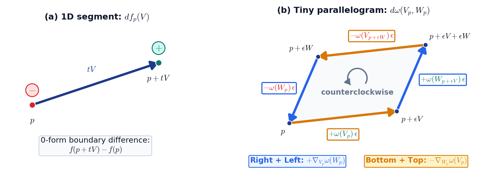

*Figure 15. Microscopic Stokes' theorem for 0-forms and 1-forms. (a) On a 1D segment from $p$ (marked $-$) to $p + tV$ (marked $+$), evaluating a 0-form $f$ on its signed boundary gives $f(p + tV) - f(p)$, whose limit after dividing by $t$ is $df_p(V)$. (b) Walking counterclockwise around the tiny parallelogram at $p$ spanned by $\epsilon V$ and $\epsilon W$ collects four signed edge terms: $+\omega(V_p)\,\epsilon$ on the bottom, $+\omega(W_{p+\epsilon V})\,\epsilon$ on the right, $-\omega(V_{p+\epsilon W})\,\epsilon$ on the top, and $-\omega(W_p)\,\epsilon$ on the left. When we pair opposite edges of the same colour and divide by $\epsilon^2$, the blue right and left edges give $+\nabla_{V_p}\omega(W_p)$, the amber bottom and top edges give $-\nabla_{W_p}\omega(V_p)$, and their sum is $d\omega(V_p, W_p)$.*

Every exterior derivative uses the exact same recipe: integrate the $k$-form over the complete boundary of an infinitesimal $(k+1)$-dimensional box, then divide by the box's scale.

**You can convert the 1-form to a flux 2-form (using the 3D metric / Hodge star).** Physically, a 1-form $\omega=F_x\,dx+F_y\,dy+F_z\,dz$ represents work/circulation along a path, whereas integrating a vector field across a surface measures flux. Our $\omega = x\,dy$ is the work 1-form of $\mathbf{F}=(0,x,0)$. To compute the flux of that same vector field through the hemisphere, you replace the 1-form with its [Hodge dual](#hodge-hodge-duals) 2-form $\star\omega=x\,dz\wedge dx$, which takes two tangent vectors and integrates cleanly over $M$. This computes a different quantity. The flux of $(0, x, 0)$ through the hemisphere is $0$, because the contributions from $x > 0$ and $x < 0$ cancel, not the $\pi$ of the first two options.

### Cells, Chains and Stokes' Theorem

[The subsection above](#stokes-theorem-but-more-profound) proved Stokes' theorem on one tiny parallelogram, where $d\omega$ is the signed circulation around its four edges per unit area. Extending that to a whole curve, surface or solid takes two pieces of bookkeeping: which regions we integrate over, and how to write "the boundary" with signs so shared interior faces cancel. Cells, chains and $\partial$ provide that bookkeeping, turning the classical integral theorems into one formula and most of the [Common Identities](#common-identities) into two rules of $d$.

To integrate over a curved patch or solid, we start from a flat parameter box $[a_1, b_1]\times\dots\times[a_n, b_n]$, which rescales linearly to the unit cube $I^n = [0, 1]^n$ with faces at $x_i = 0$ and $x_i = 1$. An $n$-cell $\sigma$ in $\mathbb{R}^m$ (or singular cube) is the image of a smooth map $\varphi: I^n \to \mathbb{R}^m$ with a chosen orientation, an ordering of $(x_1, \dots, x_n)$ that fixes the Jacobian's sign. A $0$-cell is a point, and $-\sigma$ reverses the orientation. For example, $\varphi(r, \theta) = (r\cos\pi\theta,\, r\sin\pi\theta)$ maps $I^2$ onto the upper unit half-disc and collapses $r = 0$ to $(0, 0)$, so discs and balls are single cells.

Single cells still fall short on their own: a boundary comes in several pieces (four signed edges on a square), it is often simpler to cut a shape into easy pieces (such as a sphere into two hemisphere graphs $\sigma_1$ and $\sigma_2$), and reversed orientations enter with minus signs. An $n$-chain $C = \sum_i n_i \sigma_i$ handles all three as a formal sum of $n$-cells with integer coefficients $n_i$, meaning a list of cells with integer multiplicities rather than a sum of coordinates: $2\sigma$ traverses $\sigma$ twice, $n\sigma + m\sigma = (n + m)\sigma$, and $\sigma + (-\sigma) = \emptyset$ (the empty chain). Integrating an $n$-form $\omega$ over $C$ adds the pieces:

$$\int_C \omega = \sum_i n_i \int_{\sigma_i} \omega$$

Thus the unit sphere is the $2$-chain $\sigma_1 + \sigma_2$.

The boundary $\partial\sigma$ of an $n$-cell is an $(n - 1)$-chain whose signs record each face's orientation. For a $1$-cell $\varphi: [0, 1] \to \mathbb{R}^m$, $\partial\sigma = \varphi(1) - \varphi(0)$, end minus start, as in the Fundamental Theorem of Calculus and [The Derivative of a Differential Form](#the-derivative-of-a-differential-form). For a $2$-cell $\varphi: [0, 1]^2 \to \mathbb{R}^m$, hold each coordinate at $1$ or $0$ while $t$ runs from $0$ to $1$:

$$\partial\sigma = \varphi(1, t) - \varphi(0, t) - \varphi(t, 1) + \varphi(t, 0)$$

These signs walk counterclockwise around $I^2$ (Figure 16(a)), matching the tiny parallelogram in [the subsection above](#stokes-theorem-but-more-profound). For a general $n$-cell $\varphi: I^n \to \mathbb{R}^m$, signs alternate across the $n$ coordinate pairs:

$$\partial\sigma = \sum_{i=1}^n (-1)^{i+1}\left(\varphi\big|_{x_i = 1} - \varphi\big|_{x_i = 0}\right)$$

On a $3$-cell, these six signs orient every face by its outward normal. Extending linearly, a chain $C = \sum_i n_i \sigma_i$ has boundary $\partial C = \sum_i n_i\,\partial\sigma_i$.

Apply the $2$-cell rule to the half-disc $\varphi(r, \theta) = (r\cos\pi\theta,\, r\sin\pi\theta)$. Naming its four edge $1$-cells $\alpha(t) = (\cos\pi t,\, \sin\pi t)$ (the arc), $\beta(t) = (-t, 0)$, $\gamma(t) = (t, 0)$ and the constant map $c(t) = (0, 0)$, the boundary chain is

$$\partial\sigma = \alpha - c - \beta + \gamma$$

Now integrate $\omega = x\,dy$ over $\partial\sigma$. Along $\gamma$ and $-\beta$, $y = 0$ so $dy = 0$, giving $0$ on each; on the collapsed edge $c$, the tangent vector is zero so $\int_c x\,dy = 0$ too. Only $\alpha$ contributes: $\int_0^1 \cos(\pi t)\,\pi\cos(\pi t)\,dt = \frac{\pi}{2}$, the half-disc's area and a preview of Stokes' theorem ($d(x\,dy) = dx\wedge dy$).

Figure 16 shows the signed edges and corner cancellations of $I^2$ alongside their image on the half-disc.

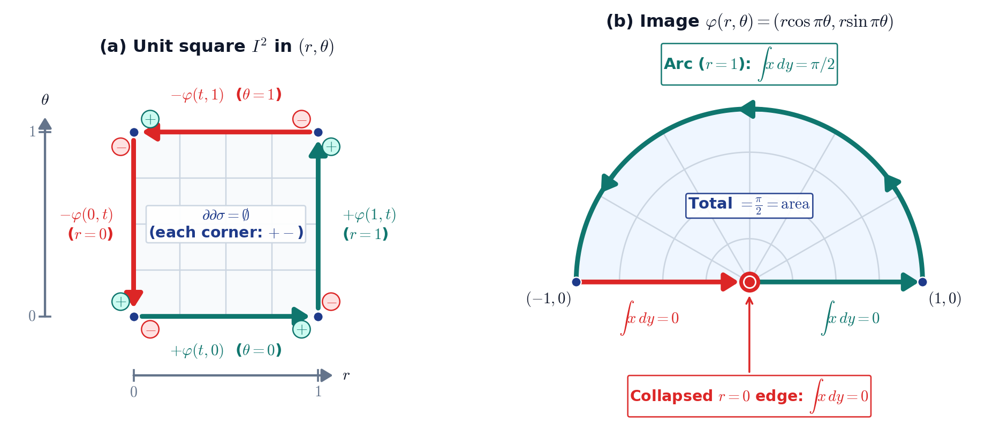

*Figure 16. Boundary of the half-disc 2-cell $\varphi(r, \theta) = (r\cos\pi\theta, r\sin\pi\theta)$. (a) On the unit square $I^2$ in the $(r, \theta)$-plane, $\partial\sigma = \varphi(1, t) - \varphi(0, t) - \varphi(t, 1) + \varphi(t, 0)$ gives $+$ to the bottom and right edges and $-$ to the top and left edges, walking counterclockwise. Each corner receives one $+$ from the arriving edge and one $-$ from the departing edge, so $\partial\partial\sigma = \emptyset$. (b) Under $\varphi$, the bottom edge becomes $\gamma: (0, 0) \to (1, 0)$, the right edge becomes the arc $\alpha: (1, 0) \to (-1, 0)$, the top edge with its minus sign runs $(-1, 0) \to (0, 0)$ as $-\beta$, and the left edge $r = 0$ collapses to $c(t) = (0, 0)$. Integrating $x\,dy$ gives $\pi/2$ on the arc and $0$ on the other three pieces, for a total of $\pi/2$.*

For the unit sphere $\sigma_1 + \sigma_2$, use the outward hemispheres $\varphi_1(r, \theta) = (r\cos 2\pi\theta,\, r\sin 2\pi\theta,\, \sqrt{1 - r^2})$ and $\varphi_2(r, \theta) = (-r\cos 2\pi\theta,\, r\sin 2\pi\theta,\, -\sqrt{1 - r^2})$ on $I^2$. In each cell, $\theta = 0$ and $\theta = 1$ trace the same meridian with opposite signs and $r = 0$ collapses to a pole, leaving only the equator $r = 1$: counterclockwise for $\sigma_1$ ($\int x\,dy = \pi$) and clockwise for $\sigma_2$ ($\int x\,dy = -\pi$). Their sum cancels the equators, so $\partial(\sigma_1 + \sigma_2) = \emptyset$, the two-caps argument of [Common Identities](#common-identities). In general $\partial(\partial C) = \emptyset$ for every chain $C$: each corner of a square ends two oppositely signed edges (Figure 16(a)), and each cube edge borders two oppositely oriented faces. That makes $\partial\partial = \emptyset$ the chain twin of $d^2 = 0$.

Generalized Stokes' theorem says that for a smooth $(n - 1)$-form $\omega$ on $\mathbb{R}^m$ and an $n$-chain $C$ in $\mathbb{R}^m$,

$$\int_{\partial C}\omega = \int_C d\omega$$

Applied twice, this pairs $\partial\partial = \emptyset$ with $d^2 = 0$: $\int_{\partial(\partial C)}\omega = \int_{\partial C} d\omega = \int_C d(d\omega) = 0$. We prove the theorem in three stages: unit cube, cell, chain.

On $I^3 \subset \mathbb{R}^3$, take one basis term $\omega = a(x_1, x_2, x_3)\,dx_2\wedge dx_3$, so $d\omega = \frac{\partial a}{\partial x_1}\,dx_1\wedge dx_2\wedge dx_3$, and cut $I^3$ into small boxes of side $t$:

1. One box: at $p$ with edges $V^1 = t\mathbf{e}_1$, $V^2 = t\mathbf{e}_2$, $V^3 = t\mathbf{e}_3$, $\frac{\partial a}{\partial x_1} \approx \frac{a(p + t\mathbf{e}_1) - a(p)}{t}$ gives $d\omega_p(V^1, V^2, V^3) \approx \omega_{p + t\mathbf{e}_1}(V^2, V^3) - \omega_p(V^2, V^3)$, which is $\omega$ on the upper $x_1$-face minus the lower $x_1$-face.
2. One column: summing along $x_1$ cancels shared interior faces in pairs as in Figure 2 of the [Divergence Theorem](#divergence-theorem), leaving $I^3$'s $x_1 = 1$ face minus its $x_1 = 0$ face.
3. Side faces: on the four side faces of $I^3$, every tangent patch has an $\mathbf{e}_1$ edge where $dx_2\wedge dx_3$ vanishes, giving $0$.
4. The limit: letting $t \to 0$ gives $\int_{I^3} d\omega = \int_{\partial I^3}\omega$. The same argument works on $I^n$, one basis term at a time.

Next, for any $n$-cell $\sigma = \varphi(I^n)$, the pull-back $\varphi^*$ from [Integrating $k$-forms](#integrating-k-forms) ($\varphi^*\omega(V_1, \dots, V_k) = \omega(D\varphi(V_1), \dots, D\varphi(V_k))$) moves the integral back to $I^n$:

$$\int_{\partial\sigma}\omega = \int_{\partial I^n}\varphi^*\omega = \int_{I^n} d(\varphi^*\omega) = \int_{I^n}\varphi^*(d\omega) = \int_\sigma d\omega$$

Here $d(\varphi^*\omega) = \varphi^*(d\omega)$ is the multivariable chain rule ($d(f\circ\varphi) = \varphi^*(df)$ on $0$-forms), carried to higher forms by wedge algebra. For $\varphi(a, b) = (a + b,\, a - b,\, ab)$ and $\omega = y\,dx + z\,dy + x\,dz$, substituting $x, y, z$ gives $\varphi^*\omega = (a - b + 2ab + b^2)\,da + (a - b + a^2)\,db$, so $d(\varphi^*\omega) = (2 - 2b)\,da\wedge db$, matching $\varphi^*(d\omega)$ from $d\omega = dy\wedge dx + dz\wedge dy + dx\wedge dz$. Finally, for $C = \sum_i n_i\sigma_i$, both $\partial$ and $\int$ add across cells, giving $\int_{\partial C}\omega = \int_C d\omega$ (just as small loops add in Figure 4 of [Stokes' Theorem](#stokes-theorem)).

#### Vector Calculus as Differential Forms

In $\mathbb{R}^3$, functions $f$ and vector fields $\vec{F} = \langle F_x, F_y, F_z\rangle$ correspond to forms through three dictionary rules:

$$\omega^1_{\vec{F}} = F_x\,dx + F_y\,dy + F_z\,dz, \qquad \omega^2_{\vec{F}} = F_x\,dy\wedge dz + F_y\,dz\wedge dx + F_z\,dx\wedge dy, \qquad \omega^3_f = f\,dx\wedge dy\wedge dz$$

Here $\omega^1_{\vec{F}}$ is the work $1$-form, $\omega^2_{\vec{F}}$ is the flux $2$-form in cyclic order, and $\omega^3_f$ is the density $3$-form. The ladder in [The Derivative of a Differential Form](#the-derivative-of-a-differential-form) becomes $df = \omega^1_{\nabla f}$, $d\omega^1_{\vec{F}} = \omega^2_{\nabla\times\vec{F}}$ and $d\omega^2_{\vec{F}} = \omega^3_{\nabla\cdot\vec{F}}$. Converting $\omega^1_{\vec{F}}$ to $\omega^2_{\vec{F}}$ is the $*\omega$ step of [the subsection above](#stokes-theorem-but-more-profound), which uses $\mathbb{R}^3$'s metric via the Hodge star (see [Hodge & Hodge Duals](#hodge-hodge-duals)), whereas $d$ needs no metric.

Specializing $\int_{\partial C}\omega = \int_C d\omega$ to $n = 1, 2, 3$ collects four integral theorems into one statement:

| $n$ | Region $C$ | Differential forms | Vector calculus |
|---|---|---|---|
| $1$ | Curve from $p$ to $q$ | $\int_C df = f(q) - f(p)$ | Fundamental Theorem of Calculus, gradient theorem |
| $2$ | Plane region $R \subset \mathbb{R}^2$ | $\int_{\partial R}(P\,dx + Q\,dy) = \int_R\left(\frac{\partial Q}{\partial x} - \frac{\partial P}{\partial y}\right)dx\wedge dy$ | Green's theorem |
| $2$ | Surface $S \subset \mathbb{R}^3$ | $\int_{\partial S}\omega^1_{\vec{F}} = \int_S d\omega^1_{\vec{F}}$ | [Stokes' theorem](#stokes-theorem) (curl) |
| $3$ | Solid $V \subset \mathbb{R}^3$ | $\int_{\partial V}\omega^2_{\vec{F}} = \int_V d\omega^2_{\vec{F}}$ | [Divergence theorem](#divergence-theorem) |

In the $n = 1$ row, $f(x, y) = x^2 y$ on the cusped curve $\varphi(t) = (t^2, t^3)$ for $t \in [-1, 1]$ gives $\int_C df = f(1, 1) - f(1, -1) = 2$ with no parametrizing. And $\oint_C \nabla f\cdot d\vec{r} = 0$ whenever the loop $C$ bounds a $2$-chain $D$ in the domain, since $\int_D d(df) = 0$. In the vortex domain of [Stokes' Theorem](#stokes-theorem) ($\mathbb{R}^3$ minus the $z$-axis), a loop around the axis bounds no $2$-chain in the domain, so $d\omega^1_{\vec{v}} = 0$ without forcing zero circulation (see [de Rham Cohomology](#de-rham-cohomology) and [Side Quest in Vector Calculus](#side-quest-in-vector-calculus)).

Three integrals show how this works. First, integrate $\omega = (x^2 + y)\,dx + (x - y^2)\,dy$ over the upper unit semicircle $\sigma$ from $(-1, 0)$ to $(1, 0)$ (clockwise over the top, as in [Integrating 1-Forms](#integrating-1-forms)). Since $d\omega = (1 - 1)\,dx\wedge dy = 0$, pair $\sigma$ with the diameter $\tau: \varphi(t) = (t, 0)$ on $[-1, 1]$. The counterclockwise boundary of the upper half-disc $D$ is $\partial D = \tau - \sigma$, so $\int_\tau \omega - \int_\sigma \omega = \int_D d\omega = 0$. On $\tau$, $y = 0$ and $dy = 0$, leaving $\int_\sigma \omega = \int_\tau \omega = \int_{-1}^1 t^2\,dt = \frac{2}{3}$.

Second, find $\oint_C \vec{F}\cdot d\vec{r}$ for $\vec{F} = \langle -x^2 y,\, xy^2,\, z^3\rangle$ around the curve $C$ where the cylinder $x^2 + y^2 = 1$ meets $z = x + 1$, oriented counterclockwise from above. Spanning $C$ with the tilted cap $\Psi(r, \theta) = (r\cos\theta,\, r\sin\theta,\, r\cos\theta + 1)$ ($0 \le r \le 1$, $0 \le \theta \le 2\pi$), Stokes' theorem gives $\oint_C \omega^1_{\vec{F}} = \int_{\text{cap}} d\omega^1_{\vec{F}}$. Since $d\omega^1_{\vec{F}} = (x^2 + y^2)\,dx\wedge dy$ has only a $dx\wedge dy$ part, only the cap's unit-disc shadow on the $xy$-plane counts ($\Psi^*(dx\wedge dy) = r\,dr\wedge d\theta$), giving $\int_0^{2\pi}\int_0^1 r^2\cdot r\,dr\,d\theta = \frac{\pi}{2}$.

Figure 17 shows the tilted elliptical cap on the cylinder $x^2 + y^2 = 1$ above its unit-disc shadow on the $xy$-plane.

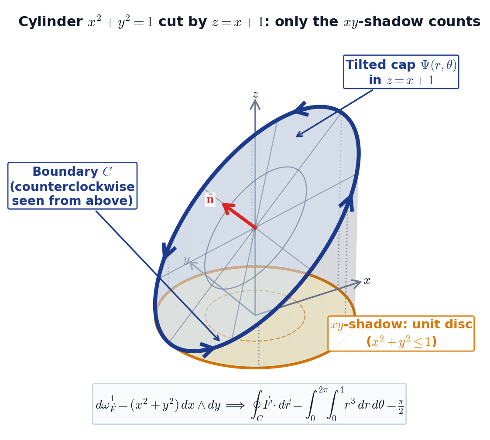

*Figure 17. Stokes' theorem on the cylinder $x^2 + y^2 = 1$ cut by the plane $z = x + 1$ for $\vec{F} = \langle -x^2 y, xy^2, z^3\rangle$. The tilted elliptical cap $\Psi(r, \theta) = (r\cos\theta, r\sin\theta, r\cos\theta + 1)$ has boundary curve $C = (\cos\theta, \sin\theta, \cos\theta + 1)$, traversed counterclockwise seen from above. Because $d\omega^1_{\vec{F}} = (x^2 + y^2)\,dx\wedge dy$ has only a $dx\wedge dy$ part, only the cap's unit-disc shadow on the $xy$-plane counts, and the integral reduces to $\int_0^{2\pi}\!\int_0^1 r^2\cdot r\,dr\,d\theta = \pi/2$.*

Third, find the outward flux of $\vec{F} = \langle xy^2,\, y^3,\, x^2 y^2\rangle$ out of the unit cube $I^3$. By the divergence row of the table, the flux $\int_{\partial I^3}\omega^2_{\vec{F}}$ equals $\int_{I^3} d\omega^2_{\vec{F}}$. Since $d\omega^2_{\vec{F}} = 4y^2\,dx\wedge dy\wedge dz$, one triple integral replaces six face integrals: $\int_{I^3} d\omega^2_{\vec{F}} = \int_0^1 4y^2\,dy = \frac{4}{3}$.

Finally, combining $d^2 = 0$ and the graded Leibniz rule from [Properties of Exterior Derivatives](#properties-of-exterior-derivatives) with the wedge rules $\omega^1_{\vec{A}}\wedge\omega^1_{\vec{B}} = \omega^2_{\vec{A}\times\vec{B}}$ and $\omega^1_{\vec{A}}\wedge\omega^2_{\vec{B}} = \omega^3_{\vec{A}\cdot\vec{B}}$ gives six of the [Common Identities](#common-identities) in a line each:

| # | Differential forms | Vector calculus |
|---|---|---|
| $1$ | $d(df) = 0$ | $\nabla\times(\nabla f) = \vec{0}$ |
| $2$ | $d(d\omega^1_{\vec{F}}) = 0$ | $\nabla\cdot(\nabla\times\vec{F}) = 0$ |
| $3$ | $d(fg) = f\,dg + g\,df$ | $\nabla(fg) = f\nabla g + g\nabla f$ |
| $4$ | $d(f\omega^1_{\vec{F}}) = df\wedge\omega^1_{\vec{F}} + f\,d\omega^1_{\vec{F}}$ | $\nabla\times(f\vec{F}) = (\nabla f)\times\vec{F} + f(\nabla\times\vec{F})$ |
| $5$ | $d(f\omega^2_{\vec{F}}) = df\wedge\omega^2_{\vec{F}} + f\,d\omega^2_{\vec{F}}$ | $\nabla\cdot(f\vec{F}) = (\nabla f)\cdot\vec{F} + f(\nabla\cdot\vec{F})$ |
| $6$ | $d(\omega^1_{\vec{F}}\wedge\omega^1_{\vec{G}}) = d\omega^1_{\vec{F}}\wedge\omega^1_{\vec{G}} - \omega^1_{\vec{F}}\wedge d\omega^1_{\vec{G}}$ | $\nabla\cdot(\vec{F}\times\vec{G}) = \vec{G}\cdot(\nabla\times\vec{F}) - \vec{F}\cdot(\nabla\times\vec{G})$ |

In row $6$, the minus sign is $(-1)^1$ from passing $d$ across the $1$-form $\omega^1_{\vec{F}}$. On $\vec{v} = f(x, y)\hat{\mathbf{y}}$ of [Common Identities](#common-identities) and Figure 3, row $4$ gives $d(f\,dy) = \frac{\partial f}{\partial x}\,dx\wedge dy$ since $\frac{\partial f}{\partial y}\,dy\wedge dy = 0$: variation along $y$ gives no curl, variation across $x$ does. Of the remaining three identities, $\nabla(\vec{F}\cdot\vec{G})$ and $\nabla\times(\vec{F}\times\vec{G})$ follow from Cartan's formula $\mathcal{L}_{\vec{G}} = d\iota_{\vec{G}} + \iota_{\vec{G}}d$ on $\omega^1_{\vec{F}}$ and $\omega^2_{\vec{F}}$ via $\iota_{\vec{G}}\omega^1_{\vec{F}} = \vec{F}\cdot\vec{G}$ and $\iota_{\vec{G}}\omega^2_{\vec{F}} = \omega^1_{\vec{F}\times\vec{G}}$ (see [The Lie Derivative](#the-lie-derivative) and [Interior Product](#interior-product)). Finally, $d^\dagger = (-1)^p \star d \star$ on $p$-forms in $\mathbb{R}^3$ gives $d^\dagger d\,\omega^1_{\vec{F}} = \omega^1_{\nabla\times(\nabla\times\vec{F})}$ and $d d^\dagger\,\omega^1_{\vec{F}} = -\omega^1_{\nabla(\nabla\cdot\vec{F})}$, so $\Delta = dd^\dagger + d^\dagger d$ computes $\Delta\omega^1_{\vec{F}} = \omega^1_{\nabla\times(\nabla\times\vec{F}) - \nabla(\nabla\cdot\vec{F})}$. Since $\Delta$ acts as $-\nabla^2$ on each Cartesian component (matching $\Delta f = -\nabla^2 f$ in [Stuff You Can Do With A Metric](#stuff-you-can-do-with-a-metric); see also [Hodge & Hodge Duals](#hodge-hodge-duals)), this is $\nabla\times(\nabla\times\vec{F}) = \nabla(\nabla\cdot\vec{F}) - \nabla^2\vec{F}$.

### Hodge & Hodge Duals

In $\mathbb{R}^3$, the numbers of 1-forms and 2-forms match ($\binom{3}{1}=\binom{3}{2}=3$, as we saw in [2-Forms](#2-forms)), and so do the numbers of 0-forms and 3-forms. The Hodge star $\star$ is the dictionary that pairs them up. It sends each basis form to the basis form built from the *missing* directions, with the sign chosen so that a basis form wedged with its dual gives the volume form $dx\wedge dy\wedge dz$:

| $\omega$ | $1$ | $dx$ | $dy$ | $dz$ | $dy\wedge dz$ | $dz\wedge dx$ | $dx\wedge dy$ | $dx\wedge dy\wedge dz$ |
|---|---|---|---|---|---|---|---|---|
| $\star\omega$ | $dx\wedge dy\wedge dz$ | $dy\wedge dz$ | $dz\wedge dx$ | $dx\wedge dy$ | $dx$ | $dy$ | $dz$ | $1$ |

For example, $dx\wedge\star dx = dx\wedge dy\wedge dz$, and $(dy\wedge dz)\wedge\star(dy\wedge dz) = dy\wedge dz\wedge dx = dx\wedge dy\wedge dz$. The star is linear, and function coefficients pass straight through it. So in the notation of [Vector Calculus as Differential Forms](#vector-calculus-as-differential-forms) it swaps the work and flux forms, $\star\omega^1_{\vec{F}}=\omega^2_{\vec{F}}$ and $\star\omega^2_{\vec{F}}=\omega^1_{\vec{F}}$, and turns a function into its density form, $\star f=\omega^3_f$. Applying it twice gives back what we started with: $\star\star=1$ on forms of every degree in $\mathbb{R}^3$.

This is the move behind the third option in [Stokes' Theorem But More Profound!](#stokes-theorem-but-more-profound), and the reason classical vector calculus can use one kind of arrow for both $\vec{E}$ (a 1-form) and $\vec{B}$ (a 2-form). The star needs more than the smooth structure, though. "The missing directions" and "the sign that gives the volume form" need lengths, angles and an orientation, so the star depends on the metric. The general definition, for any metric and dimension, is in [Stuff You Can Do With A Metric](#stuff-you-can-do-with-a-metric).

When [the metric](#the-metric-tensor) $g_{\mu\nu}$ is diagonal, $\star\omega$ still sends a basis $p$-form $\omega$ to a multiple of the $(n-p)$ missing coordinate differentials wedged together, fixed by

$$\omega\wedge(\star\omega) = \langle\omega,\omega\rangle\,\mathrm{vol}, \qquad \mathrm{vol} = \sqrt{|g|}\,dx^1\wedge\dots\wedge dx^n$$

Here $\mathrm{vol}$ is the [volume form](#stuff-you-can-do-with-a-metric) in coordinates $(x^1,\dots,x^n)$ ordered by the orientation, with $g = \det(g_{\mu\nu})$, and $\langle\omega,\omega\rangle$ is the pointwise inner product of $\omega$ with itself: on a basis $p$-form, multiply together the inverse-metric entries $g^{\mu\mu} = 1/g_{\mu\mu}$, one for each $dx^\mu$ in $\omega$ (with $\langle 1,1\rangle = 1$). Two things set the sign: the orientation sets the swap sign that reorders $\omega$ wedged with the missing differentials into $dx^1\wedge\dots\wedge dx^n$, and the metric sets the sign of $\langle\omega,\omega\rangle$ via any negative $g_{\mu\mu}$. In Cartesian $\mathbb{R}^3$, $g_{\mu\nu} = \delta_{\mu\nu}$ gives $\sqrt{|g|} = 1$ and $\langle\omega,\omega\rangle = +1$ on every basis form, so both metric factors equal $1$ and drop out. In Minkowski spacetime ($ds^2 = -dt^2+dx^2+dy^2+dz^2$, $\mathrm{vol} = dt\wedge dx\wedge dy\wedge dz$), $g_{tt} = -1$ contributes $-1$ whenever $dt$ appears: for $\omega = dt$, $\langle dt,dt\rangle = -1$, so $dt\wedge(\star dt) = -\,\mathrm{vol}$ flips the bare $\mathbb{R}^3$ sign to $\star dt = -\,dx\wedge dy\wedge dz$ with no swaps. In polar coordinates ($ds^2 = dr^2+r^2\,d\theta^2$), the size changes too: $\mathrm{vol} = r\,dr\wedge d\theta$ and $\langle d\theta,d\theta\rangle = 1/r^2$, so $d\theta\wedge(\star d\theta) = \frac{1}{r}\,dr\wedge d\theta$ gives $\star d\theta = -\frac{1}{r}\,dr$ (and $\star dr = r\,d\theta$).

#### Maxwell's Equations via Hodge Duality

For example, in empty space (no charges or currents, and units with $c = 1$), all of Maxwell's equations can be written as:

$dF=0$ and $d\star F=0$ where $F$ is given by:

$$F = E_x\,dx \wedge dt + E_y\,dy \wedge dt + E_z\,dz \wedge dt + B_x\,dy \wedge dz + B_y\,dz \wedge dx + B_z\,dx \wedge dy$$

$\star F$ is given by:

$$\star F = E_x\,dy \wedge dz + E_y\,dz \wedge dx + E_z\,dx \wedge dy + B_x\,dt \wedge dx + B_y\,dt \wedge dy + B_z\,dt \wedge dz$$

Here we use the rule above, $\omega \wedge (\star\omega) = \langle\omega,\omega\rangle\,\mathrm{vol}$ for a basis form $\omega$, with the Minkowski volume form $\mathrm{vol} = dt \wedge dx \wedge dy \wedge dz$. For $\omega = dx \wedge dt$ we have $\langle dx \wedge dt, dx \wedge dt\rangle = -1$, so we get the Hodge dual $\star\omega$ by setting

$$(dx \wedge dt) \wedge (\star\omega) = -\,dt \wedge dx \wedge dy \wedge dz = dx \wedge dy \wedge dz \wedge dt$$

Shifting $dt$ to the right by $2$ places gives no sign change, so we get the dual as $\star(dx \wedge dt) = dy \wedge dz$.

Now for the $B_x$ term $\omega = dy \wedge dz$, both $y$ and $z$ are spatial coordinates, so $\langle dy \wedge dz, dy \wedge dz\rangle = +1$, and we set

$$(dy \wedge dz) \wedge (\star\omega) = +\,dt \wedge dx \wedge dy \wedge dz$$

Taking $\star\omega = dt \wedge dx$ requires shifting $dt$ and $dx$ past $dy$ and $dz$ ($4$ swaps total, no sign change), so we get $\star(dy \wedge dz) = dt \wedge dx$. That is why we retain the same $+$ sign for $B_x$, for example, in both $F$ and $\star F$.

If we instead take the dual in reverse for $dt \wedge dx$, then since $dt \wedge dx = -\,dx \wedge dt$ (or using $(dt \wedge dx) \wedge (\star\omega) = -\,dt \wedge dx \wedge dy \wedge dz$), we get $\star(dt \wedge dx) = -\,dy \wedge dz$. This minus sign is expected because in 4D Minkowski spacetime, applying the Hodge star twice to a 2-form gives $\star(\star\omega) = -\omega$.

With charges and currents present, $dF = 0$ is unchanged and the second equation becomes $d\star F = \star J$, where $J$ is the current 1-form; [Hodge Duals & Electromagnetism](#hodge-duals-electromagnetism) derives this from the action.

## Mathematical Formalities

### Vectors & Covectors

The coordinate basis vectors of our tangent spaces are quite literally the tangents, or rather the partial derivatives along each coordinate direction (we justify writing tangent vectors as partial derivatives in [Multivariable Chain Rule](#multivariable-chain-rule) below). We can therefore define any vector in this space using this basis. 

As we mentioned earlier, the covectors are counting machines. Throw a vector into a covector basis and it tells you how many ticks that vector passes through along that particular coordinate direction, or in other words, along that basis vector. So the components of the vector along each basis can be recovered using the dual covector basis.

Since the covectors are a basis, it means the covector space is a valid vector space, and we can construct arbitrary covectors by taking linear combinations of the basis. Geometrically, a covector is like a contour line; or rather like an infinite family of parallel contour lines: think of all the coordinate lines we would draw perpendicular to the $x$-axis of a graph paper. _All of those lines_, which on the paper may be separated by a millimeter, together form one basis covector. This is the stack picture of [1-Forms](#1-forms) (Figure 9). The basis covector $dx^\mu$ represents a set of contour lines spaced exactly 1 coordinate unit apart. If you draw the basis tangent vector $\partial_\mu$ (an arrow exactly 1 coordinate unit long), its tip will perfectly pierce exactly one of these contour lines. The machine outputs $1$.

Now let us say we multiply that basis by a component of 5, we get $5 dx^\mu$. This means we now have an infinite family of lines again, but we are cramming 5 lines into the space that formerly separated two lines. The density of lines has gone up by 5 because to make the machine output a $5$ when fed that same 1-unit vector arrow, the arrow must now pierce 5 contour lines. Because the vector arrow hasn't changed length, the only geometric solution is to cram 5 contour lines into the exact same coordinate space. Cramming contour lines closer together means you are traversing values much faster over the same distance. It means a steeper gradient or a faster rate of change. 

**In short:** Vectors scale by length. Change a vector component from $1$ to $5$, the physical arrow stretches to become 5 times longer. Covectors scale by density. Change a covector component from $1$ to $5$, the contour lines get squished together, becoming 5 times denser.

### Multivariable Chain Rule

We can tie all this together with the chain rule. Depending on how we "factor" it, we generate either the covector (1-form) or the vector (operator). We take a scalar function $f$ evaluated along a parameterized curve $x^\mu(t)$. 

$$\frac{df}{dt} = \frac{dx^\mu}{dt} \frac{\partial f}{\partial x^\mu}$$

The scalar function will lead us to covectors and the curve to vectors. That makes sense. Scalar functions have contours and curves have vectors (their tangents). Let's start with $f$, and let's say we are interested in its rate of change over our manifold. We throw away the $dt$ parameter. We can write this out in terms of the covector basis for that coordinate grid:

$$df = \frac{\partial f}{\partial x^\mu} dx^\mu$$

$dx^\mu$ is the covector basis and $\frac{\partial f}{\partial x^\mu}$ are the covector components. $df$ is called the exterior derivative of the function $f$. By throwing away $dt$, we graduate from a parameterized rate of change (which requires a specific path and speed) to a purely geometric object ($df$) that represents the total possible changes of the function in every direction simultaneously.

However, we can look at this a little differently by focusing on the curve. We factor out the function $f$ from the right side:

$$\frac{d}{dt}(f) = \left( \frac{dx^\mu}{dt} \frac{\partial}{\partial x^\mu} \right) f$$

Now, we recognize that $\frac{dx^\mu}{dt}$ are simply the velocity components of our curve. Let us call them $X^\mu$. We also use the shorthand for the basis operators: $\partial_\mu = \frac{\partial}{\partial x^\mu}$.

$$\frac{d}{dt}(f) = (X^\mu \partial_\mu) f$$

Finally, we "throw away" the scalar function $f$ from both sides to reveal the bare operator:

$$\frac{d}{dt} = X^\mu \partial_\mu$$

Letting $X = \frac{d}{dt}$, we get:

$$X = X^\mu \partial_\mu$$

We can merge these two viewpoints now. $df$ is a covector and its geometric purpose is to consume a tangent vector $X$ and output a real number. Similarly, a vector is a linear map or a machine that exists to eat a covector to output a real number, and both of these outputs are the same.  $df(X) = X(f)$.

If we feed this vector $X$ into our $df$ machine, the covector basis $dx^\mu$ mathematically evaluates the vector basis $\frac{\partial}{\partial x^\nu}$. Because they are dual to each other, this outputs the Kronecker delta $\delta^\mu_\nu$, which simply pairs the matching coordinate components. The result is a single scalar number:

$$df(X) = \frac{\partial f}{\partial x^\mu} X^\mu$$

If we feed the scalar function $f$ into our $X$ operator, the vector basis $\partial_\mu$ simply executes its role as a differential operator directly on the function $f$. The result is the same scalar number:

$$X(f) = X^\mu \frac{\partial f}{\partial x^\mu}$$

This operation geometrically represents the vector arrow $X$ piercing through the crammed contour lines of $df$. It is called the directional derivative. It is the product of two real numbers (or rather the sum of products because the indices are contracted). 
 It tells us how much the function $f$ changes if you move along the specific direction and length defined by the arrow $X$. We have successfully calculated a physical rate of change purely using the duality of vectors and covectors, without ever requiring a metric tensor.

---

**Aside:** Vector and covectors are mathematically on an equal footing. We tend to be more familiar with vectors because we live in a spatial dimension where physical quantities like velocity, force, and momentum are naturally represented as directed arrows (vectors). Covectors (gradients, momenta, flux densities) are less visually intuitive, leading introductory physics to treat vectors as primary and covectors as derived tools. But formally, they are identical twins defined entirely by their reciprocal behaviour under coordinate transformations.

In our example above, we said the covector basis first evaluate against the vector basis to get the Kronecker delta, but the vector basis directly applies the differential operation on the function. This seems to be an asymmetry in the significance of the vector and covector. This asymmetry is merely an artifact that falls out of the fact that we constructed our vector space first (from the tangents) and then defined covectors as machines that eat them. We could have done it the other way around too, which is sometimes done in advanced differential geometry. The cotangent space basis $dx^\mu$ is defined as the fundamental geometric object. A vector $X$ is defined formally as an operator on a covector $\omega$: $X(\omega) \in \mathbb{R}$.

---

To concretize this, let's head back to Everest. Say we have a temperature gradient which is 5 degrees per meter, and the component of the wind vector is 10 meters per second along North. Multiplying them gives 50 degrees per second. This means if you were a leaf in the wind, if you were blown north you would experience a temperature change of 50 degrees per second.

We have managed to evaluate this without actually needing to define physical lengths. Though I mentioned meters above just for the sake of concretely defining a velocity and gradient for the convenience of reading, we would get the exact same result even if we had defined everything using feet instead of meters, because the units of length  cancel out. We never need to actually calculate the velocity of the wind in terms of meters per second or the temperature gradient in terms of degrees per meter.

The example with the wind and temperature tells us why we would want to go through this rigmarole of defining vectors and covectors. We can build a massive amount of rigorous mathematics and physics before ever touching a metric. This is called differential topology, where we study intrinsic properties of spaces using only smooth structures, vector fields, and exterior derivatives ($d$).

We can define whether a vector field flows into itself or another vector field using the Lie bracket ($[X, Y]$). We can define whether a differential form $\omega$ is closed ($d\omega = 0$) or exact ($\omega = d\alpha$ for some form $\alpha$). We can classify the global topology of the manifold without ever measuring a single distance. The metric tensor is needed when we wish to add geometry to topology. Topology tells you how spaces connect and wrap. Differential geometry (via the metric) tells you how long things are, what angles they intersect at, and what volumes they enclose.
    
By separating the metric-free machinery (like $df(X)$) from the metric-dependent machinery (like lengths and angles), we can isolate physics that requires a gravitational/geometric field from physics that falls only out of smooth manifold structure.

### Vector Fields & Global Flows

As we mentioned earlier, the metric tensor is what defines measurement and distance and angles in our manifold. And the mathematician or the physics of the situation provide us with it. But what if they don't? Is there any way we can gain knowledge about the situation without resorting to a metric tensor? As we saw above, there is a way. We take a vector and a scalar function and club them together. Earlier, we did that for just one point. But we can do that for every point as well by taking vector fields, which is the collection of vectors at every point of the manifold.  

We can follow the arrows of a vector field along curves called its integral curves, and the map that moves every point along them is called the flow of the field (both are defined below). They let us measure how stuff changes as it flows in that field. This is the foundation for one of the most important tools in General Relativity: the Lie Derivative ($\mathcal{L}_X$). The Lie derivative of any tensor simply measures how much that tensor changes when it is "dragged" along the integral curves (the flow $\sigma_t$) of a vector field $X$.

By using the integral curves of $X$, we can measure not just how a scalar field like temperature changes along the flow, but how other vector fields or tensors stretch and twist as they are carried along by the "wind" of $X$, all without ever needing a metric tensor.

Here's an example. When we write the 4-velocity operator $U = U^\mu \partial_\mu$, the hidden parameter is strictly defined as proper time ($\tau$), the actual time ticking on the wristwatch of the observer moving along that path.

If we feed the ambient cosmic microwave background temperature $f$ into an astronaut's 4-velocity operator $U$, the value $U(f)$ tells us exactly how fast the astronaut watches the universe cool down on their own ship's clock.

$$U(f) = \frac{df}{d\tau}$$

We do not need to know the astronaut's global trajectory through the universe to calculate this. We just need their 4-velocity vector at that one specific moment, and the operator $U(f)$ instantly gives us the physical rate of change.

Now for the mathematics. We start by defining a vector field. If you define a specific tangent operator at every point across a region, you have constructed a vector field $X$. These tangent operators have nothing to do with the manifold itself. The vector field is an independent mathematical object. We just describe the vectors of this field at each point using the basis vectors of the tangent space. That is the only link with the manifold itself (apart from the vectors being defined at each point of the manifold, of course). Imagine for example, a weather map showing the wind velocity at every location on Everest. The topography of Everest is different from the flow of the wind itself (though they may influence each other!)

---

**Aside:** Note that you could build a vector field using exactly one of the basis vectors of your coordinate chart; it is called a coordinate vector field. This is just one of the infinite vector fields you could have over every point of your manifold. If we take the complete set of $n$ coordinate vector fields together (e.g., both $\partial_x$ and $\partial_y$), we have constructed a coordinate frame field. Such a frame is called holonomic. A frame of vector fields comes from some coordinate system exactly when all their [Lie brackets](#the-lie-bracket) vanish, which is why frames that don't come from coordinates, like the tetrads in [Tetrad Formalism](#tetrad-formalism), are called non-holonomic. In General Relativity, when we want to describe the physics experienced by a specific observer moving through spacetime, we attach a specialized frame field to that observer, known as a tetrad (or vierbein).

---

We can find a physical curve $x^\mu(\lambda)$ parameterized by some $\lambda$, by demanding that the curve's tangent perfectly matches the local vector field at every point it passes through:

$$\frac{dx^\mu}{d\lambda} = X^\mu(x(\lambda))$$

This forms a system of ordinary differential equations. By solving these equations, effectively integrating the local slopes from point to point, the global geometry of the curve emerges naturally without ever referencing an arbitrary global origin. Such a curve is called an integral curve of $X$, and moving every point along its integral curve for a parameter time $t$ defines the flow of $X$. The flow is global (defined for every $t$) only when every integral curve exists for all time; such a field is called complete. On $\mathbb{R}$, the field $X = x^2\,\partial_x$ is not complete: its integral curve $x(\lambda) = \frac{x_0}{1 - x_0\lambda}$ shoots off to infinity at $\lambda = 1/x_0$. Every smooth vector field on a compact manifold, such as a sphere, is complete.

Up to now, we used maps (charts) to take a point on the manifold $M$ and assign it coordinates in $\mathbb{R}^n$. Global flows are entirely different. The map $\sigma_t : M \to M$ maps the manifold back onto itself.

It represents an active physical transformation. If you place a particle at point $p$ and let it be carried by the fluid for a time $t$, it will arrive at a new physical point $q$. The map $\sigma_t$ simply formalizes this: $\sigma_t(p) = q$.

The rules governing this map are the basic logic of time evolution:

-   $\sigma_{t=0}$ is the identity map: If zero time passes, the particle stays exactly where it is.
    
-   $\sigma_s \circ \sigma_t = \sigma_{s+t}$: If you flow the particle for time $t$, pause, and then flow it for time $s$, it ends up in the exact same location as if you had flowed it continuously for time $s+t$. It means the flow is steady and has no "memory" of its history.

Global curves and local vectors can go back and forth between each other. If you know the macroscopic flow of the fluid (the streamlines), you can deduce the velocity of a particle at any specific point. This generates a vector field $X^\mu(x)$. You get this by taking the time derivative of the streamline precisely as the particle passes through that point.

Conversely, if someone hands you a vector field $X^\mu(x)$ (an array of instantaneous velocity arrows at every point), you can reconstruct the macroscopic streamlines, which is what we talked about just above. You do this by setting up a system of ordinary differential equations (ODEs) as we did above:

$$\frac{dx^\mu}{dt} = X^\mu(x^1, \dots, x^n)$$

By integrating these ODEs starting from an initial position $x^\mu_{\text{initial}}$, you trace out the entire path of the particle i.e. how the coordinates change with time. These reconstructed paths are called integral curves.

Integral curves do not require you to know anything about the metric tensor or connections. You are handed a pre-existing vector field $X$ defined everywhere on the manifold. You just follow the arrows. Because the arrows already exist at every point, you never have to move an arrow yourself. The smooth structure of the manifold is enough to calculate $\frac{dx^\mu}{dt} = X^\mu(x)$.

### Scalar Fields

A scalar field is a set of scalar values at every point of the manifold. For example, the temperature at every point on Everest. A nice thing to keep in mind about scalar fields is that they have contour lines, which will come in handy soon.

In physics, we are usually interested in how a vector field and a scalar field interact, which is why it is of great interest to take what we know about vector fields above and see how it fits in with scalar fields. Another way of putting this is, we can define a vector field by the rate of change of a scalar field along that vector field, and we can define a scalar field by how many contour lines of the scalar field a vector field pierces. These are essentially the same thing and should remind us of the vector and covector relationships from above, because they are actually the same thing.

Mathematically, we say: $df(X) = X(f)$, where $f$ is the scalar function and $X$ is the vector field. As an example, we can see how this works when we choose the vector $X$ as a coordinate basis vector $\partial_\nu$ and $f = x^\mu$. The equation becomes:

$$dx^\mu(\partial_\nu) = \partial_\nu(x^\mu) = \delta^\mu_\nu$$

This is as expected: $dx^\mu$ is the dual basis one-form to the tangent vector $\partial_\mu$. The $dx$ is no longer a small step along an axis; it is a linear functional that maps vectors to real numbers.

Note that, $df = \frac{\partial f}{\partial x^\mu} dx^\mu$, and so we see that the partial derivatives $\frac{\partial f}{\partial x^\mu}$ are strictly the components of a one-form, not a vector.

In standard engineering physics, the gradient $\nabla f$ is taught as a vector pointing in the direction of steepest ascent. In differential geometry, the gradient of a scalar field is natively a one-form.

Without a metric tensor, there is no concept of "steepest ascent" or "perpendicular to the contour lines" because angles and lengths do not exist. Instead, the gradient $df$ simply is the stack of contour lines of the function $f$. You do not measure steepest ascent. You measure how many contour lines a given vector $X$ pierces by computing $df(X)$. 

Note that the metric tensor maps the one-form back into a vector by raising the index. The classical gradient vector is formally written as $(\nabla f)^\mu = g^{\mu\nu} \partial_\nu f$. This explicitly shows that "steepest ascent" is a metric-dependent geometric construct.

## More Stuff We Don't Need A Metric Tensor For

### The Lie Bracket 

A vector field acts on functions by differentiating them, $X(f) = X^\mu\partial_\mu f$. Applying two fields one after the other, $X(Y(f))$, involves second derivatives of $f$, so $XY$ on its own is not a vector field. But in the difference the second derivatives cancel, because the mixed partial derivatives of $f$ commute:

$$[X, Y](f) = X(Y(f)) - Y(X(f)) = \left(X^\mu \partial_\mu Y^\nu - Y^\mu \partial_\mu X^\nu\right)\partial_\nu f$$

So the Lie bracket $[X, Y] = XY - YX$ is again a vector field, with components $[X, Y]^\nu = X^\mu \partial_\mu Y^\nu - Y^\mu \partial_\mu X^\nu$. We will see in [The Lie Derivative](#the-lie-derivative) that it is also the Lie derivative $\mathcal{L}_X Y$.

This measures the failure of the two flows to commute. If you flow along $X$ for a small parameter distance $\epsilon$, then along $Y$ for $\epsilon$, and then reverse the sequence (flow along $-X$ then $-Y$), you will not necessarily return to your starting point. The gap between your starting point and ending point is $\epsilon^2[X, Y]$, up to terms of order $\epsilon^3$. For example, on the flat plane take $X = \partial_x$ and $Y = x\,\partial_y$. Their bracket is $[X, Y] = \partial_x(x)\,\partial_y = \partial_y$. Starting at the origin, the loop goes to $(\epsilon, 0)$, then up to $(\epsilon, \epsilon^2)$ (since $Y$ has length $x = \epsilon$ there), then back to $(0, \epsilon^2)$, and the last step along $-Y$ does nothing, because $Y = 0$ on the $y$-axis. The loop ends at $(0, \epsilon^2)$, a gap of exactly $\epsilon^2[X, Y]$.

Figure 18 draws the two fields and this loop.

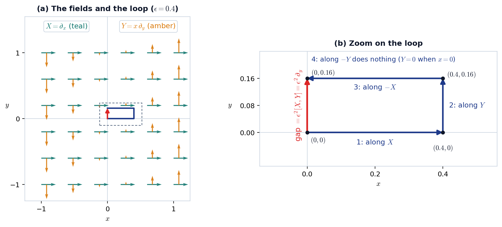

*Figure 18. The Lie bracket as the gap in a loop. (a) The fields $X = \partial_x$ (teal) and $Y = x\,\partial_y$ (amber). $X$ is the same everywhere. $Y$ points up for $x > 0$ and down for $x < 0$, and grows with $|x|$. The loop with $\epsilon = 0.4$ (navy) starts at the origin; the dashed box is enlarged in (b). (b) Step 1, along $X$, reaches $(0.4, 0)$. Step 2, along $Y$, whose length there is $x\,\epsilon = 0.16$, reaches $(0.4, 0.16)$. Step 3, along $-X$, reaches $(0, 0.16)$. Step 4, along $-Y$, does nothing, because $Y = 0$ on the $y$-axis. The loop ends $0.16 = \epsilon^2$ above its start: the gap is $\epsilon^2[X, Y] = \epsilon^2\,\partial_y$.*

### The Lie Derivative

The Lie Derivative tells you how a tensor changes relative to a dynamic flow of a vector. Whenever you want to know if a physical system, a geometric shape, or a coordinate grid looks exactly the same after you shift it in a certain direction, you calculate the Lie derivative. If the result is zero, you have found a symmetry.

To find out if the vector has its own independent rate of change, meaning it is changing differently than the fluid wants it to, we must take the total observed change and subtract the baseline distortion forced upon it by the fluid.

The Lie derivative of a scalar function $f$ is just the directional derivative $X(f)$. The Lie derivative of a vector field $Y$ along $X$ is given by the Lie bracket $[X, Y]$, whose components are:

$$(\mathcal{L}_X Y)^\mu = X^\nu \partial_\nu Y^\mu - Y^\nu \partial_\nu X^\mu$$

The first term $X^\nu \partial_\nu Y^\mu$ applies the standard directional derivative along $X$ to the scalar components $Y^\mu$. It evaluates how the numerical coordinates of $Y$ change as we take an infinitesimal step along the direction of $X$, scaled by the magnitude of $X$ (because we are not simply interested in the rate of change, but the rate of change "caused" by $X$ or along $X$).

The second term $- Y^\nu \partial_\nu X^\mu$ corrects for the distortions caused to $Y$ by the flow of $X$. When you evaluate the Lie derivative, you are taking the vector $Y$ at point $q$ and letting the fluid flow $X$ carry it backward in time to point $p$. If the fluid flow $X$ is perfectly uniform (all vectors in $X$ are parallel and constant), the vector $Y$ arrives at $p$ exactly as it was. In this case, the Lie derivative is just the naive directional derivative. However, if the fluid $X$ is diverging, converging, or rotating between $p$ and $q$, the act of dragging $Y$ backward through that fluid actively stretches and rotates $Y$. The second term exactly corrects for that geometric distortion.

The Lie derivative of a covector (1-form) $\omega$ is calculated by applying the Leibniz product rule to its components and basis vectors:

$$\mathcal{L}_X \omega = \mathcal{L}_X (\omega_\mu dx^\mu) = (\mathcal{L}_X \omega_\mu) dx^\mu + \omega_\nu \mathcal{L}_X(dx^\nu)$$

Because $\omega_\mu$ is just a scalar component, its Lie derivative is simply $X^\nu \partial_\nu \omega_\mu$. For the basis 1-form $dx^\nu$, the Lie derivative evaluates to $\partial_\mu X^\nu dx^\mu$: dragging commutes with $d$ (we show why below, from Cartan's formula), so $\mathcal{L}_X(dx^\nu) = d(\mathcal{L}_X x^\nu) = d(X(x^\nu)) = d(X^\nu) = \partial_\mu X^\nu dx^\mu$. Substituting these in gives the final components:

$$\mathcal{L}_X \omega = \left( X^\nu \partial_\nu \omega_\mu + \omega_\nu \partial_\mu X^\nu \right) dx^\mu$$

Notice the sign difference between the vector and covector Lie derivatives. For a vector, the correction term is subtracted. For a covector, the correction term is added. This is a direct mathematical consequence of their dual nature: pushing a vector forward vs. pulling a covector backward.

### Differential Forms

In this section, we are interested in tensors that are formed from a basis of $p$ covectors, which can be fed $p$ vectors to give a scalar, i.e., $(0,p)$ tensors. First, we generalize our 1-forms to $p$-forms.

A tensor product is a general operation that combines a $(0, p)$ tensor and a $(0, q)$ tensor to create a new $(0, p+q)$ tensor. Completely antisymmetric $(0,p)$ covariant tensors are called differential forms (or $p$-forms).

The process of taking the tensor product and extracting the completely antisymmetric portion is represented by the wedge product $\wedge$. For two 1-forms:

$$\omega \wedge \eta = \omega \otimes \eta - \eta \otimes \omega$$

When you evaluate this on two vectors $u$ and $v$, it evaluates to:

$$(\omega \wedge \eta)(u, v) = \omega(u)\eta(v) - \eta(u)\omega(v)$$

A general $p$-form $\Omega$ is expressed in a coordinate basis using Einstein summation convention as:

$$\Omega = \frac{1}{p!} \Omega_{\mu_1 \mu_2 \dots \mu_p} dx^{\mu_1} \wedge dx^{\mu_2} \wedge \dots \wedge dx^{\mu_p}$$

The factor $\frac{1}{p!}$ is required because Einstein summation sums over all possible permutations of the indices independently. Since the wedge product is totally antisymmetric, the same physical basis element appears $p!$ times in the unrestricted sum, so the combinatorial factor prevents overcounting. When written with strictly ordered indices ($\mu_1 < \mu_2 < \dots < \mu_p$), the factorial is omitted:

$$\Omega = \sum_{\mu_1 < \mu_2 < \dots < \mu_p} \Omega_{\mu_1 \mu_2 \dots \mu_p} dx^{\mu_1} \wedge dx^{\mu_2} \wedge \dots \wedge dx^{\mu_p}$$

In unrestricted Einstein summation:

$$\Omega = \frac{1}{2!} \Omega_{\mu\nu} dx^\mu \wedge dx^\nu = \frac{1}{2} \sum_{\mu=1}^3 \sum_{\nu=1}^3 \Omega_{\mu\nu} dx^\mu \wedge dx^\nu$$

Expanding all 9 terms (noting that terms with identical indices vanish since $dx^\mu \wedge dx^\mu = 0$, and using $\Omega_{\nu\mu} = -\Omega_{\mu\nu}$ and $dx^\nu \wedge dx^\mu = -dx^\mu \wedge dx^\nu$):

$$\Omega = \frac{1}{2} \left[ \Omega_{12} dx^1 \wedge dx^2 + \Omega_{21} dx^2 \wedge dx^1 + \Omega_{13} dx^1 \wedge dx^3 + \Omega_{31} dx^3 \wedge dx^1 + \Omega_{23} dx^2 \wedge dx^3 + \Omega_{32} dx^3 \wedge dx^2 \right]$$

$$\Omega = \Omega_{12} dx^1 \wedge dx^2 + \Omega_{13} dx^1 \wedge dx^3 + \Omega_{23} dx^2 \wedge dx^3$$

Swapping the basis 1-forms in a wedge product flips the sign:

$$dx^\mu \wedge dx^\nu = -dx^\nu \wedge dx^\mu$$

Consequently, $dx^\mu \wedge dx^\mu = 0$.

The exterior derivative operator $d$ maps a $p$-form to a $(p+1)$-form. Acting on a $p$-form $\omega$, it is defined as:

$$d\omega = \frac{1}{p!} \left( \partial_\alpha \omega_{\mu_1\dots\mu_p} \right) dx^\alpha \wedge dx^{\mu_1} \wedge \dots \wedge dx^{\mu_p}$$

In component notation, its antisymmetric components are:

$$(d\omega)_{\mu_1\dots\mu_{p+1}} = (p + 1) \partial_{[\mu_1} \omega_{\mu_2\dots\mu_{p+1}]}$$

The anti-symmetrization bracket $[\dots]$ represents the normalized alternating sum over all possible permutations of the enclosed indices:

$$T_{[\mu_1\dots\mu_n]} = \frac{1}{n!} \sum_{\pi} \text{sgn}(\pi) T_{\mu_{\pi(1)}\dots\mu_{\pi(n)}}$$

Here, $\pi$ represents a specific permutation of the indices, and $\text{sgn}(\pi)$ is the signature of that permutation:

-   $+1$ for an even permutation (an even number of index swaps).
    
-   $-1$ for an odd permutation (an odd number of index swaps).
    
For two indices ($n=2$):

$$T_{[\mu\nu]} = \frac{1}{2!} (T_{\mu\nu} - T_{\nu\mu})$$

For three indices ($n=3$):

$$T_{[\mu\nu\rho]} = \frac{1}{3!} (T_{\mu\nu\rho} + T_{\nu\rho\mu} + T_{\rho\mu\nu} - T_{\nu\mu\rho} - T_{\rho\nu\mu} - T_{\mu\rho\nu})$$

An example of the Exterior Derivative in 3D Space is the curl, $d$ acting on a 1-form (producing a 2-form).

Let $A = A_1 dx^1 + A_2 dx^2 + A_3 dx^3$ be a 1-form. Taking the exterior derivative:

$$dA = \partial_\nu A_\mu dx^\nu \wedge dx^\mu$$

Expanding out the non-zero independent wedges:

$$dA = \left(\frac{\partial A_2}{\partial x^1} - \frac{\partial A_1}{\partial x^2}\right) dx^1 \wedge dx^2 + \left(\frac{\partial A_3}{\partial x^1} - \frac{\partial A_1}{\partial x^3}\right) dx^1 \wedge dx^3 + \left(\frac{\partial A_3}{\partial x^2} - \frac{\partial A_2}{\partial x^3}\right) dx^2 \wedge dx^3$$

These component brackets are the standard Cartesian components of $\nabla \times \mathbf{A}$, with one sign to watch: the $dx^1 \wedge dx^3$ bracket is $-(\nabla\times\mathbf{A})_2$. Writing that term with $dx^3 \wedge dx^1$ instead, as in [The Derivative of a Differential Form](#the-derivative-of-a-differential-form), makes all three signs match.

Similarly, we get the divergence with $d$ acting on a 2-form (producing a 3-form).

Let $B$ be a 2-form representing flux through coordinate planes:

$$B = B_1 dx^2 \wedge dx^3 + B_2 dx^3 \wedge dx^1 + B_3 dx^1 \wedge dx^2$$

Applying the exterior derivative $d$:

$$dB = \left(\frac{\partial B_1}{\partial x^1}\right) dx^1 \wedge dx^2 \wedge dx^3 + \left(\frac{\partial B_2}{\partial x^2}\right) dx^2 \wedge dx^3 \wedge dx^1 + \left(\frac{\partial B_3}{\partial x^3}\right) dx^3 \wedge dx^1 \wedge dx^2$$

Permuting the differentials to the standard order $dx^1 \wedge dx^2 \wedge dx^3$:

-   $dx^2 \wedge dx^3 \wedge dx^1 = + dx^1 \wedge dx^2 \wedge dx^3$ (even permutation: 2 swaps)
    
-   $dx^3 \wedge dx^1 \wedge dx^2 = + dx^1 \wedge dx^2 \wedge dx^3$ (even permutation: 2 swaps)
    
Factoring gives:

$$dB = \left( \frac{\partial B_1}{\partial x^1} + \frac{\partial B_2}{\partial x^2} + \frac{\partial B_3}{\partial x^3} \right) dx^1 \wedge dx^2 \wedge dx^3 = (\nabla \cdot \mathbf{B}) \, dx^1 \wedge dx^2 \wedge dx^3$$

The coefficient of the resulting top-form is the divergence.

Applying the exterior derivative twice ($d^2 = 0$) always yields exactly zero. This happens because of a fundamental clash of symmetries: via Clairaut's theorem, mixed partial derivatives are symmetric: they are equal regardless of order, whereas the wedge product of the differentials is strictly antisymmetric: swapping them causes a sign change.

Mathematically, let's look at the exterior derivative applied twice to a scalar function $f$ (a 0-form):

First, take the exterior derivative to get a 1-form:

$$df = \partial_\mu f dx^\mu$$

Now, take the exterior derivative again to get a 2-form:

$$d(df) = \partial_\nu (\partial_\mu f) dx^\nu \wedge dx^\mu = \partial_\nu \partial_\mu f dx^\nu \wedge dx^\mu$$

Because we are summing over all possible combinations of $\mu$ and $\nu$, for any distinct pair (say, $\mu=1, \nu=2$), the expansion gives:

$$\partial_2 \partial_1 f dx^2 \wedge dx^1 + \partial_1 \partial_2 f dx^1 \wedge dx^2$$

By Clairaut's theorem, the partial derivatives commute, so $\partial_2 \partial_1 f = \partial_1 \partial_2 f$. However, the wedge product is antisymmetric, meaning $dx^2 \wedge dx^1 = -dx^1 \wedge dx^2$.

Substituting these in:

$$-(\partial_1 \partial_2 f) dx^1 \wedge dx^2 + (\partial_1 \partial_2 f) dx^1 \wedge dx^2 = 0$$

Because the symmetric partial derivatives are contracted against the antisymmetric wedge product, every single term cancels itself out. Therefore, $d^2 = 0$.

### Interior Product

The interior product, denoted $\iota_X$, is a mathematical operation that "contracts" a vector field with a differential form. You can think of it as permanently occupying one of the input slots of a tensor.

Because a $p$-form is a machine that requires $p$ vectors to output a number, permanently filling one of those slots with a specific vector $X$ leaves $p-1$ empty slots. Therefore, the resulting object is a $(p-1)$-form.

This is written as $\iota_X : \Lambda^p(M) \to \Lambda^{p-1}(M)$, where $\Lambda^p(M)$ is the space of $p$-forms on $M$ (the $\Omega^p$ of the [vector calculus section](#intuition-of-vector-calculus)), or:

$$\iota_X \omega(Y_1, \dots, Y_{p-1}) = \omega(X, Y_1, \dots, Y_{p-1})$$

You simply take the vector $X$ and plug it into the very first argument of the $p$-form $\omega$. The remaining $Y$ vectors fill the rest of the slots.

In component notation (which often clarifies the math for calculations), this is simply a tensor contraction of the vector $X^\nu$ with the first index of the form $\omega_{\nu\mu_1\dots\mu_{p-1}}$:

$$(\iota_X \omega)_{\mu_1\dots\mu_{p-1}} = X^\nu \omega_{\nu\mu_1\dots\mu_{p-1}}$$

---

**Aside:** The exterior derivative wedges the gradients of the form's components. You take the partial derivatives of the component functions across all spatial directions ($\partial_\nu \omega_\mu$). Then you wedge the corresponding basis covectors ($dx^\nu$) onto the existing basis to enforce anti-symmetry. The interior product is "unwedging" one of the covectors.

---

The Lie derivative of differential forms can also be calculated via Cartan's Magic Formula using the exterior derivative and the interior product:

$$\mathcal{L}_X \omega = d(\iota_X \omega) + \iota_X(d\omega)$$

On a function $f$ (a 0-form) there is no slot to plug $X$ into, so $\iota_X f = 0$, and the formula gives $\mathcal{L}_X f = \iota_X\,df = df(X) = X(f)$, the directional derivative, as it should. The formula also shows that $\mathcal{L}_X$ commutes with $d$: both $d\mathcal{L}_X$ and $\mathcal{L}_X d$ equal $d\,\iota_X\,d$, because $d^2 = 0$.

## de Rham Cohomology

If the exterior derivative of a form evaluates to zero, $d\omega = 0$, then $\omega$ is called a closed form.

If a $p$-form $\omega$ can be written as the exterior derivative of some lower-degree $(p-1)$-form $\eta$, such that $\omega = d\eta$, then $\omega$ is called an exact form.

These two concepts are intimately linked by the nilpotency property: $d^2 = 0$.

If a form is exact ($\omega = d\eta$), then taking its exterior derivative yields:

$$d\omega = d(d\eta) = 0$$

Therefore, every exact form is automatically a closed form. However, the reverse statement is the central problem of algebraic topology: not every closed form is exact.

Whether a closed form is exact depends on the global topology (the "holes") of the manifold it lives on. If the manifold has a hole in it, you can have a form where $d\omega = 0$ everywhere, yet you cannot mathematically find any $\eta$ to satisfy $\omega = d\eta$. The mathematical field that studies which closed forms fail to be exact is called de Rham cohomology.

To count the failures, we treat two closed $p$-forms as the same when they differ by an exact form, since the exact part is the uninteresting one. The resulting classes form the $p$-th de Rham cohomology group,

$$H^p(M) = \frac{\{\text{closed } p\text{-forms on } M\}}{\{\text{exact } p\text{-forms on } M\}}$$

If every closed $p$-form is exact, $H^p(M)$ is zero.

The standard example is the irrotational vortex of [Curl](#curl-nablatimes), $\mathbf{v} = \frac{k}{r}\hat{\boldsymbol{\phi}}$, with $k = 1$. As a 1-form on the plane with the origin removed, it is

$$d\theta = \frac{-y\,dx + x\,dy}{x^2 + y^2}$$

A short calculation gives $d(d\theta) = 0$ away from the origin, so the form is closed. But its integral once round the unit circle, $x = \cos t$, $y = \sin t$, is $\int_0^{2\pi}(\sin^2 t + \cos^2 t)\,dt = 2\pi \neq 0$. An exact form $df$ would give $f(\text{end}) - f(\text{start}) = 0$ round any closed loop, so $d\theta$ is not exact, despite its name. The angle $\theta$ exists near any point, but it cannot be defined on the whole punctured plane without a jump of $2\pi$ somewhere. So $H^1$ of the punctured plane is not zero: the missing origin is a hole that loops can't be pulled off.

Holes come in different dimensions. In 3D space with the origin removed, every loop can slide off the missing point (see [Side Quest in Vector Calculus](#side-quest-in-vector-calculus) below), so every closed 1-form there is exact. But the flux 2-form of a point charge's field $\frac{\hat{\mathbf{r}}}{r^2}$ is closed, because the field has zero divergence away from the origin, and its flux through any sphere around the origin is $4\pi$. An exact 2-form $d\eta$ would have zero flux through a closed surface, by Stokes' theorem, since a sphere has no boundary. So this 2-form is not exact, and $H^2 \neq 0$: the missing point is a hole that spheres, rather than loops, can't be pulled off.

Figure 19 shows both examples.

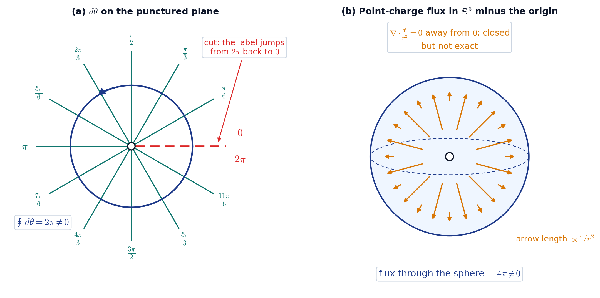

*Figure 19. Closed forms that are not exact. (a) The 1-form $d\theta = \frac{-y\,dx + x\,dy}{x^2 + y^2}$ on the plane with the origin removed (open circle), drawn as its stack: the rays $\theta = 0, \frac{\pi}{6}, \dots, \frac{11\pi}{6}$, which crowd together near the origin. Going once round the unit circle counterclockwise crosses the whole stack, so $\oint d\theta = 2\pi \neq 0$. No single function $\theta$ works on the whole punctured plane: the labels must jump from $2\pi$ back to $0$ somewhere, here along the dashed cut. (b) The field $\frac{\hat{\mathbf{r}}}{r^2}$ of a point charge in $\mathbb{R}^3$ with the origin removed (arrow length proportional to $1/r^2$). Its divergence is $0$ away from the origin, so its flux 2-form is closed. But its flux through the sphere is $4\pi \neq 0$, and an exact 2-form would give $0$.*

### Side Quest in Vector Calculus
The concepts of "closed" and "exact" forms are the rigorous, coordinate-independent generalizations of familiar ideas from 3D vector calculus.

In standard 3D space ($\mathbb{R}^3$), we map scalar functions to 0-forms and 3-forms, and vector fields to 1-forms and 2-forms. The exterior derivative $d$ automatically becomes the three fundamental derivatives of vector calculus:

-   $d$ on a 0-form is the Gradient ($\nabla f$)
    
-   $d$ on a 1-form is the Curl ($\nabla \times \vec{A}$)
    
-   $d$ on a 2-form is the Divergence ($\nabla \cdot \vec{B}$)
    

Let $\omega$ be a 1-form (representing a vector field).

1.  **Exact:** If $\omega = df$, it means $\omega$ is the exterior derivative of a 0-form. In vector calculus, this means your vector field is a **gradient field** ($\vec{E} = -\nabla \phi$).
    
2.  **Closed:** If $d\omega = 0$, it means the exterior derivative of $\omega$ is zero. In vector calculus, this means your vector field is **curl-free** or irrotational ($\nabla \times \vec{E} = 0$).
    
3.  **Exact $\implies$ Closed:** Because $d(df) = 0$, the curl of a gradient is always zero ($\nabla \times (\nabla \phi) = 0$).
    
Now let $\Omega$ be a 2-form (representing a flux field, like a magnetic field).

1.  **Exact:** If $\Omega = d\eta$, it means $\Omega$ is the exterior derivative of a 1-form. In vector calculus, this means your field is the **curl of a vector potential** ($\vec{B} = \nabla \times \vec{A}$).
    
2.  **Closed:** If $d\Omega = 0$, it means the exterior derivative of $\Omega$ is zero. In vector calculus, this means your field is **divergence-free** or solenoidal ($\nabla \cdot \vec{B} = 0$, which is Gauss's Law for Magnetism).
    
3.  **Exact $\implies$ Closed:** Because $d(d\eta) = 0$, the divergence of a curl is always zero ($\nabla \cdot (\nabla \times \vec{A}) = 0$).
    

This also explains why "closed" does not always mean "exact." In vector calculus, we are told that if a vector field has zero curl ($\nabla \times \vec{F} = 0$), you can usually write it as the gradient of a scalar potential ($\vec{F} = \nabla f$).

However, there is a critical caveat: this is only true if the space is simply connected, meaning it has no holes that a loop can wrap around, such as an infinitely long wire punching through 3D space, or a single point removed from a plane. (Removing a single point from 3D space does not create such a hole: any loop can slide off the missing point, so 3D space minus the origin is still simply connected, and the field of a point charge there is still the gradient of a potential.) If there is a hole, we can have a field that is completely curl-free everywhere it exists, but it is impossible to define a single, continuous potential function $f$ for it.

This translates identically to forms. On a region with no holes at all, more precisely one that can be shrunk continuously to a point (a contractible region, such as a ball or all of $\mathbb{R}^n$), the Poincaré lemma guarantees that every closed form is exact (every curl-free field is a gradient, and every divergence-free field is a curl). If the manifold has holes, you can have closed forms that are not exact.

### Side Quest in Thermodynamics
1-forms can be used to describe much of thermodynamics. (Here we write $đQ$ and $đW$ for the inexact 1-forms that Aside 2 of [1-Forms](#1-forms) wrote as $\delta Q$ and $\delta W$, since $\delta$ will mean something else in [Stuff You Can Do With A Metric](#stuff-you-can-do-with-a-metric); $E$ for the internal energy $U$; and $p$ for the pressure $P$.) In the 1840s, physicists like James Joule conducted experiments to transition isolated systems from an initial State A to a final State B doing only mechanical work (for example, using a falling weight to turn a paddle wheel inside a sealed tub of water to raise its temperature).

They observed a profound physical fact: to get from State A to State B, the total amount of work required was always the exact same number. It did not matter if they did the work quickly, slowly, or in erratic stages. The work done was entirely independent of the path taken.

In the language of differential geometry, the quasi-static work 1-form $đW = -p\,dV$ is **inexact**, since $d(-p\,dV) = -dp\wedge dV \neq 0$. Its integral over a path $\gamma$ from A to B is path-dependent:

$$W = \int_\gamma đW$$

Joule's work was not of this kind. Stirring a tub of water with a paddle wheel is not $-p\,dV$ work, and it is not quasi-static, so it cannot be written as a 1-form on the space of equilibrium states at all. What his experiments showed is a statement about totals: for a thermally insulated system ($đQ = 0$), the total work needed to take it from State A to State B is the same for every process that does it, however erratic. For a 1-form, path-independence of every integral is exactly what makes it exact: define $f(B)$ as the integral from a fixed starting point, and the 1-form is then $df$. Joule's result does the same job for adiabatic processes, with the total work in place of the integral.

Therefore, the physicists concluded that there is some previously unknown 0-form (state function), which they called the internal energy $E$, whose change is the adiabatic work:

$$W_{\text{adiabatic}}(A \to B) = E(B) - E(A)$$

Once it was established that a state function $E$ exists, the First Law of Thermodynamics was formalized for general, non-isolated systems.

If you remove the insulation and allow heat $đQ$ to flow, the total change in the system's state is no longer just $đW$. Because $E$ is a fundamental property of the state (a 0-form), its exterior derivative $dE$ is always an exact 1-form, no matter how the system transitions.

The First Law postulates that while the heat 1-form $đQ$ and the work 1-form $đW$ are individually inexact (path-dependent), their sum is always an exact 1-form:

$$dE = đQ + đW$$

Thus, the First Law is not merely an accounting rule for transferring energy; it is the fundamental mathematical postulate that a state function $E$ exists whose exterior derivative perfectly absorbs the path-dependency of heat and work.

### Side Quest into Hamiltonian Mechanics

To transition to Hamiltonian mechanics, we shift our focus from configuration space (described by coordinates and velocities) to phase space (described by coordinates and conjugate momenta).

We can treat the generalized coordinates $q^i$ and their canonical momenta $p_i$ on equal footing by combining them into a single $2n$-dimensional state vector $x^\mu$:

$$x^\mu = (q^i, p_i)$$

Here, $i = 1, \dots, n$, representing the $n$ degrees of freedom of the system, meaning the phase space index $\mu$ runs from $1$ to $2n$. By packaging the coordinates and momenta together into $x^\mu$, we can apply the tools of differential geometry to phase space, treating it as a symplectic manifold. A symplectic manifold is a space with a closed 2-form that is non-degenerate: for every non-zero vector $X$ there is a $Y$ with $\omega(X, Y) \neq 0$. On phase space this symplectic form is

$$\omega = \sum_{i=1}^n dp_i\wedge dq^i$$

(a specific 2-form, not the generic $\omega$ of earlier sections). It is closed because $d(dp_i\wedge dq^i) = 0$, and for one degree of freedom it measures area in the $(q, p)$ plane.

The time evolution of the system is governed by a Hamiltonian energy function $H$. This function generates a vector field $X_H$ that dictates how the system moves. The strict geometric definition linking the energy to the motion is:

$$\iota_{X_H} \omega = -dH$$

With one degree of freedom, writing $X_H = \dot q\,\partial_q + \dot p\,\partial_p$ gives $\iota_{X_H}\omega = \dot p\,dq - \dot q\,dp$. Matching this with $-dH = -\frac{\partial H}{\partial q}dq - \frac{\partial H}{\partial p}dp$ gives Hamilton's equations, $\dot q = \frac{\partial H}{\partial p}$ and $\dot p = -\frac{\partial H}{\partial q}$.

If we want to know if the phase space volume changes as the system evolves over time, we need to take the Lie derivative of the symplectic 2-form $\omega$ along the flow $X_H$. Using Cartan's Magic Formula, the calculation is trivial:

$$\mathcal{L}_{X_H} \omega = d(\iota_{X_H} \omega) + \iota_{X_H}(d\omega)$$

Because the symplectic form is closed, $d\omega = 0$, so the second term vanishes. We then substitute the Hamiltonian definition into the first term:

$$\mathcal{L}_{X_H} \omega = d(-dH) = -d(dH)$$

Because the exterior derivative is nilpotent ($d^2 = 0$), the entire expression collapses:

$$\mathcal{L}_{X_H} \omega = 0$$

In three lines of pure algebra, Cartan's formula shows that the flow preserves $\omega$. One more line gives Liouville's Theorem. The phase-space volume form is $\frac{\omega^n}{n!}$ (the wedge of $n$ copies of $\omega$), and by the Leibniz rule $\mathcal{L}_{X_H}(\omega^n) = n\,\omega^{n-1}\wedge\mathcal{L}_{X_H}\omega = 0$. So the volume of phase space is strictly conserved as a classical system evolves, however complex the forces involved, as long as the motion is Hamiltonian. Friction, for example, shrinks phase-space volume.

Figure 20 follows a blob of initial conditions under a pendulum and under a damped oscillator.

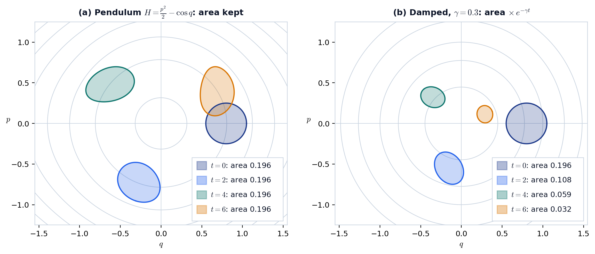

*Figure 20. Liouville's theorem. A disc of initial conditions of radius $0.25$ centred at $(q, p) = (0.8, 0)$, with area $\pi(0.25)^2 \approx 0.196$, is followed at $t = 0, 2, 4, 6$ (navy, blue, teal, amber). (a) Under the pendulum, $H = \frac{p^2}{2} - \cos q$, the blob is carried round and sheared, but its area stays $0.196$ at every time. The grey lines are level curves of $H$. (b) The damped oscillator $\dot q = p$, $\dot p = -q - \gamma p$ with $\gamma = 0.3$ is not Hamiltonian. Its areas fall to $0.108$, $0.059$ and $0.032$, matching $0.196\,e^{-\gamma t}$: friction shrinks phase-space volume.*

## The Metric Tensor

A metric $g$ is a $(0, 2)$ symmetric tensor field. It can be written as a tensor product of basis 1-forms: $g = g_{\mu\nu}(x) dx^\mu \otimes dx^\nu$, which means it eats two vectors to give a scalar, or one vector to give a covector (this operation is called index lowering: $X_\mu = g_{\mu\nu}X^\nu$). The metric components can be extracted via dot products of the coordinate basis vectors (as we discussed in our intuitive analogy):

$$g_{\mu\nu}(x) = g\left(\frac{\partial}{\partial x^\mu}, \frac{\partial}{\partial x^\nu}\right)$$

We are primarily interested in metrics of pseudo-Riemannian manifolds. For Riemannian manifolds, we are guaranteed that a metric evaluates to a positive number for all non-zero vectors (it is positive-definite). Pseudo-Riemannian manifolds relax this: they only require the metric to be _non-degenerate_. This means that if $g(X, Y) = 0$ for _all_ possible vectors $Y$, then $X$ must be the zero vector. Crucially, a pseudo-Riemannian metric can evaluate to zero or a negative number for a non-zero vector.

The metric components $g_{\mu\nu}$ form a symmetric matrix. As we pointed out about Riemann Normal Coordinates, we can always pick a basis for each tangent space where the metric's matrix is perfectly diagonal. Because the metric is non-degenerate, none of these diagonal elements can be $0$. Furthermore, a theorem called **Sylvester's Law of Inertia** states that no matter what coordinate basis you choose to diagonalize the metric, the _number_ of positive and negative diagonal elements (the metric signature) will always remain strictly the same.

The tensor $g$ can be written as a line element $ds^2$:

$$ds^2 = g_{\mu\nu}(x) dx^\mu dx^\nu$$

For purely spatial (Riemannian) geometry, this allows us to measure the length of a vector $X$ at each point and the angles between vectors:

$$\vert{}X\vert{} = \sqrt{g(X, X)}$$

$$g(X, Y) = \vert{}X\vert{}\vert{}Y\vert{} \cos\theta$$

We can also measure distance along a curve. If $X$ is a vector field tangent to the curve and the coordinates of the curve are given by the functions $x^\mu(t)$, the tangent vector components are $X^\mu = \frac{dx^\mu}{dt}$, and the distance is:

$$\int_a^b dt \sqrt{g_{\mu\nu}(x) \frac{dx^\mu}{dt} \frac{dx^\nu}{dt}}$$

This formula is reparameterization invariant: if we switch to a new parameter $t'$, each $\frac{dx^\mu}{dt}$ picks up a factor $\frac{dt'}{dt}$, which comes out of the square root and cancels against $dt = \frac{dt}{dt'}\,dt'$.

In General Relativity, the manifolds we encounter will have a metric where one of the diagonal entries has a sign opposite to the rest (a signature of either $(-, +, +, +)$ or $(+, -, -, -)$). Such manifolds are called Lorentzian manifolds. Their geometry is built on hyperbolas rather than circles: the vectors with $g(X, X) = -1$ form a hyperboloid, much as the unit vectors of a Riemannian metric form a sphere. The Minkowski metric is the simplest example of one of these metrics, used for flat spacetime.

If we assume the mostly-plus convention $(-, +, +, +)$, a vector is timelike if $g(X, X) < 0$, null (or lightlike) if $g(X, X) = 0$, and spacelike if $g(X, X) > 0$. For the mostly-minus convention, these signs perfectly flip. The null tangent vectors at any point form a lightcone. Directions inside or on the cone are ones a signal can travel along; directions outside are ones no signal can, and events in those directions can be made simultaneous by a suitable observer. The direction of lightcones can change at each point of the manifold.

Figure 21 shows the light cone at a point, with one vector of each kind.

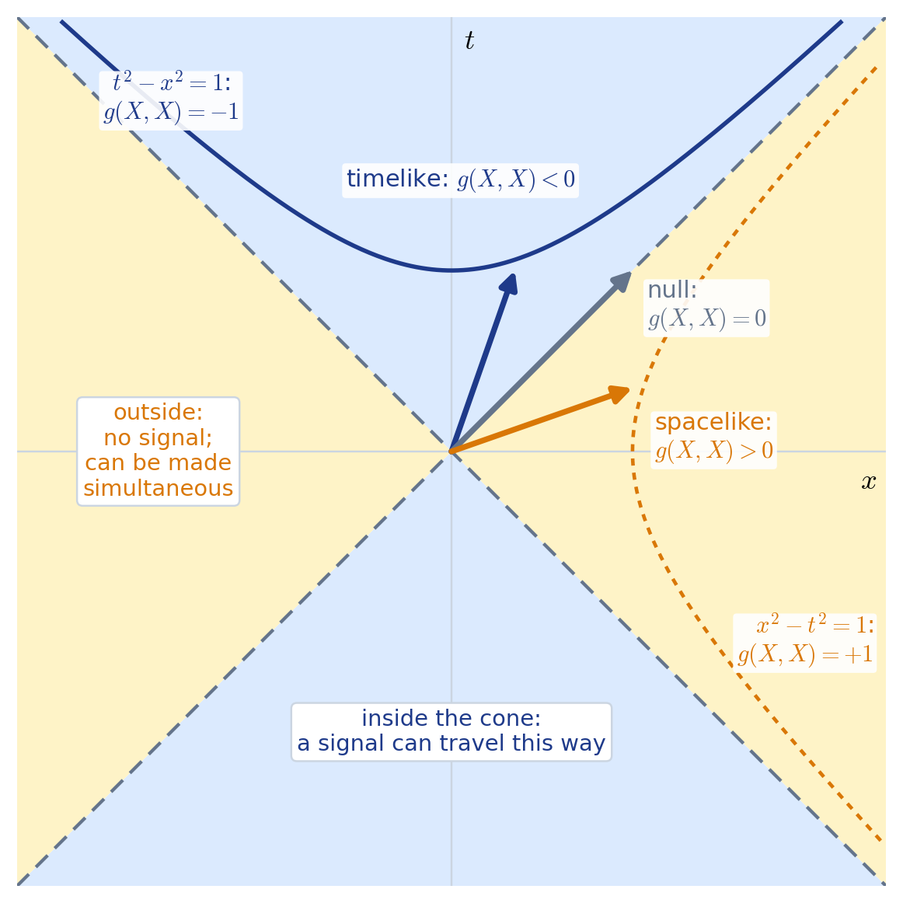

*Figure 21. The light cone at a point, in the mostly-plus convention with $c = 1$ ($x$ across, $t$ up). The null lines $t = \pm x$ (dashed) separate the timelike directions inside the cone (blue) from the spacelike directions outside (amber). A signal can travel along any direction inside the cone and along none outside it; events in the outside directions can be made simultaneous by a suitable observer. The timelike vector $(x, t) = (0.35, 1)$ has $g(X, X) = -0.8775$, the null vector $(1, 1)$ has $g(X, X) = 0$, and the spacelike vector $(1, 0.35)$ has $g(X, X) = 0.8775$. The vectors with $g(X, X) = -1$ form the hyperbola $t^2 - x^2 = 1$, which plays the role that the unit circle plays for a Riemannian metric. The dotted hyperbola $x^2 - t^2 = 1$ is $g(X, X) = +1$.*

Because a timelike vector yields a negative length squared, our earlier spatial distance formula would return an imaginary number. The physical distance measured along a timelike worldline is therefore the proper time $\tau$. Parameterized by a parameter $t$, it is given by absorbing the negative sign:

$$\tau = \int_a^b dt \sqrt{-g_{\mu\nu} \frac{dx^\mu}{dt} \frac{dx^\nu}{dt}}$$

Since the metric is a tensor product of two covectors, we can also feed it one vector and get a covector. This is an isomorphism, and is called index lowering. The components of the vector $X$  and covector (also called $X$) are related by $X_\mu = g_{\mu\nu}X^\nu$, where the position of the indices tells us that the LHS is the covector component and the RHS is the vector component. You can use the inverse metric to raise the index on a 1-form to get a vector.  $X^\mu = g^{\mu\nu}X_\nu$

### Stuff You Can Do With A Metric

**Volume Form:** The metric tensor $g_{\mu\nu}$ provides a natural, coordinate-independent way to integrate over a manifold $M$ by defining a canonical volume form $v$. For an $n$-dimensional manifold, the volume top-form is:

$$v = \sqrt{\vert{}g\vert{}} dx^1 \wedge \dots \wedge dx^n$$

where $g = \det(g_{\mu\nu})$. The absolute value handles the negative determinants found in Lorentzian (spacetime) manifolds.

The scalar factor $\sqrt{\vert{}g\vert{}}$ perfectly absorbs the Jacobian determinant generated by changing coordinates. This ensures the geometric volume remains invariant regardless of the coordinate grid used.

Associated with the volume form is the totally anti-symmetric Levi-Civita symbol $\epsilon_{\mu_1...\mu_n}$, which is not a true tensor because it transforms with the determinant of the Jacobian matrix (it is a "tensor density of weight +1"). To make it a true tensor, it must be multiplied by $\sqrt{\vert{}g\vert{}}$, yielding the covariant volume components:

$$v_{\mu_1...\mu_n} = \sqrt{\vert{}g\vert{}} \epsilon_{\mu_1...\mu_n}$$

**Hodge Dual:** The metric allows us to map any $p$-form to a complementary $(n-p)$-form via the Hodge dual operator $\star$: $\star : \Lambda^p(M) \to \Lambda^{n-p}(M)$. To execute this mathematically, we must contract the $p$-form with the volume form:

$$(\star\omega)_{\nu_1 \dots \nu_{n-p}} = \frac{1}{p!} \omega^{\mu_1 \dots \mu_p} v_{\mu_1 \dots \mu_p \nu_1 \dots \nu_{n-p}}$$

The Hodge star operator ($\star$) takes a $p$-form and mathematically maps it to its orthogonal complement, the exact $(n-p)$ dimensions of the manifold that are "not in the $p$-form." Applying it twice returns the original form, up to a sign determined by the manifold's dimension, the degree of the form, and the metric signature: $\star (\star \omega) = (-1)^{p(n-p)+s}\omega$, where $s$ is the number of minus signs in the signature ($s = 0$ for a Riemannian metric, $s = 1$ for spacetime).

**The Inner Product:** The Hodge dual allows the construction of a global, positive-definite (on Riemannian manifolds) inner product for $p$-forms. By wedging a $p$-form $\eta$ with the dual of another $p$-form $\omega$, we create a top-form that can be integrated over the entire manifold:

$$\langle \eta, \omega \rangle = \int_M \eta \wedge \star \omega$$

Note that $\eta \wedge \star \omega$ acts as a volume density. It is a field that varies from coordinate to coordinate. To get a global scalar out of the inner product, we must integrate over the manifold. At each point, $\eta\wedge\star\omega$ equals the pointwise inner product of the two forms times $\mathrm{vol}$ (the rule in [Hodge & Hodge Duals](#hodge-hodge-duals) is the case $\eta = \omega$ for a basis form), so the integral adds up these pointwise values over $M$. From here on, $\langle\eta,\omega\rangle$ means this integral, not the pointwise number.

This specific integral is incredibly important because it constructs the action of a field. The top-form is the Lagrangian density, and integrating it gives us the action. For example, the entire action for the electromagnetic field in curved spacetime is simply $S = -\frac{1}{2} \int F \wedge \star F$.

**Adjoint Derivative ($d^\dagger$ or $\delta$):** Just as operators in quantum mechanics have adjoints, the exterior derivative $d$ has an adjoint operator $d^\dagger$ (also called the codifferential, often denoted $\delta$).

$$d^\dagger : \Lambda^p(M) \to \Lambda^{p-1}(M)$$

It is constructed by sandwiching $d$ between two Hodge stars:

$$d^\dagger = \pm(-1)^{np+n-1} \star d \star$$

$d^\dagger$ is defined as the formal adjoint of $d$ with respect to the inner product. By applying Stokes' Theorem to a closed manifold (here meaning compact and without boundary, not to be confused with a closed form), the derivative can be shifted from one form to the other:

$$\langle d\alpha, \omega \rangle = \langle \alpha, d^\dagger\omega \rangle$$

**Laplace-de Rham Operator ($\Delta$):** The exterior derivative $d$ (generalizing gradient/curl) and its adjoint $d^\dagger$ (generalizing divergence) combine to form the Laplacian on manifolds.

$$\Delta = d d^\dagger + d^\dagger d$$

Its action on functions is such that because a scalar function $f$ is a 0-form, $d^\dagger f = 0$ (because $\star$ of a scalar is a top-form and $d$ of a top-form is 0). The geometric Laplacian acting on a function reduces to $- \star d \star d f$. Note that this formulation generates a non-negative operator, meaning it carries a minus sign relative to the standard curved-space Laplacian ($\nabla^2$) used in physics:

$$\Delta f = - \nabla^2 f = - \frac{1}{\sqrt{\vert{}g\vert{}}} \partial_\nu \left( \sqrt{\vert{}g\vert{}} g^{\mu\nu} \partial_\mu f \right)$$

**Hodge Theory and Topology:** Now we connect local differential equations (the Laplacian) to global topology (cohomology). First, we define what a harmonic form is.

A $p$-form $\gamma$ is called harmonic if it satisfies Laplace's equation: $\Delta\gamma = 0$.

On a compact Riemannian manifold, where the inner product is positive-definite, the equation $\langle \gamma, \Delta \gamma \rangle = 0$ forces the sum of two positive squares to be zero: $\langle d\gamma, d\gamma \rangle + \langle d^\dagger \gamma, d^\dagger \gamma \rangle = 0$ (because $\langle \alpha, d^\dagger \omega \rangle = \langle d\alpha, \omega \rangle$ means $\langle \gamma, d (d^\dagger \gamma) \rangle = \langle d^\dagger \gamma, d^\dagger \gamma \rangle$ and $\langle \gamma, d^\dagger (d \gamma) \rangle = \langle d\gamma, d \gamma \rangle$).

Therefore, every harmonic form is simultaneously closed: $d\gamma = 0$, and co-closed: $d^\dagger \gamma = 0$.

**The Hodge Decomposition Theorem:** Any arbitrary $p$-form $\omega$ on a compact Riemannian manifold can be uniquely broken into three mutually orthogonal components:

$$\omega = d\alpha + d^\dagger\beta + \gamma$$

Where $d\alpha$ is an exact form, $d^\dagger\beta$ is a co-exact form, and $\gamma$ is a harmonic form.

**Hodge's Theorem:** There is an exact isomorphism between the space of harmonic forms $\text{Harm}^p(M)$ and the de Rham cohomology group $H^p(M)$:

$$\text{Harm}^p(M) \cong H^p(M)$$

The cohomology group $H^p(M)$, defined in [de Rham Cohomology](#de-rham-cohomology), groups the closed forms into classes that differ by exact forms, and the classes that are not zero detect the holes in the manifold. The dimension of this group equals the number of independent holes in that specific dimension and is called the $p$-th Betti number. For example, a sphere has $b_1 = 0$, because every loop on it can be shrunk to a point, while a torus has $b_1 = 2$.

Figure 22 shows both.

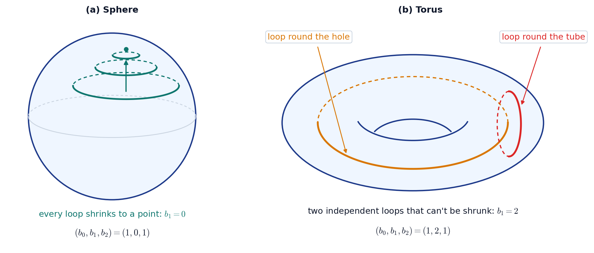

*Figure 22. Holes counted by Betti numbers. (a) On a sphere every loop can be shrunk to a point (teal), so there are no independent 1-dimensional holes: $b_1 = 0$, and $(b_0, b_1, b_2) = (1, 0, 1)$. (b) On a torus, a loop round the hole (amber) and a loop round the tube (red) cannot be shrunk to a point, and neither can be deformed into the other: $b_1 = 2$, and $(b_0, b_1, b_2) = (1, 2, 1)$. Dashed parts are on the far side.*

Hodge's Theorem proves that within every infinite equivalence class of closed forms, there is exactly one unique harmonic form ($\Delta \gamma = 0$). The harmonic form is also the one with the smallest energy $\langle\omega, \omega\rangle$ in its class, since adding an exact piece $d\alpha$ adds $\langle d\alpha, d\alpha\rangle \geq 0$ (the cross term $\langle\gamma, d\alpha\rangle = \langle d^\dagger\gamma, \alpha\rangle$ vanishes). Physically, among all fields with the same topological configuration dictated by the shape of the space, the harmonic one is the minimum-energy state.

### Hodge Duals & Electromagnetism

In classical field theory, the dynamical degrees of freedom are fields, which are objects taking values at each point in the spacetime manifold $M$. The simplest example is a scalar field, which assigns a smooth function across $M$.

The theory of electromagnetism is described by a 1-form field, the vector potential $A$. This field is subject to gauge transformations of the form $A \to A + d\alpha$, where $\alpha$ is an arbitrary scalar function. To extract physical observables that are invariant under this gauge redundancy, we take the exterior derivative to construct the field strength 2-form $F = dA$. Because the exterior derivative is nilpotent ($d^2 = 0$), the field strength is strictly gauge-invariant.

The dynamics of these fields are governed by an action principle, constructed by integrating a top-level form (a 4-form in 4D spacetime) over the manifold $M$. The language of differential geometry severely restricts what actions are mathematically possible to write down.

If the manifold lacks a metric, the only 4-form we can build purely from the field strength is the wedge product of $F$ with itself:

$$S_{top} = -\frac{1}{2} \int_M F \wedge F$$

This is a topological action. In terms of physical electric and magnetic fields, it evaluates to $\int d^4x (\mathbf{E} \cdot \mathbf{B})$. Because we can apply the product rule of exterior derivatives to write $F \wedge F = d(A \wedge F)$, the entire integrand is an exact form (a total derivative). By Stokes' theorem, the integral evaluates purely at the boundary of the manifold. Consequently, it does not contribute to the local classical equations of motion.

To generate non-trivial classical dynamics, the manifold must be equipped with a metric tensor $g_{\mu\nu}$. The metric allows us to define the Hodge star operator $\star$, which maps the 2-form $F$ into its dual 2-form $\star F$. This allows us to construct a dynamically relevant 4-form, giving the Maxwell action in curved spacetime:

$$S_{Maxwell} = -\frac{1}{2} \int_M F \wedge \star F = -\frac{1}{4} \int d^4x \sqrt{-g} \, g^{\mu\nu} g^{\rho\sigma} F_{\mu\rho} F_{\nu\sigma} = -\frac{1}{4} \int d^4x \sqrt{-g} \, F^{\mu\nu} F_{\mu\nu}$$

Breaking down the components of the coordinate representation:

-   $d^4x$: The standard coordinate volume element.
    
-   $\sqrt{-g}$: The square root of the negative determinant of the metric, which acts as the Jacobian correction to ensure the volume element is a true geometric invariant under coordinate transformations.
    
-   $g^{\mu\nu} g^{\rho\sigma} F_{\mu\rho} F_{\nu\sigma}$: The full contraction of the field strength tensor using the inverse metric, yielding the Lorentz-invariant scalar $F^{\mu\nu} F_{\mu\nu}$. In flat Minkowski space, this evaluates to $2(B^2 - E^2)$.
    

Varying this action with respect to the field $A$ yields half of the source-free Maxwell equations, written elegantly in the language of differential forms as $d \star F = 0$ (Gauss's law and the Ampère–Maxwell law, without sources). The other half, $dF = 0$ (Faraday's law and the absence of magnetic monopoles), comes for free: $F = dA$, so $dF = d^2A = 0$.

To describe physical interactions with matter, we couple the gauge field to an electric current, described geometrically as a 1-form $J$. The interacting action becomes:

$$S = \int_M \left( -\frac{1}{2} F \wedge \star F + A \wedge \star J \right)$$

Fundamental physical consistency requires that this interacting action remains invariant under the gauge transformation $A \to A + d\alpha$. Under this shift, the action transforms by an additional term: $\int d\alpha \wedge \star J$. Integrating this by parts (and assuming the boundary terms vanish at infinity) shifts the exterior derivative from $\alpha$ onto the current dual form. For the action to remain unchanged for any arbitrary scalar $\alpha$, we must enforce:

$$d \star J = 0$$

This is the geometric expression of current conservation (the continuity equation $\nabla_\mu J^\mu = 0$). With the source term included in the action, the variational principle yields the full Maxwell equations of motion: $d \star F = \star J$.

## The Covariant Derivative

A tensor is a physical object that exists on the manifold independently of any coordinate system. The covariant derivative isolates the true, intrinsic rate of change of that tensor relative to the manifold itself. However, when we impose a coordinate grid onto a curved manifold, that grid will inevitably twist, stretch, or shrink from point to point. Because we describe the invariant tensor using the components of this twisting grid, if you only take the naive partial derivative of the tensor components ($\partial_\nu Y^\mu$), you are only measuring how the component's numbers change. As your coordinate grid curves, like latitude and longitude lines on the Earth, the numerical components $Y^\mu$ of a vector will change from point to point even if the physical vector is pointing rigidly in the exact same direction. The partial derivative is "polluted" by this coordinate illusion. 

This is why the covariant derivative has to know about the coordinate grid and how it connects across local patches of the manifold: it takes the grid's twisting into account, so that its result does not depend on the grid. A connection is a map that helps you go from local patch to local patch in the manifold. It is written in terms of the covariant derivative: $\nabla(X, Y) = \nabla_X Y$, where the object $\nabla_X$ is the covariant derivative. It measures if the field $Y$ is "straight" and constant relative to the intrinsic curvature of the manifold itself.

The covariant derivative satisfies three fundamental properties for all vector fields $X, Y, Z$ and all scalar functions $f, g$:

-   **Additivity:** $\nabla_X(Y + Z) = \nabla_X Y + \nabla_X Z$
    
-   **Linearity in the lower index:** $\nabla_{fX+gY}Z = f\nabla_X Z + g\nabla_Y Z$
    
-   **Leibniz (Product) Rule:** $\nabla_X(fY) = f\nabla_X Y + (\nabla_X f)Y$, where the action on a scalar function is defined as simply taking the directional derivative: $\nabla_X f = X(f)$.
    
The equivalent notations are often used for this: $\nabla_\mu = \nabla_{e_\mu}$. The covariant derivative is:

$$\nabla_X Y = \nabla_X(Y^\mu e_\mu)$$

$$= X(Y^\mu)e_\mu + Y^\mu \nabla_X e_\mu$$

$$= X^\nu e_\nu(Y^\mu)e_\mu + X^\nu Y^\mu \nabla_{e_\nu} e_\mu$$

The covariant derivative of a basis vector is again a vector, so we can write it as a linear combination of the basis vectors. Its coefficients define the connection coefficients $\Gamma$:

$$\nabla_{e_\nu} e_\rho = \Gamma^\mu_{\nu\rho}\, e_\mu$$

Substituting this and renaming the dummy indices so we can factor out $e_\mu$, we get:

$$\nabla_X Y = X^\nu \left[ e_\nu(Y^\mu) + \Gamma^\mu_{\nu\rho} Y^\rho \right] e_\mu$$

Because the operator $\nabla_X$ is linear with respect to $X$ we can cleanly strip off the overall factor of $X^\nu$, and it makes sense to define the components of the covariant derivative  along the basis directions. Assuming a standard coordinate basis where $e_\nu = \partial_\nu$, the components of the covariant derivative $\nabla_\nu Y$ are:

$$(\nabla_\nu Y)^\mu = \partial_\nu Y^\mu + \Gamma^\mu_{\nu\rho} Y^\rho$$

The first term ($\partial_\nu Y^\mu$) is simply the gradient of the components of $Y$. It measures how the raw numerical coordinates of the vector change from point to point.

The second term ($\Gamma^\mu_{\nu\rho} Y^\rho$) is the geometric correction that subtracts how the basis vectors $e_\nu$ themselves are changing, expressed in terms of the other basis vectors. We must include this in our definition of the derivative so that we get an accurate picture of how the vector $Y$ is changing due to its own nature and not because of changes in the coordinate system itself.

For example, let's say the coordinate basis was getting smaller. The first term of the covariant derivative i.e. the components would be positive because the components would appear to get larger. But the second term would be negative because the basis is becoming smaller and these effects would cancel each other out to give us the true rate of change of the vector.

It is worth comparing this to the Lie derivative. Both operators coincide when acting on scalar functions: $\nabla_X f = \mathcal{L}_X f = X(f)$, which also matches the partial-derivative expression $X^\mu\partial_\mu f$.

However, their actions on vector fields are fundamentally different. The Lie derivative $\mathcal{L}_X Y = [X, Y]$ depends on both $X$ and the first derivative of $X$. The covariant derivative depends only on the algebraic value of $X$ at that specific point. This linearity is exactly why we could write $\nabla_X = X^\nu \nabla_\nu$ and think of $\nabla_\mu$ as an independent operator in its own right (there is no equivalent way to write "$\mathcal{L}_X = X^\mu \mathcal{L}_\mu$"). This algebraic independence is why the covariant derivative, not the Lie derivative, is the natural geometric generalization of the partial derivative to curved spacetime.

Notation-wise, $\nabla_\nu Y^\mu$ is the same as $(\nabla_\nu Y)^\mu$, and should not be thought of as the covariant derivative of the $\mu$ component of $Y$. You may also encounter a simple comma used to denote the standard partial derivative. $\partial_\nu Y^\mu$ is written as $Y^\mu_{,\nu}$. A semi-colon denotes the full covariant derivative. $\nabla_\nu Y^\mu$ is written as $Y^\mu_{;\nu}$. The component formula for the covariant derivative of a vector field becomes: $Y^\mu_{;\nu} = Y^\mu_{,\nu} + \Gamma^\mu_{\nu\rho} Y^\rho$

The covariant derivative of a 1-form is $\nabla_\nu \omega_\mu = \partial_\nu \omega_\mu - \Gamma^\rho_{\nu\mu} \omega_\rho$, where the sign in front of the Christoffel symbols has flipped to a minus. The minus sign follows from the Leibniz rule. $\omega_\mu Y^\mu$ is a scalar, so its covariant derivative is a plain partial derivative: $\partial_\nu(\omega_\mu Y^\mu) = (\nabla_\nu\omega)_\mu Y^\mu + \omega_\mu(\nabla_\nu Y)^\mu$. Expand the left side by the ordinary product rule and substitute $(\nabla_\nu Y)^\mu = \partial_\nu Y^\mu + \Gamma^\mu_{\nu\rho}Y^\rho$ on the right. The $\omega_\mu\partial_\nu Y^\mu$ terms cancel, leaving $(\nabla_\nu\omega)_\rho Y^\rho = (\partial_\nu\omega_\rho - \Gamma^\mu_{\nu\rho}\omega_\mu)Y^\rho$ for every $Y$. 

The covariant derivative is really a relationship between the tensor, the manifold and the connection. You can choose a connection such that it makes the covariant derivative of some random tensor $T$ zero ($\nabla T = 0$), but the rest of the tensors will still experience a non-zero covariant derivative. In general relativity, we tend to choose the Levi-Civita connection which is torsion-free and metric compatible, which means $\nabla_\rho g_{\mu\nu} = 0$ (though other tensors may still have non-zero covariant derivatives). We have picked a connection that perfectly matches how the metric tensor is changing. This means we can make measurements all over the place and be sure that they are compatible with each other because the metric tensor components change in sync with the coordinate system's changes. 

We can see this immediately if we write out the component expansion of $\nabla_\rho g_{\mu\nu} = 0$ and do some basic algebra:

$$\nabla_\rho g_{\mu\nu} = \partial_\rho g_{\mu\nu} - \Gamma^\sigma_{\rho\mu} g_{\sigma\nu} - \Gamma^\sigma_{\rho\nu} g_{\mu\sigma} = 0$$

If you move the connection terms to the other side of the equals sign, you get:

$$\partial_\rho g_{\mu\nu} = \Gamma^\sigma_{\rho\mu} g_{\sigma\nu} + \Gamma^\sigma_{\rho\nu} g_{\mu\sigma}$$

Read this equation purely conceptually: The raw coordinate change of the metric components ($\partial_\rho g_{\mu\nu}$) is perfectly absorbed and matched by the twisting of the connection ($\Gamma$).

To solve for $\Gamma$, write this equation three times with the indices cycled, and lower the upper index of $\Gamma$ with the metric, $\Gamma_{\sigma\rho\mu} = g_{\sigma\lambda}\Gamma^\lambda_{\rho\mu}$:

$$\partial_\rho g_{\mu\nu} = \Gamma_{\nu\rho\mu} + \Gamma_{\mu\rho\nu}, \qquad \partial_\mu g_{\nu\rho} = \Gamma_{\rho\mu\nu} + \Gamma_{\nu\mu\rho}, \qquad \partial_\nu g_{\rho\mu} = \Gamma_{\mu\nu\rho} + \Gamma_{\rho\nu\mu}$$

For the Levi-Civita connection, zero torsion means $\Gamma$ is symmetric in its last two indices (see [The Torsion Tensor](#the-torsion-tensor)). Add the second and third equations and subtract the first. The symmetric pairs cancel, leaving $\partial_\mu g_{\nu\rho} + \partial_\nu g_{\rho\mu} - \partial_\rho g_{\mu\nu} = 2\Gamma_{\rho\mu\nu}$. Raising the index $\rho$ gives the Christoffel symbols of the second kind for the Levi-Civita connection:

$$\Gamma^\lambda_{\mu\nu} = \frac{1}{2} g^{\lambda\rho} (\partial_\mu g_{\nu\rho} + \partial_\nu g_{\mu\rho} - \partial_\rho g_{\mu\nu})$$

Note that for the Minkowski metric, where the metric does not change, these symbols become 0. However, in other coordinates like the polar coordinate system, these symbols can be non-zero even for flat space.

For example, the flat plane in polar coordinates has $ds^2 = dr^2 + r^2\,d\theta^2$, so $g_{rr} = 1$ and $g_{\theta\theta} = r^2$, and the only non-zero derivative of the metric is $\partial_r g_{\theta\theta} = 2r$. The formula gives

$$\Gamma^r_{\theta\theta} = -\frac{1}{2}\partial_r g_{\theta\theta} = -r, \qquad \Gamma^\theta_{r\theta} = \Gamma^\theta_{\theta r} = \frac{1}{2}g^{\theta\theta}\partial_r g_{\theta\theta} = \frac{1}{r}$$

and all the others are zero. Now take the constant field $\partial_x$, the same arrow everywhere. In polar components it is $Y = \cos\theta\,\partial_r - \frac{\sin\theta}{r}\partial_\theta$, whose components change from point to point. The partial derivatives see that change, but the $\Gamma$ terms cancel it exactly. For example,

$$(\nabla_\theta Y)^r = \partial_\theta Y^r + \Gamma^r_{\theta\theta}Y^\theta = -\sin\theta + (-r)\left(-\frac{\sin\theta}{r}\right) = 0$$

and the same happens for every component, so $\nabla Y = 0$, as it must for an arrow that doesn't change.

Figure 23 shows the arrows and their changing components.

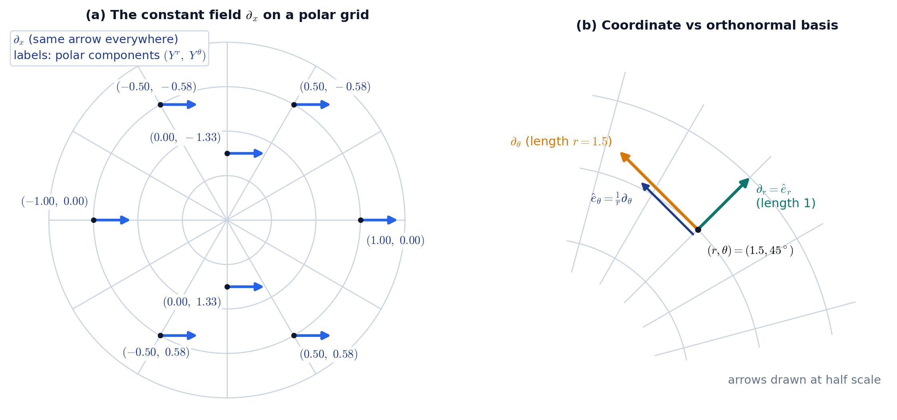

*Figure 23. A constant field in polar coordinates. (a) The field $\partial_x$ is the same arrow at every point, but its polar components $(Y^r, Y^\theta) = \left(\cos\theta, -\frac{\sin\theta}{r}\right)$ change from point to point. On the circle $r = 1.5$ they are $(1.00, 0.00)$ at $\theta = 0^\circ$, $(0.50, -0.58)$ at $60^\circ$ and $(-1.00, 0.00)$ at $180^\circ$; on $r = 0.75$ they are $(0.00, -1.33)$ at $90^\circ$. The partial derivatives of these components are not zero, but the Christoffel terms cancel them, so $\nabla(\partial_x) = 0$. (b) At $(r, \theta) = (1.5, 45^\circ)$, the coordinate basis vector $\partial_r$ has length 1 but $\partial_\theta$ has length $r = 1.5$. Dividing by $r$ gives the orthonormal $\hat e_\theta = \frac{1}{r}\partial_\theta$, while $\hat e_r = \partial_r$. The arrows are drawn at half scale.*

To determine if a space is flat, we must check if the Riemann curvature tensor is 0. The Christoffel symbols are not tensors, so they are not reliable indicators. They can change with coordinate systems. The Riemann tensor is a genuine tensor. If it vanishes in one coordinate system then it must vanish in all of them.

---

**Aside:** The Christoffel symbols are not tensor components. This can be checked by seeing that they do not transform as tensor components. Let us see what the connection looks like when we transition to a different basis. Let us define a new basis $\tilde{e}_\nu$ related to our old basis $e_\mu$ by an invertible transformation matrix $A$:

$$\tilde{e}_\nu = A^\mu_\nu e_\mu$$

If both $e_\mu$ and $\tilde{e}_\nu$ are coordinate bases (which is typically the case in General Relativity), this matrix is simply the Jacobian of the coordinate transformation:

$$A^\mu_\nu = \frac{\partial x^\mu}{\partial \tilde{x}^\nu}$$

To see if the connection coefficients are tensors, we must check if they obey the standard tensor transformation rules. We know that the components of a true $(1, 2)$ tensor, let's call it $T$, transform purely multiplicatively via the matrices:

$$\tilde{T}^\mu_{\nu\rho} = (A^{-1})^\mu_\tau A^\lambda_\nu A^\sigma_\rho T^\tau_{\lambda\sigma}$$

We can now derive the transformation law for the connection components $\Gamma^\mu_{\rho\nu}$ to see if they match this behavior. In our new basis $\tilde{e}_\mu$, the connection is defined as:

$$\nabla_{\tilde{e}_\rho} \tilde{e}_\nu = \tilde{\Gamma}^\mu_{\rho\nu} \tilde{e}_\mu$$

Substituting our transformation matrix into the left side of this equation, we get:

$$\tilde{\Gamma}^\mu_{\rho\nu} \tilde{e}_\mu = \nabla_{(A^\sigma_\rho e_\sigma)} (A^\lambda_\nu e_\lambda)$$

Because the covariant derivative is linear in its lower index, we can immediately pull the scalar $A^\sigma_\rho$ out to the front:

$$\tilde{\Gamma}^\mu_{\rho\nu} \tilde{e}_\mu = A^\sigma_\rho \nabla_{e_\sigma} (A^\lambda_\nu e_\lambda)$$

Now we apply the Leibniz (product) rule to the argument. The covariant derivative will act on the scalar function $A^\lambda_\nu$ (which evaluates to the partial derivative $\partial_\sigma A^\lambda_\nu$) and then act on the basis vector $e_\lambda$ (which evaluates to $\Gamma^\tau_{\sigma\lambda} e_\tau$):

$$\tilde{\Gamma}^\mu_{\rho\nu} \tilde{e}_\mu = A^\sigma_\rho \left[ A^\lambda_\nu \Gamma^\tau_{\sigma\lambda} e_\tau + (\partial_\sigma A^\lambda_\nu) e_\lambda \right]$$

To combine these terms, we can swap the dummy index in the second term from $\lambda$ to $\tau$, allowing us to factor out the basis vector $e_\tau$:

$$\tilde{\Gamma}^\mu_{\rho\nu} \tilde{e}_\mu = \left[ A^\sigma_\rho A^\lambda_\nu \Gamma^\tau_{\sigma\lambda} + A^\sigma_\rho \partial_\sigma A^\tau_\nu \right] e_\tau$$

Finally, we need the left and right sides to use the same basis so we can compare the components directly. We convert $e_\tau$ back into the new basis using the inverse matrix $e_\tau = (A^{-1})^\mu_\tau \tilde{e}_\mu$:

$$\tilde{\Gamma}^\mu_{\rho\nu} \tilde{e}_\mu = \left[ A^\sigma_\rho A^\lambda_\nu \Gamma^\tau_{\sigma\lambda} + A^\sigma_\rho \partial_\sigma A^\tau_\nu \right] (A^{-1})^\mu_\tau \tilde{e}_\mu$$

Stripping off the matching basis vectors $\tilde{e}_\mu$ from both sides, we arrive at the exact transformation law for the components of the connection:

$$\tilde{\Gamma}^\mu_{\rho\nu} = (A^{-1})^\mu_\tau A^\sigma_\rho A^\lambda_\nu \Gamma^\tau_{\sigma\lambda} + (A^{-1})^\mu_\tau A^\sigma_\rho \partial_\sigma A^\tau_\nu$$

This result mathematically proves that connection coefficients (and by extension, the Christoffel symbols) do _not_ transform as tensors.

Looking at the right side of the equation, the first term is exactly the transformation law for a $(1, 2)$ tensor. However, the presence of the second term ruins the tensor nature of the object. This second term contains the derivative of the transformation matrix ($\partial_\sigma A^\tau_\nu$). Together with the $A^\sigma_\rho$ in front of it, it is a second derivative of the coordinates: $A^\sigma_\rho\,\partial_\sigma A^\tau_\nu = \frac{\partial^2 x^\tau}{\partial \tilde{x}^\rho\, \partial \tilde{x}^\nu}$.

This inhomogeneous second term physically represents the relative acceleration between the two coordinate grids. Because $\Gamma$ is not a tensor, you can always find a specific coordinate transformation (Riemann Normal Coordinates) where the first derivatives of the metric vanish, forcing the connection components to be exactly zero at a specific point. If $\Gamma$ were a true tensor, being zero in one coordinate system would mathematically force it to be zero in all coordinate systems, which would mean curved spacetime could not exist!

---

#### $\partial_x \to \mathcal{L}_X \to \nabla_X$: The Difference

If you want to know how the vector field $Y$ is changing, your first instinct is to just take the standard partial derivative: $X^\mu \partial_\mu Y^\nu$. But this naive partial derivative is contaminated by the twisting of the coordinate grid.

If we are interested in measuring how much $Y$ truly deviates from being straight (parallel) along $X$, we must calculate the Covariant Derivative ($\nabla_X Y$) by correcting for and removing the grid's twisting. The Covariant Derivative doesn't care about how $X$ itself changes. $X$ is just a marker of which direction to travel in. We never actually travel all the way along X. It does not matter if the field $X$ is diverging, converging, or swirling wildly an inch away from $p$. Because the covariant derivative is evaluated pointwise, the derivatives of $X$ are mathematically irrelevant. This is why we can ignore the $X$ components and just use the basis vectors as a directional pointer, and then add things up linearly i.e. you multiply by the components of $X$. If $\nabla_X Y = 0$, $Y$ is parallel-transported along $X$: it does not turn or stretch as we move along $X$. (In the special case $Y = X$, the curve's own tangent is parallel-transported along it, and the curve is a geodesic; see [Parallel Transport](#parallel-transport).) The Christoffel term ($+ \Gamma^\nu_{\mu\rho} X^\mu Y^\rho$) is the correction for the grid's twisting. 

Note that the multiplication by the components of $X$ are necessary. They tell the operator how "fast" you are traversing that path. If $X$ represents a particle's velocity, and the particle passes through point $p$ at twice the speed, it will observe the field $Y$ changing twice as fast with respect to its proper time.

If we are interested in a measurement of how much $Y$ truly deviates from perfectly riding the flow of $X$, we must correct for the dragging effects of $X$. The flow term ($- Y^\nu \partial_\nu X^\mu$) corrects for $X$'s shearing. If $\mathcal{L}_X Y = [X, Y] = 0$, the two flows commute: flowing along $X$ then $Y$ lands at the same point as $Y$ then $X$, so the little loops close, and $X$ and $Y$ can serve as coordinate basis fields (see [The Lie Bracket](#the-lie-bracket)). 

## Parallel Transport

Consider a vector field $X$ and one of its integral curves, denoted as $C$. This curve can be parametrized by a scalar variable $\tau$, yielding the coordinate path $x^\mu(\tau)$. By the definition of an integral curve, the vector field evaluated at any point on $C$ is exactly equal to the tangent velocity vector of the curve at that point:

$$X^\mu\vert{}_C = \frac{dx^\mu(\tau)}{d\tau}$$

We define the parallel transport of a general tensor field $T$ along this curve. The tensor $T$ is said to be parallel transported along $C$ if its covariant derivative taken strictly along the direction of $X$ vanishes identically:

$$\nabla_X T = 0$$

This is the "manifold" equivalent of shifting a vector from point to point without changing its orientation. The idea of parallel transport depends on the connection. If the connection changes, the meaning of "parallel" changes because the transport takes place along the connection.

A geodesic is a curve which parallel transports itself. Think of a straight line. If you look at the velocity vector along that line, it never changes direction. At every point on the line, it is parallel to itself at all other points. In other words, a curve whose tangent does not change when it is transported along the curve is a geodesic. This means we must parallel transport the velocity vector along itself.

$$\nabla_X X = 0$$

Writing $X^\mu = \frac{dx^\mu}{d\tau}$, and using that $X^\nu\partial_\nu = \frac{d}{d\tau}$ along the curve, the components $(\nabla_X X)^\mu = X^\nu\partial_\nu X^\mu + \Gamma^\mu_{\rho\nu}X^\rho X^\nu = 0$ become the geodesic equation:

$$\frac{d^2x^\mu}{d\tau^2} + \Gamma^\mu_{\rho\nu} \frac{dx^\rho}{d\tau} \frac{dx^\nu}{d\tau} = 0$$

Here $\tau$ must be an affine parameter, such as proper time. With a parameter that speeds up or slows down along the curve, $\nabla_X X$ points along $X$ instead of vanishing.

## Tensors You Should Know (& Love!)

### The Torsion Tensor

The Torsion tensor is a rank (1,2) tensor that measures the twisting of the Affine Connection. Evaluated with a one-form $\omega$ and two vector fields $X$ and $Y$, it is written as:

$$T(\omega, X, Y) = \omega(\nabla_X Y - \nabla_Y X - [X, Y])$$

Torsion measures whether the rule for parallel transport (the connection) causes space to twist. To test this, you attempt to build a parallelogram using two vector fields, $X$ and $Y$. You compare $Y$ with its parallel transport along $X$ (the difference per unit step is $\nabla_X Y$), and you compare $X$ with its parallel transport along $Y$ ($\nabla_Y X$).

If you subtract these two terms, you are measuring the gap between where the two paths end. However, this gap could exist simply because the vector fields $X$ and $Y$ do not commute, meaning their flows naturally fail to form a closed loop. The Lie bracket $[X, Y]$ quantifies this. By subtracting $[X, Y]$, you filter out the distortions caused by the vector fields. If the result is not zero, the remaining gap is the Torsion. It means the Affine Connection itself is twisting the vectors as you transport them. (In General Relativity, we enforce a "torsion-free" Levi-Civita connection, forcing this tensor to be exactly zero).

The components of the torsion tensor in a coordinate basis $e_\mu = \partial_\mu$, with dual basis $f^\rho = dx^\rho$, come from putting $\omega = f^\rho$, $X = e_\mu$ and $Y = e_\nu$. Coordinate basis fields commute, $[e_\mu, e_\nu] = 0$, so the bracket term drops out:

$$T^\rho_{\mu\nu} = f^\rho(\Gamma^\sigma_{\mu\nu} e_\sigma - \Gamma^\sigma_{\nu\mu} e_\sigma)$$

Applying the dual basis $f^\rho$ to the vector $e_\sigma$ yields the Kronecker delta $\delta^\rho_\sigma$, which simply replaces the index $\sigma$ with $\rho$:

$$T^\rho_{\mu\nu} = \Gamma^\rho_{\mu\nu} - \Gamma^\rho_{\nu\mu}$$

In a basis that does not come from coordinates, such as the tetrads of [Tetrad Formalism](#tetrad-formalism), $[e_\mu, e_\nu] \neq 0$ and the bracket term stays.

The connection coefficients $\Gamma^\rho_{\mu\nu}$ do not transform as tensors but their anti-symmetric part $\Gamma^\rho_{[\mu\nu]}$ does. Also, the torsion tensor is obviously anti-symmetric in its lower two indices, $T^\rho_{\mu\nu} = -T^\rho_{\nu\mu}$. 

If a connection is symmetric in its components, then $\Gamma^\rho_{\mu\nu} = \Gamma^\rho_{\nu\mu}$ and $T^\rho_{\mu\nu} = 0$. Such connections are said to be torsion-free. Geometrically, zero torsion means that if you infinitesimally parallel transport vector $X$ along vector $Y$, and vector $Y$ along vector $X$, the resulting parallelogram perfectly closes.

### The Riemann Curvature Tensor

The Riemann Curvature tensor is a rank (1,3) tensor that measures the intrinsic curvature of the manifold. Evaluated with a one-form $\omega$ and three vector fields $X$, $Y$, and $Z$, it is written as:

$$R(\omega, Z, X, Y) = \omega(\nabla_X \nabla_Y Z - \nabla_Y \nabla_X Z - \nabla_{[X,Y]} Z)$$

The Riemann Curvature tensor tests if the manifold is curved by taking a vector $Z$ on an infinitesimal round trip. You take $Z$ along $Y$ and then along $X$, measuring at each step how it differs from parallel transport ($\nabla_X \nabla_Y Z$), and compare this with going along $X$ first and then $Y$ ($\nabla_Y \nabla_X Z$).

If the manifold is flat, the order of operations does not matter, and the vector $Z$ will point in the exact same direction either way. If the final vector points in a different direction than the initial vector after this closed loop, that rotation is purely the result of the manifold's intrinsic curvature.

However, if the vector fields $X$ and $Y$ do not commute, your two paths do not form a closed box; they end at different points. To make a valid comparison, $Z$ must complete a true closed loop. The Lie bracket $[X, Y]$ represents the vector needed to close the gap between the two paths. Therefore, the third term $\nabla_{[X,Y]} Z$ physically transports $Z$ across that final gap. By subtracting this term, you guarantee that $Z$ has returned to its exact starting point. 

The components of this tensor are:

$$R^\sigma_{\rho\mu\nu} = \partial_\mu \Gamma^\sigma_{\nu\rho} - \partial_\nu \Gamma^\sigma_{\mu\rho} + \Gamma^\lambda_{\nu\rho} \Gamma^\sigma_{\mu\lambda} - \Gamma^\lambda_{\mu\rho} \Gamma^\sigma_{\nu\lambda}$$

Note that the indices $\mu$ and $\nu$ that are associated with the covariant derivatives are placed at the very end. 

Physically, the first two terms ($\partial \Gamma$) represent the raw, first-order changes in the connection from point to point, measuring how the coordinate grid's stretching accelerates. The last two terms ($\Gamma \Gamma$) are non-linear correction factors. They account for the fact that as you parallel transport a vector around a closed loop to measure curvature, the coordinate basis vectors themselves are constantly twisting along the journey.

#### The Riemann Tensor Components

The Riemann tensor has $4^4 = 256$ components in 4D, but its symmetries tie most of them together. For the Levi-Civita connection only $20$ are independent ($\frac{n^2(n^2-1)}{12}$ in $n$ dimensions).

If we lower an index on the Riemann tensor, and write $R_{\sigma\rho\mu\nu} = g_{\sigma\lambda} R^\lambda_{\phantom{\lambda}\rho\mu\nu}$, then the resulting object also obeys the following identities:

-   $R_{\sigma\rho\mu\nu} = -R_{\sigma\rho\nu\mu}$ (for all connections)
    
-   $R_{\sigma\rho\mu\nu} = -R_{\rho\sigma\mu\nu}$ (for metric compatible connections)
    
-   $R_{\sigma\rho\mu\nu} = R_{\mu\nu\sigma\rho}$ (pair symmetry: for metric-compatible, torsion-free connections, i.e. Levi-Civita)
    
-   $R_{\sigma[\rho\mu\nu]} = 0$ (the first Bianchi identity: for torsion-free connections)

-   Second Bianchi identity: $\nabla_{[\lambda} R_{\sigma\rho]\mu\nu} = 0$. Alternatively, we can anti-symmetrize on the final three indices: $R^\sigma_{\phantom{\sigma}\rho[\mu\nu;\lambda]} = 0$

To read the components physically, take a freely falling observer and use a local inertial frame in which they are at rest, so their 4-velocity is $U = e_0$. (Velocity along $x$ alone, $V = e_1$, is not a possible 4-velocity: it is spacelike.) With $U = e_0$, the [geodesic deviation equation](#curvature-the-riemann-tensor-and-geodesic-deviation) below gives the relative acceleration of a neighbouring particle at spatial separation $S^j$ as

$$A^i = -R^i{}_{0j0}\,S^j$$

* $R^1{}_{010}$ is the $x$-acceleration produced by an $x$-separation: stretching or squeezing along the line joining two particles. Components such as $R^1{}_{020}$ give the $x$-acceleration produced by a $y$-separation, a shear.
* Together, the nine components $R^i{}_{0j0}$ form the tidal tensor, the gravitational analogue of the electric field $\vec{E}$. In the Newtonian limit, with gravitational potential $\Phi$, they are $R^i{}_{0j0} = \partial_i\partial_j\Phi$, so the tidal acceleration $A^i = -\partial_i\partial_j\Phi\,S^j$ is the difference between the Newtonian gravitational accelerations $-\partial_i\Phi$ at the two particles.
* Components with a spatial index in place of a $0$, such as $R^i{}_{0jk}$, change the tidal acceleration seen by an observer moving relative to this frame. They carry the gravitational analogue of the magnetic field (gravitomagnetism).
* Components such as $R^0{}_{101}$ carry nothing new: in an orthonormal frame with the Levi-Civita connection, $R^0{}_{101} = -R_{0101} = -R^1{}_{010}$.

#### What's That 1-form $\omega$ for?
Why do we need the 1-form in these two tensors? Because we'd like to get a nice scalar at the end of the operations. If we look at the operations inside the brackets, they output a vector $V$ representing the gap. $\omega$ is the set of contour lines we use to measure how "long" that gap is in a specific coordinate direction.

### Curvature, the Riemann Tensor and Geodesic Deviation
To evaluate curvature, a single geodesic is insufficient because the Equivalence Principle guarantees we can always find a local frame where a single geodesic looks like a straight line in flat space.

Instead, we must analyze a congruence (a continuous family) of geodesics. Imagine two freely falling observers dropping side-by-side. We parameterize this system with two variables:

-   $\tau$: The proper time (affine parameter) along any specific geodesic.
    
-   $s$: A continuous label that identifies _which_ geodesic you are on.
    
From these parameters, we define two fundamental vector fields:

-   **The Tangent Vector ($U^\mu$):** The four-velocity of the freely falling observer, defined as $U^\mu = \frac{\partial x^\mu}{\partial \tau}$. Because it follows a geodesic, we know $\nabla_U U^\mu = 0$.
    
-   **The Deviation Vector ($S^\mu$):** A spatial vector pointing exactly from one geodesic to its infinitesimally close neighbor, defined as $S^\mu = \frac{\partial x^\mu}{\partial s}$.

Because partial derivatives commute ($\frac{\partial^2 x}{\partial \tau \partial s} = \frac{\partial^2 x}{\partial s \partial \tau}$), the Lie bracket of these two vector fields is zero ($[U, S] = 0$). In a torsion-free geometry like General Relativity:

$$T(X, Y) = \nabla_X Y - \nabla_Y X - [X, Y]$$

where $[X, Y]$ and $T(X, Y)$ both vanish for $X = U$ and $Y = S$, so

$$\implies \nabla_U S^\mu = \nabla_S U^\mu$$

Physically, this means the rate at which the separation vector changes over time is equal to the rate at which the velocity field changes across space.

In flat Euclidean or Minkowski space, initially parallel straight lines remain parallel forever. The deviation vector $S^\mu$ might have a constant velocity, but its acceleration is strictly zero.

On a curved manifold, this is no longer true. Think of how longitudes behave for example. They accelerate towards each other as we go from equator to pole. We define Geodesic Acceleration ($A^\mu$) as the second covariant derivative of the deviation vector along the tangent path:

$$A^\mu = \nabla_U (\nabla_U S^\mu)$$

If $A^\mu \neq 0$, the neighboring freely falling observers are accelerating toward or away from each other, despite both traveling in perfectly "straight" lines.

Figure 24 shows the longitudes doing exactly this.

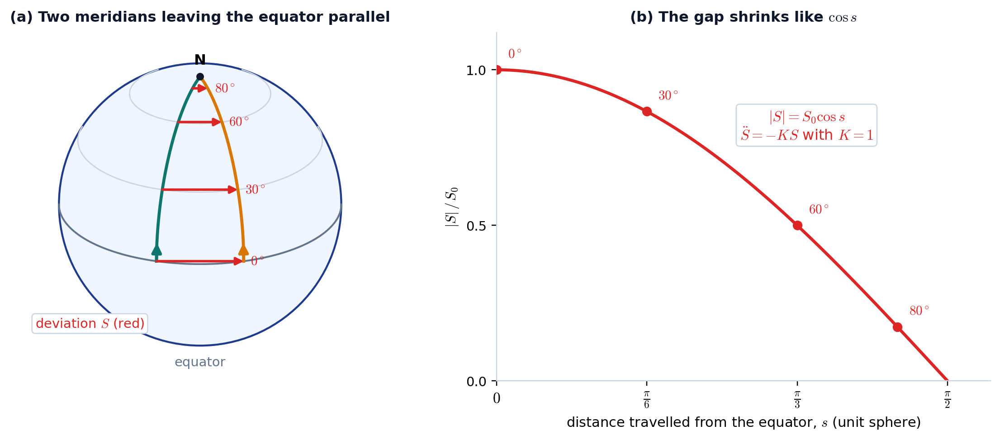

*Figure 24. Geodesic deviation on a sphere. (a) Two meridians (teal and amber) leave the equator parallel, both heading north, and meet at the North Pole. The gap $S$ between them (red), drawn at latitudes $0^\circ$, $30^\circ$, $60^\circ$ and $80^\circ$, shrinks although each walker goes straight. (b) On the unit sphere, after a distance $s$ from the equator the gap is $|S| = S_0\cos s$: $1.000$, $0.866$, $0.500$ and $0.174$ times $S_0$ at those latitudes. This solves $\ddot S = -K S$ with curvature $K = 1$, the geodesic deviation equation on a sphere.*

By the earlier symmetry, we have: 

$$A^\mu = \nabla_U (\nabla_S U^\mu)$$

By definition, the Riemann Curvature Tensor $R^\mu_{\nu\rho\sigma}$ measures the failure of covariant derivatives to commute. Applying its formal definition to the vector $U^\mu$, we get:  

$$\nabla_U \nabla_S U^\mu - \nabla_S \nabla_U U^\mu = R^\mu_{\nu\rho\sigma} U^\nu U^\rho S^\sigma$$

Because $U^\mu$ is a geodesic, its own covariant acceleration is zero ($\nabla_U U^\mu = 0$). Therefore, the second term vanishes completely, leaving us with the Equation of Geodesic Deviation:

$$\nabla_U \nabla_U S^\mu = R^\mu_{\nu\rho\sigma} U^\nu U^\rho S^\sigma$$

Relative acceleration of geodesics is therefore another measure of the curvature of the manifold.
  
In the context of General Relativity, the Equation of Geodesic Deviation is the geometric definition of tidal forces. If you drop a cloud of dust particles into a black hole, every individual particle believes it is in a local inertial frame experiencing zero gravity ($\nabla_U U^\mu = 0$). However, because the Riemann tensor $R^\mu_{\nu\rho\sigma}$ is non-zero, the Equation of Geodesic Deviation dictates that the dust particles will accelerate relative to one another.  

The dust cloud will stretch along the axis of the fall (spaghettification) and compress along the perpendicular axes. Gravity, as a force, does not exist in this framework; what we perceive as gravity is simply the Riemann tensor driving geodesic deviation across a finite volume.

### Ricci Tensor
Given the $(1, 3)$ Riemann tensor, we get the $(0, 2)$ Ricci tensor by contraction:

$$R_{\mu\nu} = R^\rho_{\phantom{\rho}\mu\rho\nu}$$

The symmetries of the Riemann tensor ensure we have symmetries in the Ricci tensor. $R_{\mu\nu} = g^{\sigma\rho} R_{\sigma\mu\rho\nu} = g^{\rho\sigma} R_{\rho\nu\sigma\mu}$, and so:

$$R_{\mu\nu} = R_{\nu\mu}$$

Contracting the Ricci tensor gives us a scalar function called the Ricci scalar:

$$R = g^{\mu\nu} R_{\mu\nu}$$

In fact, from the Bianchi Identity, 

$$\nabla_\lambda R_{\sigma\rho\mu\nu} + \nabla_\sigma R_{\rho\lambda\mu\nu} + \nabla_\rho R_{\lambda\sigma\mu\nu} = 0$$

Multiplying by the inverse metric tensors $g^{\mu\lambda} g^{\rho\nu}$ contracts the indices, yielding:

$$\nabla_\mu R^\mu_{\phantom{\mu}\sigma} - \nabla_\sigma R + \nabla_\nu R^\nu_{\phantom{\nu}\sigma} = 0$$

Combining the identical first and third terms and rearranging gives:

$$\nabla_\mu R^\mu_{\phantom{\mu}\nu} = \frac{1}{2} \nabla_\nu R$$

This motivates us to introduce the Einstein tensor, defined as:

$$G_{\mu\nu} = R_{\mu\nu} - \frac{1}{2} R g_{\mu\nu}$$

which has the property that it is divergence-free, meaning:

$$\nabla^\mu G_{\mu\nu} = 0$$

Let us look at what the Riemann and Ricci tensors actually mean from the perspective of curvature. Take the Riemann tensor component $R^\rho_{\mu\nu\sigma}$. If you look at this equation in terms of the relative acceleration of the separation vector between geodesics, you get the geodesic deviation equation from above, written with the separation in the third slot instead of the fourth (swapping those two slots flips the sign of the Riemann tensor, hence the minus sign):

$$A^\rho = -R^\rho_{\mu\nu\sigma} V^\mu X^\nu V^\sigma$$

* $A^\rho$ is the acceleration of the separation vector along the $\rho$ direction.
* $V^\mu$ and $V^\sigma$ are the components of the 4-velocity of the reference frame in the $\mu$ and $\sigma$ directions.
* $X^\nu$ is the separation vector between two adjacent geodesics in the $\nu$ direction.

* $R_{00} = R^\rho{}_{0\rho0} = R^i{}_{0i0}$ is the trace of the tidal tensor from [The Riemann Tensor Components](#the-riemann-tensor-components). Release a small ball of dust from rest. Each particle's tidal acceleration is $A^i = -R^i{}_{0j0}S^j$, so the ball's volume starts to change with initial acceleration $\frac{\ddot V}{V} = -R_{00}$. A positive $R_{00}$ means the ball starts to shrink: gravity focuses. In the Newtonian limit, $R_{00} = \nabla^2\Phi = 4\pi G\rho$.
* Through Einstein's equation, the Ricci tensor is tied to the matter at that point. In its trace-reversed form, $R_{\mu\nu} = 8\pi G\left(T_{\mu\nu} - \frac{1}{2}T g_{\mu\nu}\right)$, where $T_{\mu\nu}$ is the energy-momentum tensor and $T$ its trace. For a fluid at rest with energy density $\rho$ and pressure $p$, this gives $R_{00} = 4\pi G(\rho + 3p)$. So pressure focuses as well as energy density, and $R_{00}$ is not the energy density on its own.
* In the same way, $R_{0i}$ follows the momentum density (energy flux) $T_{0i}$, and the $R_{ij}$ follow the stresses, normal stresses or pressures on the diagonal and shear stresses off it, after the trace correction.
* Where there is no matter, $R_{\mu\nu} = 0$, yet tidal forces and frame-dragging around a rotating body are still there. They live in the part of the Riemann tensor that Ricci leaves out, [the Weyl tensor](#the-weyl-tensor).

#### The Ricci Scalar

The Ricci scalar $R$ is the complete trace of the Ricci tensor across all time and spatial dimensions. In a Riemannian space it measures how the volume of a small ball differs from the flat value. A geodesic ball of radius $\epsilon$ in $n$ dimensions has volume $V_{\text{flat}}(\epsilon)\left(1 - \frac{R\,\epsilon^2}{6(n+2)} + \dots\right)$. On a sphere of radius $a$, for example, $R = \frac{2}{a^2}$, so a small disc on the sphere has area $\pi\epsilon^2\left(1 - \frac{\epsilon^2}{12a^2}\right)$, a little less than a flat disc. In spacetime, the comparison is with flat Minkowski space instead.

### The Weyl Tensor

The Riemann tensor has $20$ independent components in 4D, and the Ricci tensor, being symmetric, has $10$. The other $10$ form the Weyl tensor $C_{\rho\sigma\mu\nu}$, the part of Riemann with all of its traces removed:

$$C_{\rho\sigma\mu\nu} = R_{\rho\sigma\mu\nu} - \frac{2}{n-2}\left(g_{\rho[\mu}R_{\nu]\sigma} - g_{\sigma[\mu}R_{\nu]\rho}\right) + \frac{2}{(n-1)(n-2)}\,R\,g_{\rho[\mu}g_{\nu]\sigma}$$

It has the same symmetries as the Riemann tensor, and contracting any pair of its indices gives zero.

Einstein's equation fixes the Ricci tensor at each point from the matter there. The Weyl tensor is the part it leaves free, so it carries the gravitational field in empty space: tidal forces outside a star, gravitational waves, and the gravitomagnetic field that drags frames around a rotating body. In vacuum the Ricci tensor vanishes and the Riemann tensor is pure Weyl. The Schwarzschild metric is an example: its tidal stretch and squeeze, worked out at the end of these notes, are pure Weyl.

The two parts act differently on the ball of dust from [Ricci Tensor](#ricci-tensor). Ricci changes its volume (focusing); Weyl changes its shape at fixed volume, stretching it one way and squeezing it another. Around a Schwarzschild black hole, the radial stretch $\frac{2M}{r^3}$ and the two transverse squeezes $-\frac{M}{r^3}$ add up to zero, so the ball's volume is unchanged at first, as a vanishing Ricci tensor demands.

The Weyl tensor $C^\rho{}_{\sigma\mu\nu}$ (with one index raised) is also unchanged when the metric is rescaled by a positive function, $g_{\mu\nu} \to \lambda\,g_{\mu\nu}$. Such a rescaling keeps all angles and light cones, so the Weyl tensor is called the conformal curvature. In four or more dimensions, a metric can be rescaled to a flat one exactly when its Weyl tensor vanishes. The FRW metric of cosmology is like this: all of its curvature is Ricci.

## Tetrad Formalism
As we've seen, the coordinate system twists and turns along the manifold, leading to some messy calculations if we want to make measurements and calculate the Riemann tensor to assess the curvature of the manifold. But going back to the RNC, we know that it is possible to pick a coordinate system at any point such that the metric there becomes Minkowski. The only issue is, every other point on the manifold becomes a mess. 

What if we could have the best of both worlds? Rather than change the coordinate system at any point, we will leave the coordinate system as it is i.e. twisting and turning with the metric, but instead choose our basis vectors at any point such that we have a flat metric there when calculated with this new basis. Note that every point will have a different basis. These do not replace the coordinate basis that we can evaluate at every point. They are separate from them and are called non-coordinate basis. They are explicitly chosen so that we can calculate a new metric out of them, which will be Minkowski, and we can then use a local translation matrix, the vielbein, to map between this non-coordinate basis and the actual "global" coordinate basis that we've always had. It is not the Jacobian of any change of coordinates: if it were, the new basis would be a coordinate basis. Its basis vectors generally have non-zero Lie brackets, which is what makes the basis non-coordinate (non-holonomic).

This way, I can conduct experiments and measurements using the flat local metric, and use the local mapping at that point to translate these results into the global metric and coordinate system. This is called the tetrad formalism or vielbeins. It makes the calculation of the Riemann curvature tensor much more algebraic and straightforward. The downside is we have to keep track of our translator matrix that must be recalculated at every point.

The vielbein $e^a_\mu$ is the transformation matrix that translates vectors between the curved coordinate grid and the flat local frame. The inner product of the vielbein basis vectors yields the flat Minkowski metric:

$$g = g_{\mu\nu} dx^\mu \otimes dx^\nu = \eta_{ab} \hat{\theta}^a \otimes \hat{\theta}^b$$

$$g(\hat{e}_a, \hat{e}_b) = \eta_{ab}$$

If you want to know what the curved spacetime metric $g_{\mu\nu}$ looks like in your coordinates, you take the flat metric $\eta_{ab}$ and push it through the translator matrices:

$$g_{\mu\nu} = e^a_\mu e^b_\nu \eta_{ab}$$

If you are floating in your perfectly flat free-falling laboratory, you can arbitrarily rotate your setup or boost your velocity (a Lorentz transformation, $\Lambda^a_b$), and the physics inside the lab doesn't change. Therefore, you can rotate the vielbeins at any point without changing the underlying metric $g_{\mu\nu}$. Gravity has now been recast as a gauge theory, similar to electromagnetism, where the gauge group is local Lorentz transformations.

In the coordinate approach, when you move from point A to point B, the grid distorts, and the Christoffel symbols ($\Gamma^\lambda_{\mu\nu}$) tell you how to correct for that distortion.

In the vielbein approach, our local laboratory frame ($\hat{e}_a$) is always rigidly flat ($\eta_{ab}$). It never distorts. But as you carry it from point A to point B over a curved manifold, the whole laboratory frame rotates relative to the background coordinates. The spin connection one-form, $\omega^a_b$, tracks exactly how this happens. Its components are given by:

$$\omega^a_b = \Gamma^a_{cb} \hat{\theta}^c$$

Note that $\hat{\theta}^c$ are the basis 1-forms dual to the vielbein vectors and not polar coordinates. Because the local frame only undergoes Lorentz rotations, and Lorentz transformations are generated by antisymmetric matrices, the spin connection for the Levi-Civita connection is perfectly antisymmetric: $\omega_{ab} = -\omega_{ba}$

If someone hands you a metric, calculating the Christoffel symbols is a nightmare of partial derivatives. The vielbein formalism offers a massive computational shortcut devised by Élie Cartan.

Cartan's First Structure Equation states that for a torsion-free connection:

$$d\hat{\theta}^a + \omega^a_b \wedge \hat{\theta}^b = 0$$

Instead of evaluating derivatives of the metric, you do this:

1.  Read the vielbein 1-forms ($\hat{\theta}^a$) directly off the metric line element.
    
2.  Take their exterior derivatives ($d\hat{\theta}^a$).
    
3.  Algebraically solve the wedge product equation above to find the unknown $\omega^a_b$ terms, utilizing the antisymmetry ($\omega_{ab} = -\omega_{ba}$) to eliminate variables.

Once you have the spin connection, you need to find the curvature. The Riemann tensor $R^\sigma_{\rho\mu\nu}$ has four indices. Cartan simplifies this by compressing the two coordinate indices ($\mu, \nu$) into a differential 2-form, leaving only the two flat-frame indices ($a, b$).

This yields the Curvature Two-Form:

$$R^a_b = \frac{1}{2} R^a_{bcd} \hat{\theta}^c \wedge \hat{\theta}^d$$

Cartan's Second Structure Equation tells you exactly how to compute this curvature directly from the spin connection:

$$R^a_b = d\omega^a_b + \omega^a_c \wedge \omega^c_b$$

If you look closely at this equation, it is mathematically identical to the field strength tensor of a Yang-Mills gauge field ($F = dA + A \wedge A$). By switching to vielbeins, you have mathematically formatted General Relativity to look exactly like the quantum gauge theories of the Strong and Electroweak forces.

Besides utility in general relativity, the vielbein is required to put quantum mechanics into curved spacetime. Fermions (like electrons) are described by spinors. Spinors transform under the rules of flat-space Lorentz rotations. A spinor does not know what a curved coordinate grid ($g_{\mu\nu}$) is; it can only be defined relative to an orthonormal frame (and the manifold must admit a spin structure, which physical spacetimes do). To describe an electron in a gravitational field, you _must_ establish a flat local vielbein frame ($\hat{e}_a$), define the spinor inside that flat frame, and use the spin connection ($\omega^a_b$) to track how the electron's spin rotates as it falls through curved space.

### Example with the Schwarzschild Metric

The global Schwarzschild metric in coordinates $(t, r, \theta, \phi)$ is given by the line element:

$$ds^2 = -\left(1 - \frac{2M}{r}\right)dt^2 + \left(1 - \frac{2M}{r}\right)^{-1}dr^2 + r^2 d\theta^2 + r^2 \sin^2\theta d\phi^2$$

The goal is to force this equation to look exactly like the flat space Minkowski line element inside the physicist's laboratory:

$$ds^2 = -(\hat{\theta}^0)^2 + (\hat{\theta}^1)^2 + (\hat{\theta}^2)^2 + (\hat{\theta}^3)^2$$

Because the Schwarzschild metric is completely diagonal (there are no mixed terms like $dt dr$), we can simply take the square root of each term to find our basis 1-forms $\hat{\theta}^a$.

By defining $\hat{\theta}^a = e^a_\mu dx^\mu$, we can literally read the vielbein matrix components $e^a_\mu$ right off the page:

-   $\hat{\theta}^0 = \sqrt{1 - \frac{2M}{r}} dt \implies e^0_t = \sqrt{1 - \frac{2M}{r}}$
    
-   $\hat{\theta}^1 = \frac{1}{\sqrt{1 - \frac{2M}{r}}} dr \implies e^1_r = \frac{1}{\sqrt{1 - \frac{2M}{r}}}$
    
-   $\hat{\theta}^2 = r d\theta \implies e^2_\theta = r$
    
-   $\hat{\theta}^3 = r \sin\theta d\phi \implies e^3_\phi = r \sin\theta$

$e^\mu_a$ translates local flat measurements ($a$) back into global coordinate steps ($\mu$). 

-   $e^t_0 = \frac{1}{\sqrt{1 - \frac{2M}{r}}}$
    
-   $e^r_1 = \sqrt{1 - \frac{2M}{r}}$
    
-   $e^\theta_2 = \frac{1}{r}$
    
-   $e^\phi_3 = \frac{1}{r \sin\theta}$
    
This frame belongs to a physicist hovering at a fixed $r$ outside the black hole, held in place by rockets, so not in free fall: their 4-velocity $\frac{1}{\sqrt{1 - 2M/r}}\,\partial_t$ is not a geodesic, and they feel an acceleration of magnitude $\frac{M}{r^2\sqrt{1 - 2M/r}}$ holding them up. A freely falling lab passing the same point carries a different orthonormal frame, related to this one by a boost in the radial direction. Suppose the hovering physicist holds up their physical steel ruler, pointing it radially toward the black hole. They measure an object to be exactly 1 meter long. In their local flat coordinates, the length vector is $X^1 = 1$. They want to know: How much Schwarzschild coordinate distance ($r$) does this object span? They use the inverse vielbein:

$$X^r = e^r_1 X^1 = \left( \sqrt{1 - \frac{2M}{r}} \right) (1)$$

The physicist instantly sees that $X^r < 1$. The physical 1-meter ruler spans less than 1 unit of the Schwarzschild $r$-coordinate. Similarly, if they wait for exactly 1 second on their physical laboratory wristwatch ($X^0 = 1$), they calculate the elapsed Schwarzschild coordinate time $t$:

$$X^t = e^t_0 X^0 = \frac{1}{\sqrt{1 - \frac{2M}{r}}} (1)$$

Because the denominator is less than 1, $X^t > 1$. The physicist realizes that 1 second of their actual physical life corresponds to _more_ than 1 unit of coordinate time passing for a distant observer.

The vielbein matrices are simply the mathematical scaling factors (gravitational time dilation and length contraction) neatly organized into a translation dictionary between the abstract grid and the physical laboratory.

Now let's calculate the Riemann tensor for this metric as well. We first take the exterior derivative. If we set:

$$f(r) = \sqrt{1 - \frac{2M}{r}}$$

The basis of non-coordinate one-forms then can be written as:

$$\hat{\theta}^0 = f dt, \qquad \hat{\theta}^1 = f^{-1} dr, \qquad \hat{\theta}^2 = r d\theta, \qquad \hat{\theta}^3 = r \sin\theta d\phi$$

The metric takes the simple form:

$$ds^2 = \eta_{ab} \hat{\theta}^a \otimes \hat{\theta}^b$$

We now compute $d\hat{\theta}^a$:

$d\hat{\theta}^0 = f' dr \wedge dt$ (since f is  a function of r and nothing else)

$$d\hat{\theta}^1 = 0$$

$$d\hat{\theta}^2 = dr \wedge d\theta$$

$$d\hat{\theta}^3 = \sin\theta dr \wedge d\phi + r \cos\theta d\theta \wedge d\phi$$

The first Cartan structure relation, $d\hat{\theta}^a = -\omega^a_{\phantom{a}b} \wedge \hat{\theta}^b$ gives $\omega^0_{\phantom{0}1} = f' f dt = f' \hat{\theta}^0$. Anti-symmetry and raising and lowering by the Minkowski metric to get $\omega^1_{\phantom{1}0} = \omega_{10} = -\omega_{01} = \omega^0_{\phantom{0}1}$. The Cartan structure equation then gives $d\hat{\theta}^1 = -\omega^1_{\phantom{1}0} \wedge \hat{\theta}^0 + \dots$ and the $\omega^1_{\phantom{1}0} \wedge \hat{\theta}^0$ contribution happily vanishes because it is proportional to $\hat{\theta}^0 \wedge \hat{\theta}^0 = 0$.

$\omega^2_{\phantom{2}1} = f d\theta = (f/r) \hat{\theta}^2$ to solve the $d\hat{\theta}^2$ structure equation. Anti-symmetry gives $\omega^1_{\phantom{1}2} = -\omega^2_{\phantom{2}1} = -(f/r) \hat{\theta}^2$ and this again gives a vanishing contribution to the $d\hat{\theta}^1$ structure equation.

Finally, the $d\hat{\theta}^3$ equation suggests that we take $\omega^3_{\phantom{3}1} = f \sin\theta d\phi = (f/r) \hat{\theta}^3$ and $\omega^3_{\phantom{3}2} = \cos\theta d\phi = (1/r) \cot\theta \hat{\theta}^3$. These anti-symmetric partners $\omega^1_{\phantom{1}3} = -\omega^3_{\phantom{3}1}$ and $\omega^2_{\phantom{2}3} = -\omega^3_{\phantom{3}2}$ do not contribute to $d\hat{\theta}^1$. We have:

$$\omega^0_{\phantom{0}1} = \omega^1_{\phantom{1}0} = f' \hat{\theta}^0, \qquad \omega^2_{\phantom{2}1} = -\omega^1_{\phantom{1}2} = \frac{f}{r} \hat{\theta}^2$$

$$\omega^3_{\phantom{3}1} = -\omega^1_{\phantom{1}3} = \frac{f}{r} \hat{\theta}^3, \qquad \omega^3_{\phantom{3}2} = -\omega^2_{\phantom{2}3} = \frac{\cot\theta}{r} \hat{\theta}^3$$

Now for the curvature two-form, let's start with:

$$R^0_{\phantom{0}1} = d\omega^0_{\phantom{0}1} + \omega^0_{\phantom{0}c} \wedge \omega^c_{\phantom{c}1}$$

We have:

$$d\omega^0_{\phantom{0}1} = f' d\hat{\theta}^0 + f'' dr \wedge \hat{\theta}^0 = \left( (f')^2 + f'' f \right) dr \wedge dt$$

The second term in the curvature 2-form, $\omega^0_{\phantom{0}c} \wedge \omega^c_{\phantom{c}1}$, is a sum over $c$. Among the $\omega^0_{\phantom{0}c}$, only $\omega^0_{\phantom{0}1}$ is non-zero, and it is multiplied by $\omega^1_{\phantom{1}1} = 0$, so the whole sum is $0$. So we are left with:

$$R^0_{\phantom{0}1} = \left( (f')^2 + f'' f \right) dr \wedge dt = \left( (f')^2 + f'' f \right) \hat{\theta}^1 \wedge \hat{\theta}^0$$

The other curvature 2-forms, or at least the non-zero ones after lowering an index, are:

$$R_{0101} = f f'' + (f')^2$$

$$R_{0202} = \frac{f f'}{r}$$

$$R_{0303} = \frac{f f'}{r}$$

$$R_{1212} = -\frac{f f'}{r}$$

$$R_{1313} = -\frac{f f'}{r}$$

$$R_{2323} = \frac{1 - f^2}{r^2}$$

In the coordinates $x^\mu = (t, r, \theta, \phi)$, we can get the same by:

$$R_{\mu\nu\rho\sigma} = e^a_\mu e^b_\nu e^c_\rho e^d_\sigma R_{abcd}$$

$$R_{trtr} = f f'' + (f')^2$$

$$R_{t\theta t\theta} = r f^3 f'$$

$$R_{t\phi t\phi} = r f^3 f' \sin^2\theta$$

$$R_{r\theta r\theta} = -r \frac{f'}{f}$$

$$R_{r\phi r\phi} = -r \frac{f'}{f} \sin^2\theta$$

$$R_{\theta\phi\theta\phi} = (1 - f^2) r^2 \sin^2\theta$$

The frame components are what the hovering physicist actually measures. Putting $f^2 = 1 - \frac{2M}{r}$ gives $f f'' + (f')^2 = -\frac{2M}{r^3}$, $\frac{f f'}{r} = \frac{M}{r^3}$ and $\frac{1 - f^2}{r^2} = \frac{2M}{r^3}$. The [geodesic deviation equation](#curvature-the-riemann-tensor-and-geodesic-deviation), with $A^i = -R^i{}_{0j0}S^j$ in this frame, then gives a radial tidal acceleration of $+\frac{2M}{r^3}$ per unit radial separation (stretching) and $-\frac{M}{r^3}$ per unit sideways separation in each of the two transverse directions (squeezing). This is the spaghettification of geodesic deviation. A radially falling observer at the same point measures the same values, because these particular components don't change under a radial boost. And since the stretch and the two squeezes add up to zero, $R_{00} = 0$, as it must be in vacuum.

Figure 25 shows the stretch and the squeeze on a ring of dust.

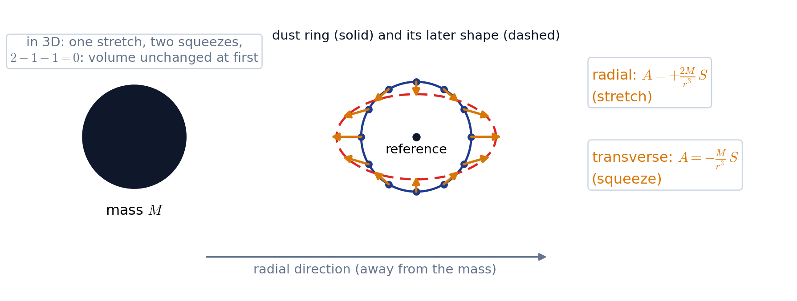

*Figure 25. Tidal forces near a mass. A ring of freely falling dust particles (solid) surrounds a reference particle, to the right of a mass $M$. Relative to the reference particle, a particle at separation $S$ along the radial direction accelerates away with $A = +\frac{2M}{r^3}S$ (stretch). A particle at separation $S$ sideways accelerates back with $A = -\frac{M}{r^3}S$ (squeeze). So the ring turns into the dashed ellipse. In 3D there are two sideways directions, and $2 - 1 - 1 = 0$: the volume of a small ball of dust does not change at first, as a vanishing Ricci tensor demands.*

## References

- Div, grad, curl, and all that by HM Schey

- [A Geometric Approach to Differential Forms](https://faculty.washington.edu/seattle/physics544/2011-lectures/bachman.pdf) by David Bachman

- The Geometry of Physics, 3rd Ed by Theodore Frankel [Sections for General Relativity: 1.1-3.3, 4.1-4.2, 8.1-8.2, 8.5-8.7, 9.1-9.6, 10.1, 11.2, 11.3a-b, 14.1a-c]

- An Introduction to Manifolds, 2nd Ed by Loring W. Tu [Sections for General Relativity: 2-6, 8, 12, 14, 17-20]

**Order of Reading**

| Stage | Reading |
|---|---|
| Preliminary | Bachman Chapters 3–5, optionally 6 |
| Foundations | Frankel 1.1–2.4; Tu §§2, 5–6, 8, 12 |
| Exterior calculus | Tu §§3–4, 17–19; Frankel 2.5–3.3 |
| Lie derivatives | Tu §§14, 20; Frankel 4.1–4.2 |
| Curvature | Frankel 8.1–8.2, 8.5–8.7, 9.1–9.6 |
| Geodesics and GR geometry | Frankel 10.1, 11.2, 11.3a–b |
| Hodge star | Frankel 14.1a–c |

**Postpone After General Relativity**

| Book | Sections | Topic |
|---|---|---|
| Tu | §§15–16 | Lie groups and Lie algebras |
| Tu | §§24–29 | De Rham cohomology |
| Frankel | Chapter 6 | Integrability and Frobenius theorem |
| Frankel | Chapters 12–13 | Global geometry and topology |
| Frankel | §§14.2–14.3 | Harmonic forms |
| Frankel | Chapters 15–18 | Lie groups, bundles, generalized connections |
