# Maths 2 - Group Theory

## Groups

In [ring theory](maths_0_vector_calculus_linear_algebra_fields.md#rings-fields) (Maths 0), we studied systems with two operations (addition and multiplication). A ring models environments where things can be scaled, added, and multiplied, like polynomials or numbers.

Group theory strips away one operation. A group is a set with a single operation (denoted $\circ$). Why do this? Because in the physical world, the most fundamental mathematical object is not a "number," but an action or a transformation. Think of a rotation. You can do one rotation and then another. There isn't any other operation really. You cannot add two rotations and get a rotation. So we have just one operation which we call a composition: do one action, then do the next.

To really make this useful, you must be able to reverse actions, you must be able to do nothing, and a composition of operations should result in another recognizable operation. Accordingly, a group is defined as a set of elements with an associated operation, which is closed under that operation, is associative and has an identity. Every element must also have an inverse. Note that the inverse of a composition (usually a composition is also simply called a product) is $(gh)^{-1} = h^{-1}g^{-1}$, i.e., you invert in the reverse order in which you applied the operations. That makes sense. It is very much like the order in which you put on and take off shoes and socks.

Because a group has inverses, it obeys the Cancellation Laws: $gx = gy \implies x = y$.

Groups need not be commutative because actions in space generally depend on the order in which they are performed: rotating a book around the X-axis then the Y-axis yields a different orientation than Y then X. If commutativity holds ($ab = ba$), such groups are called Abelian. It is customary to use $+$ instead of $\circ$ in abelian groups.

**Example:** The set of all integers, with the operation $+$, is a group. In fact, if $R$ is any ring, we get a group with the operation $+$. It is an abelian group which is the same thing as saying it is the additive group of a ring. Conversely, given any abelian group $R$, where the group operation is written as $+$ and the identity as $0$, we obtain a ring (called a zero ring, or a ring with zero multiplication; not to be confused with the one-element zero ring $\{0\}$ from earlier) by defining the ring multiplication by the rule $ab = 0$ for all $a, b \in R$.

Similarly, the set of units of a ring with an identity $1$, with the operation of multiplication, is a group. This is called the group of units of the ring $R$.

Similarly, with a field $F$, $F \setminus \{0\}$ is a group, the multiplicative group of $F$, written as $F^*$ (or $F^\times$, as in [Figure 3 of Maths 0](maths_0_vector_calculus_linear_algebra_fields.md#figure-3); the two symbols mean the same).

The set of invertible $n \times n$ matrices ($\det(A) \neq 0$) over a field $F$, with the operation of matrix multiplication, is a group, the General Linear group $GL(n, F)$.

A fundamental aspect behind groups is permutation, i.e., taking a set and permuting it or switching some of the elements. Every permutation can be written as a series of swaps between two elements. If there are an even number of these swaps, the parity of the permutation is even. Otherwise, it is odd.

If you take a set of $n$ points, say $\{1, 2, \dots, n\}$, and write out all the possible permutations of its elements, these form a group called the symmetric group $S_n$: the group of all permutations of $n$ points. It has $n!$ elements.

Usually, a permutation is written out in the cycle notation, which tells us which element each element is sent to, until it returns to itself. A cycle such as $(1, 2, 3)$ means that each listed point goes to the next one and the last goes back to the first, $1 \mapsto 2 \mapsto 3 \mapsto 1$, while points that are not listed stay put; so $(1, 3, 2)$ is $1 \mapsto 3 \mapsto 2 \mapsto 1$, and the 2-cycle $(1, 2)$ just swaps $1$ and $2$. A permutation may involve multiple cycles working together because it may not be possible for one element to permute into all other elements. If that were possible, we would have a single cycle. For example, $S_3$ consists of the six elements which permute the 3 items $1$, $2$, $3$ in the following way (in cycle notation): $(1)$ (the identity, so nothing is permuted), $(1, 2, 3)$, $(1, 3, 2)$, $(1, 2)$, $(2, 3)$, and $(1, 3)$. A 2-cycle like (2 3) is a transposition.

To multiply permutations, we read the product from left to right: $gh$ means first do $g$, then do $h$. To work out a product, follow each point through the factors in turn. For $(1\,2)(1\,2\,3)$, we first apply $(1\,2)$ and then $(1\,2\,3)$:

| start | after $(1\,2)$ | after $(1\,2\,3)$ | result |
|---|---|---|---|
| $1$ | $2$ | $3$ | $1 \to 3$ |
| $2$ | $1$ | $2$ | $2$ stays put |
| $3$ | $3$ | $1$ | $3 \to 1$ |

So $1$ and $3$ swap, $2$ does not move, and the product is $(1\,3)$. When we write the answer in cycle notation, we start each cycle with its lowest number, and we leave out the points that do not move, so $2$ does not appear. (Writing $(3\,1)$ or $(1\,3)(2)$ would describe the same permutation.)

Some books read products from right to left, like composing functions. There $(1\,2)(1\,2\,3)$ means first $(1\,2\,3)$ and then $(1\,2)$, and following the points in that order gives $1 \to 2 \to 1$, $2 \to 3 \to 3$ and $3 \to 1 \to 2$, so the product is $(2\,3)$ instead. The two answers differ because permutations do not commute in general, so it is worth checking which convention a text uses.

A Cayley table is like an operation table with the group elements listed on top and to the left, horizontally and vertically. Each slot in the table is filled with the group element produced by the composition of those two elements. This means any row or column will contain only one instance of any element, and every element must be present. This is like Sudoku and is generally called a Latin Square.

Let $R$ be a ring. An automorphism of $R$ is an isomorphism $\theta : R \to R$; in other words, it is a permutation of $R$ which happens also to be a homomorphism satisfying $(x + y)\theta = x\theta + y\theta$ and $(xy)\theta = (x\theta)(y\theta)$. (Here the map is written on the right of its argument, so $x\theta$ means $\theta(x)$; group theory books often do this because it fits reading products left to right: $x\theta\phi$ means first $\theta$, then $\phi$.) $\operatorname{Aut}(R)$ is the set of all automorphisms of $R$. It is a group: the automorphism group of $R$.

### The Rosetta Stone: Rings vs. Groups

The structural theorems we learned for [rings in Maths 0](maths_0_vector_calculus_linear_algebra_fields.md#homomorphisms-and-isomorphisms) were ported directly into group theory. Here is the exact translation dictionary between the two:

| Concept | Ring Theory (Additive + Multiplicative) | Group Theory (Multiplicative Only) |
| --- | --- | --- |
| **Base Environment** | Ring $R$ | Group $G$ |
| **Neutral Element** | Zero ($0$) | Identity ($1$ or $e$) |
| **Smaller enclosed system** | Subring $S$ | Subgroup $H$ |
| **One-step closure test** (non-empty subset) | $a - b \in S$, plus $ab \in S$ | $ab^{-1} \in H$ |
| **System that permits quotients** | Ideal $I$ (absorbs $r \cdot i$) | Normal Subgroup $N$ (absorbs $g^{-1}ng$) |
| **Equivalence bundles** | Cosets $x + I$ | Left/Right Cosets $gN$ or $Ng$ |
| **Quotient construction** | Factor Ring $R/I$ | Factor Group $G/N$ |
| **Homomorphism property** | $\phi(a+b) = \phi(a)+\phi(b)$ and $\phi(ab) = \phi(a)\phi(b)$ | $\phi(ab) = \phi(a)\phi(b)$ |
| **Homomorphism Kernel** | $\{r \in R \mid \phi(r) = 0\}$ | $\{g \in G \mid \phi(g) = 1\}$ |

### Subgroups

Given a group, there's a few things we'd like to do. We'd like to see if we can break that group into pieces called subgroups, which would make it easier to understand and analyse its behaviour. The other thing we would like to do is to use that group and combine with other groups to form bigger groups. Let's look at the first item.

A subgroup is a subset of a larger group, with the same operation as the parent, which is also a group. As with rings, the simple condition to test whether a subset is a subgroup is to check inversion (subtraction in rings) and composition (addition in rings) in one shot with $gh^{-1} \in H$ for all $g$ and $h$ in $H$, provided $H$ is non-empty (the empty set passes this test because it has no elements to check, but it is not a group). Unlike rings though, every subgroup will contain the identity. (Well, even in rings, the additive identity is always present).

As with rings, we can partition a group by a subgroup $H$, creating bundles or cosets, which are equivalence classes. However, since commutativity need _not_ hold, we have right and left cosets: $Hg = \{xg \mid x \in H\}$ and $gH = \{gx \mid x \in H\}$, which are: execute any action of $H$, then some element $g$ of $G$; and execute $g$, then any action of $H$.

Because $gh \neq hg$ in general, $gH$ and $Hg$ will usually be completely different sets of actions. Your physical state after $gH$ is not the same as after $Hg$. However, the sets of right and left cosets are in bijection with each other.

In a similar way to rings, we can say that $g_1$ and $g_2$ belong to the same coset by checking if the composition of their inverse (subtraction in rings) is in the subgroup, i.e., $g_1 \sim_L g_2$ if and only if $g_1^{-1}g_2 \in H$; and $g_1 \sim_R g_2$ if and only if $g_2g_1^{-1} \in H$.

Now what happens if you composed _every_ element of $G$ with every element of $H$? You would generate a set of all cosets for $H$. However, many different $g$'s will generate the exact same coset.

The order or cardinality of a group $G$, written $\vert{}G\vert{}$, is the number of elements in the group. This may be finite or infinite. Every coset of a subgroup $H$ contains exactly the same number of elements as $H$. Because cosets perfectly partition the group without overlapping, the total size of the group must be a clean multiple of the size of $H$. This is called the index of $H$ (often denoted $[G:H]$):

$$\vert{}G\vert{} = \vert{}H\vert{} \cdot [G:H]$$

This is a rigid quantization rule. A group of 15 elements physically cannot contain a self-contained subsystem of 4 elements.

### Normal Subgroups

In rings, we built a quotient ring $R/I$ by partitioning with an ideal. In groups, we build a quotient group $G/N$ by partitioning by a subgroup that is called a Normal Subgroup. We needed an ideal to ensure multiplication of any elements of equivalence classes always produces the same product. Similarly, we want to look at what properties a subgroup must have to allow multiplication of elements of cosets consistently. For example, $(a)(b) = ab$. Now $a$ is an element of the coset $aN$ and $b$ of $bN$, while $ab$ is an element of coset $(ab)N$. We want this relationship of belonging to this same coset $(ab)N$ to hold for the product of any elements of the first two cosets. In other words, we want (the product of two subsets of a group is the set of all products of an element of the first with an element of the second, $XY = \{xy \mid x \in X, y \in Y\}$):

$$(aN)(bN) = abN$$

To make $a \cdot N \cdot b \cdot N$ equal $abN$, you need to be able to swap the $N$ and the $b$ in the middle (and note that the $NN$ reduces to just $N$ because $N$ is a group). You need the set $N$ to commute with the element $b$:

$$Nb = bN$$

So a normal subgroup commutes with every element of $G$ as a whole set ($gN = Ng$), even though $gn$ and $ng$ can be different elements for a particular $n \in N$. Its right and left cosets are the same. Another way of writing this is $g^{-1}Ng = N$ for every $g \in G$. Or in other words, $g^{-1}xg \in N$ for every $g$ in $G$ and every $x$ in $N$. As an aside, this means that in an Abelian group every single subgroup is a normal subgroup. The converse fails, so this does not characterise Abelian groups: the quaternion group $Q_8 = \{\pm 1, \pm i, \pm j, \pm k\}$ (multiplied by the rules $i^2 = j^2 = k^2 = ijk = -1$, with $-1$ commuting with everything) is not Abelian ($ij = k$ but $ji = -k$), yet every one of its subgroups is normal.

One difference from ideals in rings is that while the ideal has the absorption property, there is nothing like that in the normal subgroup. In a ring, absorption works perfectly because you are absorbing a second operation (multiplication) into a subgroup built on the first operation (addition). $r \cdot 0 = 0$, so multiplying by the additive identity doesn't force $r$ into the ideal. But in a group, you only have one operation. The only subgroup that absorbs the group operation is the entire group itself. However, the normal subgroup does absorb perspective shifts (which we will explain shortly). 

[Figure 1](#figure-1) shows the Cayley table of $S_3$ coloured first by the normal subgroup $N = A_3$ (the three even permutations $e$, $(1\,2\,3)$ and $(1\,3\,2)$), which gives solid $3 \times 3$ coset blocks, and then by the non-normal subgroup $H = \{e, (1\,2)\}$, where the $2 \times 2$ blocks split across two cosets.

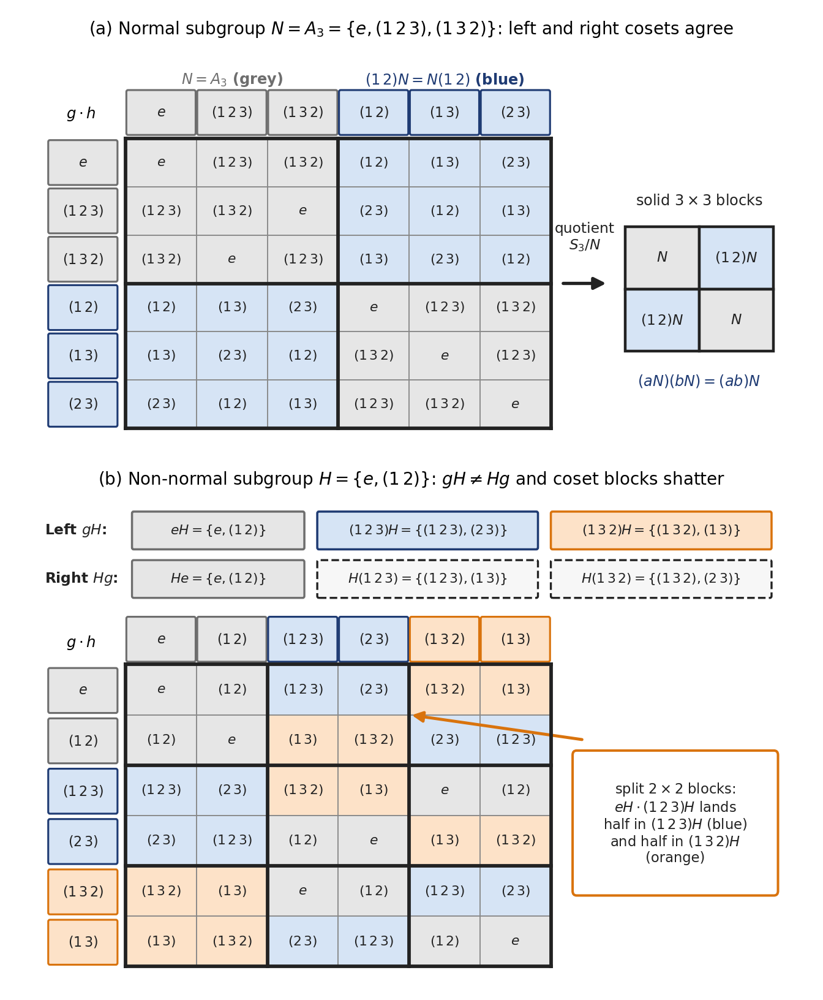

*Figure 1. Coset blocks in the Cayley table of $S_3$, with products read left to right ($gh$ means first $g$, then $h$). (a) For the normal subgroup $N = A_3 = \{e, (1\,2\,3), (1\,3\,2)\}$, left and right cosets agree and the table splits into four solid $3 \times 3$ blocks that form the quotient $S_3/N$. (b) For the non-normal subgroup $H = \{e, (1\,2)\}$, left and right cosets differ on $(1\,3)$ and $(2\,3)$, and six of the nine $2 \times 2$ blocks split across two cosets.*

A geometric way of thinking of normal subgroups is through conjugation. Two elements $x$ and $y$ are conjugate if $y = g^{-1}xg$. They are said to belong to the same conjugacy class, which is an equivalence relation. This is the mathematical formulation of a change of perspective or a change of basis/coordinates. (We will encounter something very similar when we look at Representation Theory and change of basis later.) Conjugacy classes partition the entire group $G$ into disjoint subsets of elements that are structurally the same type of operation.

Imagine you are standing in a room.

Let $x$ be the action: "Step one meter forward."

Let $g$ be the action: "Rotate your body 90 degrees to the right."

What does $g^{-1}xg$ mean?

**$g^{-1}$:** Rotate 90 degrees to the left (undoing $g$).

**$x$:** Step one meter forward.

**$g$:** Rotate 90 degrees to the right.

If you execute $g^{-1}xg$, the net physical result is that you stepped one meter to the left. The action $x$ (stepping forward) was executed _from a different rotational perspective_.

Conjugate elements are exactly the same physical action, just operating on a different axis or starting state. In the symmetric group $S_n$, two permutations are conjugate if and only if they have the exact same cycle structure (the same number of cycles of each length; e.g., both are swaps, or both are 3-cycles). They do the same "shape" of shuffling, just to different items (cycle shapes come back as partitions of $n$ in [two-part partitions and irreducible characters of symmetric groups](#two-part-partitions-and-irreducible-characters-of-symmetric-groups)).

Saying a subgroup $N$ is normal means that the collection of actions in $N$ is completely blind to orientation. If you take any internal action from $N$ and execute it from a twisted, alien perspective, the resulting physical action might be a different element than the one you started with, but it is guaranteed to still be an action belonging to the set $N$. The internal elements of $N$ might shuffle around under conjugation, but the boundaries of $N$ remain perfectly rigid across all reference frames.

This is very similar to the Lie Bracket in Differential Geometry. The [Lie bracket](maths_1_differential_geometry.md#the-lie-bracket) $[X, Y]$ of two vector fields measures the failure of their flows to commute. You flow along $X$, then $Y$, then $-X$, then $-Y$. If the two flows commute, which is exactly when $[X, Y] = 0$, you form a closed loop and return to where you started. Flat space is not enough on its own: on the flat plane, $X = \partial_x$ and $Y = x\,\partial_y$ have $[X, Y] = \partial_y \neq 0$, so this loop does not close. If they don't commute, the bracket measures the geometric gap where the loop failed to close.

In discrete group theory, this exact concept is called the Group Commutator, and it is written:

$$[g, h] = g^{-1}h^{-1}gh$$

It is checking whether the inverse of a raw action is cancelled by a conjugated version of the action:

$$[g, h] = g^{-1} \cdot (h^{-1}gh)$$

It takes the inverse of $g$, and multiplies it by $g$ _as viewed from the orientation of $h$_. If changing the orientation to $h$ doesn't alter how $g$ behaves, then $h^{-1}gh = g$, and the commutator collapses: $g^{-1}g = 1$. The loop closes perfectly. This is the defining feature of the centralizer group (the elements that commute with a given element; more on that [later](#centralizers-and-the-center)). 

If instead, in a finite group $G$ with a subgroup $N$, we have: $[G, N] \subseteq N$ (where $[G, N]$ is the smallest subgroup containing all the commutators $[g, n]$ with $g \in G$ and $n \in N$), then $N$ is a normal subgroup of $G$ i.e. it can absorb the group commutator with any external element.

Another way to think of cosets is as macroscopic actions, while individual elements of the coset are microscopic actions. For example, "Drive 50 miles North" and then "drift 1 inch left".

A coset like $aN$ is a "fuzzy" command. It means: Execute the macro-jump $a$, and then suffer some random microscopic error from the set $N$. For the quotient $G/N$ to form a valid, functioning group, you need to be able to compose these fuzzy macro-commands together predictably. If you execute $aN$ and then execute $bN$, the final macroscopic destination must be strictly and perfectly $(ab)N$. The random microscopic errors cannot be allowed to derail the macro-trajectory. If normality fails, the quotient group collapses because $(aN)(bN)$ no longer lands neatly inside $(ab)N$.

Let's look at the physical timeline of executing $(aN)$ followed by $(bN)$:

Execute macro-jump $a$.

Suffer a random micro-error $n_1$.

Execute macro-jump $b$.

Suffer a random micro-error $n_2$.

To guarantee that this sequence is indistinguishable from the clean macroscopic command $(ab)N$, we need to prove that the sequence $[a \to n_1 \to b \to n_2]$ can be perfectly rewritten as $[a \to b \to \text{some final micro-error}]$.

We need the physical state of doing $[n_1 \to b]$ to be identical to doing $[b \to \text{some new error } n_3]$.

Algebraically, this is:

$$n_1 b = b n_3$$

If we multiply both sides by $b^{-1}$, we get:

$$b^{-1} n_1 b = n_3$$

This is the normality condition. We want our final error to fall in the same coset, because then we can somehow figure out how to correct for the error. If it fell into another coset, because we don't know what the error is and whether it even occurred, we wouldn't know whether we need to stay in this same new coset or actually shift back to some other coset.

#### Conditions Implying a Normal Subgroup

Each of the following conditions implies that $H$ is a normal subgroup:

a.) $G$ is abelian;

b.) $H$ is finite and is the only subgroup of $G$ of its order; because for any subgroup $H$ of $G$ and any element $g$ of $G$, the conjugate set $g^{-1}hg$ for $h \in H$ is a subgroup of $G$. This means if there is only one subgroup of a certain order, it must be normal.

c.) $H$ has index 2 in $G$.

Take note of condition (b). This seems to violate the index formula $\vert{}G\vert{} = \vert{}H\vert{} \cdot [G:H]$. But that formula partitions $G$ into cosets of $H$, not into distinct subgroups of order $\vert{}H\vert{}$. So why does (b) hold? Because for any $g \in G$, the conjugate $gHg^{-1}$ is also a subgroup of $G$. So $\vert{}gHg^{-1}\vert{} = \vert{}H\vert{}$. If there is only one subgroup of G of this order, $gHg^{-1} = H$, which is the definition of a normal subgroup.

We can generalize this. If $G$ is a finite group and $H \le G$ is a subgroup such that $[G : H] = p$, where $p$ is the smallest prime dividing $\vert{}G\vert{}$, then $H \trianglelefteq G$ (that is, $H$ is a normal subgroup of $G$).

When $p = 2$, this reduces directly to the index 2 property: $2$ is the smallest prime dividing any even group order, so index 2 subgroups are always normal (how the irreducible characters of $G$ restrict to such a subgroup is worked out in [normal subgroups of index 2 and the character table of $A_5$](#normal-subgroups-of-index-2-and-the-character-table-of-a_5)).

**Proof:** Let $\Omega$ be the set of left cosets of $H$ in $G$:

$$\Omega = G/H = \{xH \mid x \in G\}$$

Since $[G : H] = p$, the set has size $\vert{}\Omega\vert{} = p$.

Let $G$ act on $\Omega$ by left multiplication (an action of $G$ on a set $\Omega$ lets each $g \in G$ permute the points of $\Omega$, compatibly with the multiplication in $G$; the exact rules are in [group actions](#group-actions-and-the-orbit-stabilizer-theorem) below):

$$g \cdot (xH) = (gx)H$$

Every group action of $G$ on a set of size $p$ is equivalent to a group homomorphism into the symmetric group on $p$ elements:

$$\phi: G \longrightarrow \text{Sym}(\Omega) \cong S_p$$

The image of $G$ under this map, $\phi(G)$, is a subgroup of $S_p$:

$$\phi(G) \le S_p$$

Let $K = \ker(\phi)$.

By the First Isomorphism Theorem (for groups it reads just as for rings; see [below](#homomorphisms-and-the-isomorphism-theorems)):

$$G/K \cong \phi(G) \le S_p$$

Because $K$ is the kernel of a homomorphism, $K$ is automatically a normal subgroup of $G$ ($K \trianglelefteq G$), just as a ring kernel is an ideal: if $\phi(k)$ is the identity, then so is $\phi(g^{-1}kg) = \phi(g)^{-1}\phi(k)\phi(g)$ (this is also stated [below](#homomorphisms-and-the-isomorphism-theorems)).

What elements live in $K$?

$$K = \{g \in G \mid g \cdot (xH) = xH \quad \forall x \in G\}$$

Setting $x = 1$ gives:

$$g \cdot (1H) = 1H \implies gH = H \implies g \in H$$

Because every element of $K$ must belong to $H$, we have:

$$K \le H \le G$$

$K$ is a normal subgroup of $G$ contained entirely inside $H$ (in fact, $K$ is the core of $H$, $\text{Core}_G(H) = \bigcap_{g \in G} gHg^{-1}$).

Now determine the index $[G : K]$:

By Lagrange's Theorem (the order of a subgroup divides the order of the group, because $\vert{}G\vert{} = \vert{}H\vert{} \cdot [G:H]$, as we saw with cosets):

$$[G : K] = \frac{\vert{}G\vert{}}{\vert{}K\vert{}} \quad \text{divides } \vert{}G\vert{}$$

Because $G/K$ is isomorphic to a subgroup of $S_p$, by Lagrange's Theorem:

$$\vert{}G/K\vert{} = [G : K] \quad \text{divides } \vert{}S_p\vert{} = p!$$

$$[G : K] = [G : H] \cdot [H : K] = p \cdot [H : K]$$

Divide both conditions by $p$:

$[H : K] = \frac{[G : K]}{p}$ must divide $\frac{\vert{}G\vert{}}{p}$.

$[H : K]$ must also divide $\frac{p!}{p} = (p - 1)!$.

Suppose $[H : K] > 1$.

Then there exists some prime $q$ that divides $[H : K]$:

Because $[H : K]$ divides $(p - 1)!$, all prime factors of $[H : K]$ must be strictly less than $p$:

$$q \le p - 1 < p$$

But $[H : K]$ also divides $\vert{}G\vert{}$, which means $q$ must divide $\vert{}G\vert{}$.

This forces $q$ to be a prime divisor of $\vert{}G\vert{}$ with:

$$q < p$$

This contradicts the initial condition that $p$ is the smallest prime dividing $\vert{}G\vert{}$.

No such prime $q$ can exist. Therefore:

$$[H : K] = 1 \implies H = K$$

Since $K$ was shown above to be normal in $G$:

$$H \trianglelefteq G$$

### Centralizers and the Center

If conjugacy means viewing an action from a different perspective, we can ask: What if changing the perspective doesn't change the action?

$$g^{-1}xg = x \implies xg = gx$$

This is a stronger condition than just being normal. If this equation holds, the action $x$ commutes with the perspective shift $g$. This leads to two critical definitions:

**The Centralizer of an element $x$, denoted $C_G(x)$:** This is the set of all perspective shifts $g$ that leave the action $x$ completely unchanged. It measures how "symmetric" the action $x$ is against the rest of the group. The intersection of the centralizers of all elements in the group is the center of the group $Z(G)$. It contains all elements of $G$ which are unaffected by conjugation with all other elements of $G$. $Z(G) = \{x \in G \mid xg = gx \text{ for all } g \in G\}$. Because $g^{-1}Z(G)g = Z(G)$, the center is always a normal subgroup.

There is a bijection between the conjugacy class of an element $x$ of $G$ and the set of cosets of the centralizer $C_G(x)$ in $G$. To see this, we just have to show that if $a$ is in the centralizer of $x$, then every shifted coset element $y = ag$ produces the same conjugate of $x$. Start with $a$ in the centralizer of $x$: $a^{-1}xa = x$. Take a shifted coset element $y = ag$ (from the right coset $C_G(x)g$) and use that shifted element to sandwich $x$: $y^{-1}xy = (ag)^{-1} x (ag)$. Use the shoe-sock rule for inverses, $(ag)^{-1} = g^{-1}a^{-1}$: $y^{-1}xy = g^{-1}(a^{-1}xa)g$. Because $a$ leaves $x$ alone ($a^{-1}xa = x$), the $a^{-1}$ and $a$ on the inside vanish, leaving: $y^{-1}xy = g^{-1}xg$. So every element in the shifted coset $C_G(x)g$, when used as a sandwich, produces the exact same conjugate $g^{-1}xg$.

Because of this bijection, the size of the conjugacy class of $x$ is exactly equal to the index of its centralizer: $\vert{}Cl(x)\vert{} = [G : C_G(x)] = \frac{\vert{}G\vert{}}{\vert{}C_G(x)\vert{}}$. This is a direct application of the Orbit-Stabilizer Theorem ([below](#orbit-stabilizer-theorem-orbit-counting-lemma): the size of an orbit times the size of a stabilizer is $\vert{}G\vert{}$), where the group acts on itself by conjugation.

[Figure 2](#figure-2) shows this for $S_4$ and $x = (1\,2)$: the 24 elements split into 6 cosets of the centralizer, and each coset gives one of the 6 transpositions. Colouring the same elements by conjugacy class shows that the classes themselves are not cosets.

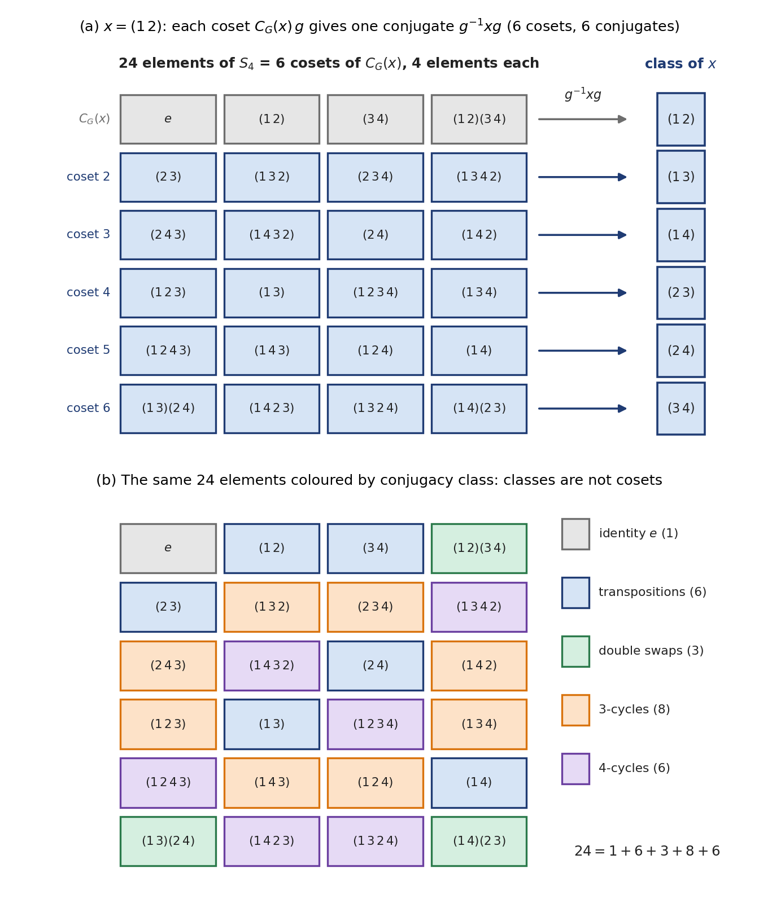

*Figure 2. Cosets of a centralizer and a conjugacy class in $S_4$, with products read left to right. (a) The centralizer of $x = (1\,2)$ is $C_G(x) = \{e, (1\,2), (3\,4), (1\,2)(3\,4)\}$, and the 24 elements fall into 6 right cosets $C_G(x)g$ of 4 elements each; every element of a coset conjugates $x$ to the same transposition $g^{-1}xg$, so the class of $x$ has $24/4 = 6$ members. (b) The same elements coloured by conjugacy class, $24 = 1 + 6 + 3 + 8 + 6$.*

Since conjugacy classes perfectly partition the group, the sum of the sizes of all distinct conjugacy classes must equal the total size of the group. This is called the class equation. Elements in the center of the group, $Z(G)$, have conjugacy classes of size 1 (they commute with everything, so they only conjugate to themselves). Grouping these together, we get the standard Class Equation:

$$\vert{}G\vert{} = \vert{}Z(G)\vert{} + \sum_{i=1}^k [G : C_G(x_i)]$$

where $x_i$ are representatives of the distinct conjugacy classes that have a size greater than 1 (i.e., elements not in the center). $k$ is the number of distinct non-trivial conjugacy classes of $G$ (that is, conjugacy classes containing more than one element).

Dividing this entire equation by the group order $\vert{}G\vert{}$ yields the fractional form of the class equation:

$$1 = \frac{\vert{}Z(G)\vert{}}{\vert{}G\vert{}} + \sum_{i=1}^k \frac{1}{\vert{}C_G(x_i)\vert{}}$$

This leads to the **5/8 Theorem (Probability of Commuting):** The fractional form of the class equation is heavily used in probabilistic group theory. Using this equation, you can prove that if you pick two random elements from a non-abelian group, the probability that they commute can never be higher than $5/8$.

Furthermore, conjugacy classes make finding normal subgroups much easier. Given a subgroup $H$, let's say we want to check if it is a normal subgroup of $G$. Due to the nature of normality, if $H$ contains one element $x$ of a conjugacy class, it must contain the entire conjugacy class. Remember the definition: for $H$ to be normal, $g^{-1}xg$ must be in $H$ for every $g \in G$. But the set of all $g^{-1}xg$ as you vary $g$ is exactly the definition of the conjugacy class of $x$! Therefore, a normal subgroup must be built perfectly out of complete, unbroken conjugacy classes.

Additionally, the identity must be present in $H$ (since $H$ is a subgroup, and its conjugacy class has size 1). And by Lagrange's Theorem, the order of $H$ must divide the order of $G$. These add multiple constraints that we can make use of.

For example, the class equation for $A_4$ (the alternating group of degree 4: the 12 even permutations of four points, [defined below](#types-of-groups)) is:

$$1 + 3 + 4 + 4 = 12$$

The total order of the group is 12. There is only one conjugacy class with a single element, and so that must be the identity.

The possible size of a non-trivial proper normal subgroup is only $1+3 = 4$. Adding any of the other conjugacy classes will mean the order of the proposed subgroup is no longer a divisor of 12. ($1+4 = 5$, $1+4+4 = 9$, $1+3+4 = 8$; none of these divide 12). That leaves one candidate, and we still have to check that it is a subgroup. The class of size 3 consists of the three products of two disjoint swaps, $(1\,2)(3\,4)$, $(1\,3)(2\,4)$ and $(1\,4)(2\,3)$; each is its own inverse, and the product of any two different ones is the third, so together with $e$ they are closed under products. So, $A_4$ has exactly one proper non-trivial normal subgroup, and it has order 4.

[Figure 3](#figure-3) shows the classes of $D_8$ (the dihedral group of the square, [defined below](#types-of-groups): its 8 symmetries are the rotations $e, r, r^2, r^3$ by multiples of $90^\circ$ and four reflections) and $A_4$ as tiles; a normal subgroup has to be built from whole tiles.

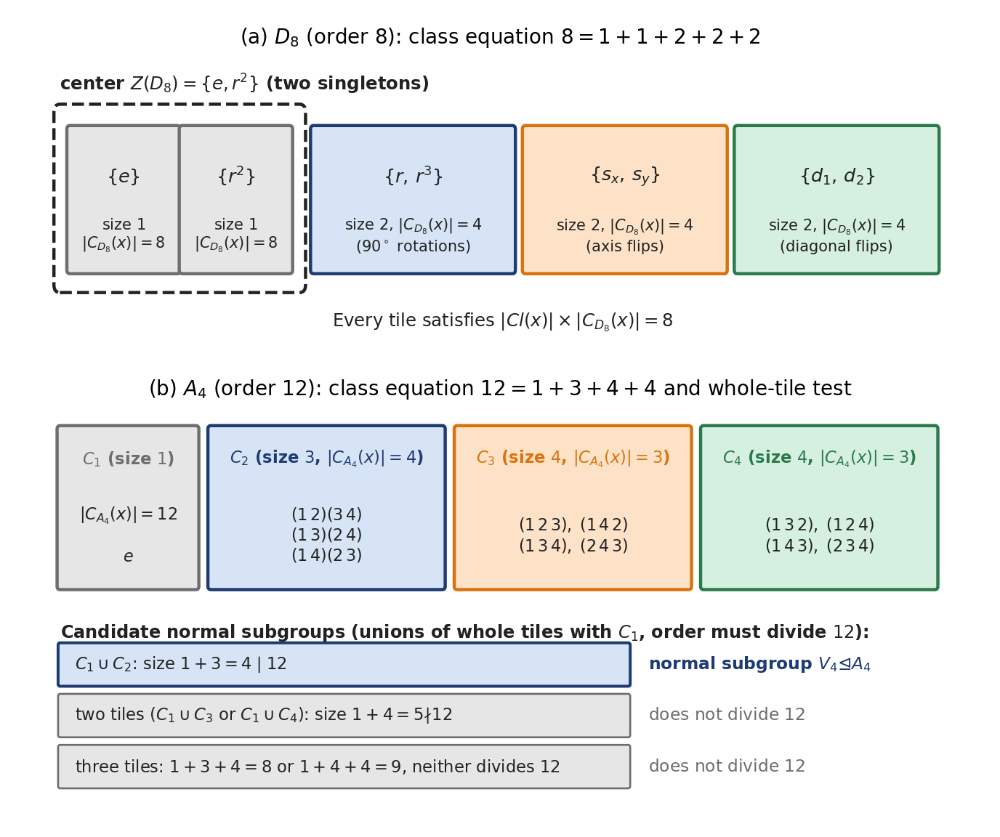

*Figure 3. Conjugacy classes and the class equation. (a) In $D_8$, the class equation is $8 = 1 + 1 + 2 + 2 + 2$, with two singletons $\{e\}$ and $\{r^2\}$ forming the center $Z(D_8)$ and three classes of size $2$. (b) In $A_4$, the class equation is $12 = 1 + 3 + 4 + 4$, and $C_1 \cup C_2$ of size $1 + 3 = 4$ is the only proper union of whole classes with $C_1$ whose size divides $12$.*

The same logic is the standard way to prove that $A_5$ (and by extension, the unsolvability of the quintic polynomial) is a Simple Group (a group whose only normal subgroups are $\{e\}$ and the group itself; see [below](#types-of-groups)). The class equation for $A_5$ is $1 + 15 + 20 + 12 + 12 = 60$. A normal subgroup is a union of whole conjugacy classes that includes the class $\{e\}$ of size $1$. If you add $1$ to any combination of the other class sizes, short of taking all of them, you will never find a sum that divides $60$. ($1$ on its own gives the trivial subgroup, and all the classes together give $A_5$ itself.) Therefore, $A_5$ has no normal subgroups other than $\{e\}$ and $A_5$. (A second route to the same fact, through the kernels in the character table of $A_5$, is in [normal subgroups of index 2 and the character table of $A_5$](#normal-subgroups-of-index-2-and-the-character-table-of-a_5).)

### Homomorphisms and the Isomorphism Theorems

A group homomorphism $\phi: G \to H$ preserves the single group operation:

$$\phi(ab) = \phi(a)\phi(b)$$

Because every element of $H$ has an inverse, the mapping naturally forces the identity to map to the identity ($\phi(1_G) = \phi(1_G 1_G) = \phi(1_G)\phi(1_G)$, and multiplying by $\phi(1_G)^{-1}$ gives $\phi(1_G) = 1_H$) and inverses to map to inverses ($\phi(a)\phi(a^{-1}) = \phi(1_G) = 1_H$, so $\phi(a^{-1}) = \phi(a)^{-1}$). For rings this argument breaks down, because the target ring need not have multiplicative inverses, and indeed a ring homomorphism need not send $1$ to $1$: the map sending everything to $0$ is a ring homomorphism.

The core theorems map perfectly to their ring counterparts, merely swapping the additive vocabulary for multiplicative vocabulary:

**The Kernel:** In rings, the kernel is what maps to $0$. In groups, the kernel maps to the identity element $1$:

$$\ker(\phi) = \{g \in G \mid \phi(g) = 1_H\}$$

Just as a ring kernel is always an ideal, a group kernel is always a normal subgroup. It absorbs perspective shifts ($g^{-1}kg \in \ker(\phi)$).

**First Isomorphism Theorem:** $G/\ker(\phi) \cong \operatorname{im}(\phi)$. The bundles (cosets) of the kernel multiply consistently to form a quotient group that is structurally identical to the image in the target group.

**Second Isomorphism Theorem:** $(HN)/N \cong H/(H \cap N)$. Let $N$ be a normal subgroup (acting like an ideal) and $H$ an ordinary subgroup (acting like a subring). Expanding $H$ by $N$ and modding out by $N$ gives the same geometric structure as restricting $N$ to its overlap with $H$ and modding out $H$ by that overlap.

**Third Isomorphism Theorem:** $(G/N)/(M/N) \cong G/M$. For normal subgroups $N \subseteq M$, folding the group down in stages (first by $N$, then by $M/N$) is identical to folding the group by $M$ directly.

**Fourth Isomorphism Theorem:** Let $G$ be a group and $N$ a normal subgroup ($N \trianglelefteq G$). Let $\pi: G \to G/N$ be the canonical projection defined by $\pi(g) = gN$.

Consider two collections of subgroups:

The Upper Collection: Subgroups of $G$ that fully contain $N$:

$$\mathcal{S}_N(G) = \{H \le G \mid N \subseteq H\}$$

The Lower Collection: All subgroups of the quotient group $G/N$:

$$\mathcal{S}(G/N) = \{\overline{H} \le G/N\}$$

The theorem states that the following forward map $\Phi$ is a bijection:

$$\Phi: \mathcal{S}_N(G) \longrightarrow \mathcal{S}(G/N)$$

$$\Phi(H) = H/N = \{hN \mid h \in H\}$$

The inverse map $\Phi^{-1}$ pulls subgroups back via the canonical projection $\pi$:

$$\Phi^{-1}(\overline{H}) = \pi^{-1}(\overline{H}) = \{g \in G \mid gN \in \overline{H}\}$$

For any two subgroups $H, K \in \mathcal{S}_N(G)$:

$$H \subseteq K \iff H/N \subseteq K/N$$

$$[K : H] = [K/N : H/N]$$

$$[G : H] = [(G/N) : (H/N)]$$

$$H \trianglelefteq G \iff H/N \trianglelefteq G/N$$

$$(H \cap K)/N = (H/N) \cap (K/N)$$

$$\langle H, K \rangle / N = \langle H/N, K/N \rangle$$

Here $\langle H, K \rangle$ is the subgroup generated by $H$ and $K$: the smallest subgroup containing both, made of all products of their elements and inverses. The same notation $\langle S \rangle$ is used for the subgroup generated by any set $S$ of elements.

So this is telling us that the normal subgroup is kind of like an inflection point in the group. The topology of the group when you project down with a normal subgroup is the same as when you build out with it.

In modern geometry and algebra, we describe this property by calling the sequence:

$$1 \longrightarrow N \hookrightarrow G \stackrel{\pi}{\longrightarrow} G/N \longrightarrow 1$$

a fibration or a short exact sequence (a chain of homomorphisms in which the image of each map is exactly the kernel of the next; the $1$ at each end stands for the trivial group $\{1\}$, and the hooked arrow $\hookrightarrow$ marks an injective homomorphism, an embedding). The word fibration is borrowed from topology and is used here only as a picture, explained below; in algebra, $G$ is then called an [extension](#example-of-building-a-larger-group) of $N$ by $G/N$.

Everything strictly inside $N$ represents internal degrees of freedom that get crushed to a single point by the projection map $\pi$. If a subgroup $K$ sits inside $N$ ($K \subset N$), the quotient map cannot resolve it independently: it collapses into the identity pixel.

For the entire universe of subgroups sitting above $N$ ($N \subseteq H \subseteq G$), the projection map preserves the structural arrangement without distortion. The algebraic "topology" of how these larger subgroups nest, intersect, and connect to each other is perfectly copied down into $G/N$.

So in a way $G/N$ reproduces $G$ itself, minus the details contained within N. The quotient group $G/N$ is $G$ viewed through a low-pass filter. High frequencies (fine details) are everything happening strictly inside $N$. This includes internal shifts, local commutators, and microscopic permutations. Low frequencies (global shape) are the macroscopic routes between different cosets. 

If $N$ were merely a subgroup and not normal, shifting perspective by some macro-jump $g$ would twist the fiber $N$ into a different orientation ($g^{-1}Ng \neq N$). In signal processing terms, that would mean the low-pass filter produces phase distortion.

Why do we call them fibers and fibration? The base space ($G/N$) is the low-resolution map. Every element in $G/N$ is a single "point" on the spine of the map. The point on the spine corresponding to the identity element of $G/N$ has a bristle sticking out of it. That bristle is made of exactly the elements inside the normal subgroup $N$. If you pick any other point on the spine (a macroscopic coordinate like $gN$), the bristle sticking out of it is the coset $gN$.

The word "fibration" implies that this structure is perfectly uniform, smooth, and untangled. If you map a random, unstructured set of data down to a smaller set, the fibers will be chaotic. The fiber over point $A$ might contain 100 elements, the fiber over point $B$ might contain 2 elements, and the fibers might twist unpredictably. Because $N$ is a normal subgroup, the group $G$ forms a perfect, rigid fibration. (Part of this, the equal and disjoint fibers described next, holds for the cosets of any subgroup, as we saw with the index formula; normality is what stops the fibers from shearing, as explained at the end of this paragraph.) Every single fiber (coset) has the exact same number of elements. They are all perfect geometric copies of $N$. The cosets strictly partition the group. No two fibers ever cross or share an element. Because $g^{-1}Ng = N$, the fibers don't "shear" when you multiply them: $(aN)(bN) = abN$, so $G/N$ is a group and $\pi$ is a homomorphism. They don't jump ship to another point on the spine.

[Figure 4](#figure-4) shows this fibration for $D_8$ over $N = \{e, r^2\}$ together with the matching subgroup lattices (all the subgroups, arranged by inclusion) of $D_8$ above $N$ and of the Klein four-group $V_4$ (the group of order 4 in which every element is its own inverse).

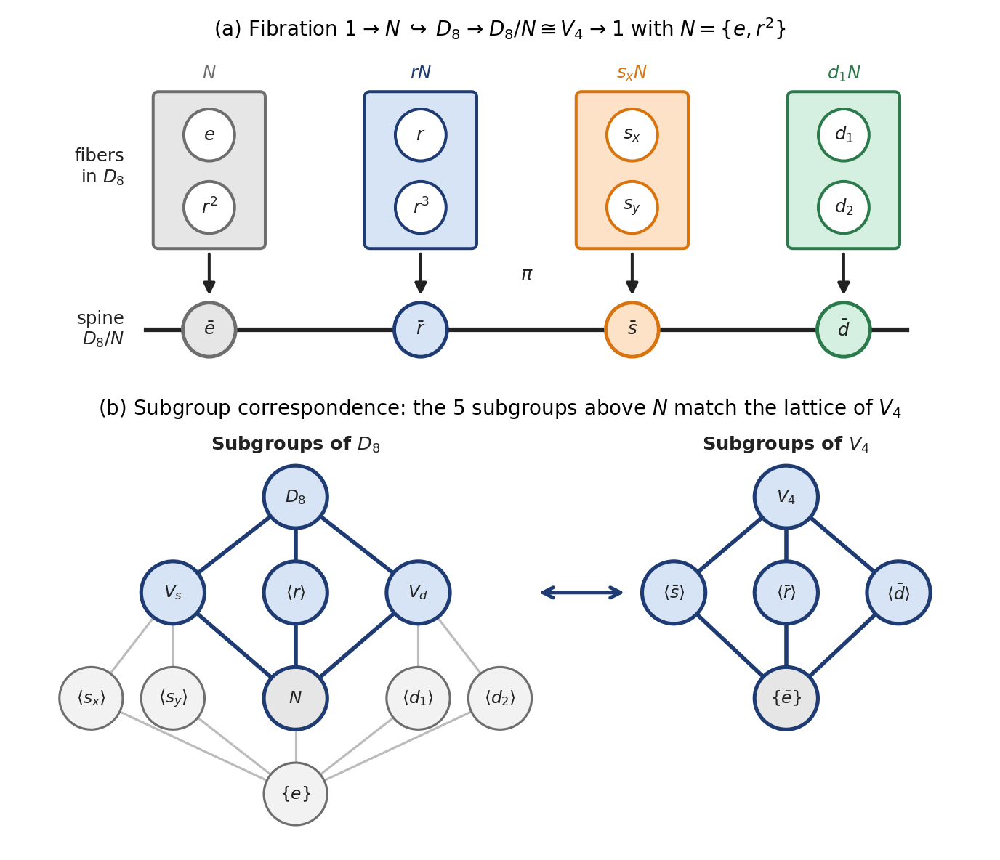

*Figure 4. Fibration and the Fourth Isomorphism Theorem for $D_8$ over $N = \{e, r^2\}$. (a) The four cosets of $N$ stand as 2-element fibers over the four points of the quotient spine $D_8/N \cong V_4$. (b) In the subgroup lattice of $D_8$, the five highlighted subgroups containing $N$ match the five subgroups of $V_4$ one-to-one.*

### Sylow's Theorems and The Anatomy of Prime Blocks

In our quest to break larger groups into simpler constituents, taking some inspiration from the prime factorization of integers is helpful. Prime factors are fundamental and unique components of an integer. In group theory, the $p$-groups (groups whose order is a power of a prime $p$) play a part of that role, though not all of it: the true analogue of prime factors is the simple groups (see [below](#the-jordan-holder-theorem-the-periodic-table-of-groups)), while the $p$-groups are the prime-power pieces that every finite group contains. These groups are highly layered and come with several restrictive properties, such as their order and how they relate to the larger group's order, which helps us put very tight constraints on how a large group can split into smaller ones. These tight constraints help us reduce our search space of the smaller constituent groups so we can find them sooner. 

Let's look at their nature for a bit. A $p$-group is a group whose entire size is a power of a single prime ($p^a$). Because they are made of a single prime "substance," they possess incredibly rigid, crystalline internal symmetries that mixed-mass groups do not.

We have Cauchy’s Theorem, which says if a prime number $p$ divides the order of a finite group $G$, then $G$ contains an element of order $p$, i.e., it has a cyclic subgroup of order $p$. (The order of an element $g$ is the smallest $n \geq 1$ with $g^n = e$, and the cyclic subgroup it generates is $\{e, g, g^2, \dots, g^{n-1}\}$.)

A key property of any non-trivial finite $p$-group $P$ is that its center is never trivial ($Z(P) \ne \{1\}$). (This is a property, not the definition: many other groups, such as every non-trivial abelian group, also have a non-trivial center.) There is always at least one non-identity action that commutes with absolutely everything else in the group. Because the center is non-trivial, you can safely quotient the group by its center, creating a smaller $p$-group, which (unless it is trivial) also has a non-trivial center, and repeat the process. This guarantees that $p$-groups can be thoroughly layered and perfectly dismantled down to the identity.

Building on this layering, one can prove the following standard theorem (we do not prove it here; its case $i = a$ is Sylow's First Theorem below): if $G$ is a group of order $p^a m$, where $p$ is a prime not dividing $m$, then for $0 \le i \le a$, $G$ contains a subgroup of order $p^i$. Furthermore, if $i < a$, then any subgroup of order $p^i$ is contained normally in a subgroup of order $p^{i+1}$. This means you can construct a nested sequence of subgroups $P_0 \subset P_1 \subset \dots \subset P_a$ such that $\vert{}P_i\vert{} = p^i$, and each subgroup is a normal subgroup of the next one in the chain ($P_i \triangleleft P_{i+1}$).

Sylow's theorems establish important rules about these $p$-groups. Lagrange’s Theorem is a restrictive law: it tells you that the order of a subgroup must divide the order of the group. If your group has 12 elements, you cannot have a subgroup of size 5. But Lagrange provides no positive guarantees. Just because 6 divides 12 does not mean a subgroup of size 6 actually exists (and in the alternating group $A_4$, it doesn't).

Sylow’s Theorems provide the positive guarantees, but they only work for prime powers. They are the structural beams of group theory.

If the order of a group is $p^a \cdot m$ (where $p$ is a prime that doesn't divide $m$), Sylow’s First Theorem guarantees that a subgroup of size $p^a$ must exist. These maximal prime-power blocks are called Sylow $p$-subgroups.

**The Second Theorem (Conjugacy):** All Sylow $p$-subgroups are conjugate. $P_1 = g^{-1}Pg$.

**The Third Sylow Theorem (Counting):** The number of Sylow $p$-subgroups (which are the maximal $p$-subgroups of order $p^a$) is $\equiv 1 \pmod p$. That is, if the order of the parent group is $\vert{}G\vert{} = n = p^a m$ (where $p$ does not divide $m$), then the number of these subgroups, denoted as $n_p$, must leave a remainder of $1$ when divided by $p$ (meaning $n_p = 1 + kp$ for some integer $k$). Additionally, $n_p$ must be a divisor of $m$ (and therefore a divisor of the total group order $n$).

By guaranteeing the existence of these prime-power subgroups, we can find $p$-group pieces inside any unknown finite group, study them in isolation, and then try to figure out how they interlock. These pieces do not determine the group on their own: the cyclic group $C_6$ (all powers of one element of order 6; see [below](#types-of-groups)) and $S_3$ have the same kinds of Sylow subgroups (cyclic of order 2 and cyclic of order 3), yet they are different groups, since one is abelian and the other is not.

The Third Sylow Theorem is the primary weapon used to prove that a group is _not_ simple. If your constraints ($n_p \equiv 1 \pmod p$ and $n_p \mid m$) leave $1$ as the only mathematically possible value for $n_p$, it means there is exactly _one_ Sylow $p$-subgroup. Because it is unique, it is invariant under conjugation, which guarantees that it is a Normal Subgroup!

When you scale up to studying finite simple groups like $PSL(2,7)$ (built from $2 \times 2$ matrices over the field with $7$ elements, as described [below](#the-jordan-holder-theorem-the-periodic-table-of-groups)) or $G_2(q)$ (an exceptional group of Lie type built over the field with $q$ elements; we do not define it in these notes), where $q \geq 3$ is a prime power ($G_2(2)$ itself is not simple: it has a normal subgroup of index $2$), this theorem dictates the structural "skeleton" of the group. For these groups to remain simple, the Sylow counts ($n_2$, $n_3$, $n_7$) must strictly be greater than 1, forcing multiple conjugate subgroups to perfectly interlock without any of them becoming normal.

### Types of Groups

Understanding the different types of groups gives us more insights into breaking a larger group into smaller pieces and then studying how those smaller pieces behave. 

We already saw the symmetric groups $S_n$, which are the groups of all possible permutations. Let's look at a few more types of groups.

**Cyclic Groups ($C_n$):** A group generated entirely by the powers of a single element $g$. Every subgroup of a cyclic group is also cyclic. A finite group G of order n is cyclic if and only if it contains an element of order $n$. For each divisor $m$ of $n$, there is a unique subgroup of G of order $m$, which is a cyclic group generated by $g^{n/m}$.

This leads us to Cauchy's Theorem. Let $G$ be a finite group, and $p$ a prime number which divides the order of $G$. Then $G$ contains an element of order $p$.

**The Alternating Group ($A_n$) and Parity:** On the symmetric group $S_n$, every complex shuffle can be broken down into a sequence of simple 2-item swaps (transpositions). While there are many ways to build the same shuffle, the parity (whether it takes an even or an odd number of swaps) is an unchangeable physical invariant of that shuffle.

The map sending a permutation to its parity ($+1$ for even, $-1$ for odd) is a homomorphism from $S_n$ to the multiplicative group $\{+1, -1\}$. The kernel of this map is the set of all even permutations. This kernel is a normal subgroup called the Alternating Group ($A_n$). Because the target group has size 2, the kernel splits the original group exactly in half, meaning $\vert{}A_n\vert{} = n! / 2$.

**Symmetry and Dihedral Groups ($D_{2n}$):** These groups represent the rigid physical symmetries of an $n$-sided regular polygon, and there are $2n$ of them (so $D_8$ is the group of the square). There are $n$ rotations (forming a cyclic, normal subgroup). There are $n$ reflections (axes of symmetry). Multiplying a rotation by a reflection flips the direction of the rotation ($r \cdot f = f \cdot r^{-1}$). For $n \geq 3$ we have $r^{-1} \neq r$, so $r \cdot f \neq f \cdot r$: this demonstrates why physical symmetries are generally non-commutative. (They need not always be: the rotations on their own commute with each other.)

**Simple Groups (The Atoms of Symmetry):** You've studied prime numbers (atoms of integers) and irreducible polynomials (atoms of rings). In groups, the "atoms" are groups that have _no_ normal subgroups except the two that every group has: the trivial subgroup $\{e\}$ and the whole group. These are called Simple Groups. Because they have no other normal subgroups, they cannot be quotiented or broken down any further. The Alternating Group $A_n$ (for $n \geq 5$) is simple!

According to Cayley's theorem, every group is in fact a subgroup of a permutation group (a group whose elements are permutations of some set). The intuition is that any group element $g$ can be viewed as a machine that shuffles the group itself. If you multiply every element in the group by $g$, you simply rearrange the elements. Therefore, $g$ is literally a permutation. There are no abstract groups; there are only permutation groups disguised by abstract notation.

### The Jordan-Hölder Theorem (The Periodic Table of Groups)

If groups are molecules, how do we find their atoms? You take a group $G$ and find a maximal normal subgroup $G_1$ (a normal subgroup other than $G$ with no normal subgroup strictly between it and $G$; it is a seam that allows a clean quotient, and maximality makes $G/G_1$ simple). You split $G$ into the quotient group $G/G_1$ and the remainder $G_1$. You then take $G_1$ and smash it again along its own maximal normal subgroup $G_2$. (Here $G_1, G_2, \dots$ are just names for the successive subgroups in the chain; this $G_2$ has nothing to do with the group of Lie type $G_2(q)$ above.) You repeat this until you are left with pieces that have no normal subgroups other than $\{e\}$ and themselves, that is, simple groups.

These unbreakable, indivisible pieces are called Simple Groups. The sequence of smashes is called a Composition Series.

The Jordan-Hölder Theorem is the Fundamental Theorem of Arithmetic for groups. It proves that no matter what normal subgroups you choose to smash along (no matter what path you take to dismantle the group), when you sweep up the simple groups left on the floor at the end, you will always have the exact same list of simple groups.

This theorem broke the study of all finite groups into two distinct massive research programs:

**The Classification Problem:** Find and catalogue every single Simple Group in the universe (the periodic table of elements).

**The Extension Problem:** Figure out how to chemically bond those simple groups back together.

When you run a group through a composition series, the "atoms" you are left with via the Jordan-Hölder theorem fall into two categories:

**Abelian Simple Groups:** These are just the cyclic groups of prime order ($C_2, C_3, C_5$). They are flat, 1-dimensional, commutative gears.

**Non-Abelian Simple Groups:** These are massively complex, multi-dimensional, interwoven structures and fall into three buckets:

**The Alternating Groups ($A_n$ for $n \ge 5$):** The group of all even permutations of $n$ items. We can prove $A_5$ is simple because its conjugacy classes (sizes 1, 15, 20, 12, 12) cannot be summed to divide 60. There is no normal subgroup to quotient out.

**Groups of Lie Type (e.g., $PSL(n, q)$):** These are [matrix groups over finite fields](maths_3_projective_geometry.md#the-picture-from-group-theory). If you take all $n \times n$ matrices with determinant 1 over the finite field $\mathbb{F}_q$ with $q$ elements (the Special Linear group), and quotient out the scalar matrices or the multiples of Identity (the Center), you get the Projective Special Linear group. Except for two exceptions, these are always simple.

**The 26 Sporadic Groups:** These are the anomalies. They do not fit into any infinite family. They are isolated, highly symmetrical geometric monsters that just happen to exist. The smallest has 7920 elements. The largest, the "Monster Group," has $\sim 10^{54}$ elements and represents the symmetries of a 196,883-dimensional space.

If a group shatters entirely into 1D prime cyclic groups ($C_p$), the group is called Soluble (or Solvable). A soluble group can be highly non-commutative overall, but its non-commutativity is superficial. You can measure this using commutators: $[x, y] = x^{-1}y^{-1}xy$. 

If you gather all these errors and take the subgroup they generate (the Derived Subgroup $[G, G]$, the smallest subgroup containing all the commutators; the commutators on their own need not form a subgroup), and then measure the errors of the errors (the derived subgroup of $[G, G]$), and so on, a Soluble group's errors will eventually vanish to $1$. In contrast, a non-abelian simple group like $A_5$ is purely non-commutative: the errors of $A_5$ are the entirety of $A_5$.

[Figure 5](#figure-5) shows both halves of this story: three different composition series of the cyclic group $C_{12}$ that sweep up the same simple factors, and a composition series of the soluble group $S_4$ beside the simple group $A_5$, which cannot be broken at all.

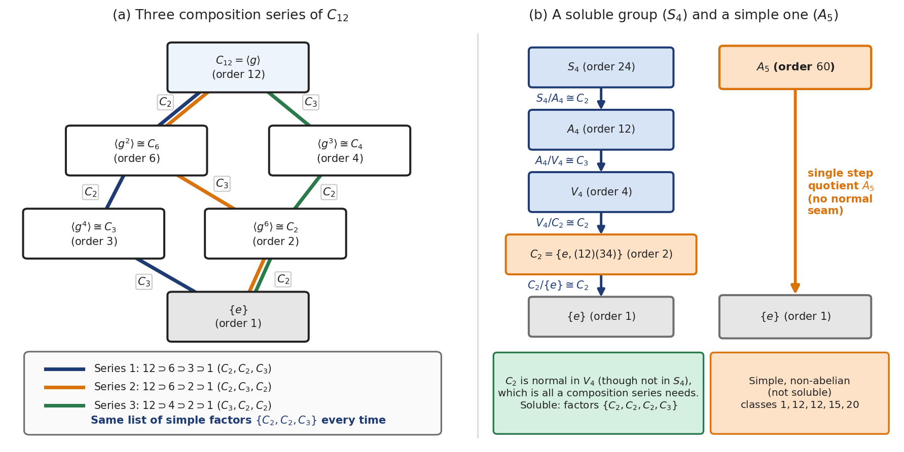

*Figure 5. Composition series and the Jordan-Hölder theorem. (a) The subgroups of $C_{12} = \langle g \rangle$, with each maximal inclusion labelled by its simple quotient; the three composition series pass through different subgroups but always produce the factors $C_2, C_2, C_3$ in some order. (b) The soluble group $S_4$ breaks down as $S_4 \triangleright A_4 \triangleright V_4 \triangleright C_2 \triangleright \{e\}$ with quotients $C_2, C_3, C_2, C_2$ (here $C_2 = \{e, (1\,2)(3\,4)\}$ is normal in $V_4$, though not in $S_4$, which is all a composition series needs), while the non-abelian simple group $A_5$ has only the one-step series $A_5 \triangleright \{e\}$.*

### Group Actions and the Orbit-Stabilizer Theorem

A group can be treated as a closed universe of abstract elements. But historically, groups were invented to do things: to shuffle roots, rotate polyhedra, or permute sets. This is the idea of a Group Action. Formally, an action of $G$ on a set $\Omega$ assigns to each $g \in G$ and $x \in \Omega$ a point $g \cdot x \in \Omega$, so that $e \cdot x = x$ and $g \cdot (h \cdot x) = (gh) \cdot x$. In this rule $h$ acts first and then $g$, which is the right-to-left reading of $gh$. Permutations, which we multiply left to right, therefore act most naturally on the right: writing $x \cdot g$ for the image of $x$ under $g$, the rule becomes $(x \cdot g) \cdot h = x \cdot (gh)$, and this is the form the module sections use ($vg$). If $\Omega$ is the set that $G$ acts on, then $\operatorname{deg}(G, \Omega) = \vert{}\Omega\vert{}$ is called the degree of the action.

When you apply a group to a physical object or set of elements, two structural questions immediately arise for any specific point/element of the set $x$:

Where can $x$ travel? Which other elements of the set can $x$ be permuted into under the action of $G$? Or alternatively, which elements of the set look the same from the perspective of the group acting on the set. The set of all possible destinations for $x$ under the group's control is called its Orbit.

The other question is, what part of $G$ leaves $x$ completely alone? The set of all group commands that leave $x$ perfectly stationary is a subgroup called the Stabilizer ($G_x$).

$G_x$ is generally not a normal subgroup of $G$. As we will see just below, the stabilizers of points in one orbit are conjugate to each other, so a normal $G_x$ would fix every point of the orbit of $x$. Suppose $G$ is transitive (it has a single orbit) and faithful (only the identity fixes every point; see [faithfulness](#kernels-cores-faithfulness) below). Then $G_x$ is normal only when $G_x = \{e\}$. Such an action is called regular, or sharply 1-transitive: exactly one element of $G$ takes any given point to any other ([regular actions](#transitive-regular-k-transitive-actions) are treated below). Without faithfulness a normal stabilizer can be larger: $C_4$ acting on the two cosets of its subgroup $C_2$ has stabilizer $C_2$, which is normal.

Normal or not, $G_x$ partitions $G$ into a set of cosets $G / G_x = \{ g G_x \mid g \in G \}$, which is in bijection with the orbit of $x$ under $G$ action, through $gG_x \mapsto g \cdot x$. (This bijection also matches the way $G$ moves the cosets with the way it moves the points of the orbit. It is not an isomorphism of groups: $G/G_x$ is only a set of cosets, and it is a group only when $G_x$ is normal.) Essentially, the "representative" of each coset can be seen as the point that $x$ shifts to during its orbit traversal. Every element $g$ inside the coset $g G_x$ moves the base point $x$ to the exact same target.

The stabilizers of elements of the set are conjugates $G_\beta = g G_\alpha g^{-1}$ when $g(\alpha) = \beta$ i.e. points in the same orbit have conjugate stabilizers. The converse fails: points in different orbits can also have conjugate, or even equal, stabilizers. For example, if every element of $G$ fixes two points, those points form two orbits of size $1$, and both of their stabilizers are all of $G$. If $G$ acts transitively, all stabilizers are conjugates of each other because there is only one orbit.

For transitive actions, since conjugate subgroups are isomorphic, every point stabilizer has the exact same order:

$$\vert{}G_\alpha\vert{} = \vert{}G_\beta\vert{} = \frac{\vert{}G\vert{}}{\vert{}\Omega\vert{}}$$

**Note on left and right.** The text above writes the action on the left ($g \cdot x$, left cosets $gG_x$, $G_\beta = gG_\alpha g^{-1}$), which goes with reading products right to left. [Figure 6](#figure-6) follows the convention of these notes, products read left to right, so the same sets appear there as right cosets $G_1g$, and the conjugate stabilizer is written $G_\beta = g^{-1}G_1g$. Here $G_1$ is the stabilizer of the corner $1$ (the $G_x$ above with $x = 1$), not the subgroup $G_1$ of a [composition series](#the-jordan-holder-theorem-the-periodic-table-of-groups). The cosets, corners and stabilizers are exactly the same sets in both; only the way the products are written differs.

[Figure 6](#figure-6) shows this bijection for $D_8$ acting on the four corners of a square, matching the four right cosets $G_1g$ (products read left to right) to the four corners and their conjugate stabilizers.

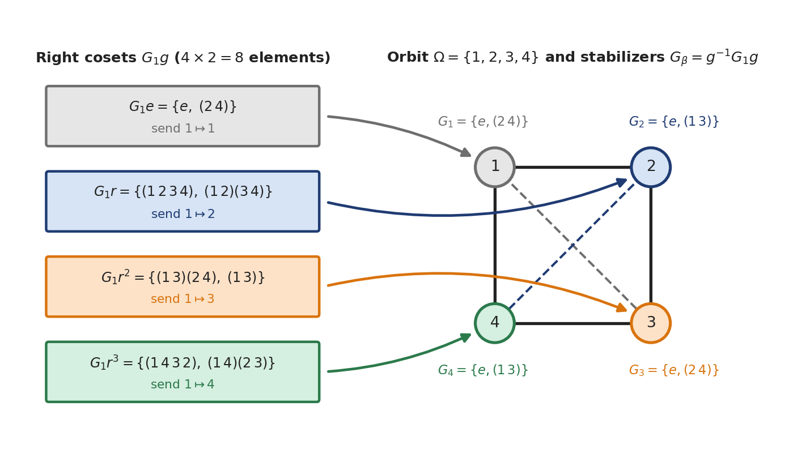

*Figure 6. The Orbit-Stabilizer Theorem for $D_8$ acting on the four corners $\Omega = \{1, 2, 3, 4\}$ of a square. The stabilizer of corner $1$ is $G_1 = \{e, (2\,4)\}$, and, with products read left to right, each of its four 2-element right cosets $G_1g$ sends corner $1$ to one corner $\beta$, the image of $1$ under $g$. Moving to corner $\beta$ conjugates the stabilizer to $G_\beta = g^{-1}G_1g$, which fixes the diagonal through $\beta$.*

**Aside:** Note the difference between the stabilizer and the centralizer, which seem to do similar things. The stabilizer is applied when a group $G$ acts on an arbitrary set $\Omega$. The centralizer is applied to elements within the group $G$ itself. The centralizer of an element $a \in G$ is the subgroup of all elements in $G$ that commute with $a$.

---

A more general rule is given in the Orbit-Stabilizer theorem below. 

For transitive actions, the set of elements of $G$ that fix every point in $\Omega$ (the kernel of the action) is the intersection of all point stabilizers:

$$\ker(\phi) = \bigcap_{\alpha \in \Omega} G_\alpha = \bigcap_{g \in G} g G_\alpha g^{-1} = \text{Core}_G(G_\alpha)$$

This is the largest normal subgroup of $G$ contained inside $G_\alpha$.

If the action is faithful (no non-identity element fixes every point), then $\text{Core}_G(G_\alpha) = \{e\}$, meaning the intersection of all these conjugate subgroups collapses to the identity.

#### Orbit-Stabilizer Theorem & Orbit-Counting Lemma

This allows us to state the Orbit-Stabilizer Theorem, a fundamental law of conservation of information. It states that for any point $x$:

$$\vert{}\text{Orbit of } x\vert{} \times \vert{}\text{Stabilizer of } x\vert{} = \vert{}G\vert{}$$

From this we can then write the Orbit-Counting Lemma which is about averaging the symmetries. If a group $G$ acts on a physical object (like the rotations of a cube), how do we count the number of fundamentally distinct configurations (orbits) it can create?

For example, if you paint the faces of a cube with 3 colours, there are $3^6 = 729$ total colourings. But if you can just rotate one colouring to look exactly like another, they belong to the same orbit. How many distinct orbits (unique painted cubes) actually exist?

The Orbit-Counting Lemma (often called Burnside's Lemma) provides a shortcut using fixed points. Instead of trying to track every colouring as it spins through space, you ask each of the 24 rotational actions of the cube: "How many of the 729 colourings do you leave perfectly unchanged (fixed)?"

The identity action fixes all 729.

A 90-degree face rotation only fixes colorings where the 4 spinning side-faces are painted the exact same color.

**The Lemma states:** The number of unique orbits is the average number of fixed points across all group actions.

$$\text{Number of Orbits} = \frac{1}{\vert{}G\vert{}} \sum_{g \in G} \text{fix}(g)$$

By averaging the fixed points of the 24 cube rotations, the 729 colourings become 57 uniquely painted cubes.

The proof of Burnside's Lemma uses a standard combinatorial trick. When we need to count something that involves two different sets of elements, we create an edge between each of the elements of the two sets that are linked to each other across sets, and then count the number of elements with an incidence in the two sets and get an equality.

Let the two sets be $G$ and $\Omega$. Define an edge between $g \in G$ and $x \in \Omega$ if and only if $g \cdot x = x$. We count the total number of edges $E$ in two ways:

**Summing across $G$:** For each $g \in G$, the number of edges incident to $g$ is the number of points in $\Omega$ fixed by $g$, namely $\vert{}\text{fix}(g)\vert{}$. Summing over all $g$:

$$E = \sum_{g \in G} \vert{}\text{fix}(g)\vert{}$$

**Summing across $\Omega$:** For each $x \in \Omega$, the number of edges incident to $x$ is the number of group elements in $G$ that fix $x$, which is the size of its stabilizer $\vert{}G_x\vert{}$. Summing over all $x$:

$$E = \sum_{x \in \Omega} \vert{}G_x\vert{}$$

Equating the two counts gives:

$$\sum_{g \in G} \vert{}\text{fix}(g)\vert{} = \sum_{x \in \Omega} \vert{}G_x\vert{}$$

Using the Orbit-Stabilizer Theorem ($\vert{}G_x\vert{} = \frac{\vert{}G\vert{}}{\vert{}\mathcal{O}_x\vert{}}$):

$$\sum_{x \in \Omega} \vert{}G_x\vert{} = \sum_{\text{orbits } \mathcal{O}} \sum_{x \in \mathcal{O}} \frac{\vert{}G\vert{}}{\vert{}\mathcal{O}\vert{}} = \sum_{\text{orbits } \mathcal{O}} \vert{}G\vert{} = \vert{}G\vert{} \cdot (\text{number of orbits})$$

Dividing both sides by $\vert{}G\vert{}$ produces Burnside's Lemma:

$$\text{number of orbits} = \frac{1}{\vert{}G\vert{}} \sum_{g \in G} \vert{}\text{fix}(g)\vert{}$$

There is another way to look at this using a permutation representation. This paragraph borrows ideas from representation theory, which only comes much later in [a little representation theory](#a-little-representation-theory), so it can be skipped on a first reading. In brief, a permutation representation turns each $g$ into the $0/1$ matrix that permutes basis vectors $e_x$ ($x \in \Omega$) the way $g$ permutes the points, and the character $\chi$ of a representation sends each $g$ to the trace of its matrix. The principal character (more commonly called the trivial character, and denoted by $\mathbf{1}$ or $1_G$) is the character corresponding to the 1-dimensional trivial representation of $G$. Specifically, it assigns the value $1$ to every single element of the group:

$$\mathbf{1}(g) = 1 \quad \text{for all } g \in G$$

Because $\mathbf{1}(g) = 1$, the inner product of any character $\chi$ with the principal character (the inner product of characters is $\langle \chi, \psi \rangle = \frac{1}{\vert{}G\vert{}} \sum_{g \in G} \chi(g) \overline{\psi(g)}$) simplifies directly to the arithmetic average of $\chi$ over the group:

$$\langle \chi, \mathbf{1} \rangle = \frac{1}{\vert{}G\vert{}} \sum_{g \in G} \chi(g) \overline{\mathbf{1}(g)} = \frac{1}{\vert{}G\vert{}} \sum_{g \in G} \chi(g)$$

For the permutation character $\pi$:

$$\langle \pi, \mathbf{1} \rangle = \frac{1}{\vert{}G\vert{}} \sum_{g \in G} \pi(g) = \frac{1}{\vert{}G\vert{}} \sum_{g \in G} \text{fix}(g)$$

since the diagonal elements of a permutation representation simply record all elements of the set fixed by that group element $g$.

Since the irreducible characters $\text{Irr}(G)$ (the characters of the irreducible representations, those with no invariant subspace other than $\{0\}$ and the whole space) form an orthonormal basis under this inner product, the multiplicity $m_{\mathbf{1}}$ (the number of times it occurs) of the principal character in the decomposition $\pi = \sum_{\chi \in \text{Irr}(G)} m_\chi \chi$ is given by:

$$m_{\mathbf{1}} = \langle \pi, \mathbf{1} \rangle$$

By Burnside's Lemma (Orbit-Counting Lemma), this integer is precisely the number of orbits of $G$ on the set $\Omega$; for permutation characters in general, including the character $\lvert\operatorname{fix}(g)\rvert - 1$ left after taking away the trivial character, see [the regular character and the subtracted permutation character](#the-regular-character-and-the-subtracted-permutation-character).

#### Jordan's Theorem

A direct consequence of this averaging is Jordan's Theorem. If a group acts transitively on a finite set $\Omega$ with at least two points, i.e. can move any point to any other point of the set, there must exist at least one element of the group that fixes nothing. If there is a transitive action, there is only 1 orbit. Because the identity element fixes everything, it heavily skews the average upward. For the average number of fixed points to drop all the way down to 1, some element needs to fix nothing. Both conditions on $\Omega$ are needed. On a single point, every element fixes that point. On an infinite set there is no average to take, and the theorem fails: the permutations of $\mathbb{N}$ that move only finitely many points form a group that acts transitively, yet each of them fixes infinitely many points.

#### Transitive, Regular & $k$-transitive Actions

Now that we have seen transitive action, we can look at free actions. An action of a group $G$ on a set $\Omega$ is free if no non-identity element fixes any point in $\Omega$.

$$\text{Stab}_G(x) = \{e\} \quad \forall x \in \Omega$$

Equivalently:

$$\text{If } g \cdot x = x \text{ for any } x \in \Omega, \quad \text{then } g = e$$

In a free action, group elements move points without "pinning" anything down. There can be multiple separate orbits. But inside every single orbit, the elements of $G$ map points one-to-one without collisions.

By the Orbit-Stabilizer Theorem, every orbit $\mathcal{O}_x$ must have an exact size equal to $\vert{}G\vert{}$:

$$\vert{}\mathcal{O}_x\vert{} = \frac{\vert{}G\vert{}}{\vert{}\text{Stab}_G(x)\vert{}} = \frac{\vert{}G\vert{}}{1} = \vert{}G\vert{}$$

Therefore, in any free action, the total size of the set $\vert{}\Omega\vert{}$ must be an exact multiple of the group size: $\vert{}\Omega\vert{} = k \cdot \vert{}G\vert{}$, where $k$ is the number of orbits.

An action is regular (also called simply transitive) if it is both transitive and free. There is only one orbit and the stabilizer is trivial. This means that for any pair of points $x, y \in \Omega$, there exists exactly one element $g \in G$ such that: $g \cdot x = y$.

Because it is transitive, $\vert{}\mathcal{O}_x\vert{} = \vert{}\Omega\vert{}$. Because it is free, $\vert{}\mathcal{O}_x\vert{} = \vert{}G\vert{}$. Therefore:

$$\vert{}\Omega\vert{} = \vert{}G\vert{}$$

The canonical example of a regular action is a group acting on itself by left (or right) multiplication: $g \cdot x = gx$. Every group element acts as a unique permutation of the group elements, with no fixed points other than the identity element doing nothing.

A stronger requirement than transitivity, which implies that a group has much more flexibility and symmetry, is $k$-transitivity for some integer $k$, where standard transitivity is the special case with $k=1$. Given any two ordered $k$-tuples of _distinct_ elements $(a_1, \dots, a_k)$ and $(b_1, \dots, b_k)$, there exists some $g \in G$ such that $g \cdot a_i = b_i$ for all $i = 1, \dots, k$. Note that we need the action to respect the order of the tuples. One obvious example of this is the symmetric group $S_n$ of degree $n$, which contains every permutation of $n$ elements and so fulfills the condition of $n$-transitivity.

The action is sharply $k$-transitive if there is exactly one element $g \in G$ that takes the first $k$-tuple to the second $k$-tuple. The pointwise stabilizer (the elements fixing every point of the tuple, written $G_{\alpha_1, \dots, \alpha_k}$) of every $k$-tuple from the parent set is the identity subgroup in such cases. A sharply 1-transitive group is a regular group.

The reason $k$-transitivity represents a dramatic leap in internal symmetry is revealed through point stabilizers:

An action of $G$ on $\Omega$ is $k$-transitive if and only if:

$G$ is transitive on $\Omega$, AND

For any point $\alpha_1 \in \Omega$, the point-stabilizer $G_{\alpha_1} = \text{Stab}_G(\alpha_1)$ acts $(k-1)$-transitively on the remaining points $\Omega \setminus \{\alpha_1\}$.

By chaining this downward, a $k$-transitive group satisfies:

$G$ is transitive on $\vert{}\Omega\vert{} = n$ points.

$G_{\alpha_1}$ is transitive on $n - 1$ points.

$\dots$

$G_{\alpha_1, \dots, \alpha_{k-1}}$ is transitive on $n - (k - 1)$ points.

By the Orbit-Stabilizer Theorem applied iteratively down the stabilizer tower:

$$\vert{}G\vert{} = n \cdot \vert{}G_{\alpha_1}\vert{} = n(n - 1) \cdot \vert{}G_{\alpha_1, \alpha_2}\vert{} = \dots = n(n - 1)(n - 2)\cdots(n - k + 1) \cdot \vert{}G_{\alpha_1, \dots, \alpha_k}\vert{}$$

Therefore, for $G$ to be $k$-transitive on $n$ points, the order of $G$ must be a multiple of the falling factorial:

$$\vert{}G\vert{} \quad \text{is divisible by} \quad \frac{n!}{(n - k)!}$$

If $n = 10$ and $G$ is $1$-transitive, $\vert{}G\vert{}$ only needs to be divisible by $10$. If $G$ is $2$-transitive, $\vert{}G\vert{}$ must be divisible by $10 \times 9 = 90$. If $G$ is $3$-transitive, $\vert{}G\vert{}$ must be divisible by $10 \times 9 \times 8 = 720$.

High transitivity is extraordinarily rare. Aside from the full symmetric groups $S_n$ ($n$-transitive) and alternating groups $A_n$ ($(n-2)$-transitive), there are no 6-transitive groups at all. The only non-trivial $4$-transitive and $5$-transitive groups in existence are the sporadic [Mathieu groups](maths_4_incidence_geometry.md#unitals-inversive-planes-and-witt-mathieu-designs) ($M_{11}, M_{12}, M_{23}, M_{24}$). Any group that is $k$-transitive for $k \ge 2$ is so flexible that it wipes out almost all invariant geometric relations (like lines, distances, or graphs) on the set. Imagine trying to do a collineation. You want to map the points of a line to some points that lie on another line. But with 2-transitivity, you could map those points to any 2 points, not necessarily just ones that lie on a line. So you cannot control and determine a collineation with such a group.

Be careful with this picture, though. 2-transitivity only controls where two points go, and any two points of a [projective plane](maths_3_projective_geometry.md#projective-plane) lie on a line, so a 2-transitive group can still preserve all the lines. $PGL(3, q)$ acting on the points of $PG(2, q)$ is 2-transitive, and every one of its elements is a collineation; for $q = 2$ this is the group of the Fano plane. What 2-transitivity does wipe out is any invariant relation between two points, such as a graph or a distance. Collinearity is a relation among three points, and 3-transitivity would destroy it.

A weaker condition on a $G$-space (a set $\Omega$ together with an action of $G$ on it, also called a $G$-set) is $k$-homogeneity, where we don't insist that some $g \in G$ maps any ordered $k$-tuple to another while respecting the order of elements in the tuple. We only require it to map any $k$-element subset to any other $k$-element subset. The order of the mapping is not important, which is why we can downgrade from a tuple to a subset.

Similar to transitivity, we have: let $\Omega$ be a transitive $G$-space and $\alpha \in \Omega$. Then $G$ is $(k + 1)$-homogeneous on $\Omega$ if the stabilizer $G_\alpha$ is $k$-homogeneous on $\Omega \setminus \{\alpha\}$. Unlike the transitive case, the converse fails. The cyclic group generated by $(1\,2\,3)$ is 2-homogeneous on $\{1, 2, 3\}$, since it moves any pair of points to any other pair, but its point stabilizers are trivial, so they are not transitive on the remaining two points.

#### Orbit Decomposition

Transitive actions are the fundamental building blocks of permutation group theory. If you understand how groups act transitively on individual orbits (which are classified purely as coset spaces $G/\text{Stab}(x)$), you can analyze any arbitrary permutation group by studying its transitive pieces and how they are wired together inside the subdirect product (a subgroup of the direct product of the pieces that still projects onto each piece; the direct product $H_1 \times \dots \times H_k$ of groups is the group of tuples $(h_1, \dots, h_k)$ with $h_i \in H_i$, multiplied entry by entry; see the [example below](#example-of-building-a-larger-group)). Towards this, we first look at how a group decomposes into orbits.

Every point $x \in \Omega$ belongs to at least one orbit (since $x \in \mathcal{O}_x$). If two orbits share even a single common point ($z \in \mathcal{O}_x \cap \mathcal{O}_y$), they must be completely identical ($\mathcal{O}_x = \mathcal{O}_y$). So two orbits are either strictly disjoint or equal. Therefore:

$$\Omega = \bigsqcup_{i \in I} \mathcal{O}_{x_i}$$

A $G$-space $\Omega$ breaks down into orbits in exactly one way because being in the same orbit is an equivalence relation.

A point $x$ cannot belong to orbit $A$ and also to a distinct orbit $B$. Every single point in the space is accounted for. Each orbit is a minimal $G$-invariant subset (a subset that every element of $G$ maps onto itself). You cannot slice an orbit into smaller $G$-invariant pieces, nor can you merge two orbits without breaking transitivity.

This theorem helps us further in our foundational "divide and conquer" theorem of permutation groups: any arbitrary permutation group can be decomposed into transitive pieces, one on each orbit. The pieces need not move independently of each other, as we will see.

$\Omega$ partitions uniquely into disjoint orbits:

$$\Omega = \Delta_1 \sqcup \Delta_2 \sqcup \dots \sqcup \Delta_k$$

For each orbit $\Delta_i$, there is a projection map $\pi_i$ that restricts the action of $g \in G$ to just the points in $\Delta_i$:

$$\pi_i : G \longrightarrow \text{Sym}(\Delta_i), \quad \pi_i(g) = g\vert{}_{\Delta_i}$$

The projection map $\pi_i$ is just a mathematical camera that zooms in on a single orbit $\Delta_i$ and ignores everything else in $\Omega$.

When $G$ acts on the whole set $\Omega$, every element $g \in G$ shuffles all the points of $\Omega$ at once. Because orbits are $G$-invariant (points inside $\Delta_i$ never cross into $\Delta_j$), a permutation $g$ is actually doing $k$ separate shuffles in parallel, one inside each orbit. Separate does not mean independent, though: in some groups the shuffle inside one orbit forces the shuffle inside another, which is what [subdirect products](#example-of-building-a-larger-group) below are about. The map $\pi_i$ isolates the shuffle happening inside $\Delta_i$.

The meaning of the notation is as follows:

**$\text{Sym}(\Delta_i)$:** The symmetric group on the subset $\Delta_i$, which is the group of all possible permutations (shuffles) of the points in $\Delta_i$ alone.

**$g\vert{}_{\Delta_i}$ ("$g$ restricted to $\Delta_i$"):** Take the full permutation $g$ and erase all parts of it that act outside $\Delta_i$. You are left with a smaller permutation that only moves points inside $\Delta_i$.

**$\pi_i : G \to \text{Sym}(\Delta_i)$:** The function (specifically, a group homomorphism) that takes an element $g \in G$ as input and outputs its restricted permutation $g\vert{}_{\Delta_i}$.

**$G^{\Delta_i} = \pi_i(G)$ (The $i$-th transitive constituent):** The image of $\pi_i$ is the $i$-th transitive constituent, $G^{\Delta_i} = \pi_i(G)$. If you feed *every* element of $G$ through the map $\pi_i$, the collection of restricted permutations you get on the other side forms a permutation group acting solely on $\Delta_i$. Because $\Delta_i$ is a single orbit, this restricted group $G^{\Delta_i}$ acts transitively on $\Delta_i$; hence the name **transitive constituent**.

If the action is faithful (only the identity fixes every point of $\Omega$), $G$ is isomorphic to a subgroup of the direct product of its transitive constituents (the group of tuples $(h_1, \dots, h_k)$ with $h_i \in G^{\Delta_i}$, multiplied entry by entry). In general it is $G$ divided by the kernel of the action that embeds there, as shown at the end of the example below.

**Example: $G$ Acting on $\Omega = \{1, 2, 3, 4, 5\}$**

Suppose $\Omega = \{1, 2, 3, 4, 5\}$ and a group $G$ of order $6$ consists of these permutations in $S_5$:

$$G = \Big\{ e, \; (123)(45), \; (132), \; (45), \; (123), \; (132)(45) \Big\}$$

Here, $\Omega$ partitions into two disjoint orbits:

**Orbit 1:** $\Delta_1 = \{1, 2, 3\}$

**Orbit 2:** $\Delta_2 = \{4, 5\}$

Now apply the two projection maps $\pi_1$ (keep only $\{1,2,3\}$) and $\pi_2$ (keep only $\{4,5\}$) to every element $g \in G$:

| Element $g \in G$ | $\pi_1(g) = g\vert{}_{\Delta_1}$ (Keep $\{1,2,3\}$) | $\pi_2(g) = g\vert{}_{\Delta_2}$ (Keep $\{4,5\}$) |
| --- | --- | --- |
| $e$ | $e$ | $e$ |
| $(123)(45)$ | $(123)$ | $(45)$ |
| $(132)$ | $(132)$ | $e$ |
| $(45)$ | $e$ | $(45)$ |
| $(123)$ | $(123)$ | $e$ |
| $(132)(45)$ | $(132)$ | $(45)$ |

Look at the distinct permutations that appear in each column:

**First Transitive Constituent $G^{\Delta_1} = \pi_1(G)$:** Collecting the distinct outputs in the $\pi_1$ column gives:

$$G^{\Delta_1} = \{e, (123), (132)\} \le \text{Sym}(\{1,2,3\})$$

Notice that $\vert{}G\vert{} = 6$, yet $\vert{}G^{\Delta_1}\vert{} = 3$. Two different elements of $G$, like $(123)(45)$ and $(123)$, look identical when you only watch $\Delta_1$.

**Second Transitive Constituent $G^{\Delta_2} = \pi_2(G)$:** Collecting the distinct outputs in the $\pi_2$ column gives:

$$G^{\Delta_2} = \{e, (45)\} \le \text{Sym}(\{4,5\})$$

Here, $\vert{}G^{\Delta_2}\vert{} = 2$. Elements like $(123)$ and $(132)$ do nothing to $\{4, 5\}$, so under $\pi_2$ they collapse to the identity $e$.

**Why We Care About $\pi_i$ and $G^{\Delta_i}$**

**Kernel of $\pi_i$:** The elements of $G$ that do nothing to $\Delta_i$ (those that map to $e$ in the $\pi_i$ column) form a normal subgroup $\ker(\pi_i) \triangleleft G$. In our example, $\ker(\pi_1) = \{e, (45)\}$ and $\ker(\pi_2) = \{e, (123), (132)\}$. By the First Isomorphism Theorem:

$$G^{\Delta_i} \cong G / \ker(\pi_i)$$

**Decomposition into Transitive Building Blocks:** Instead of studying a complicated intransitive action on a large set $\Omega$, the maps $\pi_1, \dots, \pi_k$ let you embed $G$ as a subgroup of the direct product of its transitive constituents:

$$G / \ker(\text{action on }\Omega) \hookrightarrow G^{\Delta_1} \times G^{\Delta_2} \times \dots \times G^{\Delta_k}$$

Every group action on any set is built by gluing together transitive actions on its individual orbits via these projection maps.

#### Kernels, Cores & Faithfulness

These three tools serve three fundamental purposes in algebra: detecting hidden normal subgroups, constructing faithful concrete representations (like matrices or permutations) for abstract groups, and detecting simple groups.

First let's explain these terms. Every group action of $G$ on a set $\Omega$ is encoded by a homomorphism:

$$\phi: G \longrightarrow \text{Sym}(\Omega)$$

where each group element $g$ gets mapped to a permutation $\phi(g)$ of the set $\Omega$.

The kernel of this action is the standard kernel of the homomorphism $\phi$:

$$\ker(\phi) = \{g \in G \mid \phi(g) = \text{id}_\Omega\}$$

The kernel consists of all group elements that do absolutely nothing to any point in the set. For an element $g$ to be in $\ker(\phi)$, it must leave every single point $\alpha \in \Omega$ fixed: $g \cdot \alpha = \alpha \quad \forall \alpha \in \Omega$.

Since fixing a point $\alpha$ means belonging to its stabilizer $G_\alpha$, an element in the kernel must live inside every single stabilizer simultaneously:

$$\ker(\phi) = \bigcap_{\alpha \in \Omega} G_\alpha$$

Because the kernel of any homomorphism is a normal subgroup, $\ker(\phi) \trianglelefteq G$ always.

An action is faithful if the group elements do not pretend to be something they are not: no non-identity element acts as the identity permutation.

$$\text{Faithful} \iff \ker(\phi) = \{e\}$$

Distinct group elements perform distinct permutations. If $g \neq h$, then there is at least one point $\alpha \in \Omega$ where $g \cdot \alpha \neq h \cdot \alpha$. The group $G$ embeds cleanly as a true subgroup of $\text{Sym}(\Omega)$.

If the action is unfaithful, there are non-identity elements ($g \neq e$) that leave every single point completely untouched. The action "forgets" or blinds itself to those elements.

The core is a concept defined for any arbitrary subgroup $H \le G$. If $H$ is a subgroup of $G$, $H$ might not be normal ($g H g^{-1} \neq H$). The core of $H$ in $G$ is defined as the intersection of all conjugate copies of $H$:

$$\text{Core}_G(H) = \bigcap_{g \in G} g H g^{-1}$$

It is the largest normal subgroup of $G$ that can fit entirely inside $H$. If $H$ is already normal to begin with, then $g H g^{-1} = H$ for all $g$, so $\text{Core}_G(H) = H$. If $H$ contains no non-trivial normal subgroups of $G$, then $\text{Core}_G(H) = \{e\}$ (we say $H$ is core-free).

The bridge connecting these three concepts is the coset action (or any transitive action). Suppose $G$ acts on the set of left cosets $\Omega = G/H$ by left multiplication:

$$g \cdot (xH) = (gx)H$$

What is the stabilizer of the base point? The base point is the coset $1H = H$. An element $g$ fixes this point if $gH = H$, which means $g \in H$. So the stabilizer is: $\text{Stab}_G(1H) = H$.

What are the stabilizers of the other points? The coset $xH$ is reached by moving $1H$ by $x$. As established earlier, moving a point conjugates its stabilizer: $\text{Stab}_G(xH) = x H x^{-1}$.

What is the kernel of this action? The kernel consists of the elements that fix all cosets in $\Omega$: $\ker(\phi) = \bigcap_{xH \in G/H} \text{Stab}_G(xH) = \bigcap_{x \in G} x H x^{-1}$.

Notice that exact formula: that is the definition of $\text{Core}_G(H)$! Therefore, for any coset action:

$$\ker(\phi) = \text{Core}_G(H)$$

$$\text{The action of } G \text{ on } G/H \text{ is faithful} \iff \ker(\phi) = \{e\} \iff \text{Core}_G(H) = \{e\}$$

Now let's look at why we care about these tools, starting with finding normal subgroups. Subgroups in a group are rarely normal. However, taking the core of _any_ non-normal subgroup automatically creates a normal subgroup:

$$\text{Core}_G(H) = \bigcap_{g \in G} g H g^{-1} \trianglelefteq G$$

The core can be trivial, though: the three conjugates of $H = \langle (1\,2) \rangle$ in $S_3$ meet only in $e$, so $\text{Core}_{S_3}(H) = \{e\}$. What $\text{Core}_G(H) \le H$ does give is this: if $H \neq G$ and the core is not $\{e\}$, then the core is a normal subgroup other than $\{e\}$ and $G$. The next theorem gives a simple condition that forces this.

**Example (Poincaré’s Theorem):** If $G$ has a subgroup $H$ of finite index $[G : H] = n$, the core $K = \text{Core}_G(H)$ is a normal subgroup of $G$ whose index $[G : K]$ divides $n!$. So if $G$ is finite, $H \neq G$, and $\vert{}G\vert{}$ does not divide $n!$, then $K \neq \{e\}$ (otherwise $\vert{}G\vert{} = [G : K]$ would divide $n!$), and $G$ has a normal subgroup other than $\{e\}$ and $G$.

This is the exact mechanism behind the smallest-prime-index result in [conditions implying a normal subgroup](#conditions-implying-a-normal-subgroup): finding a prime-index subgroup $H$ and showing that $H = \text{Core}_G(H)$, which immediately proves $H$ is normal.

Now let's look at converting abstract groups into concrete permutations or matrices. Abstract groups defined by axioms or generators and relations can be difficult to visualize or compute with. To study them, we map them into concrete geometric groups:

$$\phi: G \longrightarrow \text{Sym}(\Omega) \quad \text{or} \quad \rho: G \longrightarrow \text{GL}(n, \mathbb{C})$$

Calculating the kernel and checking faithfulness tells you whether information is lost in that translation. If the action is faithful ($\ker(\phi) = \{1\}$), by the First Isomorphism Theorem:

$$G / \{1\} \cong G \hookrightarrow \text{Sym}(\Omega)$$

The map is an embedding. You have successfully realized the abstract group $G$ as a concrete group of permutations or invertible matrices. You can now use matrix algorithms or permutation cycle notation to analyze $G$.

If the action is unfaithful ($\ker(\phi) \neq \{1\}$), the representation collapses parts of $G$. The image does not represent $G$, but rather the smaller quotient group $G/\ker(\phi)$.

These definitions are also useful for proving that a group is simple. Recall that a group is simple if its only normal subgroups are $\{1\}$ and the group itself. If you are investigating a group $G$ and you construct a non-trivial action on a set $\Omega$:

The kernel $\ker(\phi)$ must be a normal subgroup of $G$. Because $G$ is simple, the only possibilities are: $\ker(\phi) = G \quad \text{or} \quad \ker(\phi) = \{1\}$

As long as at least one element of $G$ moves at least one point in $\Omega$, $\ker(\phi) \neq G$. Therefore, $\ker(\phi)$ is forced to be $\{1\}$. Any non-trivial action of a simple group is automatically faithful. This makes it possible to determine the minimum degree $n$ needed to embed a simple group into $S_n$.

These are also useful in diagnosing the "blind spots" of a physical/symmetric system. In physics and coding theory, group actions often represent symmetries applied to a state space:

Elements in the kernel (the core) are global "gauge redundancies" or invisible shifts: operations you apply to the system that leave every measurable state completely unchanged.

If a symmetry action is not faithful, factoring out the kernel ($G/\ker(\phi)$) gives the effective symmetry group that actually impacts the physical degrees of freedom.

**Aside:** The hook arrow symbol $\hookrightarrow$ represents an injective homomorphism (also called an embedding or canonical inclusion). In the expression:

$$G / \{1\} \cong G \hookrightarrow \text{Sym}(\Omega)$$

A standard single arrow $\to$ denotes any arbitrary function or homomorphism.

The "hook" tail on $\hookrightarrow$ specifically indicates injectivity (one-to-one).

When you write $A \hookrightarrow B$, it asserts two things:

No Information Loss (Trivial Kernel): The map preserves the algebraic structure with zero collapse: $\ker = \{1\}$. Distinct elements in $A$ map to distinct elements in $B$.

Subgroup Realization: $A$ is isomorphic to its image inside $B$. $A \cong \text{im}(A) \le B$.

Because the action $\phi: G \to \text{Sym}(\Omega)$ is faithful, its kernel is trivial ($\ker(\phi) = \{1\}$). Therefore, $G$ is not just sending signals into $\text{Sym}(\Omega)$; it is embedded directly inside $\text{Sym}(\Omega)$ as an honest, fully realized subgroup of permutations.

#### Example of Building a Larger Group

Suppose a group $G$ permutes a 10-point set $\Omega = \Omega_1 \sqcup \Omega_2$, where $\vert{}\Omega_1\vert{} = 4$ and $\vert{}\Omega_2\vert{} = 6$. Suppose also that every element of $G$ maps $\Omega_1$ to itself and $\Omega_2$ to itself, and that the $6$ points of $\Omega_2$ are the vertices of a regular hexagon, which every element of $G$ moves by a symmetry of the hexagon. So $G$ acts on $\Omega_1$ through $S_4$ and on $\Omega_2$ through the dihedral group $D_{12}$ (a general group acting on $6$ points need not do this).

When you pick any element $g \in G$:

$g$ does something to the 4 points in $\Omega_1$. Call that transformation $g_1 \in S_4$.

Simultaneously, $g$ does something to the 6 points in $\Omega_2$. Call that transformation $g_2 \in D_{12}$.

So every element $g \in G$ can be written as an ordered pair:

$$g = (g_1, g_2) \in S_4 \times D_{12}$$

Now the central question is: Are the actions on $\Omega_1$ and $\Omega_2$ completely independent, or are they talking to each other?

If they are completely independent, you can pick any permutation $g_1 \in S_4$ on $\Omega_1$ while keeping $\Omega_2$ frozen ($g_2 = e$). And you can pick _any_ symmetry $g_2 \in D_{12}$ on $\Omega_2$ while keeping $\Omega_1$ frozen. If so, $G$ is the entire direct product $S_4 \times D_{12}$, of size $24 \times 12 = 288$.

If the two are somehow coupled, whenever you do something to $\Omega_1$, it forces you to do something compatible on $\Omega_2$. For example: "If I do an odd permutation on the first 4 points, I am strictly forbidden from keeping $\Omega_2$ still. I must perform a reflection on the hexagon." This is the entire motivation: how do we find all possible ways two orbits can be "coupled together"? Goursat's Lemma is the algebraic rule that tells you this.

Before looking at the Lemma, we look at a definition. Let $A$ and $B$ be two groups. A subgroup $G \le A \times B$ is called a subdirect product if:

$G$ has at least one element $(a, b)$ for every $a \in A$ i.e. every element of $A$ appears as the first coordinate of at least one element in $G$ (the projection $\pi_1: G \to A$ is surjective).

$G$ has at least one element $(a, b)$ for every $b \in B$ i.e. every element of $B$ appears as the second coordinate of at least one element in $G$ (the projection $\pi_2: G \to B$ is surjective).

In our case, the action on $\Omega_1$ is all of $S_4$. The action on $\Omega_2$ is all of $D_{12}$.    

That is literally saying that $G \le S_4 \times D_{12}$ is a subdirect product.

Now for the concept behind Goursat's Lemma. We will find that finer actions, such as the actions of a normal subgroup of $S_4$ and a normal subgroup of $D_{12}$, are independent. But when we quotient by these normal subgroups, the coarser actions in the two quotients lock together and are not independent. So we cannot simply use the direct product formula unless the common quotient is the trivial group alone (meaning the normal subgroups are the full groups $N_1 = G_1$ and $N_2 = G_2$; in this paragraph $G_1$ and $G_2$ are the two groups being combined, called $A$ and $B$ below and $S_4$ and $D_{12}$ in our example, not point stabilizers). We will see that the way to build the combined group (a subdirect product) is to search for normal subgroups $N_1 \trianglelefteq G_1$ and $N_2 \trianglelefteq G_2$ such that they give an isomorphic common quotient $Q \cong G_1/N_1 \cong G_2/N_2$ when quotienting their respective groups. We then couple the two normal subgroups via a direct product $N_1 \times N_2$ because they act independently, and extend this base by the locked common quotient $Q$ (which is a group extension, and specifically a semidirect product $(N_1 \times N_2) \rtimes Q$ when the quotient splits in both groups). Briefly, a group extension of $N$ by $Q$ is a group that contains $N$ as a normal subgroup with quotient $Q$ (when $N$ is abelian, the extensions with a given action of $Q$ on $N$ are classified in [degree two cohomology](#degree-two-cohomology-factor-sets-and-group-extensions)). It is split, and is then a semidirect product $N \rtimes Q$ when it also contains a subgroup that meets $N$ only in the identity and maps onto the quotient, a copy of $Q$ sitting inside it. Saying that the quotient splits in both groups means that each $G_i$ is split over $N_i$ in this sense. Looking at the arithmetic of group orders, this works out to $(\vert{}G_1\vert{}/\vert{}Q\vert{} \cdot \vert{}G_2\vert{}/\vert{}Q\vert{})\cdot \vert{}Q\vert{} = \frac{\vert{}G_1\vert{}\cdot \vert{}G_2\vert{}}{\vert{}Q\vert{}}$, where we divide out the order of the common quotient to prevent it from being counted twice. This arithmetic directly gives the order of the resulting group from the orders of the constituent groups involved.

[Figure 7](#figure-7) shows the three possibilities on small groups: a direct product, a split extension that is not a direct product, and an extension that does not split. In the figure, $A$ is the normal subgroup ($N$ above) and $B$ the quotient ($Q$); $b$ stands for a representative of a coset of $A$, $\phi_b$ is how $b$ acts on $A$ by conjugation, and the factor set $f(b_1, b_2) \in A$ measures how far the product of the representatives of $b_1$ and $b_2$ lands from the representative of $b_1 b_2$.

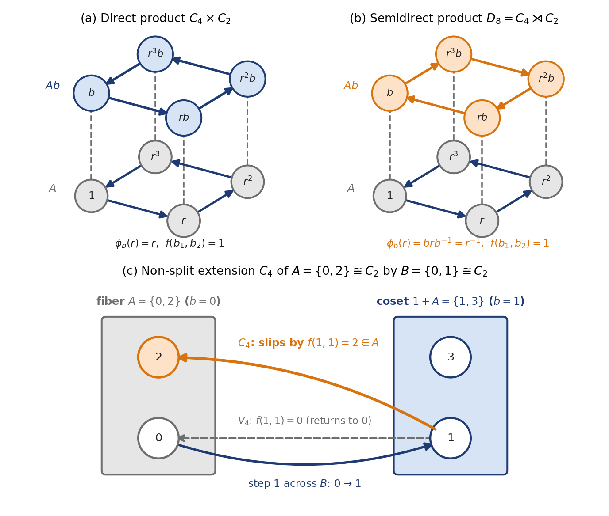

*Figure 7. Building a group from a normal subgroup $A$ and a quotient $B$, using the action $\phi_b$ and the factor set $f(b_1, b_2)$. (a, b) The arrows in each layer show right multiplication by $r$: in the direct product $C_4 \times C_2$ both layers rotate the same way ($\phi_b(r) = r$), whereas in the semidirect product $D_8 = C_4 \rtimes C_2$ the action $\phi_b(r) = brb^{-1} = r^{-1}$ reverses the arrows in the upper layer $Ab$; in both, the factor set is trivial. (c) In the non-split extension $C_4$ of $A = \{0, 2\}$ by $B = \{0, 1\}$, stepping across $B$ twice from $0$ through $1$ does not return to $0$, as it would in $V_4 = C_2 \times C_2$, but slips along $A$ to $2$: the factor set is $f(1, 1) = 2$.*

Now for Goursat's Lemma. Look at the elements that fix one orbit entirely:

Let $N_1$ be the set of transformations on $\Omega_1$ that can occur while leaving $\Omega_2$ completely unmoved:

$$N_1 = \{ g_1 \in A \mid (g_1, e_B) \in G \}$$

Let $N_2$ be the set of transformations on $\Omega_2$ that can occur while leaving $\Omega_1$ completely unmoved:

$$N_2 = \{ g_2 \in B \mid (e_A, g_2) \in G \}$$

$N_1$ is a normal subgroup of $A$, and $N_2$ is a normal subgroup of $B$.

Now, what is left over once you ignore the independent movements inside $N_1$ and $N_2$?

In $A$, the "coarse" behavior is given by the quotient group $A / N_1$.

In $B$, the "coarse" behavior is given by the quotient group $B / N_2$.

The reason the quotient group $A / N_1$ is the coupling mechanism is that the second coordinate depends only on which coset of $N_1$ you are in. Suppose $(a, b) \in G$. What happens if you modify $a$ by any internal, independent motion $n_1 \in N_1$?

$$(n_1, e_B) \cdot (a, b) = (n_1 a, b) \in G$$

The first coordinate changed from $a$ to $n_1 a$ (staying inside the same coset $a N_1$). The second coordinate did not change at all. It is still $b$.

Conversely, if $(a, b_1) \in G$ and $(a, b_2) \in G$, then $(a, b_1)^{-1}(a, b_2) = (a^{-1}, b_1^{-1})(a, b_2) = (e_A, b_1^{-1} b_2) \in G$.

This forces $b_1^{-1} b_2 \in N_2$, meaning $b_1$ and $b_2$ belong to the exact same coset $b_1 N_2 = b_2 N_2$.

The individual elements $a \in A$ carry too much fine-grained internal detail ($N_1$). Once you "blur" that fine detail out by quotienting:

$$A \longrightarrow A / N_1$$

each entire coset $a N_1$ determines a unique coarse behavior that matches one-to-one with a coarse behavior $b N_2$ in $B / N_2$. The correspondence between those coarse packages must respect multiplication, which is why it is an isomorphism of quotient groups.

**Goursat's Lemma:** The "locked-together" part of the two groups must be an exact isomorphism between their quotient groups.

$$\theta: A / N_1 \xrightarrow{\sim} B / N_2$$

An element $(g_1, g_2) \in A \times B$ belongs to $G$ if and only if $\theta(g_1 N_1) = g_2 N_2$.

To find all subdirect products of $A$ and $B$, Goursat's Lemma gives a 3-step recipe:

Find normal subgroups $N_1 \trianglelefteq A$ and $N_2 \trianglelefteq B$.

Check if $A/N_1$ and $B/N_2$ are isomorphic ($A/N_1 \cong B/N_2 \cong Q$). If they don't have the same quotient structure, they cannot be coupled this way.

For every isomorphism $\theta: A/N_1 \to B/N_2$, form:

$$G = \{ (g_1, g_2) \in A \times B \mid \theta(g_1 N_1) = g_2 N_2 \}$$

Let us see this machine in action on $S_4 \times D_{12}$:

**Case 1: Quotient $Q = \{1\}$ (Zero coupling)**

We choose $N_1 = S_4$ and $N_2 = D_{12}$.

Quotients: $S_4/S_4 \cong \{1\}$ and $D_{12}/D_{12} \cong \{1\}$.

Condition: $\theta(g_1 N_1) = g_2 N_2$ is vacuously true for every pair.

**Result:** No restrictions. $G = S_4 \times D_{12}$. Both orbits move with complete independence.

**Case 2: Quotient $Q = C_2$ (Odd/Even Parity coupling)**

In $S_4$, there is only one normal subgroup of index 2: $N_1 = A_4$ (the even permutations). The quotient $S_4 / A_4 \cong \{+1, -1\}$ just records whether a permutation is even or odd.

In $D_{12}$, is there a normal subgroup of index 2? Yes! In fact there are three. Write $r$ for the rotation by $60^\circ$ and $s$ for a reflection of the hexagon (a reflection was written $f$ in [types of groups](#types-of-groups); here it is $s$). The three are the rotations $\langle r \rangle \cong C_6$ and two subgroups isomorphic to $S_3$, namely $\langle r^2, s \rangle$ and $\langle r^2, rs \rangle$. So Goursat's recipe gives three different parity couplings with $S_4$, one for each of them. We follow the one that uses the rotations.

Take $N_2 = \langle r \rangle \cong C_6$ (the 6 rotations of the hexagon).

The quotient $D_{12} / \langle r \rangle \cong \{+1, -1\}$ records whether a symmetry is a pure rotation or includes a reflection.

Both quotients are $C_2$. They match!

What is the group $G$?

Goursat says: pair them up via the isomorphism $\theta$:

$$(g_1, g_2) \in G \iff \operatorname{sgn}(g_1) = \begin{cases} +1 & \text{if } g_2 \text{ is a rotation} \\ -1 & \text{if } g_2 \text{ is a reflection} \end{cases}$$

**What this means in plain English:** You can shuffle the 4 points however you want, and you can move the hexagon however you want, except: If you do an even shuffle on the 4 points, you are forced to do a rotation on the hexagon. If you do an odd shuffle on the 4 points, you are forced to do a reflection on the hexagon. The two orbits are tied together by a parity "gear."

**More details:** The resulting group $G$ is the fiber product (or subdirect product) $S_4 \times_{C_2} D_{12}$, an index-$2$ subgroup of $S_4 \times D_{12}$ of order $144$. (When two groups $A$ and $B$ each map onto a common group $Q$, their fiber product $A \times_Q B$ is the set of pairs $(a, b)$ whose images in $Q$ are equal. Here the maps are the sign $S_4 \to C_2$ and the map $D_{12} \to C_2$ that records rotation or reflection, so the fiber product is exactly the subdirect product that Goursat's recipe builds. The notation does not show the maps, so it has a definite meaning only once they are fixed.)

**Exact element structure of $G$:** The full direct product $S_4 \times D_{12}$ has order $24 \times 12 = 288$ and splits into four blocks of $12 \times 6 = 72$ pairs based on the two cosets of $A_4$ in $S_4$ ($\text{Even}, \text{Odd}$) and the two cosets of $C_6$ in $D_{12}$ ($\text{Rot}, \text{Ref}$). The parity-coupling condition selects two of those four blocks:

$$G = \underbrace{(A_4 \times C_6)}_{\substack{\text{Even } \times \text{ Rotation} \\ (12 \times 6 = 72 \text{ elements})}} \;\sqcup\; \underbrace{\big((S_4 \setminus A_4) \times (D_{12} \setminus C_6)\big)}_{\substack{\text{Odd } \times \text{ Reflection} \\ (12 \times 6 = 72 \text{ elements})}}$$

Block 1 (The Normal Core $N_1 \times N_2 = A_4 \times C_6$): All $72$ pairs $(g_1, g_2)$ where $g_1$ is an even permutation in $A_4$ and $g_2$ is a pure rotation $r^k \in C_6$.

Block 2 (The Coupled Coset): All $72$ pairs $(g_1, g_2)$ where $g_1$ is an odd permutation (like a transposition $(12)$ or $4$-cycle $(1234)$) and $g_2$ is a reflection $sr^k$. You are forbidden from pairing an even permutation with a reflection, or an odd permutation with a pure rotation. Every time you flip the hexagon, you must simultaneously apply an odd permutation to the $4$ points, and vice versa.

We can identify $G$ as a semidirect product (as defined above) by noticing that the normal subgroup $N = A_4 \times C_6$ has index $2$ in $G$. Pick the coupled element $t = ((12), s) \in G$, where $(12) \in S_4 \setminus A_4$ is an odd transposition and $s \in D_{12} \setminus C_6$ is a reflection.

Notice its order: $t^2 = ((12)^2, s^2) = (e, e)$, so $\langle t \rangle \cong C_2$. Since $t \notin A_4 \times C_6$, the group $G$ splits as a semidirect product:

$$G \cong (A_4 \times C_6) \rtimes C_2$$

where the generator $t$ of $C_2$ acts simultaneously on both factors by conjugation: it acts on $A_4$ as the outer automorphism $(12)$ (creating $S_4$) and acts on $C_6$ by inversion $r \mapsto r^{-1}$ (creating $D_{12}$).

Because $D_{12} \cong S_3 \times C_2$ (where the central $180^\circ$ rotation $r^3$ generates a direct factor $C_2 = \{e, r^3\}$ inside the rotation group $C_6$), that central $C_2$ is completely unaffected by the reflection parity. Factoring it out gives:

$$G \cong \big(S_4 \times_{C_2} S_3\big) \times C_2$$

Here, $S_4 \times_{C_2} S_3$ is the parity-coupled group of order $72$ (where even/odd permutations in $S_4$ are locked to even/odd permutations in $S_3$), and $G$ is simply the direct product of that $72$-element group with $C_2$.

**Case 3: Quotient $Q = S_3$ (3-fold symmetry coupling)**

Can $S_4$ quotient down to $S_3$? Yes: $S_4 / V_4 \cong S_3$, where $V_4 = \{e, (12)(34), (13)(24), (14)(23)\}$ is the Klein four-group.

Can $D_{12}$ quotient down to $S_3$? The center of $D_{12}$ is $Z(D_{12}) = \{e, r^3\}$ (rotation by $180^\circ$).

Quotienting out the $180^\circ$ rotation collapses opposite vertices of the hexagon, leaving a triangle! The symmetry group of an equilateral triangle is $D_6 \cong S_3$.

So $D_{12} / \langle r^3 \rangle \cong S_3$. Both quotients are $S_3$. They match!

**What this means in plain English:** $S_4$ permutes the 3 coordinate axes of the tetrahedron/cube via $S_3$, while $D_{12}$ permutes the 3 main diagonals of the hexagon via $S_3$. The group $G$ locks these two 3-element actions together so that whatever permutation occurs on the 3 axes of $\Omega_1$ must match the permutation on the 3 diagonals of $\Omega_2$.

**More Details:** Think of $S_4 \times D_{12}$ as a $6 \times 6$ chessboard of coset blocks, corresponding to the $6$ elements of $Q = S_3$:

Rows ($S_4 / V_4$): $S_4$ (size $24$) splits into $6$ cosets of $V_4$, where each coset has size $\vert{}V_4\vert{} = 4$.

Columns ($D_{12} / \langle r^3 \rangle$): $D_{12}$ (size $12$) splits into $6$ cosets of $\langle r^3 \rangle$, where each coset has size $\vert{}\langle r^3 \rangle\vert{} = 2$.

Grid Cells: There are $6 \times 6 = 36$ cells in the full direct product, and each cell contains $\vert{}V_4\vert{} \times \vert{}\langle r^3 \rangle\vert{} = 4 \times 2 = 8$ element pairs ($36 \times 8 = 288$).

Goursat's isomorphism $\theta: S_4/V_4 \stackrel{\sim}{\longrightarrow} D_{12}/\langle r^3 \rangle$ locks each row to one specific matching column, selecting only the $6$ diagonal cells out of the $36$ cells:

$$\vert{}G\vert{} = \underbrace{6}_{\text{matching cells } (\vert{}Q\vert{})} \times \underbrace{(4 \times 2)}_{\text{size of } N_1 \times N_2} = 6 \times 8 = 48 = \frac{288}{6}$$ 

Partition the $4$ numbers $\{1, 2, 3, 4\}$ into pairs in all $3$ possible ways (the $3$ matchings of $4$ points, or the $3$ pairs of opposite edges of a tetrahedron):

Matching $\alpha$: $\{1,2\} \cup \{3,4\}$

Matching $\beta$: $\{1,3\} \cup \{2,4\}$

Matching $\gamma$: $\{1,4\} \cup \{2,3\}$

Every permutation in $S_4$ permutes the $3$ labels $\{\alpha, \beta, \gamma\}$ among themselves, which induces a map $S_4 \to \text{Sym}(\{\alpha, \beta, \gamma\}) \cong S_3$.

Which permutations in $S_4$ leave all $3$ matchings $\alpha, \beta, \gamma$ fixed in place? Precisely the identity $e$ and the three double-transpositions $(12)(34), (13)(24), (14)(23)$, which is the normal subgroup $N_1 = V_4$. Thus, each of the $6$ cosets of $V_4$ corresponds to one of the $6$ permutations of $\{\alpha, \beta, \gamma\}$ in $S_3$.

Label the $6$ vertices of a regular hexagon $1, 2, 3, 4, 5, 6$ in order, and group the $3$ pairs of opposite vertices (the $3$ main diagonals of the hexagon):

Diagonal $A$: $\{1, 4\}$

Diagonal $B$: $\{2, 5\}$

Diagonal $C$: $\{3, 6\}$

Every symmetry in $D_{12}$ permutes the $3$ diagonals $\{A, B, C\}$, inducing a map $D_{12} \to \text{Sym}(\{A, B, C\}) \cong S_3$.

Which symmetries in $D_{12}$ leave all $3$ diagonals $A, B, C$ in their exact original positions? Only the identity $e$ and the $180^\circ$ rotation $r^3$ (which swaps $1 \leftrightarrow 4$, $2 \leftrightarrow 5$, and $3 \leftrightarrow 6$, keeping each diagonal on top of itself). That kernel is $N_2 = \{e, r^3\} = \langle r^3 \rangle$. Thus, each of the $6$ cosets of $\langle r^3 \rangle$ corresponds to one of the $6$ permutations of the $3$ diagonals $\{A, B, C\}$ in $S_3$.

Under the Goursat coupling $\theta$ (matching $\alpha \leftrightarrow A$, $\beta \leftrightarrow B$, $\gamma \leftrightarrow C$; this is one of $6$ possible choices of $\theta$, one for each way of matching $\{\alpha, \beta, \gamma\}$ with $\{A, B, C\}$, since $S_3$ has $6$ automorphisms (isomorphisms from $S_3$ to itself), and each choice gives a different subgroup $G$ of order $48$), a pair $(g_1, g_2) \in S_4 \times D_{12}$ belongs to $G$ if and only if $g_1$ shuffles the $3$ matchings $\{\alpha, \beta, \gamma\}$ in the exact same way that $g_2$ shuffles the $3$ hexagon diagonals $\{A, B, C\}$. For each of the $6$ possible shuffles in $S_3$, you have $4$ choices in $S_4$ (one coset of $V_4$) and $2$ choices in $D_{12}$ (either $g_2$ or $g_2 r^3$), giving $6 \times (4 \times 2) = 48$ elements. Furthermore, $D_{12} = S_3 \times \langle r^3 \rangle$, where $S_3 = \langle r^2, s \rangle$ meets $\langle r^3 \rangle$ only in $e$, so each coset of $\langle r^3 \rangle$ contains exactly one element of this $S_3$. The coupling only involves the $S_3$ factor. For each $g_1 \in S_4$ there is exactly one $x \in \langle r^2, s \rangle$ that shuffles the diagonals the way $g_1$ shuffles the matchings, and these pairs $(g_1, x)$ form a subgroup isomorphic to $S_4$. Every element of $G$ is such a pair times $(e, e)$ or $(e, r^3)$, and $(e, r^3)$ commutes with everything, so $G = \{(g_1, x) : x \text{ matches } g_1\} \times \langle (e, r^3) \rangle$, and this $48$-element group is isomorphic to:

$$G \cong S_4 \times C_2$$

(which happens to be the full octahedral group $O_h$, the $48$-element symmetry group of a cube).

[Figure 8](#figure-8) draws the chessboard for all three cases.

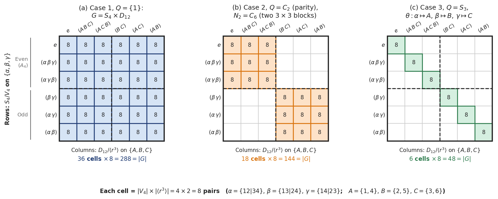

*Figure 8. Three of the Goursat couplings of $S_4 \times D_{12}$, one for each quotient $Q$ in the text, on the $6 \times 6$ chessboard of coset blocks. Rows are the cosets of $V_4$ in $S_4$, labelled by how they permute the matchings $\alpha, \beta, \gamma$; columns are the cosets of $\langle r^3 \rangle$ in $D_{12}$, labelled by how they permute the diagonals $A, B, C$; each cell holds $4 \times 2 = 8$ pairs. (a) Case 1, $Q = \{1\}$: every cell, so $G = S_4 \times D_{12}$, of order $288$. (b) Case 2, $Q = C_2$ with $N_2 = C_6$: the cells where an even permutation meets a rotation or an odd permutation meets a reflection, two $3 \times 3$ blocks, order $144$. (c) Case 3, $Q = S_3$ with $\theta$ matching $\alpha, \beta, \gamma$ to $A, B, C$: the $6$ cells where both sides permute their three objects in the same way, order $48$.*

**The Big Picture Takeaway**

Whenever an action has two orbits $\Omega_1$ and $\Omega_2$:

$G$ is always a subgroup of $\operatorname{Sym}(\Omega_1) \times \operatorname{Sym}(\Omega_2)$.

The orbits define normal subgroups of "unassisted" internal motions.

The cross-talk between the two orbits is governed entirely by a shared quotient group $Q$.

Goursat's Lemma is just the classification of all possible gear-locks between two independent mechanisms.

#### Sub-orbits, Orbitals, Blocks & Primitives

When $G$ acts on $\Omega$, we can also consider how $G$ acts on ordered pairs in $\Omega \times \Omega$. Primarily we will be looking at transitive actions here.

$$g \cdot (\alpha, \beta) = (g \cdot \alpha, \; g \cdot \beta)$$

An orbital $\Gamma$ is simply an orbit of this action on pairs:

$$\Gamma = \{ (g \cdot \alpha, g \cdot \beta) \mid g \in G \}$$

The set of pairs with identical elements, $\Delta = \{(\alpha, \alpha) \mid \alpha \in \Omega\}$, is an orbital when $G$ is transitive. (If $G$ has several orbits, $\Delta$ splits into one orbital for each orbit; for $G = \langle (1\,2\,3)(4\,5\,6) \rangle$ these are $\{(1,1),(2,2),(3,3)\}$ and $\{(4,4),(5,5),(6,6)\}$.) It is the trivial diagonal orbital. Non-diagonal orbitals are the interesting relations between distinct points.

An orbital is a $G$-invariant relation. If $(\alpha, \beta)$ is an edge in the orbital, then applying any element of $G$ turns it into another edge in the same orbital.

Now we look at sub-orbits. Fix a point $\alpha \in \Omega$ and look at its point-stabilizer $G_\alpha$.

Even though $G$ moves $\alpha$ everywhere, $G_\alpha$ keeps $\alpha$ pinned down. $G_\alpha$ acts on the rest of the points of $\Omega$. The orbits of $G_\alpha$ on $\Omega$ are called the sub-orbits of $G$.

A sub-orbit requires picking a reference point $\alpha \in \Omega$. By definition, a sub-orbit with respect to $\alpha$ is an orbit of the stabilizer $G_\alpha$ acting on $\Omega$.

If you choose a different point $\beta \neq \alpha$, the stabilizer $G_\beta$ is a conjugate subgroup ($G_\beta = g G_\alpha g^{-1}$ where $g(\alpha) = \beta$). The subsets of $\Omega$ that form the orbits of $G_\beta$ will consist of different elements than the orbits of $G_\alpha$.

A sub-orbit of $G$ with respect to $\alpha \in \Omega$ is an orbit of the point stabilizer $G_\alpha$ acting on $\Omega$. Since $G_\alpha$ fixes $\alpha$, $\{\alpha\}$ is always an orbit of size 1 (the trivial sub-orbit).

An orbital is global (pairs of points). A sub-orbit is local (looking from one fixed base point $\alpha$). 

For every orbital $\Gamma$, the slice:

$$\Gamma(\alpha) = \{\beta \in \Omega \mid (\alpha, \beta) \in \Gamma\}$$

is an orbit of $G_\alpha$ on $\Omega$ (a sub-orbit). That shouldn't be surprising. $\Gamma(\alpha)$ pins $\alpha$ down but moves all other elements, so the $\beta$ portion of the orbital forms the sub-orbit. 

From this, we can see that the number of orbitals of $G$ equals the number of sub-orbits of $G_\alpha$. This number is equal for all points of the set. It is called the rank of the transitive group $G$. But if an action is intransitive and you pick two points from different orbits, the suborbits can have completely different counts, sizes, and group structures.

If rank = 2, $G_\alpha$ has only two orbits: $\{\alpha\}$ and $\Omega \setminus \{\alpha\}$. This means $G_\alpha$ acts transitively on all other points, which means $G$ is $2$-transitive (what rank $2$ means for the permutation character is shown in [permutation characters, product actions and 2-transitivity](#permutation-characters-product-actions-and-2-transitivity)).

Looking at it conversely, because $G$ is 2-transitive, for any two distinct points $\beta, \gamma \in \Omega \setminus \{\alpha\}$, there exists $g \in G$ fixing $\alpha$ and sending $\beta \mapsto \gamma$. That means $G_\alpha$ acts transitively on the remaining points $\Omega \setminus \{\alpha\}$. Therefore, $G_\alpha$ partitions $\Omega$ into exactly two orbits: $\{\alpha\}$ and $\Omega \setminus \{\alpha\}$.

#### Blocks

A block is a subset $B \subseteq \Omega$ that every $g \in G$ either maps onto itself or moves completely off itself: $gB = B$ or $gB \cap B = \emptyset$. The single points and $\Omega$ itself are always blocks, the trivial ones. A transitive action is primitive if it has no other blocks, and imprimitive otherwise. If it has a non-trivial block, the images of that block split $\Omega$ into a system of blocks. The whole set $\Omega$ is acted on by $G$ transitively and so the whole set is already one single orbit (any point can reach any other point). However, $\Omega$ splits into smaller clumps $B_1, B_2, \dots, B_m$ that swap places with each other as whole units ($g \cdot B_1 = B_2$).

For example, take $D_8$ on a square. Every corner can reach every other corner (so $\{1, 2, 3, 4\}$ is one single orbit). Inside that single orbit, $B_1 = \{1, 3\}$ and $B_2 = \{2, 4\}$ are blocks because a $90^\circ$ rotation moves the entire pair $\{1, 3\}$ onto $\{2, 4\}$ without ever splitting opposite corners apart.

Imprimitivity is the exact opposite extreme of $k$-homogeneity, because both look at how $G$ moves $k$-element subsets around but $k$-Homogeneity represents maximum mixing. The group $G$ acts transitively on the set of all $\binom{n}{k}$ possible $k$-element subsets. Any $k$-subset can be mapped to any other $k$-subset, so no $k$-subset is special. (Note: $k$-homogeneity is for unordered $k$-subsets; $k$-transitivity is for ordered $k$-tuples). Imprimitivity with blocks of size $k$ represents minimum mixing. Out of all $\binom{n}{k}$ possible $k$-subsets, there is a tiny, closed collection of just $m = n/k$ disjoint $k$-subsets (the blocks $\{B_1, B_2, \dots, B_m\}$) that only map to each other under every $g \in G$, never mixing with the remaining $\binom{n}{k} - m$ subsets. Because a $2$-homogeneous group can map any pair inside a block to a pair that straddles two different blocks, $2$-homogeneity (and thus $2$-transitivity) automatically forces the action to be primitive.

The hierarchy of transitivity properties runs strictly in this order:

$$\dots \implies 3\text{-transitive} \implies 2\text{-transitive} \implies \text{Primitive} \implies 1\text{-transitive}$$

We can also say a non-trivial normal subgroup of a primitive permutation group is transitive. And, a transitive group $G$ acting on a set $\Omega$ is primitive if and only if the point stabilizer $G_\alpha$ is a maximal subgroup of $G$ (a subgroup other than $G$ with no subgroup strictly between it and $G$).

Why do we care about this? Abstract group theory decomposes groups using normal subgroups:

$$\text{Group} \longrightarrow \text{Composition Factors (Simple Groups)}$$

Permutation group theory uses a geometric and combinatorial hierarchy based on the preservation of structure on $\Omega$:

$$\text{All Actions} \xrightarrow{\text{orbits}} \text{Transitive} \xrightarrow{\text{blocks}} \text{Primitive} \xrightarrow{\text{O'Nan-Scott}} \text{Affine / Almost Simple / Product Action}$$

**Intransitive $\to$ Transitive:** Any permutation action breaks into disjoint transitive components (its orbits).

**Transitive $\to$ Primitive:** A transitive group is imprimitive if it preserves a non-trivial partition of $\Omega$ (called a system of blocks, like suits in a deck of cards). If no non-trivial partition is preserved, the group is primitive. Imprimitive groups embed into wreath products $H \wr K$ (the group that permutes the blocks among themselves by $K$ and, independently, acts inside each block by its own copy of $H$), reducing their study to primitive components.

**Primitive $\to$ Almost Simple / Basic Types:** By the O'Nan-Scott Theorem, every finite primitive permutation group belongs to one of five explicit structural classes (e.g., affine type, almost simple, product action, diagonal type). Roughly, affine type means that $\Omega$ can be taken to be a vector space $\mathbb{F}_p^d$ on which $G$ acts by maps $x \mapsto Ax + b$, with all the translations $x \mapsto x + b$ in $G$; almost simple means that $T \le G \le \operatorname{Aut}(T)$ for some non-abelian simple group $T$ (with $T$ identified with the automorphisms of $T$ given by conjugation); diagonal type and product action are built from several copies of one non-abelian simple group, acting on the cosets of a diagonal subgroup and on the $k$-tuples of points of a smaller set respectively. We will not need the details.

This yields a completely independent structural ladder where primitive groups play the role of "irreducible" objects. Here, "primitive" refers to prime.

[Figure 9](#figure-9) shows orbits, blocks and sub-orbits on one small example, the symmetries $D_{12}$ of a regular hexagon. The opposite-vertex blocks in panel (b) are exactly the long diagonals that form the second orbit in panel (a).

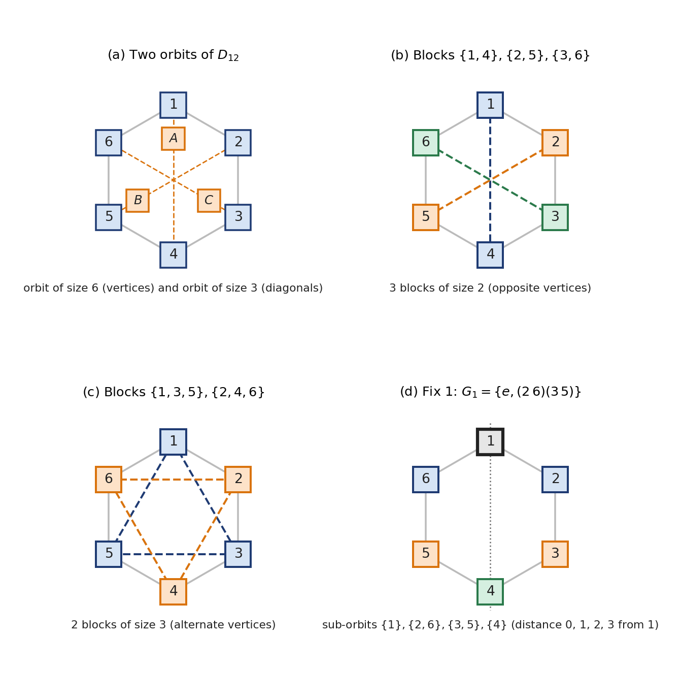

*Figure 9. Orbits, blocks and sub-orbits for the symmetry group $D_{12}$ of a regular hexagon. (a) Acting on the 6 vertices and the 3 long diagonals $A = \{1, 4\}$, $B = \{2, 5\}$, $C = \{3, 6\}$, the group has two orbits, of sizes 6 and 3. (b, c) On the vertices it has two systems of blocks, the opposite pairs and the two alternate triangles, and every symmetry maps each block onto a block. (d) The stabilizer of vertex $1$ splits the vertices into the sub-orbits $\{1\}$, $\{2, 6\}$, $\{3, 5\}$ and $\{4\}$, the points at distance 0, 1, 2 and 3 from $1$.*

Permutation group theory provides the natural language for symmetry in external mathematical structures:

**Rank and Orbitals $\leftrightarrow$ Graph Theory:** Every orbital $\Delta$ of a transitive group $G$ defines an orbital digraph (directed graph) $\Gamma = (\Omega, \Delta)$, with an arrow $\alpha \to \beta$ for each pair $(\alpha, \beta) \in \Delta$. (In this paragraph $\Delta$ is any orbital and $\Gamma$ is its graph; above, $\Gamma$ named an orbital and $\Delta$ the diagonal orbital.) If the orbital is self-paired (it contains $(\beta, \alpha)$ whenever it contains $(\alpha, \beta)$), $\Gamma$ is an undirected graph. For a rank 3 permutation group of even order, both non-trivial orbitals are self-paired, and each of their graphs is a [strongly regular graph](maths_4_incidence_geometry.md#strongly-regular-and-distance-regular-graphs): every vertex has the same number $k$ of neighbours, every two adjacent vertices have the same number $\lambda$ of common neighbours, and every two non-adjacent vertices have the same number $\mu$. So rank 3 groups construct many strongly regular graphs (e.g., the Petersen graph from $S_5$, the Higman-Sims graph), and classifying the rank 3 groups classifies the strongly regular graphs that admit one. Most strongly regular graphs admit no rank 3 group, and many have very few symmetries at all.

**Point Stabilizers $\leftrightarrow$ Geometries:** Coset spaces $G / G_\alpha$ allow one to reconstruct incidence geometries, projective planes, and [block designs](maths_4_incidence_geometry.md#combinatorial-designs) purely from subgroup lattice data.

#### Equivariant vs Invariant

A couple of definitions before we proceed. An object (a subset, a function, a relation, or a metric) is $G$-invariant if applying any element $g \in G$ leaves it completely unchanged.

For example, **Invariant subset:** $S \subseteq \Omega$ is $G$-invariant if $g(S) = S$ for all $g \in G$.

**Invariant function:** $f: \Omega \to \mathbb{R}$ is $G$-invariant if $f(g(x)) = f(x)$ for all $g \in G, x \in \Omega$. (The output value does not change when the input is transformed).

**Invariant relation:** A relation $\sim$ on $\Omega$ is $G$-invariant if $x \sim y \iff g(x) \sim g(y)$ for all $g \in G$. Orbitals are examples. A $G$-invariant equivalence relation is called a **$G$-congruence**. Its classes are blocks, and the partitions of $\Omega$ into the classes of a $G$-congruence are exactly the partitions that $G$ preserves (each $g$ maps every class onto a class), such as the systems of blocks above.

By contrast, a map between two spaces, each equipped with its own $G$-action, is equivariant if applying a group element _before_ the map gives the same result as applying it _after_ the map.    

Let $X$ and $Y$ both be $G$-sets. A map $\phi: X \to Y$ is $G$-equivariant (or a homomorphism of $G$-sets) if: $\phi(g \cdot x) = g \cdot \phi(x) \quad \text{for all } g \in G, x \in X$.

**Invariance** is a property of a single static entity or a scalar evaluation (the output space has a trivial action: $g \cdot c = c$, so $\phi(g \cdot x) = \phi(x)$).

**Equivariance** is a dynamic structural property of maps between spaces that transform non-trivially under the group.

**Example 1 of Orbitals**

Consider $G = \langle (1 \; 2 \; 3 \; 4 \; 5) \rangle \cong C_5$ acting on $\Omega = \{1, 2, 3, 4, 5\}$. Let us test the orbit of the pair $(1, 4)$ under $g = (1 \; 2 \; 3 \; 4 \; 5)$. Every transformed pair is an edge in the graph:

$g^0(1, 4) = (1, 4) \implies \text{Edge: } 1 \to 4$

$g^1(1, 4) = (2, 5) \implies \text{Edge: } 2 \to 5$

$g^2(1, 4) = (3, 1) \implies \text{Edge: } 3 \to 1$

$g^3(1, 4) = (4, 2) \implies \text{Edge: } 4 \to 2$

$g^4(1, 4) = (5, 3) \implies \text{Edge: } 5 \to 3$

The graph consists of exactly these 5 directed edges:

$$E = \{ (1, 4), \; (2, 5), \; (3, 1), \; (4, 2), \; (5, 3) \}$$

To trace the connected path, match the head of each arrow to the tail of the next:

Start at $1$: the edge is $1 \to 4$ (you are now at vertex $4$).

From $4$: look for the edge starting at $4$, which is $4 \to 2$ (now at vertex $2$).

From $2$: the edge is $2 \to 5$ (now at vertex $5$).

From $5$: the edge is $5 \to 3$ (now at vertex $3$).

From $3$: the edge is $3 \to 1$ (back at vertex $1$).

Chaining them sequentially gives the closed path:

$$1 \longrightarrow 4 \longrightarrow 2 \longrightarrow 5 \longrightarrow 3 \longrightarrow 1$$

Every single vertex $\{1, 2, 3, 4, 5\}$ is visited in a single continuous cycle, so the graph has only $1$ connected component.

Suppose instead we had 6 points and $G = \langle (1 \; 2 \; 3 \; 4 \; 5 \; 6) \rangle \cong C_6$. Applying powers of $g$ to the seed pair $(1, 3)$ generates its orbit:

$g^0(1, 3) = (1, 3) \implies 1 \to 3$

$g^1(1, 3) = (2, 4) \implies 2 \to 4$

$g^2(1, 3) = (3, 5) \implies 3 \to 5$

$g^3(1, 3) = (4, 6) \implies 4 \to 6$

$g^4(1, 3) = (5, 1) \implies 5 \to 1$

$g^5(1, 3) = (6, 2) \implies 6 \to 2$

The resulting edge set contains 6 directed edges:

$$E = \{ (1, 3), \; (2, 4), \; (3, 5), \; (4, 6), \; (5, 1), \; (6, 2) \}$$

Tracing paths by following the arrows:

$$1 \longrightarrow 3 \longrightarrow 5 \longrightarrow 1$$

Vertex $1$ goes to $3$, $3$ goes to $5$, and $5$ goes back to $1$. This closes a 3-cycle.

$$2 \longrightarrow 4 \longrightarrow 6 \longrightarrow 2$$

Vertex $2$ goes to $4$, $4$ goes to $6$, and $6$ goes back to $2$. This closes a separate 3-cycle.

Neither path can reach the other because no edge connects the odd set $\{1, 3, 5\}$ to the even set $\{2, 4, 6\}$.

A single seed pair $(1, 3)$ generated an edge set whose graph naturally splits into two disconnected components (the blocks of imprimitivity $\{1, 3, 5\}$ and $\{2, 4, 6\}$). The orbital graph detects the hidden internal geometry and intermediate subgroups of the action.

**Example 2 of orbitals**

Let $\Omega = \Delta_1 \sqcup \Delta_2$, where:

$\Delta_1 = \{1, 2, 3\}$

$\Delta_2 = \{4, 5, 6\}$

The total product space $\Omega \times \Omega$ contains $6 \times 6 = 36$ ordered pairs. Because an element $g \in G$ cannot map a point from $\Delta_1$ into $\Delta_2$ (or vice-versa), the product space splits into four disjoint, $G$-invariant quadrants:

$$\Omega \times \Omega = (\Delta_1 \times \Delta_1) \;\sqcup\; (\Delta_2 \times \Delta_2) \;\sqcup\; (\Delta_1 \times \Delta_2) \;\sqcup\; (\Delta_2 \times \Delta_1)$$

Every orbital of $G$ on $\Omega$ must live entirely inside one of these four quadrants.

There are two types of orbitals. One is Intra-orbitals (Diagonal Blocks: $\Delta_1 \times \Delta_1$ and $\Delta_2 \times \Delta_2$). These consist of pairs where both points come from the **same** orbit, such as $(1, 2)$ or $(4, 5)$. An orbital inside $\Delta_1 \times \Delta_1$ is identical to an orbital of the transitive constituent $G^{\Delta_1}$ acting on $\Delta_1$. In the orbital graph, these are edges that stay entirely within island $\Delta_1$ or island $\Delta_2$.

The other type is Cross-orbitals (Off-Diagonal Blocks: $\Delta_1 \times \Delta_2$ and $\Delta_2 \times \Delta_1$). These consist of mixed pairs, such as $(1, 4)$ or $(2, 6)$, where the starting point is in $\Delta_1$ and the target point is in $\Delta_2$. In the orbital graph, these form a bipartite graph with directed arrows crossing exclusively from the set $\{1, 2, 3\}$ over to $\{4, 5, 6\}$. These cross-orbitals measure how the action on $\Delta_1$ is synchronized with the action on $\Delta_2$.

To see what cross-orbitals reveal, compare two different actions having the exact same orbits $\Delta_1 = \{1, 2, 3\}$ and $\Delta_2 = \{4, 5, 6\}$. In example A, let $G = \langle (1 \; 2 \; 3)(4 \; 5 \; 6) \rangle \cong C_3$. The order of $G$ is 3. Pick the cross-pair $(1, 4) \in \Delta_1 \times \Delta_2$. Its orbit under $G$ is: $\{(1, 4), \; (2, 5), \; (3, 6)\}$.

Because $\vert{}G\vert{} = 3$, this cross-orbital has only 3 pairs. The remaining 6 mixed pairs in $\Delta_1 \times \Delta_2$ split into two other separate cross-orbitals:

Orbit of $(1, 5)$: $\{(1, 5), (2, 6), (3, 4)\}$ and orbit of $(1, 6)$: $\{(1, 6), (2, 4), (3, 5)\}$

The cross-orbitals detect the rigid 1-to-1 locking between the two orbits.

As example B, let's look at a fully independent (uncoupled) action. Let $G = \langle (1 \; 2 \; 3), \; (4 \; 5 \; 6) \rangle \cong C_3 \times C_3$. The order of $G$ is 9. Pick the cross-pair $(1, 4) \in \Delta_1 \times \Delta_2$. Because you can cycle $\{1, 2, 3\}$ while holding $\{4, 5, 6\}$ stationary (using $(1 \; 2 \; 3)$), and cycle $\{4, 5, 6\}$ independently (using $(4 \; 5 \; 6)$), you can steer $(1, 4)$ to any of the $3 \times 3 = 9$ possible pairs in $\Delta_1 \times \Delta_2$.

The entire cross-space $\Delta_1 \times \Delta_2$ forms one single cross-orbital of size 9.

How to approach it in practice? If your goal is to analyze blocks of imprimitivity and primitivity: You focus on the transitive constituents first, taking the orbitals of each orbit individually ($\Delta_i \times \Delta_i$), because primitivity is only defined for transitive actions.

If your goal is to understand the full group structure of $G$ (as a subdirect product): You take the global orbitals of the whole action on $\Omega \times \Omega$. The cross-orbitals will tell you whether the orbits move independently (direct product) or are constrained together (subdirect product). The test works in one direction only. Several cross-orbitals between two orbits prove that their motions are coupled, but a single cross-orbital does not prove they are independent. For example, let $S_3$ act on $\{1, 2, 3\}$ in the usual way and on $\{4, 5\}$ through the sign: even permutations fix $4$ and $5$, odd ones swap them. The action on $\{4, 5\}$ is completely determined by the action on $\{1, 2, 3\}$, so this is a proper subdirect product inside $S_3 \times C_2$. Yet $\{1, 2, 3\} \times \{4, 5\}$ is a single cross-orbital, because the stabilizer of $1$ contains the odd permutation $(2\,3)$, which swaps $4$ and $5$.

The choice between taking the intra-orbitals (orbit-by-orbit analysis) versus the global cross-orbitals corresponds directly to whether you are analyzing the internal structure of an individual code/system or analyzing entanglement, correlations, and cross-talk across multi-component systems.

You care about intra-orbitals ($\Delta_i \times \Delta_i$) and primitivity when analyzing a single space where your group acts transitively. In classical error-correcting codes, the automorphism group of a code, $\text{Aut}(C)$ (the coordinate permutations that map codewords to codewords), acts on the coordinate positions $\{1, 2, \dots, n\}$, and for many important codes, such as cyclic codes (which the cyclic shift of the coordinates maps to themselves) and Reed-Muller codes, it acts transitively. This is a property of the code, not a general fact: for $C = \{00, 10\}$, swapping the two coordinates sends $10$ to $01 \notin C$, so $\text{Aut}(C)$ is trivial and not transitive.

If $\text{Aut}(C)$ acts primitively on the bit positions, the code has no non-trivial block structure. It cannot be decomposed into a direct sum (for linear codes, $C = C_1 \oplus C_2$ means that the coordinates split into two non-empty sets and $C$ consists of all words whose part on the first set is a codeword of $C_1$ and whose part on the second set is a codeword of $C_2$; we leave aside the trivial codes $\{0\}$ and $\mathbb{F}_2^n$, which are direct sums of one-coordinate pieces) or a non-trivial concatenated code over coordinates.

For example, the affine group $\text{AGL}(m, 2)$ (the maps $x \mapsto Ax + b$ on $\mathbb{F}_2^m$, with $A$ invertible) acting on Reed-Muller codes $\mathcal{RM}(r, m)$ acts 2-transitively (and hence primitively) on the affine space $\mathbb{F}_2^m$. Its orbital graph is complete, meaning every coordinate is completely symmetric to every other coordinate with no clustered "islands."

If $\text{Aut}(C)$ is imprimitive, the vertices cluster into blocks of imprimitivity. Those blocks pinpoint coordinate sub-blocks, revealing that the code is equivalent to an interleaved code or a generalized concatenated architecture.

In Quantum Information Theory & QEC, consider a [stabilizer code](../quantum/quantum_2_quantum_information_theory.md#stabilizer-formalism) $[[n, k, d]]$. The permutations of the physical qubits that map the code space to itself act as logical operations. They are not transversal operations (a transversal operation is a tensor product of single-qubit gates, one on each qubit), but when they are done by relabelling or moving the qubits they share the useful property of transversal gates: an error on one qubit stays an error on one qubit. In topological codes (like the Toric code or surface codes), stabilizer generators are local. If you analyze the symmetries of the syndrome graph, primitive actions mean there are no invariant sub-lattices. Fixing a base qubit $\alpha$, the sub-orbits of the point stabilizer $G_\alpha$ partition the remaining qubits into shells. (Here $G$ is the group of qubit permutations and $G_\alpha$ is its stabilizer of $\alpha$. This is not the stabilizer group of the code, the Pauli operators that fix every code state, which does not permute qubits at all.) If $G$ preserves the distance between qubits, each sub-orbit lies inside one distance shell around $\alpha$. The sub-orbits are exactly the distance shells only when $G$ is distance-transitive (it can move any pair of qubits to any other pair at the same distance); in general they are finer. The weight distribution of Pauli errors that map into stabilizers is constrained by these sub-orbits.

On the other hand, you care about global cross-orbitals ($\Delta_1 \times \Delta_2$) when your space naturally breaks into multiple distinct sectors or physical subsystems, and you need to measure coupling vs. independence. In classical error correction, suppose you transmit data across two separate parallel channels, $\Delta_1$ and $\Delta_2$. If the symmetry group acts as a full direct product ($G^{\Delta_1} \times G^{\Delta_2}$), there is only one giant cross-orbital, and the symmetries of channel 1 and channel 2 are independent of each other. One cross-orbital on its own is not proof of this, though, as the $S_3$ example above shows.

If the symmetry group acts as a subdirect product (e.g., $C_3 \le C_3 \times C_3$), the cross-space can split into multiple smaller cross-orbitals. When it does, this diagnoses cross-talk, shared parity constraints, or structured joint channel noise.

In generalized low-density parity-check (LDPC) codes or turbo codes, parity checks live on bipartite graphs connecting variable nodes ($\Delta_1$) and check nodes ($\Delta_2$). The edges of the Tanner graph are invariant sub-graphs formed by specific cross-orbitals between variable and check sets.

In Quantum Information Theory & QEC, in Quantum Entanglement and Bipartite Systems ($\mathcal{H}_A \otimes \mathcal{H}_B$): Let $\Delta_1$ index a basis for system $A$ and $\Delta_2$ index a basis for system $B$. A joint state $\vert{}\psi_{AB}\rangle = \sum_{\alpha, \beta} c_{\alpha, \beta} \vert{}\alpha\rangle \vert{}\beta\rangle$ has a density matrix $\rho_{AB}$ acted on by a symmetry group $G$.

If the group action creates multiple, small cross-orbitals, the basis pairs $(\alpha, \beta)$ are locked together in invariant sub-spaces. By Schur’s Lemma (a linear map that commutes with every matrix of an irreducible representation is a multiple of the identity; see [Schur's lemma](#schurs-lemma) below), a density matrix $\rho_{AB}$ that is invariant under $G$ (it commutes with the permutation matrix of every $g \in G$) maps each isotypic component (the sum of all copies of one irreducible representation) into itself. So it is block-diagonal in a basis adapted to those components, but the blocks follow the types of irreducible representation, not the cross-orbitals. The span of every cross-orbital contains a copy of the trivial representation, so different cross-orbitals can mix. For the group of Example A, $G = \langle (1 \; 2 \; 3)(4 \; 5 \; 6) \rangle$, and $\vert{}u\rangle = \tfrac13 \sum_{\alpha \in \Delta_1, \beta \in \Delta_2} \vert{}\alpha\rangle \vert{}\beta\rangle$, the invariant state $\vert{}u\rangle\langle u\vert{}$ has the entry $1/9$ between $\vert{}1\rangle\vert{}4\rangle$ and $\vert{}1\rangle\vert{}5\rangle$, which lie in different cross-orbitals. What invariance does give is that an entry of $\rho_{AB}$ does not change when the same $g$ is applied to the labels of its row and of its column. One might hope that this structure proves the existence of entanglement or classical correlations that cannot be disrupted by symmetric local operations. This last step is too strong. Symmetry restricts the shape of an invariant density matrix, but it cannot by itself prove entanglement or even correlation. The maximally mixed state $\rho_{AB} = I/n$ is invariant under every permutation of the basis, yet it equals $(I_A/n_A) \otimes (I_B/n_B)$, a product state with no correlations at all. Whether an invariant state is entangled depends on its actual entries, not only on the orbitals.

In flag-fault-tolerant architectures, you introduce auxiliary "flag" qubits ($\Delta_2$) to monitor data qubits ($\Delta_1$).

The joint stabilizer-syndrome operations act intransitively: data qubits remain data qubits, and flag qubits remain flag qubits. The cross-orbitals in $\Delta_1 \times \Delta_2$ sort the (data qubit, flag qubit) pairs into classes that the symmetry treats alike, and if the circuit is symmetric under $G$, the set of data-flag pairs that interact is a union of such classes. A single cross-orbital means that every data qubit stands in the same relation to every flag qubit, so the symmetry alone singles out no specific flag. Whether a weight-2 data error can be uniquely identified, and kept from spreading into an uncorrectable fault, depends on the actual circuit and its syndromes, not on the orbitals alone.

One fact links orbital graphs to primitivity, Higman's criterion: a finite transitive group is primitive if and only if every non-trivial orbital graph is connected. Here an orbital digraph counts as connected when any two points are joined by a chain of arrows, ignoring their directions (connected graphs are treated in [paths, geodesics and distance](maths_4_incidence_geometry.md#paths-geodesics-and-distance) in Maths 4). For the orbital digraphs of a finite transitive group this is the same as being strongly connected, where the arrows must be followed forwards; that is a standard fact we do not prove here. The criterion itself has a short proof. If $B$ is a non-trivial block and $\alpha \neq \beta$ both lie in $B$, every arrow $(g \cdot \alpha, g \cdot \beta)$ of the orbital of $(\alpha, \beta)$ joins two points of the same block $gB$, so that orbital graph is disconnected, as in the $C_6$ example above. Conversely, $G$ maps arrows to arrows, so it permutes the connected components of any orbital graph, and each component is a block. A component has at least two points, because every point has an arrow leaving it, so a disconnected non-trivial orbital graph gives a non-trivial block. For $S_4$ on four points, the only non-trivial orbital is the set of all pairs of distinct points, whose graph is the complete graph $K_4$ (every two of the four points are joined), and it is connected.

How do orbitals, subgroups, actions and transitivity fit together? Assume $G$ acts transitively on $\Omega$. [Figure 10](#figure-10) traces this pipeline step by step, contrasting $D_8$ and $S_4$ on the four corners $\Omega = \{1, 2, 3, 4\}$.

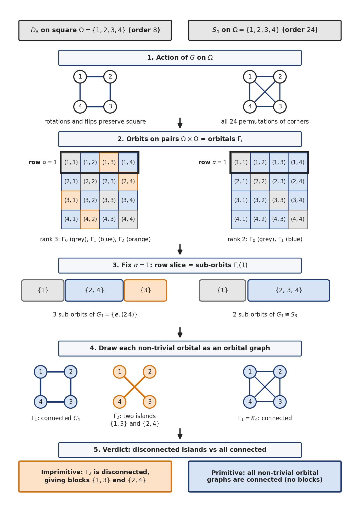

*Figure 10. Pipeline from a transitive action on $\Omega = \{1, 2, 3, 4\}$ to primitivity, comparing $D_8$ (left) and $S_4$ (right). The action on $\Omega \times \Omega$ partitions the $16$ ordered pairs into orbitals $\Gamma_i$, and slicing row $\alpha = 1$ gives the sub-orbits $\Gamma_i(1)$ of the stabilizer $G_1$. Drawing each non-trivial orbital as a graph shows that $D_8$ is imprimitive because $\Gamma_2$ splits into the two blocks $\{1, 3\}$ and $\{2, 4\}$, whereas $S_4$ is primitive because its only non-trivial orbital graph, the complete graph $K_4$, is connected.*

### A Little Representation Theory

While Cayley proved every group is a permutation group, permutations are notoriously difficult to do calculus or continuous mathematics on. You cannot easily take the derivative or find the eigenvectors of a permutation.

We would like to port the powerful tools of Linear Algebra (matrices, traces, determinants) into abstract groups. This leads to Representation Theory.

A group mathematically captures the "symmetries" of a system (like rotations or permutations). When we write a representation, we are drawing matrices that show exactly how those symmetries move vectors around in a space. So $(gh)r$ and $gr$ are the notation for the matrices of the group elements $gh$ and $g$ in the representation $r$.

A representation of $G$ over $F$ is a homomorphism $r$ from $G$ to $GL(n, F)$, for some $n$. The degree of $r$ is the integer $n$. Thus if $r$ is a function from $G$ to $GL(n, F)$, then $r$ is a representation if and only if:

$$(gh)r = (gr)(hr) \quad \text{for all } g, h \in G$$

Concretely, the matrices representing group elements $g$ and $h$: $gr$ and $hr$, must compose into the matrix for the group element $gh$, which is $(gh)r$. 

Here, and often from now on, maps are written to the right of their arguments, as the module sections below do ($vg$): $gr$ means $r(g)$, the matrix that $r$ gives to $g$ (not a product of $g$ and $r$). Likewise $(g)\rho$ means $\rho(g)$ and $w\pi$ means $\pi(w)$; where a later passage writes $\rho(g)$, it means the same matrix.

Since a representation is a homomorphism, it follows that for every representation $r: G \to GL(n, F)$, we have:

$$1r = I_n$$

and

$$(g^{-1})r = (gr)^{-1} \quad \text{for all } g \in G$$

Two representations are equivalent (and form an equivalence relation) if: 

Let $\rho: G \to GL(m, F)$ and $\sigma: G \to GL(n, F)$ be representations of $G$ over $F$. We say that $\rho$ is equivalent to $\sigma$ if $n = m$ and there exists an invertible $n \times n$ matrix $T$ such that for all $g \in G$,

$$(g)\sigma = T^{-1}((g)\rho)T$$

To understand why this is so, let $\rho$ map element $g$ to matrix $A_1$ and $h$ to $A_2$, and let $\sigma$ map $g$ to $B_1$ and $h$ to $B_2$. For a representation we must have $\rho$ mapping $gh$ to $A_1A_2$ and $\sigma$ mapping $gh$ to $B_1B_2$.

By the above definition, if we have some matrix $T$ such that $B_1 = T^{-1}A_1T$ and $B_2 = T^{-1}A_2T$, then we can evaluate the product $B_1B_2$:

$$B_1B_2 = (T^{-1}A_1T)(T^{-1}A_2T)$$

The $TT^{-1}$ in the middle cancels out to the identity matrix, leaving $T^{-1}A_1A_2T$. Thus, the equality holds true, preserving the group structure.

Equivalency in representation theory is just linear algebra's "change of basis." The matrix $T$ represents a coordinate transformation. Two equivalent representations are the exact same physical symmetries; you are just writing down the matrices using a different set of coordinate axes.

The matrix $T$ is mathematically known as an intertwining operator. It is a linear map between vector spaces that "commutes" with the group action (i.e., $T((g)\sigma) = ((g)\rho)T$). When an intertwining operator is invertible, the representations are equivalent.

A representation is said to be faithful if $\ker(\rho) = \{1\}$; that is, if the identity element of $G$ is the only element $g$ for which $(g)\rho = I_n$. From what we know of kernels and images, it is no surprise that a representation $\rho$ of a finite group $G$ is faithful if and only if $\operatorname{im}(\rho)$ is isomorphic to $G$; see [kernels and the trivial representation](#kernels-and-the-trivial-representation) for the faithful representation that the quotient $G/\ker\rho$ inherits.

A faithful representation means that no two distinct group elements map to the exact same matrix. The group structure is perfectly preserved without any "crushing" or loss of information. In quantum mechanics, a faithful representation means every distinct physical symmetry operation (like rotating 90 degrees vs. 180 degrees) corresponds to a strictly unique matrix operator acting on your state vectors. If a representation is unfaithful (say, mapping every element to the $1 \times 1$ identity matrix), it means your state space is entirely blind to that specific symmetry.

A finite abelian group's representations all decompose into 1-dimensional subspaces over $\mathbb{C}$. Conversely, suppose that $G$ is a finite group such that every irreducible $\mathbb{C}G$-module (one with no $G$-invariant subspace other than $\{0\}$ and itself, as defined [below](#subspaces)) has dimension 1. Then $G$ is abelian (both directions are treated in [irreducible representations of finite abelian groups and diagonalization](#irreducible-representations-of-finite-abelian-groups-and-diagonalization) and [the centre of the group algebra and the centre of the group](#the-centre-of-the-group-algebra-and-the-centre-of-the-group)).

For a finite group over $\mathbb{C}$ (more generally, over a field whose characteristic does not divide $\vert{}G\vert{}$ and which contains the needed roots of unity), a representation matrix of any element $g$ is diagonalizable in some basis (over $\mathbb{F}_2$ this fails: sending the generator of $C_2$ to $\begin{pmatrix} 1 & 1 \\ 0 & 1 \end{pmatrix}$ gives a representation that is not diagonalizable), but that does not mean the same basis can give us diagonal matrices for all elements of $G$. This will happen only if the matrices commute with each other, that is, if the image of the representation is abelian. For a faithful representation, that means $G$ itself is abelian; a non-faithful one can be diagonal even for a non-abelian group (the sign representation of $S_3$ is $1 \times 1$). This should remind us of commuting observables in quantum mechanics. The theorem proving that a finite abelian group's representations all decompose into 1-dimensional subspaces over $\mathbb{C}$ is the exact mathematical mechanism that allows a [complete set of commuting observables](../quantum/quantum_1_quantum_physics.md#complete-set-of-compatible-observables) (CSCO) to uniquely identify every pure state in a quantum system.

#### $FG$-modules

A module represents abstract linear operations of group elements on a vector space. It isn't really different from a representation. Matrix representations just have a concrete choice of basis vectors. Modules are very much like tensors. A tensor $T$ is an intrinsic, geometric multilinear object. When you select a coordinate basis, $T$ reveals itself as a multidimensional array of numbers (components $T^{i}_{\ j}$). If you perform a coordinate transformation, the numbers change according to the transformation rule, but the tensor itself remains unchanged.

Note that a module can give many representations based on different choices of basis vectors to write our representation matrices in. 

For example, say an $FG$-module (its formal conditions follow a little further down) defines an abstract linear action of each group element $g \in G$ on the space $V$ via $v \mapsto vg$. Once you choose an ordered basis of vectors $\mathscr{B} = \{v_1, \dots, v_n\}$, each basis vector transforms under $g$ into some new vector $v_i g \in V$. Because $\mathscr{B}$ is a basis, that resulting vector can be written uniquely as a linear combination of the basis vectors: $v_i g = \sum_{j=1}^n a_{ij} v_j$.

The coefficients $a_{ij} \in F$ form the entries of the matrix $[g]_{\mathscr{B}}$:

$$[g]_{\mathscr{B}} = \begin{pmatrix} a_{11} & a_{12} & \dots & a_{1n} \\ a_{21} & a_{22} & \dots & a_{2n} \\ \vdots & \vdots & \ddots & \vdots \\ a_{n1} & a_{n2} & \dots & a_{nn} \end{pmatrix} \in \operatorname{GL}(n, F)$$

The underlying $FG$-module $V$ is a single coordinate-free object. However, there are many choices of ordered basis $\mathscr{B}, \mathscr{B}', \dots$ for $V$, each made of $n$ vectors. Over $\mathbb{C}$ there are infinitely many, while over a finite field there are only finitely many ($\mathbb{F}_2^2$, for instance, has just 6 ordered bases). Each choice gives its own matrices $[g]_{\mathscr{B}}$, so one module gives many representations.

These resulting representations are related by a change-of-basis matrix $P$ (an invertible matrix, not to be confused with the permutation matrices $P(g)$ [below](#permutation-modules-representations)):

$$[g]_{\mathscr{B}'} = P^{-1} [g]_{\mathscr{B}} P \quad \forall g \in G$$

From this, we can see that all such representations are equivalent, with $P$ playing the role of $T$ in the [definition of equivalence](#a-little-representation-theory). The fuller treatment, including the fact that two $FG$-modules are isomorphic if and only if their representations are equivalent, is in [change of basis and equivalent representations](#change-of-basis-and-equivalent-representations) and [isomorphic modules and equivalent representations](#isomorphic-modules-and-equivalent-representations).

Modules are powerful and come with many tools, like character tables (tables of the traces of the representation matrices, [below](#character-tables-isomorphism-and-grouping-into-multiplicities)), that allow us to determine the many aspects of the interaction between groups, fields and vector spaces without having to resort to matrix manipulations.

Algebraists prefer the module definition because it is coordinate-free (no matrices required), while physicists often prefer the matrix representation for explicit calculations.

An $FG$-module is a vector space $V$ over a field $F$. It needs a few algebraic rules to function consistently. The following conditions should hold for all $u, v \in V$, $\lambda \in F$ and $g, h \in G$:

1.  $vg \in V$

2.  $v(gh) = (vg)h$

3.  $v1 = v$

4.  $(\lambda v)g = \lambda(vg)$,  $\lambda$ is a scalar in $F$.

5.  $(u + v)g = ug + vg$

You could actually club conditions 4 and 5 into one single condition representing linearity: $\left( \sum_{i=1}^n \lambda_i v_i \right) g = \sum_{i=1}^n \lambda_i (v_i g)$

A module is faithful if the identity element of $G$ is the only element for which $vg = v$ for all $v \in V$. 

In the conditions above, if you just think of the element $g$ as being a matrix representation of $g$ i.e. $g\rho$ where $\rho$ is a representation, it essentially turns into the conditions for a representation. So, giving a representation $\rho: G \to GL(n, F)$ is equivalent to turning the vector space $F^n$ into an $FG$-module. 

If we have a representation (and its basis vectors) in hand, we don't actually need to test the conditions for a module for each $v$. We can just test that the conditions hold for the basis vectors $v_i$ and extend them linearly to span the whole vector space (see [testing the module axioms on a basis and permutation modules](#testing-the-module-axioms-on-a-basis-and-permutation-modules)). 

**Does a finite group only have a finite number of representations?** You can build an infinite number of representations by making bigger and bigger direct sums, or by acting on larger and larger sets. However, a finite group only has a finite number of distinct irreducible representations. (In fact, over $\mathbb{C}$ the number of distinct irreducible representations exactly equals the number of conjugacy classes in the group. See [the centre of the group algebra](#the-centre-of-the-group-algebra-zmathbbcg) below.) Over $\mathbb{C}$ (more generally, when the characteristic of $F$ does not divide $\vert{}G\vert{}$), every other representation in the universe for that group is just built by stacking these few fundamental irreducible blocks together; this is [Maschke's theorem](#maschkes-theorem) below.

#### Permutation Modules & Representations

We define a permutation matrix $P(g)$ of an element $g$. It defines whether $g$ permutes the $j^{th}$ element into the $i^{th}$ element of the set. We construct this matrix by placing $1$ in row $i$, column $j$ when $g$ maps the $j$-th element to the $i$-th element, and $0$ everywhere else. 

$P(g)$ is not a property of just the group element $g$ alone. A permutation representation specifically comes from the group acting on a finite set $\Omega$ (like permuting the 8 corners of a cube), which we then convert into vector matrices. So the matrix $P(g)$ depends on the set $\Omega$ it is acting on. The exact same group $G$ will yield different matrices $P(g)$ if you let it act on a set of 3 points versus a set of 10 points.

Let a finite group $G$ act on a finite set $\Omega = \{1, 2, \dots, n\}$. To analyze a permutation action with linear algebra, convert the set $\Omega$ into a complex vector space $V = \mathbb{C}^\Omega \cong \mathbb{C}^n$.

Assign a basis vector $e_\alpha$ to each element $\alpha \in \Omega$. Any vector $v \in V$ is a formal linear combination:

$$v = \sum_{\alpha \in \Omega} c_\alpha e_\alpha, \quad c_\alpha \in \mathbb{C}$$

Each group element $g \in G$ acts linearly on $V$ by permuting the basis vectors:

$$P(g) e_\alpha = e_{g\alpha}$$

In coordinates, $P(g)$ is an $n \times n$ permutation matrix with entries:

$$(P(g))_{\alpha \beta} = \begin{cases} 1 & \text{if } g\beta = \alpha \\ 0 & \text{otherwise} \end{cases}$$

Because $P(gh) = P(g)P(h)$, the assignment $g \mapsto P(g)$ is a matrix representation of $G$ on $V$.

Note that this passage writes the action on the left ($P(g)e_\alpha = e_{g\alpha}$) and places the $1$s by column. Like the rule $g \cdot (h \cdot x) = (gh) \cdot x$ in the [group actions](#group-actions-and-the-orbit-stabilizer-theorem) section, this reads $gh$ right to left (first $h$, then $g$), and that is what makes $P(gh) = P(g)P(h)$. The $FG$-module conventions above act on the right instead: for a permutation module, $v_i g = v_{ig}$, where $ig$ is the image of $i$ under $g$ written on the right. Since these notes read products left to right, $i(gh) = (ig)h$, which is exactly condition 2, $v(gh) = (vg)h$. The module convention records $v_i g$ in the $i$-th row, so for the same permutation the two matrices are transposes of each other.

If we look at this as modules instead of matrices, if $G$ is a subgroup of the symmetric group $S_n$, then this module is called the permutation module and $e_{\alpha} \dots e_{\eta}$ are called the natural basis of the vector space. Since the only element of $G$ which fixes every $e_\alpha$ is the identity, we see that the permutation module is a faithful $FG$-module. And from Cayley's theorem, we know that every $G$ is isomorphic to a subgroup of some symmetric group. Thus, any group has a faithful $FG$-module.

#### Subspaces

A subspace $W$ of an $FG$-module $V$ is called $G$-invariant (or a subrepresentation, or an $FG$-submodule) if applying any group element keeps vectors inside $W$:

$$w \in W \implies wg \in W \quad \text{for all } g \in G$$

For the permutation representation above, written on the left, this reads $P(g)w \in W$.

An invariant subspace $W \subseteq V$ is irreducible (or simple) if $W \neq \{0\}$ and its only $G$-invariant subspaces are $\{0\}$ and $W$ itself. It represents a minimal, indivisible building block of symmetry. 

An (irreducible) invariant subspace of an $FG$-module is also an (irreducible) $FG$-module. 

**Example**

Let $G = C_3 = \langle a \mid a^3 = 1 \rangle$ (the group generated by one element $a$ subject only to the rule $a^3 = 1$), and let $V$ be the 3-dimensional $FG$-module where $V$ has basis $v_1, v_2, v_3$, and the group elements act on the basis as follows:

$$v_1 1 = v_1, \quad v_2 1 = v_2, \quad v_3 1 = v_3$$

$$v_1 a = v_2, \quad v_2 a = v_3, \quad v_3 a = v_1$$

$$v_1 a^2 = v_3, \quad v_2 a^2 = v_1, \quad v_3 a^2 = v_2$$

Put $w = v_1 + v_2 + v_3$, and let $W = \operatorname{sp}(w)$, the 1-dimensional subspace spanned by $w$. Since

$$w 1 = w a = w a^2 = w,$$

$W$ is an $FG$-submodule of $V$.

However, $\operatorname{sp}(v_1 + v_2)$ is not an $FG$-submodule, since:

$$(v_1 + v_2)a = v_2 + v_3 \notin \operatorname{sp}(v_1 + v_2)$$

**Projections**

Let $V$ be an $FG$-module and let $W$ be an $FG$-submodule of $V$. An $F$-linear map (vector space homomorphism) $\pi: V \to V$ is called a projection from $V$ to $W$ if:

$\operatorname{im}(\pi) = W$

$w\pi = w$ for all $w \in W$ (meaning $\pi$ acts as the identity on $W$)

Because $w\pi = w$ for any element in the image, applying the map twice yields:

$$v\pi^2 = (v\pi)\pi = v\pi \quad \text{for all } v \in V$$

that is, $\pi^2 = \pi$ (the map is idempotent).

Any idempotent linear operator $\pi$ automatically induces an internal direct sum decomposition of the vector space:

$$V = \operatorname{im}(\pi) \oplus \ker(\pi) = W \oplus \ker(\pi)$$

Every vector splits uniquely as $v = v\pi + (v - v\pi)$, where $v\pi \in W$ and $(v - v\pi) \in \ker(\pi)$.

**IMPORTANT!**

Not every subspace is an $FG$-module, but a subspace that is $G$-invariant is an $FG$-submodule. A vector subspace $W \subseteq V$ is merely closed under addition and scalar multiplication ($F$). For $W$ to be an $FG$-submodule (and hence an $FG$-module in its own right), it must also be closed under the action of the group $G$.

An $FG$-module need not necessarily be a subspace of $V$. A good example is one we will show below where the quotient is a module, and therefore is a vector space but not a subspace of $V$ (though it is isomorphic to an actual subspace of $V$).

For a general $FG$-module like the quotient $V/W$, it is guaranteed to be isomorphic (as an $FG$-module, meaning there is an invertible linear map between them that commutes with the action of $G$) to an actual submodule of $V$ when $W$ has a $G$-invariant complement, that is, a submodule $U$ with $V = W \oplus U$, because then $V/W \cong U$. Such a complement always exists when $V$ is completely reducible (a direct sum of irreducible submodules), and we can figure that out from Maschke's Theorem, which we will see below. Complete reducibility is enough but not necessary: $V/W$ can be isomorphic to a submodule of $V$ even when $W$ has no invariant complement.

**Example**

Suppose that $V$ is a reducible $FG$-module, so that there is an $FG$-submodule $W$ with $0 < \dim W < \dim V$. Take a basis $B_1$ of $W$ and extend it to a basis $B$ of $V$. Then for all $g \in G$, the matrix $[g]_B$ has the form

$$\begin{pmatrix} X_g & 0 \\ Y_g & Z_g \end{pmatrix} $$

where $X_g$ is $k \times k$ ($k = \dim W$).

$Z_g$ is not just an arbitrary block of numbers; the map $g \mapsto Z_g$ is a genuine representation corresponding to the quotient module $V/W$.

The quotient vector space $V/W$ consists of cosets:

$$V/W = \{v + W \mid v \in V\}$$

Its dimension is $\dim(V/W) = \dim V - \dim W = n - k$.

The Basis of $V/W$: Let the extended basis of $V$ be:

$$\mathscr{B} = \{\underbrace{w_1, \dots, w_k}_{\mathscr{B}_1 \text{ (basis of } W)}, \underbrace{u_{1}, \dots, u_{n-k}}_{\text{complementary vectors}}\}$$

Then the cosets $\overline{\mathscr{B}} = \{u_1 + W, \dots, u_{n-k} + W\}$ form a basis for $V/W$.

$V/W$ is **not** a subspace of $V$. It cannot be a subspace because its elements are not vectors in $V$; they are **entire subsets (cosets)** of $V$.

Moreover a subspace of $V$ must contain the zero vector $0 \in V$. The zero element of the quotient space $V/W$ is the entire subspace $W$ itself: $0_{V/W} = 0 + W = W$.

A common source of confusion is conflating a complementary subspace with the quotient space:

A complementary subspace is a genuine subspace $U \le V$ such that $V = W \oplus U$ as vector spaces. When you choose basis vectors $\{u_1, \dots, u_{n-k}\}$, their span:

$$U = \operatorname{span}_F\{u_1, \dots, u_{n-k}\}$$

is a subspace of $V$.

The problem with $U$ is that while $U$ is a vector subspace of $V$, it is not necessarily an $FG$-submodule. Group operations often kick vectors out of $U$: $u_i \in U \quad \not\implies \quad u_i g \in U$

Instead, $u_i g$ generally has components along both $W$ and $U$:

$$u_i g = \underbrace{w}_{\in W} + \underbrace{u'}_{\in U}$$

The matrix block $Y_g$ records that non-zero $w \in W$ portion.

Because $U$ fails to be stable under $G$, we mod out by $W$. In the quotient space, the unwanted piece $w \in W$ gets mapped to zero:

$$(u_i + W)g = u_i g + W = (w + u') + W = u' + W$$

By collapsing $W$ to $0$, the group action becomes well-defined and closed.

**Example in $\mathbb{R}^2$**

Consider $V = \mathbb{R}^2$, and let $W$ be the $x$-axis:

$$W = \{(x, 0) \mid x \in \mathbb{R}\}$$

$W$ is a 1-dimensional subspace of $\mathbb{R}^2$. The quotient space $V/W$ is the collection of all horizontal lines:

$$(0, y) + W = \{(x, y) \mid x \in \mathbb{R}\}$$

Each horizontal line is a single element of $V/W$.

Now consider a shear transformation matrix acting on row vectors:

$$g = \begin{pmatrix} 1 & 0 \\ 1 & 1 \end{pmatrix}$$

Choose the complementary subspace $U$ as the $y$-axis, spanned by $u = (0, 1)$. Apply $g$ to $u$:

$$(0, 1) \begin{pmatrix} 1 & 0 \\ 1 & 1 \end{pmatrix} = (1, 1) = \underbrace{(1, 0)}_{\in W} + \underbrace{(0, 1)}_{\in U}$$

Notice that $(1, 1)$ does **not** stay on the $y$-axis ($U$). The transformation introduced a component $(1, 0)$ inside $W$. That component is precisely what produces $Y_g \neq 0$.

In the quotient space $V/W$, we project out the $x$-direction:

$$(u + W)g = (1, 1) + W = (0, 1) + W = u + W$$

The coset moves to itself, giving the representation matrix $Z_g = (1)$ without any spillover.

$V/W$ is an abstract vector space isomorphic to $U$, but it lives at a different structural level than a subspace. When the spillover $Y_g$ cannot be removed by any choice of complement, $V$ is a genuinely glued combination of $W$ and $V/W$, and the possible ways of gluing are classified in [extensions of modules and Yoneda composition](#extensions-of-modules-and-yoneda-composition).

[Figure 11](#figure-11) contrasts the complementary $y$-axis $U$, which the shear tilts out of $U$ along $W$, with the horizontal coset lines of $V/W$, which slide along themselves.

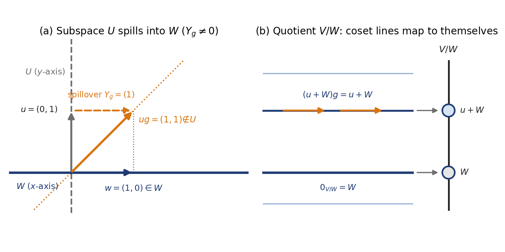

*Figure 11. Subspace versus quotient module in $V = \mathbb{R}^2$ under the shear $g$ acting on row vectors. (a) The $x$-axis $W$ is fixed, but $u = (0, 1)$ on the complementary $y$-axis $U$ maps to $ug = (1, 1)$, picking up a horizontal spillover component $Y_g = (1)$ in $W$. (b) In the quotient space $V/W$, the elements are horizontal coset lines $yu + W$, and the shear slides each line along itself without leaving the line.*

**Example with explicit calculation of transformation matrices**

Let $G = C_3 = \langle a \mid a^3 = 1 \rangle$ and let $V$ be the 3-dimensional $FG$-module with basis $\{v_1, v_2, v_3\}$ such that:

$$v_1 a = v_2, \quad v_2 a = v_3, \quad v_3 a = v_1$$

$V$ is a reducible $FG$-module and has an $FG$-submodule $W = \operatorname{sp}(v_1 + v_2 + v_3)$.

Let $\mathscr{B}$ be the new basis $\{b_1, b_2, b_3\}$ of $V$, defined by:

$$b_1 = v_1 + v_2 + v_3$$

$$b_2 = v_1$$

$$b_3 = v_2$$

Notice that from this basis, $v_3$ can be expressed in terms of the basis vectors as:

$$v_3 = b_1 - b_2 - b_3$$

The action of $a$ on the original vectors is:

$$v_1 a = v_2, \quad v_2 a = v_3, \quad v_3 a = v_1$$

Now compute how each basis vector $b_i$ transforms under $a$:

$$b_1 a = (v_1 + v_2 + v_3)a = v_1 a + v_2 a + v_3 a = v_2 + v_3 + v_1 = b_1$$

In coordinates with respect to $\mathscr{B} = \{b_1, b_2, b_3\}$:

$$b_1 a = \mathbf{1}b_1 + \mathbf{0}b_2 + \mathbf{0}b_3 \implies \text{Row 1} = \begin{pmatrix} 1 & 0 & 0 \end{pmatrix}$$

Now for the second row:

$$b_2 a = v_1 a = v_2 = b_3$$

In coordinates with respect to $\mathscr{B}$:

$$b_2 a = \mathbf{0}b_1 + \mathbf{0}b_2 + \mathbf{1}b_3 \implies \text{Row 2} = \begin{pmatrix} 0 & 0 & 1 \end{pmatrix}$$

The third row ($b_3 a$):

$$b_3 a = v_2 a = v_3 = b_1 - b_2 - b_3$$

In coordinates with respect to $\mathscr{B}$:

$$b_3 a = \mathbf{1}b_1 - \mathbf{1}b_2 - \mathbf{1}b_3 \implies \text{Row 3} = \begin{pmatrix} 1 & -1 & -1 \end{pmatrix}$$

Assembling these rows gives $[a]_{\mathscr{B}}$:

$$[a]_{\mathscr{B}} = \begin{pmatrix} 1 & 0 & 0 \\ 0 & 0 & 1 \\ 1 & -1 & -1 \end{pmatrix}$$

Similarly for $[a^2]_{\mathscr{B}}$:

Since this is a representation, $[a^2]_{\mathscr{B}} = [a]_{\mathscr{B}}^2$:

$$[a^2]_{\mathscr{B}} = \begin{pmatrix} 1 & 0 & 0 \\ 0 & 0 & 1 \\ 1 & -1 & -1 \end{pmatrix} \begin{pmatrix} 1 & 0 & 0 \\ 0 & 0 & 1 \\ 1 & -1 & -1 \end{pmatrix} = \begin{pmatrix} 1 & 0 & 0 \\ 1 & -1 & -1 \\ 0 & 1 & 0 \end{pmatrix}$$

The top-left entry across all three matrices is:

$$[1] \mapsto (1), \quad [a] \mapsto (1), \quad [a^2] \mapsto (1)$$

This $1 \times 1$ block corresponds directly to the 1-dimensional subspace spanned by the first basis vector:

$$W = \operatorname{sp}(b_1) = \operatorname{sp}(v_1 + v_2 + v_3)$$

For any vector $w = c b_1 \in W$ and any group element $g \in \{1, a, a^2\}$:

$$w g = (c b_1) g = c (b_1 g) = c b_1 = w$$

Every element of the group acts as the identity transformation (multiplication by $1$) on this subspace. By definition, a representation where $g \mapsto (1)$ for all $g \in G$ is called the trivial representation.

Any 1-dimensional module is automatically irreducible because the only vector subspaces of a 1-dimensional space are $\{0\}$ and the space itself; there are simply no non-trivial proper subspaces available.

#### Group Algebras

Abstractly, a vector does not have to be an arrow with spatial coordinates. In abstract algebra,  a vector space is defined entirely by how elements behave under addition and scalar multiplication, not by what the elements "look like." Any set can serve as a basis by declaring its elements to be the basis vectors.

For example, we could use the group elements as basis vectors. Let $G = \{g_1, g_2, \dots, g_n\}$ be a finite group of order $n$. To turn this set into a basis for a vector space $V$:

You treat each symbol $g_i$ as a distinct unit axis, exactly like the standard basis vectors $e_1, e_2, \dots, e_n$ in $\mathbb{R}^n$.

A general vector $v \in V$ is a linear combination:

$$v = c_1 g_1 + c_2 g_2 + \dots + c_n g_n = \sum_{i=1}^n c_i g_i \quad (c_i \in F)$$

We also define vector addition and scalar multiplication:

$$\left(\sum_{i=1}^n a_i g_i\right) + \left(\sum_{i=1}^n b_i g_i\right) = \sum_{i=1}^n (a_i + b_i) g_i$$

$$\alpha \left(\sum_{i=1}^n c_i g_i\right) = \sum_{i=1}^n (\alpha c_i) g_i$$

Because these operations satisfy all standard vector space axioms (associativity, distributivity, existence of zero, etc.), this collection forms a genuine $n$-dimensional vector space over $F$.

The reason for promoting group elements to basis vectors is to define multiplication between vectors, which turns this vector space into the group algebra $FG$ (and the module into something called the regular module):

$$\left(\sum_{g \in G} a_g g\right) \left(\sum_{h \in G} b_h h\right) = \sum_{g, h \in G} (a_g b_h)(gh)$$

The group multiplication rule $g \cdot h = gh$ dictates how basis elements multiply, while vector addition allows you to add and scale them.

This does feel like a ring or a field, with two operations (addition and multiplication), unlike a group, which has only one. That is precisely why the object is named an algebra (specifically, the group algebra $FG$):

$$\text{Group Algebra } FG = \text{Ring} + \text{Vector Space (over a field } F\text{)}$$

The two structures must fit together: $\lambda(xy) = (\lambda x)y = x(\lambda y)$ for all $\lambda \in F$ and $x, y \in FG$. This compatibility is what makes a ring that is also a vector space into an algebra. (Although $FG$ feels like a ring or a field, it is never actually a field when $\vert{}G\vert{} > 1$: if $g \neq 1$ has order $t$, then $(1 - g)(1 + g + \dots + g^{t-1}) = 1 - g^t = 0$, so $FG$ has zero divisors.) Why not just call it a ring and stop there? Because $FG$ contains two layers of addition and multiplication: Internal ring multiplication: multiplying two group linear combinations via the group's product rule; & external scaling: scaling linear combinations by elements of $F$.

This allows you to deploy tools that only exist in vector spaces (like dimension, kernels, bases, and linear projections) to solve problems about the multiplicative structure of the group.

Now if you take the vector space $V = FG$, built using the group elements as its linearly independent basis, it forms what is called the regular $FG$-module. This module is faithful.

In this module, the group $G$ acts on the space by right multiplication: you take a basis vector $g_i$, multiply it by a group element $g$, and get a new basis vector $g_k = g_i g$.

The set $\mathscr{B} = \{g_1, g_2, \dots, g_n\}$ is the natural basis of this vector space. They are the "coordinate axes" of your space, not the representation itself.

The representation is the action: specifically, the mapping that assigns an $n \times n$ matrix $[g]_{\mathscr{B}}$ to every group element $g$. Because multiplying by $g$ simply rearranges the group elements (and therefore the basis vectors) without absorbing them or leaving any out, the matrices of the regular representation are purely permutation matrices (matrices with exactly one $1$ in each row and column, and $0$ elsewhere).

This should remind you of the permutation representation we discussed above. The regular representation is not merely close to a permutation representation; it is a permutation representation. Specifically, it is the permutation representation obtained when a group $G$ acts on itself via right multiplication.

Recall that a permutation representation requires two things: a finite set $\Omega$ that the group $G$ acts on by permutations. And a vector space $V$ having $\Omega$ as its basis.    

For the regular representation, the set is the set of group elements themselves. The group action on this set is right multiplication. While any set action can yield a permutation representation, the regular representation is important because it is faithful.

What makes the regular module so vital in representation theory is that it is the "master container." When you decompose the regular module over the complex numbers, it contains every single irreducible representation of the group $G$, with each one appearing exactly as many times as the irreducible representation's dimension. In the multiplicity formula $\dim(V) = \sum_k m_k d_k$ given below, the regular representation has $m_k = d_k$.

Now there's one more thing you can do. Instead of just allowing a single group element $g$ to act on a vector, you can allow linear combinations of group elements to act on a vector.

Up until now, the rule was strict: you take a vector $v \in V$, and you hit it with a single symmetry $g \in G$ to get a new vector $vg$. But the group algebra $FG$ contains elements like $r = 3g_1 - 2g_2$. 

Now we define how an element like $r$ interacts with $V$ by distributing the action linearly:

$$v(3g_1 - 2g_2) = 3(vg_1) - 2(vg_2)$$

Formally, for any $r = \sum_{g \in G} c_g g \in FG$, the natural extension is:

$$vr = \sum_{g \in G} c_g (vg)$$

Why do we need this? If you only have the group $G$, you can only apply individual symmetries (e.g., "rotate by 90 degrees"). But in representation theory, the most powerful tools are averages and projections. By extending the multiplication to all of $FG$, you upgrade $V$ from being just a "space that gets pushed around by group elements" to a full module over the ring $FG$. This allows you to treat entire sums of symmetries as single, unified operators (like the averaging operator $\frac{1}{\vert{}G\vert{}} \sum_{g \in G} g$) that act directly on your vectors.

Now we have closure, associativity and distributivity over multiplication and addition between vectors, group algebra elements and scalars over $F$; see [the group algebra and the regular module](#the-group-algebra-and-the-regular-module) for the full list of rules and worked computations in $\mathbb{C}C_3$ and $FS_4$.

This is where representation theory shifts from being a branch of group theory into a branch of ring theory. Because $V$ satisfies all these axioms, we can stop worrying about individual group matrices and instead use powerful, global ring-theoretic tools (like ideals and ring homomorphisms) to study the symmetries.

#### Maschke’s Theorem

Over $\mathbb{C}$, every representation of a finite group is completely reducible. That is, $V$ decomposes into a direct sum of mutually disjoint irreducible invariant subspaces:

$$V = W_1 \oplus W_2 \oplus \dots \oplus W_k$$

This means every vector $v \in V$ can be written uniquely as $v = w_1 + \dots + w_k$ with $w_i \in W_i$, and the group $G$ never mixes vectors from different subspaces $W_i$. Since $W_i$ is $G$-invariant, it is also a submodule. Note that Maschke's Theorem requires char($F$) to not be a divisor of $\vert{}G\vert{}$. The characteristic char($F$) is the smallest $p$ for which adding $1$ to itself $p$ times gives $0$ (as in $\mathbb{F}_9$ [in Maths 0](maths_0_vector_calculus_linear_algebra_fields.md#lets-build-a-field)), or $0$ if there is no such $p$; $\mathbb{C}$ has characteristic $0$. So Maschke's Theorem is not applicable when we are working with $F(2)$ (the field $\mathbb{F}_2$ with two elements, of characteristic $2$) with the group $G_2(2)$ of order 12096. 

Maschke's Theorem guarantees that if we end up with a representation matrix for $V$ such that 

$$\begin{pmatrix} X_g & 0 \\ Y_g & Z_g \end{pmatrix} $$

then we can find some other basis such that we can transform this representation into

$$\begin{pmatrix} X_g & 0 \\ 0 & Z_g \end{pmatrix} $$

i.e. it becomes block diagonal. The similarity transformation $T [g]_\mathscr{B} T^{-1}$ cleanly removes $Y_g$. Why such a $T$ exists when the characteristic of $F$ does not divide $\vert{}G\vert{}$ (by averaging a projection over $G$), with a worked $S_3$ example and counterexamples when $G$ is infinite or the characteristic divides $\vert{}G\vert{}$, is in [Maschke's theorem and complete reducibility](#maschkes-theorem-and-complete-reducibility).

Maschke's Theorem therefore implies that, for a finite group $G$ with char($F$) not dividing $\vert{}G\vert{}$, every $FG$-module can be written as a direct sum of irreducible $FG$-submodules. Modules that split up like this are called semisimple modules. The submodules are the irreducible summands of the module, and an irreducible module isomorphic to one of them is called a composition factor. (That is the special case. In general, a composition factor of $V$ is one of the irreducible quotients $V_i/V_{i-1}$ in a chain of submodules $0 = V_0 < V_1 < \dots < V_t = V$ in which every quotient is irreducible, like the composition series of a group in [Jordan-Hölder](#the-jordan-holder-theorem-the-periodic-table-of-groups). When Maschke's Theorem applies, these quotients are exactly the irreducible summands up to isomorphism; in the modular case below they need not be summands at all.) Thus, to understand $FG$-modules, we must understand irreducible $FG$-submodules. When $F=\mathbb{C}$, we can say any irreducible submodule must be isomorphic to one of the irreducible submodules in the direct sum.

What happens when Maschke's Theorem fails? We use Modular Representation Theory. The group algebra $FG$ is not semisimple (that is, not every $FG$-module is semisimple). Modules can form non-trivial un-splittable chains (extensions) where $Y_g \neq 0$ permanently, leading to non-trivial Jordan block structures.

#### Character Tables, Isomorphism and Grouping into Multiplicities

A representation translates abstract group elements into matrices, turning abstract group multiplication into standard matrix multiplication. However, matrices hold too much data. A $10 \times 10$ matrix has 100 entries. But in effect, almost all the vital structural data of the representation is captured by the traces of its matrices (the sums of their diagonal elements), taken over all the group elements together. The trace of one matrix says little about that matrix, but over $\mathbb{C}$ the whole list of traces determines the representation up to isomorphism (though not the matrices themselves). This list of traces, as a function on $G$, is called the Character of the representation.

A Character Table is a grid that records these traces for the irreducible representations of the group (one row for each irreducible character) across its conjugacy classes (one column for each class). Why use conjugacy classes instead of every element $g \in G$? Suppose $x$ and $y$ are in the same conjugacy class, meaning $y = gxg^{-1}$ for some $g \in G$. In any representation $r$, their matrices are related by a similarity transformation:

$$yr = (gxg^{-1})r = (gr)(xr)(gr)^{-1}$$

A fundamental property of matrices is that cyclic shifts inside a trace do not change the trace: $\operatorname{tr}(ABC) = \operatorname{tr}(CAB)$. Taking $A = gr$, $B = xr$ and $C = (gr)^{-1}$ gives

$$\operatorname{tr}(yr) = \operatorname{tr}\big((gr)^{-1}(gr)(xr)\big) = \operatorname{tr}(xr)$$

So every element of a conjugacy class has the same trace, and we just need to know the trace for any one element of the whole conjugacy class. 

Over $\mathbb{C}$ the table is square, since there the number of irreducible representations equals the number of conjugacy classes ([above](#fg-modules)). It acts as the structural DNA of the group. It compresses the complex non-commutative structure of the group into a simple spreadsheet of numbers, allowing us to identify normal subgroups, centers, and factoring properties just by looking at the rows and columns.

The character of the representation is the function $\chi: G \to \mathbb{C}$ tracking the traces of the matrices (in this formula $\rho g$ is the matrix of $g$, written $g\rho$ or $\rho(g)$ elsewhere):

$$\chi(g) = \operatorname{Tr}(\rho g)$$

A character is literally an $n$-dimensional ($n$ is the number of elements in $G$) vector where each coordinate corresponds to one group element:

$$\vec{\chi} = \big(\chi(g_1), \; \chi(g_2), \; \dots, \; \chi(g_n)\big) \in \mathbb{C}^{\vert{}G\vert{}}$$

So you can take the inner product of two characters $\chi$ and $\psi$ with their standard complex dot product. This will come in handy soon.

**Do many representations have the same character?** No! This is one of the most powerful theorems in the subject: over $\mathbb{C}$ (more generally, over any field of characteristic $0$), two representations of a finite group have the exact same character if and only if they are isomorphic (equivalent) (Note that this fails in characteristic $p$: over $\mathbb{F}_2$, the regular module of $C_2$ and the 2-dimensional trivial module both have character $(0, 0)$, yet they are not isomorphic). The character is a perfect mathematical fingerprint. If the characters match, the representations are built out of the exact same irreducible blocks in the exact same quantities (see [inner products of characters and module decomposition](#inner-products-of-characters-and-module-decomposition)).   

If $x$ and $y$ are conjugate elements of the group $G$, then they have the same character in all representations of $G$. 

In a permutation representation, because a permutation matrix has a $1$ on the diagonal if and only if $g\alpha = \alpha$, the character simply counts fixed points:

$$\chi(g) = \big\vert{}\{\alpha \in \Omega : g\alpha = \alpha\}\big\vert{}$$

Two irreducible subspaces $W_a$ and $W_b$ are isomorphic as representations if there is an invertible linear map between them that commutes with every $P(g)$.

Let $V_1, V_2, \dots, V_s$ denote the distinct, non-isomorphic types of irreducible representations that appear in $V$. We group isomorphic copies together:

$$V \cong \underbrace{(V_1 \oplus \dots \oplus V_1)}_{m_1 \text{ copies}} \oplus \underbrace{(V_2 \oplus \dots \oplus V_2)}_{m_2 \text{ copies}} \oplus \dots \oplus \underbrace{(V_s \oplus \dots \oplus V_s)}_{m_s \text{ copies}} = \bigoplus_{k=1}^s V_k^{\oplus m_k}$$

Note that this is not different from what we saw just a little earlier. 

$$V = W_1 \oplus W_2 \oplus W_3 \oplus W_4 \oplus W_5$$

Where $W_1$ and $W_2$ are both Type $V_1$, $W_3$ is Type $V_2$, and $W_4$ and $W_5$ are both Type $V_3$.

We then "group" the identical copies together:

$$V = (\text{Type } V_1 \oplus \text{Type } V_1) \oplus (\text{Type } V_2) \oplus (\text{Type } V_3 \oplus \text{Type } V_3)$$

Each $V_k$ is called an irreducible constituent of the permutation representation.

The integer $m_k \ge 1$ is the multiplicity of the constituent $V_k$. Note that $\dim(V) = \sum_{k=1}^s m_k d_k$ where the dimension of each $V_k$ is $d_k$. 

The character decomposes into a sum of irreducible characters $\chi_k = \operatorname{Tr}\vert{}_{V_k}$: $\chi = \sum_{k=1}^s m_k \chi_k$

The representation is called multiplicity-free if every $m_k = 1$.

**Example**

If $G = D_6$ (the dihedral group of order $6$, symmetries of an equilateral triangle), then the complex group algebra decomposes as:

$$\mathbb{C}G = U_1 \oplus U_2 \oplus U_3 \oplus U_4$$

where $U_1, U_2$ are non-isomorphic $1$-dimensional $\mathbb{C}G$-modules, and $U_3, U_4$ are isomorphic irreducible $2$-dimensional $\mathbb{C}G$-modules ($U_3 \cong U_4$).

This illustrates the general decomposition theorem for the regular representation:

$$\mathbb{C}G \cong \bigoplus_{i=1}^k d_i V_i$$

where each distinct irreducible module $V_i$ appears with multiplicity equal to its dimension $d_i = \dim V_i$:

$U_1$ occurs once, with $\dim U_1 = 1$;

$U_2$ occurs once, with $\dim U_2 = 1$;

The $2$-dimensional irreducible module type of $U_3$ occurs twice ($U_3 \oplus U_4$), with $\dim U_3 = 2$.

Summing the dimensions confirms the total dimension of the regular module:

$$\dim(\mathbb{C}G) = \vert{}G\vert{} = 1^2 + 1^2 + 2^2 = 1 + 1 + 4 = 6$$

#### Schur’s Lemma

Let $U$ and $W$ be two irreducible representations of $G$. Loosely, Schur's Lemma says that every homomorphism of representations from $U$ to $W$ (a linear map that commutes with the action of $G$) is either the zero map, whose kernel is the whole of $U$, or an isomorphism; so if $U$ and $W$ are not isomorphic, the zero map is the only one. Over $\mathbb{C}$, a homomorphism from $U$ to itself is a scalar multiple of the identity (and if $U \cong W$, every homomorphism $U \to W$ is a scalar multiple of one fixed isomorphism). 

More formally, let $T: U \to W$ be a linear map satisfying $T P(g) = P(g) T$ for all $g \in G$ (here $P(g)$ is no longer a permutation matrix: it stands for the matrix of $g$ on $U$ on the left side of this equation and on $W$ on the right side, with matrices acting on column vectors from the left, as in the permutation-matrix passage):

If $U \not\cong W$, then $T = 0$ (no non-zero commuting maps exist between distinct irreps, that is, irreducible representations).

If $U = W$, then $T = \lambda I$ for some scalar $\lambda \in \mathbb{C}$ (the only commuting maps from an irrep to itself are scalar multiplications).

In terms of the intertwining operator, the lemma is stating that if two representations are  irreducible, any intertwining operator $T$ between them is either the zero matrix or an invertible matrix (making them equivalent). Furthermore, an intertwining operator from an irreducible representation to itself must be a scalar multiple of the identity matrix.

You can also give Schur's Lemma as: 

For any field $F$: If $V, W$ are irreducible, then $\operatorname{Hom}_{FG}(V, W) = \{0\}$ (the space of linear maps $V \to W$ that commute with the action of every $g \in G$) if $V \not\cong W$, and if $V \cong W$, every non-zero map is an isomorphism ($\operatorname{End}_{FG}(V) = \operatorname{Hom}_{FG}(V, V)$ is a division algebra).

Over an algebraically closed field (one in which every non-constant polynomial has a root, so every square matrix has an eigenvalue; e.g., $\mathbb{C}$, but not $\mathbb{R}$): $\operatorname{End}_{\mathbb{C}G}(V) \cong \mathbb{C}$, meaning every endomorphism is uniquely of the form $\lambda I$.

There is also another way to look at Schur's Lemma. Suppose $\rho$ is an irreducible representation of $G$ into $\operatorname{GL}(n, \mathbb{C})$ acting on an $n$-dimensional complex vector space $V$. The set of all $n \times n$ matrices that commute with the representation matrix of every group element is called the Centralizer Algebra ("centralizer" because the centralizer of a group element is the set of all elements that leave the element fixed under conjugation, which is the same thing as commuting with it). Any $n \times n$ matrix $A$ that belongs to the Centralizer Algebra must be a scalar multiple of the identity matrix.

To see why, a matrix commuting with the group representation means:

$$A(g\rho) = (g\rho)A \quad \text{for all } g \in G$$

where $g$ is an abstract group element, $\rho$ is the representation map, and therefore $g\rho$ denotes the actual representation matrix. For brevity, let us denote the operator $(g\rho)$ simply by $g$. In this proof the matrices act on column vectors from the left ($Av$, $gv$), as in the permutation-matrix passage, not on row vectors from the right as in the module sections; $g\rho$, $\rho(g)$ and $P(g)$ in this part all mean the matrix of $g$.

Because the field $\mathbb{C}$ is algebraically closed, the linear transformation $A$ has at least one eigenvalue $\lambda \in \mathbb{C}$. Let $V_\lambda$ denote the eigenspace corresponding to $\lambda$:

$$V_\lambda = \{v \in V \mid Av = \lambda v\}$$

Since $\lambda$ is an eigenvalue, $V_\lambda \neq \{0\}$. Now let $v \in V_\lambda$ and $g \in G$. Because $A$ commutes with $g$:

$$A(gv) = (Ag)v = (gA)v = g(Av) = g(\lambda v) = \lambda(gv)$$

Thus, the vector $gv$ is also an eigenvector of $A$ with the same eigenvalue $\lambda$, which means $gv \in V_\lambda$. Because this holds for all $g \in G$ and all $v \in V_\lambda$, the eigenspace $V_\lambda$ is a non-zero $G$-invariant subspace of $V$ (an $FG$-submodule).

However, the representation $\rho$ is given to be irreducible, which implies the only non-zero $G$-invariant subspace of $V$ is $V$ itself. Therefore:

$$V_\lambda = V$$

Since every vector in $V$ is an eigenvector of $A$ with eigenvalue $\lambda$, the operator acts as a uniform scaling across the entire space. **Hence, $A = \lambda I_n$. All commuting matrices must be of this form.**

**Aside:** In quantum mechanics, Schur's Lemma is the mathematical core behind superselection rules and the evaluation of central charges/Casimir operators. If a Hamiltonian $\hat{H}$ commutes with every generator of a symmetry group $G$ acting irreducibly on a multiplet space, $\hat{H}$ must act as a pure scalar energy eigenvalue $E \cdot \hat{I}$ on that entire multiplet (explaining energy degeneracy in spherical/rotational symmetry).

---

The above result is used as a test to see if a representation is irreducible, though it is a highly inefficient method (worked matrix tests on $C_3$ and $D_{10}$ are in [the converse of Schur's lemma and the matrix commutant test](#the-converse-of-schurs-lemma-and-the-matrix-commutant-test)). In practice, one easy way is to check if the representation is 1-dimensional, which is trivially irreducible. Other than that, the standard way is to check the inner product of a character with itself and sum those over all elements of the group.

The character inner product is a mathematical operation that measures how much two representations "overlap" or share structural components. It functions as a geometric dot product for the space of group characters.

$$\langle \chi, \psi \rangle = \frac{1}{\vert{}G\vert{}} \sum_{g \in G} \chi(g) \overline{\psi(g)}$$

$\vert{}G\vert{}$ is the total number of elements in the group, and $\overline{\psi(g)}$ is the complex conjugate of the character value.

Because characters evaluate to the same trace for any elements within the same conjugacy class, this formula is the same as:

$$\langle \chi, \psi \rangle = \frac{1}{\vert{}G\vert{}} \sum_{i=1}^k \vert{}C_i\vert{} \chi(g_i) \overline{\psi(g_i)}$$

$\vert{}C_i\vert{}$ is the number of elements in that class, and $g_i$ is a representative element chosen from it.

This operation is the primary computational engine of character theory due to three rigid rules:

Irreducible characters are perfectly orthogonal to one another. If $\chi_i$ and $\chi_j$ are distinct irreducible characters, they have zero overlap: $\langle \chi_i, \chi_j \rangle = 0$.

If you have a large, reducible module $V$ with character $\chi_V$, you can determine exactly how many times an irreducible module $W_i$ (with character $\chi_i$) appears inside it by calculating their inner product: $m_i = \langle \chi_V, \chi_i \rangle$.

A representation is strictly irreducible if and only if its character's inner product with itself is unity: $\langle \chi, \chi \rangle = 1$. If it is greater than 1, which means it is composed of multiple irreducible characters, it is reducible. Why the irreducible characters are orthonormal, and how central idempotents in $\mathbb{C}G$ pick out the pieces of a module, is developed in [inner products of characters and module decomposition](#inner-products-of-characters-and-module-decomposition).

### The Centralizer Algebra

#### The Centre of the Group Algebra: $Z(\mathbb{C}G)$

The centre is defined abstractly as the set of elements $z$ inside the group algebra $\mathbb{C}G$ that commute with every element $r$ in $\mathbb{C}G$: $zr = rz$.

It is a subspace of the group algebra itself.

It exists entirely independently of any specific matrix representation. It is an intrinsic property of the group $G$.

For abelian groups, because everything commutes, the centre is the entire group algebra.

The dimension of this subspace equals the number of conjugacy classes of $G$: an element $\sum_{g} c_g g$ is central exactly when its coefficients $c_g$ are constant on each conjugacy class, so the class sums (for each class, the sum of its elements) form a basis. Over $\mathbb{C}$ this number also equals the number of irreducible representations of $G$. That second equality is a standard theorem (it comes from writing $\mathbb{C}G$ as a direct sum of complete matrix algebras, one for each irreducible representation, each with a 1-dimensional centre), which these notes use but do not prove.

#### The Centralizer Algebra of a Representation: $\operatorname{End}_{\mathbb{C}G}(V)$

This is what we were discussing with Schur's Lemma above. This is the set of all $n \times n$ matrices $A$ that commute with the representation matrices $g\rho$. This algebra lives inside the space of physical transformations (matrices acting on a specific vector space $V$). It depends entirely on which representation $\rho$ you are looking at.

Because elements $z \in Z(\mathbb{C}G)$ commute with every group element $g$ in the abstract algebra, when you plug $z$ into any representation $\rho$ (extended linearly, as in [group algebras](#group-algebras): for $z = \sum_{g} c_g g$, $\rho(z) = \sum_{g} c_g \rho(g)$), the resulting matrix $\rho(z)$ will commute with every representation matrix $\rho(g)$. This means the representation maps the Centre directly into the Centralizer Algebra.

If the representation is irreducible, Schur's Lemma kicks in immediately. Because $\rho(z)$ commutes with everything, Schur's Lemma forces $\rho(z)$ to be a scalar multiple of the identity:

$$\rho(z) = \lambda_z I_n$$

If there is a faithful irreducible $\mathbb{C}G$-module, the center of the group $G$, $Z(G)$ is cyclic (see [the centre of the group algebra and the centre of the group](#the-centre-of-the-group-algebra-and-the-centre-of-the-group)). 

#### The Orbitals Span $\mathcal{A}$

Now let's see how things work out with the centralizer algebra and Schur's Lemma if we use a permutation representation.  

We first look at how orbitals can be represented via matrices, called Adjacency Matrices. $A_1, \dots, A_r$ are the $0$-$1$ adjacency matrices of orbitals $R_1, \dots, R_r$, defined as:

$$(A_i)_{\alpha \beta} = \begin{cases} 1 & \text{if } (\alpha, \beta) \in R_i \\ 0 & \text{otherwise} \end{cases}$$

The centralizer algebra (or commutant) $\operatorname{End}_G(V)$ is the set of all $n \times n$ complex matrices $M$ that commute with the group action:

$$\mathcal{A} = \{M \in M_n(\mathbb{C}) : M P(g) = P(g) M \text{ for all } g \in G\}$$

Let $M \in M_n(\mathbb{C})$. The commutation condition $M P(g) = P(g) M$ can be evaluated entry-by-entry:

$$(P(g^{-1}) M P(g))_{\alpha \beta} = M_{g\alpha, g\beta}$$

So $M$ commutes with all $P(g)$ if and only if:

$$M_{\alpha, \beta} = M_{g\alpha, g\beta} \quad \text{for all } g \in G \text{ and all } \alpha, \beta \in \Omega$$

This condition forces the entries of $M$ to be constant along each orbit of $G$ on $\Omega \times \Omega$ (the orbitals $R_1, \dots, R_r$).

Then any matrix $M \in \mathcal{A}$ is uniquely expressed as:

$$M = \sum_{i=1}^r c_i A_i, \quad c_i \in \mathbb{C}$$

Thus, $\{A_1, \dots, A_r\}$ forms a vector space basis for $\mathcal{A}$.

$\text{End}_G(V)$ is just the formal, mathematical name for the centralizer algebra. $\text{End}$ stands for Endomorphisms (linear maps from a vector space $V$ back to itself). The subscript $G$ means we only want the endomorphisms that commute with the group $G$ (i.e., $T P(g) = P(g) T$).

To determine what the commuting centralizer algebra matrices look like, we examine how a commuting map acts on the decomposed space $V = \bigoplus_{k=1}^s V_k^{\oplus m_k}$.

**Example**

Suppose an irreducible block $V_k$ is a $2$-dimensional space (a $2 \times 2$ block of symmetry).

Suppose this block appears with multiplicity $m_k = 3$ (there are 3 identical copies of it).

The total subspace holding these copies is $2 \times 3 = 6$-dimensional.

Therefore, the commuting matrix $M^{(k)}$ acting on this whole subspace is a $6 \times 6$ matrix.

But because of Schur's lemma, once we choose bases of the three copies that match (so that each $g$ acts by the same $2 \times 2$ matrix on every copy; in the natural basis of a permutation module this needs a change of basis), this $6 \times 6$ matrix is locked into a rigid grid where every $2 \times 2$ block is just a multiple of the identity matrix:

$$M^{(k)} = \begin{pmatrix} c_{11}I_2 & c_{12}I_2 & c_{13}I_2 \\ c_{21}I_2 & c_{22}I_2 & c_{23}I_2 \\ c_{31}I_2 & c_{32}I_2 & c_{33}I_2 \end{pmatrix}$$

Notice that this entire $6 \times 6$ matrix $M^{(k)}$ is completely controlled by just a $3 \times 3$ grid of regular complex numbers. That grid of regular numbers:

$$C = \begin{pmatrix} c_{11} & c_{12} & c_{13} \\ c_{21} & c_{22} & c_{23} \\ c_{31} & c_{32} & c_{33} \end{pmatrix}$$

is the matrix of scalars $(c_{ab})$.

So, the freedom you have to build the $6 \times 6$ matrix $M^{(k)}$ is exactly equivalent to freely choosing a $3 \times 3$ matrix of numbers. Therefore, the algebra of these commuting matrices is isomorphic to a "complete matrix algebra" of size $m_k \times m_k$.    

#### Dimension Formula for the Rank

$\mathcal{A}$ is isomorphic to the direct sum of complete matrix algebras: $\bigoplus_{k=1}^s M_{m_k}(\mathbb{C})$. Every element of $\mathcal{A}$ (not of a single $M_{m_k}(\mathbb{C})$, whose matrices are only $m_k \times m_k$) can be written as a linear combination of the basis of $r$ adjacency matrices. 

To show this, apply Schur’s Lemma to $V = \bigoplus_{k=1}^s V_k^{\oplus m_k}$:

Between two different constituents $V_j$ and $V_k$ ($j \neq k$), any commuting matrix acts as the zero block.

Within the block $V_k^{\oplus m_k} = \underbrace{V_k \oplus \dots \oplus V_k}_{m_k \text{ copies}}$, a linear map can mix the copies. If we write a map on this subspace as an $m_k \times m_k$ block matrix of operators:

$$M^{(k)} = \begin{pmatrix} T_{11} & \dots & T_{1 m_k} \\ \vdots & \ddots & \vdots \\ T_{m_k 1} & \dots & T_{m_k m_k} \end{pmatrix}$$

each sub-block $T_{ab}: V_k \to V_k$ must commute with $G$. By Schur's Lemma, each $T_{ab} = c_{ab} I_{d_k}$ for some complex number $c_{ab}$ (again in bases of the copies chosen to match, as in the example above).

Therefore, the matrix of scalars $(c_{ab})$ can be any arbitrary $m_k \times m_k$ matrix with complex entries. The commuting operations on that sector form the full matrix algebra $M_{m_k}(\mathbb{C})$.

Summing across all irreducible constituents gives:

$$\mathcal{A} \cong \bigoplus_{k=1}^s M_{m_k}(\mathbb{C})$$

Now what is the dimension of a complete $m_k \times m_k$ matrix algebra? It has $m_k$ rows and $m_k$ columns, so it has exactly $m_k^2$ independent entries. If an irrep is $5$-dimensional, but it appears $3$ times in the decomposition ($m_k = 3$), the commuting matrix algebra for that block is $3 \times 3$, not $5 \times 5$.

The dimension of a direct sum is just the sum of the dimensions of its pieces. Thus, the dimension of the right side is $\sum_{k=1}^s m_k^2$.

But $\mathcal{A}$ has $r$ basis matrices and so is $r$-dimensional. Equating the dimensions of both sides gives: $r = \sum_{k=1}^s m_k^2$.

The rank $r$ (the number of orbitals) equals the sum of the squares of the multiplicities of the irreducible constituents.

A corollary of this isomorphism, $\mathcal{A} \cong \bigoplus_{k=1}^s M_{m_k}(\mathbb{C})$, is that the algebra is commutative if and only if the permutation character is multiplicity-free. Matrix multiplication in a complete matrix algebra $M_m(\mathbb{C})$ is commutative if and only if $m = 1$ ($1 \times 1$ matrices are ordinary numbers $\mathbb{C}$, whereas $m \times m$ matrices do not commute when $m \ge 2$). Hence:

$$\bigoplus_{k=1}^s M_{m_k}(\mathbb{C}) \text{ is commutative} \iff m_k = 1 \text{ for every } k$$

**Can we determine the number of irreps via the Class Equation?**

Yes! This is one of the most beautiful dualities in finite group theory. The Class Equation partitions the sheer number of elements in the group $\vert{}G\vert{}$ into the sizes of its conjugacy classes:

$$\vert{}G\vert{} = 1 + \vert{}C_2\vert{} + \vert{}C_3\vert{} + \dots + \vert{}C_k\vert{}$$

If you count the number of "buckets" (terms) in this equation, you get the integer $k$. That $k$ is the number of conjugacy classes. (Here the class equation has one term for every class, including a term $1$ for each central element, so $k$ counts all the classes; in the [standard class equation](#centralizers-and-the-center) earlier, the central elements were lumped into $\vert{}Z(G)\vert{}$ and $k$ counted only the non-central classes. This $k$ is also not the running index $k$ of $V_k$ and $m_k$ above.) The class equation by itself only counts classes. That there are exactly $k$ distinct irreducible representations over $\mathbb{C}$ is the standard theorem quoted in [the centre of the group algebra](#the-centre-of-the-group-algebra-zmathbbcg), which these notes use but do not prove.

Furthermore, this gives birth to a famous "dual" equation. While the class equation partitions $\vert{}G\vert{}$ using conjugacy class sizes, the representation theory partitions $\vert{}G\vert{}$ using the dimensions ($d_i$) of those $k$ irreducible representations:

$$\vert{}G\vert{} = d_1^2 + d_2^2 + d_3^2 + \dots + d_k^2$$

This equation follows from the $r = \sum_{k=1}^s m_k^2$ formula above if we choose the regular representation. Then $r = |G|$ and $m_k = d_k$.

**The Duality:**

You have exactly $k$ conjugacy classes (grouping the _group elements_).

You have exactly $k$ irreducible representations (grouping the _matrix actions_).

The sum of the sizes of the classes equals $\vert{}G\vert{}$.

The sum of the squares of the irrep dimensions equals $\vert{}G\vert{}$.

This is why, given that theorem, if you know the class equation of a group, you instantly know exactly how many irreducible complex representations exist before you even write down a single matrix.

Another aspect of the Centralizer Algebra is that closure under multiplication shows that, if $\mathcal{O}_1, \dots, \mathcal{O}_r$ are the orbitals of $G$ on $\Omega$ (the same orbitals as $R_1, \dots, R_r$ above, so $A(\mathcal{O}_i) = A_i$; earlier sections also wrote a single orbital as $\Gamma$ or $\Delta$), then we have:

$$A(\mathcal{O}_i) A(\mathcal{O}_j) = \sum_{k=1}^r p_{ij}^k A(\mathcal{O}_k)$$

for some constants $p_{ij}^k$, where $A$ is the Adjacency Matrix.

This formula also has a combinatorial proof which gives an explicit interpretation to these numbers: $p_{ij}^k$ is the number of points $\gamma \in \Omega$ such that $(\alpha, \gamma) \in \mathcal{O}_i$ and $(\gamma, \beta) \in \mathcal{O}_j$, where $(\alpha, \beta)$ is any fixed pair chosen from the orbital $\mathcal{O}_k$. Essentially, $p_{ij}^k$ counts the two-step paths from $\alpha$ to $\beta$ that take an $\mathcal{O}_i$-step and then an $\mathcal{O}_j$-step.

(This follows directly from the definition of matrix multiplication for zero-one adjacency matrices: the $(\alpha, \beta)$ entry of the product matrix $A(\mathcal{O}_i)A(\mathcal{O}_j)$ is given by $\sum_{\gamma \in \Omega} A(\mathcal{O}_i)_{\alpha \gamma} A(\mathcal{O}_j)_{\gamma \beta}$, which simply counts the number of intermediate vertices $\gamma$ where both the $(\alpha, \gamma)$ entry of the first factor and the $(\gamma, \beta)$ entry of the second factor are equal to $1$.)

Fix any ordered pair $(\alpha, \beta) \in \mathcal{O}_k$. The parameter $p_{ij}^k$ is the number of points $\gamma \in \Omega$ such that:

$$(\alpha, \gamma) \in \mathcal{O}_i \quad \text{and} \quad (\gamma, \beta) \in \mathcal{O}_j$$

This proves that the intersection numbers $p_{ij}^k$ are non-negative integers that depend solely on the chosen orbitals $i, j, k$, independent of the specific representative pair $(\alpha, \beta) \in \mathcal{O}_k$.

### Coherent Configurations

As we just discussed, the group symmetry of a permutation group forces the intermediate count $p_{ij}^k$ to be identical for every edge in that orbital. But we based it on the group structure, its action on the set, the orbitals etc. 

A coherent configuration is the purely combinatorial generalization of permutation groups: it keeps the regular numerical structure of group orbitals, even if no underlying group actually exists to produce it.

Without a group, the definition reads as follows. A **coherent configuration** on a finite set $\Omega$ is a partition of $\Omega \times \Omega$ into non-empty relations $R_1, \dots, R_r$ (each a set of ordered pairs) with three properties: the diagonal $\{(\alpha, \alpha) \mid \alpha \in \Omega\}$ is a union of some of the $R_i$; the converse $\{(\beta, \alpha) \mid (\alpha, \beta) \in R_i\}$ of each relation is again one of the relations; and for all $i, j, k$, the number of points $\gamma$ with $(\alpha, \gamma) \in R_i$ and $(\gamma, \beta) \in R_j$ is the same for every pair $(\alpha, \beta) \in R_k$. That common number is the intersection number $p_{ij}^k$. Below we check that the orbitals of a permutation group have all these properties.

Formally, let the permutation group $G$ have $m$ orbits on $\Omega$ (this $m$ counts orbits; it is not a multiplicity $m_k$), and have rank $r$ (the number of orbits on $\Omega^2 = \Omega \times \Omega$). An orbital is an orbit of $G$ on $\Omega^2$, that is, the set of all images $(g\alpha, g\beta)$ of one ordered pair $(\alpha, \beta)$ under the componentwise action of $G$. It is a smallest non-empty set of pairs invariant under $G$; a union of several orbitals is also invariant, but it is not an orbital. It is customary to regard such a set of pairs as a binary relation on $\Omega$. Accordingly, we denote the orbitals by $R_1, \dots, R_r$, and regard them as relations on $\Omega$.

If $\Omega_1, \dots, \Omega_m$ are the orbits of $G$ on $\Omega$, we choose the indexing convention so that, for $1 \le i \le m$,

$$R_i = \{(\alpha, \alpha) \mid \alpha \in \Omega_i\}$$

is the diagonal relation on the orbit $\Omega_i$. Let $\mathcal{R} = \{R_1, \dots, R_r\}$.

The relations $R_i \in \mathcal{R}$ satisfy the following fundamental properties:

**Partition of $\Omega^2$:** The orbitals form a partition of the Cartesian product $\Omega \times \Omega$:

$$\bigcup_{k=1}^r R_k = \Omega \times \Omega \quad \text{and} \quad R_j \cap R_k = \emptyset \quad \text{for } j \neq k$$

**Diagonal Subsets:** The diagonal $\Delta = \{(\alpha, \alpha) \mid \alpha \in \Omega\}$ decomposes as the disjoint union of the first $m$ relations:

$$\Delta = \bigcup_{i=1}^m R_i$$

The number of diagonal orbitals is equal to $m$, the number of orbits of $G$ on $\Omega$. This provides an immediate structural check: $r \ge m$. In particular, if $G$ is transitive ($m = 1$), there is exactly one diagonal orbital $R_1 = \{(\alpha, \alpha) \mid \alpha \in \Omega\}$.

**Paired Relations (Converse Orbitals):** For each orbital $R_k \in \mathcal{R}$, the converse relation

$$R_k^* = \{(\beta, \alpha) \mid (\alpha, \beta) \in R_k\}$$

is also an orbital in $\mathcal{R}$ (often denoted $R_{k^*}$). If $R_k = R_k^*$, the orbital is called self-paired (or symmetric), corresponding to an undirected orbital graph.

**Intersection Numbers:** The number of intermediate points $\gamma \in \Omega$ with $(\alpha, \gamma) \in R_i$ and $(\gamma, \beta) \in R_j$ depends only on the orbital $R_k$ containing $(\alpha, \beta)$, because $G$ acts transitively on each orbital $R_k$.

In algebraic combinatorics, the partition $\Omega \times \Omega = \bigcup_{k=1}^r R_k$ therefore satisfies the definition given above, so $(\Omega, \mathcal{R})$, with its intersection numbers $p_{ij}^k$, is a coherent configuration. For a general partition, the fact that $p_{ij}^k$ is the same for every pair in $R_k$ is an axiom; here the group gave it to us for free. If $G$ is the permutation group of $\Omega$ and $\mathcal{R}$ the associated set of orbitals of $G$, then this is called the coherent configuration of $G$.

When $G$ is transitive ($m = 1$), this coherent configuration is called homogeneous, which means the diagonal is a single orbital.

If we have commutativity:

$$p_{ij}^k = p_{ji}^k \quad \text{for all } i, j, k$$

This means: for a fixed pair $(\alpha, \beta) \in R_k$, the number of two-step paths that take an $i$-step followed by a $j$-step is exactly equal to the number of two-step paths that take a $j$-step followed by an $i$-step. This configuration is called an Association Scheme. 

If every relation is self-paired, $(\alpha, \beta) \in R_i \iff (\beta, \alpha) \in R_i$, this is a symmetric association scheme. If there is a directed edge $\alpha \to \beta$ in a relation, the reverse directed edge $\beta \to \alpha$ is also in the same relation. Thus, every relation graph becomes an undirected graph. Symmetry implies commutativity but not the other way around.

The definition of a coherent configuration can be phrased in the language of matrices. Given a binary relation $R$ on $\Omega$, we define its basis matrix $B(R)$ to be the matrix with rows and columns indexed by $\Omega$, with $(\alpha, \beta)$ entry $1$ if $(\alpha, \beta) \in R$, and $0$ otherwise. This is pretty much the adjacency matrix of an orbital of a permutation group, but in the spirit of generalization of coherent configurations, we call this the characteristic function of the relation $R$.

Let $I$ denote the identity matrix, and $J$ denote the all-ones matrix of appropriate size ($\vert{}\Omega\vert{} \times \vert{}\Omega\vert{}$). The following translates the four axioms we gave above of a coherent configuration directly into matrix algebra:

Let $\mathcal{A} = \{A_1, \dots, A_r\}$ be a set of non-zero $0\text{--}1$ matrices with rows and columns indexed by $\Omega$ (for a moment $\mathcal{A}$ is just this finite set of matrices, not the centralizer algebra of the previous sections; the algebra it spans is $V(\mathcal{A})$ below). Then $\mathcal{A}$ is the set of basis matrices of a coherent configuration on $\Omega$ if and only if the following conditions are satisfied:

1.  Partition of the Complete Graph: $\sum_{i=1}^r A_i = J$

2.  Partition of the diagonal: There exists a subset $\mathcal{A}_0 \subseteq \mathcal{A}$ whose sum is the identity matrix: $\sum_{A_i \in \mathcal{A}_0} A_i = I$

    (If the configuration is homogeneous / the group action is transitive, $\vert{}\mathcal{A}_0\vert{} = 1$ and $A_1 = I$).

3.  Transposition Invariance: The set $\mathcal{A}$ is closed under transposition. That is, for every $A_i \in \mathcal{A}$, there exists $i^* \in \{1, \dots, r\}$ such that: $A_i^T = A_{i^*}$

4.  Intersection Numbers (Closure under Multiplication): For all $i, j \in \{1, \dots, r\}$, the matrix product is a linear combination of the basis matrices:

    $$A_i A_j = \sum_{k=1}^r p_{ij}^k A_k$$

    for non-negative integers $p_{ij}^k$

Let $V(\mathcal{A}) = \operatorname{span}_{\mathbb{C}}(\mathcal{A})$ be the complex linear span of $\mathcal{A}$. Condition 4 asserts that $V(\mathcal{A})$ is closed under matrix multiplication, making it a finite-dimensional associative $\mathbb{C}$-algebra. We call $V(\mathcal{A})$ the basis algebra (or coherent algebra) of the configuration. Condition 2 guarantees that this algebra contains the multiplicative identity $I$, and condition 3 ensures it is a $*$-algebra closed under Hermitian adjoints (transposition and complex conjugation). A matrix algebra closed in this way is semisimple: it has no non-zero nilpotent ideals, that is, no non-zero ideal $N$ with $N^t = 0$ for some $t$ (where $N^t$ is spanned by the products of $t$ elements of $N$). Closure is a sufficient condition for this, not the definition. To see why it works, let $X$ lie in a nilpotent ideal $N$. Its conjugate transpose $\overline{X}^T$ is in the algebra, so $\overline{X}^T X$ is in $N$ and is nilpotent; it is also Hermitian, hence diagonalizable with all its eigenvalues equal to $0$, hence $\overline{X}^T X = 0$. The trace of $\overline{X}^T X$ is the sum of $\vert{}x_{\alpha\beta}\vert{}^2$ over all entries of $X$, so this forces $X = 0$. For finite-dimensional algebras with an identity, such as this one, having no non-zero nilpotent ideal is equivalent to the property in [Maschke's theorem](#maschkes-theorem), that every module splits into a direct sum of irreducible pieces.

If the coherent configuration is associated with a group, then this basis algebra is just the centraliser algebra we already encountered.

The centralizer algebra commutes with every permutation matrix of the group, but it need not be commutative itself: as we saw, it is commutative exactly when the permutation character is multiplicity-free. For example, $S_3$ acting on itself by multiplication gives the algebra $\mathbb{C} \oplus \mathbb{C} \oplus M_2(\mathbb{C})$, which is not commutative. A general coherent algebra likewise need not be commutative. It becomes commutative if $p_{ij}^k = p_{ji}^k$ for all $i, j, k$.

Let's look a little deeper at this basis algebra. We can apply something analogous to Schur's Lemma. The basis algebra of a coherent configuration, which from here on we again call $\mathcal{A}$ (now meaning the algebra $V(\mathcal{A})$, not the set of its basis matrices), decomposes as a direct sum of complete matrix algebras over $\mathbb{C}$:

$$\mathcal{A} \cong M_{e_1}(\mathbb{C}) \oplus M_{e_2}(\mathbb{C}) \oplus \dots \oplus M_{e_s}(\mathbb{C})$$

This is an instance of the Artin–Wedderburn Theorem for semisimple finite-dimensional algebras (which applies to this algebra because it is closed under conjugate transpose, which makes it semisimple, as shown above).

When the coherent configuration comes from a permutation group $G$ acting on $\Omega$ with permutation character $\pi$, the permutation representation decomposes into its distinct irreducible representations $\rho_i$ with multiplicities $m_i$:

$$\mathbb{C}^\Omega \cong \bigoplus_{i=1}^s m_i V_i$$

So the character is $\pi = \sum_{i=1}^s m_i \chi_i$.

By Schur's Lemma, the algebra of all endomorphisms that commute with $G$ (the centralizer algebra $\mathcal{A} = \text{End}_G(\mathbb{C}^\Omega)$) decomposes as:

$$\text{End}_G(\mathbb{C}^\Omega) \cong \bigoplus_{i=1}^s \text{End}_G(m_i V_i) \cong \bigoplus_{i=1}^s M_{m_i}(\mathbb{C})$$

Comparing with the coherent configuration case, each block is the complete matrix algebra $M_{m_i}(\mathbb{C})$. Thus, the degrees are the multiplicities of the irreducible constituents: $e_i = m_i$. As we already saw in the case of a group, the total dimension of the basis algebra is the rank $r$ of the configuration:

$$r = \dim \mathcal{A} = \sum_{i=1}^s e_i^2 = \sum_{i=1}^s m_i^2$$

(which is the character norm $\langle \pi, \pi \rangle$).

The algebra is commutative ($A_i A_j = A_j A_i$) if and only if every matrix block has size $e_i = 1$. If associated with a group, then this happens if and only if the permutation representation is multiplicity-free ($m_i = 1$ for all $i$).

Now let's apply the stronger condition of a symmetry. Under symmetry $A_i^T = A_i$ for all $i$. This allows us to place further constraints on the intersection numbers. 

From here on, wherever the diagonal relation of a homogeneous configuration is singled out, we follow the usual numbering for association schemes and call it $R_0$ (so $A_0 = I$), not $R_1$ as above; a plain list of all $r$ basis matrices may still be written $A_1, \dots, A_r$. Let $v_k = p_{k k^*}^0$ be the valency (degree) of the relation $R_k$. For $p_{ij}^m$ (here $m$ is just the index of a relation, not the number of orbits or a multiplicity), if $m = 0$ that corresponds to the diagonal. Because $m = 0$, the starting and ending vertices must satisfy $(\alpha, \beta) \in R_0$. Since $R_0$ is the diagonal, $\alpha$ and $\beta$ must be the exact same vertex: $\alpha = \beta$. So $p_{k k^*}^0$ is the number of vertices $\gamma \in \Omega$ such that:

$$(\alpha, \gamma) \in R_k \quad \text{and} \quad (\gamma, \alpha) \in R_{k^*}$$

Then we have what is called the full triangle symmetry:

$$v_k p_{ij}^k = v_i p_{jk}^i = v_j p_{ki}^j$$

Shifting the roles of the three vertices of the triangle $(\alpha, \beta, \gamma)$ cyclically or by reflections leaves the weighted count of triangles invariant.

**Aside:** Regarding the permutation character, by definition, the inner product of any two characters is:

$$\langle \pi, \pi \rangle = \frac{1}{\vert{}G\vert{}} \sum_{g \in G} \pi(g) \overline{\pi(g)} = \frac{1}{\vert{}G\vert{}} \sum_{g \in G} \vert{}\pi(g)\vert{}^2$$

Let $\chi_1, \dots, \chi_s$ be the irreducible characters, which are orthonormal under this inner product:

$$\langle \chi_i, \chi_j \rangle = \frac{1}{\vert{}G\vert{}} \sum_{g \in G} \chi_i(g) \overline{\chi_j(g)} = \delta_{ij} = \begin{cases} 1 & \text{if } i = j \\ 0 & \text{if } i \neq j \end{cases}$$

Now, write the decomposition of the permutation character into irreducible constituents:

$$\pi = \sum_{i=1}^s m_i \chi_i$$

Taking the inner product of $\pi$ with itself:

$$\langle \pi, \pi \rangle = \left\langle \sum_{i=1}^s m_i \chi_i, \, \sum_{j=1}^s m_j \chi_j \right\rangle = \sum_{i=1}^s \sum_{j=1}^s m_i m_j \langle \chi_i, \chi_j \rangle$$

$$\langle \pi, \pi \rangle = \sum_{i=1}^s m_i^2 \langle \chi_i, \chi_i \rangle = \sum_{i=1}^s m_i^2 (1) = \sum_{i=1}^s m_i^2$$

$$\frac{1}{\vert{}G\vert{}} \sum_{g \in G} \pi(g)^2 = \langle \pi, \pi \rangle = \sum_{i=1}^s m_i^2$$

By the orbit-counting lemma applied to ordered pairs, $\langle \pi, \pi \rangle$ is also the number of orbits of $G$ on $\Omega \times \Omega$, which is the rank; [permutation characters, product actions and 2-transitivity](#permutation-characters-product-actions-and-2-transitivity) and [two-part partitions and irreducible characters of symmetric groups](#two-part-partitions-and-irreducible-characters-of-symmetric-groups) use this to decompose permutation characters.

---

#### The Intersection Algebra

There's a bit of a problem though. Groups often act on huge sets. But the centralizer algebra $\mathcal{A}$ is spanned by exactly $r$ linearly independent basis matrices: $\{A_1, A_2, \dots, A_r\}$. $r$ is generally a fairly manageable number. Can we switch our algebra from $n \times n$ matrices to $r \times r$ matrices?

Yes! Because these $r$ matrices form a basis, any matrix $M$ inside $\mathcal{A}$ can be uniquely written as a linear combination:

$$M = c_1 A_1 + c_2 A_2 + \dots + c_r A_r$$

Instead of writing out $M$ as a massive $n \times n$ grid of numbers, we can completely identify $M$ by extracting its $r$ coefficients in this linear combination and writing them as a simple $r$-dimensional column vector:

$$\vec{c} = \begin{pmatrix} c_1 \\ c_2 \\ \vdots \\ c_r \end{pmatrix}$$

To see how multiplication works in this compressed format, recall that the basis $\{A_1, \dots, A_r\}$ closes under matrix multiplication:

$$A_i A_j = \sum_{k=1}^r p_{ij}^k A_k$$

Now consider what happens when we take a specific basis matrix, say $A_i$, and left-multiply $M$ by it. Every finite-dimensional algebra acts on itself by left multiplication. Because $\mathcal{A}$ is closed under multiplication, the product $A_i M$ is guaranteed to still be inside $\mathcal{A}$. Therefore, the new product matrix must have its own unique set of $r$ coefficients:

$$A_i M = d_1 A_1 + d_2 A_2 + \dots + d_r A_r$$

This gives us a new $r$-dimensional coordinate vector (the $d_j$ here are just coefficients, not the dimensions $d_k$ of irreducible representations from earlier):

$$\vec{d} = \begin{pmatrix} d_1 \\ d_2 \\ \vdots \\ d_r \end{pmatrix}$$

The operation of left-multiplying by $A_i$ maps the old coordinate vector $\vec{c}$ to the new coordinate vector $\vec{d}$. We can define this linear operator as $L_{A_i}: \mathcal{A} \to \mathcal{A}$, where $L_{A_i}(X) = A_i X$. Because matrix multiplication is distributive and associative, this mapping is a linear transformation from $\mathbb{C}^r$ to $\mathbb{C}^r$, which means it can be written as an $r \times r$ matrix.

Let's call the matrix that performs this exact coordinate transformation $P_i$ (no relation to the permutation matrices $P(g)$ or the change-of-basis matrix $P$ earlier). We can find its entries by looking at how $A_i$ acts on the basis vectors. Multiplying $A_i$ by the $j$-th basis vector $A_j$ gives the $j$-th column of $P_i$. Looking at our multiplication rule above, the coefficient for the $k$-th row is $p_{ij}^k$. Therefore, the entries of $P_i$ are explicitly:

$$(P_i)_{kj} = p_{ij}^k$$

_(Note: The indices are $k,j$, not $j,k$, because the sum over $k$ represents the rows of the $j$-th column)._

The linear span of $\{P_1, \dots, P_r\}$ forms an algebra of $r \times r$ matrices, called the intersection algebra $\hat{\mathcal{A}}$.

Because matrix multiplication is associative, the assignment $A_i \mapsto P_i$ strictly preserves the multiplication table:

$$P_i P_j = \sum_{k=1}^r p_{ij}^k P_k$$

This makes the map $A_i \mapsto P_i$ an algebra isomorphism. By extracting the $r$ basis coefficients, we compress the act of matrix multiplication into the $r \times r$ intersection matrices $P_i$. It transfers all eigenvalue equations and algebraic identities from the large $n \times n$ matrices down to the explicit $r \times r$ matrices, allowing us to solve the system without ever computing anything of size $n$.

[Figure 12](#figure-12) works this out for $D_{10}$ acting on the regular pentagon, compressing the $5 \times 5$ adjacency matrix $A_1$ into the $3 \times 3$ intersection matrix $P_1$.

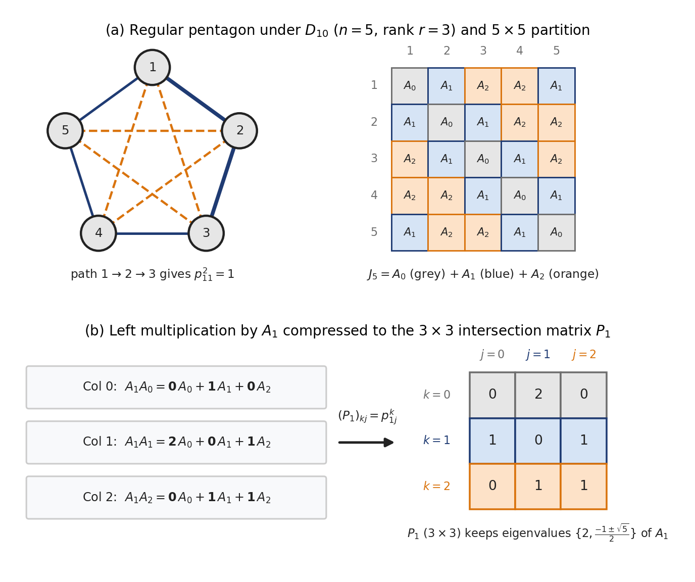

*Figure 12. Coherent configuration and intersection algebra for $D_{10}$ on the regular pentagon ($n = 5$, rank $r = 3$). (a) The three orbitals (diagonal, perimeter edges, and star chords) partition the $5 \times 5$ all-ones matrix as $J_5 = A_0 + A_1 + A_2$, and two-step path counts on the pentagon give the numbers $p_{ij}^k$. (b) Left-multiplying the basis $\{A_0, A_1, A_2\}$ by $A_1$ gives three coefficient columns $(P_1)_{kj} = p_{1j}^k$ that form the $3 \times 3$ intersection matrix $P_1$.*

For an association scheme on $n$ vertices, the algebra formed by the association matrices is called the [Bose-Mesner Algebra](maths_4_incidence_geometry.md#distance-matrices-distance-polynomials-and-the-bose-mesner-algebra), which is isomorphic to the intersection algebra. For an association scheme, since it is commutative, the basis matrices $A_i$ of the Bose-Mesner algebra form a commuting family of normal (in the symmetric case, real symmetric) matrices. They are therefore simultaneously diagonalizable via an orthonormal basis of common eigenvectors. This is a statement about the $A_i$. The intersection matrices $P_i$ also commute and have the same set of eigenvalues as the $A_i$ (but with different multiplicities: $P_i$ has one eigenvalue for each common eigenspace of the $A_j$, so a value repeats only when $A_i$ takes it on several of those eigenspaces), so they can be diagonalized together too, but in general not by an orthonormal basis: for the complete graph $K_3$, $P_1 = \begin{pmatrix} 0 & 2 \\ 1 & 1 \end{pmatrix}$ is not even symmetric. In this common eigenbasis, every matrix in the algebra decomposes into a diagonal matrix (a direct sum of $1 \times 1$ blocks). 

The Bose-Mesner algebra has two distinguished dual bases. Here "dual" does not mean a basis of the dual space: both bases lie in the algebra itself, and they trade the roles of the two products, since the $A_i$ are idempotent and mutually orthogonal under the entrywise product $\circ$, while the $E_i$ are idempotent and mutually orthogonal under the ordinary product:

The geometric basis: $\{A_0, A_1, \dots, A_d\}$, where $d = r - 1$ is the number of non-identity relations, under ordinary and [Schur-Hadamard multiplication](maths_4_incidence_geometry.md#rank-determinants-and-gram-matrices) (the entrywise product, $(A \circ B)_{\alpha\beta} = A_{\alpha\beta} B_{\alpha\beta}$):

$$A_i A_j = \sum_{k=0}^d p_{ij}^k A_k, \qquad A_i \circ A_j = \delta_{ij} A_i$$

The spectral basis of primitive idempotents $\{E_0, E_1, \dots, E_d\}$ (the orthogonal projections onto the common eigenspaces of all the $A_j$; primitive means none of them splits into a sum of two smaller such projections):

$$E_i E_j = \delta_{ij} E_i, \qquad E_i \circ E_j = \frac{1}{n} \sum_{k=0}^d q_{ij}^k E_k$$

where $E_0 = \frac{1}{n} J$, and the numbers $q_{ij}^k$, called the Krein parameters, play the same role for the entrywise product of the $E_i$ that the intersection numbers $p_{ij}^k$ play for the ordinary product of the $A_i$.

The transition matrices between these two dual bases define the first eigenmatrix $P$ and the second eigenmatrix $Q$ (this $P$, with entries $P_{ij}$, is a single $r \times r$ matrix, not one of the intersection matrices $P_i$ above; for $K_3$, $P = \begin{pmatrix} 1 & 2 \\ 1 & -1 \end{pmatrix}$, while $P_1 = \begin{pmatrix} 0 & 2 \\ 1 & 1 \end{pmatrix}$):

$$A_j = \sum_{i=0}^d P_{ij} E_i \quad \Longleftrightarrow \quad E_j = \frac{1}{n} \sum_{i=0}^d Q_{ij} A_i$$

Here, $P_{ij}$ represents the $i$-th [eigenvalue of the adjacency matrix](maths_4_incidence_geometry.md#the-adjacency-matrix-and-its-eigenvalues) $A_j$. Writing this linear change of basis in matrix form yields the orthogonality relation:

The relationship between the first and second eigenmatrices $P$ and $Q$ is $P Q = Q P = n I_{r}$, and $r = d+1$, where $d$ is the number of classes (the non-identity relations) of the scheme. For the distance schemes of distance-regular graphs, introduced below, $d$ is also the diameter of the graph.

<!-- terms checked: trivial representation; trivial module; reducible; completely reducible; composition factor; linear character; trivial character; faithful character; complex conjugate character; regular character; permutation character; class function; constituent; algebra; degree; permutation matrix; induced module -->

## Representations & Characters

The earlier survey of [a little representation theory](#a-little-representation-theory) introduced matrix representations, group modules, and characters informally, and stated several far-reaching facts: every representation of a finite group over $\mathbb{C}$ breaks into irreducible pieces, two representations are equivalent if and only if their characters agree, and the irreducible characters form an orthonormal set of functions on the group. How can the trace of a matrix, a single number compressed from $n^2$ entries, lock down an entire representation up to change of basis, and how do we build and decompose the representations of a group from its group algebra, its subgroups, and its permutation actions?

### Matrix Representations, Equivalence and Kernels

To study an abstract group $G$ using linear algebra, we map its elements to invertible matrices so that group multiplication becomes matrix multiplication. We then need a way to tell when two such matrix assignments differ only by a choice of coordinates, and how much of $G$ the matrices actually see.

We recall from [a little representation theory](#a-little-representation-theory) that a representation of a group $G$ over a field $F$ is a homomorphism $\rho : G \to \mathrm{GL}(n, F)$ into the general linear group of invertible $n \times n$ matrices over $F$. The positive integer $n$ is the degree of $\rho$. Throughout this chapter we keep the right-hand notation of the earlier representation theory sections: maps are written on the right, so $\rho$ sends $g \in G$ to $g\rho$, and row vectors in $F^n$ are multiplied by matrices on the right. The homomorphism condition then reads $(gh)\rho = (g\rho)(h\rho)$ for all $g, h \in G$, which implies $1\rho = I_n$ and $g^{-1}\rho = (g\rho)^{-1}$. Two representations $\rho, \sigma : G \to \mathrm{GL}(n, F)$ of the same degree are equivalent if there is an invertible matrix $T \in \mathrm{GL}(n, F)$ such that $g\sigma = T^{-1}(g\rho)T$ for all $g \in G$. This defines an equivalence relation on the representations of $G$: it is reflexive via $T = I_n$, symmetric via $T^{-1}$, and transitive via $T_1 T_2$.

Up to and including [Maschke's theorem](#maschkes-theorem-and-complete-reducibility), we take the ground field $F$ to be $\mathbb{R}$ or $\mathbb{C}$. We also write $D_{2n}$ for the dihedral group of order $2n$, generated by a rotation $a$ of order $n$ and a reflection $b$ of order $2$ satisfying $a^n = b^2 = 1$ and $b^{-1}ab = a^{-1}$. Under this convention, $D_8$ is the symmetry group of the square and $D_6 \cong S_3$ is the symmetry group of the equilateral triangle.

#### Worked Examples of Representations and Equivalence

Whenever $G$ is presented by generators and defining relations, such as $D_{2n} = \langle a, b : a^n = b^2 = 1,\, b^{-1}ab = a^{-1} \rangle$, each element of $D_{2n}$ can be written uniquely as $a^r b^s$ with $0 \le r < n$ and $s \in \{0, 1\}$. If $A, B \in \mathrm{GL}(m, F)$ satisfy the same relations $A^n = B^2 = I_m$ and $B^{-1}AB = A^{-1}$, then $B A^r = A^{-r} B$ for every integer $r$, so setting $(a^r b^s)\rho = A^r B^s$ respects the multiplication rule $(a^r b)(a^t b^u) = a^{r - t} b^{1 + u}$ and defines a representation $\rho : D_{2n} \to \mathrm{GL}(m, F)$.

**Worked example: a degree-$2$ representation of $D_8$ and its diagonalization of $a$ over $\mathbb{C}$.** Take $G = D_8 = \langle a, b : a^4 = b^2 = 1,\, b^{-1}ab = a^{-1} \rangle$ and consider the matrices in $\mathrm{GL}(2, F)$ given by

$$A = \begin{pmatrix} 0 & 1 \\ -1 & 0 \end{pmatrix}, \qquad B = \begin{pmatrix} 1 & 0 \\ 0 & -1 \end{pmatrix}.$$

Squaring $A$ gives $A^2 = -I_2$, so $A^3 = -A = A^{-1}$ and $A^4 = I_2$. We also have $B^2 = I_2 = B^{-1}$ and

$$B^{-1}AB = \begin{pmatrix} 1 & 0 \\ 0 & -1 \end{pmatrix} \begin{pmatrix} 0 & 1 \\ -1 & 0 \end{pmatrix} \begin{pmatrix} 1 & 0 \\ 0 & -1 \end{pmatrix} = \begin{pmatrix} 0 & -1 \\ 1 & 0 \end{pmatrix} = A^{-1}.$$

Assigning $(a^r b^s)\rho = A^r B^s$ for $0 \le r \le 3$ and $s \in \{0, 1\}$ therefore defines a representation $\rho : D_8 \to \mathrm{GL}(2, F)$ of degree $2$, whose eight matrices are

$$1\rho = \begin{pmatrix} 1 & 0 \\ 0 & 1 \end{pmatrix}, \quad a\rho = \begin{pmatrix} 0 & 1 \\ -1 & 0 \end{pmatrix}, \quad a^2\rho = \begin{pmatrix} -1 & 0 \\ 0 & -1 \end{pmatrix}, \quad a^3\rho = \begin{pmatrix} 0 & -1 \\ 1 & 0 \end{pmatrix},$$

$$b\rho = \begin{pmatrix} 1 & 0 \\ 0 & -1 \end{pmatrix}, \quad ab\rho = \begin{pmatrix} 0 & -1 \\ -1 & 0 \end{pmatrix}, \quad a^2b\rho = \begin{pmatrix} -1 & 0 \\ 0 & 1 \end{pmatrix}, \quad a^3b\rho = \begin{pmatrix} 0 & 1 \\ 1 & 0 \end{pmatrix}.$$

When $F = \mathbb{C}$, we can conjugate $\rho$ by an invertible matrix $T$ that diagonalizes $a\rho$. Taking

$$T = \frac{1}{\sqrt{2}} \begin{pmatrix} 1 & 1 \\ i & -i \end{pmatrix}, \qquad T^{-1} = \frac{1}{\sqrt{2}} \begin{pmatrix} 1 & -i \\ 1 & i \end{pmatrix},$$

and defining $g\sigma = T^{-1}(g\rho)T$ for all $g \in D_8$ gives an equivalent representation $\sigma : D_8 \to \mathrm{GL}(2, \mathbb{C})$ generated by

$$a\sigma = \frac{1}{2} \begin{pmatrix} 1 & -i \\ 1 & i \end{pmatrix} \begin{pmatrix} 0 & 1 \\ -1 & 0 \end{pmatrix} \begin{pmatrix} 1 & 1 \\ i & -i \end{pmatrix} = \begin{pmatrix} i & 0 \\ 0 & -i \end{pmatrix}, \qquad b\sigma = \frac{1}{2} \begin{pmatrix} 1 & -i \\ 1 & i \end{pmatrix} \begin{pmatrix} 1 & 0 \\ 0 & -1 \end{pmatrix} \begin{pmatrix} 1 & 1 \\ i & -i \end{pmatrix} = \begin{pmatrix} 0 & 1 \\ 1 & 0 \end{pmatrix}.$$

**Worked example: diagonalizing a representation of $C_2$.** Let $G = C_2 = \langle a : a^2 = 1 \rangle$. Any matrix $A \in \mathrm{GL}(n, F)$ satisfying $A^2 = I_n$ determines a degree-$n$ representation $\rho$ of $C_2$ via $1\rho = I_n$ and $a\rho = A$. For instance, take

$$A = \begin{pmatrix} -5 & 12 \\ -2 & 5 \end{pmatrix}, \qquad A^2 = \begin{pmatrix} 25 - 24 & -60 + 60 \\ 10 - 10 & -24 + 25 \end{pmatrix} = \begin{pmatrix} 1 & 0 \\ 0 & 1 \end{pmatrix}.$$

Conjugating by $T = \begin{pmatrix} 2 & -3 \\ 1 & -1 \end{pmatrix}$, which has inverse $T^{-1} = \begin{pmatrix} -1 & 3 \\ -1 & 2 \end{pmatrix}$, yields the equivalent representation $\sigma : C_2 \to \mathrm{GL}(2, F)$ with

$$1\sigma = \begin{pmatrix} 1 & 0 \\ 0 & 1 \end{pmatrix}, \qquad a\sigma = T^{-1}AT = \begin{pmatrix} -1 & 3 \\ -1 & 2 \end{pmatrix} \begin{pmatrix} -5 & 12 \\ -2 & 5 \end{pmatrix} \begin{pmatrix} 2 & -3 \\ 1 & -1 \end{pmatrix} = \begin{pmatrix} 1 & 0 \\ 0 & -1 \end{pmatrix}.$$

Two extreme cases of equivalence are worth noting: if $\rho$ has degree $1$, or if $g\rho = I_n$ for every $g \in G$, then $T^{-1}(g\rho)T = g\rho$ for every $T \in \mathrm{GL}(n, F)$, so the only representation equivalent to $\rho$ is $\rho$ itself. Setting $g\rho = I_n$ for all $g \in G$ also shows that every group has representations of arbitrarily large degree.

#### Kernels and the Trivial Representation

For any group $G$, the **trivial representation** is the degree-$1$ representation $G \to \mathrm{GL}(1, F)$ given by $g \mapsto (1)$ for all $g \in G$. At the opposite extreme, a representation $\rho : G \to \mathrm{GL}(n, F)$ is faithful when its kernel $\ker\rho = \{g \in G : g\rho = I_n\}$ is the trivial subgroup $\{1\}$ ([a little representation theory](#a-little-representation-theory)).

Because $\rho : G \to \mathrm{GL}(n, F)$ is a group homomorphism, [homomorphisms and the isomorphism theorems](#homomorphisms-and-the-isomorphism-theorems) give three facts about $\ker\rho$ and the image $\operatorname{Im}\rho = \{g\rho : g \in G\}$.

**Normal kernel and subgroup image.** The kernel $\ker\rho$ is a normal subgroup of $G$, and the image $\operatorname{Im}\rho$ is a subgroup of $\mathrm{GL}(n, F)$.

**First isomorphism theorem and faithfulness.** The quotient $G / \ker\rho$ is isomorphic to $\operatorname{Im}\rho$. In particular, $\rho$ is faithful if and only if $\operatorname{Im}\rho \cong G$; when $G$ is finite, this holds if and only if $|\operatorname{Im}\rho| = |G|$.

**Faithful representation of the quotient.** Writing $N = \ker\rho$, the quotient group $G/N$ inherits a faithful representation $\tilde{\rho} : G/N \to \mathrm{GL}(n, F)$ defined by $(Ng)\tilde{\rho} = g\rho$.

Equivalent representations have the same kernel, because conjugating the identity matrix $I_n$ by an invertible matrix $T$ leaves $I_n$ unchanged. Any representation equivalent to a faithful representation is therefore faithful. In the degree-$2$ representation of $D_8$ worked out above, the eight matrices $g\rho$ are all distinct, so $\ker\rho = \{1\}$ and both $\rho$ and the equivalent diagonalized representation $\sigma$ are faithful. By contrast, the trivial representation has $\ker\rho = G$ and is faithful if and only if $G = \{1\}$.

### Modules over the Group and Basis Changes

Matrix representations depend on a choice of basis, and changing the basis conjugates every matrix by the same invertible matrix $T$. Passing from matrices to an $FG$-module removes the basis from the definition while keeping the exact correspondence with matrix representations once a basis is chosen.

The five axioms for an $FG$-module are introduced in [$FG$-modules](#fg-modules): a vector space $V$ over $F$ is acted on from the right by $G$ so that $vg \in V$, $v(gh) = (vg)h$, $v1 = v$, $(\lambda v)g = \lambda(vg)$, and $(u + v)g = ug + vg$ for all $u, v \in V$, $\lambda \in F$, and $g, h \in G$. Throughout these notes, every $FG$-module is assumed to be finite-dimensional over $F$. That section and [permutation modules and representations](#permutation-modules-representations) also define a faithful module as one where $\{g \in G : vg = v \text{ for all } v \in V\} = \{1\}$, and define the matrix $[g]_{\mathscr{B}}$ of $g$ relative to a basis $\mathscr{B} = \{v_1, \dots, v_n\}$ of $V$: its $i$-th row consists of the coordinates of $v_i g$ in $\mathscr{B}$.

#### The Two-Way Bridge Between Modules and Representations

The link between representations of $G$ and $FG$-modules goes in both directions:

**From a representation to an $FG$-module.** If $\rho : G \to \mathrm{GL}(n, F)$ is a representation of $G$ and $V = F^n$ is the space of $n$-component row vectors over $F$, then defining $vg := v(g\rho)$ for $v \in V$ and $g \in G$ makes $V$ into an $FG$-module. In the standard basis $\mathscr{B} = \{e_1, \dots, e_n\}$ of $F^n$, the $i$-th row of $g\rho$ is $e_i(g\rho) = e_i g$, so $[g]_{\mathscr{B}} = g\rho$ for all $g \in G$.

**From an $FG$-module to a representation.** Conversely, if $V$ is an $FG$-module with basis $\mathscr{B} = \{v_1, \dots, v_n\}$, then for each $g \in G$ the map $v \mapsto vg$ is an $F$-linear transformation of $V$ with invertible matrix $[g]_{\mathscr{B}} \in \mathrm{GL}(n, F)$, and $g \mapsto [g]_{\mathscr{B}}$ is a representation of $G$ of degree $n = \dim V$ satisfying $[gh]_{\mathscr{B}} = [g]_{\mathscr{B}}[h]_{\mathscr{B}}$ and $[1]_{\mathscr{B}} = I_n$.

**Worked examples: $D_8$ on $F^2$ and the quaternion group $Q_8$ on $\mathbb{C}^2$.** In the degree-$2$ representation of $D_8$ from the previous section, let $V = F^2$ with standard basis $v_1 = (1, 0)$ and $v_2 = (0, 1)$. For any row vector $v = (\lambda_1, \lambda_2) \in F^2$, right multiplication by $a\rho$, $b\rho$, and $a^3\rho$ gives

$$(\lambda_1, \lambda_2)a = (\lambda_1, \lambda_2)\begin{pmatrix} 0 & 1 \\ -1 & 0 \end{pmatrix} = (-\lambda_2, \lambda_1), \qquad (\lambda_1, \lambda_2)b = (\lambda_1, -\lambda_2), \qquad (\lambda_1, \lambda_2)a^3 = (\lambda_2, -\lambda_1).$$

On the basis vectors $v_1, v_2$, the generators act by $v_1 a = v_2$, $v_2 a = -v_1$, $v_1 b = v_1$, and $v_2 b = -v_2$. Using the module axioms, we can compute the action of any group element on any linear combination without rewriting matrices: for example,

$$(v_1 + 2v_2)(ab) = ((v_1 + 2v_2)a)b = (v_1 a + 2(v_2 a))b = (v_2 - 2v_1)b = v_2 b - 2(v_1 b) = -2v_1 - v_2.$$

As a second example, let $Q_8 = \langle a, b : a^4 = 1,\, a^2 = b^2,\, b^{-1}ab = a^{-1} \rangle$ be the quaternion group of order $8$, which is realized inside $\mathrm{GL}(2, \mathbb{C})$ by the matrices

$$A = \begin{pmatrix} i & 0 \\ 0 & -i \end{pmatrix}, \qquad B = \begin{pmatrix} 0 & 1 \\ -1 & 0 \end{pmatrix}$$

since $A^2 = B^2 = -I_2$, $A^4 = I_2$, and $B^{-1}AB = \begin{pmatrix} 0 & -1 \\ 1 & 0 \end{pmatrix}\begin{pmatrix} i & 0 \\ 0 & -i \end{pmatrix}\begin{pmatrix} 0 & 1 \\ -1 & 0 \end{pmatrix} = \begin{pmatrix} -i & 0 \\ 0 & i \end{pmatrix} = A^{-1}$. The corresponding $\mathbb{C}Q_8$-module $V = \mathbb{C}^2$ with standard basis $v_1, v_2$ has the action

$$v_1 a = iv_1, \quad v_2 a = -iv_2, \quad v_1 b = v_2, \quad v_2 b = -v_1.$$

#### Testing the Module Axioms on a Basis and Permutation Modules

To define an $FG$-module structure on a vector space $V$ with basis $v_1, \dots, v_n$, it is enough to specify elements $v_i g \in V$ for each $i \in \{1, \dots, n\}$ and $g \in G$ such that $(v_i g)h = v_i(gh)$ and $v_i 1 = v_i$, and then extend the action linearly to all of $V$ by setting

$$\left(\sum_{i=1}^n \lambda_i v_i\right)g = \sum_{i=1}^n \lambda_i (v_i g) \qquad (\lambda_i \in F).$$

Two standard modules arise immediately from this basis test:

**The trivial module.** The **trivial $FG$-module** is a $1$-dimensional vector space $V = \operatorname{sp}(v)$ over $F$ with action $vg = v$ for all $v \in V$ and $g \in G$; in any basis $\mathscr{B} = \{v\}$, the corresponding representation is the trivial representation $g \mapsto (1)$.

**The permutation module.** Let $G \le S_n$ be a group of permutations of $\{1, \dots, n\}$ acting on the right, where the image of $i$ under $g$ is written $ig$. Let $V$ be an $n$-dimensional vector space over $F$ with natural basis $\mathscr{B} = \{v_1, \dots, v_n\}$ ([permutation modules and representations](#permutation-modules-representations)). Setting $v_i g = v_{ig}$ for $1 \le i \le n$ and $g \in G$ satisfies $(v_i g)h = v_{ig} h = v_{(ig)h} = v_{i(gh)} = v_i(gh)$ and $v_i 1 = v_{i1} = v_i$, so the basis test makes $V$ into an $FG$-module, the permutation module for $G$. In the natural basis $\mathscr{B}$, the $i$-th row of $[g]_{\mathscr{B}}$ has a $1$ in column $ig$ and $0$ elsewhere. Because $g$ is a bijection on $\{1, \dots, n\}$, each column $j$ also has a single $1$ (in row $jg^{-1}$); such a matrix, with exactly one $1$ in each row and each column and $0$ elsewhere, is a **permutation matrix**, as in [permutation modules and representations](#permutation-modules-representations).

**Worked examples: permutation modules for $S_4$ and $C_3$.** For $G = S_4$ acting on $V = \operatorname{sp}(v_1, v_2, v_3, v_4)$, the elements $g = (1\,2)$ and $h = (1\,3\,4)$ act on the basis vectors by $v_1 g = v_2$, $v_2 g = v_1$, $v_3 g = v_3$, $v_4 g = v_4$ and $v_1 h = v_3$, $v_2 h = v_2$, $v_3 h = v_4$, $v_4 h = v_1$, giving the permutation matrices

$$[g]_{\mathscr{B}} = \begin{pmatrix} 0 & 1 & 0 & 0 \\ 1 & 0 & 0 & 0 \\ 0 & 0 & 1 & 0 \\ 0 & 0 & 0 & 1 \end{pmatrix}, \qquad [h]_{\mathscr{B}} = \begin{pmatrix} 0 & 0 & 1 & 0 \\ 0 & 1 & 0 & 0 \\ 0 & 0 & 0 & 1 \\ 1 & 0 & 0 & 0 \end{pmatrix}.$$

Similarly, the cyclic group $C_3 = \langle a : a^3 = 1 \rangle$ is isomorphic to the subgroup $\langle (1\,2\,3) \rangle \le S_3$; its permutation module $V = \operatorname{sp}(v_1, v_2, v_3)$ has $v_1 a = v_2$, $v_2 a = v_3$, $v_3 a = v_1$, and

$$[1]_{\mathscr{B}} = \begin{pmatrix} 1 & 0 & 0 \\ 0 & 1 & 0 \\ 0 & 0 & 1 \end{pmatrix}, \qquad [a]_{\mathscr{B}} = \begin{pmatrix} 0 & 1 & 0 \\ 0 & 0 & 1 \\ 1 & 0 & 0 \end{pmatrix}, \qquad [a^2]_{\mathscr{B}} = \begin{pmatrix} 0 & 0 & 1 \\ 1 & 0 & 0 \\ 0 & 1 & 0 \end{pmatrix}.$$

#### Change of Basis and Equivalent Representations

Suppose $V$ is an $FG$-module and $\mathscr{B} = \{v_1, \dots, v_n\}$ and $\mathscr{B}' = \{v_1', \dots, v_n'\}$ are two bases of $V$. Let $T = (t_{ij}) \in \mathrm{GL}(n, F)$ be the change-of-basis matrix whose $i$-th row records the coordinates of $v_i'$ in the basis $\mathscr{B}$, so $v_i' = \sum_{j=1}^n t_{ij} v_j$. Then the matrices of $g \in G$ relative to $\mathscr{B}$ and $\mathscr{B}'$ satisfy $[g]_{\mathscr{B}'} T = T [g]_{\mathscr{B}}$, or equivalently

$$[g]_{\mathscr{B}} = T^{-1}[g]_{\mathscr{B}'}T \qquad (g \in G).$$

Thus two representations of $G$ are equivalent if and only if they represent the action of $G$ on the same $FG$-module relative to two bases.

**Worked example: changing basis in a $2$-dimensional $\mathbb{C}C_3$-module.** Let $G = C_3 = \langle a : a^3 = 1 \rangle$ act on $V = \mathbb{C}^2$ with standard basis $\mathscr{B} = \{v_1, v_2\}$ via the matrices

$$[1]_{\mathscr{B}} = \begin{pmatrix} 1 & 0 \\ 0 & 1 \end{pmatrix}, \qquad [a]_{\mathscr{B}} = \begin{pmatrix} 0 & 1 \\ -1 & -1 \end{pmatrix}, \qquad [a^2]_{\mathscr{B}} = \begin{pmatrix} -1 & -1 \\ 1 & 0 \end{pmatrix},$$

so $v_1 a = v_2$ and $v_2 a = -v_1 - v_2$. Switch to the new basis $\mathscr{B}' = \{u_1, u_2\}$ with $u_1 = v_1$ and $u_2 = v_1 + v_2$. Then

$$u_1 a = v_1 a = v_2 = -u_1 + u_2, \qquad u_2 a = (v_1 + v_2)a = v_2 - v_1 - v_2 = -v_1 = -u_1,$$

$$u_1 a^2 = (-u_1 + u_2)a = u_1 - u_2 - u_1 = -u_2, \qquad u_2 a^2 = (-u_1)a = u_1 - u_2.$$

Reading the coordinates row by row gives the matrices in the basis $\mathscr{B}'$:

$$[1]_{\mathscr{B}'} = \begin{pmatrix} 1 & 0 \\ 0 & 1 \end{pmatrix}, \qquad [a]_{\mathscr{B}'} = \begin{pmatrix} -1 & 1 \\ -1 & 0 \end{pmatrix}, \qquad [a^2]_{\mathscr{B}'} = \begin{pmatrix} 0 & -1 \\ 1 & -1 \end{pmatrix}.$$

With $T = \begin{pmatrix} 1 & 0 \\ 1 & 1 \end{pmatrix}$, whose rows are the coordinates of $u_1, u_2$ in $\mathscr{B}$, we verify that $T^{-1}[g]_{\mathscr{B}'}T = [g]_{\mathscr{B}}$ for all $g \in C_3$.

### Submodules and Reducibility

To break a representation of degree $n$ into smaller representations, we look for a proper non-zero subspace that the group action traps inside itself, so that every matrix becomes block-triangular when the basis starts inside that subspace.

We recall from [invariant subspaces and reducibility](#subspaces) that an $FG$-submodule of an $FG$-module $V$ is a vector subspace $W \le V$ such that $wg \in W$ for all $w \in W$ and $g \in G$. Thus $W$ is an $FG$-module in its own right. A non-zero $FG$-module $V$ is irreducible if its only $FG$-submodules are $\{0\}$ and $V$, and it is **reducible** if it has a proper non-zero $FG$-submodule $W$, with $0 < \dim W < \dim V$. A representation $\rho : G \to \mathrm{GL}(n, F)$ is called irreducible or reducible according as the corresponding $FG$-module $F^n$ is irreducible or reducible. Every $1$-dimensional $FG$-module is automatically irreducible, because a $1$-dimensional vector space has no subspaces of dimension strictly between $0$ and $1$.

The earlier notes also worked out the $3$-dimensional permutation module $V = \operatorname{sp}(v_1, v_2, v_3)$ of $C_3 = \langle a : a^3 = 1 \rangle$ ([invariant subspaces and reducibility](#subspaces)). There $W = \operatorname{sp}(v_1 + v_2 + v_3)$ is a $1$-dimensional $FC_3$-submodule because $(v_1 + v_2 + v_3)g = v_1 + v_2 + v_3$ for all $g \in C_3$, whereas $U = \operatorname{sp}(v_1 + v_2)$ is not an $FC_3$-submodule because $(v_1 + v_2)a = v_2 + v_3 \notin U$.

Why does a proper non-zero submodule $W \le V$ of dimension $k$ produce block-lower-triangular matrices? Choose a basis $\mathscr{B}_1 = \{v_1, \dots, v_k\}$ of $W$ and extend it to a basis $\mathscr{B} = \{v_1, \dots, v_k, v_{k+1}, \dots, v_n\}$ of $V$. For each $i \in \{1, \dots, k\}$ and $g \in G$, the vector $v_i g$ lies in $W$ because $W$ is an $FG$-submodule, so $v_i g$ is a linear combination of $v_1, \dots, v_k$ alone, with zero coefficient on $v_{k+1}, \dots, v_n$. Since the $i$-th row of $[g]_{\mathscr{B}}$ records the coordinates of $v_i g$ in $\mathscr{B}$, the top-right $k \times (n - k)$ block of $[g]_{\mathscr{B}}$ is zero:

$$[g]_{\mathscr{B}} = \begin{pmatrix} X_g & 0 \\ Y_g & Z_g \end{pmatrix} \qquad (g \in G).$$

Here $X_g$ is $k \times k$, $Y_g$ is $(n - k) \times k$, and $Z_g$ is $(n - k) \times (n - k)$. Because the top-right block is zero, multiplying two such block matrices multiplies their diagonal blocks independently ($X_{gh} = X_g X_h$ and $Z_{gh} = Z_g Z_h$). Thus $g \mapsto X_g$, which is the representation on the submodule $W$ in the basis $\mathscr{B}_1$, and $g \mapsto Z_g$ are both representations of $G$, of degrees $k$ and $n - k$. For instance, in the $C_3$ permutation module with adapted basis $\mathscr{B}' = \{v_1 + v_2 + v_3, v_1, v_2\}$ ([invariant subspaces and reducibility](#subspaces)), we have $[a]_{\mathscr{B}'} = \left(\begin{array}{c|cc} 1 & 0 & 0 \\ \hline 0 & 0 & 1 \\ 1 & -1 & -1 \end{array}\right)$. Here $g \mapsto X_g = (1)$ is the trivial representation of $C_3$, and $g \mapsto Z_g$ is the degree-$2$ representation with $Z_a = \begin{pmatrix} 0 & 1 \\ -1 & -1 \end{pmatrix}$ and $Z_{a^2} = \begin{pmatrix} -1 & -1 \\ 1 & 0 \end{pmatrix}$.

**Worked example: showing the $2$-dimensional $FD_8$-module is irreducible.** Let $G = D_8 = \langle a, b : a^4 = b^2 = 1,\, b^{-1}ab = a^{-1} \rangle$ act on $V = F^2$ via $(\lambda_1, \lambda_2)a = (-\lambda_2, \lambda_1)$ and $(\lambda_1, \lambda_2)b = (\lambda_1, -\lambda_2)$. Suppose $U \le V$ is an $FD_8$-submodule with $\dim U \le 1$, so $U = \operatorname{sp}(v)$ for some $v = (\alpha, \beta) \in F^2$. Because $U$ is invariant under $b$, the vector $vb = (\alpha, -\beta)$ is a scalar multiple of $(\alpha, \beta)$, which forces either $\alpha = 0$ or $\beta = 0$. If $\alpha = 0$, then $v = (0, \beta)$, so $va = (-\beta, 0) \in U = \operatorname{sp}((0, \beta))$, which forces $-\beta = 0$ and hence $v = (0, 0)$. If $\beta = 0$, then $v = (\alpha, 0)$, so $va = (0, \alpha) \in U = \operatorname{sp}((\alpha, 0))$, which forces $\alpha = 0$ and again $v = (0, 0)$. Hence $V$ has no $1$-dimensional $FD_8$-submodule, so its only $FD_8$-submodules are $\{0\}$ and $V$, and $V$ is irreducible over both $F = \mathbb{R}$ and $F = \mathbb{C}$.

### The Group Algebra and the Regular Module

Up to this point, an $FG$-module has two separate operations: vector-space linear combinations over $F$ and right multiplication by elements of $G$. Merging the field $F$ and the group $G$ into a single algebra $FG$ turns both operations into a single bilinear multiplication and gives a universal module that contains every irreducible representation of $G$. A vector space over $F$ equipped with a multiplication that is associative, distributes over addition, has an identity, and satisfies $\lambda(rs) = (\lambda r)s = r(\lambda s)$ for all $\lambda \in F$ and $r, s$ in the space is called an **algebra** over $F$ (described informally as a ring plus a vector space in [group algebras](#group-algebras)), and the rules listed below for $FG$ are precisely these axioms.

We recall from [group algebras](#group-algebras) the construction of the group algebra $FG$, the regular $FG$-module (namely $FG$ acting on itself by right multiplication), and the regular representation. As a vector space over $F$, the group algebra $FG$ has the elements $g_1, \dots, g_n$ of $G$ as its natural basis, with multiplication given by

$$\left(\sum_{g \in G} \lambda_g g\right)\left(\sum_{h \in G} \mu_h h\right) = \sum_{g, h \in G} \lambda_g \mu_h (gh) = \sum_{g \in G} \left(\sum_{h \in G} \lambda_h \mu_{h^{-1}g}\right)g \qquad (\lambda_g, \mu_h \in F).$$

For any $FG$-module $V$, the action of $G$ on $V$ extends linearly to an action of $FG$ on $V$ by setting

$$v\left(\sum_{g \in G} \lambda_g g\right) = \sum_{g \in G} \lambda_g (vg) \qquad (v \in V, \; \lambda_g \in F).$$

Direct expansion from the group axioms and the field axioms shows that for all $r, s, t \in FG$, $\lambda \in F$, and $u, v \in V$ (where $V$ is any $FG$-module), multiplication in $FG$ and the action of $FG$ on $V$ obey the associative and distributive laws:

$$r(s + t) = rs + rt, \quad (r + s)t = rt + st, \quad (rs)t = r(st), \quad \lambda(rs) = (\lambda r)s = r(\lambda s), \quad r1 = 1r = r,$$

$$(u + v)r = ur + vr, \quad v(r + s) = vr + vs, \quad v(rs) = (vr)s, \quad v(\lambda r) = (\lambda v)r = \lambda(vr), \quad v1 = v.$$

Because $FG$ satisfies these rules on itself, the regular $FG$-module is an $FG$-module of dimension $|G|$. Moreover, the regular $FG$-module is always faithful, since $1g = g$ on the basis vector $1 \in FG$.

**Worked examples: computing in $\mathbb{C}C_3$, the regular representation of $C_3$, and $FS_4$ acting on its permutation module.** Let $G = C_3 = \{e, a, a^2\}$ with $a^3 = e$, and consider the elements $u = e - a + 2a^2$ and $v = \frac{1}{2}e + 5a$ in $\mathbb{C}C_3$. Adding componentwise, scaling, and multiplying out using $a^3 = e$ and $a^4 = a$ give

$$u + v = \frac{3}{2}e + 4a + 2a^2, \qquad \frac{1}{3}u = \frac{1}{3}e - \frac{1}{3}a + \frac{2}{3}a^2,$$

$$uv = (e - a + 2a^2)\left(\frac{1}{2}e + 5a\right) = \frac{1}{2}e + 5a - \frac{1}{2}a - 5a^2 + a^2 + 10a^3 = \frac{21}{2}e + \frac{9}{2}a - 4a^2.$$

On the ordered natural basis $\mathscr{B} = \{e, a, a^2\}$ of the regular module $FC_3$, right multiplication by $a$ sends $e \mapsto a$, $a \mapsto a^2$, $a^2 \mapsto e$, and right multiplication by $a^2$ sends $e \mapsto a^2$, $a \mapsto e$, $a^2 \mapsto a$, so the regular representation of $C_3$ is

$$[e]_{\mathscr{B}} = \begin{pmatrix} 1 & 0 & 0 \\ 0 & 1 & 0 \\ 0 & 0 & 1 \end{pmatrix}, \qquad [a]_{\mathscr{B}} = \begin{pmatrix} 0 & 1 & 0 \\ 0 & 0 & 1 \\ 1 & 0 & 0 \end{pmatrix}, \qquad [a^2]_{\mathscr{B}} = \begin{pmatrix} 0 & 0 & 1 \\ 1 & 0 & 0 \\ 0 & 1 & 0 \end{pmatrix}.$$

Finally, let $V = \operatorname{sp}(v_1, v_2, v_3, v_4)$ be the permutation module for $S_4$ and let $r = \lambda(1\,2) + \mu(1\,3\,4) \in FS_4$ ($\lambda, \mu \in F$). Then $r$ acts on $V$ by

$$v_1 r = \lambda v_1(1\,2) + \mu v_1(1\,3\,4) = \lambda v_2 + \mu v_3, \qquad v_2 r = \lambda v_2(1\,2) + \mu v_2(1\,3\,4) = \lambda v_1 + \mu v_2,$$

$$(2v_1 + v_2)r = 2(v_1 r) + v_2 r = 2(\lambda v_2 + \mu v_3) + (\lambda v_1 + \mu v_2) = \lambda v_1 + (2\lambda + \mu)v_2 + 2\mu v_3.$$

### Module Homomorphisms, Isomorphisms and Direct Sums

How do we compare two different $FG$-modules without choosing bases, and how do linear maps that commute with the group action produce submodules and direct-sum decompositions?

#### Homomorphisms of Modules and Their Kernels and Images

Let $V$ and $W$ be $FG$-modules. An **$FG$-homomorphism** is a linear transformation $\vartheta : V \to W$ such that

$$(vg)\vartheta = (v\vartheta)g \qquad \text{for all } v \in V \text{ and } g \in G.$$

In the language of group actions, an $FG$-homomorphism is a linear map that is equivariant with respect to $G$ ([equivariant versus invariant](#equivariant-vs-invariant)), also called an intertwining operator in [a little representation theory](#a-little-representation-theory). Because $\vartheta$ is $F$-linear, the condition $(vg)\vartheta = (v\vartheta)g$ for all $g \in G$ automatically extends by linearity to $(vr)\vartheta = (v\vartheta)r$ for all $r = \sum_{g \in G} \lambda_g g \in FG$.

Every $FG$-homomorphism $\vartheta : V \to W$ produces an $FG$-submodule in its domain and an $FG$-submodule in its codomain.

**Kernel.** The kernel $\ker\vartheta = \{v \in V : v\vartheta = 0\}$ is an $FG$-submodule of $V$.

**Image.** The image $\operatorname{Im}\vartheta = \{v\vartheta : v \in V\}$ is an $FG$-submodule of $W$.

**Worked examples: scalar maps and the coordinate-sum homomorphism on a permutation module.** For any $FG$-modules $V$ and $W$, the zero map $v \mapsto 0$ is an $FG$-homomorphism, and for any $\lambda \in F$ the scalar map $\vartheta : V \to V$ defined by $v\vartheta = \lambda v$ is an $FG$-homomorphism because $(vg)\vartheta = \lambda(vg) = (\lambda v)g = (v\vartheta)g$. For a non-scalar example, let $G \le S_n$, let $V = \operatorname{sp}(v_1, \dots, v_n)$ be the permutation module with $v_i g = v_{ig}$, and let $W = \operatorname{sp}(w)$ be a $1$-dimensional trivial $FG$-module ($wg = w$ for all $g \in G$). Define $\vartheta : V \to W$ by

$$\left(\sum_{i=1}^n \lambda_i v_i\right)\vartheta = \left(\sum_{i=1}^n \lambda_i\right)w \qquad (\lambda_i \in F).$$

Then $\vartheta$ is linear, and for any $v = \sum_{i=1}^n \lambda_i v_i \in V$ and $g \in G$, permuting the basis vectors $v_{ig}$ does not change the sum of their coefficients:

$$(vg)\vartheta = \left(\sum_{i=1}^n \lambda_i v_{ig}\right)\vartheta = \left(\sum_{i=1}^n \lambda_i\right)w = \left(\left(\sum_{i=1}^n \lambda_i\right)w\right)g = (v\vartheta)g.$$

Hence $\vartheta$ is an $FG$-homomorphism with image $\operatorname{Im}\vartheta = W$. Its kernel is therefore an $(n - 1)$-dimensional $FG$-submodule of the permutation module $V$, namely the zero-sum subspace

$$\ker\vartheta = \left\{\sum_{i=1}^n \lambda_i v_i : \sum_{i=1}^n \lambda_i = 0\right\} = \operatorname{sp}(v_1 - v_2,\, v_2 - v_3,\, \dots,\, v_{n-1} - v_n).$$

#### Isomorphic Modules and Equivalent Representations

An **$FG$-isomorphism** is an invertible $FG$-homomorphism $\vartheta : V \to W$. When such a map exists, we say that $V$ and $W$ are **isomorphic $FG$-modules** and write $V \cong W$. If $\vartheta : V \to W$ is an $FG$-isomorphism, then its inverse $\vartheta^{-1} : W \to V$ is automatically an $FG$-isomorphism as well. Isomorphism of $FG$-modules is therefore an equivalence relation, and isomorphic $FG$-modules share all module-theoretic properties: they have the same dimension, one is irreducible if and only if the other is, and $\vartheta$ sends any $FG$-submodule $U \le V$ to an isomorphic $FG$-submodule $U\vartheta \le W$.

Just as changing basis in a single module yields an equivalent representation, module isomorphism is the basis-free counterpart of equivalence of matrix representations.

**Isomorphism-equivalence theorem.** Let $V$ and $W$ be $FG$-modules with bases $\mathscr{B}$ and $\mathscr{B}'$, respectively. Then $V$ and $W$ are isomorphic $FG$-modules if and only if the representations $\rho : g \mapsto [g]_{\mathscr{B}}$ and $\sigma : g \mapsto [g]_{\mathscr{B}'}$ are equivalent, which holds if and only if there exist bases $\mathscr{B}_1$ of $V$ and $\mathscr{B}_2$ of $W$ such that $[g]_{\mathscr{B}_1} = [g]_{\mathscr{B}_2}$ for all $g \in G$.

An $FG$-isomorphism $\vartheta : V \to W$ carries any basis of $V$ to a basis of $W$ in which every group element $g$ has the exact same matrix, and changing from that basis to any other basis of $W$ conjugates those matrices.

**Worked examples: $C_3$ permutation and regular modules, and two isomorphic $\mathbb{C}D_8$-modules.** For $G = C_3 = \{1, a, a^2\}$, the permutation module $V = \operatorname{sp}(v_1, v_2, v_3)$ and the regular module $FC_3 = \operatorname{sp}(1, a, a^2)$ have identical matrices $[g]_{\mathscr{B}} = [g]_{\mathscr{B}'}$ in their natural bases, so the linear map $\lambda_1 v_1 + \lambda_2 v_2 + \lambda_3 v_3 \mapsto \lambda_1 1 + \lambda_2 a + \lambda_3 a^2$ is an $FC_3$-isomorphism $V \cong FC_3$.

For a second example, let $G = D_8 = \langle a, b : a^4 = b^2 = 1,\, b^{-1}ab = a^{-1} \rangle$, and compare the $\mathbb{C}D_8$-module $V = \operatorname{sp}(v_1, v_2)$ defined by

$$v_1 a = v_2, \quad v_2 a = -v_1, \quad v_1 b = v_1, \quad v_2 b = -v_2$$

with the $\mathbb{C}D_8$-module $W = \operatorname{sp}(w_1, w_2)$ defined by

$$w_1 a = iw_1, \quad w_2 a = -iw_2, \quad w_1 b = w_2, \quad w_2 b = w_1.$$

We saw earlier that the corresponding matrix representations are equivalent via $T = \frac{1}{\sqrt{2}}\begin{pmatrix} 1 & 1 \\ i & -i \end{pmatrix}$. Dropping the overall scalar $\frac{1}{\sqrt{2}}$, define the invertible linear map $\vartheta : V \to W$ by $v_1\vartheta = w_1 + w_2$ and $v_2\vartheta = iw_1 - iw_2$. Checking the generators $a$ and $b$ on $v_1$ and $v_2$ confirms directly that $\vartheta$ is a $\mathbb{C}D_8$-isomorphism:

$$(v_1 a)\vartheta = v_2\vartheta = iw_1 - iw_2 = (w_1 + w_2)a = (v_1\vartheta)a, \qquad (v_2 a)\vartheta = -v_1\vartheta = -w_1 - w_2 = (iw_1 - iw_2)a = (v_2\vartheta)a,$$

$$(v_1 b)\vartheta = v_1\vartheta = w_1 + w_2 = w_2 + w_1 = (w_1 + w_2)b = (v_1\vartheta)b, \qquad (v_2 b)\vartheta = -v_2\vartheta = -iw_1 + iw_2 = (iw_1 - iw_2)b = (v_2\vartheta)b.$$

#### Direct Sums of Modules and Sums of Irreducible Submodules

Recall from linear algebra that a vector space $V$ is the (internal) direct sum $V = U_1 \oplus \cdots \oplus U_r$ of subspaces $U_1, \dots, U_r$ if every $v \in V$ can be written uniquely as $v = u_1 + \cdots + u_r$ with $u_i \in U_i$; for $r = 2$, this means $V = U_1 + U_2$ and $U_1 \cap U_2 = \{0\}$. When each $U_i$ is an $FG$-submodule of $V$, every $u_i g \in U_i$ is a linear combination of a basis $\mathscr{B}_i$ of $U_i$ alone. Concatenating the bases $\mathscr{B}_i$ into a basis $\mathscr{B} = \mathscr{B}_1 \cup \cdots \cup \mathscr{B}_r$ of $V$ therefore puts every matrix $[g]_{\mathscr{B}}$ into block-diagonal form:

$$[g]_{\mathscr{B}} = \begin{pmatrix} [g]_{\mathscr{B}_1} & 0 & \cdots & 0 \\ 0 & [g]_{\mathscr{B}_2} & \cdots & 0 \\ \vdots & \vdots & \ddots & \vdots \\ 0 & 0 & \cdots & [g]_{\mathscr{B}_r} \end{pmatrix} \qquad (g \in G).$$

We can also form the external direct sum $V_1 \oplus \cdots \oplus V_r$ of any $FG$-modules $V_1, \dots, V_r$ by equipping the vector space of $r$-tuples $(v_1, \dots, v_r)$ ($v_i \in V_i$) with the componentwise action $(v_1, \dots, v_r)g = (v_1 g, \dots, v_r g)$.

Whenever $V = U_1 \oplus \cdots \oplus U_r$ is a direct sum of $FG$-submodules, define the coordinate projection $\pi_i : V \to V$ by

$$(u_1 + \cdots + u_r)\pi_i = u_i \qquad (u_j \in U_j).$$

This map is not only a linear projection onto $U_i$ with $\pi_i^2 = \pi_i$ and $\operatorname{Im}\pi_i = U_i$ ([invariant subspaces and reducibility](#subspaces)), but also an $FG$-homomorphism, because $g$ acts inside each summand $U_j$ separately. Notice that both $U_i$ and the complementary sum $\bigoplus_{j \neq i} U_j = \ker\pi_i$ must be $FG$-submodules for $\pi_i$ to commute with $G$.

**Extracting a direct sum of irreducible submodules.** Finally, what happens when you only know that $V$ is spanned by a collection of irreducible submodules $U_1 + \cdots + U_r$ that might overlap or be linearly dependent (a regular sum $+$, not a direct sum $\oplus$). Because they overlap, you cannot yet write a block-diagonal matrix.

You need to do the module-theoretic analogue of pruning a spanning set of vectors into a linearly independent basis:

Suppose you start with $W_1 = U_1$ and test $U_2$. The intersection $U_1 \cap U_2$ is itself an $FG$-submodule of $U_2$. Because $U_2$ is irreducible, its only submodules are $\{0\}$ and $U_2$ itself. There is no "partial overlap." Therefore, either $U_1 \cap U_2 = U_2$, so $U_2$ is completely redundant and you discard it, or $U_1 \cap U_2 = \{0\}$ meaning $U_2$ is completely independent of $U_1$, so their sum is direct: $U_1 \oplus U_2$.

**Concrete Example with $2$-Dimensional Copies.** Suppose a $4$-dimensional space $V=W_1 \oplus W_2$ is the direct sum of two copies of the same $2$-dimensional irreducible representation, giving a $4\times 4$ block-diagonal matrix made of two $2\times 2$ blocks.

Beyond $U_1=W_1$ and $U_2=W_2$, you could also define a "diagonal" submodule $U_3 = \{(w, w) \mid w \in W_1\} \subseteq W_1 \oplus W_2$. $U_3$ is also a valid $2$-dimensional irreducible submodule of $V$. If someone hands you the spanning list $V = U_1 + U_2 + U_3$, the sum is **not direct** because $U_3 \subseteq U_1 + U_2$ (the dimensions add up to $2+2+2=6 \neq 4$). Applying the pruning algorithm: keep $U_1$, keep $U_2$ (since $U_1 \cap U_2 = \{0\}$), and check $U_3$ against $U_1 \oplus U_2$. Since $(U_1 \oplus U_2) \cap U_3 = U_3$, you drop $U_3$. You are left with the subset $V = U_1 \oplus U_2$, which restores the clean $4\times 4$ block-diagonal matrix.

### Maschke's Theorem and Complete Reducibility

A reducible $FG$-module $V$ with a proper non-zero submodule $U$ gives block-lower-triangular matrices $\begin{pmatrix} X_g & 0 \\ Y_g & Z_g \end{pmatrix}$. If we had a complementary $FG$-submodule $W$ such that $V = U \oplus W$, it would eliminate the off-diagonal block $Y_g$ and make the matrices block-diagonal.

[Maschke's theorem](#maschkes-theorem) says that the off-diagonal block can be eliminated repeatedly when $\operatorname{char}(F) \nmid \vert{}G\vert{}$, yielding a direct sum of irreducible modules. The theorem says that if a finite-dimensional $FG$-module $V$ contains an irreducible submodule $U_1$, it is guaranteed to have a complementary $FG$-submodule $W_1$ such that $V = U_1 \oplus W_1$. Iteratively, $W_1$ is either irreducible itself, or it contains an irreducible submodule $U_2$, which in turn has a complementary submodule $W_2$ within $W_1$ such that $W_1 = U_2 \oplus W_2$. Because $\dim(V)$ is finite, we can repeat this process until it terminates, yielding $V = U_1 \oplus U_2 \oplus \cdots \oplus U_k$ as a direct sum of irreducible $FG$-submodules.

The statement of [Maschke's theorem](#maschkes-theorem) and the resulting block-diagonal matrix picture are given in the earlier notes: if $G$ is a finite group, $F = \mathbb{R}$ or $\mathbb{C}$, and $U$ is an $FG$-submodule of an $FG$-module $V$, then there is an $FG$-submodule $W$ of $V$ such that $V = U \oplus W$. As noted in [Maschke's theorem](#maschkes-theorem), the same averaging construction works over any field $F$ whose characteristic does not divide $|G|$; the choice $F = \mathbb{R}$ or $\mathbb{C}$ is the characteristic-$0$ case.

#### Averaging a Projection over the Group

The idea behind Maschke's theorem is to start with any vector-space complement $W_0$ to $U$ in $V$, take the linear projection $\phi : V \to V$ onto $U$ along $W_0$, and average it over the group:

$$v\vartheta = \frac{1}{|G|} \sum_{g \in G} v g \phi g^{-1} \qquad (v \in V).$$

Here $vg\phi g^{-1}$ means $((vg)\phi)g^{-1}$. Averaging over all $g \in G$ makes $\vartheta$ commute with every group element (multiplying $v$ by $x \in G$ merely permutes the terms in the sum), while dividing by $|G|$ ensures that $\vartheta$ still fixes every vector in $U$ and requires $|G| \neq 0$ in the field $F$. The kernel $W = \ker\vartheta$ is then an $FG$-submodule that complements $U$, splitting $V = U \oplus W$.

---

**Aside: why averaging needs a finite group and division by $|G|$.** Two ingredients in the formula $v\vartheta = \frac{1}{|G|}\sum_{g \in G} vg\phi g^{-1}$ can fail outside the hypotheses of Maschke's theorem. First, summing over all $g \in G$ requires $G$ to be finite; for compact topological groups such as $\mathrm{SO}(3)$ or $\mathrm{SU}(n)$, one replaces the finite sum by integration against a translation-invariant Haar measure. Second, dividing by $|G|$ requires $|G| \neq 0$ in the field $F$, which fails when $\operatorname{char}(F) = p$ divides $|G|$.

---

**Worked example: averaging a non-invariant projection in the $S_3$ permutation module.** Let $G = S_3$ act on its permutation module $V = \operatorname{sp}(v_1, v_2, v_3)$ over $F = \mathbb{R}$ or $\mathbb{C}$, and let $U = \operatorname{sp}(v_1 + v_2 + v_3)$ be the $1$-dimensional trivial $FS_3$-submodule. Choose the vector-space complement $W_0 = \operatorname{sp}(v_1, v_2)$, which is *not* an $FS_3$-submodule since $v_2(2\,3) = v_3 \notin W_0$. Because $v_3 = (v_1 + v_2 + v_3) + (-v_1 - v_2)$, the linear projection $\phi : V \to V$ onto $U$ along $W_0$ acts on the basis by

$$v_1\phi = 0, \qquad v_2\phi = 0, \qquad v_3\phi = v_1 + v_2 + v_3.$$

Now evaluate $v_1\vartheta = \frac{1}{6}\sum_{g \in S_3} v_1 g \phi g^{-1}$. For the four elements $g \in \{1,\, (1\,2),\, (2\,3),\, (1\,2\,3)\}$, the image $v_1 g$ is $v_1$ or $v_2$, which $\phi$ sends to $0$. For the remaining two elements $g = (1\,3)$ and $g = (1\,3\,2)$, we have $v_1 g = v_3$, so $(v_1 g)\phi = v_1 + v_2 + v_3$, and since $g^{-1}$ fixes $v_1 + v_2 + v_3$, both terms equal $v_1 + v_2 + v_3$. Thus

$$v_1\vartheta = \frac{1}{6}(0 + 0 + 0 + 0 + (v_1 + v_2 + v_3) + (v_1 + v_2 + v_3)) = \frac{1}{3}(v_1 + v_2 + v_3).$$

By the same calculation, two elements of $S_3$ send $v_i$ to $v_3$ for each $i$, giving $v_2\vartheta = \frac{1}{3}(v_1 + v_2 + v_3)$ and $v_3\vartheta = \frac{1}{3}(v_1 + v_2 + v_3)$. By linearity,

$$(\lambda_1 v_1 + \lambda_2 v_2 + \lambda_3 v_3)\vartheta = \frac{\lambda_1 + \lambda_2 + \lambda_3}{3}(v_1 + v_2 + v_3).$$

The complementary $FS_3$-submodule produced by $\vartheta$ is therefore

$$W = \ker\vartheta = \{\lambda_1 v_1 + \lambda_2 v_2 + \lambda_3 v_3 : \lambda_1 + \lambda_2 + \lambda_3 = 0\} = \operatorname{sp}(v_1 - v_2,\, v_2 - v_3).$$

Hence $V = U \oplus W$; [Figure 13](#figure-13) shows the initial projection $\phi$ and the averaged projection $\vartheta$. In the adapted basis $\mathscr{B}' = \{v_1 + v_2 + v_3,\, v_1 - v_2,\, v_2 - v_3\}$, every matrix $[g]_{\mathscr{B}'}$ is block-diagonal with a $1 \times 1$ block $(1)$ and a $2 \times 2$ block on $W$: for example,

$$[(1\,2)]_{\mathscr{B}'} = \begin{pmatrix} 1 & 0 & 0 \\ 0 & -1 & 0 \\ 0 & 1 & 1 \end{pmatrix}, \qquad [(1\,2\,3)]_{\mathscr{B}'} = \begin{pmatrix} 1 & 0 & 0 \\ 0 & 0 & 1 \\ 0 & -1 & -1 \end{pmatrix}.$$

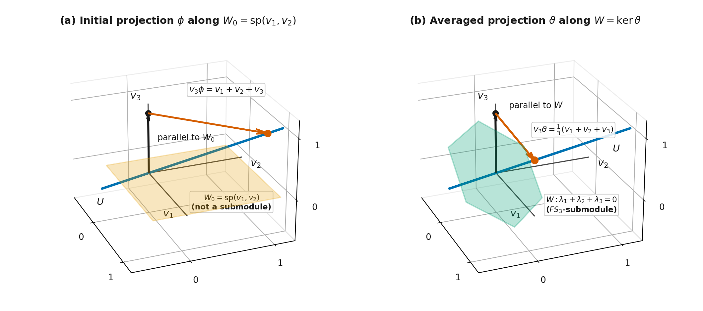

*Figure 13. Averaging a projection in the $3$-dimensional permutation module $V = \operatorname{sp}(v_1, v_2, v_3)$ of $S_3$, where $U = \operatorname{sp}(v_1 + v_2 + v_3)$ is the $1$-dimensional trivial submodule: (a) the initial linear projection $\phi$ onto $U$ along the coordinate plane $W_0 = \operatorname{sp}(v_1, v_2)$, which is not an $FS_3$-submodule, sends $v_3$ parallel to $W_0$ to $v_1 + v_2 + v_3$; (b) the group-averaged projection $\vartheta = \frac{1}{6}\sum_{g \in S_3} g\phi g^{-1}$ projects onto $U$ along the $FS_3$-submodule $W = \ker\vartheta = \{\lambda_1 v_1 + \lambda_2 v_2 + \lambda_3 v_3 : \lambda_1 + \lambda_2 + \lambda_3 = 0\}$, sending $v_3$ parallel to $W$ to $\frac{1}{3}(v_1 + v_2 + v_3)$ and splitting $V = U \oplus W$.*

#### Why Finiteness and the Field Matter, and Complete Reducibility

Two counterexamples show that neither hypothesis in Maschke's theorem can be dropped.

**Worked example: failure in prime characteristic $p \mid |G|$.** Let $p$ be a prime, let $F = \mathbb{F}_p$ be the field of $p$ elements, and let $G = C_p = \langle a : a^p = 1 \rangle$. Define $\rho : C_p \to \mathrm{GL}(2, \mathbb{F}_p)$ by

$$a^j\rho = \begin{pmatrix} 1 & 0 \\ j & 1 \end{pmatrix} \qquad (0 \le j \le p - 1).$$

This map is a homomorphism because $\begin{pmatrix} 1 & 0 \\ j & 1 \end{pmatrix}\begin{pmatrix} 1 & 0 \\ k & 1 \end{pmatrix} = \begin{pmatrix} 1 & 0 \\ j + k & 1 \end{pmatrix}$ and $p = 0$ in $\mathbb{F}_p$. On the corresponding $\mathbb{F}_p C_p$-module $V = \operatorname{sp}(v_1, v_2)$, the generator $a$ acts by $v_1 a = v_1$ and $v_2 a = v_1 + v_2$, so $U = \operatorname{sp}(v_1)$ is a $1$-dimensional $\mathbb{F}_p C_p$-submodule.

Suppose $W = \operatorname{sp}(\alpha v_1 + \beta v_2)$ is any $1$-dimensional $\mathbb{F}_p C_p$-submodule of $V$. Then $(\alpha v_1 + \beta v_2)a = (\alpha + \beta)v_1 + \beta v_2$ must be a scalar multiple $\mu(\alpha v_1 + \beta v_2)$. If $\beta \neq 0$, comparing coefficients of $v_2$ gives $\mu = 1$, and then comparing coefficients of $v_1$ gives $\alpha + \beta = \alpha$, so $\beta = 0$, a contradiction. Thus $\beta = 0$ and $W = \operatorname{sp}(v_1) = U$. Because $U$ is the *only* $1$-dimensional $\mathbb{F}_p C_p$-submodule of $V$, there is no $\mathbb{F}_p C_p$-submodule $W$ with $V = U \oplus W$. How such modules are layered by their radical and socle series, and how they break into indecomposable pieces, is taken up in [the Jacobson radical and Loewy layers](#the-jacobson-radical-and-loewy-layers) and [local rings and the Krull–Schmidt theorem](#local-rings-and-the-krullschmidt-theorem).

**Worked example: failure for an infinite group over $\mathbb{C}$.** Let $G = \left\{\begin{pmatrix} 1 & 0 \\ n & 1 \end{pmatrix} : n \in \mathbb{Z}\right\} \le \mathrm{GL}(2, \mathbb{C})$, which is an infinite cyclic group acting on $V = \mathbb{C}^2$ by right matrix multiplication. By the same calculation on $a = \begin{pmatrix} 1 & 0 \\ 1 & 1 \end{pmatrix}$ as above, $U = \operatorname{sp}((1, 0))$ is the only $1$-dimensional $\mathbb{C}G$-submodule of $V$, so $U$ has no $\mathbb{C}G$-submodule complement in $V$.

An $FG$-module $V$ is **completely reducible** if $V = U_1 \oplus \cdots \oplus U_r$ for some irreducible $FG$-submodules $U_1, \dots, U_r$ of $V$. Applying Maschke's theorem repeatedly splits any reducible module into smaller summands until every piece is irreducible.

**Complete reducibility theorem.** If $G$ is a finite group and $F = \mathbb{R}$ or $\mathbb{C}$, then every non-zero $FG$-module $V$ is completely reducible.

Maschke's theorem also shows that every $FG$-submodule $U$ of an $FG$-module $V$ is a homomorphic image of $V$: writing $V = U \oplus W$, the coordinate projection $\pi : u + w \mapsto u$ is a surjective $FG$-homomorphism from $V$ onto $U$.

### Schur's Lemma, Abelian Groups and the Centre

Once we decompose a module into irreducible summands, what can an $FG$-homomorphism between two irreducible modules look like? By Schur's Lemma, any $FG$-homomorphism $\phi: U_i \to U_j$ between two irreducible $FG$-modules is either the zero map ($\phi = 0$) or an isomorphism ($U_i \cong U_j$). For example, if we have $4$ irreducible submodules $U_1, U_2, U_3, U_4 \subseteq V$ each of dimension $\dim(U_i) = 2$ that are pairwise non-isomorphic ($U_i \not\cong U_j$ for $i \neq j$), no non-zero $FG$-homomorphism can exist between them. We saw earlier that any intersection between $U_k$ and the sum of the others is a submodule that must be either $\{0\}$ or all of $U_k$, non-isomorphism forces a trivial intersection $\left(\bigoplus_{i < k} U_i\right) \cap U_k = \{0\}$, allowing us to take their direct sum $U_1 \oplus U_2 \oplus U_3 \oplus U_4$.

This property holds unconditionally over any field $F$ (even in modular representation theory when $\operatorname{char}(F) \mid \vert{}G\vert{}$), without needing Maschke's Theorem.

From this section onward, we assume that $G$ is a finite group and take the ground field to be $F = \mathbb{C}$. The eigenvalue argument in Schur's lemma requires every linear transformation of a non-zero finite-dimensional vector space to have at least one eigenvalue in the ground field. That holds over $\mathbb{C}$ by the fundamental theorem of algebra, whereas rotation by $90^\circ$ on $\mathbb{R}^2$ has characteristic polynomial $\lambda^2 + 1$ with no real root.

Both parts of [Schur's lemma](#schurs-lemma) are introduced in the earlier notes.

**Homomorphisms between irreducible modules.** If $V$ and $W$ are irreducible $\mathbb{C}G$-modules, then every $\mathbb{C}G$-homomorphism $\vartheta : V \to W$ is either $0$ or a $\mathbb{C}G$-isomorphism, because $V$ and $W$ have no proper non-zero submodules for $\ker\vartheta$ or $\operatorname{Im}\vartheta$ to land on.

**Endomorphisms of an irreducible module.** If $V$ is an irreducible $\mathbb{C}G$-module, then every $\mathbb{C}G$-homomorphism $\vartheta : V \to V$ is a scalar multiple of the identity map $1_V$, that is, $\vartheta = \lambda 1_V$ for some $\lambda \in \mathbb{C}$.

#### The Converse of Schur's Lemma and the Matrix Commutant Test

Over $\mathbb{C}$ for a finite group $G$, the scalar-endomorphism property characterizes irreducibility in both directions.

**Converse of Schur's lemma.** Let $V$ be a non-zero $\mathbb{C}G$-module. If every $\mathbb{C}G$-homomorphism $\vartheta : V \to V$ is of the form $\lambda 1_V$ for some $\lambda \in \mathbb{C}$, then $V$ is irreducible.

The idea is that if $V$ were reducible, Maschke's theorem would split it as $V = U \oplus W$ for non-zero submodules $U$ and $W$, and the coordinate projection onto $U$ along $W$ would be a non-scalar $\mathbb{C}G$-homomorphism.

Choosing a basis $\mathscr{B}$ of $V$ translates $\mathbb{C}G$-endomorphisms into matrices. As shown in [the centralizer algebra of a representation](#the-centralizer-algebra-of-a-representation-operatornameend_mathbbcgv), a linear map $\vartheta$ with matrix $A$ satisfies $(vg)\vartheta = (v\vartheta)g$ if and only if $(g\rho)A = A(g\rho)$, which gives a concrete matrix test for irreducibility.

**Matrix commutant test for irreducibility.** A representation $\rho : G \to \mathrm{GL}(n, \mathbb{C})$ of a finite group $G$ is irreducible if and only if every $n \times n$ complex matrix $A$ satisfying $(g\rho)A = A(g\rho)$ for all $g \in G$ has the form $A = \lambda I_n$ for some $\lambda \in \mathbb{C}$.

**Worked examples: testing reducibility on $C_3$ and irreducibility on $D_{10}$.** Consider first the degree-$2$ representation $\rho$ of $C_3 = \langle a : a^3 = 1 \rangle$ over $\mathbb{C}$ with

$$1\rho = \begin{pmatrix} 1 & 0 \\ 0 & 1 \end{pmatrix}, \qquad a\rho = \begin{pmatrix} 0 & 1 \\ -1 & -1 \end{pmatrix}, \qquad a^2\rho = \begin{pmatrix} -1 & -1 \\ 1 & 0 \end{pmatrix}.$$

Because $C_3$ is abelian, the matrix $A = a\rho$ commutes with $1\rho$, $a\rho$, and $a^2\rho$, and $A$ is not a scalar multiple of $I_2$; by the matrix commutant test, $\rho$ is reducible over $\mathbb{C}$.

Next, let $G = D_{10} = \langle a, b : a^5 = b^2 = 1,\, b^{-1}ab = a^{-1} \rangle$ and let $\omega = e^{2\pi i/5}$. Since $\omega^5 = 1$, we can define a degree-$2$ representation $\rho$ of $D_{10}$ via $a^j b^k \mapsto (a\rho)^j (b\rho)^k$ with

$$a\rho = \begin{pmatrix} \omega & 0 \\ 0 & \omega^{-1} \end{pmatrix}, \qquad b\rho = \begin{pmatrix} 0 & 1 \\ 1 & 0 \end{pmatrix}.$$

Let $A = \begin{pmatrix} \alpha & \beta \\ \gamma & \delta \end{pmatrix}$ be any $2 \times 2$ complex matrix that commutes with $g\rho$ for all $g \in D_{10}$. Commuting with $a\rho$ gives

$$\begin{pmatrix} \omega & 0 \\ 0 & \omega^{-1} \end{pmatrix} \begin{pmatrix} \alpha & \beta \\ \gamma & \delta \end{pmatrix} = \begin{pmatrix} \alpha & \beta \\ \gamma & \delta \end{pmatrix} \begin{pmatrix} \omega & 0 \\ 0 & \omega^{-1} \end{pmatrix} \implies \begin{pmatrix} \omega\alpha & \omega\beta \\ \omega^{-1}\gamma & \omega^{-1}\delta \end{pmatrix} = \begin{pmatrix} \omega\alpha & \omega^{-1}\beta \\ \omega\gamma & \omega^{-1}\delta \end{pmatrix}.$$

Because $\omega \neq \omega^{-1}$, equating the off-diagonal entries forces $\beta = \gamma = 0$. Commuting with $b\rho$ then gives

$$\begin{pmatrix} 0 & 1 \\ 1 & 0 \end{pmatrix} \begin{pmatrix} \alpha & 0 \\ 0 & \delta \end{pmatrix} = \begin{pmatrix} \alpha & 0 \\ 0 & \delta \end{pmatrix} \begin{pmatrix} 0 & 1 \\ 1 & 0 \end{pmatrix} \implies \begin{pmatrix} 0 & \delta \\ \alpha & 0 \end{pmatrix} = \begin{pmatrix} 0 & \alpha \\ \delta & 0 \end{pmatrix}.$$

Hence $\alpha = \delta$ and $A = \alpha I_2$. By the matrix commutant test, $\rho$ is irreducible.

#### Irreducible Representations of Finite Abelian Groups and Diagonalization

When $G$ is abelian, right multiplication by a fixed element $x \in G$ commutes with the action of every $g \in G$, which allows Schur's lemma to collapse every irreducible $\mathbb{C}G$-module to dimension $1$.

**Dimension of irreducible modules for abelian groups.** If $G$ is a finite abelian group, then every irreducible $\mathbb{C}G$-module $V$ has dimension $1$.

Because multiplication by $x \in G$ is a $\mathbb{C}G$-homomorphism on $V$, Schur's lemma forces every $x \in G$ to act as a scalar multiple of the identity, so every vector subspace of $V$ is a $\mathbb{C}G$-submodule and an irreducible module can only have dimension $1$.

By the structure theorem for finite abelian groups from algebra, any finite abelian group $G$ is isomorphic to a direct product of cyclic groups:

$$G \cong C_{n_1} \times C_{n_2} \times \cdots \times C_{n_r}.$$

Here $C_{n_k} = \langle g_k : g_k^{n_k} = 1 \rangle$, so every element of $G$ has a unique expression $g_1^{i_1} \cdots g_r^{i_r}$ with $0 \le i_k < n_k$, and $|G| = n_1 n_2 \cdots n_r$. In any $1$-dimensional representation $\rho : G \to \mathrm{GL}(1, \mathbb{C})$, each generator $g_k$ maps to a $1 \times 1$ matrix $(\lambda_k)$ satisfying $(\lambda_k^{n_k}) = (g_k\rho)^{n_k} = (g_k^{n_k})\rho = 1\rho = (1)$, so $\lambda_k$ is an $n_k$-th root of unity in $\mathbb{C}$.

Conversely, for each of the $n_1 n_2 \cdots n_r = |G|$ choices of $(\lambda_1, \dots, \lambda_r)$ with $\lambda_k^{n_k} = 1$, define $\rho_{\lambda_1, \dots, \lambda_r} : G \to \mathrm{GL}(1, \mathbb{C})$ by

$$(g_1^{i_1} \cdots g_r^{i_r})\rho_{\lambda_1, \dots, \lambda_r} = (\lambda_1^{i_1} \cdots \lambda_r^{i_r}) \qquad (0 \le i_k < n_k).$$

This map is a degree-$1$ representation of $G$, and is therefore irreducible. Because two degree-$1$ representations are equivalent if and only if they are equal, and $g_k\rho_{\lambda_1, \dots, \lambda_r} = (\lambda_k)$, these $|G|$ representations are pairwise inequivalent and form the complete list of irreducible representations of $G$ over $\mathbb{C}$ up to equivalence.

**Worked examples: $C_n$ and the Klein four-group $C_2 \times C_2$.** For the cyclic group $C_n = \langle a : a^n = 1 \rangle$, let $\omega = e^{2\pi i/n}$; the $n$ inequivalent irreducible representations of $C_n$ over $\mathbb{C}$ are $\rho_m : a^k \mapsto (\omega^{mk})$ for $0 \le m \le n - 1$. For the Klein four-group $G = C_2 \times C_2 = \{1, g_1, g_2, g_1 g_2\}$ ($g_1^2 = g_2^2 = 1$, $g_1 g_2 = g_2 g_1$), the square roots of $1$ are $\pm 1$, giving four non-isomorphic $1$-dimensional irreducible $\mathbb{C}G$-modules $V_1, V_2, V_3, V_4$:

| Module | Action of $1$ | Action of $g_1$ | Action of $g_2$ | Action of $g_1 g_2$ |
|:------ |:-------------:|:---------------:|:---------------:|:-------------------:|
| $V_1$  | $v \mapsto v$ | $v \mapsto v$   | $v \mapsto v$   | $v \mapsto v$       |
| $V_2$  | $v \mapsto v$ | $v \mapsto v$   | $v \mapsto -v$  | $v \mapsto -v$      |
| $V_3$  | $v \mapsto v$ | $v \mapsto -v$  | $v \mapsto v$   | $v \mapsto -v$      |
| $V_4$  | $v \mapsto v$ | $v \mapsto -v$  | $v \mapsto -v$  | $v \mapsto v$       |

Even when a finite group $G$ is non-abelian, the cyclic subgroup $H = \langle g \rangle$ generated by a single element $g \in G$ of order $n$ is abelian. Viewing any $\mathbb{C}G$-module $V$ as a $\mathbb{C}H$-module by restricting the action to $H$, complete reducibility decomposes $V = U_1 \oplus \cdots \oplus U_r$ into irreducible $\mathbb{C}H$-submodules $U_j$. Because $H$ is abelian, each $U_j$ has dimension $1$, say $U_j = \operatorname{sp}(v_j)$, and $g$ acts on $v_j$ by an $n$-th root of unity $\omega^{m_j}$ ($\omega = e^{2\pi i/n}$). In the basis $\mathscr{B} = \{v_1, \dots, v_r\}$ of $V$, the matrix of $g$ is therefore diagonal:

$$[g]_{\mathscr{B}} = \begin{pmatrix} \omega^{m_1} & 0 & \cdots & 0 \\ 0 & \omega^{m_2} & \cdots & 0 \\ \vdots & \vdots & \ddots & \vdots \\ 0 & 0 & \cdots & \omega^{m_r} \end{pmatrix}.$$

Thus every individual group element $g \in G$ of order $n$ can be diagonalized in a suitable basis of $V$, and all of its eigenvalues are $n$-th roots of unity.

#### The Centre of the Group Algebra and the Centre of the Group

Recall from [the centre of the group algebra](#the-centre-of-the-group-algebra-zmathbbcg) and [centralizers and the center](#centralizers-and-the-center) that the centre of the group algebra $\mathbb{C}G$ is the subalgebra $Z(\mathbb{C}G) = \{z \in \mathbb{C}G : zr = rz \text{ for all } r \in \mathbb{C}G\}$, while the centre of the group is $Z(G) = \{z \in G : zg = gz \text{ for all } g \in G\} \subseteq Z(\mathbb{C}G)$.

**Worked example: normal subgroup sums in $Z(\mathbb{C}G)$ and $Z(\mathbb{C}D_6)$.** If $H$ is any normal subgroup of $G$, then the sum $z = \sum_{h \in H} h$ belongs to $Z(\mathbb{C}G)$: for every $g \in G$, conjugation by $g$ permutes the elements of $H = g^{-1}Hg$, so $g^{-1}zg = \sum_{h \in H} g^{-1}hg = \sum_{h' \in H} h' = z$, which gives $zg = gz$ for all $g \in G$ and hence $zr = rz$ for all $r \in \mathbb{C}G$. In $D_6 = \langle a, b : a^3 = b^2 = 1,\, b^{-1}ab = a^{-1} \rangle$, the normal subgroups $\{1\}$, $\langle a \rangle = \{1, a, a^2\}$, and $D_6$ produce the central elements $1$, $1 + a + a^2$, and $1 + a + a^2 + b + ab + a^2b$ in $Z(\mathbb{C}D_6)$.

If $V$ is an irreducible $\mathbb{C}G$-module and $z \in Z(\mathbb{C}G)$, then the map $\vartheta_z : v \mapsto vz$ satisfies $(vg)\vartheta_z = v(gz) = v(zg) = (vz)g = (v\vartheta_z)g$ for all $g \in G$, so $\vartheta_z$ is a $\mathbb{C}G$-homomorphism. By Schur's lemma, there is a scalar $\lambda_z \in \mathbb{C}$ such that

$$vz = \lambda_z v \qquad \text{for all } v \in V.$$

This scalar action leads to two structural theorems stated in [Schur's lemma](#schurs-lemma).

**Faithful irreducible module implies $Z(G)$ is cyclic.** If a finite group $G$ has a faithful irreducible $\mathbb{C}G$-module $V$, then the centre $Z(G)$ is cyclic.

Because each central element $z \in Z(G)$ acts on $V$ by a non-zero scalar $\lambda_z \in \mathbb{C}^*$ and $V$ is faithful, the map $z \mapsto \lambda_z$ embeds $Z(G)$ as a finite subgroup of the multiplicative group $\mathbb{C}^*$, and every finite subgroup of $\mathbb{C}^*$ is cyclic. In particular, a group whose centre is not cyclic, such as $C_2 \times C_2$ or $D_8 \times C_2$, has no faithful irreducible representation over $\mathbb{C}$.

**All irreducible $\mathbb{C}G$-modules have dimension $1$ if and only if $G$ is abelian.** A finite group $G$ is abelian if and only if every irreducible $\mathbb{C}G$-module has dimension $1$.

In the reverse direction, if every irreducible $\mathbb{C}G$-module has dimension $1$, then decomposing the faithful regular module $\mathbb{C}G$ into $1$-dimensional submodules diagonalizes every group element simultaneously, and since diagonal matrices commute, $G$ must be abelian.

### Characters, Roots of Unity and Kernels

An $n$-dimensional representation assigns an $n \times n$ matrix of $n^2$ numbers to each group element, and changing the basis changes all $n^2$ entries. Taking the trace collapses each matrix to a single basis-independent complex number $\chi(g)$ from which we can still read off the dimension of the module, the eigenvalues of involutions, and the kernel of the representation.

We recall from [character tables, isomorphism and grouping into multiplicities](#character-tables-isomorphism-and-grouping-into-multiplicities) that the trace of an $n \times n$ matrix $A = (a_{ij})$ is $\operatorname{tr} A = \sum_{i=1}^n a_{ii}$, and that the character $\chi$ of a $\mathbb{C}G$-module $V$ with basis $\mathscr{B}$ (or of the representation $\rho : g \mapsto [g]_{\mathscr{B}}$) is the function $\chi : G \to \mathbb{C}$ defined by $\chi(g) = \operatorname{tr}[g]_{\mathscr{B}}$.

#### Trace Identities, Character Degree and Linear Characters

For any $n \times n$ matrices $A = (a_{ij})$, $B = (b_{ij})$ and any invertible matrix $T \in \mathrm{GL}(n, \mathbb{C})$, the trace satisfies three identities:

$$\operatorname{tr}(A + B) = \operatorname{tr} A + \operatorname{tr} B, \qquad \operatorname{tr}(AB) = \operatorname{tr}(BA), \qquad \operatorname{tr}(T^{-1}AT) = \operatorname{tr} A.$$

Note that $\operatorname{tr}(AB) \neq (\operatorname{tr} A)(\operatorname{tr} B)$ in general: for $A = \begin{pmatrix} 1 & 0 \\ 0 & 0 \end{pmatrix}$ and $B = \begin{pmatrix} 0 & 0 \\ 0 & 1 \end{pmatrix}$, we have $\operatorname{tr}(AB) = 0 \neq 1 = (\operatorname{tr} A)(\operatorname{tr} B)$.

From $\operatorname{tr}(T^{-1}AT) = \operatorname{tr} A$, two consequences follow at once.

**Don't be confused.** In representation theory, the noun "character" is simply shorthand for **"character function."**

Formally, the character of an $FG$-module $V$ is the function $\chi_V: G \to F$ defined by mapping each group element $g \in G$ to the trace of its action: $\chi_V(g) = \operatorname{tr}([g]_{\mathscr{B}})$

The slight ambiguity in how textbooks use the word comes down to whether they are referring to the **whole map** or a **single evaluated output**. $\chi_V$ (the Character / Character Function) is the entire map $G \to F$ (i.e., the full list of traces across all $g \in G$, or across each conjugacy class since conjugate elements share the same trace). This is why a row in a character table is called "a character." Whereas $\chi_V(g)$ (The Character Value at $g$) is the specific scalar in $F$ obtained when you evaluate that function at a single group element $g$. Some authors casually call $\chi_V(g)$ "the character of $g$," though "character value" is more precise.

**Isomorphic modules have the same character.** If $V \cong W$, their matrices in any bases $\mathscr{B}, \mathscr{B}'$ satisfy $[g]_{\mathscr{B}'} = T^{-1}[g]_{\mathscr{B}}T$, so $\operatorname{tr}[g]_{\mathscr{B}'} = \operatorname{tr}[g]_{\mathscr{B}}$ for all $g \in G$. In particular, $\chi(g)$ does not depend on the choice of basis $\mathscr{B}$ of $V$.

**Characters are constant on conjugacy classes.** If $x, y \in G$ are conjugate in $G$, say $y = g^{-1}xg$ ([centralizers and the center](#centralizers-and-the-center)), then $[y]_{\mathscr{B}} = [g]_{\mathscr{B}}^{-1}[x]_{\mathscr{B}}[g]_{\mathscr{B}}$, so $\chi(y) = \chi(g^{-1}xg) = \chi(x)$.

**Worked examples: characters of $D_8$, $S_3$, $C_3$, and $D_6$.** Taking the traces of the matrices computed in earlier sections gives four examples of characters.

For the degree-$2$ representation of $D_8 = \langle a, b : a^4 = b^2 = 1,\, b^{-1}ab = a^{-1} \rangle$ from the first section, taking the diagonal sums of the eight matrices $g\rho$ gives:

| $g$       | $1$ | $a$ | $a^2$ | $a^3$ | $b$ | $ab$ | $a^2b$ | $a^3b$ |
|:--------- |:---:|:---:|:-----:|:-----:|:---:|:----:|:------:|:------:|
| $\chi(g)$ | $2$ | $0$ | $-2$  | $0$   | $0$ | $0$  | $0$    | $0$    |

On the $3$-dimensional permutation module $V = \operatorname{sp}(v_1, v_2, v_3)$ of $S_3$, the $i$-th diagonal entry of $[g]_{\mathscr{B}}$ is $1$ if $ig = i$ and $0$ otherwise, so $\chi(g)$ counts the points fixed by $g$:

| $g$       | $1$ | $(1\,2)$ | $(1\,3)$ | $(2\,3)$ | $(1\,2\,3)$ | $(1\,3\,2)$ |
|:--------- |:---:|:--------:|:--------:|:--------:|:-----------:|:-----------:|
| $\chi(g)$ | $3$ | $1$      | $1$      | $1$      | $0$         | $0$         |

For $C_3 = \langle a : a^3 = 1 \rangle$ with $\omega = e^{2\pi i/3}$, the three $1$-dimensional irreducible representations give the three irreducible characters $\chi_1 = (1, 1, 1)$, $\chi_2 = (1, \omega, \omega^2)$, and $\chi_3 = (1, \omega^2, \omega)$ on $(1, a, a^2)$.

For $D_6 = \langle a, b : a^3 = b^2 = 1,\, b^{-1}ab = a^{-1} \rangle \cong S_3$, let $\omega = e^{2\pi i/3}$, so that $\omega + \omega^{-1} = -1$. As the degree-sum formula $\sum d_i^2 = |G|$ will confirm below via $1^2 + 1^2 + 2^2 = 6$, the complete list of non-isomorphic irreducible representations of $D_6$ consists of the trivial representation $\rho_1 : g \mapsto (1)$, the sign representation $\rho_2 : a^j b^k \mapsto ((-1)^k)$, and the degree-$2$ representation $\rho_3$ given by $a\rho_3 = \begin{pmatrix} \omega & 0 \\ 0 & \omega^{-1} \end{pmatrix}$ and $b\rho_3 = \begin{pmatrix} 0 & 1 \\ 1 & 0 \end{pmatrix}$. Their characters $\chi_1, \chi_2, \chi_3$ on the six elements of $D_6$ are:

| Character | $1$ | $a$  | $a^2$ | $b$  | $ab$ | $a^2b$ |
|:--------- |:---:|:----:|:-----:|:----:|:----:|:------:|
| $\chi_1$  | $1$ | $1$  | $1$   | $1$  | $1$  | $1$    |
| $\chi_2$  | $1$ | $1$  | $1$   | $-1$ | $-1$ | $-1$   |
| $\chi_3$  | $2$ | $-1$ | $-1$  | $0$  | $0$  | $0$    |

Because $[1]_{\mathscr{B}} = I_{\dim V}$, the value of a character $\chi$ at the identity element $1 \in G$ is always the dimension of the module, $\chi(1) = \dim V$, which is called the **degree** of $\chi$ and equals the degree of the corresponding representation. A character of degree $1$ is called a **linear character**. Since the trace of a $1 \times 1$ matrix $(\lambda)$ is $\lambda$ itself, a linear character $\chi : G \to \mathbb{C}^*$ is a group homomorphism satisfying $\chi(gh) = \chi(g)\chi(h)$, whereas for $\chi(1) > 1$ a character is *not* a homomorphism. The character $1_G$ of the trivial representation, defined by $1_G(g) = 1$ for all $g \in G$, is called the **trivial character** of $G$.

#### Character Values, Involutions, Kernels and Conjugate Characters

Diagonalizing the matrix $[g]_{\mathscr{B}}$ of an element $g \in G$ of order $m$ reveals the arithmetic structure of $\chi(g)$.

**Properties of character values.** Let $V$ be a $\mathbb{C}G$-module of dimension $n$ with character $\chi$, and let $g \in G$ have order $m$. Then $\chi(1) = n = \dim V$, and $\chi(g) = \omega_1 + \cdots + \omega_n$ for some $m$-th roots of unity $\omega_1, \dots, \omega_n$ in $\mathbb{C}$. Moreover, $\chi(g^{-1}) = \overline{\chi(g)}$ is the complex conjugate of $\chi(g)$, so $\chi(g) \in \mathbb{R}$ whenever $g$ is conjugate to $g^{-1}$ in $G$. In particular, if $g$ has order $2$ (an involution), then $\chi(g)$ is an integer and $\chi(g) \equiv \chi(1) \pmod 2$.

In a basis that diagonalizes $g$, the diagonal entries of $[g]_{\mathscr{B}}$ are $m$-th roots of unity $\omega_1, \dots, \omega_n$ on the unit circle, and the diagonal entries of $[g^{-1}]_{\mathscr{B}} = [g]_{\mathscr{B}}^{-1}$ are their inverses $\omega_k^{-1} = \overline{\omega_k}$. When $g$ has order $2$, each eigenvalue $\omega_k$ is $+1$ or $-1$, and flipping a $+1$ to a $-1$ changes the sum by $2$, preserving the parity of $\chi(1)$.

Next, how large can $|\chi(g)|$ be, and when does it reach its upper bound $\chi(1)$?

**Triangle-inequality bound and the kernel of a character.** Let $\rho : G \to \mathrm{GL}(n, \mathbb{C})$ be a representation with character $\chi$. For every $g \in G$, we have $|\chi(g)| \le \chi(1)$, with

$$|\chi(g)| = \chi(1) \iff g\rho = \lambda I_n \text{ for some } \lambda \in \mathbb{C}, \qquad \text{and} \qquad \chi(g) = \chi(1) \iff g\rho = I_n.$$

Because $\chi(g) = \omega_1 + \cdots + \omega_n$ is a sum of $n = \chi(1)$ complex numbers of unit length, its modulus is at most $n$, with equality $|\chi(g)| = \chi(1)$ only when all $n$ eigenvalues point in the same direction ($\omega_1 = \cdots = \omega_n = \lambda$, so $g\rho = \lambda I_n$). In particular, $\chi(g) = \chi(1)$ holds only when every eigenvalue equals $1$, which means $g\rho = I_n$.

This theorem shows that the kernel of a representation $\rho$ can be read directly off its character $\chi$. We define the kernel of $\chi$ to be

$$\ker\chi := \{g \in G : \chi(g) = \chi(1)\} = \ker\rho \trianglelefteq G.$$

We say that $\chi$ is a **faithful character** if $\ker\chi = \{1\}$. For any character $\chi$, the set $\ker\chi$ already exhibits a normal subgroup of $G$ without writing any matrices.

**Worked examples: reading kernels and scalar matrices from characters of $D_6$ and $D_8$.** For the three irreducible characters $\chi_1, \chi_2, \chi_3$ of $D_6 = \{1, a, a^2, b, ab, a^2b\}$ tabulated above, reading the columns where $\chi_i(g) = \chi_i(1)$ gives the three normal subgroups $\ker\chi_1 = D_6$, $\ker\chi_2 = \{1, a, a^2\} = \langle a \rangle$, and $\ker\chi_3 = \{1\}$, so $\chi_3$ is faithful. For the degree-$2$ character $\chi = (2, 0, -2, 0, 0, 0, 0, 0)$ of $D_8$ on $(1, a, a^2, a^3, b, ab, a^2b, a^3b)$, the only element with $\chi(g) = 2$ is $g = 1$, so $\ker\chi = \{1\}$ and $\chi$ is faithful. Furthermore, $|\chi(a^2)| = |-2| = 2 = \chi(1)$, which tells us without inspecting the matrices that $a^2\rho = -I_2$ in *every* representation $\rho$ with character $\chi$. [Figure 14](#figure-14) shows the eigenvalue vectors on the unit circle for these cases.

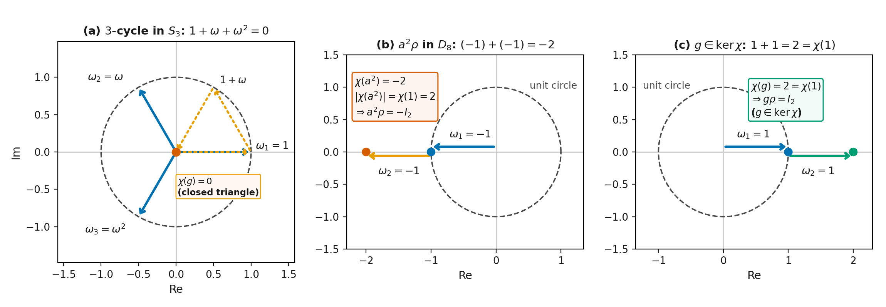

*Figure 14. Eigenvalues of $g\rho$ on the unit circle in $\mathbb{C}$ and their head-to-tail sum $\chi(g) = \omega_1 + \cdots + \omega_n$: (a) for a $3$-cycle $g = (1\,2\,3)$ on the $3$-dimensional permutation module of $S_3$, the eigenvalues $1, \omega, \omega^2$ ($\omega = e^{2\pi i/3}$) form a closed equilateral triangle summing to $\chi(g) = 0 < 3 = \chi(1)$; (b) for $a^2$ in the degree-$2$ representation $\rho$ of $D_8$, both eigenvalues equal $-1$ and align to give $\chi(a^2) = -2$, reaching $\lvert\chi(a^2)\rvert = 2 = \chi(1)$ with $a^2\rho = -I_2$; (c) at $g = 1$ (or any $g \in \ker\chi = \ker\rho$), all eigenvalues equal $+1$ and sum to $\chi(g) = \chi(1) = 2$, so $g\rho = I_2$.*

Finally, if $\chi$ is the character of a representation $\rho : G \to \mathrm{GL}(n, \mathbb{C})$, then its pointwise complex conjugate $\bar{\chi} : G \to \mathbb{C}$ defined by $\bar{\chi}(g) = \overline{\chi(g)}$ is the character of the complex conjugate representation $g \mapsto \overline{g\rho}$, and is called the **complex conjugate character** of $\chi$. Moreover, $\bar{\chi}$ is irreducible if and only if $\chi$ is irreducible.

#### The Regular Character and the Subtracted Permutation Character

If $V = U_1 \oplus \cdots \oplus U_r$ is a direct sum of $\mathbb{C}G$-submodules $U_1, \dots, U_r$ with characters $\chi_1, \dots, \chi_r$, then in a basis $\mathscr{B} = \mathscr{B}_1 \cup \cdots \cup \mathscr{B}_r$ adapted to the direct sum, $[g]_{\mathscr{B}}$ is block-diagonal with blocks $[g]_{\mathscr{B}_1}, \dots, [g]_{\mathscr{B}_r}$, so the trace adds across the blocks:

$$\chi_V(g) = \chi_1(g) + \cdots + \chi_r(g) \qquad (g \in G).$$

We call the character $\chi_{\mathrm{reg}}$ of the regular $\mathbb{C}G$-module $\mathbb{C}G$ the **regular character** of $G$. To evaluate $\chi_{\mathrm{reg}}$ directly, take the natural basis $\mathscr{B} = \{g_1, \dots, g_n\}$ of $\mathbb{C}G$. When $g = 1$, right multiplication by $g$ fixes all $|G|$ basis elements, so $\chi_{\mathrm{reg}}(1) = |G|$. When $g \neq 1$, we have $g_j g \neq g_j$ for every $j$, so every diagonal entry of $[g]_{\mathscr{B}}$ is $0$ and $\chi_{\mathrm{reg}}(g) = 0$.

On the other hand, we use the structural decomposition of the regular module stated in [character tables, isomorphism and grouping into multiplicities](#character-tables-isomorphism-and-grouping-into-multiplicities): every irreducible $\mathbb{C}G$-module is isomorphic to a submodule of $\mathbb{C}G$. More precisely, if $V_1, \dots, V_k$ is a complete set of non-isomorphic irreducible $\mathbb{C}G$-modules with characters $\chi_1, \dots, \chi_k$, then each $V_i$ occurs in $\mathbb{C}G$ with multiplicity equal to its dimension $d_i = \dim V_i = \chi_i(1)$, so $\mathbb{C}G \cong \bigoplus_{i=1}^k V_i^{\oplus d_i}$ and $\sum_{i=1}^k d_i^2 = |G|$. Taking characters on both sides gives two descriptions of $\chi_{\mathrm{reg}}$:

$$\chi_{\mathrm{reg}} = \sum_{i=1}^k \chi_i(1)\chi_i, \qquad \chi_{\mathrm{reg}}(1) = |G|, \qquad \chi_{\mathrm{reg}}(g) = 0 \quad \text{for all } g \neq 1.$$

**Worked example: checking $\chi_{\mathrm{reg}}$ on $D_6$.** For $D_6$, the three irreducible characters $\chi_1, \chi_2, \chi_3$ have degrees $1, 1, 2$, and forming $\chi_1(1)\chi_1 + \chi_2(1)\chi_2 + \chi_3(1)\chi_3 = \chi_1 + \chi_2 + 2\chi_3$ on $(1, a, a^2, b, ab, a^2b)$ gives

$$(1 + 1 + 4,\; 1 + 1 - 2,\; 1 + 1 - 2,\; 1 - 1 + 0,\; 1 - 1 + 0,\; 1 - 1 + 0) = (6, 0, 0, 0, 0, 0) = \chi_{\mathrm{reg}}.$$

More generally, for any permutation group $G \le S_n$ acting on the permutation module $V = \operatorname{sp}(v_1, \dots, v_n)$, the character $\pi$ of $V$ is called the **permutation character** of $G$ on $\{1, \dots, n\}$. As noted in [character tables, isomorphism and grouping into multiplicities](#character-tables-isomorphism-and-grouping-into-multiplicities), the $i$-th diagonal entry of $[g]_{\mathscr{B}}$ is $1$ if $ig = i$ and $0$ otherwise, so $\pi(g) = |\operatorname{fix}(g)| = |\{i \in \{1, \dots, n\} : ig = i\}|$. Because $U = \operatorname{sp}(v_1 + \cdots + v_n)$ is a $1$-dimensional trivial $\mathbb{C}G$-submodule of $V$ with character $1_G$, Maschke's theorem splits $V = U \oplus W$ for an $(n - 1)$-dimensional $\mathbb{C}G$-submodule $W$, namely the zero-sum submodule $W = \{\sum_{i=1}^n \lambda_i v_i : \sum_{i=1}^n \lambda_i = 0\}$. By additivity of characters on direct sums, $\pi = 1_G + \chi_W$. Thus the subtracted function

$$\nu(g) := |\operatorname{fix}(g)| - 1 \qquad (g \in G)$$

is always a character of $G$, equal to the character $\chi_W$ of $W$.

**Worked examples: permutation characters of $S_4$ and $A_4$.** The symmetric group $S_4$ has five conjugacy classes (one for each cycle type), with representatives $1$, $(1\,2)$, $(1\,2\,3)$, $(1\,2)(3\,4)$, and $(1\,2\,3\,4)$. Counting fixed points in $\{1, 2, 3, 4\}$ gives the permutation character $\pi$ and the subtracted character $\nu = \pi - 1_{S_4}$:

| Conjugacy class representative $g$               | $1$ | $(1\,2)$ | $(1\,2\,3)$ | $(1\,2)(3\,4)$ | $(1\,2\,3\,4)$ |
|:------------------------------------------------ |:---:|:--------:|:-----------:|:--------------:|:--------------:|
| $\pi(g) = \lvert\operatorname{fix}(g)\rvert$     | $4$ | $2$      | $1$         | $0$            | $0$            |
| $\nu(g) = \lvert\operatorname{fix}(g)\rvert - 1$ | $3$ | $1$      | $0$         | $-1$           | $-1$           |

Now restrict to the alternating group $A_4 \le S_4$. It has four conjugacy classes with representatives $g_1 = 1$, $g_2 = (1\,2)(3\,4)$, $g_3 = (1\,2\,3)$, and $g_4 = (1\,3\,2)$, of sizes $1, 3, 4, 4$ and centralizer orders $|C_{A_4}(g_i)| = 12 / |g_i^{A_4}| = 12, 4, 3, 3$. On these four classes, the character $\nu(g) = |\operatorname{fix}(g)| - 1$ of the $3$-dimensional zero-sum $\mathbb{C}A_4$-module $W$ takes the values:

| Representative $g_i$                                 | $1$ | $(1\,2)(3\,4)$ | $(1\,2\,3)$ | $(1\,3\,2)$ |
|:---------------------------------------------------- |:---:|:--------------:|:-----------:|:-----------:|
| $\nu(g_i) = \lvert\operatorname{fix}(g_i)\rvert - 1$ | $3$ | $-1$           | $0$         | $0$         |

### Inner Products of Characters and Module Decomposition

Why do the irreducible characters of $G$ form an orthonormal set under the inner product $\langle \chi, \psi \rangle$, how does that single theorem ensure that two $\mathbb{C}G$-modules with the same character are isomorphic, and how can we use characters to write down explicit projection operators that decompose a given module into submodules?

The character inner product $\langle \chi, \psi \rangle = \frac{1}{|G|}\sum_{g \in G} \chi(g)\overline{\psi(g)}$, the orthonormality relation $\langle \chi_i, \chi_j \rangle = \delta_{ij}$, the multiplicity formula $d_i = \langle \psi, \chi_i \rangle$, and the irreducibility test $\langle \psi, \psi \rangle = 1$ were stated in [Schur's lemma](#schurs-lemma). Here we establish the inner product space of functions on $G$, connect the orthonormality of irreducible characters to central idempotents in $\mathbb{C}G$, and use it to decompose characters, homomorphism spaces, and modules.

#### The Inner Product Space of Functions on a Group

The set of all functions from $G$ to $\mathbb{C}$ is a complex vector space of dimension $|G|$ under pointwise addition and scalar multiplication, $(\vartheta + \phi)(g) = \vartheta(g) + \phi(g)$ and $(\lambda\vartheta)(g) = \lambda(\vartheta(g))$ for $g \in G$ and $\lambda \in \mathbb{C}$. On this vector space, define the pairing

$$\langle \vartheta, \phi \rangle = \frac{1}{|G|} \sum_{g \in G} \vartheta(g)\overline{\phi(g)}.$$

This pairing satisfies the three axioms of a complex inner product. First, it is conjugate-symmetric: $\langle \vartheta, \phi \rangle = \overline{\langle \phi, \vartheta \rangle}$ for all $\vartheta, \phi$. Second, it is linear in the first argument, $\langle \lambda_1\vartheta_1 + \lambda_2\vartheta_2, \phi \rangle = \lambda_1\langle \vartheta_1, \phi \rangle + \lambda_2\langle \vartheta_2, \phi \rangle$ for all $\lambda_1, \lambda_2 \in \mathbb{C}$, and therefore conjugate-linear in the second argument, $\langle \phi, \lambda_1\vartheta_1 + \lambda_2\vartheta_2 \rangle = \overline{\lambda_1}\langle \phi, \vartheta_1 \rangle + \overline{\lambda_2}\langle \phi, \vartheta_2 \rangle$. Third, it is positive-definite: $\langle \vartheta, \vartheta \rangle = \frac{1}{|G|}\sum_{g \in G} |\vartheta(g)|^2 > 0$ whenever $\vartheta \neq 0$.

**Worked example: inner products of functions on $C_3$.** Let $G = C_3 = \{1, a, a^2\}$ and define $\vartheta, \phi : C_3 \to \mathbb{C}$ by the row vectors $\vartheta = (2, i, -1)$ and $\phi = (1, 1, 1)$ on $(1, a, a^2)$. Then $\vartheta + \phi = (3, 1 + i, 0)$, $3\vartheta = (6, 3i, -3)$, and

$$\langle \vartheta, \phi \rangle = \frac{1}{3}(2 \cdot 1 + i \cdot 1 + (-1) \cdot 1) = \frac{1}{3}(1 + i), \qquad \langle \vartheta, \vartheta \rangle = \frac{1}{3}(2 \cdot 2 + i \cdot (-i) + (-1) \cdot (-1)) = 2, \qquad \langle \phi, \phi \rangle = \frac{1}{3}(1 + 1 + 1) = 1.$$

When $\chi$ and $\psi$ are characters of $G$, two simplifications occur. First, because $\overline{\psi(g)} = \psi(g^{-1})$ and $g^{-1}$ runs over $G$ as $g$ runs over $G$, we have

$$\langle \chi, \psi \rangle = \frac{1}{|G|} \sum_{g \in G} \chi(g)\psi(g^{-1}) = \frac{1}{|G|} \sum_{g \in G} \chi(g^{-1})\psi(g) = \langle \psi, \chi \rangle.$$

Since $\langle \psi, \chi \rangle = \overline{\langle \chi, \psi \rangle}$, the inner product $\langle \chi, \psi \rangle$ of any two characters is a real number. Second, because characters are constant on conjugacy classes, we can group the sum over the $l$ conjugacy classes $g_1^G, \dots, g_l^G$ of $G$ with representatives $g_1, \dots, g_l$. Using the orbit-stabilizer relation $|g_i^G| = |G| / |C_G(g_i)|$ ([centralizers and the center](#centralizers-and-the-center)) gives

$$\langle \chi, \psi \rangle = \frac{1}{|G|} \sum_{i=1}^l \sum_{g \in g_i^G} \chi(g)\overline{\psi(g)} = \sum_{i=1}^l \frac{|g_i^G|}{|G|} \chi(g_i)\overline{\psi(g_i)} = \sum_{i=1}^l \frac{\chi(g_i)\overline{\psi(g_i)}}{|C_G(g_i)|}.$$

**Fact we use (the character table of $A_4$).** On $A_4$, with conjugacy class representatives $g_1 = 1$, $g_2 = (1\,2)(3\,4)$, $g_3 = (1\,2\,3)$, and $g_4 = (1\,3\,2)$ and centralizer orders $|C_{A_4}(g_i)| = 12, 4, 3, 3$, let $\omega = e^{2\pi i/3}$, so that $\bar{\omega} = \omega^2$, $\overline{\omega^2} = \omega$, and $1 + \omega + \omega^2 = 0$. Composing the quotient map $A_4 \to A_4 / V_4 \cong C_3$, where $V_4 = \{1, (1\,2)(3\,4), (1\,3)(2\,4), (1\,4)(2\,3)\} \trianglelefteq A_4$, with the three linear characters of $C_3$ gives three $1$-dimensional irreducible characters $\chi_1 = 1_{A_4}$, $\chi_2 = \chi$, and $\chi_3 = \bar{\chi}$ of $A_4$. The $3$-dimensional zero-sum character $\nu = (3, -1, 0, 0)$ from the previous section is the fourth irreducible character $\chi_4 = \nu$, with $1 + 1 + 1 + 9 = 12 = |A_4|$. Recording $\chi_1, \chi_2, \chi_3, \chi_4$ together with the reducible character $\psi = \chi_3 + \chi_4 = (4, 0, \omega^2, \omega)$ gives:

| Representative $g_i$        | $g_1 = 1$ | $g_2 = (1\,2)(3\,4)$ | $g_3 = (1\,2\,3)$ | $g_4 = (1\,3\,2)$ |
|:--------------------------- |:---------:|:--------------------:|:-----------------:|:-----------------:|
| $\lvert C_{A_4}(g_i)\rvert$ | $12$      | $4$                  | $3$               | $3$               |
| $\chi_1 = 1_{A_4}$          | $1$       | $1$                  | $1$               | $1$               |
| $\chi = \chi_2$             | $1$       | $1$                  | $\omega$          | $\omega^2$        |
| $\bar{\chi} = \chi_3$       | $1$       | $1$                  | $\omega^2$        | $\omega$          |
| $\nu = \chi_4$              | $3$       | $-1$                 | $0$               | $0$               |
| $\psi = \chi_3 + \chi_4$    | $4$       | $0$                  | $\omega^2$        | $\omega$          |

**Worked example: inner products of characters of $A_4$.** Applying the centralizer formula $\sum_{i=1}^4 \chi(g_i)\overline{\psi(g_i)} / |C_{A_4}(g_i)|$ to the rows of the $A_4$ table above gives

$$\langle \chi, \psi \rangle = \frac{1 \cdot 4}{12} + \frac{1 \cdot 0}{4} + \frac{\omega \cdot \overline{\omega^2}}{3} + \frac{\omega^2 \cdot \bar{\omega}}{3} = \frac{1}{3} + 0 + \frac{\omega^2}{3} + \frac{\omega}{3} = \frac{1 + \omega + \omega^2}{3} = 0,$$

$$\langle \psi, \psi \rangle = \frac{4 \cdot 4}{12} + \frac{0 \cdot 0}{4} + \frac{\omega^2 \cdot \overline{\omega^2}}{3} + \frac{\omega \cdot \bar{\omega}}{3} = \frac{4}{3} + 0 + \frac{1}{3} + \frac{1}{3} = 2, \qquad \langle \chi, \chi \rangle = \frac{1}{12} + \frac{1}{4} + \frac{1}{3} + \frac{1}{3} = 1.$$

With the trivial character $1_{A_4}$, we obtain $\langle \chi, 1_{A_4} \rangle = \frac{1}{12} + \frac{1}{4} + \frac{\omega}{3} + \frac{\omega^2}{3} = \frac{1 + \omega + \omega^2}{3} = 0$ and $\langle \psi, 1_{A_4} \rangle = \frac{4}{12} + 0 + \frac{\omega^2}{3} + \frac{\omega}{3} = 0$. On the $3$-dimensional character $\nu = (3, -1, 0, 0)$, the same formula gives

$$\langle \nu, \nu \rangle = \frac{3^2}{12} + \frac{(-1)^2}{4} + 0 + 0 = \frac{9}{12} + \frac{1}{4} = 1,$$

confirming that $\nu$ is irreducible by the test $\langle \psi, \psi \rangle = 1$ stated in [Schur's lemma](#schurs-lemma).

#### Orthonormality and Central Idempotents in the Group Algebra

To connect the irreducible characters of $G$ to the decomposition of the regular module $\mathbb{C}G = U_1 \oplus \cdots \oplus U_r$ into irreducible $\mathbb{C}G$-submodules, we first state the working definition of a **composition factor**: an irreducible $\mathbb{C}G$-module $U$ is a composition factor of a $\mathbb{C}G$-module $W$ if $W$ contains a $\mathbb{C}G$-submodule isomorphic to $U$. By complete reducibility, this holds if and only if $U$ is isomorphic to one of the irreducible summands in a complete decomposition of $W$. (When complete reducibility fails, composition factors are defined through composition series instead, as in [modules over a ring, composition series and the socle and radical series](#modules-over-a-ring-composition-series-and-the-socle-and-radical-series).) Two $\mathbb{C}G$-modules $W_1$ and $W_2$ have *no common composition factor* if no irreducible $\mathbb{C}G$-module is a composition factor of both $W_1$ and $W_2$. By Schur's lemma and complete reducibility, when $W_1$ and $W_2$ have no common composition factor, the only $\mathbb{C}G$-homomorphism between $W_1$ and $W_2$ is the zero map.

**Orthonormality theorem for irreducible characters.** If $U$ and $V$ are non-isomorphic irreducible $\mathbb{C}G$-modules with characters $\chi$ and $\psi$, respectively, then

$$\langle \chi, \chi \rangle = 1 \qquad \text{and} \qquad \langle \chi, \psi \rangle = 0.$$

The idea behind orthonormality comes from splitting the regular module $\mathbb{C}G = W_1 \oplus W_2$ into two submodules with no common composition factor and decomposing the identity element as $1 = e_1 + e_2$ with $e_1 \in W_1$ and $e_2 \in W_2$. Because Schur's lemma permits no non-zero $\mathbb{C}G$-homomorphisms between $W_1$ and $W_2$, the components $e_1$ and $e_2$ act as orthogonal idempotents ($e_1^2 = e_1$, $e_2^2 = e_2$, and $e_1 e_2 = e_2 e_1 = 0$), and computing the trace of $w \mapsto w e_1 x^{-1}$ on $\mathbb{C}G$ identifies $e_1$ explicitly as $e_1 = \frac{1}{|G|}\sum_{g \in G} \chi_{W_1}(g^{-1})g$. Equating the coefficient of $1 \in G$ on both sides of $e_1^2 = e_1$ then gives $\langle \chi_{W_1}, \chi_{W_1} \rangle = \chi_{W_1}(1)$, which forces $\langle \chi, \chi \rangle = 1$ when $W_1$ collects the $\chi(1)$ copies of $U$ in $\mathbb{C}G$, and $\langle \chi, \psi \rangle = 0$ when $W_1$ collects the copies of $U$ and $V$ together.

#### Consequences of Orthonormality and Decomposing Modules

Let $V_1, \dots, V_k$ be a complete set of non-isomorphic irreducible $\mathbb{C}G$-modules with characters $\chi_1, \dots, \chi_k$. Then $\langle \chi_i, \chi_j \rangle = \delta_{ij}$ for all $i, j$; in particular, $\chi_1, \dots, \chi_k$ are all distinct. By complete reducibility, any $\mathbb{C}G$-module $V$ is isomorphic to a direct sum of copies of $V_1, \dots, V_k$ for some non-negative integers $d_1, \dots, d_k$:

$$V \cong V_1^{\oplus d_1} \oplus V_2^{\oplus d_2} \oplus \cdots \oplus V_k^{\oplus d_k}, \qquad \psi = \chi_V = d_1\chi_1 + d_2\chi_2 + \cdots + d_k\chi_k.$$

Taking inner products with $\chi_i$ and with $\psi$ using $\langle \chi_i, \chi_j \rangle = \delta_{ij}$ gives five consequences.

**Multiplicity and norm formulas.** For every $i \in \{1, \dots, k\}$, the multiplicity of $V_i$ in $V$ is $d_i = \langle \psi, \chi_i \rangle = \langle \chi_i, \psi \rangle$, and $\langle \psi, \psi \rangle = \sum_{i=1}^k d_i^2$. An irreducible character $\chi_i$ is called a **constituent** of $\psi$ if $d_i = \langle \psi, \chi_i \rangle \neq 0$.

**Irreducibility criterion.** Because the $d_i$ are non-negative integers, $\sum_{i=1}^k d_i^2 = 1$ holds if and only if one $d_i$ equals $1$ and all other $d_j$ equal $0$. Thus $V$ is irreducible if and only if $\langle \psi, \psi \rangle = 1$.

**Characters determine modules up to isomorphism.** If $V$ and $W$ are $\mathbb{C}G$-modules with characters $\chi = \sum_{i=1}^k c_i\chi_i$ and $\psi = \sum_{i=1}^k d_i\chi_i$, then $\chi = \psi$ implies $c_i = \langle \chi, \chi_i \rangle = \langle \psi, \chi_i \rangle = d_i$ for every $i = 1, \dots, k$, so $V$ and $W$ have the same number of summands isomorphic to each $V_i$ and hence $V \cong W$. Thus $V \cong W \iff \chi_V = \chi_W$.

**Linear independence of irreducible characters.** If $\sum_{i=1}^k \lambda_i\chi_i = 0$ as a function on $G$ ($\lambda_i \in \mathbb{C}$), then taking the inner product with $\chi_j$ gives $0 = \langle \sum_{i=1}^k \lambda_i\chi_i, \chi_j \rangle = \lambda_j$ for every $j$. Thus $\chi_1, \dots, \chi_k$ are linearly independent vectors in the space of functions $G \to \mathbb{C}$. In particular, they are linearly independent in the subspace of **class functions**, the functions $G \to \mathbb{C}$ that are constant on each conjugacy class of $G$. As stated in [the dimension formula for the rank](#dimension-formula-for-the-rank), the number of irreducible characters $k$ equals the number of conjugacy classes of $G$, so $\chi_1, \dots, \chi_k$ form an orthonormal basis of the space of class functions.

**Dimension of the space of $\mathbb{C}G$-homomorphisms.** Let $\operatorname{Hom}_{\mathbb{C}G}(V, W)$ denote the complex vector space of all $\mathbb{C}G$-homomorphisms from $V$ to $W$. By Schur's lemma, $\dim \operatorname{Hom}_{\mathbb{C}G}(V_i, V_j) = \delta_{ij}$ for irreducible modules $V_i, V_j$, and since a homomorphism between direct sums is determined by its block components on each summand, decomposing $V \cong \bigoplus_{i=1}^k V_i^{\oplus c_i}$ and $W \cong \bigoplus_{j=1}^k V_j^{\oplus d_j}$ gives

$$\dim \operatorname{Hom}_{\mathbb{C}G}(V, W) = \sum_{i=1}^k c_i d_i = \langle \chi_V, \chi_W \rangle.$$

**Worked examples: decomposing the permutation character of $S_3$ and testing equivalence on $C_3$.** Let $\psi = (3, 1, 0)$ be the character of the $3$-dimensional permutation module of $S_3 \cong D_6$ on the conjugacy class representatives $1$, $(1\,2)$, $(1\,2\,3)$, where $|C_{S_3}(g_i)| = 6, 2, 3$. Taking inner products with the three irreducible characters $\chi_1 = (1, 1, 1)$, $\chi_2 = (1, -1, 1)$, and $\chi_3 = (2, 0, -1)$ gives

$$\langle \psi, \chi_1 \rangle = \frac{3 \cdot 1}{6} + \frac{1 \cdot 1}{2} + 0 = 1, \qquad \langle \psi, \chi_2 \rangle = \frac{3 \cdot 1}{6} + \frac{1 \cdot (-1)}{2} + 0 = 0, \qquad \langle \psi, \chi_3 \rangle = \frac{3 \cdot 2}{6} + 0 + 0 = 1.$$

Thus $\psi = \chi_1 + \chi_3$, with constituents $\chi_1$ and $\chi_3$.

As a second example, let $G = C_3 = \langle a : a^3 = 1 \rangle$, let $\omega = e^{2\pi i/3}$, and consider the four degree-$2$ representations $\rho_1, \rho_2, \rho_3, \rho_4$ of $C_3$ defined by

$$a\rho_1 = \begin{pmatrix} \omega & 0 \\ 0 & \omega \end{pmatrix}, \qquad a\rho_2 = \begin{pmatrix} \omega & 0 \\ 0 & \omega^{-1} \end{pmatrix}, \qquad a\rho_3 = \begin{pmatrix} 0 & 1 \\ -1 & -1 \end{pmatrix}, \qquad a\rho_4 = \begin{pmatrix} 1 & \omega^{-1} \\ 0 & \omega \end{pmatrix}.$$

Computing the traces of $1\rho_j = I_2$, $a\rho_j$, and $a^2\rho_j = (a\rho_j)^2$ gives their characters $\psi_1, \psi_2, \psi_3, \psi_4$ on $(1, a, a^2)$:

| Character | $1$ | $a$          | $a^2$          |
|:--------- |:---:|:------------:|:--------------:|
| $\psi_1$  | $2$ | $2\omega$    | $2\omega^2$    |
| $\psi_2$  | $2$ | $-1$         | $-1$           |
| $\psi_3$  | $2$ | $-1$         | $-1$           |
| $\psi_4$  | $2$ | $1 + \omega$ | $1 + \omega^2$ |

Because two representations are equivalent if and only if their characters are equal, $\rho_2$ and $\rho_3$ are equivalent since $\psi_2 = \psi_3$, and there are no other equivalences among $\rho_1, \rho_2, \rho_3, \rho_4$.

Finally, how do we find the actual submodules inside a given $\mathbb{C}G$-module $V$ corresponding to each irreducible character $\chi_i$? Return to the splitting $\mathbb{C}G = W_1 \oplus W_2$, where $W_1$ and $W_2$ have no common composition factor and $1 = e_1 + e_2$ with $e_i \in W_i$. Because every irreducible $\mathbb{C}G$-module occurs as a composition factor of $\mathbb{C}G$, each composition factor of any $\mathbb{C}G$-module $V$ lies in either $W_1$ or $W_2$. Grouping the irreducible summands in a complete decomposition of $V$ accordingly splits $V = V_1 \oplus V_2$, where every composition factor of $V_1$ is a composition factor of $W_1$ and every composition factor of $V_2$ is a composition factor of $W_2$. Because Schur's lemma allows no non-zero $\mathbb{C}G$-homomorphisms between modules with no common composition factor, $e_1$ acts as the identity on $V_1$ and as zero on $V_2$, while $e_2$ acts as the identity on $V_2$ and as zero on $V_1$.

In particular, take $W_1$ to be the sum of the $\chi_i(1)$ submodules of $\mathbb{C}G$ with irreducible character $\chi_i$, so that $\chi_{W_1} = \chi_i(1)\chi_i$. The idempotent $e_1 = \frac{1}{|G|}\sum_{g \in G} \chi_{W_1}(g^{-1})g$ then becomes

$$e_i = \frac{\chi_i(1)}{|G|} \sum_{g \in G} \chi_i(g^{-1})g \in \mathbb{C}G.$$

Applying $e_i$ to $V$, or omitting the non-zero scalar factor $\chi_i(1) / |G|$, projects $V$ onto the sum of all $\mathbb{C}G$-submodules of $V$ that have character $\chi_i$:

$$V_{\chi_i} := V e_i = V\left(\sum_{g \in G} \chi_i(g^{-1})g\right).$$

To decompose a $\mathbb{C}G$-module $V$ with basis $v_1, \dots, v_n$, we evaluate the spanning vectors $v_j\left(\sum_{g \in G} \chi_i(g^{-1})g\right)$ for $1 \le j \le n$ and each irreducible character $\chi_i$ ($1 \le i \le k$) to obtain $V_{\chi_i} = V e_i$. Then $V = V_{\chi_1} \oplus \cdots \oplus V_{\chi_k}$, where each $V_{\chi_i}$ is a $\mathbb{C}G$-submodule with character $d_i\chi_i$ and $d_i = \langle \chi_V, \chi_i \rangle$. Notice that $V_{\chi_i}$ is irreducible when $d_i = 1$, and equals $\{0\}$ when $d_i = 0$. When $d_i > 1$, the submodule $V_{\chi_i} \cong V_i^{\oplus d_i}$ is a direct sum of $d_i$ copies of $V_i$ rather than a single irreducible submodule.

**Worked examples: the fixed-point submodule and decomposing the $4$-dimensional permutation module of $D_8$.** Taking $\chi_1 = 1_G$ to be the trivial character shows that for any $\mathbb{C}G$-module $V$, the sum of all trivial $\mathbb{C}G$-submodules of $V$ is $V\left(\sum_{g \in G} g\right)$. For instance, on the permutation module $V = \operatorname{sp}(v_1, \dots, v_n)$ of $S_n$, each $v_j\left(\sum_{g \in S_n} g\right)$ equals $(n - 1)!\,(v_1 + \cdots + v_n)$, so $V\left(\sum_{g \in S_n} g\right) = \operatorname{sp}(v_1 + \cdots + v_n)$, showing that $V$ has a unique trivial $\mathbb{C}S_n$-submodule.

For a complete multi-component example, let $G = D_8$ be the subgroup of $S_4$ generated by the $4$-cycle $a = (1\,2\,3\,4)$ and the double transposition $b = (1\,2)(3\,4)$, which satisfy $a^4 = b^2 = 1$ and $b^{-1}ab = a^{-1}$. Using the quotient $D_8 / \langle a^2 \rangle \cong C_2 \times C_2$ to obtain four $1$-dimensional irreducible characters $\chi_1, \chi_2, \chi_3, \chi_4$ and adjoining the faithful degree-$2$ irreducible character $\chi_5$ from earlier, with $\sum_{i=1}^5 \chi_i(1)^2 = 1 + 1 + 1 + 1 + 4 = 8 = |D_8|$, gives the complete character table of $D_8$:

| Character | $1$ | $a$  | $a^2$ | $a^3$ | $b$  | $ab$ | $a^2b$ | $a^3b$ |
|:--------- |:---:|:----:|:-----:|:-----:|:----:|:----:|:------:|:------:|
| $\chi_1$  | $1$ | $1$  | $1$   | $1$   | $1$  | $1$  | $1$    | $1$    |
| $\chi_2$  | $1$ | $1$  | $1$   | $1$   | $-1$ | $-1$ | $-1$   | $-1$   |
| $\chi_3$  | $1$ | $-1$ | $1$   | $-1$  | $1$  | $-1$ | $1$    | $-1$   |
| $\chi_4$  | $1$ | $-1$ | $1$   | $-1$  | $-1$ | $1$  | $-1$   | $1$    |
| $\chi_5$  | $2$ | $0$  | $-2$  | $0$   | $0$  | $0$  | $0$    | $0$    |

Let $V = \operatorname{sp}(v_1, v_2, v_3, v_4)$ be the permutation module for $G \le S_4$ with $v_j g = v_{jg}$, and set $e_i = \frac{\chi_i(1)}{8}\sum_{g \in G} \chi_i(g^{-1})g$ for $1 \le i \le 5$. In $\mathbb{C}G$, these five central idempotents satisfy $e_1 + e_2 + e_3 + e_4 + e_5 = 1$, $e_i^2 = e_i$, and $e_i e_j = 0$ for $i \neq j$. Composing permutations from left to right, the eight elements of $G$ are $1$, $a = (1\,2\,3\,4)$, $a^2 = (1\,3)(2\,4)$, $a^3 = (1\,4\,3\,2)$, $b = (1\,2)(3\,4)$, $ab = (2\,4)$, $a^2b = (1\,4)(2\,3)$, and $a^3b = (1\,3)$. In particular, they send $1$ to $1, 2, 3, 4, 2, 1, 4, 3$, so on $v_1$ they give

$$(v_1 1,\, v_1 a,\, v_1 a^2,\, v_1 a^3,\, v_1 b,\, v_1 ab,\, v_1 a^2b,\, v_1 a^3b) = (v_1,\, v_2,\, v_3,\, v_4,\, v_2,\, v_1,\, v_4,\, v_3).$$

For $i = 1$, $e_1 = \frac{1}{8}(1 + a + a^2 + a^3 + b + ab + a^2b + a^3b)$ sends every $v_j$ to $\frac{1}{4}(v_1 + v_2 + v_3 + v_4)$, so $V e_1 = \operatorname{sp}(v_1 + v_2 + v_3 + v_4)$. For $i = 2$ and $i = 3$, substituting the images of $v_1$ into $e_2 = \frac{1}{8}(1 + a + a^2 + a^3 - b - ab - a^2b - a^3b)$ and $e_3 = \frac{1}{8}(1 - a + a^2 - a^3 + b - ab + a^2b - a^3b)$ gives

$$v_1 e_2 = \frac{1}{8}(v_1 + v_2 + v_3 + v_4 - v_2 - v_1 - v_4 - v_3) = 0, \qquad v_1 e_3 = \frac{1}{8}(v_1 - v_2 + v_3 - v_4 + v_2 - v_1 + v_4 - v_3) = 0.$$

Since $v_j = v_1 a^{j-1}$ and $a^{j-1}$ commutes with $e_i$, we get $v_j e_2 = (v_1 e_2)a^{j-1} = 0$ and $v_j e_3 = (v_1 e_3)a^{j-1} = 0$ for all $j$, so $V e_2 = \{0\}$ and $V e_3 = \{0\}$.

For $i = 4$, $e_4 = \frac{1}{8}(1 - a + a^2 - a^3 - b + ab - a^2b + a^3b)$ sends $v_1$ to $\frac{1}{8}(v_1 - v_2 + v_3 - v_4 - v_2 + v_1 - v_4 + v_3) = \frac{1}{4}(v_1 - v_2 + v_3 - v_4)$ and $v_j$ to $(-1)^{j-1}\frac{1}{4}(v_1 - v_2 + v_3 - v_4)$, so $V e_4 = \operatorname{sp}(v_1 - v_2 + v_3 - v_4)$. Finally, for $i = 5$, only $g = 1$ and $g = a^2$ have $\chi_5(g^{-1}) \neq 0$, so $e_5 = \frac{2}{8}(2 \cdot 1 - 2 \cdot a^2) = \frac{1}{2}(1 - a^2)$. Because $a^2 = (1\,3)(2\,4)$ swaps $v_1 \leftrightarrow v_3$ and $v_2 \leftrightarrow v_4$, we get $v_1 e_5 = \frac{1}{2}(v_1 - v_3)$ and $v_2 e_5 = \frac{1}{2}(v_2 - v_4)$, giving $V e_5 = \operatorname{sp}(v_1 - v_3,\, v_2 - v_4)$.

Each of the non-zero subspaces $V e_1$ ($\dim 1$), $V e_4$ ($\dim 1$), and $V e_5$ ($\dim 2$) has dimension equal to $\chi_i(1)$, so each is irreducible, and the permutation module decomposes into irreducible $\mathbb{C}D_8$-submodules ([Figure 15](#figure-15)) as

$$V = V e_1 \oplus V e_4 \oplus V e_5 = \operatorname{sp}(v_1 + v_2 + v_3 + v_4) \oplus \operatorname{sp}(v_1 - v_2 + v_3 - v_4) \oplus \operatorname{sp}(v_1 - v_3,\, v_2 - v_4).$$

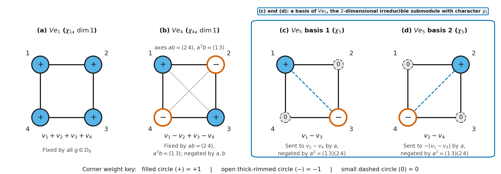

*Figure 15. Decomposing the $4$-dimensional permutation module $V = \operatorname{sp}(v_1, v_2, v_3, v_4)$ of $D_8 = \langle a, b \rangle$ on the corners $1, 2, 3, 4$ of a square into $V = V e_1 \oplus V e_4 \oplus V e_5$: (a) $V e_1 = \operatorname{sp}(v_1 + v_2 + v_3 + v_4)$ has equal weight $+1$ at all four corners and is fixed by all of $D_8$; (b) $V e_4 = \operatorname{sp}(v_1 - v_2 + v_3 - v_4)$ alternates $+1$ and $-1$ around the square, so it is fixed by the diagonal reflections $ab = (2\,4)$ and $a^3b = (1\,3)$ and negated by the $90^\circ$ rotation $a = (1\,2\,3\,4)$ and the reflection $b = (1\,2)(3\,4)$; (c) and (d) the opposite-corner differences $v_1 - v_3$ and $v_2 - v_4$ (with weight $0$ at the other two corners) are sent to $v_2 - v_4$ and $-(v_1 - v_3)$ by $a$ and negated by $a^2 = (1\,3)(2\,4)$, spanning the $2$-dimensional irreducible submodule $V e_5$.*

### Restriction to a Subgroup and Clifford's Theorem

Studying the representations of a large group $G$ directly is often hard, so we want a bridge between the representations of $G$ and those of a smaller subgroup $H \le G$. The simpler direction of that bridge is downward: any $\mathbb{C}G$-module $V$ is already a $\mathbb{C}H$-module when we ignore the group elements outside $H$, and its character on $H$ is read straight off the character table of $G$. Even when $V$ is irreducible over $\mathbb{C}G$, how does it break up over $H$, and when can we deduce the character table of $H$ from that of $G$?

#### Restricting Modules and Characters to a Subgroup

Let $H$ be a subgroup of a finite group $G$ ([subgroups](#subgroups)). Because every linear combination of elements of $H$ is also a linear combination of elements of $G$, the group algebra $\mathbb{C}H$ sits inside $\mathbb{C}G$ as a subalgebra ([group algebras](#group-algebras)). If $V$ is a $\mathbb{C}G$-module, the module axioms hold for all $g, h \in G$, so they hold in particular when we restrict attention to elements $g, h \in H$. We write $V \downarrow H$ for $V$ viewed as a $\mathbb{C}H$-module in this way, and call $V \downarrow H$ the **restricted $\mathbb{C}H$-module** (or the restriction of $V$ to $H$).

On the character side, let $\chi$ be the character of the $\mathbb{C}G$-module $V$. For each $h \in H$, the action of $h$ on $V \downarrow H$ is the same linear transformation as its action on $V$, so its trace is still $\chi(h)$. The character of $V \downarrow H$ is therefore obtained by evaluating $\chi$ on the elements of $H$ alone. We write this character of $H$ as $\chi \downarrow H$ and call it the **restricted character** (or the restriction of $\chi$ to $H$). More generally, for any function $f : G \to \mathbb{C}$, we write $f \downarrow H$ for the function on $H$ defined by $(f \downarrow H)(h) = f(h)$ for all $h \in H$.

Because $V$ and $V \downarrow H$ have the same underlying vector space, they have the same dimension, $\dim(V \downarrow H) = \dim V$, and $(\chi \downarrow H)(1) = \chi(1)$. If $U$ is a $\mathbb{C}G$-submodule of $V$, then $U$ is closed under right multiplication by all elements of $G$, so $U$ is also closed under right multiplication by all elements of $H$. Thus $U \downarrow H$ is a $\mathbb{C}H$-submodule of $V \downarrow H$. Taking the contrapositive gives a quick sufficient test for irreducibility in $G$: if $V \downarrow H$ is an irreducible $\mathbb{C}H$-module, then $V$ has no proper non-zero $\mathbb{C}H$-submodules, so it can have no proper non-zero $\mathbb{C}G$-submodules either, and $V$ must be an irreducible $\mathbb{C}G$-module.

The converse fails. An irreducible $\mathbb{C}G$-module $V$ can become reducible when restricted to $H$, because a subspace $W \subseteq V$ may be invariant under every $h \in H$ while elements $g \in G \setminus H$ move $W$ outside itself.

**Worked example: restricting the degree-$2$ irreducible module of $D_8$ to $H = \{1, a^2, b, a^2b\}$.** Let $G = D_8 = \langle a, b : a^4 = b^2 = 1,\, b^{-1}ab = a^{-1} \rangle$, and let $V$ be the $2$-dimensional $\mathbb{C}G$-module with basis $v_1, v_2$ from [the two-way bridge between modules and representations](#the-two-way-bridge-between-modules-and-representations). On this basis, $a$ and $b$ act by

$$v_1 a = v_2, \qquad v_2 a = -v_1, \qquad v_1 b = v_1, \qquad v_2 b = -v_2.$$

Now let $H = \{1, a^2, b, a^2b\} \le D_8$ (a subgroup isomorphic to $C_2 \times C_2$). Applying $a$ twice gives $v_1 a^2 = (v_1 a)a = v_2 a = -v_1$ and $v_2 a^2 = (v_2 a)a = (-v_1)a = -v_2$. On $V \downarrow H$, the generators $a^2$ and $b$ of $H$ therefore act by

$$v_1 a^2 = -v_1, \qquad v_2 a^2 = -v_2, \qquad v_1 b = v_1, \qquad v_2 b = -v_2.$$

Notice that both $a^2$ and $b$ send $v_1$ to a scalar multiple of $v_1$ and $v_2$ to a scalar multiple of $v_2$. Thus $\operatorname{sp}(v_1)$ and $\operatorname{sp}(v_2)$ are $1$-dimensional $\mathbb{C}H$-submodules of $V \downarrow H$, and $V \downarrow H = \operatorname{sp}(v_1) \oplus \operatorname{sp}(v_2)$ is reducible even though $V$ is an irreducible $\mathbb{C}D_8$-module (in $D_8$, the rotation $a \notin H$ swaps $\operatorname{sp}(v_1)$ and $\operatorname{sp}(v_2)$). Taking traces on all eight elements of $D_8$ gives the character $\chi$ of $V$:

| $g \in D_8$ | $1$ | $a$ | $a^2$ | $a^3$ | $b$ | $ab$ | $a^2b$ | $a^3b$ |
| :--- | :---: | :---: | :---: | :---: | :---: | :---: | :---: | :---: |
| $\chi(g)$ | $2$ | $0$ | $-2$ | $0$ | $0$ | $0$ | $0$ | $0$ |

Keeping only the four columns belonging to $H = \{1, a^2, b, a^2b\}$ gives the restricted character $\chi \downarrow H$:

| $h \in H$ | $1$ | $a^2$ | $b$ | $a^2b$ |
| :--- | :---: | :---: | :---: | :---: |
| $(\chi \downarrow H)(h)$ | $2$ | $-2$ | $0$ | $0$ |

To see restriction at work on a larger group, we restrict the irreducible characters of $S_5$ to its subgroup $A_4$. First we record the character table of $S_5$ as a borrowed fact.

**Fact we use (the character table of $S_5$).** Two permutations in $S_n$ are conjugate in $S_n$ if and only if they have the same cycle shape ([normal subgroups](#normal-subgroups)). For $G = S_5$ (of order $5! = 120$), the seven cycle shapes give seven conjugacy classes and hence seven irreducible characters $\chi_1, \dots, \chi_7$:

| Representative $g_i$ | $1$ | $(1\,2)$ | $(1\,2\,3)$ | $(1\,2)(3\,4)$ | $(1\,2\,3\,4)$ | $(1\,2\,3)(4\,5)$ | $(1\,2\,3\,4\,5)$ |
| :--- | :---: | :---: | :---: | :---: | :---: | :---: | :---: |
| Class size $\lvert g_i^{S_5}\rvert$ | $1$ | $10$ | $20$ | $15$ | $30$ | $20$ | $24$ |
| $\lvert C_{S_5}(g_i)\rvert$ | $120$ | $12$ | $6$ | $8$ | $4$ | $6$ | $5$ |
| $\chi_1$ | $1$ | $1$ | $1$ | $1$ | $1$ | $1$ | $1$ |
| $\chi_2$ | $1$ | $-1$ | $1$ | $1$ | $-1$ | $-1$ | $1$ |
| $\chi_3$ | $4$ | $2$ | $1$ | $0$ | $0$ | $-1$ | $-1$ |
| $\chi_4$ | $4$ | $-2$ | $1$ | $0$ | $0$ | $1$ | $-1$ |
| $\chi_5$ | $6$ | $0$ | $0$ | $-2$ | $0$ | $0$ | $1$ |
| $\chi_6$ | $5$ | $1$ | $-1$ | $1$ | $-1$ | $1$ | $0$ |
| $\chi_7$ | $5$ | $-1$ | $-1$ | $1$ | $1$ | $-1$ | $0$ |

In this table, $\chi_1 = 1_{S_5}$ is the trivial character, $\chi_2$ is the sign character ($+1$ on even permutations and $-1$ on odd permutations), $\chi_3(g) = \lvert\operatorname{fix}(g)\rvert - 1$ is the subtracted permutation character from [the regular character and the subtracted permutation character](#the-regular-character-and-the-subtracted-permutation-character), and the pairs $(\chi_3, \chi_4)$ and $(\chi_6, \chi_7)$ satisfy $\chi_4(g) = \chi_3(g)\chi_2(g)$ and $\chi_7(g) = \chi_6(g)\chi_2(g)$ for all $g \in S_5$ (pointwise product).

**Worked example: restricting the irreducible characters of $S_5$ to $A_4$.** Let $G = S_5$, and let $H = A_4$ be the subgroup of order $12$ consisting of all even permutations of $\{1, 2, 3, 4\}$ that fix $5$. Recall from [the inner product space of functions on a group](#the-inner-product-space-of-functions-on-a-group) that $H = A_4$ has four conjugacy classes with representatives $1$, $(1\,2)(3\,4)$, $(1\,2\,3)$, and $(1\,3\,2)$, centralizer orders $12, 4, 3, 3$, and four irreducible characters $\psi_1, \psi_2, \psi_3, \psi_4$ (where $\omega = e^{2\pi i/3}$):

| Representative $g_i$ | $1$ | $(1\,2)(3\,4)$ | $(1\,2\,3)$ | $(1\,3\,2)$ |
| :--- | :---: | :---: | :---: | :---: |
| $\lvert C_{A_4}(g_i)\rvert$ | $12$ | $4$ | $3$ | $3$ |
| $\psi_1$ | $1$ | $1$ | $1$ | $1$ |
| $\psi_2$ | $1$ | $1$ | $\omega$ | $\omega^2$ |
| $\psi_3$ | $1$ | $1$ | $\omega^2$ | $\omega$ |
| $\psi_4$ | $3$ | $-1$ | $0$ | $0$ |

We want to express each restriction $\chi_i \downarrow H$ ($1 \le i \le 7$) as a sum of the irreducible characters $\psi_1, \psi_2, \psi_3, \psi_4$ of $H$. Because every element of $H = A_4$ is an even permutation, $\chi_2(h) = 1$ for all $h \in H$, so the pairs that differ only by the sign character $\chi_2$ have identical restrictions to $H$:

$$\chi_1 \downarrow H = \chi_2 \downarrow H, \qquad \chi_3 \downarrow H = \chi_4 \downarrow H, \qquad \chi_6 \downarrow H = \chi_7 \downarrow H.$$

We therefore only need to evaluate $\chi_1 \downarrow H$, $\chi_3 \downarrow H$, $\chi_5 \downarrow H$, and $\chi_6 \downarrow H$ on the four conjugacy class representatives of $A_4$. In $S_5$, both $3$-cycles $(1\,2\,3)$ and $(1\,3\,2)$ belong to the single $S_5$-conjugacy class of $(1\,2\,3)$, while $(1\,2)(3\,4)$ belongs to the $S_5$-conjugacy class of $(1\,2)(3\,4)$. Reading the columns $1$, $(1\,2)(3\,4)$, and $(1\,2\,3)$ of the $S_5$ table gives the restricted values on $A_4$:

| Restricted character | $1$ | $(1\,2)(3\,4)$ | $(1\,2\,3)$ | $(1\,3\,2)$ |
| :--- | :---: | :---: | :---: | :---: |
| $\chi_1 \downarrow H = \chi_2 \downarrow H$ | $1$ | $1$ | $1$ | $1$ |
| $\chi_3 \downarrow H = \chi_4 \downarrow H$ | $4$ | $0$ | $1$ | $1$ |
| $\chi_5 \downarrow H$ | $6$ | $-2$ | $0$ | $0$ |
| $\chi_6 \downarrow H = \chi_7 \downarrow H$ | $5$ | $1$ | $-1$ | $-1$ |

Comparing these four rows with the rows of the $A_4$ character table (and using $1 + \omega + \omega^2 = 0$, so $\psi_2 + \psi_3 = (2, 2, -1, -1)$) gives the decompositions directly:

$$\chi_1 \downarrow H = \chi_2 \downarrow H = \psi_1, \qquad \chi_3 \downarrow H = \chi_4 \downarrow H = \psi_1 + \psi_4, \qquad \chi_5 \downarrow H = 2\psi_4, \qquad \chi_6 \downarrow H = \chi_7 \downarrow H = \psi_2 + \psi_3 + \psi_4.$$

#### Constituents of a Restricted Character and Clifford's Theorem

When we work with a group $G$ and a subgroup $H \le G$ at the same time, we have two inner products ([the inner product space of functions on a group](#the-inner-product-space-of-functions-on-a-group)): one on functions $\vartheta_1, \vartheta_2 : G \to \mathbb{C}$, and one on functions $\phi_1, \phi_2 : H \to \mathbb{C}$. We label them with subscripts $G$ and $H$ to keep track of which group is being averaged over:

$$\langle \vartheta_1, \vartheta_2 \rangle_G = \frac{1}{\lvert G\rvert} \sum_{g \in G} \vartheta_1(g)\overline{\vartheta_2(g)}, \qquad \langle \phi_1, \phi_2 \rangle_H = \frac{1}{\lvert H\rvert} \sum_{h \in H} \phi_1(h)\overline{\phi_2(h)}.$$

Let $\psi_1, \dots, \psi_r$ be the irreducible characters of $H$. Because $\chi \downarrow H$ is a character of $H$, the multiplicity formula from [consequences of orthonormality and decomposing modules](#consequences-of-orthonormality-and-decomposing-modules) expands $\chi \downarrow H$ in terms of $\psi_1, \dots, \psi_r$ with non-negative integer coefficients $d_1, \dots, d_r$:

$$\chi \downarrow H = d_1\psi_1 + \cdots + d_r\psi_r, \qquad d_i = \langle \chi \downarrow H, \psi_i \rangle_H.$$

As in $G$, we say that $\psi_i$ is a [constituent](#consequences-of-orthonormality-and-decomposing-modules) of $\chi \downarrow H$ when $d_i \neq 0$.

Does every irreducible character of $H$ show up when we restrict the irreducible characters of $G$ down to $H$, or could some irreducible character of $H$ be missed entirely? Restricting the regular character of $G$ shows that none is ever missed.

**Every character of $H$ shares a constituent with some irreducible restriction from $G$.** Let $H$ be a subgroup of $G$ and let $\psi$ be a non-zero character of $H$. Then there exists an irreducible character $\chi$ of $G$ such that $\langle \chi \downarrow H, \psi \rangle_H \neq 0$. In particular, taking $\psi$ to be an irreducible character of $H$, every irreducible character of $H$ is a constituent of $\chi \downarrow H$ for at least one irreducible character $\chi$ of $G$.

The reason is that the regular character $\chi_{\mathrm{reg}} = \sum_{i=1}^k \chi_i(1)\chi_i$ of $G$ ([the regular character and the subtracted permutation character](#the-regular-character-and-the-subtracted-permutation-character)) takes the value $\lvert G\rvert$ at $1$ and $0$ everywhere else on $H$, so its restriction to $H$ has positive inner product $\frac{\lvert G\rvert}{\lvert H\rvert}\psi(1) > 0$ with $\psi$, forcing at least one summand $\chi_i \downarrow H$ to have a non-zero inner product with $\psi$.

Knowing that every irreducible character of $H$ appears in some $\chi_i \downarrow H$ suggests trying to find the character table of $H$ by restricting the irreducible characters of $G$. In practice, decomposing $\chi \downarrow H$ is easiest when the index $\lvert G : H\rvert = \lvert G\rvert / \lvert H\rvert$ ([subgroups](#subgroups)) is small, because the index bounds the sum of the squares of the multiplicities $d_i$.

**Index bound for the constituents of a restricted character.** Let $H$ be a subgroup of $G$, let $\chi$ be an irreducible character of $G$, and let $\psi_1, \dots, \psi_r$ be the irreducible characters of $H$. Write $\chi \downarrow H = d_1\psi_1 + \cdots + d_r\psi_r$ for non-negative integers $d_1, \dots, d_r$. Then the multiplicities satisfy

$$\sum_{i=1}^r d_i^2 \le \lvert G : H\rvert.$$

Moreover, equality holds in this bound if and only if $\chi(g) = 0$ for every element $g \in G$ that lies outside $H$.

This bound comes from comparing the norm $\sum_{i=1}^r d_i^2 = \frac{1}{\lvert H\rvert}\sum_{h \in H} \lvert\chi(h)\rvert^2$ of $\chi \downarrow H$ on $H$ with the norm $1 = \frac{1}{\lvert G\rvert}\sum_{g \in G} \lvert\chi(g)\rvert^2$ of $\chi$ on $G$. Dropping the non-negative terms $\lvert\chi(g)\rvert^2$ for $g \notin H$ makes the sum over $H$ at most $\lvert G\rvert$, and it equals $\lvert G\rvert$ if and only if $\chi(g) = 0$ for every $g \notin H$.

When $H$ is not just any subgroup but a *normal* subgroup of $G$ ($H \trianglelefteq G$, so $ghg^{-1} \in H$ for all $g \in G$ and $h \in H$; see [normal subgroups](#normal-subgroups)), the constituents of $\chi \downarrow H$ are much more tightly constrained. If $U \subseteq V \downarrow H$ is an irreducible $\mathbb{C}H$-submodule and $g \in G$, then multiplying $U$ on the right by $g$ moves $U$ to another subspace $Ug = \{ug : u \in U\}$ of $V$. Because $H$ is normal in $G$, the action of $h \in H$ on $Ug$ can be pulled past $g$ using $(ug)h = u(ghg^{-1})g$ with $ghg^{-1} \in H$. Thus $Ug$ is again an irreducible $\mathbb{C}H$-submodule of $V \downarrow H$ of the same dimension as $U$, and as $g$ runs over $G$, the subspaces $Ug$ sweep out all of $V$ ([direct sums of modules and sums of irreducible submodules](#direct-sums-of-modules-and-sums-of-irreducible-submodules)).

**Conjugate $\mathbb{C}H$-submodules inside an irreducible $\mathbb{C}G$-module.** Suppose that $H \trianglelefteq G$. Let $V$ be an irreducible $\mathbb{C}G$-module and let $U$ be an irreducible $\mathbb{C}H$-submodule of $V \downarrow H$. For each $g \in G$, define $Ug = \{ug : u \in U\}$. Then three properties hold. First, $Ug$ is an irreducible $\mathbb{C}H$-submodule of $V \downarrow H$ with $\dim Ug = \dim U$. Second, as a $\mathbb{C}H$-module, $V \downarrow H$ is a direct sum of some of the $\mathbb{C}H$-submodules $Ug$. Third, if $g_1, g_2, g \in G$ and $Ug_1 \cong Ug_2$ as $\mathbb{C}H$-modules, then $Ug_1 g \cong Ug_2 g$ as $\mathbb{C}H$-modules.

Grouping the isomorphic summands $Ug$ according to their characters gives Clifford's theorem: when we restrict an irreducible character $\chi$ of $G$ to a normal subgroup $H \trianglelefteq G$, every constituent $\psi_i$ of $\chi \downarrow H$ has the same degree and appears with the same multiplicity $e$.

**Clifford's theorem.** Suppose that $H \trianglelefteq G$ and that $\chi$ is an irreducible character of $G$. Then all the constituents of $\chi \downarrow H$ have the same degree, and if $\psi_1, \dots, \psi_m$ are the distinct constituents of $\chi \downarrow H$, there is a positive integer $e$ such that

$$\chi \downarrow H = e(\psi_1 + \cdots + \psi_m).$$

Because $V$ is irreducible over $\mathbb{C}G$, the elements of $G$ shuffle the irreducible $\mathbb{C}H$-submodules $Ug$ transitively among themselves. Every constituent $\psi_i$ of $\chi \downarrow H$ is therefore the character of some translate $Ug$ of the same dimension $\dim U$, and right multiplication by $g \in G$ carries the $e$ copies of one constituent $\psi_1$ bijectively onto the $e$ copies of each other constituent $\psi_i$.

#### Normal Subgroups of Index 2 and the Character Table of $A_5$

Clifford's theorem and the index bound $\sum_{i=1}^r d_i^2 \le \lvert G : H\rvert$ are sharpest when $H$ is a subgroup of index $2$ in $G$, such as $H = A_n$ inside $G = S_n$ or the rotation subgroup $H = \langle a \rangle$ inside $G = D_{2n}$. Recall from [conditions implying a normal subgroup](#conditions-implying-a-normal-subgroup) that any subgroup $H$ of index $2$ in $G$ is automatically normal in $G$.

**The index-$2$ restriction dichotomy.** Suppose that $H$ is a normal subgroup of index $2$ in $G$, and let $\chi$ be an irreducible character of $G$. Then either $\chi \downarrow H$ is irreducible, or $\chi \downarrow H = \psi_1 + \psi_2$ is the sum of two distinct irreducible characters $\psi_1, \psi_2$ of $H$ of the same degree.

Because the non-negative integer multiplicities $d_i$ in $\chi \downarrow H$ satisfy $\sum_{i=1}^r d_i^2 \le \lvert G : H\rvert = 2$, either a single $d_i$ equals $1$ or two distinct $d_i, d_j$ equal $1$, and Clifford's theorem forces the two constituents in the second case to have the same degree.

To tell which of the two cases occurs for a given $\chi$, and how the restrictions from different $\chi$ overlap, we use the quotient group $G/H \cong C_2$. First we state two general facts about normal subgroups and linear characters.

**Fact we use (lifted characters and multiplying by a linear character).** When $N \trianglelefteq G$, every character $\tilde{\chi}$ of the quotient group $G/N$ defines a character $\chi$ of $G$ of the same degree via $\chi(g) = \tilde{\chi}(Ng)$ ($g \in G$), called the **lift** of $\tilde{\chi}$ to $G$. Composing representations of $G/N$ with the quotient map $g \mapsto Ng$ gives a bijection between the irreducible characters of $G/N$ and the irreducible characters of $G$ whose kernel contains $N$ (the converse of the quotient construction in [kernels and the trivial representation](#kernels-and-the-trivial-representation)). Furthermore, if $\chi$ is an irreducible character of $G$ and $\lambda$ is any linear character of $G$ ($\lambda(1) = 1$, so $\lvert\lambda(g)\rvert = 1$ for all $g \in G$), then the pointwise product $\chi\lambda$ is again an irreducible character of $G$ of the same degree.

Applying this to our index-$2$ subgroup $H \trianglelefteq G$, the quotient $G/H \cong C_2$ has one non-trivial linear character (sending the non-identity coset to $-1$), whose lift to $G$ is the linear character $\lambda : G \to \mathbb{C}^*$ given by

$$\lambda(g) = \begin{cases} 1 & \text{if } g \in H, \\ -1 & \text{if } g \notin H. \end{cases}$$

For every irreducible character $\chi$ of $G$, the product $\chi\lambda$ is an irreducible character of $G$ of the same degree, satisfying $(\chi\lambda)(g) = \chi(g)$ for $g \in H$ and $(\chi\lambda)(g) = -\chi(g)$ for $g \notin H$. In particular, $\chi \downarrow H = (\chi\lambda) \downarrow H$. Three short results now give the complete dictionary between the irreducible characters of $G$ and those of $H$.

**Criterion for $\chi \downarrow H$ to remain irreducible.** Suppose that $H \trianglelefteq G$ has index $2$ and $\chi$ is an irreducible character of $G$. Then the following three conditions are equivalent: $\chi \downarrow H$ is irreducible; $\chi(g) \neq 0$ for some $g \in G \setminus H$; and $\chi \neq \chi\lambda$.

**Fibres when $\chi \downarrow H$ is irreducible.** Suppose that $H \trianglelefteq G$ has index $2$, and let $\chi$ be an irreducible character of $G$ such that $\chi \downarrow H$ is irreducible. If $\phi$ is any irreducible character of $G$ satisfying $\phi \downarrow H = \chi \downarrow H$, then either $\phi = \chi$ or $\phi = \chi\lambda$.

**Fibres when $\chi \downarrow H$ is reducible.** Suppose that $H \trianglelefteq G$ has index $2$, and let $\chi$ be an irreducible character of $G$ whose restriction splits as $\chi \downarrow H = \psi_1 + \psi_2$ for two irreducible characters $\psi_1, \psi_2$ of $H$. If $\phi$ is an irreducible character of $G$ such that $\phi \downarrow H$ has $\psi_1$ or $\psi_2$ as a constituent, then $\phi = \chi$.

Putting these pieces together with the fact that every irreducible character of $H$ appears in the restriction of some irreducible character of $G$ gives the complete recipe for building the character table of $H$ from that of $G$ when $\lvert G : H\rvert = 2$.

**Recipe for the irreducible characters of an index-$2$ subgroup $H \trianglelefteq G$.** First, every irreducible character $\chi$ of $G$ that is non-zero somewhere outside $H$ occurs as part of a distinct pair $\{\chi, \chi\lambda\}$ having the same restriction $\chi \downarrow H = (\chi\lambda) \downarrow H$, and that common restriction is an irreducible character of $H$. Second, every irreducible character $\chi$ of $G$ that vanishes everywhere outside $H$ satisfies $\chi = \chi\lambda$ and restricts to the sum $\chi \downarrow H = \psi_1 + \psi_2$ of two distinct irreducible characters of $H$ of degree $\frac{1}{2}\chi(1)$, which appear in the restriction of no other irreducible character of $G$. Third, every irreducible character of $H$ arises in one of these two ways, with no duplicates once one character is kept from each pair $\{\chi, \chi\lambda\}$.

In the second case of the recipe, restricting $\chi$ gives the sum $\psi_1 + \psi_2$, so finding the individual values of $\psi_1$ and $\psi_2$ on the conjugacy classes of $H$ takes one additional step. As we now show for $H = A_5$ inside $G = S_5$, orthogonality between columns of the character table supplies the missing values immediately. First we record the borrowed facts on the conjugacy classes of $A_5$, column orthogonality, and reading normal subgroups from a character table.

**Fact we use (conjugacy classes in $A_n$ and in $A_5$).** Under left-to-right permutation composition, conjugating a $k$-cycle $(i_1\,i_2\,\dots\,i_k) \in S_n$ by $g \in S_n$ gives $g^{-1}(i_1\,i_2\,\dots\,i_k)g = (i_1 g\,\,i_2 g\,\,\dots\,\,i_k g)$. For an even permutation $x \in A_n$ ($n > 1$), its $S_n$-conjugacy class $x^{S_n}$ remains a single $A_n$-conjugacy class $x^{A_n} = x^{S_n}$ if $x$ commutes with at least one odd permutation $g \in S_n$. If instead $x$ commutes with no odd permutation, then $C_{A_n}(x) = C_{S_n}(x)$ and $x^{S_n}$ splits into two disjoint $A_n$-conjugacy classes of size $\frac{1}{2}\lvert x^{S_n}\rvert$, represented by $x$ and $(1\,2)^{-1}x(1\,2)$.

In $A_5$ (of order $60$), the elements $1$, $(1\,2\,3)$, and $(2\,3)(4\,5)$ commute with the odd transposition $(4\,5)$, whereas $(1\,2\,3\,4\,5)$ commutes only with its own powers in $A_5$. Its $S_5$-class of size $24$ therefore splits into two $A_5$-classes of size $12$ represented by $(1\,2\,3\,4\,5)$ and $(1\,2)^{-1}(1\,2\,3\,4\,5)(1\,2) = (2\,1\,3\,4\,5) = (1\,3\,4\,5\,2)$. This gives five $A_5$-classes of sizes $1, 20, 15, 12, 12$ and centralizer orders $60, 3, 4, 5, 5$, and every element of $A_5$ is conjugate in $A_5$ to its inverse.

**Fact we use (column orthogonality and normal subgroups from the character table).** If $\chi_1, \dots, \chi_k$ are the irreducible characters of $G$ and $g_1, \dots, g_k$ are representatives of the conjugacy classes of $G$, the columns of the character table satisfy the **column orthogonality relations**:

$$\sum_{i=1}^k \chi_i(g_r)\overline{\chi_i(g_s)} = \delta_{rs}\lvert C_G(g_r)\rvert \qquad (1 \le r, s \le k).$$

In addition, every normal subgroup $N \trianglelefteq G$ is the intersection of the kernels $\ker\chi_i = \{g \in G : \chi_i(g) = \chi_i(1)\}$ of some of the irreducible characters of $G$, so $G$ is simple if and only if $\ker\chi_i = \{1\}$ for every non-trivial irreducible character $\chi_i$ of $G$.

**Worked example: deriving the character table of $A_5$ from that of $S_5$.** Take $G = S_5$ and $H = A_5$, a normal subgroup of index $2$. Look at the seven irreducible characters $\chi_1, \dots, \chi_7$ in the character table of $S_5$ above, where the odd conjugacy classes are $(1\,2)$, $(1\,2\,3\,4)$, and $(1\,2\,3)(4\,5)$.

First, the characters $\chi_1, \chi_3, \chi_6$ are non-zero on the transposition $(1\,2) \notin A_5$, where they take values $1, 2, 1$, and their partners under multiplication by the sign character $\lambda = \chi_2$ are $\chi_2 = \chi_1\lambda$, $\chi_4 = \chi_3\lambda$, and $\chi_7 = \chi_6\lambda$. By the first part of the index-$2$ recipe, their restrictions to $A_5$ give three distinct irreducible characters $\psi_1, \psi_2, \psi_3$ of $A_5$, of degrees $1, 4, 5$:

$$\psi_1 := \chi_1 \downarrow A_5 = \chi_2 \downarrow A_5, \qquad \psi_2 := \chi_3 \downarrow A_5 = \chi_4 \downarrow A_5, \qquad \psi_3 := \chi_6 \downarrow A_5 = \chi_7 \downarrow A_5.$$

Second, the remaining irreducible character $\chi_5$ of $S_5$ (of degree $6$) takes the value $0$ on all three odd conjugacy classes $(1\,2)$, $(1\,2\,3\,4)$, and $(1\,2\,3)(4\,5)$, so $\chi_5(g) = 0$ for every $g \notin A_5$. By the second part of the index-$2$ recipe, $\chi_5 \downarrow A_5$ splits into two distinct irreducible characters $\psi_4, \psi_5$ of $A_5$ of degree $3$:

$$\chi_5 \downarrow A_5 = \psi_4 + \psi_5.$$

By the third part of the recipe, $\psi_1, \psi_2, \psi_3, \psi_4, \psi_5$ are all five irreducible characters of $A_5$. Reading the values of $\psi_1, \psi_2, \psi_3$ on the even classes $1, (1\,2\,3), (1\,2)(3\,4), (1\,2\,3\,4\,5)$ directly from the $S_5$ table gives the character table of $A_5$ up to eight unknown entries $\alpha_2, \alpha_3, \alpha_4, \alpha_5$ and $\beta_2, \beta_3, \beta_4, \beta_5$:

| Representative $g_i$ | $1$ | $(1\,2\,3)$ | $(1\,2)(3\,4)$ | $(1\,2\,3\,4\,5)$ | $(1\,3\,4\,5\,2)$ |
| :--- | :---: | :---: | :---: | :---: | :---: |
| $\lvert C_{A_5}(g_i)\rvert$ | $60$ | $3$ | $4$ | $5$ | $5$ |
| $\psi_1$ | $1$ | $1$ | $1$ | $1$ | $1$ |
| $\psi_2$ | $4$ | $1$ | $0$ | $-1$ | $-1$ |
| $\psi_3$ | $5$ | $-1$ | $1$ | $0$ | $0$ |
| $\psi_4$ | $3$ | $\alpha_2$ | $\alpha_3$ | $\alpha_4$ | $\alpha_5$ |
| $\psi_5$ | $3$ | $\beta_2$ | $\beta_3$ | $\beta_4$ | $\beta_5$ |

Third, we find $\alpha_i$ and $\beta_i$ for $2 \le i \le 5$. Because $\psi_4 + \psi_5 = \chi_5 \downarrow A_5$ and $\chi_5$ takes values $0, -2, 1, 1$ on $(1\,2\,3), (1\,2)(3\,4), (1\,2\,3\,4\,5), (1\,3\,4\,5\,2)$ (the same sum also comes from column orthogonality between column $1$ and column $i$), we have

$$\alpha_2 + \beta_2 = 0, \qquad \alpha_3 + \beta_3 = -2, \qquad \alpha_4 + \beta_4 = 1, \qquad \alpha_5 + \beta_5 = 1.$$

Because every element of $A_5$ is conjugate in $A_5$ to its inverse, $\psi(g) = \psi(g^{-1}) = \overline{\psi(g)}$ ([character values, involutions, kernels and conjugate characters](#character-values-involutions-kernels-and-conjugate-characters)), so all entries $\alpha_i, \beta_i$ in the table are real numbers. Applying the column orthogonality relation $\sum_{r=1}^5 \psi_r(g_i)^2 = \lvert C_{A_5}(g_i)\rvert$ to each column $i = 2, 3, 4, 5$ with itself gives

$$3 = 1^2 + 1^2 + (-1)^2 + \alpha_2^2 + \beta_2^2 = 3 + \alpha_2^2 + \beta_2^2,$$

$$4 = 1^2 + 0^2 + 1^2 + \alpha_3^2 + \beta_3^2 = 2 + \alpha_3^2 + \beta_3^2,$$

$$5 = 1^2 + (-1)^2 + 0^2 + \alpha_4^2 + \beta_4^2 = 2 + \alpha_4^2 + \beta_4^2 = 2 + \alpha_5^2 + \beta_5^2.$$

From the first equation, $\alpha_2^2 + \beta_2^2 = 0$, and since $\alpha_2, \beta_2 \in \mathbb{R}$, we get $\alpha_2 = \beta_2 = 0$. From the second equation, $\alpha_3^2 + \beta_3^2 = 2$; substituting $\beta_3 = -2 - \alpha_3$ gives $2(\alpha_3 + 1)^2 = 0$, so $\alpha_3 = \beta_3 = -1$.

From the third equation, $\alpha_4^2 + \beta_4^2 = 3$ with $\alpha_4 + \beta_4 = 1$, so $\alpha_4\beta_4 = \frac{1}{2}((\alpha_4 + \beta_4)^2 - (\alpha_4^2 + \beta_4^2)) = -1$. Thus $\alpha_4$ and $\beta_4$ are the two roots of the quadratic equation $x^2 - x - 1 = 0$, which are $\alpha = \frac{1}{2}(1 + \sqrt{5})$ and $\beta = \frac{1}{2}(1 - \sqrt{5})$, and the same holds for $\alpha_5$ and $\beta_5$. Ordering $\psi_4$ and $\psi_5$ so that $\alpha_4 = \alpha$ and $\beta_4 = \beta$, we find $\alpha_5$ and $\beta_5$ from the column orthogonality relation between the two $5$-cycle columns, whose inner product must be $0$:

$$1 \cdot 1 + (-1)(-1) + 0 \cdot 0 + \alpha_4\alpha_5 + \beta_4\beta_5 = 2 + \alpha_4\alpha_5 + \beta_4\beta_5 = 0.$$

The same assignment $\alpha_5 = \alpha, \beta_5 = \beta$ would give $2 + \alpha^2 + \beta^2 = 5 \neq 0$, whereas the opposite assignment $\alpha_5 = \beta, \beta_5 = \alpha$ gives $2 + 2\alpha\beta = 2 - 2 = 0$. Thus $\alpha_5 = \beta$ and $\beta_5 = \alpha$, completing the character table of $A_5$:

| Representative $g_i$ | $1$ | $(1\,2\,3)$ | $(1\,2)(3\,4)$ | $(1\,2\,3\,4\,5)$ | $(1\,3\,4\,5\,2)$ |
| :--- | :---: | :---: | :---: | :---: | :---: |
| $\lvert C_{A_5}(g_i)\rvert$ | $60$ | $3$ | $4$ | $5$ | $5$ |
| $\psi_1$ | $1$ | $1$ | $1$ | $1$ | $1$ |
| $\psi_2$ | $4$ | $1$ | $0$ | $-1$ | $-1$ |
| $\psi_3$ | $5$ | $-1$ | $1$ | $0$ | $0$ |
| $\psi_4$ | $3$ | $0$ | $-1$ | $\alpha$ | $\beta$ |
| $\psi_5$ | $3$ | $0$ | $-1$ | $\beta$ | $\alpha$ |

In each non-trivial row $\psi_2, \psi_3, \psi_4, \psi_5$, no column $g_i \neq 1$ equals the degree $\psi_r(1)$, so $\ker\psi_r = \{1\}$ for every $r \in \{2, 3, 4, 5\}$. Because every normal subgroup of $A_5$ is an intersection of kernels of irreducible characters, $A_5$ has no proper non-trivial normal subgroups, recovering from the character table that $A_5$ is a simple group (compare the class-equation argument in [centralizers and the center](#centralizers-and-the-center)). [Figure 16](#figure-16) summarizes the restriction from $S_5$ to $A_5$ and the splitting of the $5$-cycle class.

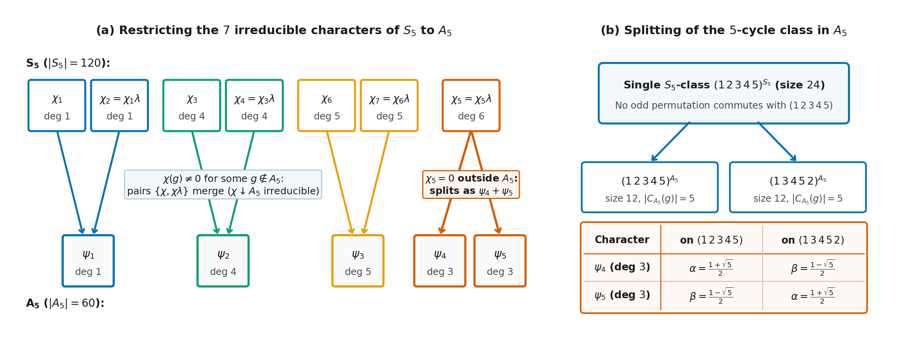

*Figure 16. Deriving the character table of the index-$2$ normal subgroup $A_5 \trianglelefteq S_5$, where $\lambda = \chi_2$ is the sign character: (a) the three pairs $\{\chi_1, \chi_2\}$, $\{\chi_3, \chi_4\}$, and $\{\chi_6, \chi_7\}$ of irreducible characters of $S_5$ that do not vanish outside $A_5$ merge on restriction into the irreducible characters $\psi_1, \psi_2, \psi_3$ of $A_5$ of degrees $1, 4, 5$, while $\chi_5$ (of degree $6$, vanishing outside $A_5$) splits as $\chi_5 \downarrow A_5 = \psi_4 + \psi_5$ into two irreducible characters of degree $3$; (b) the $S_5$-conjugacy class of $5$-cycles of size $24$ splits in $A_5$ into two conjugacy classes $(1\,2\,3\,4\,5)^{A_5}$ and $(1\,3\,4\,5\,2)^{A_5}$ of size $12$, on which $\psi_4$ takes the values $\alpha$ and $\beta$ and $\psi_5$ takes the values $\beta$ and $\alpha$, where $\alpha = \frac{1}{2}(1 + \sqrt{5})$ and $\beta = \frac{1}{2}(1 - \sqrt{5})$.*

### Induced Modules, Induced Characters and Frobenius Reciprocity

Restriction turns a representation of $G$ into a representation of a subgroup $H \le G$ simply by ignoring the elements outside $H$. In practice, however, we usually know the representations of a smaller subgroup $H$ (such as a cyclic or dihedral subgroup) and want to build representations of the larger group $G$ from them. That upward construction is induction: starting from a $\mathbb{C}H$-module $U$, it produces a $\mathbb{C}G$-module $U \uparrow G$ of dimension $\lvert G : H\rvert \dim U$. Because $U$ only specifies how elements of $H$ act, extending the action to all of $G$ uses the group algebra $\mathbb{C}G$ to sweep $U$ across the cosets of $H$. The payoff is twofold: Frobenius reciprocity shows that inducing up from $H$ to $G$ and restricting down from $G$ to $H$ are adjoint operations for the character inner product, and an explicit class formula lets us evaluate the character of $U \uparrow G$ from centralizer orders and build new rows of a character table directly from a subgroup.

#### Homomorphisms into the Group Algebra and Inducing a Module

Throughout this section, $H$ is a subgroup of the finite group $G$. Before defining induced modules, we establish a concrete description of all module homomorphisms from a submodule of $\mathbb{C}H$ into $\mathbb{C}G$.

Let $U$ be a $\mathbb{C}H$-submodule of the regular module $\mathbb{C}H$. Given any fixed element $r \in \mathbb{C}G$, consider the map $\vartheta : U \to \mathbb{C}G$ defined by left multiplication by $r$:

$$u\vartheta = ru \qquad (u \in U).$$

By associativity of multiplication in $\mathbb{C}G$, for every $u \in U$ and $s \in \mathbb{C}H$ we have $(us)\vartheta = r(us) = (ru)s = (u\vartheta)s$, so $\vartheta$ is a $\mathbb{C}H$-homomorphism from $U$ into $\mathbb{C}G$ (viewed as a $\mathbb{C}H$-module by restriction). By [Maschke's theorem](#maschkes-theorem-and-complete-reducibility) on $\mathbb{C}H$, *every* $\mathbb{C}H$-homomorphism from $U$ to $\mathbb{C}G$ has this form.

**Left-multiplication form of $\mathbb{C}H$-homomorphisms into $\mathbb{C}G$.** Assume that $H \le G$, and let $U$ be a $\mathbb{C}H$-submodule of $\mathbb{C}H$. If $\vartheta : U \to \mathbb{C}G$ is a $\mathbb{C}H$-homomorphism, then there exists an element $r \in \mathbb{C}G$ such that $u\vartheta = ru$ for all $u \in U$.

The idea is to use Maschke's theorem to split $\mathbb{C}H = U \oplus W$, extend $\vartheta$ to a $\mathbb{C}H$-homomorphism $\phi : \mathbb{C}H \to \mathbb{C}G$ by sending $W$ to $0$, and set $r = 1\phi \in \mathbb{C}G$ so that $u\vartheta = (1u)\phi = (1\phi)u = ru$.

Taking $H = G$ gives two immediate consequences for submodules of $\mathbb{C}G$.

**Left-multiplication form of $\mathbb{C}G$-homomorphisms and testing disjoint submodules.** First, if $U$ is a $\mathbb{C}G$-submodule of $\mathbb{C}G$, then every $\mathbb{C}G$-homomorphism from $U$ to $\mathbb{C}G$ has the form $u \mapsto ru$ ($u \in U$) for some $r \in \mathbb{C}G$. Second, if $U$ and $V$ are $\mathbb{C}G$-submodules of $\mathbb{C}G$, then $U \cap V = \{0\}$ if and only if there exists $r \in \mathbb{C}G$ such that $ru = u$ for all $u \in U$ and $rv = 0$ for all $v \in V$.

We now define induction in two stages: first for a $\mathbb{C}H$-submodule $U$ of the regular module $\mathbb{C}H$, and then for an arbitrary $\mathbb{C}H$-module by decomposing it into irreducible summands.

For any subset $X$ of $\mathbb{C}G$, let $X(\mathbb{C}G)$ denote the subspace of $\mathbb{C}G$ spanned by all products $xg$ with $x \in X$ and $g \in G$:

$$X(\mathbb{C}G) = \operatorname{sp}\{xg : x \in X,\, g \in G\}.$$

Multiplying any spanning element $xg$ on the right by $g' \in G$ gives $x(gg') \in X(\mathbb{C}G)$, so $X(\mathbb{C}G)$ is a $\mathbb{C}G$-submodule of $\mathbb{C}G$ (in fact, it is the smallest $\mathbb{C}G$-submodule of $\mathbb{C}G$ containing $X$). When $U$ is a $\mathbb{C}H$-submodule of $\mathbb{C}H$, $U$ is already a subset of $\mathbb{C}G$ closed under right multiplication by $H$, and forming $U(\mathbb{C}G)$ simply closes $U$ under right multiplication by all elements of $G$. We write $U \uparrow G$ for this submodule and call it the **induced module** of $U$ (the $\mathbb{C}G$-module induced from $U$):

$$U \uparrow G := U(\mathbb{C}G).$$

**Fact we use (the irreducible submodules of $\mathbb{C}C_3$ and $\mathbb{C}D_6$).** Let $\omega = e^{2\pi i/3}$. In the regular module $\mathbb{C}H$ of the cyclic group $H = \langle a : a^3 = 1 \rangle \cong C_3$, the three vectors $v_0 = 1 + a + a^2$, $v_1 = 1 + \omega^2 a + \omega a^2$, and $v_2 = 1 + \omega a + \omega^2 a^2$ satisfy $v_k a = \omega^k v_k$ ($k = 0, 1, 2$), so $W_k = \operatorname{sp}(v_k)$ are the three $1$-dimensional irreducible $\mathbb{C}H$-submodules in $\mathbb{C}H = W_0 \oplus W_1 \oplus W_2$. In the regular module $\mathbb{C}G$ of $G = D_6 = \langle a, b : a^3 = b^2 = 1,\, b^{-1}ab = a^{-1} \rangle$, right multiplication by $b$ gives $v_0 b = b + ab + a^2b$, $v_1 b = b + \omega^2 ab + \omega a^2b$, and $v_2 b = b + \omega ab + \omega^2 a^2b$, and $\mathbb{C}G$ decomposes into four irreducible $\mathbb{C}G$-submodules $\mathbb{C}G = U_1 \oplus U_2 \oplus U_3 \oplus U_4$:

$$U_1 = \operatorname{sp}(1 + a + a^2 + b + ab + a^2b), \qquad U_2 = \operatorname{sp}(1 + a + a^2 - b - ab - a^2b),$$

$$U_3 = \operatorname{sp}(1 + \omega^2 a + \omega a^2,\, b + \omega^2 ab + \omega a^2b), \qquad U_4 = \operatorname{sp}(1 + \omega a + \omega^2 a^2,\, b + \omega ab + \omega^2 a^2b).$$

Here $\dim U_1 = \dim U_2 = 1$ (giving the trivial and sign representations) and $U_3 \cong U_4$ have dimension $2$.

**Worked example: inducing the irreducible submodules of $\mathbb{C}C_3$ to $\mathbb{C}D_6$.** Let $G = D_6 = \langle a, b : a^3 = b^2 = 1,\, b^{-1}ab = a^{-1} \rangle$ and $H = \langle a \rangle \cong C_3$, and take the three $1$-dimensional $\mathbb{C}H$-submodules $W_0 = \operatorname{sp}(v_0)$, $W_1 = \operatorname{sp}(v_1)$, and $W_2 = \operatorname{sp}(v_2)$ of $\mathbb{C}H$ defined above. Every element of $G$ has the form $a^i$ or $a^i b$ ($0 \le i \le 2$). Because $v_k a^i = \omega^{ik} v_k$ is already a scalar multiple of $v_k$, the induced subspace $W_k \uparrow G = W_k(\mathbb{C}G) = \operatorname{sp}\{v_k g : g \in G\}$ is spanned by $v_k$ and $v_k b$:

$$W_0 \uparrow G = \operatorname{sp}(1 + a + a^2,\, b + ab + a^2b),$$

$$W_1 \uparrow G = \operatorname{sp}(1 + \omega^2 a + \omega a^2,\, b + \omega^2 ab + \omega a^2b),$$

$$W_2 \uparrow G = \operatorname{sp}(1 + \omega a + \omega^2 a^2,\, b + \omega ab + \omega^2 a^2b).$$

Comparing these three $2$-dimensional subspaces with the irreducible decomposition $\mathbb{C}G = U_1 \oplus U_2 \oplus U_3 \oplus U_4$ above, the sum and difference of $1 + a + a^2$ and $b + ab + a^2b$ span $U_1$ and $U_2$, while $W_1 \uparrow G$ and $W_2 \uparrow G$ are literally $U_3$ and $U_4$:

$$W_0 \uparrow G = U_1 \oplus U_2, \qquad W_1 \uparrow G = U_3, \qquad W_2 \uparrow G = U_4.$$

Thus inducing an irreducible $\mathbb{C}H$-module can produce either a reducible $\mathbb{C}G$-module ($W_0 \uparrow G = U_1 \oplus U_2$) or an irreducible $\mathbb{C}G$-module ($W_1 \uparrow G = U_3$ and $W_2 \uparrow G = U_4$).

[Figure 17](#figure-17) shows the three induced modules on the $2 \times 3$ grid of basis elements of $\mathbb{C}D_6$, one row for each coset of $H$.

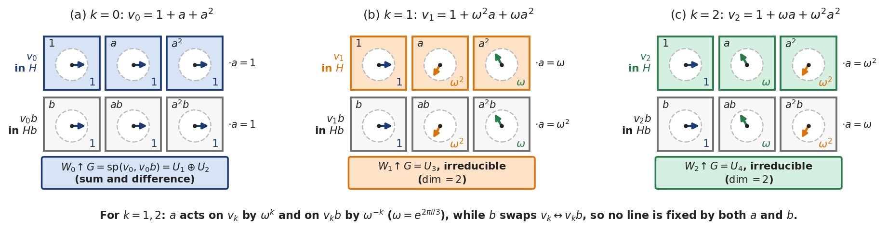

*Figure 17. Inducing the three $1$-dimensional $\mathbb{C}C_3$-modules $W_k = \operatorname{sp}(v_k)$ to $\mathbb{C}D_6$. The top row of each grid is the coset $H = \{1, a, a^2\}$ and the bottom row is $Hb = \{b, ab, a^2b\}$; each arrow is a coefficient $1$, $\omega$ or $\omega^2$ drawn at its angle. (a) For $k = 0$, $a$ fixes both $v_0$ and $v_0 b$, and $W_0 \uparrow G$ splits into the sum and difference lines $U_1 \oplus U_2$. (b, c) For $k = 1, 2$, $a$ multiplies $v_k$ by $\omega^k$ and $v_k b$ by $\omega^{-k}$, while $b$ swaps the two lines, so no line is fixed by both and $W_k \uparrow G$ is irreducible.*

Why was $U \uparrow G = U(\mathbb{C}G)$ defined first only for submodules $U \subseteq \mathbb{C}H$? An arbitrary $\mathbb{C}H$-module $U$ (such as a space of row vectors $\mathbb{C}^n$, or a direct sum containing an irreducible $\mathbb{C}H$-module with multiplicity larger than its degree) does not sit inside $\mathbb{C}H$ as a subset, so we cannot multiply its elements by $g \in G$ inside $\mathbb{C}G$.

However, by Maschke's theorem and the regular-module theorem ([character tables, isomorphism and grouping into multiplicities](#character-tables-isomorphism-and-grouping-into-multiplicities)), every $\mathbb{C}H$-module $U$ is isomorphic to an external direct sum $U_1 \oplus \cdots \oplus U_m$ of irreducible $\mathbb{C}H$-submodules $U_i$ of $\mathbb{C}H$. To define $U \uparrow G$ as $(U_1 \uparrow G) \oplus \cdots \oplus (U_m \uparrow G)$, we need two consistency facts for submodules inside $\mathbb{C}H$: that isomorphic submodules of $\mathbb{C}H$ induce to isomorphic submodules of $\mathbb{C}G$, and that direct sums inside $\mathbb{C}H$ induce to direct sums inside $\mathbb{C}G$.

**Isomorphic submodules of $\mathbb{C}H$ induce to isomorphic submodules of $\mathbb{C}G$.** Suppose that $U$ and $V$ are $\mathbb{C}H$-submodules of $\mathbb{C}H$ and $U \cong V$ as $\mathbb{C}H$-modules. Then $U \uparrow G \cong V \uparrow G$ as $\mathbb{C}G$-modules.

**Direct sums inside $\mathbb{C}H$ induce to direct sums inside $\mathbb{C}G$.** If $U$ and $V$ are $\mathbb{C}H$-submodules of $\mathbb{C}H$ with $U \cap V = \{0\}$, then $(U \uparrow G) \cap (V \uparrow G) = \{0\}$. Consequently, if a $\mathbb{C}H$-submodule $U \subseteq \mathbb{C}H$ is an internal direct sum $U = U_1 \oplus \cdots \oplus U_m$ of $\mathbb{C}H$-submodules $U_i$, then

$$U \uparrow G = (U_1 \uparrow G) \oplus \cdots \oplus (U_m \uparrow G).$$

**Extending induction to any $\mathbb{C}H$-module.** For any $\mathbb{C}H$-module $U$, choose an isomorphism $U \cong U_1 \oplus \cdots \oplus U_m$ where each $U_i$ is an irreducible $\mathbb{C}H$-submodule of $\mathbb{C}H$, and define the induced $\mathbb{C}G$-module $U \uparrow G$ to be the external direct sum

$$U \uparrow G := (U_1 \uparrow G) \oplus \cdots \oplus (U_m \uparrow G).$$

The two consistency results above guarantee that if $U$ was already a $\mathbb{C}H$-submodule of $\mathbb{C}H$, this external direct sum is $\mathbb{C}G$-isomorphic to $U(\mathbb{C}G)$, and up to $\mathbb{C}G$-isomorphism it does not depend on which isomorphic copies $U_i \subseteq \mathbb{C}H$ we chose. Moreover, for any $\mathbb{C}H$-modules $U_1, \dots, U_m$, induction distributes over direct sums:

$$(U_1 \oplus \cdots \oplus U_m) \uparrow G \cong (U_1 \uparrow G) \oplus \cdots \oplus (U_m \uparrow G).$$

Because any $\mathbb{C}H$-module is built from submodules of $\mathbb{C}H$ by direct sums, properties of $U(\mathbb{C}G)$ carry over to general induced modules. In particular, **transitivity of induction** says that inducing in stages through an intermediate subgroup $K$ produces the same module as inducing in a single step.

**Transitivity of induction.** Suppose that $H$ and $K$ are subgroups of $G$ with $H \le K \le G$. If $U$ is any $\mathbb{C}H$-module, then

$$(U \uparrow K) \uparrow G \cong U \uparrow G.$$

For a submodule $U \subseteq \mathbb{C}H$, closing $U$ under right multiplication by $K$ and then by $G$ spans the exact same subspace $U(\mathbb{C}G)$ as closing $U$ under right multiplication by $G$ directly. Over an arbitrary commutative ring $R$, where a module need not sit inside $RH$, the induced module is built as a tensor product instead, in [induction and restriction](#induction-and-restriction).

#### Induced Characters and Frobenius Reciprocity

If $\psi$ is the character of a $\mathbb{C}H$-module $U$, the character of the induced $\mathbb{C}G$-module $U \uparrow G$ is written $\psi \uparrow G$ and is called the **induced character** (or the character induced from $\psi$). Because isomorphic modules have equal characters and induction distributes over direct sums, $\psi \uparrow G$ depends only on $\psi$ and satisfies $(\psi_1 + \psi_2) \uparrow G = \psi_1 \uparrow G + \psi_2 \uparrow G$.

Before computing the values of $\psi \uparrow G$ on group elements, let us look back at the restriction table between $G = S_5$ and $H = A_4$ and see how its columns already encode the induced characters $\psi_j \uparrow G$.

**Worked example: the restriction-induction matrix between $S_5$ and $A_4$.** For $G = S_5$ (with irreducible characters $\chi_1, \dots, \chi_7$) and $H = A_4$ (with irreducible characters $\psi_1, \dots, \psi_4$), we found earlier that

$$\chi_1 \downarrow H = \chi_2 \downarrow H = \psi_1, \qquad \chi_3 \downarrow H = \chi_4 \downarrow H = \psi_1 + \psi_4, \qquad \chi_5 \downarrow H = 2\psi_4, \qquad \chi_6 \downarrow H = \chi_7 \downarrow H = \psi_2 + \psi_3 + \psi_4.$$

The coefficient of $\psi_j$ in $\chi_i \downarrow H$ is the inner product $\langle \chi_i \downarrow H, \psi_j \rangle_H$. Recording these inner products in a $7 \times 4$ matrix with rows indexed by $\chi_1, \dots, \chi_7$ and columns indexed by $\psi_1, \dots, \psi_4$ gives

$$\begin{pmatrix} \langle \chi_i \downarrow H, \psi_j \rangle_H \end{pmatrix} = \begin{array}{c|cccc} & \psi_1 & \psi_2 & \psi_3 & \psi_4 \\ \hline \chi_1 & 1 & 0 & 0 & 0 \\ \chi_2 & 1 & 0 & 0 & 0 \\ \chi_3 & 1 & 0 & 0 & 1 \\ \chi_4 & 1 & 0 & 0 & 1 \\ \chi_5 & 0 & 0 & 0 & 2 \\ \chi_6 & 0 & 1 & 1 & 1 \\ \chi_7 & 0 & 1 & 1 & 1 \end{array}$$

Reading across row $i$ tells us how $\chi_i$ restricts to $H$: for instance, row $3$ reads $\chi_3 \downarrow H = 1\psi_1 + 0\psi_2 + 0\psi_3 + 1\psi_4$. Reading down column $j$ gives the decomposition of the induced character $\psi_j \uparrow G$ into the irreducible characters of $G$:

$$\psi_1 \uparrow G = \chi_1 + \chi_2 + \chi_3 + \chi_4, \qquad \psi_2 \uparrow G = \psi_3 \uparrow G = \chi_6 + \chi_7, \qquad \psi_4 \uparrow G = \chi_3 + \chi_4 + 2\chi_5 + \chi_6 + \chi_7.$$

That is, the $(i, j)$-entry of the matrix equals both the multiplicity $\langle \chi_i \downarrow H, \psi_j \rangle_H$ of $\psi_j$ in $\chi_i \downarrow H$ and the multiplicity $\langle \chi_i, \psi_j \uparrow G \rangle_G$ of $\chi_i$ in $\psi_j \uparrow G$.

This equality of multiplicities is a general theorem, called Frobenius reciprocity. In plain English, inducing up from $H$ to $G$ and restricting down from $G$ to $H$ are adjoint operations: for any character $\psi$ of $H$ and any character $\chi$ of $G$, taking the inner product of $\psi \uparrow G$ with $\chi$ on $G$ gives the exact same number as taking the inner product of $\psi$ with $\chi \downarrow H$ on $H$.

The bridge between the two inner products comes from comparing the spaces of module homomorphisms $\operatorname{Hom}_{\mathbb{C}G}(U \uparrow G, V)$ and $\operatorname{Hom}_{\mathbb{C}H}(U, V \downarrow H)$ ([consequences of orthonormality and decomposing modules](#consequences-of-orthonormality-and-decomposing-modules)).

**Equality of homomorphism-space dimensions.** Assume that $H \le G$. Let $U$ be a $\mathbb{C}H$-submodule of $\mathbb{C}H$, and let $V$ be a $\mathbb{C}G$-submodule of $\mathbb{C}G$. Then the vector spaces $\operatorname{Hom}_{\mathbb{C}G}(U \uparrow G, V)$ and $\operatorname{Hom}_{\mathbb{C}H}(U, V \downarrow H)$ have the same dimension.

Both homomorphism spaces consist of left multiplications $u \mapsto ru$ by elements $r \in \mathbb{C}G$ that send $U$ into $V$: restricting a $\mathbb{C}G$-homomorphism $U \uparrow G \to V$ to $U$ gives a $\mathbb{C}H$-homomorphism $U \to V \downarrow H$, and extending a $\mathbb{C}H$-homomorphism $U \to V \downarrow H$ linearly across the products $ug$ ($g \in G$) recovers the $\mathbb{C}G$-homomorphism on $U \uparrow G$. Over any commutative ring $R$, this becomes the adjointness of induction and restriction, together with its counterpart for higher extension groups (the Eckmann–Shapiro lemma), in [tensor-product induction, coinduction and Frobenius reciprocity](#tensor-product-induction-coinduction-and-frobenius-reciprocity).

**Frobenius reciprocity theorem.** Assume that $H \le G$. For every character $\chi$ of $G$ and every character $\psi$ of $H$,

$$\langle \psi \uparrow G, \chi \rangle_G = \langle \psi, \chi \downarrow H \rangle_H.$$

More generally, if $f$ is any class function on $G$ and $\psi$ is a character of $H$, then $\langle \psi \uparrow G, f \rangle_G = \langle \psi, f \downarrow H \rangle_H$.

Inducing up from $H$ to $G$ and restricting down from $G$ to $H$ are two sides of this single correspondence between homomorphism spaces: the inner product $\langle \psi \uparrow G, \chi \rangle_G$ counts the dimension of $\operatorname{Hom}_{\mathbb{C}G}(U \uparrow G, V)$, while $\langle \psi, \chi \downarrow H \rangle_H$ counts the dimension of $\operatorname{Hom}_{\mathbb{C}H}(U, V \downarrow H)$. Since the irreducible characters of $G$ span the space of [class functions](#consequences-of-orthonormality-and-decomposing-modules) on $G$, the same identity extends by linearity to any class function $f$ on $G$.

#### Two Formulas for the Values of Induced Characters

Frobenius reciprocity tells us the inner products of $\psi \uparrow G$ with characters of $G$ when we already know the characters of $G$. Often, however, we want the reverse: we know a character $\psi$ of a subgroup $H \le G$, and we want to compute the values $(\psi \uparrow G)(g)$ for $g \in G$ directly in order to *find* unknown irreducible characters of $G$. We have two explicit formulas for $(\psi \uparrow G)(g)$: first a sum over all elements $y \in G$, and then a faster formula in terms of centralizer orders and the conjugacy classes of $H$ contained in $g^G$.

Let $\psi$ be a character of $H \le G$. Define the zero-extended function $\psi^\circ : G \to \mathbb{C}$ (also written $\dot{\psi}$) by setting $\psi^\circ$ equal to $\psi$ on $H$ and $0$ outside $H$:

$$\psi^\circ(g) = \begin{cases} \psi(g) & \text{if } g \in H, \\ 0 & \text{if } g \notin H. \end{cases}$$

**First formula for induced character values (averaging over $G$).** For any character $\psi$ of $H \le G$ and any $g \in G$, the value of the induced character $\psi \uparrow G$ at $g$ is

$$(\psi \uparrow G)(g) = \frac{1}{\lvert H\rvert} \sum_{y \in G} \psi^\circ(y^{-1}gy).$$

In particular, evaluating at $g = 1$ (where $y^{-1}1y = 1 \in H$ for all $\lvert G\rvert$ elements $y \in G$) gives the degree of the induced character:

$$(\psi \uparrow G)(1) = \frac{\lvert G\rvert}{\lvert H\rvert}\psi(1) = \lvert G : H\rvert\psi(1).$$

Intuitively, averaging $\psi^\circ(y^{-1}gy)$ over all $y \in G$ builds a class function on $G$ whose inner product with any character $\chi$ of $G$ collapses to $\langle \psi, \chi \downarrow H \rangle_H = \langle \psi \uparrow G, \chi \rangle_G$ by Frobenius reciprocity.

For hand calculations on concrete groups, summing over every $y \in G$ is cumbersome, and character tables record only conjugacy class representatives and centralizer orders. To convert the formula into centralizer orders, we use the characteristic function $f_x^G : G \to \mathbb{C}$ of the conjugacy class $x^G$ of an element $x \in G$, defined by

$$f_x^G(y) = \begin{cases} 1 & \text{if } y \in x^G, \\ 0 & \text{if } y \notin x^G \end{cases} \qquad (y \in G).$$

Because $f_x^G$ is constant on conjugacy classes of $G$, it is a class function on $G$. Its inner product with any character $\chi$ of $G$ picks out the value $\chi(x)$ divided by the centralizer order $\lvert C_G(x)\rvert$.

**Inner product with the characteristic function of a conjugacy class.** For any character $\chi$ of $G$ and any $x \in G$,

$$\langle \chi, f_x^G \rangle_G = \frac{\chi(x)}{\lvert C_G(x)\rvert}.$$

Because $f_x^G$ is $1$ only on the $\lvert x^G\rvert = \lvert G\rvert / \lvert C_G(x)\rvert$ elements of $x^G$ ([centralizers and the center](#centralizers-and-the-center)), where $\chi$ takes the constant value $\chi(x)$, averaging over $G$ divides $\chi(x)$ by $\lvert C_G(x)\rvert$.

Now look at how a $G$-conjugacy class $x^G$ intersects the subgroup $H$. If $h \in H$, every $H$-conjugate $k^{-1}hk$ ($k \in H$) is also a $G$-conjugate of $h$, so the $H$-conjugacy class $h^H$ is contained inside $h^G$. Consequently, the intersection $H \cap x^G$ is a union of complete $H$-conjugacy classes. Two possibilities can occur: either no element of $x^G$ lies in $H$, in which case $H \cap x^G = \emptyset$ and $f_x^G \downarrow H = 0$; or at least one element of $x^G$ lies in $H$, in which case $H \cap x^G$ breaks up into $m \ge 1$ disjoint $H$-conjugacy classes $x_1^H, \dots, x_m^H$ with representatives $x_1, \dots, x_m \in H$, and the restricted characteristic function splits as

$$f_x^G \downarrow H = f_{x_1}^H + \cdots + f_{x_m}^H.$$

Combining this splitting with Frobenius reciprocity for the class function $f_x^G$ gives our second formula for induced characters.

**Second formula for induced character values (via centralizer orders and $H$-classes).** Let $\psi$ be a character of $H \le G$, and let $x \in G$. If no element of $x^G$ lies in $H$, then $(\psi \uparrow G)(x) = 0$. If $H \cap x^G$ breaks up into $m \ge 1$ conjugacy classes of $H$ with representatives $x_1, \dots, x_m \in H$ (so $f_x^G \downarrow H = f_{x_1}^H + \cdots + f_{x_m}^H$), then

$$(\psi \uparrow G)(x) = \lvert C_G(x)\rvert\left(\frac{\psi(x_1)}{\lvert C_H(x_1)\rvert} + \cdots + \frac{\psi(x_m)}{\lvert C_H(x_m)\rvert}\right).$$

We finish with two worked examples of this centralizer formula: first inducing all five irreducible characters of $D_8$ up to $S_4$, and then finding the full character table of a non-abelian group of order $21$ by inducing linear characters from its normal subgroup of order $7$.

**Fact we use (conjugacy classes of $D_{2n}$ for even $n$).** In $D_{2n} = \langle a, b : a^n = b^2 = 1,\, b^{-1}ab = a^{-1} \rangle$ with $n = 2m$ even, the relations $b^{-1}a^i b = a^{-i}$ and $a^j b a^{-j} = a^{2j}b$ split $D_{2n}$ into $m + 3$ conjugacy classes: the two central classes $\{1\}$ and $\{a^m\}$, the $m - 1$ rotation pairs $\{a^i, a^{-i}\}$ ($1 \le i \le m - 1$), and the two reflection classes $\{a^{2j}b : 0 \le j \le m - 1\}$ and $\{a^{2j+1}b : 0 \le j \le m - 1\}$.

**Worked example: inducing the irreducible characters of $D_8$ to $S_4$.** Let $G = S_4$, and let $H = \langle a, b \rangle \le S_4$, where $a = (1\,2\,3\,4)$ and $b = (1\,3)$. Composing permutations from left to right, we have $a^4 = b^2 = 1$ and $b^{-1}ab = (1\,3)(1\,2\,3\,4)(1\,3) = (1\,4\,3\,2) = a^{-1}$, so $H \cong D_8$ of order $8$, with elements

$$1, \quad a = (1\,2\,3\,4), \quad a^2 = (1\,3)(2\,4), \quad a^3 = (1\,4\,3\,2), \quad b = (1\,3), \quad ab = (1\,2)(3\,4), \quad a^2b = (2\,4), \quad a^3b = (1\,4)(2\,3).$$

By the conjugacy-class description of $D_{2n}$ with $n = 4$ ($m = 2$), the five conjugacy classes of $H$ are

$$\{1\}, \qquad \{a^2 = (1\,3)(2\,4)\}, \qquad \{a = (1\,2\,3\,4),\, a^3 = (1\,4\,3\,2)\}, \qquad \{b = (1\,3),\, a^2b = (2\,4)\}, \qquad \{ab = (1\,2)(3\,4),\, a^3b = (1\,4)(2\,3)\}.$$

Now compare these five $H$-classes with the five conjugacy classes of $G = S_4$ (determined by cycle shape, with representatives $1$, $(1\,3)$, $(1\,2\,3)$, $(1\,2)(3\,4)$, and $(1\,2\,3\,4)$). No $3$-cycle lies in $H$, so $(1\,2\,3)^G \cap H = \emptyset$. The identity class $\{1\}$, the $2$-cycle class $(1\,3)^G$ (which meets $H$ in $\{b = (1\,3), a^2b = (2\,4)\}$), and the $4$-cycle class $(1\,2\,3\,4)^G$ (which meets $H$ in $\{a = (1\,2\,3\,4), a^3 = (1\,4\,3\,2)\}$) each contain a single $H$-conjugacy class.

By contrast, all three double transpositions in $S_4$ lie in $H$, but in $H$ they split into *two* conjugacy classes: the central class $\{a^2 = (1\,3)(2\,4)\}$ of size $1$ and the reflection class $\{ab = (1\,2)(3\,4), a^3b = (1\,4)(2\,3)\}$ of size $2$. In terms of characteristic functions,

$$f_1^G \downarrow H = f_1^H, \qquad f_{(1\,3)}^G \downarrow H = f_{(1\,3)}^H, \qquad f_{(1\,2\,3)}^G \downarrow H = 0, \qquad f_{(1\,2)(3\,4)}^G \downarrow H = f_{(1\,3)(2\,4)}^H + f_{(1\,2)(3\,4)}^H, \qquad f_{(1\,2\,3\,4)}^G \downarrow H = f_{(1\,2\,3\,4)}^H.$$

Using $\lvert C_G(h)\rvert = \lvert G\rvert / \lvert h^G\rvert$ and $\lvert C_H(h)\rvert = \lvert H\rvert / \lvert h^H\rvert$, the centralizer orders of the five $H$-class representatives in $G = S_4$ and in $H = D_8$ are:

| Representative $h \in H$ | $1$ | $a^2 = (1\,3)(2\,4)$ | $a = (1\,2\,3\,4)$ | $b = (1\,3)$ | $ab = (1\,2)(3\,4)$ |
| :--- | :---: | :---: | :---: | :---: | :---: |
| $\lvert C_G(h)\rvert$ | $24$ | $8$ | $4$ | $4$ | $8$ |
| $\lvert C_H(h)\rvert$ | $8$ | $8$ | $4$ | $4$ | $4$ |

For any character $\psi$ of $H$, our centralizer formula for $(\psi \uparrow G)(x)$ on the five class representatives of $S_4$ therefore gives

$$(\psi \uparrow G)(1) = 24\frac{\psi(1)}{8} = 3\psi(1), \qquad (\psi \uparrow G)((1\,3)) = 4\frac{\psi((1\,3))}{4} = \psi((1\,3)), \qquad (\psi \uparrow G)((1\,2\,3)) = 0,$$

$$(\psi \uparrow G)((1\,2)(3\,4)) = 8\left(\frac{\psi((1\,3)(2\,4))}{8} + \frac{\psi((1\,2)(3\,4))}{4}\right) = \psi(a^2) + 2\psi(ab), \qquad (\psi \uparrow G)((1\,2\,3\,4)) = 4\frac{\psi((1\,2\,3\,4))}{4} = \psi(a).$$

Recall the five irreducible characters $\chi_1, \dots, \chi_5$ of $D_8$ from [consequences of orthonormality and decomposing modules](#consequences-of-orthonormality-and-decomposing-modules): on $(1, a^2, a, b, ab)$ they take values $\chi_1 = (1, 1, 1, 1, 1)$, $\chi_2 = (1, 1, 1, -1, -1)$, $\chi_3 = (1, 1, -1, 1, -1)$, $\chi_4 = (1, 1, -1, -1, 1)$, and $\chi_5 = (2, -2, 0, 0, 0)$. Plugging each $\chi_i$ into the five formulas above (and writing $(1\,2)$ for the $2$-cycle class representative of $S_4$) gives the induced characters on $S_4$:

| Induced character | $1$ | $(1\,2)$ | $(1\,2\,3)$ | $(1\,2)(3\,4)$ | $(1\,2\,3\,4)$ |
| :--- | :---: | :---: | :---: | :---: | :---: |
| $\chi_1 \uparrow G$ | $3$ | $1$ | $0$ | $3$ | $1$ |
| $\chi_2 \uparrow G$ | $3$ | $-1$ | $0$ | $-1$ | $1$ |
| $\chi_3 \uparrow G$ | $3$ | $1$ | $0$ | $-1$ | $-1$ |
| $\chi_4 \uparrow G$ | $3$ | $-1$ | $0$ | $3$ | $-1$ |
| $\chi_5 \uparrow G$ | $6$ | $0$ | $0$ | $-2$ | $0$ |

Notice that $\chi_2 \uparrow G$ and $\chi_3 \uparrow G$ have norm $\frac{9}{24} + \frac{1}{4} + 0 + \frac{1}{8} + \frac{1}{4} = 1$ on $S_4$, so inducing the $1$-dimensional characters $\chi_2$ and $\chi_3$ of $D_8$ directly produces the two $3$-dimensional irreducible characters of $S_4$.

**Worked example: constructing the character table of a group of order $21$ by induction.** In $S_7$, define the $7$-cycle $a = (1\,2\,3\,4\,5\,6\,7)$ and the product of two $3$-cycles $b = (2\,3\,5)(4\,7\,6)$, and let $G = \langle a, b \rangle \le S_7$. We have $a^7 = 1$ and $b^3 = 1$, and applying the cycle-conjugation rule $b^{-1}(1\,2\,3\,4\,5\,6\,7)b = (1b\,\,2b\,\,3b\,\,4b\,\,5b\,\,6b\,\,7b)$ gives

$$b^{-1}ab = (1\,3\,5\,7\,2\,4\,6) = a^2.$$

Because $b^{-1}ab = a^2$ gives $ab = ba^2$ and $ba = a^4b$, every product of powers of $a$ and $b$ can be rearranged into the form $a^i b^j$ with $0 \le i \le 6$ and $0 \le j \le 2$. Since the cyclic subgroup $H = \langle a \rangle$ has order $7$ and $b \notin \langle a \rangle$ has order $3$, the $21$ elements $a^i b^j$ ($0 \le i \le 6, 0 \le j \le 2$) are all distinct, and $G$ is a non-abelian group of order $21$.

To build the character table of $G$, we first find its conjugacy classes. The abelian subgroup $\langle a \rangle$ of order $7$ is contained in $C_G(a)$, so $7$ divides $\lvert C_G(a)\rvert$; because $b^{-1}ab = a^2 \neq a$, we have $b \notin C_G(a)$, so $\lvert C_G(a)\rvert < 21$ and hence $\lvert C_G(a)\rvert = 7$, which means $\lvert a^G\rvert = 21 / 7 = 3$. Conjugating $a$ repeatedly by $b$ gives $b^{-1}ab = a^2$ and $b^{-2}ab^2 = (a^2)^2 = a^4$, so $a^G = \{a, a^2, a^4\}$, and similarly $(a^3)^G = \{a^3, a^6, a^5\} = \{a^3, a^5, a^6\}$.

Next, $\langle b \rangle \le C_G(b)$ has order $3$ and $a \notin C_G(b)$, so $\lvert C_G(b)\rvert = 3$ and $\lvert b^G\rvert = 21 / 3 = 7$. Because $b^{-1}a^i b = a^{2i}$, every element inside $b^G$ has the same non-zero $b$-exponent modulo $3$, so $b^G = \{a^i b : 0 \le i \le 6\}$ and $(b^2)^G = \{a^i b^2 : 0 \le i \le 6\}$. Thus $G$ has five conjugacy classes, with representatives $1, a, a^3, b, b^2$ and centralizer orders $21, 7, 7, 3, 3$, and $G$ has five irreducible characters.

Because $b^{-1}ab = a^2 \in \langle a \rangle$, the subgroup $H = \langle a \rangle$ is normal in $G$ and the quotient $G/H = \langle Hb \rangle \cong C_3$ is cyclic of order $3$. Let $\omega = e^{2\pi i/3}$. Lifting the three linear characters of $G/H \cong C_3$ gives three $1$-dimensional irreducible characters $\chi_1, \chi_2, \chi_3$ of $G$:

| Representative $g$ | $1$ | $a$ | $a^3$ | $b$ | $b^2$ |
| :--- | :---: | :---: | :---: | :---: | :---: |
| $\lvert C_G(g)\rvert$ | $21$ | $7$ | $7$ | $3$ | $3$ |
| $\chi_1$ | $1$ | $1$ | $1$ | $1$ | $1$ |
| $\chi_2$ | $1$ | $1$ | $1$ | $\omega$ | $\omega^2$ |
| $\chi_3$ | $1$ | $1$ | $1$ | $\omega^2$ | $\omega$ |

We obtain the remaining two irreducible characters of $G$ by inducing the non-trivial linear characters of the cyclic subgroup $H = \langle a \rangle \cong C_7$. Let $\eta = e^{2\pi i/7}$. For each $k \in \{1, 2, 3, 4, 5, 6\}$, the map $\psi_k(a^j) = \eta^{jk}$ ($0 \le j \le 6$) is a linear character of $H$. Because $H$ is abelian, each element of $H$ forms a singleton $H$-conjugacy class with $\lvert C_H(h)\rvert = \lvert H\rvert = 7$. The $G$-conjugacy class $a^G = \{a, a^2, a^4\}$ lies entirely in $H$ and breaks into the three singleton $H$-classes $\{a\}$, $\{a^2\}$, and $\{a^4\}$, while $(a^3)^G = \{a^3, a^5, a^6\}$ breaks into $\{a^3\}$, $\{a^5\}$, and $\{a^6\}$:

$$f_a^G \downarrow H = f_a^H + f_{a^2}^H + f_{a^4}^H, \qquad f_{a^3}^G \downarrow H = f_{a^3}^H + f_{a^5}^H + f_{a^6}^H, \qquad f_b^G \downarrow H = f_{b^2}^G \downarrow H = 0.$$

Since $\lvert C_G(a)\rvert = \lvert C_G(a^3)\rvert = 7$ cancels $\lvert C_H(x_m)\rvert = 7$ in the centralizer formula for $(\psi_k \uparrow G)(x)$, inducing $\psi_1$ and $\psi_3$ gives $(\psi_1 \uparrow G)(1) = (\psi_3 \uparrow G)(1) = \frac{21}{7} \cdot 1 = 3$, $(\psi_1 \uparrow G)(b) = (\psi_1 \uparrow G)(b^2) = (\psi_3 \uparrow G)(b) = (\psi_3 \uparrow G)(b^2) = 0$, and on $a$ and $a^3$:

$$(\psi_1 \uparrow G)(a) = \eta + \eta^2 + \eta^4, \qquad (\psi_1 \uparrow G)(a^3) = \eta^3 + \eta^5 + \eta^6,$$

$$(\psi_3 \uparrow G)(a) = \eta^3 + \eta^{6} + \eta^{12} = \eta^3 + \eta^5 + \eta^6, \qquad (\psi_3 \uparrow G)(a^3) = \eta^9 + \eta^{15} + \eta^{18} = \eta + \eta^2 + \eta^4.$$

Set $\chi_4 := \psi_1 \uparrow G$ and $\chi_5 := \psi_3 \uparrow G$. To check that $\chi_4$ and $\chi_5$ are distinct and irreducible, note first that on $H$ we have $\chi_4 \downarrow H = \psi_1 + \psi_2 + \psi_4$ and $\chi_5 \downarrow H = \psi_3 + \psi_5 + \psi_6$, which are distinct because $\psi_1, \dots, \psi_6$ are linearly independent characters of $H$. Next, because $\overline{\eta^r} = \eta^{7-r}$ and $1 + \eta + \eta^2 + \eta^3 + \eta^4 + \eta^5 + \eta^6 = 0$, the product of $\eta + \eta^2 + \eta^4$ with its complex conjugate $\eta^6 + \eta^5 + \eta^3$ expands as

$$\lvert\eta + \eta^2 + \eta^4\rvert^2 = (\eta + \eta^2 + \eta^4)(\eta^6 + \eta^5 + \eta^3) = 3 + (\eta + \eta^2 + \eta^3 + \eta^4 + \eta^5 + \eta^6) = 3 - 1 = 2.$$

Thus $\lvert\chi_4(a)\rvert^2 = \lvert\chi_4(a^3)\rvert^2 = 2$, and the norm of $\chi_4$ (and likewise of $\chi_5$) on $G$ is

$$\langle \chi_4, \chi_4 \rangle_G = \frac{3^2}{21} + \frac{2}{7} + \frac{2}{7} + \frac{0}{3} + \frac{0}{3} = \frac{3}{7} + \frac{2}{7} + \frac{2}{7} = 1.$$

Hence $\chi_4$ and $\chi_5$ are irreducible characters of $G$, completing the character table of $G = \langle a, b : a^7 = b^3 = 1,\, b^{-1}ab = a^2 \rangle$:

| Representative $g_i$ | $1$ | $a$ | $a^3$ | $b$ | $b^2$ |
| :--- | :---: | :---: | :---: | :---: | :---: |
| $\lvert C_G(g_i)\rvert$ | $21$ | $7$ | $7$ | $3$ | $3$ |
| $\chi_1$ | $1$ | $1$ | $1$ | $1$ | $1$ |
| $\chi_2$ | $1$ | $1$ | $1$ | $\omega$ | $\omega^2$ |
| $\chi_3$ | $1$ | $1$ | $1$ | $\omega^2$ | $\omega$ |
| $\chi_4$ | $3$ | $\eta + \eta^2 + \eta^4$ | $\eta^3 + \eta^5 + \eta^6$ | $0$ | $0$ |
| $\chi_5$ | $3$ | $\eta^3 + \eta^5 + \eta^6$ | $\eta + \eta^2 + \eta^4$ | $0$ | $0$ |

### Permutation Characters, 2-Transitive Actions and Symmetric Groups

In [the regular character and the subtracted permutation character](#the-regular-character-and-the-subtracted-permutation-character), we saw that any subgroup $G \le S_n$ has a permutation character $\pi(g) = \lvert\operatorname{fix}(g)\rvert$ on $\{1, \dots, n\}$, and that $\pi - 1_G$ is always a character of $G$. More generally, a group $G$ can act on many different finite sets $\Omega$, such as pairs of points, $k$-element subsets, $1$-dimensional subspaces of a vector space, or right cosets of a subgroup. Each action turns the vector space $\mathbb{C}\Omega$ with basis $\Omega$ into a $\mathbb{C}G$-module whose character $\pi$ counts fixed points on $\Omega$. The inner products $\langle \pi, 1_G \rangle$, $\langle \pi_1, \pi_2 \rangle$, and $\langle \pi, \pi \rangle$ then count the orbits of $G$ on $\Omega$, on $\Omega_1 \times \Omega_2$, and on $\Omega \times \Omega$. From these orbit counts alone, we can tell when $\pi - 1_G$ is irreducible and construct a family of irreducible characters $\chi^{(n-k,k)} = \pi_k - \pi_{k-1}$ of $S_n$ from its actions on $k$-element subsets of $\{1, \dots, n\}$.

#### Right Group Actions, Orbits and the Stabilizer Index

For any set $\Omega$, let $\operatorname{Sym}(\Omega)$ denote the group of all permutations of $\Omega$. In particular, when $\Omega = \{1, 2, \dots, n\}$, we have $\operatorname{Sym}(\Omega) = S_n$.

As introduced in [group actions and the orbit-stabilizer theorem](#group-actions-and-the-orbit-stabilizer-theorem) and [kernels, cores and faithfulness](#kernels-cores-faithfulness), an action of a group $G$ on a set $\Omega$ is a group homomorphism $\varphi : G \to \operatorname{Sym}(\Omega)$, and we say that $G$ acts on $\Omega$ via $\varphi$. Earlier in Maths 2, group actions were written on the left ($g \cdot x$ or $g(\alpha)$). Here we keep our right-hand convention for maps and modules, so an element $g \in G$ sends $\omega \in \Omega$ to $\omega(g\varphi)$, which we shorten to $\omega g$. Because $\varphi$ is a homomorphism and permutations compose from left to right, the action satisfies $\omega 1 = \omega$ and

$$\omega(gh) = (\omega g)h \qquad (\omega \in \Omega,\; g, h \in G).$$

Nothing else changes when we switch from left to right notation.

**Worked examples: four group actions written on the right.** First, if $G \le S_n$ is a permutation group, the identity map $\varphi : G \to S_n$ is an action of $G$ on $\Omega = \{1, \dots, n\}$.

Second, let $G = S_n$ and let $\Omega$ be the set of all unordered pairs $\{i, j\}$ of distinct elements of $\{1, \dots, n\}$ ($1 \le i < j \le n$, so $\lvert\Omega\rvert = \binom{n}{2}$). Define $\varphi : S_n \to \operatorname{Sym}(\Omega)$ by

$$\{i, j\}(g\varphi) = \{ig, jg\} \qquad (g \in S_n,\; 1 \le i < j \le n).$$

For instance, $(1\,2)\varphi$ sends $\{1, 3\}$ to $\{2, 3\}$. Applying $gh$ gives $\{i, j\}((gh)\varphi) = \{i(gh), j(gh)\} = \{(ig)h, (jg)h\} = (\{i, j\}(g\varphi))(h\varphi)$, so $\varphi$ is a homomorphism, called the *action of $S_n$ on pairs*.

Third, let $\mathbb{F}_q$ be a finite field of order $q$, and let $G = \operatorname{GL}(2, q)$ be the group of invertible $2 \times 2$ matrices over $\mathbb{F}_q$. Let $V = \mathbb{F}_q^2$ be the $2$-dimensional vector space of row vectors $(a, b)$ with $a, b \in \mathbb{F}_q$, and let $\Omega$ be the set of all $1$-dimensional subspaces $\langle v \rangle$ ($0 \neq v \in V$) of $V$ (the points of the projective line over $\mathbb{F}_q$). Define $\varphi : G \to \operatorname{Sym}(\Omega)$ by

$$\langle v \rangle(g\varphi) = \langle vg \rangle \qquad (\langle v \rangle \in \Omega,\; g \in G).$$

Because $(\lambda v)g = \lambda(vg)$ for any non-zero scalar $\lambda \in \mathbb{F}_q$, the subspace $\langle vg \rangle$ depends only on the subspace $\langle v \rangle$, and matrix associativity $v(gh) = (vg)h$ shows that $\varphi$ is an action of $\operatorname{GL}(2, q)$ on $\Omega$. For example, if $g = \begin{pmatrix} 1 & 1 \\ 0 & 1 \end{pmatrix}$, then $(a, b)g = (a, a + b)$, so $g\varphi$ sends $\langle (a, b) \rangle$ to $\langle (a, a + b) \rangle$.

Fourth, let $H$ be a subgroup of $G$ of index $n = \lvert G : H\rvert$, and let $\Omega$ be the set of all $n$ right cosets $Hx$ of $H$ in $G$. Define $\varphi : G \to \operatorname{Sym}(\Omega)$ by

$$(Hx)(g\varphi) = Hxg \qquad (x, g \in G).$$

Associativity in $G$ gives $(Hx)((gh)\varphi) = Hx(gh) = (Hxg)h = ((Hx)(g\varphi))(h\varphi)$, so $\varphi$ is an action of $G$ on $\Omega$. An element $g \in G$ fixes the coset $Hx$ ($Hxg = Hx$) if and only if $xgx^{-1} \in H$, which means $g \in x^{-1}Hx$. Thus the kernel of $\varphi$ is the core of $H$ in $G$ ([kernels, cores and faithfulness](#kernels-cores-faithfulness)):

$$\ker\varphi = \bigcap_{x \in G} x^{-1}Hx \le H.$$

Recall from [group actions and the orbit-stabilizer theorem](#group-actions-and-the-orbit-stabilizer-theorem) and [orbit decomposition](#orbit-decomposition) how an action splits $\Omega$ into orbits. Define a relation $\sim$ on $\Omega$ by setting $\alpha \sim \beta$ if and only if there exists $g \in G$ such that $\alpha g = \beta$. Because $\alpha 1 = \alpha$, $\alpha g = \beta \implies \beta g^{-1} = \alpha$, and $\alpha g = \beta, \beta h = \gamma \implies \alpha(gh) = \gamma$, the relation $\sim$ is an equivalence relation on $\Omega$. Its equivalence classes are the orbits of $G$ on $\Omega$, so $\Omega$ is the disjoint union of the orbits of $G$. We write $\operatorname{orb}(G, \Omega)$ for the number of orbits of $G$ on $\Omega$. As in [transitive, regular and $k$-transitive actions](#transitive-regular-k-transitive-actions), $G$ is transitive on $\Omega$ if $\operatorname{orb}(G, \Omega) = 1$; equivalently, for any $\alpha, \beta \in \Omega$, there exists $g \in G$ such that $\alpha g = \beta$.

**Worked examples: counting orbits for $C_4$ and checking transitivity.** First, let $G = C_4 = \langle x \rangle$, and define $\varphi : G \to S_8$ by $x\varphi = (1\,2\,3\,4)(5\,6)(7\,8)$ (so $x^k\varphi = ((1\,2\,3\,4)(5\,6)(7\,8))^k$ for every integer $k$). Then $G$ has $\operatorname{orb}(G, \Omega) = 3$ orbits on $\Omega = \{1, \dots, 8\}$, namely $\{1, 2, 3, 4\}$, $\{5, 6\}$, and $\{7, 8\}$.

Second, in our actions on pairs ($n \ge 2$), on $1$-dimensional subspaces of $\mathbb{F}_q^2$, and on right cosets of $H$, the group $G$ is transitive on $\Omega$. For $S_n$ on pairs, given any two pairs $\{i, j\}$ and $\{k, l\}$, there is a permutation in $S_n$ sending $i \mapsto k$ and $j \mapsto l$. For $\operatorname{GL}(2, q)$ on $1$-dimensional subspaces of $V = \mathbb{F}_q^2$, given any two non-zero row vectors $v, w \in V$, we can extend each to a basis of $V$ and map the first basis to the second by an invertible matrix $A \in \operatorname{GL}(2, q)$, so $vA = w$ and $\langle v \rangle A = \langle w \rangle$. For $G$ on the right cosets of $H$, given any two right cosets $Hx$ and $Hy$, the group element $g = x^{-1}y \in G$ satisfies $(Hx)g = Hx(x^{-1}y) = Hy$.

For any point $\omega \in \Omega$, we write $\omega^G = \{\omega g : g \in G\}$ for the orbit of $G$ containing $\omega$, and $G_\omega = \{g \in G : \omega g = \omega\}$ for the stabilizer of $\omega$ in $G$ ([group actions and the orbit-stabilizer theorem](#group-actions-and-the-orbit-stabilizer-theorem)). In right-coset notation, the orbit-stabilizer theorem takes the following form.

**Stabilizer subgroup and orbit size (orbit-stabilizer theorem).** For any group $G$ acting on $\Omega$ and any $\omega \in \Omega$, the stabilizer $G_\omega$ is a subgroup of $G$, and the size of the orbit $\omega^G$ equals the index of $G_\omega$ in $G$:

$$\lvert\omega^G\rvert = \lvert G : G_\omega\rvert.$$

Two elements $x, y \in G$ send $\omega$ to the same point ($\omega x = \omega y$) if and only if they lie in the same right coset $G_\omega x = G_\omega y$, so the right cosets of $G_\omega$ in $G$ correspond bijectively to the points of the orbit $\omega^G$.

#### Permutation Characters, Product Actions and 2-Transitivity

Now let $G$ act on a finite set $\Omega$. Denote by $\mathbb{C}\Omega$ the complex vector space with basis $\Omega$, consisting of all formal linear combinations $\sum_{\omega \in \Omega} \lambda_\omega \omega$ ($\lambda_\omega \in \mathbb{C}$). Just as for $G \le S_n$ in [testing the module axioms on a basis and permutation modules](#testing-the-module-axioms-on-a-basis-and-permutation-modules) (see also [permutation modules and representations](#permutation-modules-representations)), extending the action of $G$ linearly by

$$\left(\sum_{\omega \in \Omega} \lambda_\omega \omega\right)g = \sum_{\omega \in \Omega} \lambda_\omega(\omega g) \qquad (g \in G)$$

makes $\mathbb{C}\Omega$ a $\mathbb{C}G$-module, called the permutation module of $G$ on $\Omega$. In the basis $\Omega$, the matrix of $g \in G$ has $1$ in the $(\omega, \omega)$ diagonal entry when $\omega g = \omega$ and $0$ when $\omega g \neq \omega$. Taking the trace as in [the regular character and the subtracted permutation character](#the-regular-character-and-the-subtracted-permutation-character) shows that the [permutation character](#the-regular-character-and-the-subtracted-permutation-character) $\pi$ of $G$ on $\Omega$ is

$$\pi(g) = \lvert\operatorname{fix}_\Omega(g)\rvert \qquad (g \in G),$$

where $\operatorname{fix}_\Omega(g) = \{\omega \in \Omega : \omega g = \omega\}$.

**The permutation character on cosets is an induced character.** When $H \le G$ and $\Omega$ is the set of right cosets of $H$ in $G$, the permutation character $\pi$ of $G$ on $\Omega$ equals the induced trivial character $1_H \uparrow G$ ([induced characters and Frobenius reciprocity](#induced-characters-and-frobenius-reciprocity)). Each right coset $Hx$ fixed by $g$ ($Hxg = Hx$) consists of $\lvert H\rvert$ elements $x \in G$ with $xgx^{-1} \in H$, which matches the averaging formula for $(1_H \uparrow G)(g)$ in [two formulas for the values of induced characters](#two-formulas-for-the-values-of-induced-characters). At the level of modules, the permutation module on the cosets of a subgroup is the induced trivial module, and restricting an induced module to a second subgroup is governed by double cosets in [the Mackey decomposition](#conjugate-modules-double-cosets-and-the-mackey-decomposition).

The link between the permutation character $\pi$ and the orbits of $G$ on $\Omega$ is the orbit-counting lemma (often called Burnside's lemma, and due to Cauchy and Frobenius), which was introduced in [orbit-stabilizer theorem and orbit-counting lemma](#orbit-stabilizer-theorem-orbit-counting-lemma).

**Orbit-counting lemma for permutation characters.** Let $G$ be a group acting on a finite set $\Omega$, and let $\pi$ be the permutation character of $G$ on $\Omega$. Then

$$\langle \pi, 1_G \rangle = \frac{1}{\lvert G\rvert} \sum_{g \in G} \lvert\operatorname{fix}_\Omega(g)\rvert = \operatorname{orb}(G, \Omega).$$

Because $G$ is transitive on $\Omega$ if and only if $\operatorname{orb}(G, \Omega) = 1$, the orbit-counting lemma gives an immediate character test for transitivity.

**Character criterion for transitivity.** A group $G$ acting on a finite set $\Omega$ is transitive on $\Omega$ if and only if $\langle \pi, 1_G \rangle = 1$.

Now suppose that $G$ acts on two finite sets $\Omega_1$ and $\Omega_2$, with permutation characters $\pi_1$ and $\pi_2$, respectively. We define a componentwise action of $G$ on the Cartesian product $\Omega_1 \times \Omega_2$ by setting

$$(\omega_1, \omega_2)g = (\omega_1 g, \omega_2 g) \qquad (\omega_1 \in \Omega_1,\; \omega_2 \in \Omega_2,\; g \in G).$$

An ordered pair $(\omega_1, \omega_2)$ is fixed by $g$ if and only if $\omega_1 g = \omega_1$ in $\Omega_1$ and $\omega_2 g = \omega_2$ in $\Omega_2$, so $\operatorname{fix}_{\Omega_1 \times \Omega_2}(g) = \operatorname{fix}_{\Omega_1}(g) \times \operatorname{fix}_{\Omega_2}(g)$ for every $g \in G$. Consequently, the permutation character $\pi$ of $G$ on $\Omega_1 \times \Omega_2$ is the pointwise product

$$\pi(g) = \pi_1(g)\pi_2(g) \qquad (g \in G).$$

This product action has a counterpart for modules over any commutative coefficient ring, the tensor product of two modules with $g$ acting on both factors at once; see [tensor products, Hom, duals and Hopf algebras](#tensor-products-hom-duals-and-hopf-algebras).

Applying the orbit-counting lemma to this product action expresses the inner product of any two permutation characters as an orbit count.

**Inner product of two permutation characters.** Let $G$ act on finite sets $\Omega_1$ and $\Omega_2$, with permutation characters $\pi_1$ and $\pi_2$, respectively. Then

$$\langle \pi_1, \pi_2 \rangle = \operatorname{orb}(G, \Omega_1 \times \Omega_2).$$

Our first application of this product formula is the case $\Omega_1 = \Omega_2 = \Omega$. As introduced in [sub-orbits, orbitals, blocks and primitives](#sub-orbits-orbitals-blocks-primitives) and [coherent configurations](#coherent-configurations), $G$ acts componentwise on $\Omega \times \Omega$ by $(\omega_1, \omega_2)g = (\omega_1 g, \omega_2 g)$, and the number of orbits of $G$ on $\Omega \times \Omega$ is called the rank of $G$ on $\Omega$, written

$$r(G, \Omega) = \operatorname{orb}(G, \Omega \times \Omega).$$

Setting $\Omega_1 = \Omega_2 = \Omega$ in the inner-product proposition immediately recovers the identity $r(G, \Omega) = \langle \pi, \pi \rangle$ that was derived via the centralizer algebra in [the dimension formula for the rank](#dimension-formula-for-the-rank) and the aside in [coherent configurations](#coherent-configurations).

**Rank as the norm of the permutation character.** Let $G$ act on a finite set $\Omega$, with permutation character $\pi$. Then

$$r(G, \Omega) = \langle \pi, \pi \rangle.$$

Now suppose that $G$ is transitive on $\Omega$ and $\lvert\Omega\rvert > 1$. Because $G$ is transitive on $\Omega$, the diagonal

$$\Delta = \{(\omega, \omega) : \omega \in \Omega\}$$

is a single orbit of $G$ on $\Omega \times \Omega$, and since $\Omega \times \Omega \setminus \Delta$ is non-empty, we always have $r(G, \Omega) \ge 2$. Following the rank point of view in [sub-orbits, orbitals, blocks and primitives](#sub-orbits-orbitals-blocks-primitives), a transitive group $G$ on $\Omega$ is $2$-transitive on $\Omega$ if $r(G, \Omega) = 2$. Because the diagonal $\Delta$ is already one orbit on $\Omega \times \Omega$, having $r(G, \Omega) = 2$ means that all non-diagonal pairs $(\alpha_1, \alpha_2)$ with $\alpha_1 \neq \alpha_2$ form a single second orbit $\Omega \times \Omega \setminus \Delta$. Equivalently, for any ordered pairs $(\alpha_1, \alpha_2)$ and $(\beta_1, \beta_2)$ in $\Omega \times \Omega$ with $\alpha_1 \neq \alpha_2$ and $\beta_1 \neq \beta_2$, there exists $g \in G$ such that $\alpha_1 g = \beta_1$ and $\alpha_2 g = \beta_2$. This matches the ordered-pair definition in [transitive, regular and $k$-transitive actions](#transitive-regular-k-transitive-actions) when $\lvert\Omega\rvert \ge 2$.

Combining $\langle \pi, 1_G \rangle = 1$ with $\langle \pi, \pi \rangle = 2$ shows why every $2$-transitive action produces an irreducible character of degree $\lvert\Omega\rvert - 1$.

**Irreducibility of $\pi - 1_G$ for a $2$-transitive action.** If $G$ is $2$-transitive on $\Omega$, with permutation character $\pi$, then

$$\pi = 1_G + \chi,$$

where $\chi$ is an irreducible character of $G$.

Transitivity on $\Omega$ means $1_G$ occurs in $\pi$ with multiplicity $\langle \pi, 1_G \rangle = 1$, so $\chi = \pi - 1_G$ is a character orthogonal to $1_G$ ([the regular character and the subtracted permutation character](#the-regular-character-and-the-subtracted-permutation-character)). Because $2$-transitivity gives $\langle \pi, \pi \rangle = r(G, \Omega) = 2$, subtracting the norm $1$ of $1_G$ leaves $\langle \chi, \chi \rangle = 2 - 1 = 1$, so $\chi$ is irreducible ([consequences of orthonormality and decomposing modules](#consequences-of-orthonormality-and-decomposing-modules)).

**Worked examples: $2$-transitive actions of $S_n$, $A_n$, and $\operatorname{GL}(2, q)$, and the rank-$3$ action of $S_n$ on pairs.** First, the symmetric group $S_n$ ($n \ge 2$) is $2$-transitive on $\{1, \dots, n\}$, and the alternating group $A_n$ is $2$-transitive on $\{1, \dots, n\}$ provided $n \ge 4$. Indeed, given two ordered pairs of distinct points $(\alpha_1, \alpha_2)$ and $(\beta_1, \beta_2)$, if a permutation $g \in S_n$ sending $\alpha_1 \mapsto \beta_1$ and $\alpha_2 \mapsto \beta_2$ is odd, multiplying $g$ on the right by the transposition swapping two points outside $\{\beta_1, \beta_2\}$ produces an even permutation in $A_n$ that still sends $\alpha_1 \mapsto \beta_1$ and $\alpha_2 \mapsto \beta_2$. By the $2$-transitive corollary, both $S_n$ ($n \ge 2$) and $A_n$ ($n \ge 4$) have an irreducible character $\chi$ of degree $n - 1$ given by

$$\chi(g) = \lvert\operatorname{fix}(g)\rvert - 1 \qquad (g \in G).$$

This explains why the subtracted permutation character $\nu(g) = \lvert\operatorname{fix}(g)\rvert - 1$ came out irreducible in our earlier character tables for $S_3$, $A_4$, $S_5$, and $A_5$, and shows the same for $S_4$.

Second, consider the action of $G = \operatorname{GL}(2, q)$ on the set $\Omega$ of all $1$-dimensional subspaces of the $2$-dimensional vector space $V = \mathbb{F}_q^2$. First let us count $\lvert\Omega\rvert$: the space $V = \mathbb{F}_q^2$ contains $q^2 - 1$ non-zero vectors, and each $1$-dimensional subspace $\langle v \rangle$ contains $q - 1$ non-zero scalar multiples of $v$, so $\Omega$ has size

$$\lvert\Omega\rvert = \frac{q^2 - 1}{q - 1} = q + 1.$$

Now let $(\langle v_1 \rangle, \langle v_2 \rangle)$ and $(\langle w_1 \rangle, \langle w_2 \rangle)$ be any two ordered pairs of distinct $1$-dimensional subspaces in $\Omega$. Because $\langle v_1 \rangle \neq \langle v_2 \rangle$, the vectors $v_1$ and $v_2$ are linearly independent in the $2$-dimensional space $V$ and therefore form a basis of $V$; likewise, $w_1$ and $w_2$ form a basis of $V$. Consequently, the unique linear transformation $V \to V$ sending $v_1 \mapsto w_1$ and $v_2 \mapsto w_2$ is invertible, giving an element of $\operatorname{GL}(2, q)$ that sends $\langle v_1 \rangle \mapsto \langle w_1 \rangle$ and $\langle v_2 \rangle \mapsto \langle w_2 \rangle$. Thus $\operatorname{GL}(2, q)$ is $2$-transitive on $\Omega$. By the $2$-transitive corollary, the permutation character $\pi$ on $\Omega$ decomposes as $\pi = 1_G + \chi$, where $\chi = \pi - 1_G$ is an irreducible character of $\operatorname{GL}(2, q)$ of degree $\chi(1) = \pi(1) - 1 = (q + 1) - 1 = q$.

Third, consider the action of $G = S_n$ on the set $\Omega$ of unordered pairs $\{i, j\} \subset \{1, \dots, n\}$, with $n \ge 4$. This action is *not* $2$-transitive because any $g \in S_n$ preserves the size of the intersection of two pairs ($\lvert\{i, j\}g \cap \{k, l\}g\rvert = \lvert\{i, j\} \cap \{k, l\}\rvert$); for instance, no element of $S_n$ can send the disjoint pair of pairs $(\{1, 2\}, \{3, 4\})$ to the overlapping pair of pairs $(\{1, 2\}, \{2, 3\})$. Conversely, any two ordered pairs of pairs in $\Omega \times \Omega$ whose intersections have the same size ($2$, $1$, or $0$) lie in the same $S_n$-orbit. Thus the orbits of $G = S_n$ on $\Omega \times \Omega$ are the three sets $\Delta$, $\Delta_1$, and $\Delta_2$, where $\Delta = \{(\{i, j\}, \{i, j\}) : \{i, j\} \in \Omega\}$ is the diagonal and

$$\Delta_1 = \{(\{i, j\}, \{k, l\}) \in \Omega \times \Omega : \lvert\{i, j\} \cap \{k, l\}\rvert = 1\}, \qquad \Delta_2 = \{(\{i, j\}, \{k, l\}) \in \Omega \times \Omega : \lvert\{i, j\} \cap \{k, l\}\rvert = 0\}.$$

Therefore $\langle \pi, \pi \rangle = r(S_n, \Omega) = 3$ ([Figure 18](#figure-18) compares the rank-$2$ action on points with this rank-$3$ action on pairs for $S_4$). Since $S_n$ is transitive on $\Omega$, we have $\langle \pi, 1_G \rangle = 1$, so $\pi = 1_G + \phi$ for a character $\phi$ satisfying $\langle \phi, 1_G \rangle = 0$ and $\langle \phi, \phi \rangle = 3 - 1 = 2$. Because a sum of squares of positive integers equals $2$ only as $1^2 + 1^2 = 2$, the character $\phi$ is the sum of two distinct irreducible characters $\chi$ and $\psi$ of $S_n$, giving

$$\pi = 1_G + \chi + \psi.$$

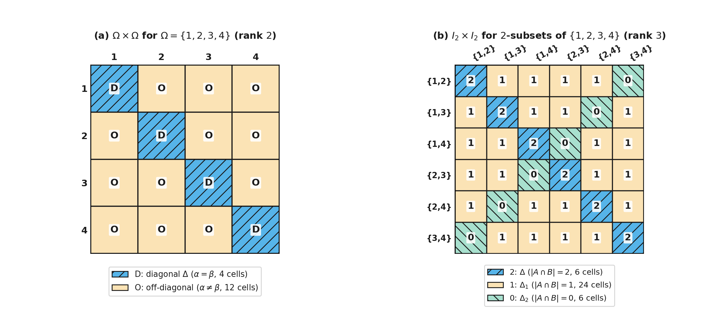

*Figure 18. Orbits on $\Omega \times \Omega$ and the rank $r(G, \Omega) = \langle \pi, \pi \rangle$ for $G = S_4$: (a) on $\Omega = \{1, 2, 3, 4\}$, the $4 \times 4 = 16$ ordered pairs split into $2$ orbits, the diagonal $\Delta$ ($4$ cells, marked $\mathrm{D}$) and the off-diagonal pairs ($12$ cells, marked $\mathrm{O}$), so $r(S_4, \Omega) = 2$ ($2$-transitive) and $\pi = 1_G + \chi$; (b) on the $6$ two-element subsets of $\{1, 2, 3, 4\}$, the $6 \times 6 = 36$ ordered pairs of $2$-subsets split into $3$ orbits $\Delta, \Delta_1, \Delta_2$ according to the intersection size $\lvert A \cap B\rvert = 2, 1, 0$, with $6$, $24$, and $6$ cells, so $r(S_4, I_2) = 3$ and $\pi = 1_G + \chi + \psi$.*

#### Two-Part Partitions and Irreducible Characters of Symmetric Groups

As noted in [normal subgroups](#normal-subgroups) (and seen from the cycle-conjugation identity $g^{-1}(i_1\,\dots\,i_r)g = (i_1 g\,\dots\,i_r g)$), two permutations in $S_n$ are conjugate if and only if they have the same cycle shape, so the conjugacy classes of $S_n$ are in bijective correspondence with all possible cycle shapes of permutations of $\{1, \dots, n\}$. Including $1$-cycles for fixed points and listing the cycle lengths in non-increasing order, each cycle shape is a sequence $\lambda = (\lambda_1, \dots, \lambda_s)$ of positive integers $\lambda_i$ such that

$$\lambda_1 \ge \lambda_2 \ge \cdots \ge \lambda_s \ge 1 \qquad \text{and} \qquad \lambda_1 + \lambda_2 + \cdots + \lambda_s = n.$$

We call such a sequence $\lambda$ an **integer partition** of $n$ (or simply a *partition* of $n$).

Because the number of irreducible characters of any finite group equals the number of its conjugacy classes ([the dimension formula for the rank](#dimension-formula-for-the-rank) and [consequences of orthonormality and decomposing modules](#consequences-of-orthonormality-and-decomposing-modules)), the irreducible characters of $S_n$ are also in bijective correspondence with the partitions $\lambda$ of $n$. A central goal in the representation theory of $S_n$ is to construct, for each partition $\lambda$ of $n$, a corresponding irreducible character $\chi^\lambda$ in a natural way. Here we carry out this construction when $\lambda = (n - k, k)$ is a **two-part partition** of $n$ ($1 \le k \le n/2$, together with the one-part partition $(n)$ giving $\chi^{(n)} = 1_{S_n}$); constructing $\chi^\lambda$ for partitions with three or more parts requires further symmetric-group methods beyond this chapter.

Let $G = S_n$ and $I = \{1, 2, \dots, n\}$. For an integer $k$ with $0 \le k \le n/2$, define $I_k$ to be the set of all $k$-element subsets of $I$ (with $I_0 = \{\emptyset\}$ of size $1$). Just as in the action on pairs ($k = 2$), $G = S_n$ acts on $I_k$ by setting

$$Ag = \{i_1 g, \dots, i_k g\} \qquad (A = \{i_1, \dots, i_k\} \in I_k,\; g \in S_n).$$

Let $\pi_k$ be the permutation character of $G = S_n$ in its action on $I_k$ (so $\pi_0 = 1_{S_n}$). At the identity element $1 \in S_n$, every $k$-subset is fixed, so the degree of $\pi_k$ is

$$\pi_k(1) = \lvert I_k\rvert = \binom{n}{k}.$$

Using the product-action formula $\langle \pi_k, \pi_l \rangle = \operatorname{orb}(S_n, I_k \times I_l)$, we can find the inner product of any two of these permutation characters.

**Inner product of the $k$-subset and $l$-subset permutation characters.** If $0 \le l \le k \le n/2$, then

$$\langle \pi_k, \pi_l \rangle = l + 1.$$

By the product-action formula, $\langle \pi_k, \pi_l \rangle$ counts the orbits of $S_n$ on ordered pairs of subsets $(A, B) \in I_k \times I_l$. Two such pairs can be mapped to one another by a permutation in $S_n$ if and only if their intersection size $s = \lvert A \cap B\rvert$ is the same, and since $0 \le l \le k \le n/2$, all $l + 1$ intersection sizes $s \in \{0, 1, \dots, l\}$ occur.

These inner products force each step $\pi_k - \pi_{k-1}$ to be a single new irreducible character of $S_n$.

**Irreducible characters $\chi^{(n-k,k)}$ of $S_n$ from $k$-element subsets.** Let $m = n/2$ if $n$ is even, and $m = (n - 1)/2$ if $n$ is odd. Then $S_n$ has $m + 1$ distinct irreducible characters $\chi^{(n)} = 1_{S_n}, \chi^{(n-1,1)}, \chi^{(n-2,2)}, \dots, \chi^{(n-m,m)}$ such that for all $k \le m$,

$$\pi_k = \chi^{(n)} + \chi^{(n-1,1)} + \cdots + \chi^{(n-k,k)}.$$

In particular, for every $k$ with $1 \le k \le m$,

$$\chi^{(n-k,k)} = \pi_k - \pi_{k-1}.$$

At each step from $k - 1$ to $k$, the formula $\langle \pi_k, \pi_i \rangle = i + 1$ ($0 \le i \le k$) implies that $\pi_k$ contains every irreducible constituent of $\pi_{k-1}$ with multiplicity $1$, while its norm $\langle \pi_k, \pi_k \rangle = k + 1$ exceeds $\langle \pi_{k-1}, \pi_{k-1} \rangle = k$ by $1$. Subtracting $\pi_{k-1}$ from $\pi_k$ therefore leaves a single new irreducible character $\chi^{(n-k,k)} = \pi_k - \pi_{k-1}$ of norm $1$.

**Worked examples: character degrees, $\chi^{(5,2)}$ on a $3$-cycle in $S_7$, and the four two-part characters of $S_6$.** First, the formula $\chi^{(n-k,k)} = \pi_k - \pi_{k-1}$ lets us evaluate $\chi^{(n-k,k)}(g)$ on any permutation $g \in S_n$ simply by counting $g$-fixed subsets of sizes $k$ and $k - 1$. At $g = 1$, the degree of $\chi^{(n-k,k)}$ is

$$\chi^{(n-k,k)}(1) = \pi_k(1) - \pi_{k-1}(1) = \binom{n}{k} - \binom{n}{k-1}.$$

For an arbitrary permutation $g \in S_n$, a $k$-element subset $A \subseteq \{1, \dots, n\}$ satisfies $Ag = A$ if and only if $A$ is a union of complete disjoint cycles of $g$ (including $1$-cycles) whose lengths add up to $k$. For example, take $n = 7$ and let us evaluate the irreducible character $\chi^{(5,2)}$ of $S_7$ (of degree $\binom{7}{2} - \binom{7}{1} = 21 - 7 = 14$) on the $3$-cycle $g = (1\,2\,3)$. In $I = \{1, 2, 3, 4, 5, 6, 7\}$, the permutation $(1\,2\,3)$ has one $3$-cycle $\{1, 2, 3\}$ and four fixed points $4, 5, 6, 7$, so $\pi_1((1\,2\,3)) = \lvert\operatorname{fix}_{I_1}((1\,2\,3))\rvert = 4$. Because a $2$-element subset cannot contain the $3$-cycle $\{1, 2, 3\}$, a $2$-subset in $I_2$ is fixed by $(1\,2\,3)$ if and only if both of its elements come from the four fixed points $\{4, 5, 6, 7\}$, so $\pi_2((1\,2\,3)) = \lvert\operatorname{fix}_{I_2}((1\,2\,3))\rvert = \binom{4}{2} = 6$. Therefore

$$\chi^{(5,2)}((1\,2\,3)) = \pi_2((1\,2\,3)) - \pi_1((1\,2\,3)) = \lvert\operatorname{fix}_{I_2}((1\,2\,3))\rvert - \lvert\operatorname{fix}_{I_1}((1\,2\,3))\rvert = 6 - 4 = 2.$$

Second, let $G = S_6$ (of order $6! = 720$, with $m = 6/2 = 3$). We use $\chi^{(6-k,k)} = \pi_k - \pi_{k-1}$ to compute the four irreducible characters $\chi^{(6)}$, $\chi^{(5,1)}$, $\chi^{(4,2)}$, and $\chi^{(3,3)}$ across all eleven conjugacy classes of $S_6$, and verify their orthonormality with the character inner product.

**Fact we use (conjugacy class sizes and centralizer orders in $S_6$).** Writing each cycle shape with $1$-cycles omitted (except $(1)$ for the identity), the eleven conjugacy classes of $S_6$ have sizes $\lvert g^{S_6}\rvert = 1, 15, 40, 45, 90, 120, 144, 15, 40, 90, 120$ and centralizer orders $\lvert C_{S_6}(g)\rvert = 720 / \lvert g^{S_6}\rvert = 720, 48, 18, 16, 8, 6, 5, 48, 18, 8, 6$ as listed in the top two rows of the table below.

For each cycle shape of $S_6$, we count how many ways a subset of size $k \in \{0, 1, 2, 3\}$ can be formed as a union of disjoint cycles of $g$ (for instance, on cycle shape $(2)$, which has one $2$-cycle and four $1$-cycles, we can form a $2$-subset either as the single $2$-cycle or as $\binom{4}{2} = 6$ pairs of $1$-cycles, giving $\pi_2((1\,2)) = 1 + 6 = 7$, and we can form a $3$-subset either as the $2$-cycle plus one of the four $1$-cycles or as $\binom{4}{3} = 4$ triples of $1$-cycles, giving $\pi_3((1\,2)) = 4 + 4 = 8$). Taking differences $\chi^{(6-k,k)} = \pi_k - \pi_{k-1}$ gives:

| Cycle shape | $(1)$ | $(2)$ | $(3)$ | $(2,2)$ | $(4)$ | $(3,2)$ | $(5)$ | $(2,2,2)$ | $(3,3)$ | $(4,2)$ | $(6)$ |
| :--- | :---: | :---: | :---: | :---: | :---: | :---: | :---: | :---: | :---: | :---: | :---: |
| Class size $\lvert g^{S_6}\rvert$ | $1$ | $15$ | $40$ | $45$ | $90$ | $120$ | $144$ | $15$ | $40$ | $90$ | $120$ |
| $\lvert C_{S_6}(g)\rvert$ | $720$ | $48$ | $18$ | $16$ | $8$ | $6$ | $5$ | $48$ | $18$ | $8$ | $6$ |
| $\pi_0 = 1_{S_6}$ | $1$ | $1$ | $1$ | $1$ | $1$ | $1$ | $1$ | $1$ | $1$ | $1$ | $1$ |
| $\pi_1$ | $6$ | $4$ | $3$ | $2$ | $2$ | $1$ | $1$ | $0$ | $0$ | $0$ | $0$ |
| $\pi_2$ | $15$ | $7$ | $3$ | $3$ | $1$ | $1$ | $0$ | $3$ | $0$ | $1$ | $0$ |
| $\pi_3$ | $20$ | $8$ | $2$ | $4$ | $0$ | $2$ | $0$ | $0$ | $2$ | $0$ | $0$ |
| $\chi^{(6)} = \pi_0$ | $1$ | $1$ | $1$ | $1$ | $1$ | $1$ | $1$ | $1$ | $1$ | $1$ | $1$ |
| $\chi^{(5,1)} = \pi_1 - \pi_0$ | $5$ | $3$ | $2$ | $1$ | $1$ | $0$ | $0$ | $-1$ | $-1$ | $-1$ | $-1$ |
| $\chi^{(4,2)} = \pi_2 - \pi_1$ | $9$ | $3$ | $0$ | $1$ | $-1$ | $0$ | $-1$ | $3$ | $0$ | $1$ | $0$ |
| $\chi^{(3,3)} = \pi_3 - \pi_2$ | $5$ | $1$ | $-1$ | $1$ | $-1$ | $1$ | $0$ | $-3$ | $2$ | $-1$ | $0$ |

Checking the norms $\langle \chi^\lambda, \chi^\lambda \rangle = \sum_{i=1}^{11} \chi^\lambda(g_i)^2 / \lvert C_{S_6}(g_i)\rvert$ across the eleven columns confirms that each of the four characters is irreducible:

$$\langle \chi^{(6)}, \chi^{(6)} \rangle = \frac{1}{720} + \frac{1}{48} + \frac{1}{18} + \frac{1}{16} + \frac{1}{8} + \frac{1}{6} + \frac{1}{5} + \frac{1}{48} + \frac{1}{18} + \frac{1}{8} + \frac{1}{6} = 1,$$

$$\langle \chi^{(5,1)}, \chi^{(5,1)} \rangle = \frac{25}{720} + \frac{9}{48} + \frac{4}{18} + \frac{1}{16} + \frac{1}{8} + 0 + 0 + \frac{1}{48} + \frac{1}{18} + \frac{1}{8} + \frac{1}{6} = 1,$$

$$\langle \chi^{(4,2)}, \chi^{(4,2)} \rangle = \frac{81}{720} + \frac{9}{48} + 0 + \frac{1}{16} + \frac{1}{8} + 0 + \frac{1}{5} + \frac{9}{48} + 0 + \frac{1}{8} + 0 = 1,$$

$$\langle \chi^{(3,3)}, \chi^{(3,3)} \rangle = \frac{25}{720} + \frac{1}{48} + \frac{1}{18} + \frac{1}{16} + \frac{1}{8} + \frac{1}{6} + 0 + \frac{9}{48} + \frac{4}{18} + \frac{1}{8} + 0 = 1,$$

and all six pairwise inner products $\langle \chi^\lambda, \chi^\mu \rangle$ ($\lambda \neq \mu$) among $\chi^{(6)}, \chi^{(5,1)}, \chi^{(4,2)}, \chi^{(3,3)}$ equal $0$. [Figure 19](#figure-19) shows the staircase decomposition of $\pi_0, \pi_1, \pi_2, \pi_3$ and the intersection invariant on $I_k \times I_l$.

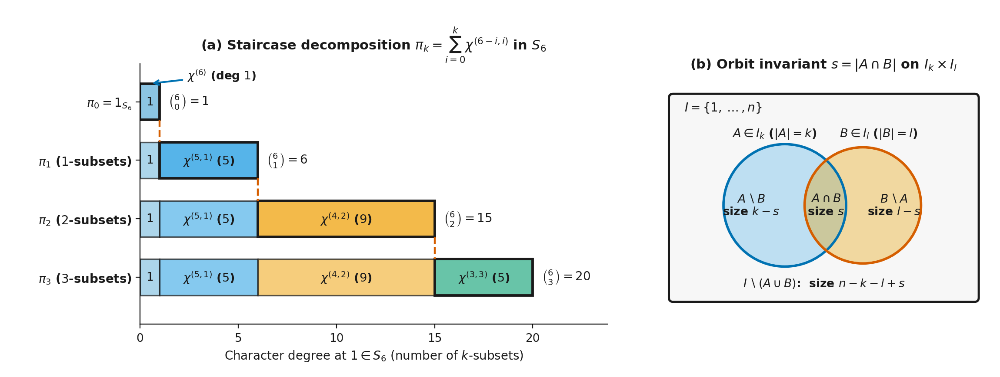

*Figure 19. Two-part irreducible characters $\chi^{(n-k,k)} = \pi_k - \pi_{k-1}$ of $S_n$ from $k$-element subsets: (a) for $S_6$, the permutation characters $\pi_0, \pi_1, \pi_2, \pi_3$ on $k$-subsets have degrees $\binom{6}{k} = 1, 6, 15, 20$, and each bar $\pi_k = \chi^{(6)} + \chi^{(5,1)} + \cdots + \chi^{(6-k,k)}$ adds one new irreducible constituent $\chi^{(6-k,k)}$ of degree $\binom{6}{k} - \binom{6}{k-1} = 1, 5, 9, 5$; (b) for $(A, B) \in I_k \times I_l$ ($0 \le l \le k \le n/2$), the intersection size $s = \lvert A \cap B\rvert \in \{0, 1, \dots, l\}$ fixes the sizes $k - s$, $s$, $l - s$, and $n - k - l + s$ of all four disjoint parts inside $I = \{1, \dots, n\}$, giving $l + 1$ orbits and $\langle \pi_k, \pi_l \rangle = l + 1$.*

## Modules, Homological Algebra & Cohomology

In [the previous chapter on representations and characters](#representations-characters), working over $\mathbb{C}$ meant that [Maschke's theorem](#maschkes-theorem-and-complete-reducibility) split every module into a direct sum of irreducible summands, and characters determined modules up to isomorphism. When the ground field $k$ has prime characteristic $p$ dividing $|G|$, or when we work over a ring of integers such as $\mathbb{Z}$, Maschke's averaging fails and a submodule can be glued to its quotient without splitting apart, as in [the $2$-dimensional $\mathbb{F}_p C_p$-module counterexample](#why-finiteness-and-the-field-matter-and-complete-reducibility). How can we classify modules and measure the glue holding their layers together when complete reducibility fails?

To match standard homological algebra conventions, we switch from the right-module notation of [modules over the group and basis changes](#modules-over-the-group-and-basis-changes) to left modules and maps written on the left. For an associative ring $\Lambda$ with multiplicative identity $1$, a **left $\Lambda$-module** $M$ has a scalar multiplication $(\lambda, m) \mapsto \lambda m$ satisfying $(\lambda\mu)m = \lambda(\mu m)$ and $1m = m$, whereas a **right $\Lambda$-module** has a right action $(m, \lambda) \mapsto m\lambda$ satisfying $m(\lambda\mu) = (m\lambda)\mu$ and $m1 = m$. A homomorphism $f : M \to N$ of left modules is written $f(m)$ and satisfies $f(\lambda m) = \lambda f(m)$, so the composite $g \circ f$ means first $f$ and then $g$.

Nothing is lost in switching sides: defining the **opposite ring** $\Lambda^{\mathrm{op}}$ to have the same underlying abelian group as $\Lambda$ with multiplication reversed ($\lambda \cdot_{\mathrm{op}} \mu = \mu\lambda$) turns any right $\Lambda$-module into a left $\Lambda^{\mathrm{op}}$-module via $\lambda \cdot m = m\lambda$. For a group algebra $RG$ over a commutative ring $R$, the linear map $\sum_{g \in G} r_g g \mapsto \sum_{g \in G} r_g g^{-1}$ is a ring isomorphism $(RG)^{\mathrm{op}} \cong RG$, so a right $RG$-module becomes a left $RG$-module by setting $g \cdot m = mg^{-1}$; accordingly, for a subgroup $H \le G$ we write $G/H$ for the set of left cosets $gH$. Throughout this chapter, $\Lambda$ denotes a ring with $1$, $R$ a commutative ring with $1$, and $k$ a field, and every module is a left module unless stated otherwise.

### The Jacobson Radical and Loewy Layers

When a module does not split into a direct sum of irreducible submodules, how can we still break it into manageable completely reducible pieces? We can filter the module either from the bottom up by summing its irreducible submodules, or from the top down by intersecting the submodules whose quotients are irreducible, and the part of the ring that annihilates every irreducible module controls the top-down filtration.

#### Modules over a Ring, Composition Series and the Socle and Radical Series

We first extend the module language of [$FG$-modules](#fg-modules) from group algebras to an arbitrary ring $\Lambda$ with $1$. A left $\Lambda$-module $M$ is an abelian group $(M, +)$ equipped with a left action $(\lambda, m) \mapsto \lambda m$ of $\Lambda$ that is distributive in both variables, associative in the sense that $(\lambda\mu)m = \lambda(\mu m)$, and unital ($1m = m$). A **$\Lambda$-submodule** $N \le M$ is an additive subgroup closed under left multiplication by $\Lambda$, and the quotient group $M/N$ of cosets $m + N$ inherits a left $\Lambda$-module structure via $\lambda(m + N) = \lambda m + N$ ([homomorphisms and isomorphisms of rings](maths_0_vector_calculus_linear_algebra_fields.md#homomorphisms-and-isomorphisms) in Maths 0). A module $M$ is **finitely generated** if there exist elements $m_1, \dots, m_r \in M$ such that $M = \Lambda m_1 + \cdots + \Lambda m_r$.

Three families of rings anchor every construction in this chapter: the ring of integers $\Lambda = \mathbb{Z}$, where a left $\mathbb{Z}$-module is simply an abelian group; the truncated polynomial algebra $\Lambda = k[x]/(x^n)$, where a module is a $k$-vector space equipped with a linear operator $x$ satisfying $x^n = 0$; and the group algebra $\Lambda = RG$ or $kG$ ([the group algebra and the regular module](#the-group-algebra-and-the-regular-module)).

A non-zero $\Lambda$-module $S$ is a **simple $\Lambda$-module** (or irreducible, as in [submodules and reducibility](#submodules-and-reducibility)) if its only submodules are $0$ and $S$. In [orthonormality and central idempotents in the group algebra](#orthonormality-and-central-idempotents-in-the-group-algebra), a composition factor of a completely reducible $\mathbb{C}G$-module was defined as an irreducible submodule. For a general $\Lambda$-module $M$ that need not split, simple pieces can also sit in quotients between submodules, just as simple groups appear as factor groups in [the Jordan–Hölder theorem for groups](#the-jordan-holder-theorem-the-periodic-table-of-groups). A **module composition series** for a $\Lambda$-module $M$ is a finite chain of submodules

$$0 = M_0 < M_1 < \cdots < M_n = M$$

such that each successive quotient $M_i/M_{i-1}$ ($1 \le i \le n$) is a simple $\Lambda$-module; these simple quotients $M_i/M_{i-1}$ are the composition factors of $M$. To state when a composition series exists, we say that $M$ satisfies the **ascending chain condition** (written A.C.C.) on submodules if every ascending chain $M_1 \le M_2 \le \cdots$ of submodules eventually stabilises ($M_k = M_{k+1} = \cdots$ for some $k$), and the **descending chain condition** (written D.C.C.) on submodules if every descending chain $M_1 \ge M_2 \ge \cdots$ eventually stabilises.

**Jordan–Hölder theorem for modules.** Given any two finite series of submodules $0 = M_0 \le \cdots \le M_r = M$ and $0 = M'_0 \le \cdots \le M'_s = M$ of a $\Lambda$-module $M$, both series can be refined by inserting extra submodules to series $0 = L_0 \le \cdots \le L_n = M$ and $0 = L'_0 \le \cdots \le L'_n = M$ of the same length $n$ whose factor modules $L_i/L_{i-1}$ are a permutation of $L'_j/L'_{j-1}$ up to isomorphism. Consequently, a $\Lambda$-module $M$ has a composition series if and only if every series of submodules can be refined to a composition series, which holds if and only if $M$ satisfies both A.C.C. and D.C.C. on submodules.

When a composition series exists, its length $n$ is an invariant of $M$ called the **composition length** of $M$, and the multiset of isomorphism classes of composition factors $M_i/M_{i-1}$ is independent of the choice of series. A module $M$ is called **uniserial** if it has a *unique* composition series, meaning that all submodules of $M$ form a single linear chain $0 = M_0 < M_1 < \cdots < M_n = M$.

**Worked example: a uniserial $\mathbb{F}_p C_p$-module that is not completely reducible.** Take $k = \mathbb{F}_p$ for a prime $p$, let $G = C_p = \langle a : a^p = 1 \rangle$, and turn the $2$-dimensional counterexample from [why finiteness and the field matter](#why-finiteness-and-the-field-matter-and-complete-reducibility) into a left $\mathbb{F}_p C_p$-module $V = \operatorname{sp}_{\mathbb{F}_p}(v_1, v_2)$ by setting

$$a v_1 = v_1, \qquad a v_2 = v_1 + v_2.$$

In the basis $\{v_1, v_2\}$, the generator $a$ acts on column coordinate vectors by the matrix $A = \begin{pmatrix} 1 & 1 \\ 0 & 1 \end{pmatrix}$. As shown in [why finiteness and the field matter](#why-finiteness-and-the-field-matter-and-complete-reducibility), the only $1$-dimensional $\mathbb{F}_p C_p$-submodule of $V$ is the fixed line $M_1 = \operatorname{sp}_{\mathbb{F}_p}(v_1)$. Thus $V$ is uniserial with unique composition series $0 < M_1 < V$ of composition length $2$. On $M_1$, the generator $a$ acts as $1$, and on the quotient $V/M_1 = \operatorname{sp}_{\mathbb{F}_p}(v_2 + M_1)$, we have $a(v_2 + M_1) = v_1 + v_2 + M_1 = v_2 + M_1$, so $a$ also acts as $1$. Both composition factors $M_1/0$ and $V/M_1$ are therefore isomorphic to the $1$-dimensional trivial module $\mathbb{F}_p$, exactly as in the direct sum $\mathbb{F}_p \oplus \mathbb{F}_p$, even though $V$ is not isomorphic to $\mathbb{F}_p \oplus \mathbb{F}_p$.

For any $\Lambda$-module $M$, two canonical series of submodules capture the largest completely reducible piece at the bottom of $M$ and the largest completely reducible quotient at the top of $M$.

**Socle and socle series.** The **socle** $\operatorname{Soc}(M)$ is the sum of all simple (irreducible) submodules of $M$, and the **socle layers** are defined inductively by $\operatorname{Soc}^0(M) = 0$ and $\operatorname{Soc}^n(M)/\operatorname{Soc}^{n-1}(M) = \operatorname{Soc}(M/\operatorname{Soc}^{n-1}(M))$.

**Radical and Loewy series.** A proper submodule $M' < M$ is a **maximal submodule** if $M/M'$ is simple; the **module radical** $\operatorname{Rad}(M)$ is the intersection of all maximal submodules of $M$, the **radical series** (or **Loewy series**) is defined inductively by $\operatorname{Rad}^0(M) = M$ and $\operatorname{Rad}^n(M) = \operatorname{Rad}(\operatorname{Rad}^{n-1}(M))$, and the $n$-th **radical layer** (or **Loewy layer**) is the quotient $\operatorname{Rad}^{n-1}(M)/\operatorname{Rad}^n(M)$.

**Head of a module.** The first Loewy layer is called the **head** (or **top**) of $M$ and is written $\operatorname{Head}(M) = M/\operatorname{Rad}(M)$.

**Semisimple modules.** A module $M$ is completely reducible (or a **semisimple module**) if $M = \operatorname{Soc}(M)$, which by Zorn's lemma (applied to choose a maximal submodule of $M$ intersecting a given submodule trivially) is equivalent to every submodule of $M$ having a direct-summand complement; if $M$ satisfies D.C.C. on submodules, then $M$ is semisimple if and only if $\operatorname{Rad}(M) = 0$, in which case $M$ is a finite direct sum of simple submodules ([extracting a direct sum of irreducible submodules](#direct-sums-of-modules-and-sums-of-irreducible-submodules)).

**Socle length and radical length.** If $M$ has **socle length** $n$, meaning $\operatorname{Soc}^n(M) = M$ while $\operatorname{Soc}^{n-1}(M) \neq M$, then $M$ also has **radical length** $n$, meaning $\operatorname{Rad}^n(M) = 0$ while $\operatorname{Rad}^{n-1}(M) \neq 0$, and the two filtrations interleave via $\operatorname{Soc}^j(M) \supseteq \operatorname{Rad}^{n-j}(M)$ for all $0 \le j \le n$.

In the $2$-dimensional $\mathbb{F}_p C_p$-module $V$ above, $M_1 = \operatorname{sp}_{\mathbb{F}_p}(v_1)$ is both the unique simple submodule and the unique maximal submodule, so $\operatorname{Soc}(V) = \operatorname{Rad}(V) = M_1$, $\operatorname{Head}(V) = V/M_1 \cong \mathbb{F}_p$, and $V$ has socle length and radical length $2$.

For a larger example, take $G = C_3 = \langle a : a^3 = 1 \rangle$ over $\mathbb{F}_3$ and set $x = a - 1$, so that $x^3 = a^3 - 1 = 0$ and the regular module $\mathbb{F}_3 C_3 \cong \mathbb{F}_3[x]/(x^3)$ is a uniserial tower of three $1$-dimensional trivial layers with $\operatorname{Rad}^j(\mathbb{F}_3 C_3) = (x^j) = \operatorname{Soc}^{3-j}(\mathbb{F}_3 C_3)$ (worked out for general $p$ in the next subsection). In the direct sum $M = \mathbb{F}_3 C_3 \oplus \mathbb{F}_3$ with an extra $1$-dimensional trivial summand $\mathbb{F}_3$, the radical filtration $\operatorname{Rad}^0(M) = M \supset \operatorname{Rad}^1(M) = (x) \oplus 0 \supset \operatorname{Rad}^2(M) = (x^2) \oplus 0 \supset \operatorname{Rad}^3(M) = 0$ has dimensions $4 \supset 2 \supset 1 \supset 0$ and radical layers $M/\operatorname{Rad}(M) \cong \mathbb{F}_3 \oplus \mathbb{F}_3$, then $\mathbb{F}_3$, then $\mathbb{F}_3$ from the top, whereas the socle filtration $\operatorname{Soc}^0(M) = 0 \subset \operatorname{Soc}^1(M) = (x^2) \oplus \mathbb{F}_3 \subset \operatorname{Soc}^2(M) = (x) \oplus \mathbb{F}_3 \subset \operatorname{Soc}^3(M) = M$ has dimensions $0 \subset 2 \subset 3 \subset 4$ and socle layers $\operatorname{Soc}(M) = \operatorname{sp}_{\mathbb{F}_3}(x^2) \oplus \mathbb{F}_3$, then $\mathbb{F}_3$, then $\mathbb{F}_3$ from the bottom. Because a semisimple direct summand has zero radical and equals its own socle, the extra summand $\mathbb{F}_3$ sits in the top radical layer and the bottom socle layer at the same time, as shown in [Figure 20](#figure-20).

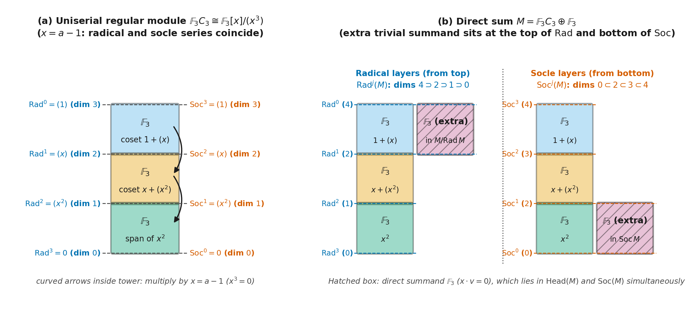

*Figure 20. Radical and socle series over $\mathbb{F}_3 C_3 \cong \mathbb{F}_3[x]/(x^3)$ with $x = a - 1$. (a) The uniserial regular module $\mathbb{F}_3 C_3$ as a three-floor tower of $1$-dimensional trivial composition factors $\mathbb{F}_3$ spanned by $1 + (x)$, $x + (x^2)$, and $x^2$: multiplication by $x$ steps down one floor at a time, and the top-down radical filtration $\operatorname{Rad}^j = (x^j)$ (left) coincides with the bottom-up socle filtration $\operatorname{Soc}^{3-j} = (x^j)$ (right). (b) The direct sum $M = \mathbb{F}_3 C_3 \oplus \mathbb{F}_3$, where the extra trivial summand $\mathbb{F}_3$ (hatched box, annihilated by $x$) sits in the top layer $\operatorname{Head}(M) = M/\operatorname{Rad}(M) \cong \mathbb{F}_3 \oplus \mathbb{F}_3$ of the radical filtration ($\dim \operatorname{Rad}^j(M) = 4, 2, 1, 0$, left) and in the bottom layer $\operatorname{Soc}(M) = \operatorname{sp}_{\mathbb{F}_3}(x^2) \oplus \mathbb{F}_3$ of the socle filtration ($\dim \operatorname{Soc}^j(M) = 0, 2, 3, 4$, right).*

#### Annihilators, the Jacobson Radical of a Ring and Invertibility

To compute $\operatorname{Rad}(M)$ directly from the ring $\Lambda$, we look at the ring elements that annihilate simple modules. The **element annihilator** of $m \in M$ is the set

$$\operatorname{Ann}_\Lambda(m) = \{\lambda \in \Lambda : \lambda m = 0\}.$$

Because $\lambda \mapsto \lambda m$ is a $\Lambda$-module homomorphism from the left regular module ${}_\Lambda\Lambda$ onto the cyclic submodule $\Lambda m$ with kernel $\operatorname{Ann}_\Lambda(m)$, the first isomorphism theorem gives $\Lambda/\operatorname{Ann}_\Lambda(m) \cong \Lambda m$. Thus $\operatorname{Ann}_\Lambda(m)$ is a left ideal of $\Lambda$, and it is a *maximal* left ideal if and only if the submodule $\Lambda m$ generated by $m$ is simple.

Passing from a single element to the whole module, the annihilator of $M$ is the intersection of the annihilators of all elements of $M$:

$$\operatorname{Ann}_\Lambda(M) = \bigcap_{m \in M} \operatorname{Ann}_\Lambda(m) = \{\lambda \in \Lambda : \lambda M = 0\}.$$

Because $M$ is closed under left multiplication by $\Lambda$, this intersection is a two-sided ideal $I$ of $\Lambda$, and the quotient ring $\Lambda/I$ acts faithfully on $M$. A two-sided ideal $I$ of $\Lambda$ that arises as the annihilator of a *simple* left $\Lambda$-module is called a **primitive** two-sided ideal, which means precisely that the quotient ring $\Lambda/I$ has a faithful simple left module.

We define the **Jacobson radical** $J(\Lambda)$ of $\Lambda$ to be the intersection of all maximal left ideals of $\Lambda$, or equivalently the intersection of all primitive two-sided ideals of $\Lambda$ (since every simple module $S$ is generated by each of its non-zero elements $m$, so $\operatorname{Ann}_\Lambda(S) = \bigcap_{0 \neq m \in S} \operatorname{Ann}_\Lambda(m)$ is an intersection of maximal left ideals, and every maximal left ideal $L$ contains the primitive ideal $\operatorname{Ann}_\Lambda(\Lambda/L)$). Equivalently, $J(\Lambda)$ is the set of elements of $\Lambda$ that annihilate every simple left $\Lambda$-module.

Although $J(\Lambda)$ is defined using left ideals, it can be described completely in terms of two-sided invertibility inside $\Lambda$, which shows that defining $J(\Lambda)$ via maximal right ideals gives the exact same ideal.

**Invertibility characterisation of the Jacobson radical.** The Jacobson radical $J(\Lambda)$ consists of those elements $x \in \Lambda$ such that $1 - axb$ has a two-sided inverse in $\Lambda$ for all $a, b \in \Lambda$.

Intuitively, an element $x \in J(\Lambda)$ belongs to every maximal left ideal, so $1 - axb$ cannot lie in any maximal left ideal and must be invertible in $\Lambda$.

When $\Lambda$ acts on itself by left multiplication, we call this the **left regular $\Lambda$-module** ${}_\Lambda\Lambda$ (or the left regular representation of $\Lambda$). Because the submodules of ${}_\Lambda\Lambda$ are precisely the left ideals of $\Lambda$, the maximal submodules of ${}_\Lambda\Lambda$ are the maximal left ideals, giving

$$J(\Lambda) = \operatorname{Rad}({}_\Lambda\Lambda).$$

We say that a ring $\Lambda$ is a **semisimple ring** if $J(\Lambda) = 0$. Since the maximal left ideals of the quotient ring $\Lambda/J(\Lambda)$ are the quotients $I/J(\Lambda)$ of maximal left ideals $I$ of $\Lambda$, their intersection in $\Lambda/J(\Lambda)$ is zero, so $\Lambda/J(\Lambda)$ is always semisimple. (Many texts reserve that phrase for a ring with $J(\Lambda) = 0$ that also satisfies D.C.C. on left ideals, where every module is completely reducible by the lemma in the next subsection.) We record the single-element case of the invertibility property separately because it drives Nakayama's lemma.

**Invertibility of $1 - a$ (Lemma).** If $a \in J(\Lambda)$, then $1 - a$ has a left inverse in $\Lambda$.

**Worked examples: $J(\mathbb{Z}) = 0$, $J(k[x]/(x^n)) = (x)$, and the Loewy layers of $\mathbb{F}_p C_p$.** In $\Lambda = \mathbb{Z}$, a maximal ideal is $p\mathbb{Z}$ for a prime number $p$ ([maximal ideals](maths_0_vector_calculus_linear_algebra_fields.md#establishing-more-mathematical-properties) in Maths 0). Because no non-zero integer is divisible by every prime $p$, the intersection is $J(\mathbb{Z}) = \bigcap_{p} p\mathbb{Z} = \{0\}$, so $\mathbb{Z}$ is semisimple in the sense $J(\mathbb{Z}) = 0$ even though $\mathbb{Z}$ is not a field and not every abelian group is a direct sum of simple groups $\mathbb{Z}/p\mathbb{Z}$.

In $\Lambda = k[x]/(x^n)$ for $n \ge 1$, every element has the form $f(x) = c_0 + c_1 x + \cdots + c_{n-1}x^{n-1}$ with $c_i \in k$. If $c_0 \neq 0$, we can write $f(x) = c_0(1 - y)$ where $y = -c_0^{-1}(c_1 x + \cdots + c_{n-1}x^{n-1})$ satisfies $y^n = 0$, and the finite geometric series $c_0^{-1}(1 + y + y^2 + \cdots + y^{n-1})$ is a two-sided inverse for $f(x)$. Thus every element outside the ideal $(x)$ is invertible, so $(x)$ is the unique maximal ideal of $\Lambda$ and $J(k[x]/(x^n)) = (x)$. The radical and socle series of ${}_\Lambda\Lambda$ coincide in reverse order along the single chain of ideals

$$k[x]/(x^n) > (x) > (x^2) > \cdots > (x^{n-1}) > 0,$$

with $\operatorname{Rad}^j(\Lambda) = (x^j) = \operatorname{Soc}^{n-j}(\Lambda)$ and each $1$-dimensional Loewy layer $(x^{j-1})/(x^j) \cong k$.

Now take $\Lambda = \mathbb{F}_p C_p$ where $C_p = \langle a : a^p = 1 \rangle$. Set $x = a - 1 \in \mathbb{F}_p C_p$. Because $p$ divides the binomial coefficient $\binom{p}{j}$ for $1 \le j \le p - 1$, the binomial theorem in characteristic $p$ gives

$$x^p = (a - 1)^p = a^p - 1 = 1 - 1 = 0.$$

Since $\{1, a, \dots, a^{p-1}\}$ and $\{1, x, x^2, \dots, x^{p-1}\}$ both span $\mathbb{F}_p C_p$ over $\mathbb{F}_p$, the map $a - 1 \mapsto x$ is an algebra isomorphism $\mathbb{F}_p C_p \cong \mathbb{F}_p[x]/(x^p)$. By the previous example, the Jacobson radical is the $(p - 1)$-dimensional augmentation ideal

$$J(\mathbb{F}_p C_p) = (a - 1) = \operatorname{sp}_{\mathbb{F}_p}\!\left(a - 1,\, (a - 1)^2,\, \dots,\, (a - 1)^{p-1}\right).$$

The regular module $\mathbb{F}_p C_p$ is uniserial of length $p$: its Loewy layers $\operatorname{Rad}^{j-1}(\mathbb{F}_p C_p)/\operatorname{Rad}^j(\mathbb{F}_p C_p) = (a - 1)^{j-1}/(a - 1)^j$ are all $1$-dimensional trivial modules $\mathbb{F}_p$, and its socle is the $1$-dimensional fixed subspace at the bottom,

$$\operatorname{Soc}(\mathbb{F}_p C_p) = \operatorname{Rad}^{p-1}(\mathbb{F}_p C_p) = \mathbb{F}_p(a - 1)^{p-1} = \mathbb{F}_p(1 + a + a^2 + \cdots + a^{p-1}).$$

#### Nakayama's Lemma, Artinian and Noetherian Rings and Hopkins–Levitzki

Because $1 - a$ is left-invertible for every $a \in J(\Lambda)$, multiplying a finitely generated non-zero module by $J(\Lambda)$ must strictly shrink it.

**Nakayama's lemma.** If $M$ is a finitely generated $\Lambda$-module and $J(\Lambda)M = M$, then $M = 0$.

Equivalently, if $N \le M$ is a submodule of a finitely generated $\Lambda$-module $M$ such that $N + J(\Lambda)M = M$, applying Nakayama's lemma to the finitely generated quotient $M/N$ gives $M/N = 0$ and hence $N = M$, so elements of $M$ whose cosets generate $M/J(\Lambda)M$ already generate $M$.

When $\Lambda$ satisfies the descending chain condition on left ideals, the condition $J(\Lambda) = 0$ is both necessary and sufficient for every $\Lambda$-module to be completely reducible, and under this D.C.C. hypothesis $J(\Lambda)M$ computes $\operatorname{Rad}(M)$ for every finitely generated $\Lambda$-module.

**Semisimplicity and complete reducibility under D.C.C. (Lemma).** If $\Lambda$ is semisimple ($J(\Lambda) = 0$) and satisfies D.C.C. on left ideals, then every $\Lambda$-module is completely reducible. Conversely, if $\Lambda$ satisfies D.C.C. on left ideals and the regular module ${}_\Lambda\Lambda$ is completely reducible, then $\Lambda$ is semisimple.

**Radical of a finitely generated module (Proposition).** Suppose that $\Lambda$ satisfies D.C.C. on left ideals (or at least that $\Lambda/J(\Lambda)$ satisfies D.C.C. on left ideals). If $M$ is a finitely generated $\Lambda$-module, then $J(\Lambda)M = \operatorname{Rad}(M)$, and hence $\operatorname{Rad}^n(M) = J(\Lambda)^n M$ (also written $J^n(\Lambda)M$) for all $n \ge 1$.

Without the D.C.C. hypothesis, only the inclusion $J(\Lambda)M \subseteq \operatorname{Rad}(M)$ holds in general: for $\Lambda = \mathbb{Z}$ and $M = \mathbb{Z}/4\mathbb{Z}$, we have $J(\mathbb{Z})M = 0$ whereas $\operatorname{Rad}(\mathbb{Z}/4\mathbb{Z}) = 2\mathbb{Z}/4\mathbb{Z} \neq 0$.

We now name the chain conditions on rings and modules and state the theorem that ties them together. A ring $\Lambda$ is **left Noetherian** (or simply Noetherian when the side is clear) if it satisfies A.C.C. on left ideals, and **left Artinian** (or Artinian) if it satisfies D.C.C. on left ideals; similarly, a $\Lambda$-module $M$ is Noetherian if it satisfies A.C.C. on submodules, and Artinian if it satisfies D.C.C. on submodules. Every finite-dimensional algebra $\Lambda$ over a field $k$ (including $kG$ for any finite group $G$) is both Artinian and Noetherian, because left ideals are $k$-vector subspaces and their dimensions lie between $0$ and $\dim_k \Lambda$.

By contrast, $\mathbb{Z}$ is Noetherian (every ideal is $n\mathbb{Z}$, and an ascending chain $n_1\mathbb{Z} \subseteq n_2\mathbb{Z} \subseteq \cdots$ corresponds to a descending chain of positive divisors of $n_1$, which must stop) but *not* Artinian, because the descending chain $2\mathbb{Z} \supsetneq 4\mathbb{Z} \supsetneq 8\mathbb{Z} \supsetneq \cdots$ never stops. Thus Noetherian does not imply Artinian; conversely, Artinian *does* imply Noetherian (this is Hopkins' theorem, and it holds for any ring with $1$).

**Hopkins–Levitzki theorem.** If $\Lambda$ is an Artinian ring, then the Jacobson radical $J(\Lambda)$ is a **nilpotent radical**, meaning $J(\Lambda)^n = 0$ for some integer $n \ge 1$; every finitely generated $\Lambda$-module $M$ is both Noetherian and Artinian (and therefore has a composition series); and $\Lambda$ itself is a Noetherian ring.

Intuitively, D.C.C. forces the descending powers $J(\Lambda)^n$ to stabilise and vanish by Nakayama's lemma, and filtering any finitely generated $\Lambda$-module $M$ by the finite chain of semisimple Loewy layers $J(\Lambda)^i M / J(\Lambda)^{i+1} M$ gives $M$ (and in particular ${}_\Lambda\Lambda$) a finite composition series and therefore both chain conditions.

Nilpotency of $J(\Lambda)$ also means that whether a subring $\Lambda'$ (or the image of a ring homomorphism) is all of the Artinian ring $\Lambda$ can be detected modulo the *square* of the radical, $J^2(\Lambda) = J(\Lambda)^2$.

**Surjectivity modulo $J^2(\Lambda)$ (Proposition).** Suppose that $\Lambda$ is an Artinian ring and $\Lambda'$ is a subring of $\Lambda$ such that $\Lambda' + J^2(\Lambda) = \Lambda$. Then $\Lambda' = \Lambda$.

Finally, because the later sections use Schur's lemma, idempotents, and the structure of $\Lambda/J(\Lambda)$, we record how these work over a general ring $\Lambda$. Over an arbitrary ring $\Lambda$, [Schur's lemma](#schurs-lemma-abelian-groups-and-the-centre) states that if $M_1$ and $M_2$ are simple $\Lambda$-modules, then the abelian group $\operatorname{Hom}_\Lambda(M_1, M_2)$ of $\Lambda$-module homomorphisms $M_1 \to M_2$ is $0$ whenever $M_1 \not\cong M_2$, while $\operatorname{End}_\Lambda(M_1) = \operatorname{Hom}_\Lambda(M_1, M_1)$ is a division ring (a ring with $1 \neq 0$ in which every non-zero element is invertible). An **idempotent** in $\Lambda$ is a non-zero element $e \in \Lambda$ satisfying $e^2 = e$ (encountered for central idempotents in [orthonormality and central idempotents in the group algebra](#orthonormality-and-central-idempotents-in-the-group-algebra)). Whenever $e \neq 1$ is an idempotent, $1 - e$ is also an idempotent with $e(1 - e) = (1 - e)e = 0$, decomposing the regular module as ${}_\Lambda\Lambda = \Lambda e \oplus \Lambda(1 - e)$. For any left $\Lambda$-module $M$, a homomorphism $\alpha : \Lambda e \to M$ is determined by $\alpha(e) = \alpha(e^2) = e\alpha(e) \in eM$, which gives an abelian-group isomorphism

$$\operatorname{Hom}_\Lambda(\Lambda e, M) \cong eM \qquad (\alpha \mapsto \alpha(e))$$

and, taking $M = \Lambda e$, a ring isomorphism $e\Lambda e \cong \operatorname{End}_\Lambda(\Lambda e)^{\mathrm{op}}$ (where the opposite ring appears because $\alpha(\lambda e) = \lambda e m$ composes in reverse order).

From classical ring theory (linked to the matrix decomposition in [coherent configurations](#coherent-configurations)), the **Wedderburn–Artin structure theorem** states that every semisimple Artinian ring $\Lambda$ is isomorphic to a finite direct sum of matrix rings over division rings,

$$\Lambda \cong \bigoplus_{i=1}^r \operatorname{Mat}_{n_i}(\Delta_i),$$

and has exactly $r$ isomorphism classes of simple modules $S_1, \dots, S_r$, with $\operatorname{End}_\Lambda(S_i) \cong \Delta_i^{\mathrm{op}}$ and $\dim_{\Delta_i^{\mathrm{op}}}(S_i) = n_i$. This matters here because for any Artinian ring $\Lambda$, the quotient $\Lambda/J(\Lambda)$ is semisimple Artinian, so $\Lambda$ has only finitely many isomorphism classes of simple modules, namely those of $\Lambda/J(\Lambda)$ viewed as $\Lambda$-modules via $\Lambda \twoheadrightarrow \Lambda/J(\Lambda)$.

### Local Rings and the Krull–Schmidt Theorem

When Maschke's theorem fails, we can no longer decompose every module into simple summands; we can only split a module until each direct summand cannot be broken any further. Are the resulting pieces still uniquely determined up to isomorphism and reordering, and what property of their endomorphism rings controls that uniqueness?

#### Local Rings, Indecomposable Modules and Unique Decomposition

A non-zero $\Lambda$-module $M$ is an **indecomposable module** if it cannot be written as a direct sum $M = M_1 \oplus M_2$ of two non-zero submodules $M_1$ and $M_2$. Every simple module is indecomposable, because it has no proper non-zero submodules at all, but the converse fails whenever Maschke's theorem fails: in our $2$-dimensional $\mathbb{F}_p C_p$-module $V$ with $a = \begin{pmatrix} 1 & 1 \\ 0 & 1 \end{pmatrix}$, the line $M_1 = \operatorname{sp}_{\mathbb{F}_p}(v_1)$ is a proper non-zero submodule (so $V$ is reducible), yet $M_1$ is the *only* $1$-dimensional submodule of $V$, so $V$ cannot be written as a direct sum of two $1$-dimensional submodules and is therefore indecomposable.

Whether a decomposition into indecomposable summands is unique turns out to depend on whether the endomorphism ring $\operatorname{End}_\Lambda(M_i)$ of each indecomposable summand behaves like a division ring modulo its radical.

**Local ring (Definition).** A (not necessarily commutative) ring $E$ is a **local ring** if it has a unique maximal left ideal, or equivalently a unique maximal right ideal.

Because the Jacobson radical $J(E)$ is the intersection of all maximal left ideals (and also of all maximal right ideals), a ring $E$ is local if and only if $J(E)$ is itself a maximal left ideal, in which case $J(E)$ is two-sided, consists of all non-invertible elements of $E$, and has quotient $E/J(E)$ a division ring. Equivalently, a ring $E$ is local if and only if the non-invertible elements of $E$ form a left ideal, meaning that the sum of two non-invertible elements of $E$ is never invertible.

**Worked examples: $k[x]/(x^n)$ and $\mathbb{Z}/p^n\mathbb{Z}$ are local, whereas $\mathbb{Z}/6\mathbb{Z}$ is not.** In $E = k[x]/(x^n)$, we saw above that an element $c_0 + c_1 x + \cdots + c_{n-1}x^{n-1}$ is invertible if and only if $c_0 \neq 0$, so the non-invertible elements form the ideal $(x) = J(E)$ and $E/(x) \cong k$ is a field; thus $k[x]/(x^n)$ (and in particular $\mathbb{F}_p C_p \cong \mathbb{F}_p[x]/(x^p)$) is a local ring. Likewise, in $\mathbb{Z}/p^n\mathbb{Z}$ for a prime $p$, an integer $m \bmod p^n$ is invertible if and only if $\gcd(m, p^n) = 1$, so the non-invertible elements are the multiples of $p$, which form the unique maximal ideal $p\mathbb{Z}/p^n\mathbb{Z}$. By contrast, in $\mathbb{Z}/6\mathbb{Z}$, the elements $2$ and $3$ are both non-invertible ($\gcd(2, 6) = 2$ and $\gcd(3, 6) = 3$), yet their sum $2 + 3 = 5 \equiv -1 \pmod{6}$ is invertible; the non-invertible elements do not form an ideal, and $\mathbb{Z}/6\mathbb{Z} \cong \mathbb{Z}/2\mathbb{Z} \oplus \mathbb{Z}/3\mathbb{Z}$ has two distinct maximal ideals, $(2)$ and $(3)$.

We now formulate what it means for a direct-sum decomposition into indecomposable modules to be unique.

**Unique decomposition property (Definition).** A $\Lambda$-module $M$ has the **unique decomposition property** if $M$ is a finite direct sum of indecomposable modules; and whenever $M = \bigoplus_{i=1}^m M_i = \bigoplus_{i=1}^n M'_i$ with each $M_i$ and each $M'_i$ non-zero indecomposable, we have $m = n$, and after reordering the summands if necessary, $M_i \cong M'_i$ for all $1 \le i \le m$.

A ring $\Lambda$ is said to have the unique decomposition property if every finitely generated $\Lambda$-module does.

**Unique decomposition from local endomorphism rings (Theorem).** Suppose that $M$ is a finite direct sum of indecomposable $\Lambda$-modules $M_i$ such that the endomorphism ring $\operatorname{End}_\Lambda(M_i)$ of each $M_i$ is a local ring. Then $M$ has the unique decomposition property.

Intuitively, decomposing the identity map of a summand $M_1$ through the summands $M'_1, \dots, M'_n$ of a second decomposition expresses $\mathrm{id}_{M_1}$ as a sum in the local ring $\operatorname{End}_\Lambda(M_1)$, where at least one term must be an automorphism that identifies $M_1$ with some $M'_j$ and allows the remaining summands to be matched one by one.

#### Fitting's Lemma and the Krull–Schmidt Theorem

Why does an indecomposable module with a composition series automatically have a local endomorphism ring? Any endomorphism of a module of finite length splits the module into a summand on which the map is an automorphism and a summand on which the map is nilpotent, just as a linear operator on a finite-dimensional vector space splits the space into an invertible part and a nilpotent Jordan part.

**Fitting's lemma.** Suppose that $M$ is a $\Lambda$-module with a composition series (equivalently, $M$ satisfies both A.C.C. and D.C.C. on submodules) and let $f \in \operatorname{End}_\Lambda(M)$. Then for all sufficiently large $n \ge 1$,

$$M = \operatorname{Im}(f^n) \oplus \operatorname{Ker}(f^n).$$

When $M$ is also indecomposable, the direct sum $M = \operatorname{Im}(f^n) \oplus \operatorname{Ker}(f^n)$ cannot have two non-zero summands: either $\operatorname{Ker}(f^n) = 0$ and $\operatorname{Im}(f^n) = M$ (so $f$ is an automorphism), or $\operatorname{Im}(f^n) = 0$ and $\operatorname{Ker}(f^n) = M$ (so $f^n = 0$ and $f$ is nilpotent).

**Locality of the endomorphism ring (Lemma).** Suppose that $M$ is an indecomposable $\Lambda$-module with a composition series. Then $\operatorname{End}_\Lambda(M)$ is a local ring.

Combining the Hopkins–Levitzki theorem (every finitely generated module over an Artinian ring has a composition series) with this locality lemma and the unique decomposition theorem gives the Krull–Schmidt theorem.

**Krull–Schmidt theorem.** Suppose that $\Lambda$ is an Artinian ring. Then $\Lambda$ has the unique decomposition property: every finitely generated $\Lambda$-module is a finite direct sum of indecomposable modules, and the indecomposable summands are uniquely determined up to isomorphism and reordering.

**Worked examples: computing $\operatorname{End}_{\mathbb{F}_p C_p}(V)$ and comparing two internal decompositions of $V \oplus \mathbb{F}_p$.** Take the indecomposable $2$-dimensional $\mathbb{F}_p C_p$-module $V = \operatorname{sp}_{\mathbb{F}_p}(v_1, v_2)$ where $a$ acts in the basis $\{v_1, v_2\}$ by $A = \begin{pmatrix} 1 & 1 \\ 0 & 1 \end{pmatrix}$. An $\mathbb{F}_p$-linear map $f : V \to V$ with matrix $B = \begin{pmatrix} \alpha & \beta \\ \gamma & \delta \end{pmatrix}$ commutes with $A$ if and only if

$$\begin{pmatrix} 1 & 1 \\ 0 & 1 \end{pmatrix}\begin{pmatrix} \alpha & \beta \\ \gamma & \delta \end{pmatrix} = \begin{pmatrix} \alpha & \beta \\ \gamma & \delta \end{pmatrix}\begin{pmatrix} 1 & 1 \\ 0 & 1 \end{pmatrix} \iff \begin{pmatrix} \alpha + \gamma & \beta + \delta \\ \gamma & \delta \end{pmatrix} = \begin{pmatrix} \alpha & \alpha + \beta \\ \gamma & \gamma + \delta \end{pmatrix}.$$

Comparing entries forces $\gamma = 0$ and $\alpha = \delta$, so the endomorphism ring is the $2$-dimensional commutative algebra

$$\operatorname{End}_{\mathbb{F}_p C_p}(V) = \left\{\begin{pmatrix} \alpha & \beta \\ 0 & \alpha \end{pmatrix} : \alpha, \beta \in \mathbb{F}_p\right\} \cong \mathbb{F}_p[x]/(x^2).$$

Here a matrix $\begin{pmatrix} \alpha & \beta \\ 0 & \alpha \end{pmatrix}$ is an automorphism when $\alpha \neq 0$, and satisfies $\begin{pmatrix} 0 & \beta \\ 0 & 0 \end{pmatrix}^2 = \begin{pmatrix} 0 & 0 \\ 0 & 0 \end{pmatrix}$ when $\alpha = 0$, confirming directly that every endomorphism of $V$ is either an automorphism or nilpotent and that $\operatorname{End}_{\mathbb{F}_p C_p}(V)$ is a local ring of order $p^2$.

Now form the $3$-dimensional $\mathbb{F}_p C_p$-module $M = V \oplus \mathbb{F}_p = \operatorname{sp}_{\mathbb{F}_p}(v_1, v_2, w)$ where $a v_1 = v_1$, $a v_2 = v_1 + v_2$, and $a w = w$. Notice that $M$ can be decomposed as an internal direct sum of indecomposable submodules in more than one way: setting $U_1 = \operatorname{sp}_{\mathbb{F}_p}(v_1, v_2)$ and $U_2 = \operatorname{sp}_{\mathbb{F}_p}(w)$ gives $M = U_1 \oplus U_2$, while setting $U'_1 = \operatorname{sp}_{\mathbb{F}_p}(v_1, v_2 + w)$ and $U'_2 = \operatorname{sp}_{\mathbb{F}_p}(v_1 + w)$ also gives $M = U'_1 \oplus U'_2$ because $a(v_2 + w) = v_1 + (v_2 + w)$ and $a(v_1 + w) = v_1 + w$, and the three vectors $v_1$, $v_2 + w$, $v_1 + w$ have determinant $\det\begin{pmatrix} 1 & 0 & 1 \\ 0 & 1 & 0 \\ 0 & 1 & 1 \end{pmatrix} = 1 \neq 0$. The submodules $U_1 \neq U'_1$ and $U_2 \neq U'_2$ are different subspaces of $M$, but $U_1 \cong U'_1 \cong V$ (both indecomposable of dimension $2$) and $U_2 \cong U'_2 \cong \mathbb{F}_p$ (both simple of dimension $1$), illustrating that Krull–Schmidt guarantees uniqueness *up to isomorphism*, not equality of subspaces.

### Projective and Injective Modules

Over a field $k$, every subspace of a vector space has a direct-summand complement, every linear map onto a quotient lifts, and every linear map on a subspace extends to the whole space. Over a general ring $\Lambda$, all three properties fail for an arbitrary module; the modules that retain those lifting and extension properties allow us to approximate any $\Lambda$-module by modules that behave like vector spaces.

#### Exact Sequences, Free Modules, Tensor Products and Projective Modules

Before defining those lifting and extension properties, we set up the language of exactness, basis-generated modules, and bilinear products over $\Lambda$. A $\Lambda$-module homomorphism $f : A \to B$ is called a **module monomorphism** if it is injective ($\operatorname{Ker}(f) = 0$, written $A \hookrightarrow B$) and a **module epimorphism** if it is surjective ($\operatorname{Im}(f) = B$, written $A \twoheadrightarrow B$); its **cokernel** is the quotient module $\operatorname{Coker}(f) = B/\operatorname{Im}(f)$. A sequence of $\Lambda$-modules and homomorphisms

$$\cdots \to M_{n+1} \xrightarrow{f_{n+1}} M_n \xrightarrow{f_n} M_{n-1} \to \cdots$$

is **exact** at $M_n$ if the image of the incoming map equals the kernel of the outgoing map, $\operatorname{Im}(f_{n+1}) = \operatorname{Ker}(f_n)$, and is an **exact module sequence** (or **long exact sequence** when it continues indefinitely) if it is exact at every term. The basic building block is a five-term exact sequence with zeroes at both ends, called a **short exact sequence**:

$$0 \to A \xrightarrow{i} B \xrightarrow{p} C \to 0.$$

Exactness at $A$ means $\operatorname{Ker}(i) = \operatorname{Im}(0 \to A) = 0$ (so $i$ is injective), exactness at $B$ means $\operatorname{Im}(i) = \operatorname{Ker}(p)$, and exactness at $C$ means $\operatorname{Im}(p) = \operatorname{Ker}(C \to 0) = C$ (so $p$ is surjective). Thus a short exact sequence says that $A$ embeds as a submodule $\operatorname{Im}(i) \le B$ with quotient $B/\operatorname{Im}(i) \cong C$.

A short exact sequence $0 \to A \xrightarrow{i} B \xrightarrow{p} C \to 0$ is a **split short exact sequence** (or splits) if the submodule $\operatorname{Im}(i)$ has a direct-summand complement in $B$, so that $B = \operatorname{Im}(i) \oplus W \cong A \oplus C$. Splitting is equivalent to the existence of a homomorphism $s : C \to B$ such that $p \circ s = \mathrm{id}_C$ (in which case $W = \operatorname{Im}(s)$ complements $\operatorname{Im}(i)$), and also equivalent to the existence of a homomorphism $r : B \to A$ such that $r \circ i = \mathrm{id}_A$ (in which case $W = \operatorname{Ker}(r)$ complements $\operatorname{Im}(i)$). For example, over $\Lambda = \mathbb{Z}$, the sequence $0 \to \mathbb{Z}/2\mathbb{Z} \xrightarrow{i} \mathbb{Z}/6\mathbb{Z} \xrightarrow{p} \mathbb{Z}/3\mathbb{Z} \to 0$ with $i(1) = 3 \bmod 6$ and $p(1) = 1 \bmod 3$ splits via the map $s : \mathbb{Z}/3\mathbb{Z} \to \mathbb{Z}/6\mathbb{Z}$ sending $1 \mapsto 4 \bmod 6$ (since $3 \cdot 4 = 12 \equiv 0 \pmod{6}$ and $p(4) = 4 \equiv 1 \pmod{3}$), reflecting $\mathbb{Z}/6\mathbb{Z} \cong \mathbb{Z}/2\mathbb{Z} \oplus \mathbb{Z}/3\mathbb{Z}$. By contrast, the sequence

$$0 \to \mathbb{Z}/2\mathbb{Z} \xrightarrow{2} \mathbb{Z}/4\mathbb{Z} \xrightarrow{p} \mathbb{Z}/2\mathbb{Z} \to 0$$

does *not* split, because any homomorphism $s : \mathbb{Z}/2\mathbb{Z} \to \mathbb{Z}/4\mathbb{Z}$ must satisfy $2s(1) = s(2) = 0 \pmod{4}$, forcing $s(1) \in \{0, 2\}$ and hence $p(s(1)) = 0 \neq 1$.

Next, a left $\Lambda$-module $F$ is a **free left module** (or free module) if it has a subset $\{b_j\}_{j \in J}$ (a basis) such that every element of $F$ can be written uniquely as a finite $\Lambda$-linear combination $\sum_{j \in J} \lambda_j b_j$ ($\lambda_j \in \Lambda$), which means $F \cong \bigoplus_{j \in J} {}_\Lambda\Lambda$ is a direct sum of copies of the regular module. Every $\Lambda$-module $M$ is a quotient of a free module: choosing any generating set $\{m_j\}_{j \in J}$ of $M$ (for instance, all elements of $M$), the map $\bigoplus_{j \in J} {}_\Lambda\Lambda \to M$ sending the $j$-th basis element $b_j$ to $m_j$ is an epimorphism.

Finally, given a right $\Lambda$-module $M$ and a left $\Lambda$-module $N$, their **tensor product** $M \otimes_\Lambda N$ is the abelian group generated by symbols $m \otimes n$ ($m \in M, n \in N$) subject to the relations that $m \otimes n$ is additive in $m$ and in $n$, and that scalars from $\Lambda$ can slide across the tensor sign:

$$(m_1 + m_2) \otimes n = m_1 \otimes n + m_2 \otimes n, \qquad m \otimes (n_1 + n_2) = m \otimes n_1 + m \otimes n_2, \qquad m\lambda \otimes n = m \otimes \lambda n$$

for all $m, m_i \in M$, $n, n_i \in N$, and $\lambda \in \Lambda$. If $M$ also has a left action of another ring $\Gamma$ commuting with the right action of $\Lambda$, namely $(\gamma m)\lambda = \gamma(m\lambda)$, we call $M$ a **$\Gamma$-$\Lambda$-bimodule** (written ${}_\Gamma M_\Lambda$), and $M \otimes_\Lambda N$ inherits a left $\Gamma$-module structure via $\gamma(m \otimes n) = (\gamma m) \otimes n$. For any right $\Lambda$-module $M$, the multiplication map $m \otimes \lambda \mapsto m\lambda$ gives $M \otimes_\Lambda {}_\Lambda\Lambda \cong M$. Over $\Lambda = \mathbb{Z}$, tensoring two cyclic groups gives $(\mathbb{Z}/m\mathbb{Z}) \otimes_{\mathbb{Z}} (\mathbb{Z}/n\mathbb{Z}) \cong \mathbb{Z}/\gcd(m, n)\mathbb{Z}$: in particular, $(\mathbb{Z}/2\mathbb{Z}) \otimes_{\mathbb{Z}} (\mathbb{Z}/3\mathbb{Z}) = 0$, because in this tensor product $1 \otimes 1 = 3(1 \otimes 1) - 2(1 \otimes 1) = (1 \otimes 3 \cdot 1) - (2 \cdot 1 \otimes 1) = 1 \otimes 0 - 0 \otimes 1 = 0$.

With these notions in hand, a projective module is defined by the universal lifting property across epimorphisms, and an injective module by the dual extension property across monomorphisms.

**Projective and injective modules (Definition).** A $\Lambda$-module $P$ is a **projective module** if for any $\Lambda$-modules $M$ and $M'$, any homomorphism $\lambda : P \to M$, and any epimorphism $\mu : M' \twoheadrightarrow M$, there exists a homomorphism $\nu : P \to M'$ lifting $\lambda$ across $\mu$, meaning that $\mu \circ \nu = \lambda$. Dually, a $\Lambda$-module $I$ is an **injective module** if for any $\Lambda$-modules $M$ and $M'$, any homomorphism $\lambda : M \to I$, and any monomorphism $\mu : M \hookrightarrow M'$, there exists a homomorphism $\nu : M' \to I$ extending $\lambda$ across $\mu$, meaning that $\nu \circ \mu = \lambda$.

**Characterisations of projective modules (Lemma).** For a $\Lambda$-module $P$, the following three conditions are equivalent: $P$ is projective; every epimorphism $\lambda : M \twoheadrightarrow P$ splits (so $M \cong \operatorname{Ker}(\lambda) \oplus P$); and $P$ is isomorphic to a direct summand of a free $\Lambda$-module.

Intuitively, a free module can lift any map by choosing a pre-image for each basis element independently, and a module inherits this lifting property if and only if it is a direct summand of a free module.

Because $M \otimes_\Lambda {}_\Lambda\Lambda \cong M$ and tensor products commute with direct sums, tensoring any long exact sequence $\cdots \to M_n \to M_{n-1} \to M_{n-2} \to \cdots$ of right $\Lambda$-modules with a free left $\Lambda$-module $F$, or with a direct summand $P$ of $F$, preserves exactness:

$$\cdots \to M_n \otimes_\Lambda P \to M_{n-1} \otimes_\Lambda P \to M_{n-2} \otimes_\Lambda P \to \cdots \quad \text{is exact.}$$

A left $\Lambda$-module $P$ with the property that $- \otimes_\Lambda P$ preserves exactness of all long exact sequences of right $\Lambda$-modules (and similarly for a right $\Lambda$-module with respect to left $\Lambda$-modules) is called a **flat** module. Thus every projective module is flat (whereas flat modules need not be projective: for instance, $\mathbb{Q}$ is a flat $\mathbb{Z}$-module because localising preserves exactness, but $\mathbb{Q}$ is not projective over $\mathbb{Z}$ because no non-zero homomorphism $\mathbb{Q} \to \mathbb{Z}$ exists).

**Worked examples: projective modules over $\mathbb{Z}$ and a projective non-free module over $\mathbb{Z}/6\mathbb{Z}$.** Over $\Lambda = \mathbb{Z}$, the module $\mathbb{Z}$ is free of rank $1$ and therefore projective, whereas $\mathbb{Z}/n\mathbb{Z}$ ($n \ge 2$) is neither projective nor flat: the quotient epimorphism $\mathbb{Z} \twoheadrightarrow \mathbb{Z}/n\mathbb{Z}$ does not split because $\mathbb{Z}$ has no non-zero elements of finite order, and tensoring the injective map $\mathbb{Z} \xrightarrow{n} \mathbb{Z}$ with $\mathbb{Z}/n\mathbb{Z}$ gives the zero map $\mathbb{Z}/n\mathbb{Z} \xrightarrow{0} \mathbb{Z}/n\mathbb{Z}$, which is not injective.

Over $\Lambda = \mathbb{Z}/6\mathbb{Z}$, the elements $e_1 = 3 \bmod 6$ and $e_2 = 4 \bmod 6$ are orthogonal idempotents ($3^2 = 9 \equiv 3$, $4^2 = 16 \equiv 4$, $3 \cdot 4 = 12 \equiv 0 \pmod{6}$, and $3 + 4 = 7 \equiv 1 \pmod{6}$), splitting the free module of rank $1$ as

$$\mathbb{Z}/6\mathbb{Z} = \Lambda e_1 \oplus \Lambda e_2 \cong \mathbb{Z}/2\mathbb{Z} \oplus \mathbb{Z}/3\mathbb{Z}.$$

Being a direct summand of the free module ${}_\Lambda\Lambda = \mathbb{Z}/6\mathbb{Z}$, the cyclic module $P = \mathbb{Z}/2\mathbb{Z}$ is a projective $\mathbb{Z}/6\mathbb{Z}$-module, even though $P$ is not free (every non-zero free $\mathbb{Z}/6\mathbb{Z}$-module $\bigoplus (\mathbb{Z}/6\mathbb{Z})$ has cardinality a multiple of $6$, whereas $|P| = 2$).

#### Projective Covers, Schanuel's Lemma and Heller Shifts

Every module $M$ is a quotient of a free module, and hence a quotient of a projective module. When $\Lambda$ is an Artinian ring and $M$ is finitely generated, we can choose a projective module mapping onto $M$ that is *minimal* with respect to direct-sum decomposition (so no non-zero direct summand of it maps to zero in $M$), and any two such minimal projective modules mapping onto $M$ are isomorphic. This unique minimal projective module mapping onto $M$ is called the **projective cover** $P_M$ of $M$, and the kernel of $P_M \twoheadrightarrow M$ is written $\Omega(M)$ (often called the Heller shift or first syzygy of $M$), giving a canonical short exact sequence

$$0 \to \Omega(M) \to P_M \to M \to 0.$$

How do projective covers look concretely over an Artinian ring $\Lambda$? By the **idempotent refinement theorem**, any idempotent in the quotient $\Lambda/N$ by a nilpotent ideal $N$ (such as $N = J(\Lambda)$) lifts to an idempotent in $\Lambda$. Applying the Wedderburn–Artin theorem to $\Lambda/J(\Lambda)$ and lifting the resulting idempotents decomposes $1 = f_1 + \cdots + f_m$ into a sum of **primitive** orthogonal idempotents in $\Lambda$ ($f_i^2 = f_i$, $f_i f_j = 0$ for $i \neq j$, and no $f_i$ splits further), which decomposes the regular module ${}_\Lambda\Lambda = \bigoplus_{i=1}^m \Lambda f_i$ into projective indecomposable summands $P_i = \Lambda f_i$. By the Krull–Schmidt theorem, every projective indecomposable $\Lambda$-module is isomorphic to one of these summands $P_i$, and each $P_i$ has a unique maximal submodule $\operatorname{Rad}(P_i) = J(\Lambda)f_i$ and a simple head $S_i = P_i/\operatorname{Rad}(P_i)$, giving a bijection between the isomorphism classes of projective indecomposable $\Lambda$-modules $P_i$ and the isomorphism classes of simple $\Lambda$-modules $S_i$, with $P_i = P_{S_i}$ serving as the projective cover of $S_i$.

Even when $\Lambda$ is not Artinian, the kernels of any two projective epimorphisms onto $M$ are almost the same: they differ only by adding projective direct summands.

**Schanuel's lemma.** Suppose that $0 \to M_1 \to P_1 \xrightarrow{\pi_1} M \to 0$ and $0 \to M_2 \to P_2 \xrightarrow{\pi_2} M \to 0$ are short exact sequences of $\Lambda$-modules with $P_1$ and $P_2$ projective. Then

$$M_1 \oplus P_2 \cong P_1 \oplus M_2.$$

Given $\pi_1 : P_1 \to M$ and $\pi_2 : P_2 \to M$, their **pullback** is the submodule $X = \{(x, y) \in P_1 \oplus P_2 : \pi_1(x) = \pi_2(y)\}$ of pairs with the same image in $M$ (dually, the **pushout** of $\iota_1 : M \to I_1$ and $\iota_2 : M \to I_2$ is the quotient of $I_1 \oplus I_2$ by $\{(\iota_1(m), -\iota_2(m)) : m \in M\}$). Projecting the pullback $X$ onto $P_1$ has kernel $M_2$ and projecting onto $P_2$ has kernel $M_1$, and projectivity of $P_1$ and $P_2$ splits both projections to identify both $M_1 \oplus P_2$ and $P_1 \oplus M_2$ with $X$.

Consequently, if we write $\tilde{\Omega}(M)$ for the kernel of *some* epimorphism $P \twoheadrightarrow M$ with $P$ projective, Schanuel's lemma guarantees that $\tilde{\Omega}(M)$ is well defined up to adding and removing projective direct summands. Moreover, given any homomorphism $\alpha : M_1 \to M_2$ and short exact sequences $0 \to \tilde{\Omega}(M_1) \to P_1 \to M_1 \to 0$ and $0 \to \tilde{\Omega}(M_2) \to P_2 \to M_2 \to 0$ with $P_1, P_2$ projective, the lifting property of $P_1$ lifts $\alpha$ to a map $P_1 \to P_2$ whose restriction defines a homomorphism

$$\tilde{\Omega}(\alpha) : \tilde{\Omega}(M_1) \to \tilde{\Omega}(M_2),$$

and any two lifts of $\alpha$ differ on $\tilde{\Omega}(M_1)$ by a homomorphism that factors through the projective module $P_1$. (Passing to the **stable module category** ${}_\Lambda\underline{\mathrm{mod}}$, which has the same objects as finitely generated $\Lambda$-modules but quotients each $\operatorname{Hom}_\Lambda(M, N)$ by the subgroup of maps factoring through a projective module, makes $\Omega$ a genuine functor.)

#### Injective Modules, Duals and the Injective Hull

Projective modules are easy to produce because every module is a quotient of a free module. How do we show dual statements for injective modules, and in particular that every $\Lambda$-module can be embedded *inside* an injective module? Because $\mathbb{Q}/\mathbb{Z}$ is a divisible abelian group (for every $y \in \mathbb{Q}/\mathbb{Z}$ and integer $n \ge 1$, the equation $nx = y$ has a solution in $\mathbb{Q}/\mathbb{Z}$), it is an injective $\mathbb{Z}$-module, and defining the character dual of a left $\Lambda$-module $M$ to be the abelian group $M^\circ = \operatorname{Hom}_{\mathbb{Z}}(M, \mathbb{Q}/\mathbb{Z})$ with the right $\Lambda$-module action $(\phi\lambda)(m) = \phi(\lambda m)$ (and vice versa for right modules) turns projective right $\Lambda$-modules into injective left $\Lambda$-modules.

**Embedding into an injective module (Lemma).** Every $\Lambda$-module $M$ can be embedded as a submodule of an injective $\Lambda$-module.

Whenever $M \hookrightarrow I$ is an embedding of $M$ into an injective $\Lambda$-module $I$, we write $\tilde{\Omega}^{-1}(M)$ for the cokernel $I/M$ (which, by the dual of Schanuel's lemma, is well defined up to injective direct summands). In one respect, injective modules are even better behaved than projective modules: whereas projective covers require a hypothesis such as $\Lambda$ being Artinian, for *any* ring $\Lambda$ and *any* $\Lambda$-module $M$ there is a unique minimal injective module $I$ into which $M$ embeds, called the **injective hull** of $M$ (the Eckmann–Schöpf theorem). When $M \hookrightarrow I$ is the injective hull of $M$, we write $\Omega^{-1}(M) = I/M$ for its cokernel, giving a canonical short exact sequence $0 \to M \to I \to \Omega^{-1}(M) \to 0$.

**Worked examples: injective hulls over $\mathbb{Z}$ and Heller shifts over $\mathbb{F}_p C_p$.** Over $\Lambda = \mathbb{Z}$, an abelian group is injective if and only if it is divisible. The rational numbers $\mathbb{Q}$ form the minimal divisible group containing $\mathbb{Z}$, so $\mathbb{Q}$ is the injective hull of $\mathbb{Z}$ and $\Omega^{-1}(\mathbb{Z}) = \mathbb{Q}/\mathbb{Z}$. For the simple $\mathbb{Z}$-module $\mathbb{Z}/p\mathbb{Z}$, the injective hull inside $\mathbb{Q}/\mathbb{Z}$ is the Prüfer $p$-group $\mathbb{Z}(p^\infty) = \{a/p^k \bmod 1 : a \in \mathbb{Z},\, k \ge 0\}$, in which $\mathbb{Z}/p\mathbb{Z} = \{a/p \bmod 1\}$ sits as the unique subgroup of order $p$.

For a finite-dimensional algebra $\Lambda$ over a field $k$, the $k$-linear dual $M^* = \operatorname{Hom}_k(M, k)$ swaps finitely generated projective and injective modules, and when the regular representation ${}_\Lambda\Lambda$ is itself injective we say that $\Lambda$ is **self-injective**, in which case a finitely generated $\Lambda$-module is projective if and only if it is injective. In particular, every group algebra $kG$ of a finite group $G$ is self-injective (the functional $\lambda(\sum c_g g) = c_1$ satisfies $\lambda(ab) = \lambda(ba)$ and contains no non-zero ideal in its kernel, making $kG$ a **symmetric algebra** and a **Frobenius algebra** with $(kG_{kG})^* \cong {}_{kG}kG$). Over $\Lambda = \mathbb{F}_p C_p \cong \mathbb{F}_p[x]/(x^p)$, the regular module $\mathbb{F}_p[x]/(x^p)$ is the unique projective indecomposable module (since $1$ is the only idempotent in a local ring), so it is both the projective cover $P_{\mathbb{F}_p}$ and the injective hull of the trivial module $\mathbb{F}_p$. More generally, for each $j \in \{1, \dots, p - 1\}$, let $M_j = \mathbb{F}_p[x]/(x^j)$ be the $j$-dimensional uniserial module. The short exact sequence

$$0 \to M_{p-j} \xrightarrow{x^j} \mathbb{F}_p[x]/(x^p) \to M_j \to 0$$

presents $\mathbb{F}_p[x]/(x^p)$ simultaneously as the projective cover of $M_j$ with kernel $M_{p-j}$ and as the injective hull of $M_{p-j}$ with cokernel $M_j$, showing that $\Omega(M_j) \cong M_{p-j}$ and $\Omega^{-1}(M_{p-j}) \cong M_j$.

### Chain Complexes, Homology and the Snake Lemma

When a functor such as $\operatorname{Hom}$ or tensor product is applied to an exact sequence, exactness can break down: the image of one map may be strictly smaller than the kernel of the next, even though their composite is still zero. Graded differential complexes turn that gap into an algebraic invariant by taking the quotient of the kernel by the image at every step.

#### Categories, Functors and Chain and Cochain Complexes

To state homological algebra in a uniform way for abelian groups, vector spaces, and modules over any ring $\Lambda$, we first introduce the basic language of categories and functors. An **abstract category** $\mathcal{C}$ consists of a class of objects (such as the category ${}_\Lambda\mathbf{Mod}$ of left $\Lambda$-modules, the category ${}_\Lambda\mathbf{mod}$ of finitely generated left $\Lambda$-modules, the category $\mathbf{Ab} = {}_{\mathbb{Z}}\mathbf{Mod}$ of abelian groups, or the category ${}_k\mathbf{Vec}$ of $k$-vector spaces) and, for each pair of objects $X, Y \in \mathcal{C}$, a set of morphisms $\operatorname{Hom}(X, Y)$, equipped with an associative composition law $(\beta, \alpha) \mapsto \beta \circ \alpha$ for $\alpha \in \operatorname{Hom}(X, Y)$ and $\beta \in \operatorname{Hom}(Y, Z)$ and an identity morphism $\mathrm{id}_X \in \operatorname{Hom}(X, X)$ for each object $X$.

A **covariant functor** $F : \mathcal{C} \to \mathcal{D}$ between two categories assigns to each object $X \in \mathcal{C}$ an object $F(X) \in \mathcal{D}$ and to each morphism $\alpha : X \to Y$ a morphism $F(\alpha) : F(X) \to F(Y)$ preserving identities and composition:

$$F(\mathrm{id}_X) = \mathrm{id}_{F(X)} \qquad \text{and} \qquad F(\beta \circ \alpha) = F(\beta) \circ F(\alpha).$$

A **contravariant functor** $F : \mathcal{C} \to \mathcal{D}$ reverses the direction of arrows, assigning to $\alpha : X \to Y$ a morphism $F(\alpha) : F(Y) \to F(X)$ such that $F(\beta \circ \alpha) = F(\alpha) \circ F(\beta)$. Given two covariant functors $F, F' : \mathcal{C} \to \mathcal{D}$, a **natural transformation** $\phi : F \leadsto F'$ assigns to each object $X \in \mathcal{C}$ a morphism $\phi_X : F(X) \to F'(X)$ such that $\phi_Y \circ F(\alpha) = F'(\alpha) \circ \phi_X$ for every morphism $\alpha : X \to Y$ in $\mathcal{C}$, and $\phi$ is a **natural isomorphism** if every component $\phi_X$ is an isomorphism.

Homological algebra takes place inside an **abelian category** $\mathcal{A}$, which is a category modelled on ${}_\Lambda\mathbf{Mod}$. Each morphism set $\operatorname{Hom}(A, B)$ is an abelian group with bilinear composition, there is a **zero object** $0$ (whose morphism groups $\operatorname{Hom}(A, 0)$ and $\operatorname{Hom}(0, A)$ are trivial), and finite direct sums exist. Every morphism $\phi : A \to B$ has a kernel and a cokernel, every monomorphism is the kernel of its cokernel, every epimorphism is the cokernel of its kernel, and every morphism factors as a monomorphism after an epimorphism.

By the Freyd embedding theorem, every small abelian category embeds as a full subcategory of ${}_\Lambda\mathbf{Mod}$ for a suitable ring $\Lambda$ via a functor that preserves exact sequences, so diagram chasing in any abelian category works as if the objects were modules with elements. A functor $F : \mathcal{A} \to \mathcal{B}$ between abelian categories is an **additive functor** if the map $\operatorname{Hom}(A, B) \to \operatorname{Hom}(F(A), F(B))$ given by $\alpha \mapsto F(\alpha)$ is a homomorphism of abelian groups for every $A, B \in \mathcal{A}$, meaning $F(\alpha + \beta) = F(\alpha) + F(\beta)$. This automatically forces $F(0) = 0$ and $F(A \oplus B) \cong F(A) \oplus F(B)$.

**Chain and cochain complexes (Definition).** Let $\mathcal{A}$ be an abelian category. A **chain complex** of objects in $\mathcal{A}$ consists of a family $\mathbf{C} = \{C_n \mid n \in \mathbb{Z}\}$ of objects $C_n \in \mathcal{A}$ indexed by the integers, together with morphisms $\partial_n : C_n \to C_{n-1}$, called the **differentials**, satisfying

$$\partial_n \circ \partial_{n+1} = 0 \qquad \text{for all } n \in \mathbb{Z}.$$

A **cochain complex** of objects in $\mathcal{A}$ consists of a family $\mathbf{C} = \{C^n \mid n \in \mathbb{Z}\}$ of objects $C^n \in \mathcal{A}$ together with morphisms $\delta^n : C^n \to C^{n+1}$ satisfying

$$\delta^n \circ \delta^{n-1} = 0 \qquad \text{for all } n \in \mathbb{Z}.$$

If $x \in C_n$ or $x \in C^n$, we write $\deg(x) = n$ and say that $x$ has **degree** $n$.

Notice that chain complexes and cochain complexes differ only by whether the differential lowers or raises the degree by $1$: given any chain complex $\{C_n, \partial_n\}$, setting $C^n = C_{-n}$ and $\delta^n = \partial_{-n}$ produces a cochain complex $\{C^n, \delta^n\}$, and vice versa. In practice, complexes often vanish in negative degrees ($C_n = 0$ or $C^n = 0$ for $n < 0$). We say that a chain or cochain complex $\mathbf{C}$ is **bounded below** if $C_n = 0$ (or $C^n = 0$) for all sufficiently large negative $n$, **bounded above** if this holds for all sufficiently large positive $n$, and a **bounded complex** if it is bounded both below and above.

Because $\partial_n \circ \partial_{n+1} = 0$, every element in the image of $\partial_{n+1}$ is sent to zero by $\partial_n$, so $\operatorname{Im}(\partial_{n+1}) \subseteq \operatorname{Ker}(\partial_n)$. Homology measures how far this inclusion is from being an equality.

**Homology and cohomology of a complex (Definition).** For a chain complex $\mathbf{C}$, an element $x \in Z_n(\mathbf{C}) = \operatorname{Ker}(\partial_n : C_n \to C_{n-1})$ is called a **cycle**, an element $x \in B_n(\mathbf{C}) = \operatorname{Im}(\partial_{n+1} : C_{n+1} \to C_n)$ is called a **boundary**, and the $n$-th **homology** of $\mathbf{C}$ is the quotient of cycles modulo boundaries:

$$H_n(\mathbf{C}) = H_n(\mathbf{C}, \partial_*) = \frac{\operatorname{Ker}(\partial_n : C_n \to C_{n-1})}{\operatorname{Im}(\partial_{n+1} : C_{n+1} \to C_n)} = \frac{Z_n(\mathbf{C})}{B_n(\mathbf{C})}.$$

Dually, for a cochain complex $\mathbf{C}$, an element $x \in Z^n(\mathbf{C}) = \operatorname{Ker}(\delta^n : C^n \to C^{n+1})$ is called a **cocycle**, an element $x \in B^n(\mathbf{C}) = \operatorname{Im}(\delta^{n-1} : C^{n-1} \to C^n)$ is called a **coboundary**, and the $n$-th **cochain cohomology** of $\mathbf{C}$ is cocycles modulo coboundaries:

$$H^n(\mathbf{C}) = H^n(\mathbf{C}, \delta^*) = \frac{\operatorname{Ker}(\delta^n : C^n \to C^{n+1})}{\operatorname{Im}(\delta^{n-1} : C^{n-1} \to C^n)} = \frac{Z^n(\mathbf{C})}{B^n(\mathbf{C})}.$$

For a cycle $x \in Z_n(\mathbf{C})$ (or cocycle $x \in Z^n(\mathbf{C})$), we write $[x] = x + B_n(\mathbf{C})$ for its homology (or cohomology) class. In particular, a complex $\mathbf{C}$ is exact at degree $n$ if and only if $H_n(\mathbf{C}) = 0$.

#### Chain Maps, Chain Homotopies and Homotopy Equivalence

Morphisms between chain complexes are families of degree-preserving maps that commute with the differentials, and this commutation is precisely what makes them induce maps on homology.

**Chain map and cochain map (Definition).** If $\mathbf{C}$ and $\mathbf{D}$ are chain complexes (or cochain complexes), a **chain map** (or **cochain map**) $f : \mathbf{C} \to \mathbf{D}$ is a collection of maps $f_n : C_n \to D_n$ (or $f_n : C^n \to D^n$) for $n \in \mathbb{Z}$ that commute with the differentials in every degree:

$$\partial_n \circ f_n = f_{n-1} \circ \partial_n \qquad (\text{or } \delta^n \circ f_n = f_{n+1} \circ \delta^n).$$

Because $\partial_n(f_n(x)) = f_{n-1}(\partial_n(x))$, a chain map $f : \mathbf{C} \to \mathbf{D}$ sends cycles $x \in Z_n(\mathbf{C})$ into cycles $Z_n(\mathbf{D})$, and because $f_n(\partial_{n+1}(y)) = \partial_{n+1}(f_{n+1}(y))$, it sends boundaries $B_n(\mathbf{C})$ into boundaries $B_n(\mathbf{D})$. Thus $f$ induces a well-defined homomorphism on homology (or cohomology),

$$f_* : H_n(\mathbf{C}) \to H_n(\mathbf{D}), \quad f_*[x] = [f_n(x)] \qquad (\text{or } f^* : H^n(\mathbf{C}) \to H^n(\mathbf{D}), \quad f^*[x] = [f_n(x)]).$$

From here on, we state definitions and results for chain complexes; reversing the arrows (or replacing $n$ by $-n$) gives the cochain versions. When do two different chain maps $f, f' : \mathbf{C} \to \mathbf{D}$ induce the exact same map $f_* = f'_*$ on homology? They do so whenever their difference $f_n - f'_n$ is accounted for by a family of degree-$+1$ maps $h_n : C_n \to D_{n+1}$.

**Chain homotopy, homotopy equivalence and contractibility (Definition).** Two chain maps $f, f' : \mathbf{C} \to \mathbf{D}$ are **chain homotopic** (written $f \simeq f'$) if there exists a collection of maps $h_n : C_n \to D_{n+1}$ ($n \in \mathbb{Z}$) such that

$$f_n - f'_n = \partial_{n+1} \circ h_n + h_{n-1} \circ \partial_n \qquad \text{for all } n \in \mathbb{Z}.$$

Two chain complexes $\mathbf{C}$ and $\mathbf{D}$ are **chain homotopy equivalent** (written $\mathbf{C} \simeq \mathbf{D}$) if there exist chain maps $f : \mathbf{C} \to \mathbf{D}$ and $f' : \mathbf{D} \to \mathbf{C}$ whose composites are chain homotopic to the identity chain maps, $f \circ f' \simeq \mathrm{id}_{\mathbf{D}}$ and $f' \circ f \simeq \mathrm{id}_{\mathbf{C}}$. A chain complex $\mathbf{C}$ is **chain contractible** if it is chain homotopy equivalent to the zero complex $\mathbf{0}$, which holds if and only if there is a **chain contraction**, namely maps $s_n : C_n \to C_{n+1}$ satisfying $\mathrm{id}_{C_n} = \partial_{n+1} \circ s_n + s_{n-1} \circ \partial_n$ for all $n \in \mathbb{Z}$.

**Homotopy invariance of homology (Proposition).** If $f, f' : \mathbf{C} \to \mathbf{D}$ are chain homotopic chain maps, then $f_* = f'_* : H_n(\mathbf{C}) \to H_n(\mathbf{D})$ for all $n \in \mathbb{Z}$. Consequently, any chain homotopy equivalence $\mathbf{C} \simeq \mathbf{D}$ induces isomorphisms $H_n(\mathbf{C}) \cong H_n(\mathbf{D})$ for all $n \in \mathbb{Z}$, and any chain contractible complex is exact ($H_n(\mathbf{C}) = 0$ for all $n$).

Intuitively, on every cycle $x \in Z_n(\mathbf{C})$ we have $\partial_n(x) = 0$, so the two maps $f_n(x)$ and $f'_n(x)$ differ by the boundary $\partial_{n+1}(h_n(x))$ and represent the same homology class. Notice also that because the chain-homotopy relation $f_n - f'_n = \partial_{n+1} \circ h_n + h_{n-1} \circ \partial_n$ is built purely out of composition and addition of morphisms, applying any additive functor $F$ to chain homotopic maps $f \simeq f'$ preserves the homotopy via $F(h_n)$, even when $F$ does not preserve exactness.

#### The Long Exact Sequence in Homology and the Snake Lemma

What happens to homology when one chain complex sits inside another with a quotient chain complex? Even though the individual complexes are not exact, a short exact sequence of chain complexes binds their homology groups together into a single long exact sequence that steps down in degree via a degree-shifting boundary map.

**Short exact sequence of chain complexes (Definition).** A **short exact sequence of chain complexes** $0 \to \mathbf{C}' \xrightarrow{\phi} \mathbf{C} \xrightarrow{\psi} \mathbf{C}'' \to 0$ consists of chain maps $\phi : \mathbf{C}' \to \mathbf{C}$ and $\psi : \mathbf{C} \to \mathbf{C}''$ such that for each $n \in \mathbb{Z}$, the degree-$n$ slice

$$0 \to C'_n \xrightarrow{\phi_n} C_n \xrightarrow{\psi_n} C''_n \to 0$$

is a short exact sequence in $\mathcal{A}$.

**Long exact sequence in homology and cohomology (Propositions).** Every short exact sequence $0 \to \mathbf{C}' \xrightarrow{\phi} \mathbf{C} \xrightarrow{\psi} \mathbf{C}'' \to 0$ of chain complexes induces a long exact sequence of homology groups

$$\cdots \to H_n(\mathbf{C}') \xrightarrow{\phi_*} H_n(\mathbf{C}) \xrightarrow{\psi_*} H_n(\mathbf{C}'') \xrightarrow{\partial} H_{n-1}(\mathbf{C}') \xrightarrow{\phi_*} H_{n-1}(\mathbf{C}) \to \cdots.$$

Dually, every short exact sequence $0 \to \mathbf{C}' \to \mathbf{C} \to \mathbf{C}'' \to 0$ of cochain complexes induces a long exact sequence of cohomology groups

$$\cdots \to H^n(\mathbf{C}') \to H^n(\mathbf{C}) \to H^n(\mathbf{C}'') \xrightarrow{\delta} H^{n+1}(\mathbf{C}') \to H^{n+1}(\mathbf{C}) \to \cdots.$$

To define the **connecting homomorphism** (or **switchback map**) $\partial : H_n(\mathbf{C}'') \to H_{n-1}(\mathbf{C}')$ on a cycle $x \in C''_n$ representing $[x] \in H_n(\mathbf{C}'')$, lift $x$ along the surjection $\psi_n : C_n \twoheadrightarrow C''_n$ to an element $y \in C_n$, apply the differential $\partial_n$ to get $\partial_n(y) \in \operatorname{Ker}(\psi_{n-1}) = \operatorname{Im}(\phi_{n-1})$, and pull $\partial_n(y)$ back along the injection $\phi_{n-1} : C'_{n-1} \hookrightarrow C_{n-1}$ to the unique element $z \in C'_{n-1}$ with $\phi_{n-1}(z) = \partial_n(y)$, setting $\partial[x] = [z] \in H_{n-1}(\mathbf{C}')$.

Specialising the long exact sequence in homology to a short exact sequence of two-term chain complexes concentrated in degrees $1$ and $0$ gives the snake lemma, which connects the kernels of three vertical maps to their cokernels.

**Snake lemma.** Given a commutative diagram with exact rows

$$0 \to C'_1 \to C_1 \to C''_1 \to 0 \qquad \text{and} \qquad 0 \to C'_0 \to C_0 \to C''_0 \to 0$$

and vertical morphisms $\alpha : C'_1 \to C'_0$, $\beta : C_1 \to C_0$, and $\gamma : C''_1 \to C''_0$, there is a six-term exact sequence

$$0 \to \operatorname{Ker}\alpha \to \operatorname{Ker}\beta \to \operatorname{Ker}\gamma \xrightarrow{\partial} \operatorname{Coker}\alpha \to \operatorname{Coker}\beta \to \operatorname{Coker}\gamma \to 0.$$

Intuitively, the snake lemma is the homology long exact sequence for three two-term chain complexes $\mathbf{C}', \mathbf{C}, \mathbf{C}''$ concentrated in degrees $1$ and $0$ with differentials $\alpha, \beta, \gamma$, whose degree-$1$ homology groups are the kernels and whose degree-$0$ homology groups are the cokernels.

**Worked examples: homology of a chain complex over $\mathbb{Z}$ and chasing the switchback map in the snake lemma.** Consider first the bounded chain complex $\mathbf{C}$ of abelian groups concentrated in degrees $3, 2, 1, 0$:

$$0 \to \mathbb{Z} \xrightarrow{\partial_3 = 6} \mathbb{Z} \xrightarrow{\partial_2 = 0} \mathbb{Z} \xrightarrow{\partial_1 = 4} \mathbb{Z} \to 0.$$

Since $\partial_2 \circ \partial_3 = 0 \cdot 6 = 0$ and $\partial_1 \circ \partial_2 = 4 \cdot 0 = 0$, this is a valid chain complex. At degree $3$, $Z_3 = \operatorname{Ker}(6) = 0$ and $B_3 = 0$, so $H_3(\mathbf{C}) = 0$. At degree $2$, $Z_2 = \operatorname{Ker}(0) = \mathbb{Z}$ and $B_2 = \operatorname{Im}(6) = 6\mathbb{Z}$, so $H_2(\mathbf{C}) = \mathbb{Z}/6\mathbb{Z}$. At degree $1$, $Z_1 = \operatorname{Ker}(4) = 0$ and $B_1 = \operatorname{Im}(0) = 0$, so $H_1(\mathbf{C}) = 0$ (the complex is exact at degree $1$). At degree $0$, $Z_0 = \mathbb{Z}$ and $B_0 = \operatorname{Im}(4) = 4\mathbb{Z}$, so $H_0(\mathbf{C}) = \mathbb{Z}/4\mathbb{Z}$.

Second, take the short exact sequence $0 \to \mathbb{Z} \xrightarrow{2} \mathbb{Z} \xrightarrow{\psi} \mathbb{Z}/2\mathbb{Z} \to 0$ (where $\psi(n) = n \bmod 2$) for both the top row ($C'_1 \to C_1 \to C''_1$) and the bottom row ($C'_0 \to C_0 \to C''_0$) of the snake lemma, with vertical maps $\alpha = 2$ on $C'_1 = \mathbb{Z}$, $\beta = 2$ on $C_1 = \mathbb{Z}$, and $\gamma = 0$ on $C''_1 = \mathbb{Z}/2\mathbb{Z}$. Notice that without the switchback map $\partial$, the naive sequences of kernels $0 \to 0 \to 0 \to \mathbb{Z}/2\mathbb{Z}$ and cokernels $\mathbb{Z}/2\mathbb{Z} \xrightarrow{2 = 0} \mathbb{Z}/2\mathbb{Z} \xrightarrow{\sim} \mathbb{Z}/2\mathbb{Z} \to 0$ fail to be exact at $\operatorname{Ker}\gamma = \mathbb{Z}/2\mathbb{Z}$ and at $\operatorname{Coker}\alpha = \mathbb{Z}/2\mathbb{Z}$. Let us compute $\partial(1 \bmod 2)$ for the non-zero element $x = 1 \bmod 2 \in \operatorname{Ker}\gamma = \mathbb{Z}/2\mathbb{Z}$. First, lift $x = 1 \bmod 2 \in C''_1$ along $\psi : \mathbb{Z} \twoheadrightarrow \mathbb{Z}/2\mathbb{Z}$ to $y = 1 \in C_1 = \mathbb{Z}$. Next, push $y = 1$ down by $\beta = 2$ to $\beta(1) = 2 \in C_0 = \mathbb{Z}$. Then pull $2 \in C_0$ back along the bottom injection $\phi_0 : \mathbb{Z} \xrightarrow{2} \mathbb{Z}$ to the unique element $z = 1 \in C'_0 = \mathbb{Z}$ satisfying $2z = 2$. Projecting $z = 1$ to $\operatorname{Coker}\alpha = \mathbb{Z}/2\mathbb{Z}$ gives $\partial(1 \bmod 2) = 1 \bmod 2$, an isomorphism $\partial : \mathbb{Z}/2\mathbb{Z} \xrightarrow{\sim} \mathbb{Z}/2\mathbb{Z}$ that joins the kernels and cokernels into the six-term exact sequence $0 \to 0 \to 0 \to \mathbb{Z}/2\mathbb{Z} \xrightarrow{\sim} \mathbb{Z}/2\mathbb{Z} \xrightarrow{0} \mathbb{Z}/2\mathbb{Z} \xrightarrow{\sim} \mathbb{Z}/2\mathbb{Z} \to 0$. [Figure 21](#figure-21) traces the S-shaped switchback path of $\partial$ in general and on this example.

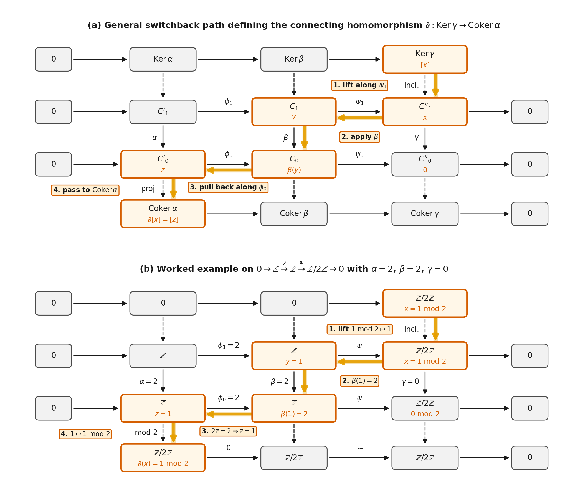

*Figure 21. The snake lemma and the switchback path of the connecting homomorphism $\partial : \operatorname{Ker}\gamma \to \operatorname{Coker}\alpha$. (a) Given two exact rows $0 \to C'_1 \xrightarrow{\phi_1} C_1 \xrightarrow{\psi_1} C''_1 \to 0$ and $0 \to C'_0 \xrightarrow{\phi_0} C_0 \xrightarrow{\psi_0} C''_0 \to 0$ joined by vertical morphisms $\alpha, \beta, \gamma$, the connecting map $\partial$ sends $x \in \operatorname{Ker}\gamma \subseteq C''_1$ along the highlighted S-shaped path: (1) lift $x$ along the surjection $\psi_1$ to $y \in C_1$, (2) apply the middle vertical map $\beta$ to get $\beta(y) \in C_0$, (3) pull $\beta(y)$ back along the injection $\phi_0$ to the unique element $z \in C'_0$ with $\phi_0(z) = \beta(y)$, and (4) pass to the quotient class $\partial[x] = [z] \in \operatorname{Coker}\alpha$. (b) The same switchback chase on the exact rows $0 \to \mathbb{Z} \xrightarrow{2} \mathbb{Z} \xrightarrow{\psi} \mathbb{Z}/2\mathbb{Z} \to 0$ with $\alpha = 2$, $\beta = 2$, and $\gamma = 0$, sending $x = 1 \bmod 2 \in \operatorname{Ker}\gamma = \mathbb{Z}/2\mathbb{Z}$ through $y = 1 \in C_1$, $\beta(1) = 2 \in C_0$, and $z = 1 \in C'_0$ to $\partial(1 \bmod 2) = 1 \bmod 2 \in \operatorname{Coker}\alpha = \mathbb{Z}/2\mathbb{Z}$.*

### Projective Resolutions, Derived Functors, Ext and Tor

When we apply $M' \otimes_\Lambda -$ or $\operatorname{Hom}_\Lambda(-, M')$ to a short exact sequence of modules, the result is exact on one side but can fail to be exact on the other. How can we systematically measure that failure of exactness for any pair of modules? We replace a module by a chain complex of projective modules that is exact everywhere except at degree $0$, apply the functor to that complex, and take the homology of the result.

#### Left and Right Exact Functors, Projective Resolutions and the Comparison Theorem

We first state the one-sided exactness properties of $\operatorname{Hom}$ and tensor product. Given a short exact sequence $0 \to A \xrightarrow{i} B \xrightarrow{p} C \to 0$ in an abelian category $\mathcal{A}$, a covariant additive functor $F : \mathcal{A} \to \mathcal{B}$ is called **right exact** if the induced sequence

$$F(A) \xrightarrow{F(i)} F(B) \xrightarrow{F(p)} F(C) \to 0$$

is always exact, and **left exact** if $0 \to F(A) \xrightarrow{F(i)} F(B) \xrightarrow{F(p)} F(C)$ is always exact; dually, a contravariant additive functor $F : \mathcal{A} \to \mathcal{B}$ is called **left exact** if

$$0 \to F(C) \xrightarrow{F(p)} F(B) \xrightarrow{F(i)} F(A)$$

is always exact, and **right exact** if $F(C) \to F(B) \to F(A) \to 0$ is always exact (a functor that is both left and right exact is called **exact**). For modules over $\Lambda$, the tensor product functor $M' \otimes_\Lambda - : {}_\Lambda\mathbf{Mod} \to \mathbf{Ab}$ is covariant and right exact, $\operatorname{Hom}_\Lambda(M, -) : {}_\Lambda\mathbf{Mod} \to \mathbf{Ab}$ is covariant and left exact, and $\operatorname{Hom}_\Lambda(-, M') : {}_\Lambda\mathbf{Mod} \to \mathbf{Ab}$ is contravariant and left exact. For example, starting from the short exact sequence $0 \to \mathbb{Z} \xrightarrow{2} \mathbb{Z} \xrightarrow{\pi} \mathbb{Z}/2\mathbb{Z} \to 0$, tensoring with $\mathbb{Z}/2\mathbb{Z}$ gives $\mathbb{Z}/2\mathbb{Z} \xrightarrow{0} \mathbb{Z}/2\mathbb{Z} \xrightarrow{\sim} \mathbb{Z}/2\mathbb{Z} \to 0$ (exact on the right, but not injective on the left), while applying $\operatorname{Hom}_{\mathbb{Z}}(-, \mathbb{Z})$ gives $0 \to 0 \to \mathbb{Z} \xrightarrow{2} \mathbb{Z}$ (exact on the left, but not surjective on the right).

To build derived functors, we resolve a left $\Lambda$-module $M$ into a chain complex of projective modules by repeatedly covering kernels with projective modules: first choose a projective module $P_0$ mapping onto $M$ with kernel $K_0 = \tilde{\Omega}(M)$, then choose a projective module $P_1$ mapping onto $K_0$ with kernel $K_1 = \tilde{\Omega}^2(M)$, and continue inductively.

**Projective resolution (Definition).** A **projective resolution** of a left $\Lambda$-module $M$ is a long exact sequence

$$\cdots \to P_2 \xrightarrow{\partial_2} P_1 \xrightarrow{\partial_1} P_0$$

of projective $\Lambda$-modules $P_n$ such that $P_0/\operatorname{Im}(\partial_1) \cong M$, or equivalently an exact sequence

$$\cdots \to P_2 \xrightarrow{\partial_2} P_1 \xrightarrow{\partial_1} P_0 \to M \to 0$$

(regarded as a chain complex in which $M$ sits in degree $-1$). Because every module is a homomorphic image of a free module, projective resolutions exist for every $\Lambda$-module $M$.

Although a module $M$ has many different projective resolutions, the universal lifting property of projective modules guarantees that any two projective resolutions of $M$ are chain homotopy equivalent, and any module homomorphism $M \to M'$ lifts uniquely up to chain homotopy.

**Comparison theorem.** Any homomorphism of $\Lambda$-modules $f_{-1} : M \to M'$ can be extended to a chain map $\{f_n : P_n \to Q_n\}_{n \ge 0}$ between any projective resolution $\cdots \to P_2 \xrightarrow{\partial_2} P_1 \xrightarrow{\partial_1} P_0 \to M \to 0$ of $M$ and any projective resolution $\cdots \to Q_2 \xrightarrow{\partial'_2} Q_1 \xrightarrow{\partial'_1} Q_0 \to M' \to 0$ of $M'$. Given any two such chain maps $\{f_n\}$ and $\{f'_n\}$ extending the same homomorphism $M \to M'$, there is a chain homotopy $h_n : P_n \to Q_{n+1}$ such that $f_n - f'_n = \partial'_{n+1} \circ h_n + h_{n-1} \circ \partial_n$ for all $n \ge 0$.

In fact, the comparison theorem holds more generally whenever the upper complex $\mathbf{P}$ consists of projective modules (it need not be exact) and the lower complex $\mathbf{Q} \to M' \to 0$ is exact (its terms $Q_n$ need not be projective); we will use this stronger form of the comparison theorem when classifying extensions.

#### Defining Tor, Ext and General Derived Functors

Now let $\cdots \to P_2 \xrightarrow{\partial_2} P_1 \xrightarrow{\partial_1} P_0$ be a projective resolution $\mathbf{P}$ of a left $\Lambda$-module $M$ (with $M$ itself omitted, and $P_n = 0$ for $n < 0$).

**Defining $\operatorname{Tor}_n^\Lambda(M', M)$.** For any right $\Lambda$-module $M'$, tensoring $\mathbf{P}$ on the left with $M'$ forms the chain complex

$$\cdots \to M' \otimes_\Lambda P_2 \xrightarrow{1 \otimes \partial_2} M' \otimes_\Lambda P_1 \xrightarrow{1 \otimes \partial_1} M' \otimes_\Lambda P_0 \to 0.$$

This complex is no longer necessarily exact, but $(1 \otimes \partial_{n-1}) \circ (1 \otimes \partial_n) = 1 \otimes (\partial_{n-1} \circ \partial_n) = 0$. By the comparison theorem, any two projective resolutions of $M$ are chain homotopy equivalent, and since the additive functor $M' \otimes_\Lambda -$ preserves chain homotopy equivalences, the homology groups of $M' \otimes_\Lambda \mathbf{P}$ do not depend on the choice of resolution $\mathbf{P}$; we define

$$\operatorname{Tor}_n^\Lambda(M', M) = H_n(M' \otimes_\Lambda \mathbf{P},\, 1 \otimes \partial_*).$$

**Defining $\operatorname{Ext}^n_\Lambda(M, M')$.** For any left $\Lambda$-module $M'$, applying the contravariant functor $\operatorname{Hom}_\Lambda(-, M')$ to $\mathbf{P}$ forms the cochain complex

$$0 \to \operatorname{Hom}_\Lambda(P_0, M') \xrightarrow{\delta^0} \operatorname{Hom}_\Lambda(P_1, M') \xrightarrow{\delta^1} \operatorname{Hom}_\Lambda(P_2, M') \to \cdots$$

where $\delta^n(\alpha) = \alpha \circ \partial_{n+1}$. Again, the comparison theorem guarantees that this cochain complex is independent of the choice of projective resolution $\mathbf{P}$ up to cochain homotopy equivalence, so we define

$$\operatorname{Ext}^n_\Lambda(M, M') = H^n(\operatorname{Hom}_\Lambda(\mathbf{P}, M'),\, \delta^*).$$

In degree $0$, right exactness of $M' \otimes_\Lambda -$ applied to $P_1 \xrightarrow{\partial_1} P_0 \to M \to 0$ gives $\operatorname{Coker}(1 \otimes \partial_1) \cong M' \otimes_\Lambda M$, and left exactness of $\operatorname{Hom}_\Lambda(-, M')$ gives $\operatorname{Ker}(\delta^0) \cong \operatorname{Hom}_\Lambda(M, M')$, so

$$\operatorname{Tor}_0^\Lambda(M', M) \cong M' \otimes_\Lambda M \qquad \text{and} \qquad \operatorname{Ext}^0_\Lambda(M, M') \cong \operatorname{Hom}_\Lambda(M, M').$$

**Abelian groups ($\Lambda = \mathbb{Z}$) have $\operatorname{Tor}_n^{\mathbb{Z}} = 0$ and $\operatorname{Ext}^n_{\mathbb{Z}} = 0$ for all $n \ge 2$.** Over $\Lambda = \mathbb{Z}$, every subgroup of a free abelian group is again a free abelian group, so the kernel of any free presentation $P_0 \twoheadrightarrow M$ is already free. Every abelian group $M$ therefore has a projective resolution $0 \to P_1 \to P_0 \to M \to 0$ of length $1$ ($P_n = 0$ for $n \ge 2$), which forces $\operatorname{Tor}_n^{\mathbb{Z}}(M', M) = 0$ and $\operatorname{Ext}^n_{\mathbb{Z}}(M, M') = 0$ for all $n \ge 2$.

---

**Aside: Whitehead's problem and the axioms of set theory.**

If $A$ is a free abelian group, then $\operatorname{Ext}^1_{\mathbb{Z}}(A, \mathbb{Z}) = 0$ because free modules are projective. J. H. C. Whitehead asked whether the converse holds: if $A$ is an abelian group with $\operatorname{Ext}^1_{\mathbb{Z}}(A, \mathbb{Z}) = 0$, must $A$ be free? Karl Stein proved that the answer is yes whenever $A$ is countable, but Saharon Shelah showed in 1974 that for uncountable abelian groups $A$, the statement is independent of the standard ZFC axioms of set theory.

---

**Projective modules have vanishing higher $\operatorname{Ext}$ and $\operatorname{Tor}$.** If $M$ is projective, we can choose its projective resolution to be $P_0 = M$ in degree $0$ and $P_n = 0$ for all $n \ge 1$, so $\operatorname{Ext}^n_\Lambda(M, M') = 0$ and $\operatorname{Tor}_n^\Lambda(M', M) = 0$ for all $n > 0$.

**Higher Heller shifts $\tilde{\Omega}^n(M)$, $\Omega^n(M)$ and minimal resolutions.** In any projective resolution $\cdots \to P_2 \xrightarrow{\partial_2} P_1 \xrightarrow{\partial_1} P_0 \xrightarrow{\partial_0} M \to 0$, we write $\tilde{\Omega}^n(M) = \operatorname{Ker}(\partial_{n-1})$ for the $n$-th kernel; iterating Schanuel's lemma shows that if $\tilde{\Omega}^n(M)'$ comes from another projective resolution of $M$, then $\tilde{\Omega}^n(M) \oplus P' \cong \tilde{\Omega}^n(M)' \oplus P$ for some projective modules $P$ and $P'$. When $M$ is finitely generated and the Krull–Schmidt theorem holds (as over any Artinian ring), taking the projective cover at each step constructs a unique **minimal resolution** of $M$, in which we write $\Omega^n(M) = \operatorname{Ker}(\partial_{n-1})$. Dually, in an **injective resolution** $0 \to M \to I_0 \xrightarrow{\delta^0} I_1 \xrightarrow{\delta^1} I_2 \to \cdots$ with each $I_n$ injective, we write $\tilde{\Omega}^{-n}(M)$ for the $n$-th cokernel, and $\Omega^{-n}(M)$ when each step is an injective hull.

**Left and right derived functors.** More generally, let $\mathcal{A}$ and $\mathcal{B}$ be abelian categories in which every object of $\mathcal{A}$ is a quotient of a projective object, and let $F : \mathcal{A} \to \mathcal{B}$ be a covariant additive functor. Applying $F$ to a projective resolution $\mathbf{P}$ of $M$ yields a chain complex $\cdots \to F(P_2) \xrightarrow{F(\partial_2)} F(P_1) \xrightarrow{F(\partial_1)} F(P_0) \to 0$, whose homology groups are the **left derived functors** $L_n F(M) = H_n(F(\mathbf{P}), F(\partial_*))$. When $F$ is right exact, $L_0 F(M) \cong F(M)$, and in particular $L_n(M' \otimes_\Lambda -) = \operatorname{Tor}_n^\Lambda(M', -)$.

Dually, if every object of $\mathcal{A}$ embeds in an injective object, applying a covariant additive functor $F$ to an injective resolution $0 \to I_0 \xrightarrow{\delta^0} I_1 \xrightarrow{\delta^1} I_2 \to \cdots$ of $M$ yields the **right derived functors** $R^n F(M) = H^n(F(\mathbf{I}), F(\delta^*))$, with $R^0 F(M) \cong F(M)$ if $F$ is left exact. For a contravariant additive functor $F$, left derived functors use an injective resolution and right derived functors use a projective resolution, so $R^n\operatorname{Hom}_\Lambda(-, M') = \operatorname{Ext}^n_\Lambda(-, M')$. As we will see in the next section, deriving the other variable via $L_n(- \otimes_\Lambda M)$ and $R^n\operatorname{Hom}_\Lambda(M, -)$ gives the exact same $\operatorname{Tor}$ and $\operatorname{Ext}$ groups.

#### Ext Between Simple Modules, Augmented Algebras and Worked Resolutions

Over an Artinian ring $\Lambda$, how can we read off $\operatorname{Ext}^1_\Lambda(S, S')$ between two simple modules $S$ and $S'$ directly from the Loewy layers of the regular module?

**$\operatorname{Ext}^1$ between simple modules (Proposition).** Suppose that $\Lambda$ is an Artinian ring, and let $P = \Lambda e$ and $P' = \Lambda e'$ be projective indecomposable $\Lambda$-modules with simple heads $S = P/\operatorname{Rad}(P)$ and $S' = P'/\operatorname{Rad}(P')$. Then

$$\operatorname{Ext}^1_\Lambda(S, S') \cong \operatorname{Hom}_\Lambda\!\left(\operatorname{Rad}(P)/\operatorname{Rad}^2(P),\, S'\right).$$

As an $\operatorname{End}_\Lambda(S')$-$\operatorname{End}_\Lambda(S)$-bimodule, this group is dual to the $\operatorname{End}_\Lambda(S)$-$\operatorname{End}_\Lambda(S')$-bimodule $e'J(\Lambda)e / e'J^2(\Lambda)e$; in particular, if $\Lambda$ is a finite-dimensional algebra over a field $k$, then

$$\dim_k \operatorname{Ext}^1_\Lambda(S, S') = \dim_k\!\left(e'J(\Lambda)e / e'J^2(\Lambda)e\right).$$

Intuitively, in a minimal projective resolution of $S$ starting with $P_0 = P$, the first syzygy is $\Omega(S) = \operatorname{Rad}(P)$, whose largest semisimple quotient is the second Loewy layer $\operatorname{Rad}(P)/\operatorname{Rad}^2(P)$.

Next, when an algebra $\Lambda$ over a commutative ring $R$ comes with a canonical way to collapse $\Lambda$ onto $R$, we can define the homology and cohomology of $\Lambda$ itself by placing the trivial module $R$ in the resolved slot.

**Augmented algebra and its homology and cohomology (Definition).** An **augmented algebra** $\Lambda$ over a commutative ring $R$ is an $R$-algebra equipped with a surjective homomorphism $\varepsilon : \Lambda \to R$ of $R$-algebras, called the **augmentation map**. Using $\varepsilon$, the ring $R$ becomes a left $\Lambda$-module via $\lambda \cdot x = \varepsilon(\lambda)x$ and a right $\Lambda$-module via $x \cdot \lambda = \varepsilon(\lambda)x$. The **algebra homology groups** of $\Lambda$ with coefficients in a right $\Lambda$-module $M$ and the **algebra cohomology groups** of $\Lambda$ with coefficients in a left $\Lambda$-module $M$ (generalising the group cohomology groups of [low degree cohomology](#low-degree-cohomology) below) are defined by

$$H_n(\Lambda, M) = \operatorname{Tor}_n^\Lambda(M, R) \qquad \text{and} \qquad H^n(\Lambda, M) = \operatorname{Ext}^n_\Lambda(R, M).$$

For a group algebra $\Lambda = RG$, the linear map $\varepsilon(\sum_{g \in G} r_g g) = \sum_{g \in G} r_g$ is a surjective $R$-algebra homomorphism $\varepsilon : RG \to R$, making $R$ the trivial $RG$-module on which every $g \in G$ acts as $1$. Note also that if $R \to R'$ is a homomorphism of commutative coefficient rings and $\Lambda$ is projective as an $R$-module, tensoring a projective resolution of $R$ over $\Lambda$ with $R'$ produces a projective resolution of $R'$ over $R' \otimes_R \Lambda$, giving natural isomorphisms $H_n(\Lambda, R') \cong H_n(R' \otimes_R \Lambda, R')$ and $H^n(\Lambda, R') \cong H^n(R' \otimes_R \Lambda, R')$.

**Worked examples: computing $\operatorname{Ext}^1_{\mathbb{Z}}(\mathbb{Z}/n\mathbb{Z}, \mathbb{Z}) \cong \mathbb{Z}/n\mathbb{Z}$, $\operatorname{Tor}_1^{\mathbb{Z}}(\mathbb{Z}/m\mathbb{Z}, \mathbb{Z}/n\mathbb{Z}) \cong \mathbb{Z}/\gcd(m,n)\mathbb{Z}$, and the periodic resolution over $kC_p$.** First, let $\Lambda = \mathbb{Z}$ and $M = \mathbb{Z}/n\mathbb{Z}$ ($n \ge 2$). Multiplication by $n$ gives a free (hence projective) resolution of $M$ of length $1$:

$$0 \to P_1 \xrightarrow{\partial_1 = n} P_0 \to \mathbb{Z}/n\mathbb{Z} \to 0 \qquad \text{with } P_1 = \mathbb{Z}, \; P_0 = \mathbb{Z}.$$

To compute $\operatorname{Ext}^k_{\mathbb{Z}}(\mathbb{Z}/n\mathbb{Z}, \mathbb{Z})$, apply $\operatorname{Hom}_{\mathbb{Z}}(-, \mathbb{Z})$ to the truncated resolution $0 \to \mathbb{Z} \xrightarrow{n} \mathbb{Z} \to 0$. Identifying $\operatorname{Hom}_{\mathbb{Z}}(\mathbb{Z}, \mathbb{Z}) \cong \mathbb{Z}$ via $\alpha \mapsto \alpha(1)$, the map $\delta^0(\alpha) = \alpha \circ n$ sends $1 \mapsto \alpha(n) = n\alpha(1)$, so the cochain complex in degrees $0$ and $1$ is

$$0 \to \mathbb{Z} \xrightarrow{\delta^0 = n} \mathbb{Z} \to 0.$$

Taking cohomology gives $\operatorname{Ext}^0_{\mathbb{Z}}(\mathbb{Z}/n\mathbb{Z}, \mathbb{Z}) = \operatorname{Ker}(n) = 0$, $\operatorname{Ext}^1_{\mathbb{Z}}(\mathbb{Z}/n\mathbb{Z}, \mathbb{Z}) = \operatorname{Coker}(n) = \mathbb{Z}/n\mathbb{Z}$, and $\operatorname{Ext}^k_{\mathbb{Z}}(\mathbb{Z}/n\mathbb{Z}, \mathbb{Z}) = 0$ for $k \ge 2$. Next, to compute $\operatorname{Tor}_k^{\mathbb{Z}}(\mathbb{Z}/m\mathbb{Z}, \mathbb{Z}/n\mathbb{Z})$, tensor the same resolution $0 \to \mathbb{Z} \xrightarrow{n} \mathbb{Z} \to 0$ on the left with $M' = \mathbb{Z}/m\mathbb{Z}$. Using $(\mathbb{Z}/m\mathbb{Z}) \otimes_{\mathbb{Z}} \mathbb{Z} \cong \mathbb{Z}/m\mathbb{Z}$, we obtain the chain complex in degrees $1$ and $0$:

$$0 \to \mathbb{Z}/m\mathbb{Z} \xrightarrow{\bar{n}} \mathbb{Z}/m\mathbb{Z} \to 0 \qquad (\bar{n}(x \bmod m) = nx \bmod m).$$

At degree $0$, the homology is $\operatorname{Tor}_0^{\mathbb{Z}}(\mathbb{Z}/m\mathbb{Z}, \mathbb{Z}/n\mathbb{Z}) = (\mathbb{Z}/m\mathbb{Z})/n(\mathbb{Z}/m\mathbb{Z}) \cong \mathbb{Z}/\gcd(m, n)\mathbb{Z}$. At degree $1$, the homology is the kernel of multiplication by $n$ on $\mathbb{Z}/m\mathbb{Z}$: an element $x \bmod m$ satisfies $nx \equiv 0 \pmod{m}$ if and only if $(m/\gcd(m, n)) \mid x$, which generates a cyclic subgroup of order $\gcd(m, n)$, so

$$\operatorname{Tor}_1^{\mathbb{Z}}(\mathbb{Z}/m\mathbb{Z}, \mathbb{Z}/n\mathbb{Z}) = \operatorname{Ker}(\bar{n}) = \langle m/\gcd(m, n) \bmod m \rangle \cong \mathbb{Z}/\gcd(m, n)\mathbb{Z}.$$

Second, let $k$ be a field of characteristic $p > 0$, let $G = C_p = \langle a : a^p = 1 \rangle$, and let $\Lambda = kC_p \cong k[x]/(x^p)$ with $x = a - 1$. In $\Lambda$, define the norm element $N = 1 + a + a^2 + \cdots + a^{p-1} = (a - 1)^{p-1} = x^{p-1}$. In the basis $\{1, x, x^2, \dots, x^{p-1}\}$ of $\Lambda$, multiplication by $x$ shifts $x^j \mapsto x^{j+1}$ for $0 \le j \le p - 2$ and kills $x^{p-1}$, so $\operatorname{Im}(x) = \operatorname{sp}_k(x, \dots, x^{p-1})$ (dimension $p - 1$) and $\operatorname{Ker}(x) = \operatorname{sp}_k(x^{p-1}) = kN$ (dimension $1$). Multiplication by $N = x^{p-1}$ sends $1 \mapsto x^{p-1}$ and kills $x, x^2, \dots, x^{p-1}$, so $\operatorname{Im}(N) = \operatorname{sp}_k(x^{p-1}) = \operatorname{Ker}(x)$ (dimension $1$) and $\operatorname{Ker}(N) = \operatorname{sp}_k(x, \dots, x^{p-1}) = \operatorname{Im}(x)$ (dimension $p - 1$). Splicing these two maps alternately gives an infinite periodic minimal projective resolution of the trivial module $k$:

$$\cdots \xrightarrow{N} kC_p \xrightarrow{x} kC_p \xrightarrow{N} kC_p \xrightarrow{x} kC_p \xrightarrow{\varepsilon} k \to 0,$$

with Heller shifts $\Omega^{2m}(k) \cong k$ and $\Omega^{2m+1}(k) \cong J(kC_p)$ for all $m \ge 0$. Applying $\operatorname{Hom}_{kC_p}(-, k)$ identifies each $\operatorname{Hom}_{kC_p}(kC_p, k) \cong k$, and because both $x \in J(kC_p)$ and $N = x^{p-1} \in J(kC_p)$ annihilate the simple module $k$, every differential $\delta^n$ in the cochain complex $0 \to k \xrightarrow{0} k \xrightarrow{0} k \xrightarrow{0} \cdots$ is zero. Similarly, tensoring with $k$ on the left sets $x$ and $N$ to zero, so for every degree $n \ge 0$,

$$H^n(kC_p, k) = \operatorname{Ext}^n_{kC_p}(k, k) \cong k \qquad \text{and} \qquad H_n(kC_p, k) = \operatorname{Tor}_n^{kC_p}(k, k) \cong k.$$

In degree $1$, this matches the simple-module formula $\dim_k \operatorname{Ext}^1_{kC_p}(k, k) = \dim_k(J(kC_p)/J^2(kC_p)) = \dim_k((x)/(x^2)) = 1$.

### Long Exact Sequences, Balance and Dimension Shifting

By themselves, $\operatorname{Hom}$ and tensor product give only three-term one-sided exact sequences when applied to a short exact sequence $0 \to M' \to M \to M'' \to 0$. The payoff of defining $\operatorname{Ext}^n$ and $\operatorname{Tor}_n$ is that they continue those three-term sequences indefinitely into long exact sequences in *either* variable, and those long exact sequences prove that resolving the second variable instead of the first gives the exact same $\operatorname{Ext}$ and $\operatorname{Tor}$ groups.

#### The Horseshoe Lemma and Long Exact Sequences in Both Variables

To obtain a long exact sequence when the *resolved* module varies in a short exact sequence $0 \to M' \to M \to M'' \to 0$, we need a way to fit projective resolutions of $M'$ and $M''$ into a short exact sequence of projective resolutions.

**Horseshoe lemma.** If $0 \to M' \to M \to M'' \to 0$ is a short exact sequence of left $\Lambda$-modules, then given projective resolutions $\cdots \to P'_2 \to P'_1 \to P'_0$ of $M'$ and $\cdots \to P''_2 \to P''_1 \to P''_0$ of $M''$, we can construct a projective resolution of $M$ whose $n$-th term is $P'_n \oplus P''_n$ so that the columns $0 \to P'_n \to P'_n \oplus P''_n \to P''_n \to 0$ form a short exact sequence of chain complexes lifting $0 \to M' \to M \to M'' \to 0$.

The name comes from the shape of the initial diagram, which has the two vertical resolutions $\mathbf{P}' \to M'$ and $\mathbf{P}'' \to M''$ on the left and right sides and the horizontal short exact sequence $0 \to M' \to M \to M'' \to 0$ along the bottom like a horseshoe. Because each column $0 \to P'_n \to P'_n \oplus P''_n \to P''_n \to 0$ in the resulting resolution is a split short exact sequence of projective modules, applying any additive functor such as $M_0 \otimes_\Lambda -$ or $\operatorname{Hom}_\Lambda(-, M_0)$ keeps the columns exact and yields a long exact sequence in homology or cohomology.

**Long exact sequences in the resolved variable (Proposition).** Suppose that $0 \to M' \to M \to M'' \to 0$ is a short exact sequence of left $\Lambda$-modules. For any right $\Lambda$-module $M_0$, there is a long exact sequence

$$\cdots \to \operatorname{Tor}_n^\Lambda(M_0, M') \to \operatorname{Tor}_n^\Lambda(M_0, M) \to \operatorname{Tor}_n^\Lambda(M_0, M'') \to \operatorname{Tor}_{n-1}^\Lambda(M_0, M') \to \cdots \to \operatorname{Tor}_1^\Lambda(M_0, M'') \to M_0 \otimes_\Lambda M' \to M_0 \otimes_\Lambda M \to M_0 \otimes_\Lambda M'' \to 0.$$

Dually, for any left $\Lambda$-module $M_0$, there is a long exact sequence

$$0 \to \operatorname{Hom}_\Lambda(M'', M_0) \to \operatorname{Hom}_\Lambda(M, M_0) \to \operatorname{Hom}_\Lambda(M', M_0) \to \operatorname{Ext}^1_\Lambda(M'', M_0) \to \cdots \to \operatorname{Ext}^n_\Lambda(M'', M_0) \to \operatorname{Ext}^n_\Lambda(M, M_0) \to \operatorname{Ext}^n_\Lambda(M', M_0) \to \operatorname{Ext}^{n+1}_\Lambda(M'', M_0) \to \cdots.$$

By the exact same horseshoe argument, any right exact covariant additive functor $F : \mathcal{A} \to \mathcal{B}$ has a long exact sequence $\cdots \to L_n F(M') \to L_n F(M) \to L_n F(M'') \to L_{n-1}F(M') \to \cdots \to L_1 F(M'') \to F(M') \to F(M) \to F(M'') \to 0$, and any left exact contravariant additive functor $F$ has a long exact sequence $0 \to F(M'') \to F(M) \to F(M') \to R^1 F(M'') \to \cdots \to R^n F(M'') \to R^n F(M) \to R^n F(M') \to R^{n+1}F(M'') \to \cdots$ (and similarly for right derived functors of left exact covariant functors and left derived functors of right exact contravariant functors).

What if the short exact sequence is in the *other* variable, while the resolved module $M'$ stays fixed? Then we do not even need the horseshoe lemma: tensoring a short exact sequence $0 \to M_0 \to M_1 \to M_2 \to 0$ of right $\Lambda$-modules with a projective resolution $\mathbf{P}'$ of $M'$ (or applying $\operatorname{Hom}_\Lambda(\mathbf{P}', -)$ to a short exact sequence of left $\Lambda$-modules) stays exact in every degree $n$ because each $P'_n$ is projective (and hence flat).

**Long exact sequences in the second variable (Proposition).** Let $M'$ be a left $\Lambda$-module. If $0 \to M_0 \to M_1 \to M_2 \to 0$ is a short exact sequence of right $\Lambda$-modules, there is a long exact sequence

$$\cdots \to \operatorname{Tor}_n^\Lambda(M_0, M') \to \operatorname{Tor}_n^\Lambda(M_1, M') \to \operatorname{Tor}_n^\Lambda(M_2, M') \to \operatorname{Tor}_{n-1}^\Lambda(M_0, M') \to \cdots \to \operatorname{Tor}_1^\Lambda(M_2, M') \to M_0 \otimes_\Lambda M' \to M_1 \otimes_\Lambda M' \to M_2 \otimes_\Lambda M' \to 0.$$

Dually, if $0 \to M_0 \to M_1 \to M_2 \to 0$ is a short exact sequence of left $\Lambda$-modules, there is a long exact sequence

$$0 \to \operatorname{Hom}_\Lambda(M', M_0) \to \operatorname{Hom}_\Lambda(M', M_1) \to \operatorname{Hom}_\Lambda(M', M_2) \to \operatorname{Ext}^1_\Lambda(M', M_0) \to \cdots \to \operatorname{Ext}^n_\Lambda(M', M_0) \to \operatorname{Ext}^n_\Lambda(M', M_1) \to \operatorname{Ext}^n_\Lambda(M', M_2) \to \operatorname{Ext}^{n+1}_\Lambda(M', M_0) \to \cdots.$$

#### Minimal Resolutions, Balance of Ext and Tor and Dimension Shifting

Before seeing that $\operatorname{Tor}$ and $\operatorname{Ext}$ can be computed by resolving either variable, we record how minimal resolutions over an Artinian ring simplify $\operatorname{Ext}^n$ when one of the modules is simple.

**$\operatorname{Ext}^n$ with a simple module via Heller shifts (Corollary).** Let $\Lambda$ be an Artinian ring and $S$ be a simple $\Lambda$-module. Then for all $n \ge 0$, if $M$ is a finitely generated $\Lambda$-module,

$$\operatorname{Ext}^n_\Lambda(M, S) \cong \operatorname{Hom}_\Lambda(\Omega^n M, S)$$

and for any $\Lambda$-module $M$,

$$\operatorname{Ext}^n_\Lambda(S, M) \cong \operatorname{Hom}_\Lambda(S, \Omega^{-n} M)$$

Intuitively, in a minimal projective or injective resolution, every differential vanishes when paired with the simple module $S$, leaving only the degree-$n$ term $\operatorname{Hom}_\Lambda(P_n, S) \cong \operatorname{Hom}_\Lambda(\Omega^n M, S)$ or $\operatorname{Hom}_\Lambda(S, I_n) \cong \operatorname{Hom}_\Lambda(S, \Omega^{-n} M)$.

**Balance of $\operatorname{Tor}$ and $\operatorname{Ext}$ (Proposition).** Both $\operatorname{Tor}_n^\Lambda$ and $\operatorname{Ext}^n_\Lambda$ can be computed by resolving the other variable. First, if $M'$ is a right $\Lambda$-module and $\cdots \to P'_2 \xrightarrow{\partial'_2} P'_1 \xrightarrow{\partial'_1} P'_0 \to M' \to 0$ is a projective resolution of $M'$ as a right $\Lambda$-module, then for any left $\Lambda$-module $M$,

$$\operatorname{Tor}_n^\Lambda(M', M) \cong H_n(\mathbf{P}' \otimes_\Lambda M,\, \partial'_* \otimes 1),$$

and in particular $\operatorname{Tor}_n^\Lambda(M', M) = 0$ for all $n > 0$ whenever $M'$ is projective. Second, if $M'$ is a left $\Lambda$-module and $0 \to M' \to I'_0 \xrightarrow{\delta^0} I'_1 \xrightarrow{\delta^1} I'_2 \to \cdots$ is an injective resolution of $M'$, then for any left $\Lambda$-module $M$,

$$\operatorname{Ext}^n_\Lambda(M, M') \cong H^n(\operatorname{Hom}_\Lambda(M, \mathbf{I}'),\, \delta^*),$$

and in particular $\operatorname{Ext}^n_\Lambda(M, M') = 0$ for all $n > 0$ whenever $M'$ is injective.

Because tensoring a projective resolution of either variable with a flat module in the other slot preserves exactness, balance of $\operatorname{Tor}$ implies that flat modules have vanishing higher $\operatorname{Tor}$.

**Vanishing of $\operatorname{Tor}$ for flat modules (Corollary).** If either the right $\Lambda$-module $M'$ or the left $\Lambda$-module $M$ is flat, then $\operatorname{Tor}_n^\Lambda(M', M) = 0$ for all $n > 0$.

Because projective and injective modules have vanishing higher $\operatorname{Ext}$ and $\operatorname{Tor}$, applying the long exact sequence to a short exact sequence $0 \to \tilde{\Omega}(M) \to P \to M \to 0$ (with $P$ projective) or $0 \to M' \to I \to \tilde{\Omega}^{-1}(M') \to 0$ (with $I$ injective) reduces degree-$n$ derived functors to degree-$(n - 1)$ derived functors of the Heller shift, an inductive technique called **dimension shifting**.

**Dimension shifting for $\operatorname{Ext}$ and $\operatorname{Tor}$ (Proposition).** For any modules $M, M'$ and any $n \ge 2$, shifting either argument by its Heller kernel or cokernel lowers the degree by $1$:

$$\operatorname{Ext}^n_\Lambda(M, M') \cong \operatorname{Ext}^{n-1}_\Lambda(\tilde{\Omega}(M), M') \cong \operatorname{Ext}^{n-1}_\Lambda(M, \tilde{\Omega}^{-1}(M')),$$

$$\operatorname{Tor}_n^\Lambda(M', M) \cong \operatorname{Tor}_{n-1}^\Lambda(\tilde{\Omega}(M'), M) \cong \operatorname{Tor}_{n-1}^\Lambda(M', \tilde{\Omega}(M)).$$

**Worked example: computing $\operatorname{Ext}^1_{\mathbb{Z}}(\mathbb{Z}/p\mathbb{Z}, \mathbb{Z}/p\mathbb{Z})$ in three ways.** Let $\Lambda = \mathbb{Z}$ and let $p$ be a prime. First, using the projective resolution $0 \to \mathbb{Z} \xrightarrow{p} \mathbb{Z} \to \mathbb{Z}/p\mathbb{Z} \to 0$ of the first variable and applying $\operatorname{Hom}_{\mathbb{Z}}(-, \mathbb{Z}/p\mathbb{Z})$ gives the cochain complex $0 \to \mathbb{Z}/p\mathbb{Z} \xrightarrow{p = 0} \mathbb{Z}/p\mathbb{Z} \to 0$ in degrees $0$ and $1$, so both $\operatorname{Ext}^0_{\mathbb{Z}}(\mathbb{Z}/p\mathbb{Z}, \mathbb{Z}/p\mathbb{Z})$ and $\operatorname{Ext}^1_{\mathbb{Z}}(\mathbb{Z}/p\mathbb{Z}, \mathbb{Z}/p\mathbb{Z})$ are isomorphic to $\mathbb{Z}/p\mathbb{Z}$.

Second, using the injective resolution $0 \to \mathbb{Z}/p\mathbb{Z} \xrightarrow{i} \mathbb{Q}/\mathbb{Z} \xrightarrow{p} \mathbb{Q}/\mathbb{Z} \to 0$ of the second variable (where $i(1 \bmod p) = 1/p \bmod 1$) and applying $\operatorname{Hom}_{\mathbb{Z}}(\mathbb{Z}/p\mathbb{Z}, -)$ picks out the $p$-torsion subgroup $\operatorname{Hom}_{\mathbb{Z}}(\mathbb{Z}/p\mathbb{Z}, \mathbb{Q}/\mathbb{Z}) \cong \mathbb{Z}/p\mathbb{Z}$ in both degrees $0$ and $1$, with induced map $p = 0$, giving the exact same cochain complex $0 \to \mathbb{Z}/p\mathbb{Z} \xrightarrow{0} \mathbb{Z}/p\mathbb{Z} \to 0$ and $\operatorname{Ext}^1_{\mathbb{Z}}(\mathbb{Z}/p\mathbb{Z}, \mathbb{Z}/p\mathbb{Z}) \cong \mathbb{Z}/p\mathbb{Z}$.

Third, without writing any cochain complex at all, apply the second-variable long exact sequence to $0 \to \mathbb{Z} \xrightarrow{p} \mathbb{Z} \to \mathbb{Z}/p\mathbb{Z} \to 0$ with $M' = \mathbb{Z}/p\mathbb{Z}$ fixed: since $\operatorname{Hom}_{\mathbb{Z}}(\mathbb{Z}/p\mathbb{Z}, \mathbb{Z}) = 0$ and $\operatorname{Ext}^1_{\mathbb{Z}}(\mathbb{Z}/p\mathbb{Z}, \mathbb{Z}) \cong \mathbb{Z}/p\mathbb{Z}$ (computed in the previous section), the long exact sequence reads

$$0 \to \operatorname{Hom}_{\mathbb{Z}}(\mathbb{Z}/p\mathbb{Z}, \mathbb{Z}/p\mathbb{Z}) \xrightarrow{\sim} \mathbb{Z}/p\mathbb{Z} \xrightarrow{p = 0} \mathbb{Z}/p\mathbb{Z} \xrightarrow{\sim} \operatorname{Ext}^1_{\mathbb{Z}}(\mathbb{Z}/p\mathbb{Z}, \mathbb{Z}/p\mathbb{Z}) \to 0,$$

giving $\operatorname{Ext}^1_{\mathbb{Z}}(\mathbb{Z}/p\mathbb{Z}, \mathbb{Z}/p\mathbb{Z}) \cong \mathbb{Z}/p\mathbb{Z}$ immediately.

### Extensions of Modules and Yoneda Composition

Why does $\operatorname{Ext}^1_\Lambda(M, M')$ carry the name $\operatorname{Ext}$? Just as the second cohomology group ([below](#degree-two-cohomology-factor-sets-and-group-extensions)) measures the factor sets that glue a normal subgroup and a quotient group together, $\operatorname{Ext}^1_\Lambda(M, M')$ is in bijection with the equivalence classes of short exact sequences $0 \to M' \to E \to M \to 0$ that glue $M'$ as a submodule to $M$ as a quotient, and more generally $\operatorname{Ext}^n_\Lambda(M, M')$ classifies $n$-step exact sequences from $M'$ to $M$, with end-to-end splicing giving $\operatorname{Ext}^*_\Lambda(M, M)$ a ring structure.

#### Equivalence of Extensions and the Splitting Criterion

**$n$-fold extensions and equivalence (Definition).** If $M$ and $M'$ are left $\Lambda$-modules and $n \ge 1$ is an integer, an **$n$-fold extension** of $M$ by $M'$ is an exact sequence

$$0 \to M' \to M_{n-1} \to M_{n-2} \to \cdots \to M_0 \to M \to 0$$

beginning with $M'$ and ending with $M$, with $n$ intermediate terms $M_{n-1}, \dots, M_0$. A **map of $n$-fold extensions** from $0 \to M' \to M_{n-1} \to \cdots \to M_0 \to M \to 0$ to $0 \to M' \to M'_{n-1} \to \cdots \to M'_0 \to M \to 0$ is a collection of homomorphisms $M_i \to M'_i$ ($0 \le i \le n - 1$) making all squares commute together with the identity maps $\mathrm{id}_{M'}$ on the left and $\mathrm{id}_M$ on the right. Completing this relation by symmetry and transitivity defines **equivalent $n$-fold extensions**.

When $n = 1$, a $1$-fold extension $0 \to M' \to M_0 \to M \to 0$ is called simply an **extension** of $M$ by $M'$. Any map of $1$-fold extensions is automatically an isomorphism $M_0 \xrightarrow{\sim} M'_0$ of short exact sequences, so for $n = 1$ the equivalence relation reduces to isomorphism of short exact sequences (whereas for $n \ge 2$, individual maps $M_i \to M'_i$ in a map of $n$-fold extensions need not be isomorphisms, which is why symmetry and transitivity are imposed).

Be careful to distinguish equivalence of extensions from mere isomorphism of the middle modules: two extensions $0 \to M' \xrightarrow{i} M_0 \xrightarrow{p} M \to 0$ and $0 \to M' \xrightarrow{i'} M'_0 \xrightarrow{p'} M \to 0$ are equivalent only if there is an isomorphism $\theta : M_0 \xrightarrow{\sim} M'_0$ that commutes with *both* the inclusions ($\theta \circ i = i'$) and the projections ($p' \circ \theta = p$). Over a field $k$, however, if the middle module $M_2$ of a finite-dimensional short exact sequence $0 \to M_1 \to M_2 \to M_3 \to 0$ happens to be isomorphic to the direct sum $M_1 \oplus M_3$ as a $\Lambda$-module, dimension counting forces the sequence itself to split.

**Splitting from $M_2 \cong M_1 \oplus M_3$ for finite-dimensional modules (Lemma).** Suppose that $\Lambda$ is an algebra over a field $k$, and let $0 \to M_1 \xrightarrow{i} M_2 \xrightarrow{p} M_3 \to 0$ be a short exact sequence of $\Lambda$-modules of finite $k$-dimension. If $M_2 \cong M_1 \oplus M_3$, then the sequence splits, and hence represents the zero element of $\operatorname{Ext}^1_\Lambda(M_3, M_1)$.

#### Classifying Extensions by Ext and Yoneda Splice

**Extension classification theorem.** Every $n$-fold extension of $M$ by $M'$ determines a cohomology class in $\operatorname{Ext}^n_\Lambda(M, M')$, and this gives a bijection between $\operatorname{Ext}^n_\Lambda(M, M')$ and the set of equivalence classes of $n$-fold extensions of $M$ by $M'$ for any left $\Lambda$-modules $M$ and $M'$ and any integer $n \ge 1$. In particular, $\operatorname{Ext}^1_\Lambda(M, M')$ is the set of equivalence classes of extensions $0 \to M' \to M_0 \to M \to 0$ under isomorphism of short exact sequences, with $0 \in \operatorname{Ext}^1_\Lambda(M, M')$ corresponding to the split extension $0 \to M' \to M' \oplus M \to M \to 0$.

How does the bijection work in each direction? Given a projective resolution $\cdots \to P_n \xrightarrow{\partial_n} P_{n-1} \to \cdots \to P_0 \to M \to 0$ of $M$ and an $n$-fold extension $0 \to M' \to M_{n-1} \to \cdots \to M_0 \to M \to 0$, the stronger form of the comparison theorem lifts $\mathrm{id}_M$ along the chain complexes to a cocycle $\phi : P_n \to M'$ in degree $n$, defining a class $\zeta = [\phi] \in \operatorname{Ext}^n_\Lambda(M, M')$ and a map $\hat{\zeta} : \tilde{\Omega}^n(M) \to M'$ on $\tilde{\Omega}^n(M) = \operatorname{Im}(\partial_n) \le P_{n-1}$. Conversely, given $\zeta \in \operatorname{Ext}^n_\Lambda(M, M')$, choosing the projective resolution of $M$ so that $\hat{\zeta} : \tilde{\Omega}^n(M) \twoheadrightarrow M'$ is an epimorphism with kernel $L_\zeta = \operatorname{Ker}(\hat{\zeta})$ and quotienting $\tilde{\Omega}^n(M) \le P_{n-1}$ by $L_\zeta$ produces the $n$-fold extension

$$0 \to M' \to P_{n-1}/L_\zeta \to P_{n-2} \to \cdots \to P_0 \to M \to 0$$

representing $\zeta$. Here the kernel $L_\zeta$ is determined up to projective direct summands: if $L'_\zeta$ is defined using another projective resolution of $M$, then $L_\zeta \oplus P \cong L'_\zeta \oplus P'$ for some projective modules $P$ and $P'$.

Once $\operatorname{Ext}^n_\Lambda(M, M')$ is interpreted as $n$-fold extensions from $M'$ to $M$, we can compose an $n$-fold extension with an $m$-fold extension simply by splicing them together where $M'$ meets $M'$. Suppose

$$0 \to M' \xrightarrow{i} M_{n-1} \to \cdots \to M_0 \to M \to 0 \qquad \text{and} \qquad 0 \to M'' \to M'_{m-1} \to \cdots \to M'_0 \xrightarrow{p'} M' \to 0$$

are an $n$-fold extension representing $\zeta \in \operatorname{Ext}^n_\Lambda(M, M')$ and an $m$-fold extension representing $\eta \in \operatorname{Ext}^m_\Lambda(M', M'')$. Because $p' : M'_0 \twoheadrightarrow M'$ is surjective and $i : M' \hookrightarrow M_{n-1}$ is injective, the composite map $i \circ p' : M'_0 \to M_{n-1}$ has $\operatorname{Im}(i \circ p') = \operatorname{Im}(i) = \operatorname{Ker}(M_{n-1} \to M_{n-2})$ and $\operatorname{Ker}(i \circ p') = \operatorname{Ker}(p') = \operatorname{Im}(M'_1 \to M'_0)$. Replacing $M'$ by $i \circ p'$ therefore splices the two exact sequences into a single $(n + m)$-fold extension of $M$ by $M''$,

$$0 \to M'' \to M'_{m-1} \to \cdots \to M'_0 \xrightarrow{i \circ p'} M_{n-1} \to \cdots \to M_0 \to M \to 0,$$

called their **Yoneda splice**, which defines an element $\eta \circ \zeta \in \operatorname{Ext}^{n+m}_\Lambda(M, M'')$. This bilinear pairing

$$\operatorname{Ext}^m_\Lambda(M', M'') \times \operatorname{Ext}^n_\Lambda(M, M') \to \operatorname{Ext}^{n+m}_\Lambda(M, M'')$$

is called **Yoneda composition** (when $m = 0$ or $n = 0$, where $\operatorname{Ext}^0_\Lambda = \operatorname{Hom}_\Lambda$, it is defined by pushing out the extension $\zeta$ along $\eta : M' \to M''$ or pulling back the extension $\eta$ along $\zeta : M \to M'$). Because splicing three exact sequences is associative, Yoneda composition makes the direct sum

$$\operatorname{Ext}^*_\Lambda(M, M) = \bigoplus_{n \ge 0} \operatorname{Ext}^n_\Lambda(M, M)$$

into an associative graded ring, and makes $\operatorname{Ext}^*_\Lambda(M, M')$ into an $\operatorname{Ext}^*_\Lambda(M', M')$-$\operatorname{Ext}^*_\Lambda(M, M)$-bimodule. In general, the ring $\operatorname{Ext}^*_\Lambda(M, M)$ is far from commutative, even when $\Lambda = RG$ is a group algebra, although the cohomology ring of a group $H^*(RG, R) = \operatorname{Ext}^*_{RG}(R, R)$ is **graded commutative** ($ab = (-1)^{\deg(a)\deg(b)}ba$).

In terms of Heller shifts, Yoneda composition becomes ordinary composition of shifted homomorphisms: if $\zeta \in \operatorname{Ext}^n_\Lambda(M, M')$ is represented by $\hat{\zeta} : \tilde{\Omega}^n(M) \to M'$ and $\eta \in \operatorname{Ext}^m_\Lambda(M', M'')$ is represented by $\hat{\eta} : \tilde{\Omega}^m(M') \to M''$, lifting $\hat{\zeta}$ $m$ times along a projective resolution of $M'$ produces a map $\tilde{\Omega}^m(\hat{\zeta}) : \tilde{\Omega}^{n+m}(M) \to \tilde{\Omega}^m(M')$, and the Yoneda composite $\eta \circ \zeta$ is represented by

$$\widehat{\eta \circ \zeta} = \hat{\eta} \circ \tilde{\Omega}^m(\hat{\zeta}) : \tilde{\Omega}^{n+m}(M) \to M''.$$

**Worked examples: classifying the $p$ extensions of $\mathbb{Z}/p\mathbb{Z}$ by $\mathbb{Z}/p\mathbb{Z}$ as abelian groups, and Yoneda powers over $kC_p$.** Let $\Lambda = \mathbb{Z}$ and let $p$ be a prime. We saw in the previous section that $\operatorname{Ext}^1_{\mathbb{Z}}(\mathbb{Z}/p\mathbb{Z}, \mathbb{Z}/p\mathbb{Z}) \cong \mathbb{Z}/p\mathbb{Z}$ has $p$ elements. Let us write down all $p$ equivalence classes of extensions $0 \to \mathbb{Z}/p\mathbb{Z} \to E \to \mathbb{Z}/p\mathbb{Z} \to 0$ explicitly from the free resolution $0 \to \mathbb{Z} \xrightarrow{p} \mathbb{Z} \xrightarrow{\pi} \mathbb{Z}/p\mathbb{Z} \to 0$. Here $\tilde{\Omega}(\mathbb{Z}/p\mathbb{Z}) = p\mathbb{Z} \cong \mathbb{Z}$, and the $p$ cohomology classes $\zeta_c \in \operatorname{Ext}^1_{\mathbb{Z}}(\mathbb{Z}/p\mathbb{Z}, \mathbb{Z}/p\mathbb{Z})$ ($c \in \{0, 1, \dots, p - 1\}$) are represented by the homomorphisms $\hat{\zeta}_c : \mathbb{Z} \to \mathbb{Z}/p\mathbb{Z}$ sending $1 \mapsto c \bmod p$.

For $c = 0$, the map $\hat{\zeta}_0 = 0$ gives the split extension

$$0 \to \mathbb{Z}/p\mathbb{Z} \xrightarrow{i_0} \mathbb{Z}/p\mathbb{Z} \oplus \mathbb{Z}/p\mathbb{Z} \xrightarrow{p_0} \mathbb{Z}/p\mathbb{Z} \to 0 \qquad (i_0(a) = (a, 0), \; p_0(a, b) = b).$$

For each $c \in \{1, \dots, p - 1\}$, let $c^{-1} \in \{1, \dots, p - 1\}$ be the modular inverse with $c c^{-1} \equiv 1 \pmod{p}$, and form the extension with middle group $E = \mathbb{Z}/p^2\mathbb{Z}$:

$$0 \to \mathbb{Z}/p\mathbb{Z} \xrightarrow{i_c} \mathbb{Z}/p^2\mathbb{Z} \xrightarrow{\pi} \mathbb{Z}/p\mathbb{Z} \to 0 \qquad (i_c(1 \bmod p) = c^{-1}p \bmod p^2, \; \pi(1 \bmod p^2) = 1 \bmod p).$$

Let us check which class in $\operatorname{Ext}^1_{\mathbb{Z}}(\mathbb{Z}/p\mathbb{Z}, \mathbb{Z}/p\mathbb{Z})$ this extension defines. Lifting $\mathrm{id}_{\mathbb{Z}/p\mathbb{Z}}$ from the free resolution $0 \to \mathbb{Z} \xrightarrow{p} \mathbb{Z} \xrightarrow{\pi} \mathbb{Z}/p\mathbb{Z} \to 0$ to $0 \to \mathbb{Z}/p\mathbb{Z} \xrightarrow{i_c} \mathbb{Z}/p^2\mathbb{Z} \xrightarrow{\pi} \mathbb{Z}/p\mathbb{Z} \to 0$ via $f_0 : \mathbb{Z} \to \mathbb{Z}/p^2\mathbb{Z}$ sending $1 \mapsto 1 \bmod p^2$, the composite $f_0 \circ p$ sends $1 \in P_1 = \mathbb{Z}$ to $p \bmod p^2 = c(c^{-1}p) \bmod p^2 = i_c(c \bmod p)$, so the induced cocycle $\phi : P_1 \to \mathbb{Z}/p\mathbb{Z}$ sends $1 \mapsto c \bmod p$, which is precisely $\hat{\zeta}_c$. Notice that when $p \ge 3$, the $p - 1$ non-zero extensions ($c = 1, \dots, p - 1$) all have the *same* middle group $\mathbb{Z}/p^2\mathbb{Z}$ up to isomorphism (so there are only two isomorphism classes of abelian groups of order $p^2$, namely $(\mathbb{Z}/p\mathbb{Z})^2$ and $\mathbb{Z}/p^2\mathbb{Z}$), yet they represent $p - 1$ distinct equivalence classes of extensions because any map of extensions fixing both ends must send a lift of $1 \bmod p$ to $1 + kp \bmod p^2$, whose $p$-th multiple is always $p \bmod p^2$ and therefore cannot carry $i_c(1) = c^{-1}p \bmod p^2$ to $i_{c'}(1) = (c')^{-1}p \bmod p^2$ when $c \not\equiv c' \pmod{p}$.

Finally, let $\Lambda = kC_p \cong k[x]/(x^p)$ over a field $k$ of characteristic $p$, and let $M_2 = k[x]/(x^2)$ be the $2$-dimensional indecomposable module. When $p = 2$, we have $M_2 = kC_2$, and the short exact sequence

$$0 \to k \xrightarrow{x} kC_2 \xrightarrow{\varepsilon} k \to 0$$

represents the generator $\zeta \in \operatorname{Ext}^1_{kC_2}(k, k) \cong k$, with $\hat{\zeta} = \mathrm{id}_k : \Omega^1(k) = k \to k$. Splicing $m$ copies of this extension end-to-end by Yoneda composition gives the $m$-fold extension

$$0 \to k \xrightarrow{x} kC_2 \xrightarrow{x} kC_2 \xrightarrow{x} \cdots \xrightarrow{x} kC_2 \xrightarrow{\varepsilon} k \to 0,$$

which is the $m$-step truncation of the minimal periodic resolution of $k$ and represents $\zeta^m \neq 0$ in $\operatorname{Ext}^m_{kC_2}(k, k) \cong k$, showing that the cohomology ring of $C_2$ over a field of characteristic $2$ is the polynomial ring $H^*(kC_2, k) = \operatorname{Ext}^*_{kC_2}(k, k) \cong k[\zeta]$ with $\deg(\zeta) = 1$. For an odd prime $p \ge 3$, the $1$-fold extension $0 \to k \xrightarrow{x} M_2 \xrightarrow{\varepsilon} k \to 0$ represents a generator $\zeta \in \operatorname{Ext}^1_{kC_p}(k, k) \cong k$ (corresponding to the quotient map $\hat{\zeta} : \Omega^1(k) = (x)/(x^p) \twoheadrightarrow (x)/(x^2) \cong k$), whereas the $2$-fold extension

$$0 \to k \xrightarrow{x^{p-1}} kC_p \xrightarrow{x} kC_p \xrightarrow{\varepsilon} k \to 0$$

from the minimal periodic resolution represents a generator $\eta \in \operatorname{Ext}^2_{kC_p}(k, k) \cong k$ in degree $2$ whose Yoneda powers $\eta^m$ generate the even-degree polynomial subalgebra $k[\eta] \subseteq \operatorname{Ext}^*_{kC_p}(k, k)$.

### Operations on $RG$-Modules

Over a general ring $\Lambda$, two left $\Lambda$-modules $M$ and $N$ cannot be tensored together to make a new left $\Lambda$-module, and $\operatorname{Hom}_\Lambda(M, N)$ is merely an abelian group with no left $\Lambda$-action remaining. When $\Lambda = RG$ is a group ring over a commutative ring $R$, the group elements $g \in G$ let us act on $M \otimes_R N$ simultaneously in both factors and on $\operatorname{Hom}_R(M, N)$ by conjugation. How do these constructions give the category of $RG$-modules internal tensor products, duals, and fixed points, and how do they interact with projectivity and $\operatorname{Ext}$?

#### Group Rings, Representations, Lattices and Fixed Points

**Group ring and augmentation.** Given a finite group $G$ and a commutative coefficient ring $R$, the group ring $RG$ consists of all formal $R$-linear combinations $\sum_{g \in G} r_g g$ ($r_g \in R$), with componentwise addition and multiplication extended linearly from the group multiplication in $G$ ([group algebras](#group-algebras)). As an $R$-module, $RG$ is free of rank $\lvert G\rvert$ with basis $G$, and the same definition applies to infinite groups when restricted to finite sums. Throughout what follows, $R$ denotes a commutative ring, $k$ denotes a field, and all $RG$-modules and $kG$-modules are finitely generated.

**Group homology and group cohomology.** As introduced in [augmented algebras](#ext-between-simple-modules-augmented-algebras-and-worked-resolutions), the map $\varepsilon : RG \to R$ sending $\sum_{g \in G} r_g g \mapsto \sum_{g \in G} r_g$ makes $RG$ an augmented algebra and gives the [trivial module](#testing-the-module-axioms-on-a-basis-and-permutation-modules) $R$ on which every $g \in G$ acts as $1$. For any left $RG$-module $M$, we write $H_n(G, M)$ and $H^n(G, M)$ for the **group homology** and **group cohomology** of $G$ with coefficients in $M$, defined via $\operatorname{Tor}$ and $\operatorname{Ext}$ over $RG$ by

$$H_n(G, M) = H_n(RG, M) = \operatorname{Tor}_n^{RG}(M, R) \qquad \text{and} \qquad H^n(G, M) = H^n(RG, M) = \operatorname{Ext}^n_{RG}(R, M).$$

In the homology slot, the left $RG$-module $M$ is viewed as a right $RG$-module via $mg = g^{-1}m$.

**Fixed points.** For a left $RG$-module $M$, the **$G$-fixed points** (or **module invariants**) of $M$ form the $R$-submodule

$$M^G = \{m \in M : gm = m \text{ for all } g \in G\}.$$

Evaluating an $RG$-homomorphism $\phi : R \to M$ at $1 \in R$ identifies $H^0(G, M) = \operatorname{Ext}^0_{RG}(R, M) \cong \operatorname{Hom}_{RG}(R, M) \cong M^G$, because $\phi(1)$ must be fixed by every $g \in G$.

**Coinvariants.** Dually, the **module coinvariants** of $M$ form the largest quotient module $M_G = M / \operatorname{sp}_R\{gm - m : g \in G,\, m \in M\}$ on which $G$ acts trivially. Because the augmentation ideal $\operatorname{Ker}(\varepsilon : RG \to R)$ is spanned over $R$ by the differences $g - 1$, tensoring $M$ with $R$ over $RG$ kills every $g^{-1}m - m$ and identifies $H_0(G, M) = \operatorname{Tor}_0^{RG}(M, R) \cong M \otimes_{RG} R \cong M_G$.

**Symmetric algebra structure of $kG$.** When $R = k$ is a field, the linear map $\lambda : kG \to k$ sending $\sum_{g \in G} r_g g \mapsto r_1$ (the coefficient of $1 \in G$) makes $kG$ a [symmetric algebra](#injective-modules-duals-and-the-injective-hull), so every projective $kG$-module is also injective, and every projective indecomposable $kG$-module $P$ has $\operatorname{Soc}(P) \cong P/\operatorname{Rad}(P)$.

**Ordinary, modular and integral representations.** Over a commutative ring $R$, a representation of $G$ is a group homomorphism $\phi : G \to \operatorname{GL}_n(R)$ into the group of invertible $n \times n$ matrices over $R$ ([matrix representations](#matrix-representations-equivalence-and-kernels)). Extending $\phi$ linearly via $(\sum_i r_i g_i)x = \sum_i r_i \phi(g_i)(x)$ makes $R^n$ into an $RG$-module and gives a bijection between equivalence classes of representations (up to basis change in $R^n$) and isomorphism classes of finitely generated $R$-free $RG$-modules ([the two-way bridge between modules and representations](#the-two-way-bridge-between-modules-and-representations)). A representation is called an **ordinary representation** if $R$ is a field of characteristic zero (or of characteristic not dividing $\lvert G\rvert$), a **modular representation** if $R$ is a field of characteristic $p$ dividing $\lvert G\rvert$, and an **integral representation** if $R$ is a ring of algebraic integers or one of its localisations or completions at a prime ideal.

**$RG$-lattices.** Often we work with a slightly wider class of modules than $R$-free ones. An **$RG$-lattice** is a finitely generated $RG$-module that is projective as an $R$-module, and a map of $RG$-lattices is required, when restricted to $R$, to factor as a split epimorphism followed by a split monomorphism.

#### Tensor Products, Hom, Duals and Hopf Algebras

**Diagonal action on $M \otimes_R N$ and conjugation action on $\operatorname{Hom}_R(M, N)$.** Given two left $RG$-modules $M$ and $N$, their tensor product $M \otimes_R N$ over the coefficient ring $R$ becomes a left $RG$-module under the **diagonal action**, and the $R$-module $\operatorname{Hom}_R(M, N)$ of $R$-linear maps $\phi : M \to N$ becomes a left $RG$-module under the **conjugation action**:

$$\left(\sum_i r_i g_i\right)(m \otimes n) = \sum_i r_i\bigl(g_i(m) \otimes g_i(n)\bigr), \qquad \left(\sum_i r_i g_i\right)(\phi)(m) = \sum_i r_i g_i\bigl(\phi(g_i^{-1}m)\bigr).$$

In $\operatorname{Hom}_R(M, N)$, the inverse $g_i^{-1}$ appears inside $\phi(g_i^{-1}m)$ so that applying $h$ and then $g$ gives $g(h\phi)(m) = gh\phi(h^{-1}g^{-1}m) = (gh\phi)(m)$, turning the contravariant input slot $M$ into a left $G$-action.

**Worked example: tensor products and fixed points of permutation modules.** Let $X$ and $Y$ be finite left $G$-sets, and let $RX$ and $RY$ be the corresponding [permutation modules](#permutation-modules-representations) over $R$, which are free $R$-modules with bases $X$ and $Y$ permuted by $G$. The tensor product $RX \otimes_R RY$ is free over $R$ with basis $\{x \otimes y : (x, y) \in X \times Y\}$, and under the diagonal action an element $g \in G$ sends $x \otimes y \mapsto gx \otimes gy$. Sending $x \otimes y \mapsto (x, y)$ therefore gives an isomorphism of $RG$-modules

$$RX \otimes_R RY \cong R(X \times Y),$$

so the tensor product of two permutation modules is the permutation module on the Cartesian product $X \times Y$ ([product actions](#permutation-characters-product-actions-and-2-transitivity)).

To find the fixed-point submodule $(RX)^G$, write $m = \sum_{x \in X} r_x x \in RX$ ($r_x \in R$). For any $g \in G$, re-indexing $gx = x'$ gives $gm = \sum_{x \in X} r_x(gx) = \sum_{x' \in X} r_{g^{-1}x'} x'$. Because $X$ is an $R$-basis, $gm = m$ holds for all $g \in G$ if and only if $r_{g^{-1}x} = r_x$ for all $g \in G$ and $x \in X$, which means the coefficient $r_x$ is constant on each $G$-orbit $\mathcal{O} \subseteq X$. Thus $(RX)^G$ is a free $R$-module with one basis vector $\sum_{x \in \mathcal{O}} x$ (the orbit sum) for each $G$-orbit $\mathcal{O}$ on $X$. For example, when $G = S_3$ acts naturally on $X = \{1, 2, 3\}$, $(RX)^{S_3}$ has $R$-rank $1$ spanned by $1 + 2 + 3$, while $(RX \otimes_R RX)^{S_3} \cong R(X \times X)^{S_3}$ has $R$-rank $2$ spanned by the diagonal orbit sum $\sum_{i=1}^3 (i, i)$ and the off-diagonal orbit sum $\sum_{i \neq j} (i, j)$.

**Bialgebras and cocommutativity.** Notice that in $RG$, only the group elements $g \in G$ act diagonally as $g(m \otimes n) = gm \otimes gn$, whereas a general linear combination $\lambda = \sum_i r_i g_i$ does not satisfy $\lambda(m \otimes n) = \lambda m \otimes \lambda n$. The structure on an $R$-algebra $\Lambda$ that specifies how elements act on tensor products is a **bialgebra**, consisting of an $R$-algebra $\Lambda$ together with two $R$-algebra homomorphisms, a **comultiplication** $\Delta : \Lambda \to \Lambda \otimes_R \Lambda$ and a **co-unit** $\varepsilon : \Lambda \to R$.

These maps satisfy **co-associativity**, meaning $(\Delta \otimes 1) \circ \Delta = (1 \otimes \Delta) \circ \Delta$ as maps $\Lambda \to \Lambda \otimes_R \Lambda \otimes_R \Lambda$, and the **co-unitary property**, meaning that both $(\varepsilon \otimes 1) \circ \Delta : \Lambda \to R \otimes_R \Lambda \cong \Lambda$ and $(1 \otimes \varepsilon) \circ \Delta : \Lambda \to \Lambda \otimes_R R \cong \Lambda$ equal $\mathrm{id}_\Lambda$. Writing $\tau : \Lambda \otimes_R \Lambda \to \Lambda \otimes_R \Lambda$ for the twist map $\tau(\mu \otimes \nu) = \nu \otimes \mu$, a bialgebra $\Lambda$ is called **cocommutative** if $\tau \circ \Delta = \Delta$.

**Hopf algebras and the antipode.** A **Hopf algebra** over $R$ is a bialgebra $\Lambda$ equipped with an $R$-linear map $\eta : \Lambda \to \Lambda$, called the **antipode**, such that if $\Delta(\lambda) = \sum_i \mu_i \otimes \nu_i \in \Lambda \otimes_R \Lambda$, then

$$\sum_i \mu_i \eta(\nu_i) = \sum_i \eta(\mu_i)\nu_i = \varepsilon(\lambda)\cdot 1 \in \Lambda.$$

When a Hopf algebra $\Lambda$ is either commutative or cocommutative, its antipode $\eta$ is unique, is an anti-automorphism of $\Lambda$ ($\eta(\lambda\mu) = \eta(\mu)\eta(\lambda)$), and satisfies $\eta^2 = \mathrm{id}_\Lambda$.

Over a bialgebra $\Lambda$, the co-unit makes $R$ into the trivial module via $\lambda(r) = \varepsilon(\lambda)r$, and if $\Delta(\lambda) = \sum_i \mu_i \otimes \nu_i$, any two left $\Lambda$-modules $M, N$ have a tensor product left $\Lambda$-module $M \otimes_R N$ via $\lambda(m \otimes n) = \sum_i \mu_i(m) \otimes \nu_i(n)$. Over a Hopf algebra $\Lambda$, the antipode turns right $\Lambda$-modules into left $\Lambda$-modules via $\lambda m = m\eta(\lambda)$ and makes $\operatorname{Hom}_R(M, N)$ into a left $\Lambda$-module via $\lambda(\phi)(m) = \sum_i \mu_i(\phi(\eta(\nu_i)(m)))$.

**Dual modules and grouplike elements.** For any left module $M$ over a Hopf algebra $\Lambda$, the **dual module** is the left $\Lambda$-module $M^* = \operatorname{Hom}_R(M, R)$. When $R = k$ is a field, $\Lambda$ is cocommutative, and $M, N$ are finite-dimensional over $k$, the standard vector-space isomorphisms $\operatorname{Hom}_k(M, N) \cong M^* \otimes_k N$ and $M^{**} \cong M$ are isomorphisms of $\Lambda$-modules. Every group ring $RG$ is a cocommutative Hopf algebra with

$$\Delta\!\left(\sum_i r_i g_i\right) = \sum_i r_i g_i \otimes g_i, \qquad \varepsilon\!\left(\sum_i r_i g_i\right) = \sum_i r_i, \qquad \eta\!\left(\sum_i r_i g_i\right) = \sum_i r_i g_i^{-1},$$

which recovers $g(m \otimes n) = gm \otimes gn$ and $(g\phi)(m) = g(\phi(g^{-1}m))$. When $R$ is an integral domain, the group $G$ can be recovered inside the Hopf algebra $RG$ as the set of **grouplike elements**, meaning the non-zero elements $\lambda \in RG$ satisfying $\Delta(\lambda) = \lambda \otimes \lambda$. Thus even when two non-isomorphic groups have the same group algebra as a ring, their group algebras are never isomorphic as Hopf algebras.

**Worked example: the dual of a module and self-duality of the $2$-dimensional $\mathbb{F}_p C_p$-module.** Suppose $M$ is a left $RG$-module that is free of rank $n$ over $R$ with basis $e_1, \dots, e_n$, on which $g \in G$ acts by the matrix $\rho(g) = (a_{ij}(g))$ via $ge_j = \sum_{i=1}^n a_{ij}(g)e_i$. Let $e'_1, \dots, e'_n$ be the dual $R$-basis of $M^* = \operatorname{Hom}_R(M, R)$ defined by $e'_i(e_j) = \delta_{ij}$. Because $G$ acts trivially on $R$, the action on $\phi \in M^*$ is $(g\phi)(m) = \phi(g^{-1}m)$, so $(ge'_j)(e_i) = e'_j(g^{-1}e_i) = a_{ji}(g^{-1})$. Thus in the dual basis $e'_1, \dots, e'_n$, each $g \in G$ acts by the inverse-transpose matrix $\rho^*(g) = \rho(g^{-1})^T$.

For the $2$-dimensional indecomposable $\mathbb{F}_p C_p$-module $V = \mathbb{F}_p^2$ ($C_p = \langle a : a^p = 1 \rangle$) from [why finiteness and the field matter](#why-finiteness-and-the-field-matter-and-complete-reducibility), where $a$ acts on $e_1, e_2$ by $A = \begin{pmatrix} 1 & 1 \\ 0 & 1 \end{pmatrix}$, the action of $a$ on the dual basis $e'_1, e'_2$ of $V^*$ is given by

$$A^* = (A^{-1})^T = \begin{pmatrix} 1 & -1 \\ 0 & 1 \end{pmatrix}^T = \begin{pmatrix} 1 & 0 \\ -1 & 1 \end{pmatrix}.$$

Here $ae'_1 = e'_1 - e'_2$ and $ae'_2 = e'_2$, so changing basis via $e_1 \mapsto -e'_2$ and $e_2 \mapsto e'_1$ gives an isomorphism $V \xrightarrow{\sim} V^*$ of $\mathbb{F}_p C_p$-modules.

#### Projectivity of Tensor Products, Adjunctions and Trivial Summands

**Tensoring with a projective module.** Tensoring a projective module with any $R$-free module over a Hopf algebra produces another projective module. Formally, if $P$ is a projective module and $M$ is an $R$-free module for a Hopf algebra $\Lambda$ over $R$, then $P \otimes_R M$ (equipped with the diagonal $\Lambda$-action) is a projective $\Lambda$-module. Intuitively, for $\Lambda = RG$, the $R$-linear map $g \otimes m \mapsto g \otimes g^{-1}m$ turns the diagonal $G$-action on $RG \otimes_R M$ into left multiplication on the first factor $RG$ alone, so $RG \otimes_R M$ is a free $RG$-module on any $R$-basis of $M$.

**Heller shifts of tensor products.** Because tensoring with an $R$-free module preserves exactness and projectivity, it commutes with Heller shifts up to projective summands. Suppose $M$ and $N$ are modules for a Hopf algebra $\Lambda$, and $N$ is $R$-free; then

$$\tilde{\Omega}(M) \otimes_R N \oplus (\text{projective}) \cong \tilde{\Omega}(M \otimes_R N) \oplus (\text{projective}),$$

and if $\Lambda$ is finite-dimensional over a field $k$, then $\Omega(M) \otimes_k N \cong \Omega(M \otimes_k N) \oplus (\text{projective})$. Tensoring a short exact sequence $0 \to \tilde{\Omega}(M) \to P \to M \to 0$ with $N$ keeps the sequence exact and keeps the middle module $P \otimes_R N$ projective.

**Fixed points of $\operatorname{Hom}_R(M, N)$ and the tensor-Hom adjunctions.** For any $RG$-modules $M$ and $N$, the $G$-fixed points of the conjugation action on $\operatorname{Hom}_R(M, N)$ are the $RG$-module homomorphisms:

$$\operatorname{Hom}_{RG}\bigl(R,\, \operatorname{Hom}_R(M, N)\bigr) \cong \operatorname{Hom}_R(M, N)^G = \operatorname{Hom}_{RG}(M, N).$$

An $R$-linear map $\phi : M \to N$ satisfies $g\phi(g^{-1}m) = \phi(m)$ for all $g \in G$ if and only if $\phi(gm) = g\phi(m)$ for all $g \in G$. More generally, for any $RG$-modules $M_1, M_2, M_3$, currying $\operatorname{Hom}_R(M_1 \otimes_R M_2, M_3) \cong \operatorname{Hom}_R(M_2, \operatorname{Hom}_R(M_1, M_3))$ respects the $G$-actions, so taking $G$-fixed points and applying [dimension shifting](#minimal-resolutions-balance-of-ext-and-tor-and-dimension-shifting) gives three natural isomorphisms:

$$\operatorname{Hom}_{RG}(M_1 \otimes_R M_2, M_3) \cong \operatorname{Hom}_{RG}(M_2, \operatorname{Hom}_R(M_1, M_3))$$

together with

$$\operatorname{Ext}^n_{RG}(M_1 \otimes_R M_2, M_3) \cong \operatorname{Ext}^n_{RG}(M_2, \operatorname{Hom}_R(M_1, M_3))$$

when $M_1$ is $R$-projective, and

$$\operatorname{Ext}^n_{RG}(M_1, M_3) \cong H^n(G, \operatorname{Hom}_R(M_1, M_3))$$

when $M_1$ is $R$-projective.

**When the trivial module is a direct summand of a tensor product.** Decomposing $M \otimes_k N$ into indecomposable summands is hard in general, but we can always tell when the trivial module $k$ splits off as a direct summand. Suppose $R = k$ is an algebraically closed field of characteristic $p$ (possibly $p = 0$), and $G$ is a group. If $M$ and $N$ are finite-dimensional indecomposable $kG$-modules, then $M \otimes_k N$ has the trivial module $k$ as a direct summand if and only if both of the following conditions hold: $M \cong N^*$; and $p \nmid \dim_k(N)$ (which holds automatically when $p = 0$).

Moreover, when $k$ is a direct summand of $N^* \otimes_k N$, it occurs with multiplicity one (so $k \oplus k$ is never a direct summand). Intuitively, splitting off $k$ inside $N^* \otimes_k N \cong \operatorname{End}_k(N)$ requires a $G$-invariant map $k \to \operatorname{End}_k(N)$ and a $G$-invariant functional $\operatorname{End}_k(N) \to k$ whose composite is non-zero, and this composite is the matrix trace on the local ring $\operatorname{End}_{kG}(N)$. Every endomorphism in $\operatorname{End}_{kG}(N)$ has the form $\lambda I + n$ with $n$ nilpotent, whose trace $\lambda \dim_k(N)$ can be non-zero if and only if $p \nmid \dim_k(N)$.

**Projectivity test via tensor products.** If $M$ is a finite-dimensional module for a cocommutative Hopf algebra $\Lambda$ over a field $k$, then $M$ is a direct summand of $M \otimes_k M^* \otimes_k M$, and the following five conditions are equivalent: $M$ is projective; $M \otimes_k M^*$ is projective; $M \otimes_k M$ is projective; $M^*$ is projective; and $M$ is injective.

In particular, every finite-dimensional cocommutative Hopf algebra $\Lambda$ over a field $k$ is self-injective (this remains true even without cocommutativity, though the argument is harder). The reason $M$ is a direct summand of $M \otimes_k M^* \otimes_k M$ is that the coevaluation map $k \to M \otimes_k M^*$ ($1 \mapsto \sum_i m_i \otimes m'_i$ in dual bases) and the evaluation map $M^* \otimes_k M \to k$ ($m'_i \otimes m \mapsto m'_i(m)$) compose to the identity on $M$.

**Worked example: decomposing $V \otimes_{\mathbb{F}_p} V$ for the $2$-dimensional $\mathbb{F}_p C_p$-module in characteristic $p = 2$ versus $p = 3$.** Let $G = C_p = \langle a : a^p = 1 \rangle$ over $k = \mathbb{F}_p$, and let $V = M_2 = \mathbb{F}_p[x]/(x^2)$ ($x = a - 1$) be the $2$-dimensional indecomposable module from the [uniserial modules $M_j = \mathbb{F}_p[x]/(x^j)$](#injective-modules-duals-and-the-injective-hull) (where $M_1 = \mathbb{F}_p$ is the trivial module and $M_p = \mathbb{F}_p[x]/(x^p) \cong \mathbb{F}_p C_p$ is the free module of rank $1$), with basis $e_1, e_2$ ($ae_1 = e_1$, $ae_2 = e_1 + e_2$). We saw above that $V \cong V^*$ and $\dim_{\mathbb{F}_p}(V) = 2$. When $p = 2$, we have $p \mid \dim_{\mathbb{F}_2}(V) = 2$, and $V = \mathbb{F}_2 C_2$ is the free module of rank $1$; here $(a - 1)$ has rank $2$ and square $0$ on $V \otimes_{\mathbb{F}_2} V$, so $V \otimes_{\mathbb{F}_2} V \cong M_2 \oplus M_2$ splits into two free summands of dimension $2$ and has no trivial direct summand $\mathbb{F}_2$.

When $p = 3$, by contrast, $p \nmid \dim_{\mathbb{F}_3}(V) = 2$: applying the theorem over an algebraic closure of $\mathbb{F}_3$ (where $V$ stays indecomposable because $a - 1 \neq 0$ has a single Jordan block) predicts a single trivial summand, and a direct computation confirms this over $\mathbb{F}_3$ itself. Concretely, in $V \otimes_{\mathbb{F}_3} V$, the vector $w_1 = e_1 \otimes e_2 - e_2 \otimes e_1$ satisfies $aw_1 = e_1 \otimes (e_1 + e_2) - (e_1 + e_2) \otimes e_1 = w_1$, spanning a $1$-dimensional trivial summand $\mathbb{F}_3 w_1 \cong M_1$. Meanwhile, $v = e_2 \otimes e_2$ satisfies $(a - 1)v = e_1 \otimes e_2 + e_2 \otimes e_1 + e_1 \otimes e_1$, $(a - 1)^2 v = 2(e_1 \otimes e_1) \neq 0$ in $\mathbb{F}_3$, and $(a - 1)^3 v = 0$, spanning a $3$-dimensional cyclic summand isomorphic to $M_3 = \mathbb{F}_3 C_3$:

$$M_2 \otimes_{\mathbb{F}_3} M_2 \cong M_1 \oplus M_3 = \mathbb{F}_3 \oplus \mathbb{F}_3 C_3.$$

### Induction and Restriction

In the previous chapter we studied [restriction](#restriction-to-a-subgroup-and-cliffords-theorem) and [induction](#induced-modules-induced-characters-and-frobenius-reciprocity) for $\mathbb{C}G$-modules by embedding irreducible $\mathbb{C}H$-modules into the group algebra $\mathbb{C}H$ and multiplying on the right by $\mathbb{C}G$. Over an arbitrary commutative ring $R$ (or a field of characteristic $p$ dividing $\lvert G\rvert$), modules no longer split into irreducibles and need not embed inside $RH$. How do we define induction and coinduction for any $RH$-module in one step using tensor products and $\operatorname{Hom}$, why do the two coincide for finite groups, and how does an induced module decompose when restricted to a second subgroup?

#### Tensor-Product Induction, Coinduction and Frobenius Reciprocity

**Restriction and tensor-product induction.** Let $H$ be a subgroup of a finite group $G$, so that $RH$ is a subring of $RG$. Any left $RG$-module $M$ can be restricted to $RH$ by keeping only the actions of elements of $H$, written $M{\downarrow_H}$ ([restricting modules and characters to a subgroup](#restricting-modules-and-characters-to-a-subgroup)). Conversely, given a left $RH$-module $N$, we view $RG$ as an $RG$-$RH$-bimodule (by left and right multiplication) and define the **induced module** $N{\uparrow^G}$ to be the tensor product over $RH$:

$$N{\uparrow^G} = RG \otimes_{RH} N.$$

Because $RG$ is a free right $RH$-module of rank $\lvert G : H\rvert$ on any set of left coset representatives $g_i \in G/H$, the induced module decomposes as an $R$-module into $\lvert G : H\rvert$ copies of $N$:

$$N{\uparrow^G} = \bigoplus_{g_i \in G/H} g_i \otimes N.$$

To see how $g \in G$ acts on the summand $g_i \otimes N$, write $gg_i = g_j h$ for the unique coset representative $g_j \in G/H$ and $h \in H$; sliding $h$ across $\otimes_{RH}$ gives $g(g_i \otimes n) = (g_j h) \otimes n = g_j \otimes hn$. In particular, inducing the trivial $RH$-module $R$ gives $R{\uparrow^G} = RG \otimes_{RH} R \cong R(G/H)$, the permutation module on the left cosets $G/H$.

**Matching the submodule definition over $\mathbb{C}$.** In [homomorphisms into the group algebra and inducing a module](#homomorphisms-into-the-group-algebra-and-inducing-a-module), induction was defined for a right $\mathbb{C}H$-submodule $U \subseteq \mathbb{C}H$ as the subspace $U(\mathbb{C}G) = \bigoplus_{i=1}^t U g_i \subseteq \mathbb{C}G$ spanned by right coset translates. For a left $\mathbb{C}H$-submodule $N \subseteq \mathbb{C}H$, the multiplication map $g_i \otimes n \mapsto g_i n$ identifies $\mathbb{C}G \otimes_{\mathbb{C}H} N$ with the left ideal $(\mathbb{C}G)N = \bigoplus_{i=1}^t g_i N \subseteq \mathbb{C}G$, which is the exact left-module mirror image of $U(\mathbb{C}G)$. Defining $N{\uparrow^G} = RG \otimes_{RH} N$ as a tensor product has the advantage that it applies directly to every $RH$-module $N$ over any ring $R$ without decomposing $N$ first.

**Coinduction and duality.** Using $\operatorname{Hom}_{RH}$ instead of $\otimes_{RH}$, the **coinduced module** of a left $RH$-module $N$ is defined by

$$N{\Uparrow^G} = \operatorname{Hom}_{RH}(RG, N),$$

where $RG$ is viewed as a left $RH$-module by left multiplication and $g \in G$ acts on $\phi \in \operatorname{Hom}_{RH}(RG, N)$ via $(g\phi)(x) = \phi(xg)$. For a finite group $G$, the $R$-linear map $\lambda : RG \to R$ sending $\sum_{g \in G} r_g g \mapsto r_1$ induces an isomorphism $RG \cong (RG)^* = \operatorname{Hom}_R(RG, R)$ of $RG$-$RG$-bimodules (sending $g \in G$ to the functional that picks out the coefficient of $g^{-1}$). As a result, induction and restriction commute with taking duals,

$$(M^*){\downarrow_H} \cong (M{\downarrow_H})^* \qquad \text{and} \qquad (N^*){\uparrow^G} \cong (N{\uparrow^G})^*,$$

and induction and coinduction coincide:

$$N{\uparrow^G} = RG \otimes_{RH} N \cong (RG)^* \otimes_{RH} N \cong \operatorname{Hom}_{RH}(RG, N) = N{\Uparrow^G}.$$

**Nakayama relations (Frobenius reciprocity for modules).** For any $RH$-module $N$ and any $RG$-module $M$, there are natural isomorphisms of $R$-modules:

$$\operatorname{Hom}_{RH}(N, M{\downarrow_H}) \cong \operatorname{Hom}_{RG}(N{\uparrow^G}, M)$$

and

$$\operatorname{Hom}_{RH}(M{\downarrow_H}, N) \cong \operatorname{Hom}_{RG}(M, N{\uparrow^G})$$

These two adjunctions are the module-theoretic form of [Frobenius reciprocity](#induced-characters-and-frobenius-reciprocity): induction $-{\uparrow^G}$ is both the left adjoint (via tensor-Hom adjunction on $RG \otimes_{RH} N$) and the right adjoint (via $N{\uparrow^G} \cong N{\Uparrow^G} = \operatorname{Hom}_{RH}(RG, N)$) of restriction $-{\downarrow_H}$. Explicitly, the second isomorphism $\operatorname{Hom}_{RH}(M{\downarrow_H}, N) \xrightarrow{\sim} \operatorname{Hom}_{RG}(M, N{\uparrow^G})$ is given by the **exterior trace map** $\widehat{\operatorname{Tr}}_{H, G}$, defined for $\phi \in \operatorname{Hom}_{RH}(M{\downarrow_H}, N)$ by

$$\widehat{\operatorname{Tr}}_{H, G}(\phi)(m) = \sum_{g \in G/H} g \otimes \phi(g^{-1}m),$$

where each summand $g \otimes \phi(g^{-1}m)$ depends only on the left coset $gH$ because $h \in H$ slides across $\otimes_{RH}$.

**Projective modules and the Eckmann–Shapiro lemma.** Because $RG$ is a free $RH$-module of rank $\lvert G : H\rvert$, restriction $-{\downarrow_H}$ and induction $-{\uparrow^G}$ are both exact functors, and both preserve projective modules (restricting a projective $RG$-module to $H$ gives a projective $RH$-module, and inducing a projective $RH$-module to $G$ gives a projective $RG$-module). Applying the Nakayama relations to projective resolutions therefore gives the **Eckmann–Shapiro lemma** for all $n \ge 0$:

$$\operatorname{Ext}^n_{RH}(N, M{\downarrow_H}) \cong \operatorname{Ext}^n_{RG}(N{\uparrow^G}, M) \qquad \text{and} \qquad \operatorname{Ext}^n_{RH}(M{\downarrow_H}, N) \cong \operatorname{Ext}^n_{RG}(M, N{\uparrow^G}).$$

**Induction of tensor products and $\operatorname{Hom}$.** Inducing a tensor product (or $\operatorname{Hom}$) in which one factor is restricted from $G$ is the same as inducing the other factor first and then tensoring (or taking $\operatorname{Hom}$) over $G$. Formally, if $N$ is an $RH$-module and $M$ is an $RG$-module, then there are natural isomorphisms of $RG$-modules:

$$(N \otimes_R M{\downarrow_H}){\uparrow^G} \cong N{\uparrow^G} \otimes_R M$$

and

$$\operatorname{Hom}_R(N, M{\downarrow_H}){\uparrow^G} \cong \operatorname{Hom}_R(N{\uparrow^G}, M)$$

In the first identity, the $G$-action on $M$ extends across all of $G$, so the shearing map $g \otimes (n \otimes m) \mapsto (g \otimes n) \otimes gm$ (with inverse $(g \otimes n) \otimes m \mapsto g \otimes (n \otimes g^{-1}m)$) untwists $M{\downarrow_H}$ out of $\otimes_{RH}$ into the diagonal tensor product $N{\uparrow^G} \otimes_R M$, and the second identity is its counterpart under coinduction. Taking $N = R$ gives $(M{\downarrow_H}){\uparrow^G} \cong R(G/H) \otimes_R M$.

#### Conjugate Modules, Double Cosets and the Mackey Decomposition

**Double cosets and conjugate modules.** Now let $H$ and $K$ be two subgroups of $G$, and suppose we induce an $RK$-module $M$ to $G$ and then restrict it to $H$, forming $M{\uparrow^G}{\downarrow_H} = {}_{RH}RG_{RK} \otimes_{RK} M$. Under left multiplication by $H$ and right multiplication by $K$, the group $G$ breaks into disjoint **double cosets** $HgK = \{hgk : h \in H,\, k \in K\}$, giving an $RH$-$RK$-bimodule decomposition

$${}_{RH}RG_{RK} = \bigoplus_{HgK \in H \backslash G / K} R(HgK).$$

For each $g \in G$, let ${}^g K = gKg^{-1}$ be the conjugate subgroup, and define the **conjugate module** ${}^g M$ (also written $g \otimes M$) to be the left $R({}^g K)$-module consisting of symbols $g \otimes m$ ($m \in M$) with action

$$(gkg^{-1})(g \otimes m) = g \otimes km \qquad (k \in K,\; m \in M).$$

Each double coset bimodule $R(HgK)$ is isomorphic to $RH \otimes_{R(H \cap {}^g K)} (g \otimes RK)$ via $hgk \leftrightarrow h \otimes (g \otimes k)$.

**Mackey decomposition theorem.** Inducing a module from $K$ to $G$ and restricting to $H$ is the same as conjugating the module by each $(H, K)$-double coset representative $g$, restricting to the intersection $H \cap {}^g K$, and inducing back up to $H$. Formally, if $H$ and $K$ are subgroups of $G$ and $M$ is an $RK$-module, then as $RH$-modules,

$$M{\uparrow^G}{\downarrow_H} \cong \bigoplus_{HgK \in H \backslash G / K} ({}^g M){\downarrow_{H \cap {}^g K}}{\uparrow^H},$$

where the direct sum runs over a set of double coset representatives $g$ for $H \backslash G / K$. Intuitively, $M{\uparrow^G}$ places a copy of $M$ on each left coset in $G/K$, and when $H$ acts on $G/K$ on the left, the cosets break into $H$-orbits indexed by the double cosets $HgK$, where the stabilizer in $H$ of the coset $gK$ is $H \cap gKg^{-1} = H \cap {}^g K$.

**Consequences of the Mackey formula for two induced modules.** If $M$ is an $RK$-module and $N$ is an $RH$-module, combining the Mackey decomposition with the tensor identity and the Eckmann–Shapiro lemma decomposes tensor products, $\operatorname{Hom}$, $\operatorname{Tor}$, and $\operatorname{Ext}$ between $M{\uparrow^G}$ and $N{\uparrow^G}$ over the double cosets $HgK \in H \backslash G / K$:

$$M{\uparrow^G} \otimes_R N{\uparrow^G} \cong \bigoplus_{HgK} \bigl(({}^g M){\downarrow_{H \cap {}^g K}} \otimes_R N{\downarrow_{H \cap {}^g K}}\bigr){\uparrow^G}$$

$$\operatorname{Hom}_R(M{\uparrow^G}, N{\uparrow^G}) \cong \bigoplus_{HgK} \bigl(\operatorname{Hom}_R(({}^g M){\downarrow_{H \cap {}^g K}}, N{\downarrow_{H \cap {}^g K}})\bigr){\uparrow^G}$$

$$M{\uparrow^G} \otimes_{RG} N{\uparrow^G} \cong \bigoplus_{HgK} \bigl(({}^g M){\downarrow_{H \cap {}^g K}} \otimes_{R(H \cap {}^g K)} N{\downarrow_{H \cap {}^g K}}\bigr)$$

$$\operatorname{Hom}_{RG}(M{\uparrow^G}, N{\uparrow^G}) \cong \bigoplus_{HgK} \operatorname{Hom}_{R(H \cap {}^g K)}\bigl(({}^g M){\downarrow_{H \cap {}^g K}}, N{\downarrow_{H \cap {}^g K}}\bigr)$$

$$\operatorname{Tor}_n^{RG}(M{\uparrow^G}, N{\uparrow^G}) \cong \bigoplus_{HgK} \operatorname{Tor}_n^{R(H \cap {}^g K)}\bigl(({}^g M){\downarrow_{H \cap {}^g K}}, N{\downarrow_{H \cap {}^g K}}\bigr)$$

and

$$\operatorname{Ext}^n_{RG}(M{\uparrow^G}, N{\uparrow^G}) \cong \bigoplus_{HgK} \operatorname{Ext}^n_{R(H \cap {}^g K)}\bigl(({}^g M){\downarrow_{H \cap {}^g K}}, N{\downarrow_{H \cap {}^g K}}\bigr)$$

**Worked example: the Mackey formula for two subgroups of order $2$ in $S_3$.** Let $G = S_3$ (of order $6$), and let $K = \{1, (1\,2)\}$ and $H = \{1, (2\,3)\}$ be two distinct subgroups of order $2$. First let us find the $(H, K)$-double cosets $HgK$ in $S_3$. For $g_1 = 1$, the double coset

$$H \cdot 1 \cdot K = \{1, (2\,3)\}\{1, (1\,2)\} = \{1, (1\,2), (2\,3), (1\,3\,2)\}$$

has $4$ elements, and the intersection $H \cap {}^{g_1} K = H \cap K = \{1\}$ is trivial. The remaining $6 - 4 = 2$ elements of $S_3$ form a second double coset with representative $g_2 = (1\,3)$:

$$H(1\,3)K = \{(1\,3), (1\,2\,3)\}.$$

Conjugating $K = \{1, (1\,2)\}$ by $g_2 = (1\,3)$ gives ${}^{(1\,3)}K = (1\,3)\{1, (1\,2)\}(1\,3) = \{1, (2\,3)\} = H$, so the second intersection is $H \cap {}^{(1\,3)}K = H \cap H = H$ (of order $2$). For any $RK$-module $M$, the Mackey decomposition therefore has two summands:

$$M{\uparrow^{S_3}}{\downarrow_H} \cong ({}^1 M){\downarrow_{\{1\}}}{\uparrow^H} \;\oplus\; ({}^{(1\,3)} M){\downarrow_H}{\uparrow^H}.$$

To see this decomposition concretely, take the trivial $RK$-module $M = R$. Then $R{\uparrow^{S_3}} \cong R(S_3/K)$ is the permutation module of $R$-rank $3$ with basis given by the three left cosets $1K = \{1, (1\,2)\}$, $(2\,3)K = \{(2\,3), (1\,3\,2)\}$, and $(1\,3)K = \{(1\,3), (1\,2\,3)\}$. When restricted to $H = \{1, (2\,3)\}$, the generator $(2\,3) \in H$ swaps the first two cosets $1K \leftrightarrow (2\,3)K$ (whose union is the double coset $H \cdot 1 \cdot K$) and fixes the third coset $(1\,3)K$ (which is the double coset $H(1\,3)K$). Thus $\operatorname{sp}_R(1K, (2\,3)K) \cong RH$ and $\operatorname{sp}_R((1\,3)K) \cong R$, decomposing $R(S_3/K){\downarrow_H} \cong RH \oplus R$, which matches the two Mackey summands $R{\downarrow_{\{1\}}}{\uparrow^H} \cong RH$ and $R{\downarrow_H}{\uparrow^H} \cong R$.

More generally, for any $RK$-module $M$ that is free of rank $d$ over $R$, the left-hand side $M{\uparrow^{S_3}}{\downarrow_H}$ has $R$-rank $\lvert S_3 : K\rvert d = 3d$, while on the right-hand side the first summand has $R$-rank $\lvert H : \{1\}\rvert d = 2d$ and the second summand has $R$-rank $\lvert H : H\rvert d = d$, summing to $2d + d = 3d$. Similarly, when $H = K = \{1, (1\,2)\}$, the two $(K, K)$-double cosets are $K \cdot 1 \cdot K = \{1, (1\,2)\}$ of size $2$ with $K \cap {}^1 K = K$, and $K(2\,3)K = \{(2\,3), (1\,3), (1\,2\,3), (1\,3\,2)\}$ of size $4$ with $K \cap {}^{(2\,3)}K = \{1\}$, giving $M{\uparrow^{S_3}}{\downarrow_K} \cong M \oplus ({}^{(2\,3)}M){\downarrow_{\{1\}}}{\uparrow^K}$ of $R$-rank $d + 2d = 3d$. [Figure 22](#figure-22) shows the three left cosets of $K$ in $S_3$ and how the action of $H = \{1, (2\,3)\}$ groups them into the two double-coset orbits.

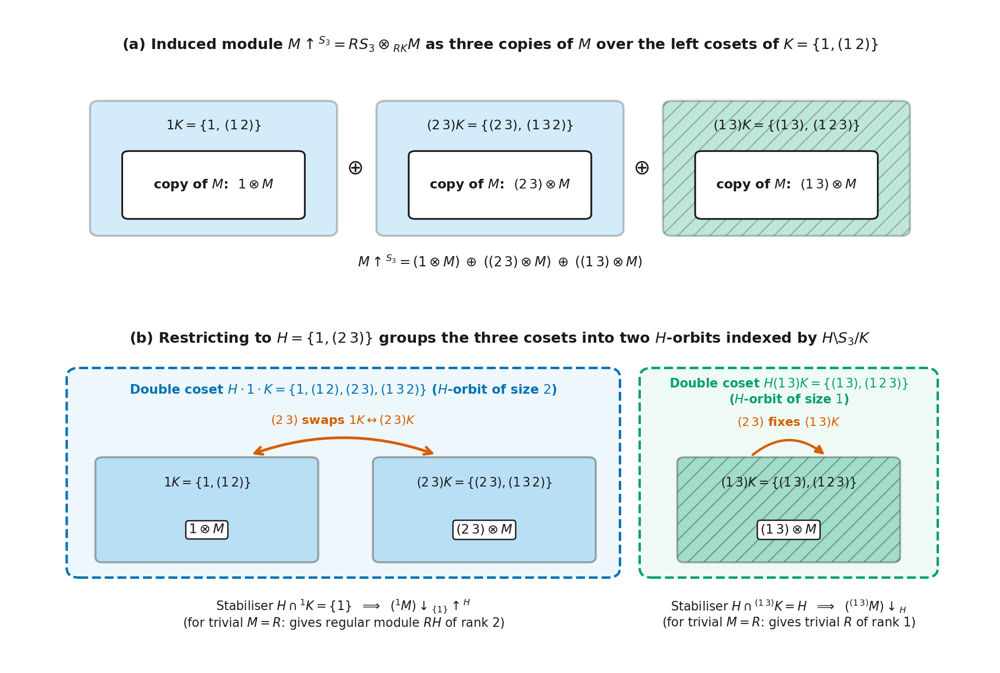

*Figure 22. Mackey decomposition of $M{\uparrow^{S_3}}{\downarrow_H}$ for $G = S_3$, $K = \{1, (1\,2)\}$, and $H = \{1, (2\,3)\}$. (a) The induced module $M{\uparrow^{S_3}} = RS_3 \otimes_{RK} M$ consists of three copies $1 \otimes M$, $(2\,3) \otimes M$, and $(1\,3) \otimes M$ of $M$, one over each left coset $1K = \{1, (1\,2)\}$, $(2\,3)K = \{(2\,3), (1\,3\,2)\}$, and $(1\,3)K = \{(1\,3), (1\,2\,3)\}$. (b) Restricting to $H = \{1, (2\,3)\}$ partitions the three coset boxes into two $H$-orbits corresponding to the $(H, K)$-double cosets: $(2\,3)$ swaps $1K$ and $(2\,3)K$ inside $H \cdot 1 \cdot K = \{1, (1\,2), (2\,3), (1\,3\,2)\}$ (orbit of size $2$ with trivial stabiliser $H \cap {}^1 K = \{1\}$, giving $({}^1 M){\downarrow_{\{1\}}}{\uparrow^H}$, or $RH$ for $M = R$) and fixes $(1\,3)K$ inside $H(1\,3)K = \{(1\,3), (1\,2\,3)\}$ (orbit of size $1$ with full stabiliser $H \cap {}^{(1\,3)}K = H$, giving $({}^{(1\,3)}M){\downarrow_H}$, or $R$ for $M = R$).*

### Standard Resolutions

Group cohomology $H^n(G, M) = \operatorname{Ext}^n_{RG}(R, M)$ and group homology $H_n(G, M) = \operatorname{Tor}_n^{RG}(M, R)$ were defined in [group rings, representations, lattices and fixed points](#group-rings-representations-lattices-and-fixed-points) (built from [defining Tor, Ext and general derived functors](#defining-tor-ext-and-general-derived-functors) and [augmented algebras](#ext-between-simple-modules-augmented-algebras-and-worked-resolutions)) using any projective resolution of the trivial $RG$-module $R$. To write down explicit cocycles and coboundaries that work for every group $G$ at once, we need a canonical free resolution of $R$ built directly from the elements of $G$. How is this standard (or bar) resolution constructed, how does it turn $n$-cochains into functions $G^n \to M$, and when can we replace it by a small periodic resolution?

#### The Homogeneous and Bar Resolutions and Cochains on $G^n$

**Standard resolution in homogeneous form.** Let $G$ be a group and $R$ be a commutative ring. The **standard resolution** of $R$ as a left $RG$-module is the sequence $\cdots \to F_2 \xrightarrow{\partial_2} F_1 \xrightarrow{\partial_1} F_0 \xrightarrow{\varepsilon} R \to 0$ in which $F_n$ ($n \ge 0$) is the free $R$-module on all $(n + 1)$-tuples $(g_0, g_1, \dots, g_n)$ of elements of $G$, with diagonal left $G$-action $g(g_0, \dots, g_n) = (gg_0, \dots, gg_n)$, augmentation $\varepsilon(g_0) = 1$, and simplicial boundary map

$$\partial_n(g_0, \dots, g_n) = \sum_{i=0}^n (-1)^i (g_0, \dots, \widehat{g_i}, \dots, g_n),$$

where $\widehat{g_i}$ indicates that $g_i$ is omitted from the list. Each $\partial_n$ is an $RG$-module homomorphism satisfying $\partial_{n-1} \circ \partial_n = 0$. The augmented complex is exact because the $R$-linear map $h_n : F_n \to F_{n+1}$ defined by $h_n(g_0, \dots, g_n) = (1, g_0, \dots, g_n)$ (with $h_{-1}(1) = (1)$) satisfies $\partial_{n+1} \circ h_n + h_{n-1} \circ \partial_n = \mathrm{id}_{F_n}$ and is therefore a [chain contraction](#chain-maps-chain-homotopies-and-homotopy-equivalence) of the complex over $R$.

**Bar notation and the bar resolution.** Because $G$ acts freely on the leading coordinate $g_0$ of $(g_0, \dots, g_n)$, we can factor $g_0$ out on the left and record the $n$ consecutive steps $g_0^{-1}g_1, g_1^{-1}g_2, \dots, g_{n-1}^{-1}g_n$. In the **bar notation**, we set

$$[g_1 \mid g_2 \mid \dots \mid g_n] = (1,\, g_1,\, g_1 g_2,\, \dots,\, g_1 g_2 \cdots g_n) \in F_n, \qquad (g_0, \dots, g_n) = g_0[g_0^{-1}g_1 \mid g_1^{-1}g_2 \mid \dots \mid g_{n-1}^{-1}g_n].$$

Thus $F_n$ is a free left $RG$-module of rank $\lvert G\rvert^n$ with $RG$-basis consisting of the symbols $[g_1 \mid \dots \mid g_n]$ ($g_i \in G$), and $F_0 \cong RG$ is free of rank $1$ on the empty symbol $[\ ] = (1)$. For this reason, the standard resolution is also called the **bar resolution**. Rewriting $\partial_n$ on the basis elements $[g_1 \mid \dots \mid g_n]$ gives the bar boundary formula:

$$\partial_n[g_1 \mid \dots \mid g_n] = g_1[g_2 \mid \dots \mid g_n] + \sum_{i=1}^{n-1} (-1)^i [g_1 \mid \dots \mid g_i g_{i+1} \mid \dots \mid g_n] + (-1)^n [g_1 \mid \dots \mid g_{n-1}].$$

In degrees $1$, $2$, and $3$, the bar boundary maps are:

$$\partial_1[g_1] = g_1[\ ] - [\ ] = (g_1 - 1)[\ ]$$

$$\partial_2[g_1 \mid g_2] = g_1[g_2] - [g_1 g_2] + [g_1]$$

and

$$\partial_3[g_1 \mid g_2 \mid g_3] = g_1[g_2 \mid g_3] - [g_1 g_2 \mid g_3] + [g_1 \mid g_2 g_3] - [g_1 \mid g_2]$$

**Cochains on $G^n$ and low-degree coboundaries.** Applying $M \otimes_{RG} -$ and $\operatorname{Hom}_{RG}(-, M)$ to the bar resolution $\mathbf{F}$ computes group homology and cohomology as

$$H_n(G, M) = \operatorname{Tor}_n^{RG}(M, R) = H_n(M \otimes_{RG} \mathbf{F},\, 1 \otimes \partial_*) \qquad \text{and} \qquad H^n(G, M) = \operatorname{Ext}^n_{RG}(R, M) = H^n(\operatorname{Hom}_{RG}(\mathbf{F}, M),\, \delta^*),$$

where $(\delta^n \alpha)(x) = \alpha(\partial_{n+1}x)$. Because $F_n$ is the free $RG$-module on the bar symbols $[g_1 \mid \dots \mid g_n] \in G^n$, we have $\operatorname{Hom}_{RG}(F_n, M) \cong \operatorname{Hom}_R(R[G^n], M)$, so a **bar $n$-cochain** $\alpha \in \operatorname{Hom}_{RG}(F_n, M)$ is simply a function $\alpha : G^n \to M$ (with $\alpha([\ ]) \in M$ in degree $0$), and its coboundary $\delta^n \alpha : G^{n+1} \to M$ is

$$(\delta^n \alpha)(g_1, \dots, g_{n+1}) = g_1 \alpha(g_2, \dots, g_{n+1}) + \sum_{i=1}^n (-1)^i \alpha(g_1, \dots, g_i g_{i+1}, \dots, g_{n+1}) + (-1)^{n+1} \alpha(g_1, \dots, g_n).$$

In degrees $0$, $1$, and $2$, this formula gives the low-degree coboundary maps:

$$(\delta^0 m)(g_1) = g_1 m - m$$

for $m = \alpha([\ ]) \in M$,

$$(\delta^1 \beta)(g_1, g_2) = g_1 \beta(g_2) - \beta(g_1 g_2) + \beta(g_1)$$

for $\beta : G \to M$, and

$$(\delta^2 \alpha)(g_1, g_2, g_3) = g_1 \alpha(g_2, g_3) - \alpha(g_1 g_2, g_3) + \alpha(g_1, g_2 g_3) - \alpha(g_1, g_2)$$

for $\alpha : G \times G \to M$.

#### Diagonal Approximation, Inflation and Periodic Resolutions for Cyclic Groups

**Cup products, diagonal approximations and the Alexander–Whitney map.** Suppose $\Lambda$ is a Hopf algebra over $R$ that is projective as an $R$-module. Given $\Lambda$-modules $M, M', N, N'$ that are projective over $R$, tensoring an $m$-fold extension of $M$ by $M'$ with an $n$-fold extension of $N$ by $N'$ over $R$ defines an associative **cup product** $\cup : \operatorname{Ext}^m_\Lambda(M, M') \times \operatorname{Ext}^n_\Lambda(N, N') \to \operatorname{Ext}^{m+n}_\Lambda(M \otimes_R N, M' \otimes_R N')$. When $\Lambda$ is cocommutative, the cup product is [graded commutative](#classifying-extensions-by-ext-and-yoneda-splice) ($\alpha \cup \beta = (-1)^{mn}\beta \cup \alpha$ up to the twist $M' \otimes_R N' \cong N' \otimes_R M'$), making $H^*(\Lambda, R) = \operatorname{Ext}^*_\Lambda(R, R)$ a graded-commutative ring; on $\operatorname{Ext}^*_\Lambda(R, R)$, the cup product agrees with Yoneda composition.

To compute cup products on $H^*(\Lambda, -)$ from a projective resolution $\mathbf{P} \to R$, one uses a **diagonal approximation**, meaning a chain map $\Delta : \mathbf{P} \to \mathbf{P} \otimes_R \mathbf{P}$ of $\Lambda$-modules lifting the isomorphism $R \cong R \otimes_R R$ (which exists and is unique up to chain homotopy by the comparison theorem, and is homotopy co-associative and homotopy cocommutative). On the standard resolution $\mathbf{F}$ of $R$ over $RG$, a strictly co-associative diagonal approximation is given by the **Alexander–Whitney map** $\Delta : \mathbf{F} \to \mathbf{F} \otimes_R \mathbf{F}$:

$$\Delta(g_0, \dots, g_n) = \sum_{j=0}^n (g_0, \dots, g_j) \otimes (g_j, \dots, g_n), \qquad \Delta[g_1 \mid \dots \mid g_n] = \sum_{j=0}^n [g_1 \mid \dots \mid g_j] \otimes g_1 \cdots g_j[g_{j+1} \mid \dots \mid g_n].$$

Pulling cochains $\alpha : G^m \to M$ and $\beta : G^n \to N$ back along $\Delta$ gives the explicit cochain formula for the cup product $\alpha \cup \beta : G^{m+n} \to M \otimes_R N$:

$$(\alpha \cup \beta)(g_1, \dots, g_{m+n}) = \alpha(g_1, \dots, g_m) \otimes g_1 \cdots g_m\,\beta(g_{m+1}, \dots, g_{m+n}).$$

**Restriction, inflation and the five-term exact sequence.** For any subgroup $H \le G$, restricting a projective resolution of an $RG$-module $M$ to $RH$ gives a projective resolution of $M{\downarrow_H}$ over $RH$, which induces the **restriction map** $\operatorname{res}_{G, H} : \operatorname{Ext}^n_{RG}(M, M') \to \operatorname{Ext}^n_{RH}(M{\downarrow_H}, M'{\downarrow_H})$ and in particular $\operatorname{res}_{G, H} : H^n(G, M) \to H^n(H, M{\downarrow_H})$; on bar cochains, $\operatorname{res}_{G, H}$ simply restricts a function $G^n \to M$ to $H^n \to M$.

Now suppose $N$ is a normal subgroup of $G$ and $M$ is an $RG$-module. When $N$ acts trivially on $M$, $M$ is an $R(G/N)$-module: if $\mathbf{P}$ is a projective resolution of $R$ over $R(G/N)$ and $\mathbf{Q}$ is a projective resolution of $R$ over $RG$, viewing $\mathbf{P}$ as a complex of $RG$-modules via $G \twoheadrightarrow G/N$ and applying the [comparison theorem](#left-and-right-exact-functors-projective-resolutions-and-the-comparison-theorem) lifts $\mathrm{id}_R$ to a chain map $\rho : \mathbf{Q} \to \mathbf{P}$ unique up to homotopy, and composing cocycles $\hat{\zeta} : P_n \to M$ with $\rho$ defines the **inflation map** $\operatorname{inf}_{G/N, G} : H^n(G/N, M) \to H^n(G, M)$ (on bar cochains, inflated cochains are functions on $G^n$ that are constant on $N$-cosets). More generally, for any $RG$-module $M$, the fixed-point submodule $M^N$ has trivial $N$-action, and we write $\operatorname{inf}_{G/N, G} : H^n(G/N, M^N) \to H^n(G, M)$ for the composite $H^n(G/N, M^N) \to H^n(G, M^N) \to H^n(G, M)$ with the map induced by $M^N \hookrightarrow M$.

Computing $H^*(N, M)$ using the $RG$-resolution $\mathbf{Q}$ of $R$ gives an action of the quotient group $G/N$ on $H^*(N, M)$ such that the image of $\operatorname{res}_{G, N} : H^*(G, M) \to H^*(N, M)$ lies in the fixed points $H^*(N, M)^{G/N}$; explicitly, in degree $1$, an element $g \in G$ acts on a $1$-cocycle $\beta : N \to M$ by $(g\beta)(n) = g\beta(g^{-1}ng)$, and for $g \in N$ this changes $\beta$ only by the $1$-coboundary $n \mapsto n\,\beta(g) - \beta(g)$. For any $RG$-module $M$, combining inflation and restriction with the **transgression** map $H^1(N, M)^{G/N} \to H^2(G/N, M^N)$ gives the five-term exact sequence in low degrees:

$$0 \to H^1(G/N, M^N) \xrightarrow{\operatorname{inf}} H^1(G, M) \xrightarrow{\operatorname{res}} H^1(N, M)^{G/N} \to H^2(G/N, M^N) \xrightarrow{\operatorname{inf}} H^2(G, M).$$

This exact sequence does not continue to higher degrees.

**Periodic resolution and cohomology of a cyclic group.** Because $\operatorname{rank}_{RG}(F_n) = \lvert G\rvert^n$ grows exponentially with $n$, the bar resolution is replaced whenever possible by a smaller resolution. For a cyclic group $C_m = \langle x : x^m = 1 \rangle$ of order $m$ over any commutative ring $R$ (generalising our [periodic resolution over $kC_p$](#ext-between-simple-modules-augmented-algebras-and-worked-resolutions)), define two $RC_m$-module endomorphisms of the free module $RC_m$ of rank $1$, the norm map $\nu$ and the difference map $T$:

$$\nu : RC_m \to RC_m, \quad u \mapsto (1 + x + \cdots + x^{m-1})u, \qquad T : RC_m \to RC_m, \quad u \mapsto (1 - x)u.$$

The $2$-periodic sequence

$$\cdots \xrightarrow{\nu} RC_m \xrightarrow{T} RC_m \xrightarrow{\nu} RC_m \xrightarrow{T} RC_m \xrightarrow{\varepsilon} R \to 0$$

is a free resolution of $R$ as an $RC_m$-module, because in the $R$-basis $1, x, \dots, x^{m-1}$ the elements killed by $1 - x$ are the constant sums ($\operatorname{Im}(\nu)$) and the elements killed by $1 + x + \cdots + x^{m-1}$ are the sums whose coefficients add to $0$ ($\operatorname{Im}(T)$).

Applying $\operatorname{Hom}_{RC_m}(-, M)$ to this resolution identifies $\operatorname{Hom}_{RC_m}(RC_m, M) \cong M$ in every degree and turns the differentials into alternating multiplications by $1 - x$ and $1 + x + \cdots + x^{m-1}$ on $M$, giving the cohomology of $C_m$ for all degrees:

$$H^0(C_m, M) = M^{C_m} = \{v \in M : (1 - x)v = 0\},$$

$$H^{2r}(C_m, M) = M^{C_m} / (1 + x + \cdots + x^{m-1})M \qquad (r > 0),$$

$$H^{2r+1}(C_m, M) = \{v \in M : (1 + x + \cdots + x^{m-1})v = 0\} / (1 - x)M \qquad (r \ge 0).$$

**Worked example: cohomology of $C_2$ on $\mathbb{Z}$ with trivial and sign actions.** Take $G = C_2 = \langle x : x^2 = 1 \rangle$ over $R = \mathbb{Z}$. On the trivial module $M = \mathbb{Z}$ ($x \cdot m = m$), the map $1 - x$ is $0$ and $1 + x$ is multiplication by $2$, so $H^0(C_2, \mathbb{Z}) = \mathbb{Z}$, $H^{2r}(C_2, \mathbb{Z}) = \mathbb{Z}/2\mathbb{Z}$ for $r > 0$, and $H^{2r+1}(C_2, \mathbb{Z}) = 0$ for $r \ge 0$. On the sign module $M = \mathbb{Z}_-$ where $x$ acts on $\mathbb{Z}$ by $-1$, the map $1 - x$ is multiplication by $2$ and $1 + x$ is $0$, so $H^0(C_2, \mathbb{Z}_-) = 0$, $H^{2r}(C_2, \mathbb{Z}_-) = 0$ for $r > 0$, and $H^{2r+1}(C_2, \mathbb{Z}_-) = \mathbb{Z}/2\mathbb{Z}$ for $r \ge 0$.

More generally, if $H \trianglelefteq G$ is a normal subgroup with cyclic quotient $G/H$ and $M$ is an $RG$-module whose restriction $M{\downarrow_H}$ is projective, tensoring $M$ with the two-step exact sequence $0 \to R \to R(G/H) \xrightarrow{T} R(G/H) \to R \to 0$ keeps the middle terms projective over $RG$ and gives $M \oplus (\text{projective}) \cong \tilde{\Omega}^2(M) \oplus (\text{projective})$.

### Low Degree Cohomology

Building a group $\hat{G}$ from an abelian normal subgroup $M$ and a quotient group $G \cong \hat{G}/M$ requires an action of $G$ on $M$ and a factor set measuring how coset representatives slip when multiplied (both are made precise below). A note on wording: the [example of building a larger group](#example-of-building-a-larger-group) calls a group with normal subgroup $N$ and quotient $Q$ an extension of $N$ by $Q$, whereas here we follow the opposite convention and call $1 \to M \to \hat{G} \to G \to 1$ an extension of the quotient $G$ by the normal subgroup $M$. Now that we have defined $H^n(G, M) \cong \operatorname{Ext}^n_{RG}(R, M) \cong \operatorname{Ext}^n_{\mathbb{Z}G}(\mathbb{Z}, M)$ and written out the low-degree differentials on the bar resolution, we can make that picture precise. What do $H^0(G, M)$, $H^1(G, M)$, and $H^2(G, M)$ classify in group theory, and how does $H^2$ govern lifting modular representations to characteristic zero?

#### Degree Zero, Derivations, Split Extensions and Complements

**Degree zero cohomology and derivations in degree one.** On the bar resolution, a $0$-cochain is an element $m \in M$ with coboundary $(\delta^0 m)(g) = gm - m$, so $H^0(G, M) = \operatorname{Ker}(\delta^0) = M^G$ is the submodule of $G$-fixed points. In degree $1$, a $1$-cochain $\beta : G \to M$ satisfies $(\delta^1 \beta)(g_1, g_2) = g_1 \beta(g_2) - \beta(g_1 g_2) + \beta(g_1) = 0$ if and only if

$$\beta(g_1 g_2) = \beta(g_1) + g_1 \beta(g_2) \qquad (g_1, g_2 \in G).$$

A function $\beta : G \to M$ obeying this twisted product rule is called a **derivation** (or **crossed homomorphism**) from $G$ to $M$, while a $1$-coboundary $(\delta^0 m)(g) = gm - m$ ($m \in M$) is called an **inner derivation** (or **principal derivation**). Thus $H^1(G, M)$ is the quotient group of derivations modulo inner derivations.

**Worked examples: $H^1(G, M) = \operatorname{Hom}(G, M)$ for trivial action, and $H^1(C_2, \mathbb{Z}_-) \cong \mathbb{Z}/2\mathbb{Z}$ from derivations.** First, suppose $G$ acts trivially on $M$, so $gm = m$ for all $g \in G$ and $m \in M$. Then the derivation rule reduces to $\beta(g_1 g_2) = \beta(g_1) + \beta(g_2)$, which is an ordinary group homomorphism from $G$ to the additive group of $M$, while every inner derivation $g \mapsto gm - m = 0$ vanishes identically. Thus when $G$ acts trivially on $M$,

$$H^1(G, M) = \operatorname{Hom}(G, M),$$

and because $M$ is abelian, every homomorphism $G \to M$ contains the commutator subgroup $[G, G]$ in its kernel (taking $M = R$ gives $\operatorname{Ext}^1_{RG}(R, R) \cong \operatorname{Hom}(G, R^+)$).

Second, let $G = C_2 = \{1, x\}$ ($x^2 = 1$) act on $M = \mathbb{Z}_-$ by $x \cdot m = -m$. For any derivation $\beta : C_2 \to \mathbb{Z}_-$, evaluating at $1 = 1 \cdot 1$ gives $\beta(1) = \beta(1) + \beta(1)$, so $\beta(1) = 0$, and evaluating at $1 = x^2$ gives

$$0 = \beta(1) = \beta(x^2) = \beta(x) + x \cdot \beta(x) = \beta(x) - \beta(x) = 0,$$

which holds for every integer $\beta(x) \in \mathbb{Z}$. Thus the group of derivations $C_2 \to \mathbb{Z}_-$ is isomorphic to $\mathbb{Z}$ via $\beta \mapsto \beta(x)$. Meanwhile, the inner derivation $\delta^0(m)$ for $m \in \mathbb{Z}_-$ sends $1 \mapsto 0$ and $x \mapsto x \cdot m - m = -2m$, so the inner derivations are those with $\beta(x) \in 2\mathbb{Z}$, giving $H^1(C_2, \mathbb{Z}_-) \cong \mathbb{Z}/2\mathbb{Z}$, in agreement with the periodic resolution.

**Group extensions, central extensions and split extensions.** A **group extension** of a group $G$ by an $RG$-module $M$ is a short exact sequence of groups

$$1 \to M \to \hat{G} \to G \to 1$$

in which $M$ is regarded as an abelian normal subgroup of $\hat{G}$ (written multiplicatively inside $\hat{G}$) and the conjugation action of $G$ on $M$ inside $\hat{G}$ coincides with the module action of $G$ on $M$. A **central extension** of $G$ is a group extension in which $G$ acts trivially on $M$ (so $M \le Z(\hat{G})$), and an **isomorphism of group extensions** is a group isomorphism $\hat{G}_1 \xrightarrow{\sim} \hat{G}_2$ that induces the identity map on both $M$ and $G$. The extension is a **split group extension** (or splits) if $\hat{G}$ contains a subgroup complementary to $M$, so that $\hat{G} \cong M \rtimes G$ is a [semidirect product](#example-of-building-a-larger-group) whose elements may be written as lower-triangular matrices $\begin{pmatrix} 1 & 0 \\ m & g \end{pmatrix}$ ($m \in M, g \in G$) multiplying by

$$\begin{pmatrix} 1 & 0 \\ m_1 & g_1 \end{pmatrix} \begin{pmatrix} 1 & 0 \\ m_2 & g_2 \end{pmatrix} = \begin{pmatrix} 1 & 0 \\ m_1 + g_1 m_2 & g_1 g_2 \end{pmatrix}.$$

**Classification of complements by $H^1(G, M)$.** The cohomology group $H^1(G, M)$ parametrises the set of conjugacy classes of complements to the normal subgroup $M$ in the split extension $\hat{G} = M \rtimes G$. Specifically, a complement to $M$ in $\hat{G}$ is a subgroup consisting of one matrix $\begin{pmatrix} 1 & 0 \\ \beta[g] & g \end{pmatrix}$ for each $g \in G$, where $\beta : G \to M$ is a derivation ($1$-cocycle), and conjugating the complement by an element of $\hat{G}$ shifts $\beta$ by an inner derivation ($1$-coboundary).

In module-extension terms, $\hat{G}$ acts on $\hat{M} = R \oplus M$ via $\begin{pmatrix} 1 & 0 \\ m_1 & g \end{pmatrix}\begin{pmatrix} n \\ m_2 \end{pmatrix} = \begin{pmatrix} n \\ nm_1 + gm_2 \end{pmatrix}$, forming a short exact sequence $0 \to M \to \hat{M} \to R \to 0$. Two complements to $M$ in $\hat{G}$ are conjugate if and only if restricting $0 \to M \to \hat{M} \to R \to 0$ to each complement gives the same extension class in $\operatorname{Ext}^1_{RG}(R, M)$.

#### Degree Two Cohomology, Factor Sets and Group Extensions

**Classification of group extensions by $H^2(G, M)$ and factor sets.** The cohomology group $H^2(G, M)$ parametrises the set of isomorphism classes of extensions $1 \to M \to \hat{G} \to G \to 1$ of $G$ by the $RG$-module $M$. Choosing a coset representative $\hat{g} \in \hat{G}$ for each $g \in G$ defines a function $\alpha : G \times G \to M$ by $\hat{g}_1 \hat{g}_2 = \alpha[g_1 \mid g_2]\widehat{g_1 g_2}$, which is called the **factor set** and gives the group multiplication on pairs $(m, g) \in M \times G$:

$$(m_1, g_1)(m_2, g_2) = \bigl(m_1 + g_1(m_2) + \alpha[g_1 \mid g_2],\, g_1 g_2\bigr).$$

Associativity in $\hat{G}$ is the $2$-cocycle equation $\alpha[g_1 \mid g_2] + \alpha[g_1 g_2 \mid g_3] = g_1\alpha[g_2 \mid g_3] + \alpha[g_1 \mid g_2 g_3]$ ($\delta^2 \alpha = 0$), and changing coset representatives to $\tilde{g} = \beta[g]\hat{g}$ shifts $\alpha[g_1 \mid g_2]$ by the $2$-coboundary $\beta[g_1] + g_1\beta[g_2] - \beta[g_1 g_2]$.

---

**Aside: how a $2$-fold module extension builds a group extension of $3 \times 3$ block matrices.**

Suppose a $2$-fold module extension $0 \to M \to A \to B \to R \to 0$ represents a class in $\operatorname{Ext}^2_{RG}(R, M) \cong H^2(G, M)$, and let $M' = \operatorname{Coker}(M \to A) \cong \operatorname{Ker}(B \to R)$ be its image-kernel module in the middle. This $2$-fold extension is the Yoneda splice of two short exact sequences $0 \to M \to A \to M' \to 0$ and $0 \to M' \to B \to R \to 0$. When these two short exact sequences split as $R$-modules ($A \cong M' \oplus M$ and $B \cong R \oplus M'$ over $R$), the action of $g \in G$ on $A$ and on $B$ takes lower-triangular block-matrix form:

$$A(g) = \begin{pmatrix} \phi_{M'}(g) & 0 \\ a(g) & \phi_M(g) \end{pmatrix}, \qquad B(g) = \begin{pmatrix} 1 & 0 \\ b(g) & \phi_{M'}(g) \end{pmatrix},$$

where $\phi_M(g)$ and $\phi_{M'}(g)$ are the actions of $g$ on $M$ and $M'$, while $a(g) \in \operatorname{Hom}_R(M', M)$ and $b(g) \in \operatorname{Hom}_R(R, M') \cong M'$ measure how $g$ mixes the quotient into the submodule in each step.

Now fit $B(g)$ in the top-left $2 \times 2$ corner and $A(g)$ in the bottom-right $2 \times 2$ corner of a $3 \times 3$ block matrix by leaving the bottom-left corner $* \in \operatorname{Hom}_R(R, M) \cong M$ completely free:

$$\hat{G} = \left\{ \begin{pmatrix} 1 & 0 & 0 \\ b(g) & \phi_{M'}(g) & 0 \\ * & a(g) & \phi_M(g) \end{pmatrix} : g \in G,\; * \in M \right\}.$$

Because $A$ and $B$ are $RG$-modules, multiplying two such $3 \times 3$ matrices for $g_1$ and $g_2$ reproduces $b(g_1 g_2)$ and $a(g_1 g_2)$ along the subdiagonal and adds an extra term $a(g_1)b(g_2) \in M$ into the bottom-left corner $*$. The matrices with $g = 1$ (so $\phi_{M'}(1) = \mathrm{id}_{M'}$, $\phi_M(1) = \mathrm{id}_M$, $a(1) = 0$, $b(1) = 0$) and $* \in M$ form an abelian normal subgroup isomorphic to $M$, and projecting onto $g \in G$ makes $\hat{G}$ a group extension $1 \to M \to \hat{G} \to G \to 1$.

Splitting this group extension means choosing a specific bottom-left entry $* = c(g) \in M$ for each $g \in G$ so that the resulting $3 \times 3$ matrices close under multiplication, which is equivalent to the Yoneda splice of $0 \to M \to A \to M' \to 0$ and $0 \to M' \to B \to R \to 0$ representing the zero class in $\operatorname{Ext}^2_{RG}(R, M)$. Moreover, a second choice $c(g) + c'(g)$ also gives a splitting if and only if the $2 \times 2$ block matrix $\begin{pmatrix} 1 & 0 \\ c'(g) & \phi_M(g) \end{pmatrix}$ defines a module extension in $\operatorname{Ext}^1_{RG}(R, M) = H^1(G, M)$, so the splittings in the matrix picture differ by $1$-cocycles.

---

**Worked example: $H^2(C_2, \mathbb{Z}/2\mathbb{Z}) \cong \mathbb{Z}/2\mathbb{Z}$ and the extensions $C_2 \times C_2$ versus $C_4$.** Let $G = C_2 = \{1, x\}$ ($x^2 = 1$) act trivially on $M = \mathbb{Z}/2\mathbb{Z} = \{0, 1\}$. By our cyclic-group cohomology formula (where $1 - x = 0$ and $1 + x = 2 \equiv 0 \pmod{2}$ on $\mathbb{Z}/2\mathbb{Z}$),

$$H^2(C_2, \mathbb{Z}/2\mathbb{Z}) = (\mathbb{Z}/2\mathbb{Z})^{C_2} / 2(\mathbb{Z}/2\mathbb{Z}) = \mathbb{Z}/2\mathbb{Z}.$$

On the bar resolution, choosing the identity representative $\hat{1} = 1 \in \hat{G}$ normalises $\alpha[1 \mid 1] = \alpha[1 \mid x] = \alpha[x \mid 1] = 0$, and changing the representative $\hat{x}$ to $\tilde{x} = \beta(x)\hat{x}$ cannot alter $\alpha[x \mid x]$ because $(\delta^1\beta)(x, x) = 2\beta(x) - \beta(1) = 0 \pmod{2}$. Thus the cohomology class is determined by the single value $\alpha[x \mid x] \in \{0, 1\}$, which records whether the square of $\hat{x} = (0, x)$ in $\hat{G}$ equals the identity $(0, 1)$ or slips into the non-zero kernel element $(1, 1)$. Setting $\alpha[x \mid x] = 0$ gives $(0, x)^2 = (0, 1)$ and the split extension $\hat{G} \cong (\mathbb{Z}/2\mathbb{Z}) \times C_2 = V_4$ (the Klein four-group), whereas setting $\alpha[x \mid x] = 1$ gives $(0, x)^2 = (1, 1) \neq (0, 1)$ of order $4$ and the non-split cyclic extension $\hat{G} \cong C_4$. [Figure 23](#figure-23) illustrates the homogeneous bar simplices behind the $2$-cocycle condition and the two resulting extensions $V_4$ and $C_4$.

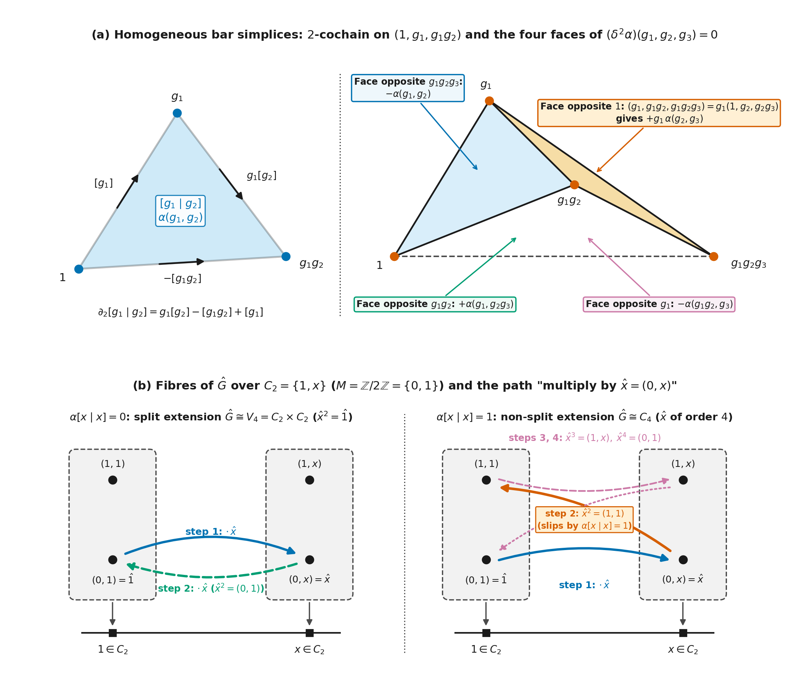

*Figure 23. Simplicial picture of the bar $2$-cocycle condition and the two extensions of $C_2 = \{1, x\}$ by $M = \mathbb{Z}/2\mathbb{Z} = \{0, 1\}$. (a) In the homogeneous standard resolution, a bar $2$-cochain $\alpha$ assigns $\alpha(g_1, g_2)$ to the triangle $[g_1 \mid g_2] = (1, g_1, g_1 g_2)$ with boundary $\partial_2[g_1 \mid g_2] = g_1[g_2] - [g_1 g_2] + [g_1]$ (left), and the four triangular faces of the tetrahedron $[g_1 \mid g_2 \mid g_3] = (1, g_1, g_1 g_2, g_1 g_2 g_3)$ carry the four signed terms of the $2$-cocycle condition $(\delta^2\alpha)(g_1, g_2, g_3) = g_1\alpha(g_2, g_3) - \alpha(g_1 g_2, g_3) + \alpha(g_1, g_2 g_3) - \alpha(g_1, g_2) = 0$, where the face $(g_1, g_1 g_2, g_1 g_2 g_3)$ opposite vertex $1$ is $g_1$ times the triangle $(1, g_2, g_2 g_3)$ and so carries the factor $g_1$ (right). (b) The four elements $(m, g)$ of $\hat{G}$ drawn as two fibres of two points over $1$ and $x$ in $C_2$: starting at $(0, 1) = \hat{1}$ and multiplying twice by the coset representative $\hat{x} = (0, x)$ returns to $(0, 1)$ after two steps when $\alpha[x \mid x] = 0$ ($\hat{G} \cong V_4 = C_2 \times C_2$, left), whereas when $\alpha[x \mid x] = 1$ the second step slips along the fibre over $1$ to $\hat{x}^2 = (1, 1)$ and two further steps via $(1, x)$ return to $(0, 1)$ ($\hat{G} \cong C_4$, right).*

#### Splitting When $\lvert G\rvert$ Is Invertible, Central Extensions and Lifting Theorems

**Transfer and splitting of extensions when $\lvert G\rvert$ is invertible.** For any $RG$-modules $M$ and $M'$ and any subgroup $H \le G$, composing the [exterior trace map](#tensor-product-induction-coinduction-and-frobenius-reciprocity) $\widehat{\operatorname{Tr}}_{H, G} : \operatorname{Hom}_{RH}(M{\downarrow_H}, M'{\downarrow_H}) \to \operatorname{Hom}_{RG}(M, M'{\downarrow_H}{\uparrow^G})$ with the natural surjection $M'{\downarrow_H}{\uparrow^G} \twoheadrightarrow M'$ ($g \otimes m' \mapsto gm'$) and applying the composite degreewise to a projective resolution defines the **transfer map** $\operatorname{Tr}_{H, G} : \operatorname{Ext}^n_{RH}(M{\downarrow_H}, M'{\downarrow_H}) \to \operatorname{Ext}^n_{RG}(M, M')$, which satisfies $\operatorname{Tr}_{H, G}(\operatorname{res}_{G, H}(\alpha)) = \lvert G : H\rvert \cdot \alpha$.

Multiplication by $\lvert G\rvert$ annihilates $H^n(G, M) = \operatorname{Ext}^n_{RG}(R, M)$ for every $n > 0$. If $\lvert G\rvert$ is invertible in $R$ and $M$ is an $RG$-module, then $H^2(G, M) = 0$ so every extension of $G$ by $M$ splits, and $H^1(G, M) = 0$ so all complements to $M$ are conjugate by the classification of complements. Intuitively, $\lvert G\rvert \cdot \alpha = \operatorname{Tr}_{\{1\}, G}(\operatorname{res}_{G, \{1\}}(\alpha))$ factors through $\operatorname{Ext}^n_R(R, M{\downarrow_{\{1\}}})$, which is zero for $n > 0$ because $R$ is already projective over $R$.

**Central extensions by $k^\times$ and twisted group rings.** In a central extension of $G$ by $k^\times$, the infinite scalar group $k^\times$ can be replaced by a finite cyclic subgroup of roots of unity whenever $k$ has enough roots. Let $\tilde{G}$ be a central extension of a finite group $G$ by the multiplicative group $k^\times$ of a field $k$ in which every element has a $\lvert G\rvert$-th root. Then $\tilde{G}$ contains a finite subgroup $\hat{G}$ with $\tilde{G} = \hat{G} \cdot k^\times$ and $Z = \hat{G} \cap k^\times$ a cyclic group of order coprime to $p = \operatorname{char}(k)$. In particular, if $G$ is a $p$-group and $k$ is a **perfect field** of characteristic $p$ (a field in which every element has a $p$-th root, for example, every finite field), the extension splits and $\tilde{G} = G \times k^\times$. Intuitively, multiplication by $\lvert G\rvert$ kills $H^2(G, k^\times)$ and every element of $k^\times$ has a $\lvert G\rvert$-th root, so the coset representatives of $G$ in $\tilde{G}$ can be rescaled to make the $2$-cocycle $\alpha[g_i \mid g_j]$ take values in the $\lvert G\rvert$-th roots of unity in $k^\times$.

The hypothesis that every element of $k$ has a $\lvert G\rvert$-th root cannot be dropped: for $k = \mathbb{Q}$ and $G = C_2$, the central extension $\tilde{G} = \langle \mathbb{Q}^\times, \sqrt{2} \rangle \le \mathbb{R}^\times$ has no finite subgroup mapping onto $G$ because $\pm 1 \in \mathbb{Q}^\times$ are the only elements of finite order in $\mathbb{R}^\times$. Given a $2$-cocycle $\alpha : G \times G \to k^\times$, the **twisted group ring** $[kG]_\alpha$ is the $k$-algebra with basis $\{\tilde{g}_i : g_i \in G\}$ and multiplication $\tilde{g}_i \tilde{g}_j = \alpha[g_i \mid g_j]\widetilde{g_i g_j}$. When $k$ is algebraically closed, choosing a finite central extension $1 \to Z \to \hat{G} \to G \to 1$ as above with an inclusion $Z \hookrightarrow k^\times$ identifies $[kG]_\alpha$ with the direct summand of $k\hat{G}$ on which each $z \in Z$ acts as the scalar $z \in k^\times$ itself, so as a $k\hat{G}$-module $[kG]_\alpha \cong \varepsilon_Z{\uparrow^{\hat{G}}}$ is induced from the $1$-dimensional $kZ$-module $\varepsilon_Z$ on which $Z$ acts via $Z \hookrightarrow k^\times$.

**Lifting algebra automorphisms of $\operatorname{End}_k(V)$.** Suppose that a finite group $G$ acts as $k$-algebra automorphisms on $\operatorname{End}_k(V)$, where $V$ is a finite-dimensional vector space over an algebraically closed field $k$ of characteristic $p$. Then a finite cyclic $p'$-central extension $\hat{G}$ of $G$, meaning a central extension of $G$ by a finite cyclic group of order coprime to $p$, acts linearly on $V$ so that its induced conjugation action on $V \otimes_k V^* \cong \operatorname{End}_k(V)$ is the given action of $G$. By the Skolem–Noether theorem, every $k$-algebra automorphism of the matrix algebra $\operatorname{End}_k(V)$ is conjugation by a matrix in $\operatorname{GL}(V)$ unique up to a scalar in $k^\times$, so the action of $G$ pulls $\operatorname{GL}(V)$ back to a central extension of $G$ by $k^\times$ to which the previous proposition applies.

**Discrete valuation rings and $p$-adic integers.** A **discrete valuation ring** is a principal ideal domain whose non-zero ideals are the powers $\mathfrak{p}^i = (\pi^i)$ of a unique maximal ideal $\mathfrak{p} = (\pi)$, generated by an element $\pi$ called a **uniformiser**. It is a **complete discrete valuation ring** if every compatible sequence of residues modulo $\pi, \pi^2, \pi^3, \dots$ comes from a single element of the ring, which is the property needed to pass from step-by-step lifts modulo $\pi^i$ to an actual lift. The prototype is the ring of **$p$-adic integers** $\mathbb{Z}_p$ for a prime $p$, with uniformiser $\pi = p$ and maximal ideal $\mathfrak{p} = p\mathbb{Z}_p$: its elements are formal power series $a_0 + a_1 p + a_2 p^2 + \cdots$ with digits $a_i \in \{0, \dots, p - 1\}$, its quotients are $\mathbb{Z}_p/p^i\mathbb{Z}_p \cong \mathbb{Z}/p^i\mathbb{Z}$, and its field of fractions is the field of **$p$-adic numbers** $\mathbb{Q}_p = \mathbb{Z}_p[1/p]$.

**$p$-modular systems.** To connect modular representations in characteristic $p$ with ordinary representations in characteristic $0$, a **$p$-modular system** is a triple $(K, \mathcal{O}, k)$ where $\mathcal{O}$ is a complete discrete valuation ring with maximal ideal $\mathfrak{p}$, field of fractions $K$ of characteristic $0$, and residue field $k = \mathcal{O}/\mathfrak{p}$ of characteristic $p$ (such as $(\mathbb{Q}_p, \mathbb{Z}_p, \mathbb{F}_p)$). Suppose a finitely generated $kG$-module $M$ of dimension $n$ has already been lifted to an $(\mathcal{O}/\mathfrak{p}^i)G$-lattice $M_i$. Lifting $M_i$ one step further to $\mathcal{O}/\mathfrak{p}^{i+1}$ means lifting the homomorphism $G \to \operatorname{GL}_n(\mathcal{O}/\mathfrak{p}^i)$ across the group extension $1 \to \operatorname{End}_k(M) \to \operatorname{GL}_n(\mathcal{O}/\mathfrak{p}^{i+1}) \to \operatorname{GL}_n(\mathcal{O}/\mathfrak{p}^i) \to 1$, whose obstruction lies in $H^2(G, \operatorname{End}_k(M)) \cong \operatorname{Ext}^2_{kG}(M, M)$.

**Green's lifting theorem.** When $\operatorname{Ext}^2_{kG}(M, M)$ vanishes, every step-by-step obstruction vanishes and $M$ lifts all the way to $\mathcal{O}$. Formally, suppose $(K, \mathcal{O}, k)$ is a $p$-modular system with $k = \mathcal{O}/\mathfrak{p}$, and $M$ is a finitely generated $kG$-module such that $\operatorname{Ext}^2_{kG}(M, M) = 0$; then there exists an $\mathcal{O}G$-lattice $\hat{M}$ with $\hat{M}/\mathfrak{p}\hat{M} \cong M$.

**Maranda's lifting theorem.** When $\operatorname{Ext}^2_{kG}(M, M) \neq 0$, a wrong lift at an early stage can get stuck later. For example, for $i \ge 3$, the trivial $\mathbb{F}_2 C_2$-module lifts to the $1 \times 1$ matrix $(2^{i-1} + 1)$ over $\mathbb{Z}/2^i\mathbb{Z}$, which then fails to lift to $\mathbb{Z}/2^{i+1}\mathbb{Z}$ because $(2^{i-1} + 1 + 2^i t)^2 \equiv 1 + 2^i \not\equiv 1 \pmod{2^{i+1}}$.

Once a lift reaches a high enough power of $p$, however, its reduction modulo a slightly smaller power of $p$ always lifts all the way to $\mathcal{O}$. Suppose $G$ is a finite group of order $p^r q$ with $q$ coprime to $p$, and $(K, \mathcal{O}, k)$ is a $p$-modular system (where for $\mathcal{O} = \mathbb{Z}_p$ the ideals $p^a\mathcal{O}$ and $\mathfrak{p}^a$ agree). If $M$ is a finitely generated $kG$-module that lifts to a finitely generated $\mathcal{O}/p^a\mathcal{O}$-free $(\mathcal{O}/p^a\mathcal{O})G$-module $\tilde{M}$ with $a \ge 2r + 1$, then there is a finitely generated $\mathcal{O}$-free $\mathcal{O}G$-module $\hat{M}$ with $\hat{M}/p^{a-r}\hat{M} \cong \tilde{M}/p^{a-r}\tilde{M}$. The obstruction at each stage is killed by $p^r$, so by giving up $r$ layers of precision one can always continue.

## References

- Introduction to Algebra by PJ Cameron
- Permutation Groups by PJ Cameron
- Representations and Characters of Groups by Gordon James, Martin Liebeck
- Representations and Cohomology Volume 1 by D. J. Benson
