# Maths 4 - Incidence Geometry

A convention used here: Vector spaces are right vector spaces, with scalars written on the right and coordinates as column vectors, whereas the earlier projective geometry notes used left vector spaces. The prologue explains why this changes nothing over a field ([right vector spaces](#linear-algebra-over-finite-fields)).

## Prologue: The Linear Algebra We Need

Incidence geometry is concerned with point-line geometries, which is a fancy way of saying "how points connect to each other with lines." One important aspect is to figure out what sort of point-line geometries (or connections between points via lines) are allowed and not allowed over various fields and within various constraints. Surprisingly, some pretty simple matrics which contain just $1$s and $0$s can tell us a lot when we apply the tools of linear algebra on them.

Most of what follows is core linear algebra, with a few items a physics degree may have skipped. Each topic gets a small example and a line saying where it is used. One example runs throughout:

$$A = \begin{pmatrix} 0 & 1 & 1 \\ 1 & 0 & 1 \\ 1 & 1 & 0 \end{pmatrix}.$$

Label the corners of a triangle $1, 2, 3$, and put a $1$ in row $x$, column $y$ when corners $x$ and $y$ are joined by an edge, and $0$ otherwise. The result is $A$, which the next chapter calls [the adjacency matrix](#the-adjacency-matrix-and-its-eigenvalues) of the triangle.

### Eigenvalues and eigenspaces

A number $\theta$ is an eigenvalue of a square matrix $A$ when $Av = \theta v$ for some nonzero vector $v$. The eigenvectors for $\theta$, together with $0$, form the eigenspace $V_\theta = \ker(A - \theta I)$. Two numbers measure how much of $\theta$ there is. The *algebraic multiplicity* is its multiplicity as a root of the characteristic polynomial $\det(XI - A)$. The *geometric multiplicity* is $\dim V_\theta$. The second is never larger than the first, and $A$ is diagonalizable exactly when the two agree for every eigenvalue.

For the running example, $\det(XI - A) = (X-2)(X+1)^2$. The eigenvalue $2$ has the eigenvector $j = (1,1,1)^T$, because every row of $A$ sums to $2$. For $\theta = -1$, note that $(Ax)_i = (x_1 + x_2 + x_3) - x_i$. Since $Av = \theta v$, we have $(x_1 + x_2 + x_3) - x_i = -1\cdot x_i$ and cancelling the $x_i$ on both side, we see every vector in the plane $x_1 + x_2 + x_3 = 0$ is an eigenvector. That plane has dimension $2$, equal to the algebraic multiplicity. Compare

$$N = \begin{pmatrix} 1 & 1 \\ 0 & 1 \end{pmatrix},$$

whose characteristic polynomial is $(X-1)^2$ but whose only eigenvectors are the multiples of $(1,0)^T$. Its two multiplicities are $2$ and $1$, and it cannot be diagonalized.

Similar matrices $P^{-1}AP$ (where $P$ represents a change of basis and is invertible) have the same characteristic polynomial, so they have the same eigenvalues with the same multiplicities.

**Where it is used.** The next chapter shows that the eigenvalues of a graph do not depend on how its vertices are labelled ([the adjacency matrix and its eigenvalues](#the-adjacency-matrix-and-its-eigenvalues)). In the chapter on [strongly regular graphs](#the-adjacency-matrix-of-a-strongly-regular-graph), the decisive test is that a multiplicity, being the dimension of an eigenspace, must be a whole number.

### Real symmetric matrices and the spectral theorem

Almost every matrix in the graph chapters is real and symmetric, and such matrices are as well behaved as matrices get. Their eigenvalues are real. Eigenvectors for different eigenvalues are orthogonal: if $Au = \theta u$ and $Av = \tau v$, then

$$\theta \langle u, v\rangle = \langle Au, v\rangle = \langle u, Av\rangle = \tau \langle u, v\rangle,$$

so $\langle u, v\rangle = 0$ when $\theta \neq \tau$. And there is an orthonormal basis of eigenvectors, so the two multiplicities always agree and we can simply say "multiplicity".

The spectral theorem packages all this. Let $E_\theta$ be the [orthogonal projector](#projectors-trace-and-positive-semidefinite-matrices) onto $V_\theta$. Then

$$A = \sum_\theta \theta E_\theta, \qquad \sum_\theta E_\theta = I, \qquad E_\theta E_\tau = 0 \ \text{ for } \theta \neq \tau.$$

This is the decomposition of an observable in quantum mechanics, with $E_\theta = \sum |v\rangle\langle v|$ over an orthonormal basis of $V_\theta$.

In the running example, the projector onto the line through $j$ is $E_2 = jj^T/3$, with every entry $1/3$, and the projector onto the plane is $E_{-1} = I - E_2$, with diagonal entries $2/3$ and off-diagonal entries $-1/3$. Then $2E_2 - E_{-1}$ has diagonal entries $0$ and off-diagonal entries $2/3 + 1/3 = 1$: it is $A$.

**Where it is used.** Adjacency matrices are real and symmetric, which is why a graph's eigenvalues are real ([the adjacency matrix and its eigenvalues](#the-adjacency-matrix-and-its-eigenvalues)). The decomposition $A = \sum_\theta \theta E_\theta$ is the backbone of [distance-regular graphs](#distance-regular-graphs), where $E_\theta$ is also called a [minimal idempotent](#minimal-idempotents-of-the-bose-mesner-algebra).

### Projectors, trace and positive semidefinite matrices

An **orthogonal projector** of a subspace $U$ is a matrix $E$ which takes a vector and returns the portion of the vector inside the subspace. Here's how it works. Every subspace $U \subseteq \mathbb{R}^n$ splits the entire space into two mutually perpendicular pieces: the target subspace $U$ (the image of $E$) and its orthogonal complement $U^\perp$ (the kernel of $E$), so that $\mathbb{R}^n = U \oplus U^\perp$. Every vector $v \in \mathbb{R}^n$ can be uniquely written as the sum of two perpendicular vectors: $v = v_\parallel + v_\perp$, where $v_\parallel \in U$ lies completely inside the subspace, and $v_\perp \in U^\perp$ is perpendicular to every vector in $U$.

When you multiply $v$ by the matrix $E$, it acts as a linear filter on those two components:

$$Ev = E(v_\parallel + v_\perp) = Ev_\parallel + Ev_\perp = 1\cdot v_\parallel + 0\cdot v_\perp = v_\parallel$$

It leaves the in-plane part $v_\parallel$ untouched (eigenvalue $1$). It annihilates the perpendicular part $v_\perp$ (eigenvalue $0$).

It's properties are $E^2 = E$ (doing it twice is the same as doing it once) and $E^T = E$ (it projects at right angles). Its eigenvalues are $0$ and $1$ as we saw: vectors in its image are fixed, and vectors orthogonal to the image are sent to $0$.

The trace, the sum of the diagonal entries, equals the sum of the eigenvalues counted with multiplicity, and $\operatorname{tr}(BC) = \operatorname{tr}(CB)$. For a projector the trace counts the eigenvalues equal to $1$, so $\operatorname{tr} E = \operatorname{rank} E$, the dimension of the image. In the running example $\operatorname{tr} E_2 = 3 \cdot \tfrac13 = 1$ and $\operatorname{tr} E_{-1} = 3 \cdot \tfrac23 = 2$, the dimensions of the two eigenspaces.

Trace equations pin down multiplicities. In the running example $\operatorname{tr} A = 0 = 2 + 2\cdot(-1)$, and $\operatorname{tr} A^2 = \sum_{i,l} A_{il}^2$, which for a symmetric matrix of zeros and ones counts its ones, is $6 = 2^2 + 2\cdot(-1)^2$. Knowing only the eigenvalues $2$ and $-1$ and that their multiplicities add up to $3$, either equation tells us how often each occurs.

A symmetric matrix $M$ is **positive semidefinite** when $x^T M x \geq 0$ for every vector $x$; equivalently, all its eigenvalues are $\geq 0$. Density matrices are the familiar case. Projectors are positive semidefinite, since $x^T E x = x^T E^T E x = |Ex|^2$.

**Where it is used.** In the chapter on [strongly regular graphs](#the-adjacency-matrix-of-a-strongly-regular-graph), the equation $\operatorname{tr} A = 0$ turns the eigenvalues into multiplicities. Positive semidefiniteness drives two inequalities proved there and in [distance-regular graphs](#distance-regular-graphs), the absolute bound and the Krein conditions.

### Polynomials in a matrix and the minimal polynomial

A polynomial $p(X) = c_0 + c_1 X + \dots + c_m X^m$ can be evaluated at a square matrix: $p(A) = c_0 I + c_1 A + \dots + c_m A^m$. Polynomials in the same matrix commute, and if $Av = \theta v$ then $p(A)v = p(\theta)v$: $p(A)$ has the eigenvalues $p(\theta)$ on the same eigenvectors.

The **minimal polynomial** of $A$ is the monic polynomial $m_A$ (leading coefficient $1$) of least degree with $m_A(A) = 0$; any nonzero scalar multiple of it is also called a minimal polynomial. It divides every polynomial that sends $A$ to $0$, including the characteristic polynomial (Cayley–Hamilton). Its roots are exactly the eigenvalues: if $Av = \theta v$ then $0 = m_A(A)v = m_A(\theta)v$, so $m_A(\theta) = 0$.

In the running example, $A^2$ has diagonal entries $2$ and off-diagonal entries $1$, so $A^2 = A + 2I$. Since $A$ is not a multiple of $I$, no polynomial of degree $1$ works, and

$$m_A(X) = X^2 - X - 2 = (X-2)(X+1).$$

It has degree $2$, although $A$ is $3 \times 3$ and its characteristic polynomial $(X-2)(X+1)^2$ has degree $3$.

You know minimal polynomials from field theory, where the minimal polynomial of an element $\alpha$ over a field $K$ is always irreducible. Here $m_A$ factors, and the difference is zero divisors. In a field, $g(\alpha)h(\alpha) = 0$ forces $g(\alpha) = 0$ or $h(\alpha) = 0$, so a factorization would produce a smaller polynomial. Matrices can multiply to zero without either being zero: $(A - 2I)(A + I) = 0$ here. For a matrix, "minimal" means least degree and nothing more.

The factorization carries information: a real matrix is diagonalizable over $\mathbb{R}$ exactly when its minimal polynomial has distinct real roots $\theta_1, \dots, \theta_s$. The reason is a set of projectors built from $A$:

$$E_i = \prod_{l \neq i} \frac{A - \theta_l I}{\theta_i - \theta_l},$$

the Lagrange polynomial that is $1$ at $\theta_i$ and $0$ at the other roots, evaluated at $A$. These add up to $I$, as the polynomials add up to $1$, and $(A - \theta_i I)E_i$ is a multiple of $m_A(A) = 0$, so each $E_i$ maps into the eigenspace of $\theta_i$; the eigenspaces fill the space. A repeated root signals failure ($N$ above has $m_N = (X-1)^2$, since $(N - I)^2 = 0 \neq N - I$), and so does a missing real root (a rotation by $90^\circ$ has $X^2 + 1$). For a real symmetric matrix, $m_A = \prod (X - \theta)$ over its distinct eigenvalues, so the degree of $m_A$ is the number of distinct eigenvalues, and the $E_i$ are exactly the orthogonal projectors onto the eigenspaces. In the example, $E_2 = (A + I)/3$ and $E_{-1} = (2I - A)/3$.

**Where it is used.** For [strongly regular graphs](#the-adjacency-matrix-of-a-strongly-regular-graph), a quadratic equation holds for the adjacency matrix on the vectors orthogonal to the all-ones vector, giving two eigenvalues there and, with one more on the all-ones vector, three in all. For [distance-regular graphs](#distance-regular-graphs), the degree of the minimal polynomial counts the eigenvalues. Projectors written as polynomials in $A$ appear in both.

### The all-ones matrix and commuting matrices

Write $j$ for the column vector with every entry $1$, and $J = jj^T$ for the square matrix with every entry $1$. The earlier projective geometry notes used $J$ for the matrix of a symplectic form; in these notes $J$ is always the all-ones matrix. For any $x$, $Jx = (x_1 + \dots + x_n)\,j$. So the $n \times n$ matrix $J$ has eigenvalue $n$ on $j$, and eigenvalue $0$ on the $(n-1)$-dimensional space $j^\perp$ of vectors whose entries sum to zero. Also $J^2 = nJ$.

Matrices of the form $aI + bJ$ come up constantly, and their eigenvalues can be read off: $a + nb$ once, on $j$, and $a$ with multiplicity $n - 1$, on $j^\perp$. Hence

$$\det(aI + bJ) = (a + nb)\,a^{n-1}.$$

The running example $A = J - I$ has eigenvalues $2$ once and $-1$ twice, as found above. In the next chapter the $7 \times 7$ matrix $2I + J$ appears; its eigenvalues are $9$ once and $2$ six times, and its determinant is $9 \cdot 2^6 = 576$, which is not zero.

Commuting symmetric matrices can be diagonalized together: if $AB = BA$ and $Av = \theta v$, then $A(Bv) = \theta\, Bv$, so $B$ maps each eigenspace of $A$ into itself and can be diagonalized inside it. The typical case: if every row and column of $A$ sums to $k$, then $AJ = JA = kJ$, so we may take $j$ as one eigenvector and all the others in $j^\perp$, where $J$ acts as $0$. On $j^\perp$, any equation in $A$, $I$ and $J$ loses its $J$ terms.

**Permutation matrices.** A permutation matrix $P$ has exactly one $1$ in each row and each column, and $0$ elsewhere. It is orthogonal, $P^T = P^{-1}$, and $PJ = JP = J$. Renumbering the rows and columns of $A$ by the same permutation replaces $A$ by the similar matrix $P^TAP$, with the same eigenvalues. And $P$ commutes with $A$ exactly when $P^TAP = A$, as every permutation of three indices does for the running example.

**Where it is used.** Relabelling a graph is conjugation by a permutation matrix ([the adjacency matrix and its eigenvalues](#the-adjacency-matrix-and-its-eigenvalues)). The matrix $2I + J$ counts incidences in the Fano plane ([point-line geometries](#point-line-geometries)), and a relative of it gives [Fisher's inequality](#the-incidence-matrix-and-fishers-inequality). Dropping $J$ on $j^\perp$ is the first step for [strongly regular graphs](#the-adjacency-matrix-of-a-strongly-regular-graph). The permutation matrices commuting with $A$ are the symmetries of a graph, and the matrices commuting with all of them form the commutant you know from group theory, which returns in [distance-regular graphs](#distance-regular-graphs).

### Rank, determinants and Gram matrices

The rank of a matrix is the dimension of its column space; for a symmetric matrix it is the number of nonzero eigenvalues, counted with multiplicity. The determinant is the product of the eigenvalues, so a square matrix is invertible exactly when its determinant is nonzero.

One rank fact does real work later. For a real matrix $M$,

$$\operatorname{rank}(MM^T) = \operatorname{rank} M.$$

The reason: if $MM^Tx = 0$, then $0 = x^TMM^Tx = |M^Tx|^2$, so $M^Tx = 0$; thus $MM^T$ and $M^T$ have the same kernel, hence the same rank. So if $M$ has $n$ rows and $MM^T$ is invertible, $M$ has at least $n$ columns. The step $|M^Tx|^2 = 0 \Rightarrow M^Tx = 0$ fails over $\mathbb{F}_2$: for $M = (1 \;\; 1)$, $MM^T = (2) = (0)$ although $M$ has rank $1$. This is one reason why the zero-one matrices of a geometry are taken over $\mathbb{R}$.

The **Gram matrix** of vectors $v_1, \dots, v_m$ in $\mathbb{R}^n$ is the $m \times m$ matrix $G$ with $G_{il} = \langle v_i, v_l \rangle$. If the $v_i$ are the columns of a matrix $V$, then $G = V^TV$. So $G$ is symmetric, positive semidefinite ($x^TGx = |Vx|^2$), and of rank equal to the dimension of the span of the $v_i$. It records the vectors up to rotation: their lengths and angles, nothing else.

Conversely, every positive semidefinite matrix $M$ of rank $r$ is a Gram matrix of vectors in $\mathbb{R}^r$. Write $M = \sum \theta\, uu^T$ over an orthonormal basis of eigenvectors $u$, with exactly $r$ of the $\theta$ positive. Stack the $r$ rows $\sqrt{\theta}\, u^T$ into a matrix $B$; then $M = B^TB$, the Gram matrix of the columns of $B$.

For example, three unit vectors in the plane at $120^\circ$ to each other have inner products $1$ and $\cos 120^\circ = -\tfrac12$, so their Gram matrix is

$$\begin{pmatrix} 1 & -\tfrac12 & -\tfrac12 \\ -\tfrac12 & 1 & -\tfrac12 \\ -\tfrac12 & -\tfrac12 & 1 \end{pmatrix} = \tfrac32\, E_{-1},$$

of rank $2$, as it must be for vectors in a plane. Read backwards, the projector $E_{-1}$ of the running example *is* a configuration of three vectors at $120^\circ$. Project the three standard basis vectors $e_i$ onto the plane $x_1 + x_2 + x_3 = 0$: the Gram matrix of the projections is $E_{-1}$ itself, because $\langle Ee_i, Ee_l\rangle = (E^TE)_{il} = E_{il}$. This is the idea behind the absolute bound for strongly regular graphs. A small eigenspace must hold one vector per vertex with only a few different angles between them, and there is a limit: $\mathbb{R}^m$ holds at most $m(m+3)/2$ unit vectors with only two different angles between them.

The **entrywise product** of two matrices of the same shape multiplies them entry by entry: $(B \circ C)_{il} = B_{il} C_{il}$. It is also called the Hadamard or Schur product. The **Schur product theorem** says that the entrywise product of two positive semidefinite matrices is positive semidefinite. With Gram matrices the proof is one line. Write $B$ as the Gram matrix of vectors $u_i$ and $C$ as the Gram matrix of vectors $w_i$; then $B \circ C$ is the Gram matrix of the tensor products $u_i \otimes w_i$, because

$$\langle u \otimes w,\, u' \otimes w' \rangle = \langle u, u' \rangle \langle w, w' \rangle,$$

the rule for the inner product of two product states of a pair of qubits. For instance, $E_{-1} \circ E_{-1}$ has diagonal entries $4/9$ and off-diagonal entries $1/9$, so it equals $\tfrac13 I + \tfrac19 J$, with eigenvalues $\tfrac13 + \tfrac39 = \tfrac23$ once and $\tfrac13$ twice: positive, as promised.

One more identity is needed only for the Krein conditions in [distance-regular graphs](#distance-regular-graphs): for symmetric $B$ and $C$, the sum of all the entries of $B \circ C$ is $\operatorname{tr}(BC)$. For $E_{-1} \circ E_{-1}$ both sides equal $2$.

**Where it is used.** The rank argument is [Fisher's inequality](#the-incidence-matrix-and-fishers-inequality). Gram matrices give the absolute bound for [strongly regular graphs](#the-adjacency-matrix-of-a-strongly-regular-graph), and the Schur product theorem gives the Krein conditions for [distance-regular graphs](#distance-regular-graphs).

### Linear algebra over finite fields

This section is used only from [the chapter on hyperplanes and projective embeddings](#hyperplanes-and-projective-embeddings-of-point-line-geometries) onwards and can be skipped until then. It sharpens two tools from the earlier notes' construction of $PG(n, q)$ from $\mathbb{F}_q^{n+1}$, hyperplanes as kernels and quotient spaces, after a convention.

**Right vector spaces.** In these notes, scalars multiply vectors on the right, $v\lambda$, and coordinates are column vectors, so a matrix acts by $v \mapsto Mv$. The earlier projective geometry notes used left vector spaces and row vectors. Over a field the two conventions describe the same objects, and every finite skew field is a field (Wedderburn's theorem). The choice matters only over a genuine skew field such as the quaternions, in [polar spaces from sesquilinear forms](maths_3_projective_geometry.md#polar-spaces-polarity).

**Linear functionals and hyperplanes.** A linear functional is a linear map $\varphi: V \to \mathbb{F}_q$. In coordinates, $\varphi(x) = a^Tx = a_0x_0 + \dots + a_nx_n$ for a coefficient vector $a$: the earlier notes wrote $a$ as the column of hyperplane coordinates $[a_0, \dots, a_n]$, and as a functional it acts as the row $a^T$. A nonzero $\varphi$ has a hyperplane as its kernel, every hyperplane arises this way, and two nonzero functionals have the same kernel exactly when one is a scalar multiple of the other. So the hyperplanes of $PG(n, q)$ correspond to the nonzero functionals up to scalars, and there are as many hyperplanes as points, $(q^{n+1} - 1)/(q - 1)$. Over $\mathbb{F}_2$ the only nonzero scalar is $1$, so hyperplanes and nonzero functionals match one to one: $PG(3, 2)$ has $2^4 - 1 = 15$ planes, and $PG(4, 2)$ has $2^5 - 1 = 31$ hyperplanes.

**Quotient spaces.** For a subspace $U$ of $V$, the quotient $V/U$ has the cosets $v + U$ as its elements, and $\dim(V/U) = \dim V - \dim U$. Its subspaces correspond to the subspaces of $V$ that contain $U$, the bijection the earlier notes used to count subspaces through a fixed one. In particular, a projective point of $V/U$ is a subspace of $V$ one dimension larger than $U$ and containing it.

For example, take $V = \mathbb{F}_2^4$ and $U = \langle c \rangle$ with $c = (1,1,1,0)^T$; any nonzero $c$ would do, and this one returns as the projection centre in [the 3-vane fan example](#the-3-vane-fan-universal-embedding-in-pg3-2-and-fano-quotient-in-pg2-2). Then $V/U \cong \mathbb{F}_2^3$. A point of the quotient is a line of $PG(3, 2)$ through the point $\langle c \rangle$. Each such line holds two points $p$ and $p + c$ besides $c$, so the $14$ other points fall into $7$ pairs, the $7$ points of a Fano plane. This is projection from $c$: each pair looks like one point when seen from $c$.

**Where it is used.** A hyperplane of $PG(n, q)$, the kernel of a single functional, cuts out a hyperplane of any geometry sitting inside $PG(n, q)$, and projection from a point is a quotient (see [full and quotient projective embeddings](#full-and-quotient-projective-embeddings) and [hyperplanes arising from an embedding](#hyperplanes-arising-from-an-embedding)). Quotients also build quotient polar spaces, the [residues of points](maths_3_projective_geometry.md#residues-give-local-to-global-classification-and-induction) of the earlier projective geometry notes.

### Bilinear and sesquilinear forms in coordinates

This section is used only from the chapter on [polar spaces](#polar-spaces) onwards and can be skipped until then. It handles the forms behind the earlier notes' polar spaces through their matrices.

Fix a basis $e_0, \dots, e_n$ of $V$. A bilinear form $f$ is determined by its Gram matrix $G$, with $G_{il} = f(e_i, e_l)$: the same idea as before, all pairings of the basis vectors. For coordinate vectors $x$ and $y$,

$$f(x, y) = x^T G y.$$

The form is symmetric when $G^T = G$, and alternating when $G^T = -G$ with zero diagonal.

Changing the basis changes $G$ by congruence. If the new basis vectors are the columns of an invertible $P$, so that $x = Px'$, the new Gram matrix is $G' = P^TGP$. This is not similarity: the eigenvalues of $G$ mean nothing for a form, but its rank does not change.

The radical of $f$, met in the earlier notes, is the set of vectors orthogonal to everything:

$$\operatorname{rad} f = \{ v : f(v, w) = 0 \text{ for all } w \}.$$

For a symmetric or alternating form it is the null space of $G$, and $f$ is nondegenerate (radical $0$) exactly when $\det G \neq 0$.

Two examples over $\mathbb{F}_2$:

- The form $f(x, y) = x_0y_1 + x_1y_0 + x_2y_3 + x_3y_2$ on $\mathbb{F}_2^4$ has the Gram matrix with $G_{01} = G_{10} = G_{23} = G_{32} = 1$ and all other entries $0$. Its determinant is $1$, so $f$ is nondegenerate. It is alternating, since $f(x, x) = 2x_0x_1 + 2x_2x_3 = 0$ over $\mathbb{F}_2$. Its totally isotropic lines give the $15$-point geometry of [generalized quadrangles](#generalized-quadrangles).
- The quadratic form $\Phi(x) = x_0^2 + x_1x_2 + x_3x_4$ on $\mathbb{F}_2^5$ has the polar form $f(x, y) = \Phi(x + y) - \Phi(x) - \Phi(y) = 2x_0y_0 + x_1y_2 + x_2y_1 + x_3y_4 + x_4y_3$. Over $\mathbb{F}_2$ the term $2x_0y_0$ vanishes, so the first row and column of $G$ are zero and $\operatorname{rad} f = \langle e_0 \rangle$. The quadric $\Phi = 0$ itself, with its $15$ points, is still the nondegenerate parabolic quadric $Q(4, 2)$ of the earlier notes, and $\langle e_0 \rangle$ is its nucleus.

**Sesquilinear forms.** A sesquilinear form twists one slot by a field automorphism $\sigma$, such as complex conjugation, or $a \mapsto a^q$ on $\mathbb{F}_{q^2}$. In these notes $\sigma$ acts on the first slot,

$$f(v\lambda, w\mu) = \lambda^\sigma f(v, w)\, \mu,$$

just as Dirac's $\langle v | w \rangle$ is antilinear in the bra. The earlier projective geometry notes put $\sigma$ on the second slot. The two conventions are mirror images: $f(v, w)$ in one is $f(w, v)$ in the other.

In coordinates, $f(x, y) = (x^\sigma)^T G y$, where $x^\sigma$ applies $\sigma$ to each entry, and a change of basis gives $G' = (P^\sigma)^T G P$. The form is Hermitian when $f(w, v) = f(v, w)^\sigma$ for all $v, w$. For example, let $\mathbb{F}_4 = \{0, 1, \omega, \omega^2\}$ with $\omega^2 = \omega + 1$, and let $\sigma(a) = a^2$, which swaps $\omega$ and $\omega^2$ and fixes $0$ and $1$. The form $f(x, y) = x_0^2 y_0 + x_1^2 y_1$ on $\mathbb{F}_4^2$ has $G = I$ and is Hermitian. A vector is isotropic when $f(x, x) = x_0^3 + x_1^3 = 0$. Every nonzero element of $\mathbb{F}_4$ has cube $1$ (the multiplicative group has order $3$), so $x_0^3 + x_1^3$ is $1 + 1 = 0$ when both coordinates are nonzero and $1$ otherwise. Of the $5$ points of $PG(1, 4)$, the $3$ points $\langle (1, a)^T \rangle$ with $a \neq 0$ are isotropic.

**Where it is used.** Forms in coordinates are the language of [polar spaces from sesquilinear forms](maths_3_projective_geometry.md#polar-spaces-polarity) and [the classical polar spaces](maths_3_projective_geometry.md#polar-spaces-polarity), and the radical of a polar form is the nucleus used in [the polar spaces chapter](#isomorphism-between-parabolic-and-symplectic-polar-spaces).

<!-- terms checked: positive semidefinite; minimal polynomial; entrywise product -->

## Graphs and Point-Line Geometries

<!-- terms checked: degree; automorphism; geometry; points; subspace; hyperplane; opposite -->

How can linear algebra prove that a finite geometry does not exist? The bridge goes through graphs. Every [point-line geometry](#point-line-geometries) gives rise to two natural graphs (one recording which points share a line, the other recording which points lie on which lines). Once we encode a graph in a real symmetric $0/1$ matrix, those local counts turn into polynomial equations for its [eigenvalues](#eigenvalues-and-eigenspaces), whose multiplicities are the dimensions of the corresponding eigenspaces and whose non-vanishing counts give the matrix rank. Because a vector space cannot have a fractional dimension, any hypothetical geometry whose counts force a non-integer eigenspace dimension cannot exist: that single integrality test will rule out impossible quadrangles in [Strongly Regular and Distance-Regular Graphs](#strongly-regular-and-distance-regular-graphs) and restrict finite [generalized polygons](#the-theorem-of-feit-and-higman) (with at least three points per line and three lines per point) to $3$-, $4$-, $6$- and $8$-gons in [The Feit–Higman theorem](#the-feithigman-theorem-and-order-bounds), while a two-line rank check on [the incidence matrix](#collinearity-graphs-incidence-graphs) will bound block counts in [Designs](#the-incidence-matrix-and-fishers-inequality). First we build the graph language, then the geometry language that feeds into it.

### Graphs

#### Neighbours, valency and why local counts miss global shape

Let's begin by defining a simple undirected graph $\Gamma = (V, E)$, where $V$ is a set of vertices and $E$ is a set of 2-element subsets of $V$ called edges. Because edges are 2-element subsets rather than ordered pairs or multisets, loops (edges from a vertex to itself) and multiple edges between the same two vertices are automatically excluded.

* Empty and Complete graphs: An empty graph has no edges ($E = \emptyset$), whereas a complete graph $K_n$ has every possible edge between its $n$ vertices.

* Isomorphism and Automorphism: Two graphs are isomorphic if we can relabel the vertices of one to get the exact edge structure of the other. An automorphism is a symmetry of a single graph: a permutation of its vertices that preserves adjacency and non-adjacency.

* Complement: The complement of $\Gamma$ keeps the same vertices $V$ but flips all connections: edges become non-edges ($x \not\sim y$) and non-edges become edges ($x \sim y$).

* Valency (or degree) and Regularity: The valency of a vertex is the number of neighbors it has. If every vertex has the same number of neighbors $k$, the graph is regular of valency $k$.

*Figure 1. Three graphs that are all regular of valency $2$: (a) the triangle $C_3 = K_3$, (b) the hexagon $C_6$ with alternating blue and orange vertices and top and bottom corners $x, y$, and (c) two disjoint triangles $2 K_3$. Looking one step out from any vertex, all three look identical.*

Every vertex in Figure 1 has valency $2$. Even total counts fail to separate $C_6$ from $2 K_3$: both have $6$ vertices and $6$ edges, yet one is a single ring and the other falls into two pieces. Valency is purely local; to tell graphs apart, we have to walk further than one step.

* Cliques: A clique is a subset of vertices where every vertex is connected to every other vertex in the subset. It is therefore a complete graph sitting inside a larger graph. A maximal clique is one that does not lie within a larger clique i.e. adding any other vertex from the graph cannot enlarge it.

#### Paths, geodesics and distance
A path is a walk along edges without repeating vertices. The distance $d(x, y)$ is the length of a shortest path (called a geodesic) between $x$ and $y$. The distance between a set of points or lines and a point or set of points or lines is the shortest distance between two points, one take from each of the two sets.

The diameter $\operatorname{diam}(\Gamma)$ is the largest distance between any pair of vertices in the graph (or $\infty$ if $\Gamma$ is disconnected), while the girth $g = \operatorname{girth}(\Gamma)$ is the length of a shortest closed cycle (or $\infty$ if $\Gamma$ has no cycles). In any graph with a cycle, two opposite vertices $x, y$ on a shortest cycle $C$ of length $g$ lie at distance $d(x, y) = \lfloor g / 2 \rfloor$ in $\Gamma$ (any shorter path between them would combine with half of $C$ to create a cycle shorter than $g$). Because $d(x, y) \le \operatorname{diam}(\Gamma)$, girth and diameter always satisfy

$$\operatorname{girth}(\Gamma) \le 2 \operatorname{diam}(\Gamma) + 1$$

(sharpening to $\operatorname{girth}(\Gamma) \le 2 \operatorname{diam}(\Gamma)$ when $g$ is even), and any two vertices at distance $d(u, v) < g / 2$ have a *unique* geodesic between them (two distinct paths of length $i$ would close a cycle of length $\le 2i < g$).

Two points at the maximum possible distance (the diameter $d$) are called **opposite**.

Check Figure 1:

- $C_3$ has diameter $1$ and girth $3 = 2(1) + 1$.
- In $C_6$, the girth is $6 = 2(3)$ and the top and bottom corners $x$ and $y$ in Figure 1(b) satisfy $d(x, y) = 3$ (the diameter), joined by *two* distinct geodesics of length $3$ (left or right around the ring), whereas closer pairs ($d < 6 / 2 = 3$) have a unique geodesic.
- $2 K_3$ is disconnected, with $2$ components, girth $3$, and diameter $\infty$.

Valency only tells you what happens in the locality of a vertex. Distance captures global information. Keep that uniqueness switch in $C_6$ in mind: in [Basic properties of generalized polygons](#basic-properties-of-generalized-polygons), geodesics will stay *unique* at every distance below the maximum distance, then close from several directions at once.

* Subgraph vs. Induced Subgraph: A general subgraph takes a subset of vertices $V'$ and some chosen subset of edges between them. An induced subgraph on $V'$ takes the subset of vertices $V'$ and is forced to keep every edge from the original graph whose endpoints both lie in $V'$.

Induced subgraphs vs. cliques in collinearity graphs: Later, when we pass from a graph to a point-line geometry, a line is always a clique in the collinearity graph, but not every maximal clique is a line. Also, the distinction between a general subgraph and an induced subgraph mirrors the later distinction between a general subgeometry and a subspace.

#### Bipartite graphs

A graph $\Gamma = (V, E)$ is **bipartite** if $V$ splits into two disjoint subsets $X_1, X_2$ (possibly empty) so every edge has one endpoint in $X_1$ and one in $X_2$. A graph is bipartite if and only if every cycle has even length. To see this, consider the hexagon in Figure 1(b). Colour each vertex alternately with two colours, blue and orange. Each edge then passes between the two disjoint sets (one blue and the other orange) of coloured vertices. Check how alternating blue and orange around $C_6$ in Figure 1(b) works cleanly, whereas two-colouring $C_3$ fails on the third corner. This is because in odd cycles, we will invariably end up with two vertices of the same colour adjacent to each other.

[Every geometry's incidence graph](#point-line-geometries) is bipartite by construction, and distance-parity will [recover a polygon from its double](#opposite-elements-flag-apartments-doubling-near-polygons-and-orders).

A **multipartite** (or **$k$-partite**) graph partitions the vertex set $V$ into $k$ disjoint sets $X_1, \dots, X_k$ so that every edge crosses between two different sets. It is a **complete $k$-partite graph**, written $K_{n_1, n_2, \dots, n_k}$ when the parts have sizes $|X_i| = n_i$ (and $K_{n_1, n_2}$ for a **complete bipartite graph** when $k = 2$), if every vertex in each $X_i$ is joined by an edge to every vertex in every other $X_j$ ($i \neq j$).

#### The Petersen graph as a packing puzzle

Before bringing in matrices, watch how small diameter plus large girth locks a graph's size and local structure completely.

**Puzzle:** If every vertex of $\Gamma$ has valency $3$ and any two vertices lie at distance at most $2$, how many vertices can $\Gamma$ have?

Count outwards from any base vertex $x$: there is $1$ vertex at distance $0$ ($x$), $3$ neighbours at distance $1$, and at most $2$ further edges leaving each neighbour, giving at most $3 \times 2 = 6$ vertices at distance $2$. Since diameter $\le 2$, there is nothing further out:

$$|V| \le 1 + 3 + 6 = 10.$$

What if $\Gamma$ actually hits $10$ vertices? Then none of the $6$ outgoing edges from distance $1$ can be wasted:

No edge can join two neighbours of $x$ (that would stay inside layer $1$ and form a triangle). Since $x$ was arbitrary, $\Gamma$ has no $3$-cycles, and *adjacent vertices share $0$ common neighbours*.

No two outgoing edges can meet at the same distance-$2$ vertex (that would merge two of the $6$ slots and form a $4$-cycle). Since $x$ was arbitrary, $\Gamma$ has no $4$-cycles, and *non-adjacent vertices share a unique common neighbour*.

Reaching $10$ vertices forces girth $\ge 5$. We can build this graph in one stroke: take the $\binom{5}{2} = 10$ two-element subsets of $\{1, 2, 3, 4, 5\}$ as vertices, and join two $2$-subsets whenever they are disjoint. This is the **Petersen graph** (Figure 2).

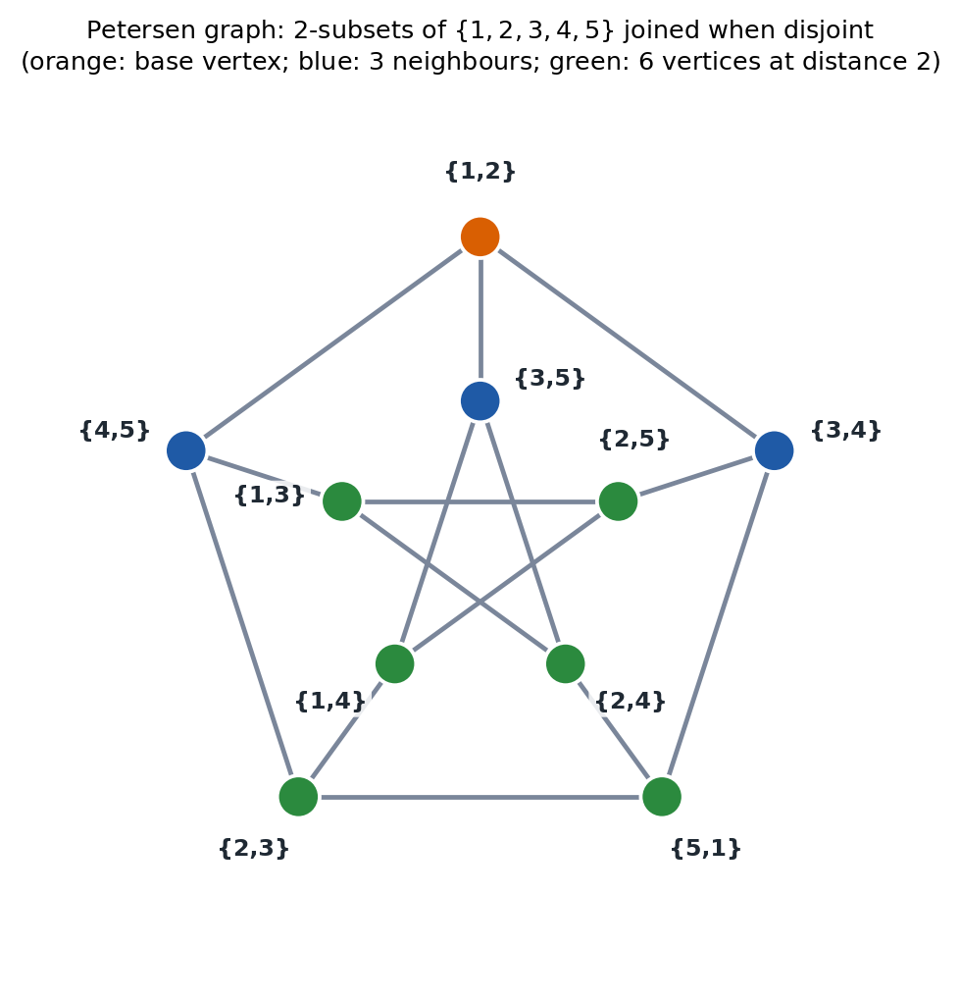

*Figure 2. The Petersen graph: vertices are the $10$ two-element subsets of $\{1, 2, 3, 4, 5\}$, joined when disjoint. From $\{1, 2\}$ (orange), the $3$ blue neighbours are pairs from $\{3, 4, 5\}$, and the $6$ green vertices at distance $2$ overlap $\{1, 2\}$ in one symbol. Unmarked crossings of inner star edges are not vertices.*

Check all four properties directly from $\{1, 2, 3, 4, 5\}$:

- **Valency $3$:** $\{1, 2\}$ leaves $\{3, 4, 5\}$, forming $\binom{3}{2} = 3$ disjoint pairs $\{3, 4\}, \{3, 5\}, \{4, 5\}$.
- **Adjacent pairs share $0$ neighbours:** $\{1, 2\}$ and $\{3, 4\}$ use four symbols, leaving only $\{5\}$, too small to form a pair.
- **Non-adjacent pairs share $1$ neighbour:** $\{1, 2\}$ and $\{1, 3\}$ use $\{1, 2, 3\}$, leaving uniquely $\{4, 5\}$ disjoint from both (diameter $2$, no $4$-cycles).
- **Girth $5$:** the outer pentagon $\{1, 2\} \sim \{3, 4\} \sim \{5, 1\} \sim \{2, 3\} \sim \{4, 5\} \sim \{1, 2\}$ closes a $5$-cycle.

This is the fundamental of what we will call [Generalized Polygons](#generalized-polygons) later: forbidding short cycles while keeping everything close forces an exact vertex count and uniform neighbour counts. Graphs on $v$ vertices of valency $k$ whose adjacent and non-adjacent pairs have constant common-neighbour counts $\lambda$ and $\mu$ are called [strongly regular](#the-adjacency-matrix-and-its-eigenvalues) (here $(v, k, \lambda, \mu) = (10, 3, 0, 1)$), studied in [Strongly Regular and Distance-Regular Graphs](#strongly-regular-and-distance-regular-graphs).

#### The adjacency matrix and its eigenvalues

Order the $v$ vertices of a finite graph $\Gamma$ as $(p_1, \dots, p_v)$ and form its $v \times v$ **adjacency matrix** $A$ over $\mathbb{R}$ (never over $\mathbb{F}_2$, since we want real path counts without mod-$2$ cancellation), setting $A_{ij} = 1$ if $p_i \sim p_j$ and $0$ otherwise. Because $A$ is real symmetric with zero diagonal, [the spectral theorem](#real-symmetric-matrices-and-the-spectral-theorem) guarantees real eigenvalues and diagonalizability.

Writing $A$ down needs an order for the vertices. But let's say you changed the order. You can do this by using $P^TAP$ as the adjacency matrix, where $P$ is a permutation matrix on the vertices. The new madjacency matrix will still have the same eigenvalues and multiplicities ([permutation matrices](#the-all-ones-matrix-and-commuting-matrices)). These eigenvalues are therefore the eigenvalues of $\Gamma$ itself. The list of eigenvalues is sometimes called the spectrum of $\Gamma$. In eigenvalue lists, exponents mark multiplicity: $1^2$ means eigenvalue $1$ twice.

Compare our two $6$-vertex valency-$2$ graphs from Figure 1:

- **Two triangles $2 K_3$:** The $2K_3$ adjacency matrix contains two triangle matrices arranged along the diagonal with zeroes everywhere else. Since $A_{K_3} = J_3 - I_3$ had eigenvalues $2, (-1)^2$ in [the prologue](#real-symmetric-matrices-and-the-spectral-theorem). Doubling the block gives $2^2, (-1)^4$.
- **Hexagon $C_6$:** Around the $6$-cycle, $(A w)_i = w_{i-1} + w_{i+1}$. Constant $(1, 1, 1, 1, 1, 1)^T$ gives $\theta = 2$; alternating $(1, -1, 1, -1, 1, -1)^T$ gives $\theta = -2$; $(1, 1, 0, -1, -1, 0)^T$ and its shift $(0, 1, 1, 0, -1, -1)^T$ give $\theta = 1$ twice; and $(1, -1, 0, 1, -1, 0)^T$ and $(0, 1, -1, 0, 1, -1)^T$ give $\theta = -1$ twice. Thus $C_6$ has eigenvalues $2, 1^2, (-1)^2, -2$.

Where do these eigenvalues come from without guessing the vectors?

**Standing waves around the cycle (roots of unity):** Because shifting one step around the $6$-cycle is rotation by $\alpha = \frac{2\pi r}{6}$ ($r = 0, 1, 2, 3, 4, 5$), testing $w_m = e^{i m \alpha}$ gives $(Aw)_m = e^{i(m-1)\alpha} + e^{i(m+1)\alpha} = (e^{-i\alpha} + e^{i\alpha})e^{im\alpha} = 2\cos(\alpha)\, w_m$. Plugging in $\alpha = r \cdot 60^\circ$ immediately yields $\theta_r = 2\cos(r \cdot 60^\circ) = 2,\, 1,\, -1,\, -2,\, -1,\, 1$ (and the real eigenvectors above are integer-scaled combinations of $\cos(m \cdot 60^\circ)$ and $\sin(m \cdot 60^\circ)$).

**Polynomial shortcut ($A^3 - 3A = 2P$):** Taking $3$ steps on $C_6$ from vertex $i$ either reaches the opposite corner ($2$ ways: clockwise or counterclockwise) or steps back and forth to an immediate neighbour ($3$ ways each). Thus $A^3 = 3A + 2P$, where $P$ swaps opposite corners of the hexagon. Since $P^2 = I$ has eigenvalues $\pm 1$, every eigenvalue $\theta$ of $A$ satisfies $\theta^3 - 3\theta = \pm 2$, which factors into $(\theta - 2)(\theta + 1)^2 = 0$ and $(\theta + 2)(\theta - 1)^2 = 0$, giving $\theta = 2, (-1)^2$ and $\theta = -2, 1^2$.

Two differences jump out between $2^2, (-1)^4$ and $2, 1^2, (-1)^2, -2$: the multiplicity of $2$, and the appearance of $-2$ because the hexagon is bipartite.

We can put a few conditions on the eiegenvalues. The valency $k$ is always an eigenvalue of the graph because every row has $k$ ones, so the all-ones vector $j$ satisfies $Aj = kj$.

No eigenvalue $\theta$ can ever exceed $k$ in absolute value ($\vert{}\theta\vert{} \le k$). To see why, assume that the eigenvector $w$ has a maximum component $w_i$. The $i^{th}$ component of $Aw = \theta w$ will be a maximum of $kw_i$. But this should equal $\theta w_i$, which means $\theta w_i \le kw_i$ which gives us the limit.

The multiplicity of the eigenvalue $k$ counts the exact number of connected components of the graph. In particular, a $k$-regular graph is connected if and only if the eigenvalue $k$ has multiplicity 1.

A connected finite $k$-regular graph ($k \ge 1$) has $-k$ as an eigenvalue if and only if it is bipartite. 

A few more definitions of types of graphs. 

Strongly Regular Graphs (SRGs): A graph with $v$ vertices (neither empty nor complete) is strongly regular with parameters $(v, k, \lambda, \mu)$ if it is $k$-regular i.e. every vertex has a valency of $k$, every pair of adjacent vertices shares $\lambda$ common neighbors, and every pair of distinct non-adjacent vertices shares $\mu$ common neighbors. Note that when we say non-adjacent, we mean any distance larger than 1, but when $\mu > 0$ the fact that they share common neighbours means that the distance is always 2 (this holds for every primitive, that is nondegenerate, strongly regular graph; when $\mu = 0$ the graph is a disjoint union of complete graphs).

Distance-Regular Graphs (DRGs): This generalizes strong regularity to arbitrary diameter $d$, with parameters $(a_i, b_i, c_i)$ for each distance $i \in \{0, \dots, d\}$. Instead of only looking at distance 1 (adjacent) and distance 2 (non-adjacent), we require that for any two vertices $x$ and $y$ at distance $i$ from each other, the number of neighbors of $y$ that are one step closer to $x$ (at distance $i-1$) is a constant $c_i$, the number of neighbors of $y$ at the same distance $i$ from $x$ is a constant $a_i$, and the number of neighbors of $y$ one step further away from $x$ (at distance $i+1$) is a constant $b_i$.

We have the property $a_i + b_i + c_i = k$ for every $i$ because any neighbor of $y$ can only be at distance $i-1$, $i$, or $i+1$ from $x$. Since $y$ has $k$ neighbors in total, those three counts must add up to $k$. At the boundaries, several values are fixed automatically: $c_0 = 0$ and $a_0 = 0$ (no vertices at distance $-1$ and no self-loops), $b_0 = k$ (all $k$ neighbors of $x$ are at distance $1$), $c_1 = 1$ (for $y \sim x$, $x$ itself is the only neighbor of $y$ at distance $0$), and $b_d = 0$ (no vertices exist beyond the diameter $d$).

SRGs are DRGs of diameter 2. In a connected graph of diameter 2, the only possible distances between distinct vertices are $i = 1$ (adjacent) and $i = 2$ (non-adjacent). For $i = 1$, $a_1$ is the number of common neighbors of two adjacent vertices ($\lambda$). For $i = 2$, $c_2$ is the number of common neighbors of two non-adjacent vertices ($\mu$).

### Point-line geometries

#### Points, lines, duals and doubles

A point-line geometry is a triple $S = (\mathcal{P}, \mathcal{L}, I)$ of points $\mathcal{P}$, lines $\mathcal{L}$ (kept formally disjoint from $\mathcal{P}$), and an incidence relation $I \subseteq \mathcal{P} \times \mathcal{L}$ telling us which points lie on which lines, with the single basic requirement that every line contains at least two points.

From any geometry $S$, we have three derived geometries:

**The Point-Line Dual $S^D$**: Swap the roles of points and lines ($\mathcal{P}^D = \mathcal{L}$ and $\mathcal{L}^D = \mathcal{P}$) and keep incidence the same. Notice the condition: every point of $S$ must lie on at least two lines. Why? Because our definition of a geometry requires every line to have at least two points; when points of $S$ become lines of $S^D$, each old point needs at least two old lines on it so that the new lines in $S^D$ have at least two new points.

**The Double $S'$**: Put points and lines of $S$ together as the points of $S'$, and use the flags $\{x, L\}$ ($x$ is a point) of $S$ as the lines of $S'$ (so every line in $S'$ is thin, having size 2).

**The Internal Structure $S_x$ at a point $x$**: Assuming every line through $x$ has at least 3 points, take all neighbors of $x$ ($x^\perp \setminus \{x\}$, where $x^\perp$ is the set of points collinear with $x$ as well as $x$ itself) as the points, and the lines of $S$ passing through $x$ as the lines.

Notice carefully that in $S_x = (x^\perp \setminus \{x\}, \mathcal{L}_x, I_x)$, the lines are only the lines through $x$. If $S$ is a partial linear space, two lines through $x$ cannot meet anywhere else, so in $S_x$ the lines $\mathcal{L}_x$ simply partition $x^\perp \setminus \{x\}$ into disjoint sets of points. Later, when studying polar spaces or near polygons, we enrich this local view by either looking at how lines not through $x$ cut across $\mathcal{L}_x$ (turning the lines through $x$ into points and planes through $x$ into lines, which gives the residue at $x$), or looking at the induced subgeometry on $x^\perp \setminus \{x\}$.

On the $3 \times 3$ grid in figure 5, $\mathcal{S}_x$ is $4$ points on two disjoint $2$-point lines. **Do not confuse $\mathcal{S}_x$ with the residue at $x$** from the earlier projective geometry notes (and [quotient polar spaces](maths_3_projective_geometry.md#residues-give-local-to-global-classification-and-induction)), where lines through $x$ become *points* and planes through $x$ become *lines*; $\mathcal{S}_x$ keeps neighbouring points as points, which is how we will build [derived designs](#unitals-inversive-planes-and-witt-mathieu-designs) in [Designs: a first look](#combinatorial-designs) and [New designs from old](#building-new-designs-from-old-ones).

Here are a few examples:

**The Fano plane $\mathrm{PG}(2, 2)$** (Figure 5(a)): $7$ points and $7$ lines of $3$ points each, $3$ lines per point. Swapping vectors and functionals on $\mathbb{F}_2^3$ shows $\mathrm{PG}(2, 2)$ is self-dual; its double has $14$ points and $21$ two-point lines.

**The $3 \times 3$ grid $Q^+(3, 2)$** ($x_0 x_3 + x_1 x_2 = 0$ in $\mathrm{PG}(3, 2)$, where $+$ and $-$ agree over $\mathbb{F}_2$): $9$ points on $3$ rows $R_1, R_2, R_3$ and $3$ columns $C_1, C_2, C_3$ ($2$ lines per point). Its dual $\mathcal{S}^D$ has $6$ points $\{R_1, R_2, R_3, C_1, C_2, C_3\}$ and $9$ two-point lines $\{R_i, C_j\}$ joining every row-point to every column-point (a **dual grid**), visibly non-isomorphic to the $9$-point grid yet sharing the same $15$-point, $18$-line double. Both return in [Basic properties of generalized polygons](#basic-properties-of-generalized-polygons) and [Which polygons exist](#the-feithigman-theorem-and-order-bounds).

#### Partial Linear Spaces

In a [projective plane](#projective-planes-degenerate-vs-nondegenerate), we say any two lines are incident at exactly one point and any two points are connected by exactly one line. This is a linear space. But recall that our hyperbolic quadric in 3D did not satisfy this rule. Any two points had either 0 or 1 line connecting them.

So a more general rule is a geometry where any two distinct points lie on at most one common line (equivalently, any two distinct lines intersect in at most one point). This is a partial linear space. Here, no two distinct lines have the exact same set of incident points.

The partial linear space has order $(s, t)$ if every line has $s + 1$ points, and every point lies on $t + 1$ lines. Why $s + 1$ and $t + 1$ instead of $s$ and $t$? This comes from projective geometry over a finite field $\mathbb{F}_q$, where a projective line $PG(1, q)$ has $q + 1$ points (one point at infinity plus $q$ affine points). So for classical geometries over $\mathbb{F}_q$, $s = q$. Also, when you fix a point $x$ on a line, there are exactly $s$ other points on that line, so in a partial linear space of order $(s, t)$, the collinearity graph is regular with valency $k = s(t + 1)$.

A subgeometry picks a subset of points $\mathcal{P}'$ and a subset of lines $\mathcal{L}'$. In a general subgeometry, a line $L \in \mathcal{L}'$ might lose some of its original points if those points were not included in $\mathcal{P}'$ (so the line gets "chopped" or shortened). A subgeometry is called full if every line $L \in \mathcal{L}'$ keeps 100% of the points it had in the ambient geometry $S$. For example, in $PG(2, q) \subset PG(3, q)$, every line in the plane retains all $q + 1$ of its points from the ambient 3-space, making it a full subgeometry.

In a partial linear space $S = (\mathcal{P}, \mathcal{L}, I)$:

* Subspace: A subset of points $X \subseteq \mathcal{P}$ with the "two-point closure rule": whenever a line of $S$ has at least two of its points inside $X$, the entire line (all of its points) must lie inside $X$. Every nonempty subspace $X$ naturally forms a full subgeometry $\tilde{X}$ using the lines contained in $X$.

* Singular Subspace: A subspace where every pair of points is collinear. (Because $X$ is also a subspace, for any two points in a singular subspace, the unique line joining them exists in $S$ and lies completely inside $X$. Thus, singular subspaces look like [projective spaces](#projective-spaces-of-arbitrary-dimension-and-the-veblenyoung-axiom): points, lines, planes, etc., where all points are mutually collinear.)

  In $\mathrm{PG}(n, q)$, if a subset $X$ obeys the two-point line rule ("whenever $x, y \in X$, the line $xy$ is in $X$"), then every pair $x, y \in X$ has a line in $X$, because every pair had a line in $\mathrm{PG}(n, q)$ to begin with.

* Generated Subspace $\langle X \rangle$: Given any starting set of points $X$, there is a unique smallest subspace containing $X$, equal to the intersection of all subspaces containing $X$. How to build this subspace step by step from the bottom up:

Start with $X_0 = X$. To get $X_1$, draw every line that passes through at least two points of $X_0$, and throw all the points on those lines into $X_1$. Repeat: to get $X_i$, take every line passing through at least two points of $X_{i-1}$ together and add all points on those lines. The union $\bigcup_{i \in \mathbb{N}} X_i$ of all these steps is the exact subspace generated by $X$.

Adding all lines through pairs of points in $X_0$ creates new points in $X_1$. A line passing through two of those newly added points in $X_1$ might not have contained two points of $X_0$, so you have to run the line-completion step again for $X_2$, $X_3$, and so on. 

The generating index is the minimum number of points needed to generate the whole geometry $\mathcal{P}$. For an $n$-dimensional projective space $PG(n, q)$, the generating index is $n + 1$ (a basis of $n + 1$ points in general position generates the entire space in $n$ steps), whereas for polar spaces and generalized quadrangles, computing the generating index tells us the minimum dimension of the ambient vector space into which the geometry can be projectively embedded.

* Hyperplane: A proper subspace ($X \neq \mathcal{P}$) that intersects every single line of the geometry in at least one point. (Because $X$ is a subspace, any line of $S$ either meets the hyperplane $X$ in a single point, or is completely contained inside $X$.)

Unlike projective hyperplanes, a hyperplane of $\mathcal{S}$ need not look flat and may contain *no lines at all*. Let us find every hyperplane $H$ of the $3 \times 3$ grid (Figure 3):

- **If $H$ contains a line**, say row $R_i$, then $R_i$ alone misses the other two rows, so $H$ needs points in both. Picking points in two different columns would give two columns $2$ points each in $H$, swallowing both columns and then all $9$ points ($H = \mathcal{P}$, not proper). So the extra points must lie in one column $C_k$, giving **$9$ hyperplanes** $x^\perp = R_i \cup C_k$ of $5$ points each (Figure 3(a)).
- **If $H$ contains no line**, it meets every row and every column in *precisely $1$ point*: a permutation pattern. There are $3! = 6$ such $3$-point **transversals** (Figure 3(b)), which are subspaces vacuously because no line hits them twice.

There are thus 15 hyperplanes in total.

*Figure 3. The $15$ hyperplanes of the $3 \times 3$ grid fall into two shapes: (a) $9$ crosses $x^\perp$ ($5$ orange points, two full lines), and (b) $6$ transversals ($3$ blue points, no lines at all, meeting all six lines once).*

A set of points meeting *every line of $\mathcal{S}$ in precisely one point* is an **ovoid** of $\mathcal{S}$ (so every ovoid of a thick-lined partial linear space is a line-free hyperplane, like the $6$ transversals). **Watch the context shift:** in the earlier projective geometry notes, an ovoid of $\mathrm{PG}(3, q)$ was a $(q^2 + 1)$-point cap like $Q^-(3, q)$ missing many ambient lines, whereas an ovoid *of $\mathcal{S}$* meets every line *of $\mathcal{S}$* once. Notice that the $3 \times 3$ grid $Q^+(3, 2) \subset \mathrm{PG}(3, 2)$ has $9 + 6 = 15$ hyperplanes, matching the $15$ planes of $\mathrm{PG}(3, 2)$ ($9$ tangent planes cutting crosses, $6$ non-tangent planes cutting ovoids), a match explained in [the 3-by-3 grid example](#the-3-by-3-grid-universal-embedding-with-no-proper-quotients).

#### Collinearity Graphs & Incidence Graphs

Every point-line geometry $S$ has two natural graphs attached to it:

The Collinearity Graph $\Gamma$: Vertices are the points $\mathcal{P}$, and two points are connected by an edge if they share a line.

For straightforward geometries where any line has only two points, this graph is the actual figure of the geometry that we would have learnt in high school. For example, the collinearity graph of a triangle is a triangle.

But notice what this graph cannot distinguish: one $3$-point line also has a collinearity graph that is a triangle $K_3$. This is why we need the Incidence Graph. 

The Incidence Graph: Vertices are both points and lines ($\mathcal{P} \cup \mathcal{L}$), and edges connect a point $p$ to a line $L$ whenever $(p, L)$ is a flag.

If every line of the geometry has only $2$ points (for example, in a thin geometry or when taking the double $\mathcal{S}'$), the incidence graph is literally obtained from the collinearity graph by inserting one line node in the middle of every edge.

When a line has $3$ or more points (say $L = \{p_1, p_2, p_3\}$), instead of putting $3$ separate line nodes on the $3$ edges of that triangle, all $3$ points connect to one single shared line node $L$ (forming a $3$-spoke star with hub $L$):

$$p_1 - L - p_2 \quad\text{and}\quad p_3 - L.$$

(Putting a separate node on each of the $3$ edges would instead describe three separate $2$-point lines $\{p_1, p_2\}, \{p_2, p_3\}, \{p_1, p_3\}$.)

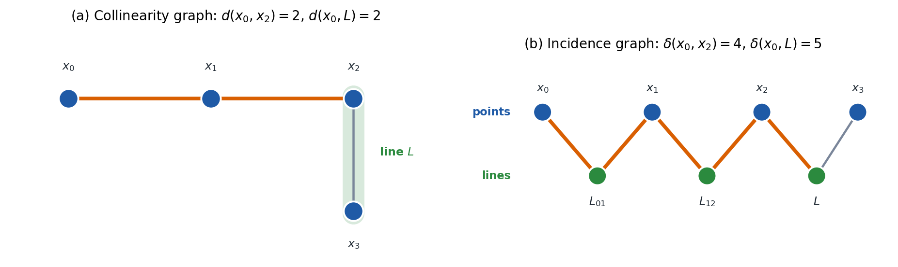

*Figure 4. Collinearity distance $d$ versus incidence distance $\delta$: (a) a two-step collinearity path $x_0 \sim x_1 \sim x_2$ reaching the nearest point $x_2$ of $L$, giving $d(x_0, x_2) = d(x_0, L) = 2$; (b) the matching alternating incidence path $x_0 - L_{01} - x_1 - L_{12} - x_2 - L$, giving $\delta(x_0, x_2) = 4$ and $\delta(x_0, L) = 5$.*

There is a relationship, illustrated in Figure 4, that translates distances $d(\cdot, \cdot)$ measured in the collinearity graph into distances $\delta(\cdot, \cdot)$ measured in the bipartite incidence graph:

- Between two points $x$ and $y$: $\delta(x, y) = 2 \cdot d(x, y)$.
- Between a point $x$ and a line $L$: $\delta(x, L) = 2 \cdot d(x, L) + 1$.
- Between two distinct lines $L_1$ and $L_2$: $\delta(L_1, L_2) = 2 \cdot d(L_1, L_2) + 2$.

Why are there $+0$, $+1$, and $+2$ in the three formulas?

In the incidence graph, every single step alternates between a point and a line: $\text{point} \to \text{line} \to \text{point}$. So one collinearity step between two points always takes 2 steps in the incidence graph, giving $2 \cdot d(x, y)$.

For a point $x$ and a line $L$, $d(x, L)$ measures the collinearity distance from $x$ to the closest point $y$ on $L$. In the incidence graph, getting from $x$ to $y$ takes $2 \cdot d(x, L)$ steps, and then stepping from the point $y$ onto the line vertex $L$ itself takes 1 final step, giving $2 \cdot d(x, L) + 1$. (Notice that if $x$ lies on $L$, $d(x, L) = 0$ and $\delta(x, L) = 1$, which is a single flag edge.)

Similarly, for two distinct lines $L_1$ and $L_2$, we add another $1$ for the second line as well. 

Notice also that parity in the incidence graph is completely locked: point-to-point and line-to-line distances are always even, while point-to-line distances are always odd.

For a finite geometry $\mathcal{S}$, the two graphs give two real matrices: an adjacency matrix $A$ of $\Gamma$ (a **collinearity matrix**, whose eigenvalues are the eigenvalues of $\mathcal{S}$). 

But the full adjacency matrix of the bipartite incidence graph listing all points $\mathcal{P}$ first and all lines $\mathcal{L}$ second, splits into four blocks:

$$\widetilde{A} = \begin{pmatrix} 0 & M \\ M^T & 0 \end{pmatrix} \begin{matrix} \leftarrow \text{points } \mathcal{P} \\ \leftarrow \text{lines } \mathcal{L} \end{matrix}$$

- **Top-left ($0$):** no point-to-point edges in the incidence graph.
- **Bottom-right ($0$):** no line-to-line edges in the incidence graph.
- **Top-right ($M$):** point-to-line edges ($M_{p, L} = 1$ if $p \,\mathrm{I}\, L$).
- **Bottom-left ($M^T$):** line-to-point edges (just the transpose of $M$).

Because the two diagonal blocks are always $0$ and the bottom-left is just $M^T$, all the information in the incidence graph's adjacency matrix lives in that **top-right $|\mathcal{P}| \times |\mathcal{L}|$ block $M$**, which is what we call the **incidence matrix**. 

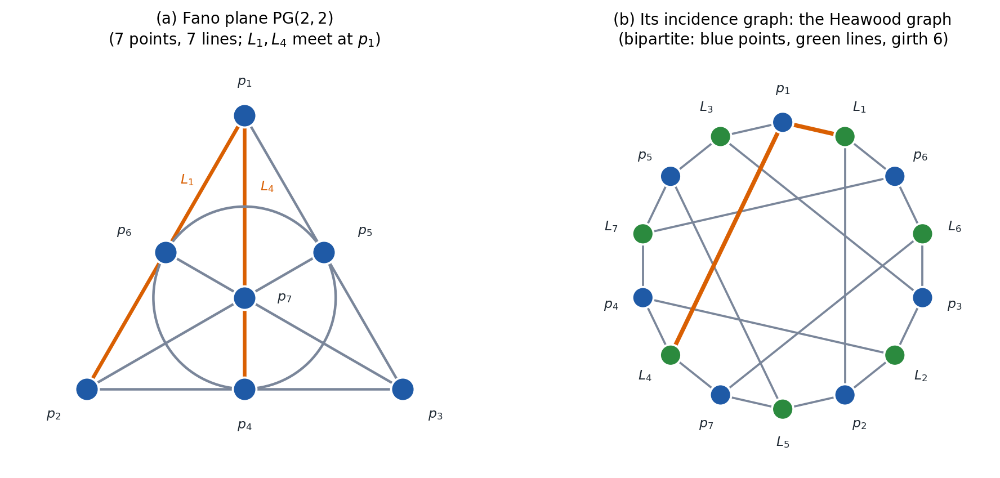

*Figure 5. (a) The Fano plane $\mathrm{PG}(2, 2)$ of order $(2, 2)$ ($7$ points, $7$ lines; $L_1$ and $L_4$ meet at $p_1$). (b) Its bipartite incidence graph, the $14$-vertex Heawood graph, drawn as a $14$-cycle alternating blue points and green lines with step-$5$ chords; orange edges mark the flags $(p_1, L_1)$ and $(p_1, L_4)$.*

Check both on $\mathrm{PG}(2, 2)$ in Figure 5. Its collinearity graph is $K_7$, forgetting which triples are lines; its incidence graph, the **Heawood graph** (also called simply the incidence graph of $\mathrm{PG}(2, 2)$), keeps everything, with $14$ vertices, valency $3$, girth $6$, and diameter $3$ (every two distinct points share a line and every two distinct lines share a point, giving $\delta = 2$, while anti-flags have $d(x, L) = 1$ and $\delta(x, L) = 3$). And multiplying its $7 \times 7$ incidence matrix $M$ by $M^T$ counts lines through both $x$ and $y$ via $(M M^T)_{xy} = \sum_L M_{x, L} M_{y, L}$: $3$ on the diagonal, $1$ off the diagonal (because each point has 3 lines incident on it and any pair of points share one line), giving

$$M M^T = 3 I_7 + (J_7 - I_7) = 2 I_7 + J_7$$

without writing down a single entry of $M$. Products like $M M^T$ and $A^2$ turn incidence counts into eigenvalue equations ([The adjacency matrix of a strongly regular graph](#the-adjacency-matrix-of-a-strongly-regular-graph) and [Fisher's inequality](#the-incidence-matrix-and-fishers-inequality)).

This will give us two algebraic weapons that prove theorems and rule out impossible geometries without ever having to draw or search for them. We will look at this in a little while. 

<!-- terms checked: subspace; hyperplane; irreducible; nondegenerate; degenerate; dimension; extension; generalized $n$-gon -->

## Classes of Point-Line Geometries

Before investigating individual geometries in depth, it helps to build a working catalogue of the main families of point-line geometries.

Before meeting spaces built from algebra or field theory, it is useful to name eight elementary point-line geometries. They appear constantly as extreme cases, degenerate cases, or building blocks inside larger theorems.

**A point:** A point-line geometry with a single point ($|\mathcal{P}| = 1$), no lines ($\mathcal{L} = \emptyset$), and empty incidence ($\mathrm{I} = \emptyset$).

**A line:** A linear space with exactly one line ($|\mathcal{L}| = 1$) and at least two points, all of which lie on that unique line.

**Graphs and circular spaces:** Any simple graph $\Gamma = (V, E)$ (where $V \neq \emptyset$ is the vertex set and $E$ is a set of $2$-element subsets of $V$) can be viewed directly as a partial linear space whose points are the vertices $V$ and whose lines are the edges $E$, all of which are **thin** ($2$ points per line). When $\Gamma = K_n$ is the complete graph on $n \ge 3$ vertices (every pair of vertices joined by a $2$-point edge), this partial linear space is called a **circular space**. It is called circular because no $3$ points on a circle are collinear, making all lines thin, just like the complete graph. Furthermore, in a complete graph, every line has exactly 2 points, just like the secant of a circle.

**Generalized $2$-gons (generalized digons):** A point-line geometry $(\mathcal{P}, \mathcal{L}, \mathrm{I})$ with $|\mathcal{P}| \ge 2$, $|\mathcal{L}| \ge 2$, and $\mathrm{I} = \mathcal{P} \times \mathcal{L}$, meaning **every point is incident with every line**.

A generalized digon is the classic example of a geometry that is *not* a partial linear space and where lines *cannot* be treated as subsets of points. Every line $L \in \mathcal{L}$ has the exact same set of incident points, namely all of $\mathcal{P}$. Keeping $\mathcal{P}$ and $\mathcal{L}$ as abstract disjoint sets linked by $\mathrm{I}$ in the definition of a point-line geometry is what allows generalized digons to exist cleanly.

**Ordinary $n$-gons ($n \ge 3$):** A partial linear space isomorphic to the $n$ vertices $\mathcal{P} = \{1, 2, \dots, n\}$ and $n$ thin edges $\mathcal{L} = \{\{1, 2\}, \{2, 3\}, \dots, \{n - 1, n\}, \{n, 1\}\}$ of an ordinary polygon, with containment as incidence. When $n = 3$, an ordinary $3$-gon (triangle) is the same thing as a circular space on $3$ vertices. Every ordinary $n$-gon is self-dual: swapping vertices and edges of an $n$-sided polygon yields another $n$-sided polygon.

**Near-pencils:** A **near-pencil** is a linear space in which one line contains *every point except one*.

Suppose a near-pencil has $n$ points in total ($n \ge 3$). Then $n - 1$ of the points, say $x_1, x_2, \dots, x_{n-1}$, all sit on one long line $L_0$, while a single outsider point $p$ sits off $L_0$ (panel (a) of Figure 6 shows $n = 5$). Because a near-pencil is a linear space, $p$ must be joined to each $x_i$ by a unique line, and none of these connecting lines can hit a second point $x_j$ on $L_0$ (otherwise it would share two points with $L_0$). That forces the remaining lines to be the $n - 1$ thin lines $\{p, x_1\}, \{p, x_2\}, \dots, \{p, x_{n-1}\}$.

So a near-pencil on $n$ points always has $n$ lines as well: one line of size $n - 1$ and $n - 1$ lines of size $2$. When $n = 3$, the "long" line also has size $2$, so a near-pencil on $3$ points is an ordinary $3$-gon. Also, the point-line dual of any near-pencil is again a near-pencil: the $n - 1$ thin lines through $p$ become $n - 1$ dual points all sitting on the dual line $p$, while $L_0$ becomes the lone outsider point. Here, we have every line meeting at a point, except for $L_0$.

**$(k_1, k_2, \dots, k_s)$-stars and $(k_1, k_2)$-crosses:** Let $s \ge 2$ and let $k_1, k_2, \dots, k_s \ge 2$ be integers. A **$(k_1, k_2, \dots, k_s)$-star** is a linear space having a distinguished hub point $p$ through which pass $s$ lines $L_1, \dots, L_s$ of respective sizes $|L_i| = k_i$, while **every line not passing through $p$ is thin** (size $2$). Because it is a linear space, every point on $L_i \setminus \{p\}$ is joined to every point on $L_j \setminus \{p\}$ ($i \neq j$) by a thin $2$-point line, and there are no other points in the geometry. When $s = 2$, a $(k_1, k_2)$-star is called a **$(k_1, k_2)$-cross**.

Note that a near-pencil on $n$ points is just the special case of a $(k_1, 2)$-cross where $k_1 = n - 1$, and the crossing point is one of the points on $L_0$, or equivalently a $(2, 2, \dots, 2)$-star with $n - 1$ rays of size $2$ where one of the outer points is viewed as the hub.

For example, consider a $(3, 3, 4)$-star (here $s = 3$). There are 3 lines through the hub $p$, containing 3, 3, and 4 points respectively (so 2, 2, and 3 points outside $p$, giving $1 + 2 + 2 + 3 = 8$ points in total). Every other line connects one point from one ray to one point on another ray, and has size 2. There are $(2 \times 2) + (2 \times 3) + (2 \times 3) = 16$ such thin lines. Total lines in the space: $3 + 16 = 19$ lines (three of sizes 3, 3, 4, and sixteen of size 2). There is no single line uniting the 3 rays outside $p$.

A circular space is also a special case. Remember that a circular space is a linear space on $n \ge 3$ points in which every line is thin (contains exactly 2 points). Because every pair of distinct points must lie on a unique 2-point line, a circular space on $n$ points is simply the complete graph $K_n$.

A $(2, 2, \dots, 2)$-star with $n - 1$ rays of size $2$ connects every pair of outer points by its own separate two-point line rather than putting them on one long line, so a $(2, 2, \dots, 2)$-star is a circular space $K_n$ (matching a near-pencil only when $n = 3$).

**$(n_1 \times n_2)$-grids and dual grids:** Given sets $X_1, X_2$ of sizes $n_1 \ge 2$ and $n_2 \ge 2$, an **$(n_1 \times n_2)$-grid** is a partial linear space isomorphic to the Cartesian product point set $X_1 \times X_2$, whose lines are the $n_1$ "rows" $\{i\} \times X_2$ ($i \in X_1$, each of size $n_2$) and the $n_2$ "columns" $X_1 \times \{j\}$ ($j \in X_2$, each of size $n_1$). Through every point $(i, j)$ pass exactly $2$ lines (its row and its column), so every $(n_1 \times n_2)$-grid has $t = 1$ (where every point is incident with $t+1$ lines). The grid is called **symmetrical** if $n_1 = n_2$ (in which case it has order $(n_1 - 1, 1)$) and **nonsymmetrical** if $n_1 \neq n_2$ (in which case lines have two different sizes, so it has no single parameter $s$ which would say every line has $s+1$ points).

Its point-line dual is called a **(symmetrical or nonsymmetrical) dual grid**. What does a dual grid look like? First, note that two row-lines never intersect, and two column-lines never intersect, while every row-line meets every column-line in a unique grid point $(i, j)$. This unique point becomes a thin $2$-point line in the dual. The $n_1$ row-lines and $n_2$ column-lines become two disjoint sets of points of sizes $n_1$ and $n_2$. Therefore, **dual grids are precisely the complete bipartite graphs $K_{n_1, n_2}$ with $n_1, n_2 \ge 2$**, viewed as partial linear spaces with thin lines.

The hyperbolic quadric $Q^+(3,q)$ in $\text{PG}(3,q)$ is a symmetrical $(q+1) \times (q+1)$ grid of order $(s, t) = (q, 1)$. Its lines split into two families of $q+1$ mutually skew lines (the regulus and the opposite regulus), where every line of the first regulus intersects every line of the second regulus in a unique point.

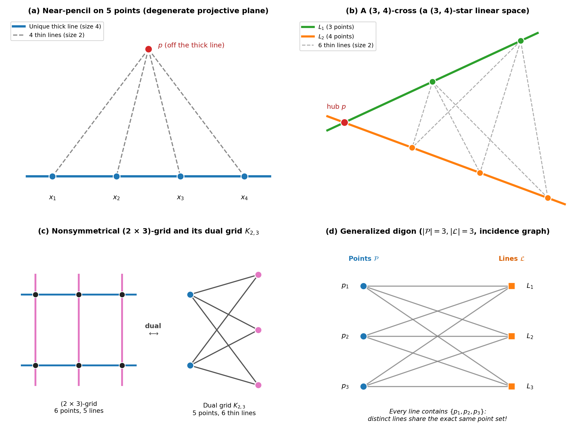

*Figure 6. Four elementary geometries. (a) A near-pencil on $5$ points: one line of size $4$, and four thin lines joining the outside point $p$ to it. (b) A $(3, 4)$-cross: two lines of $3$ and $4$ points through the hub $p$, and the six thin lines joining their other points. (c) A nonsymmetrical $2 \times 3$ grid ($6$ points, $5$ lines) and its dual grid $K_{2,3}$ ($5$ points, $6$ thin lines). (d) A generalized digon with $3$ points and $3$ lines, drawn as its incidence graph: every point lies on every line.*

| Elementary Geometry | Point Count $\lvert\mathcal{P}\rvert$ | Line Count $\lvert\mathcal{L}\rvert$ | Line Sizes | Linear Space? | Self-Dual? |
| :--- | :--- | :--- | :--- | :--- | :--- |
| Point | $1$ | $0$ | none | vacuously yes | dual undefined |
| Line (size $k \ge 2$) | $k$ | $1$ | $k$ | yes | dual undefined |
| Circular space ($K_n, n \ge 3$) | $n$ | $\binom{n}{2}$ | all $2$ (thin) | yes | only for $n = 3$ |
| Generalized digon | $m \ge 2$ | $n \ge 2$ | all $m$ | no (not even partial linear) | iff $m = n$ |
| Ordinary $n$-gon ($n \ge 3$) | $n$ | $n$ | all $2$ (thin) | only for $n = 3$ | yes |
| Near-pencil ($n \ge 3$) | $n$ | $n$ | one of $n-1$, and $n-1$ of $2$ | yes | yes |
| $(k_1, \dots, k_s)$-star | $1 + \sum_{i=1}^s (k_i - 1)$ | $s + \sum_{i < j}(k_i - 1)(k_j - 1)$ | $k_1, \dots, k_s$, rest $2$ | yes | iff near-pencil |
| $(n_1 \times n_2)$-grid ($n_i \ge 2$) | $n_1 n_2$ | $n_1 + n_2$ | $n_1$ of size $n_2$; $n_2$ of size $n_1$ | no | yes if $n_1 = n_2 = 2$; no otherwise (dual is $K_{n_1, n_2}$) |

Why is the star self-dual only when it is a near-pencil? A star is a linear space, meaning if it is self-dual, the dual has to be a linear space too. If a star is not a near-pencil, it always contains two disjoint lines (one of the rays $L_i$ and a thin line connecting two other rays), so its dual has pairs of points with no line between them and fails to be a linear space. Conversely, every near-pencil on $n$ points has $n$ points, $n$ lines, and every pair of lines meets in a unique point, making it self-dual.

### Projective planes: degenerate vs. nondegenerate

A **projective plane** is a linear space $\mathcal{S}$ satisfying two axioms:

- Any two distinct lines of $\mathcal{S}$ meet in a unique point.
- There exist three noncollinear points.

Because three noncollinear points $x_1, x_2, x_3$ determine three lines $x_1 x_2, x_2 x_3, x_3 x_1$ that do not all pass through a common point (three nonconcurrent lines), swapping points and lines preserves every axiom: **the point-line dual of any projective plane is again a projective plane**.

Pause and ask: is requiring *three* noncollinear points enough to give a rich plane like the Fano plane? Look back at panel (a) of Figure 6: in a **near-pencil** on $n \ge 3$ points, every two points determine a unique line, *every two lines intersect in a unique point* (two thin lines meet at $p$, and each thin line $\{p, x_i\}$ meets the long line at $x_i$), and $p, x_1, x_2$ are three noncollinear points. So near-pencils satisfy the two axioms above, even though almost all their points are collapsed onto a single line.

To separate genuine planes from near-pencils, we strengthen "three noncollinear points" to four:

- A projective plane is **irreducible** (or **nondegenerate**) if it contains **four points, no three of which are collinear** (a quadrangle).
- Otherwise, it is **reducible** (or **degenerate**). The degenerate projective planes are **precisely the near-pencils**.

We now show why in any nondegenerate projective plane $\mathcal{S}$, every line has the same number of points, which also equals the number of lines in the plane.

Take any two lines $L_1$ and $L_2$. Because the plane is nondegenerate, there is an external point $p$ lying on neither line. Draw the lines through $p$. In a projective plane, every point $x$ on $L_1$ connects to $p$ by a unique line $px$. That line $px$ must intersect $L_2$ in a unique point $x'$ (since any two lines in a projective plane intersect). Thus, the rays through $p$ pair up every point $x \in L_1$ with a unique point $x' \in L_2$, and simultaneously pair every point on $L_1$ with a unique line through $p$:

$$\text{Points on } L_1 \longleftrightarrow \text{Lines through } p \longleftrightarrow \text{Points on } L_2$$

Because all three sets are in one-to-one correspondence, $\vert{}L_1\vert{} = \vert{}L_2\vert{} = \text{deg}(p)$. Since $L_1, L_2$ are arbitrary, every line has the same number of points $s + 1$, and every point has the same number of lines $s + 1$ passing through it.

$s$ (possibly infinite) and $\ge 2$ is called the **order** of the projective plane. When $s$ is finite, double counting flags starting from one point $p$ (each of the $s + 1$ lines through $p$ holds $s$ additional points, covering all of $\mathcal{P}$) gives:

$$|\mathcal{P}| = |\mathcal{L}| = 1 + (s + 1)s = s^2 + s + 1.$$

### Projective spaces of arbitrary dimension and the Veblen–Young axiom

In dimension $3$ or higher, we cannot require every two lines to intersect, because skew lines exist in $3$-space. How do we express "no parallel lines exist inside any plane" purely in terms of points and lines, without mentioning planes first? That is the job of the **Veblen–Young axiom**:

A **projective space** is a linear space $\mathcal{S}$ satisfying the **Veblen–Young axiom** $(\star)$:

$(\star)$ Whenever $L_1$ and $L_2$ are two distinct lines meeting at a point $z$, and we pick two distinct points $x_1, y_1 \in L_1 \setminus \{z\}$ and two distinct points $x_2, y_2 \in L_2 \setminus \{z\}$, the lines $x_1 x_2$ and $y_1 y_2$ must intersect in a point.

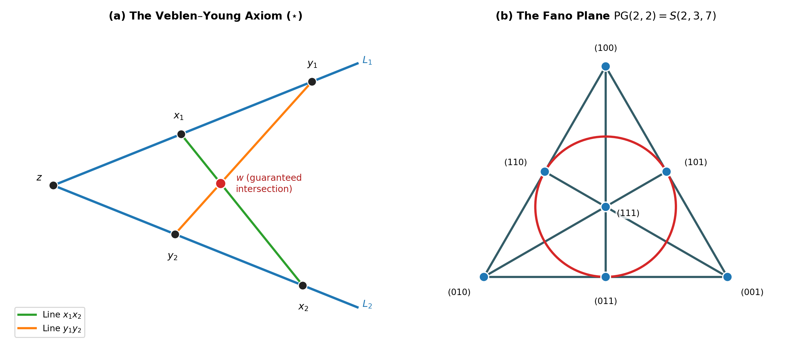

*Figure 7. (a) The Veblen–Young axiom: the lines $L_1$ and $L_2$ meet at $z$, and for points $x_1, y_1$ on $L_1$ and $x_2, y_2$ on $L_2$ the lines $x_1 x_2$ and $y_1 y_2$ must meet, here at $w$. (b) The Fano plane $\mathrm{PG}(2, 2) = S(2, 3, 7)$, each point labelled by its coordinates; the circle is the seventh line.*

Look at panel (a) of Figure 7 to see why $(\star)$ works. The lines $L_1$ and $L_2$ meet at $z$, so they lie in a common $2$-dimensional flat sheet. In an affine (Euclidean) plane, you could pick $x_1 x_2$ parallel to $y_1 y_2$, and those two crossbar lines would never meet. Forcing $x_1 x_2$ and $y_1 y_2$ to meet kills off parallel lines inside every $2$-dimensional sheet while still allowing skew lines elsewhere in $3$-space. In fact, the Veblen–Young axiom $(\star)$ is completely equivalent to:

$(\star')$ Whenever $x_1, x_2, x_3$ are three noncollinear points of $\mathcal{S}$, the subspace $X = \langle x_1, x_2, x_3 \rangle$ they generate carries the induced geometry of a (possibly degenerate) **projective plane**.

Just as with planes, we distinguish thick projective spaces from glued-together pieces:

- A projective space is **irreducible** if **every line is thick** (incident with at least $3$ points). If at least one line is thin (incident with only $2$ points), the projective space is **reducible**. For a projective space of dimension at least $2$, irreducibility is equivalent to requiring every generated plane $\langle x_1, x_2, x_3 \rangle$ of three noncollinear points to be an *irreducible* projective plane.
- The **dimension** of a projective space $\mathcal{S}$ is defined via its generating index $N_{\mathcal{S}}$ (the minimum number of points needed to generate $\mathcal{S}$):

$$\dim(\mathcal{S}) = N_{\mathcal{S}} - 1.$$

Why subtract $1$? Because a single point requires $N_{\mathcal{S}} = 1$ generator and has dimension $0$; a line is generated by $N_{\mathcal{S}} = 2$ distinct points and has dimension $1$; and a projective plane is generated by $N_{\mathcal{S}} = 3$ noncollinear points $x_1, x_2, x_3$ and has dimension $2$ (any point $y \neq x_1$ lies on the line $x_1 y$, which intersects $x_2 x_3$ at some point $w$, so $y$ lies on $x_1 w$ and is generated by $\{x_1, x_2, x_3\}$). By convention, if $\Sigma$ denotes the collection of all subspaces of $\mathcal{S}$, we often refer to the pair $(\mathcal{P}, \Sigma)$ itself as a projective space, and we declare the empty structure $(\emptyset, \{\emptyset\})$ to be a projective space of **dimension $-1$** ($N = 0$ generators).

### Combinatorial designs

Projective and affine planes have the striking uniformity that *every* pair of distinct points lies on $1$ line, and *every* line has the exact same size $k$. Combinatorial design theory generalizes this symmetry in two directions: instead of demanding balance for pairs ($t = 2$) of points, we can demand balance for arbitrary $t$-tuples of points; and instead of requiring $1$ line per $t$-tuple, we can require any constant number $\lambda$ of lines.

#### Definition and notations: $t$-designs and Steiner systems

We will be covering this in detail in [Designs](#designs), so we will not bother about it here.

#### Unitals, inversive planes, and Witt (Mathieu) designs

Beyond projective and affine spaces, three celebrated geometric and group-theoretic families of Steiner systems appear throughout finite geometry:

**Unitals $S(2, n + 1, n^3 + 1)$ and Hermitian curves.** A Steiner system of type $S(2, n + 1, n^3 + 1)$ is called a **unital**. To see where $n^3 + 1$ points and $(n + 1)$-point lines come from naturally, work inside the projective plane $\mathrm{PG}(2, q^2)$ over a square-order finite field $\mathbb{F}_{q^2}$. After a suitable choice of projective coordinates, a **Hermitian curve** $\mathcal{H}$ in $\mathrm{PG}(2, q^2)$ has equation

$$X_0^{q+1} + X_1^{q+1} + X_2^{q+1} = 0.$$

We can verify that this is Hermitian with the Frobenius automorphism $\bar{x} = x^q$ by applying $f(X, X) = \sigma(f(X, X))$. There are two ways to check this. The first way is with the underlying two-variable sesquilinear form:

$$f(X, Y) = X_0 Y_0^q + X_1 Y_1^q + X_2 Y_2^q$$

It is linear in $X$ and $\sigma$-semilinear in $Y$, and it satisfies the Hermitian symmetry condition $f(Y, X) = \sigma(f(X, Y))$ because:

$$\sigma(f(X, Y)) = (X_0 Y_0^q + X_1 Y_1^q + X_2 Y_2^q)^q = X_0^q (Y_0^q)^q + X_1^q (Y_1^q)^q + X_2^q (Y_2^q)^q = Y_0 X_0^q + Y_1 X_1^q + Y_2 X_2^q = f(Y, X)$$

Here we used two properties of $\mathbb{F}_{q^2}$:

In characteristic $p$ (where $q$ is a power of $p$), raising a sum to the power $q$ distributes across addition: $(a + b)^q = a^q + b^q$.

For any element $y \in \mathbb{F}_{q^2}$, $y^{q^2} = y$.

Set $Y = X$ to get the diagonal evaluation: $f(X, X) = X_0^{q+1} + X_1^{q+1} + X_2^{q+1}$

The second way is to apply $\sigma$ to $f(X, X)$, we get:

$$\sigma(f(X, X)) = (X_0^{q+1} + X_1^{q+1} + X_2^{q+1})^q = (X_0^{q+1})^q + (X_1^{q+1})^q + (X_2^{q+1})^q$$

Look at the exponent on each term: $(X_i^{q+1})^q = X_i^{q^2 + q} = X_i^{q^2} \cdot X_i^q$. Since $X_i \in \mathbb{F}_{q^2}$, we have $X_i^{q^2} = X_i$, so:

$$X_i^{q^2} \cdot X_i^q = X_i \cdot X_i^q = X_i^{q+1}$$

Therefore, $\sigma(f(X, X)) = f(X, X)$.
The curve $\mathcal{H}$ contains $q^3 + 1$ points, and every line of $\mathrm{PG}(2, q^2)$ meets $\mathcal{H}$ in either $1$ point (a tangent) or $q + 1$ points (a secant). Taking $\mathcal{H}$ as the point set and keeping only the lines of $\mathrm{PG}(2, q^2)$ that meet $\mathcal{H}$ in $q + 1$ points produces a linear space $\mathcal{U}_{\mathcal{H}}$: any two points of $\mathcal{H}$ determine a unique line of $\mathrm{PG}(2, q^2)$, which already hits $\mathcal{H}$ twice and must therefore be a $(q + 1)$-point secant. So $\mathcal{U}_{\mathcal{H}}$ is a Steiner system $S(2, q + 1, q^3 + 1)$, and hence a unital.

Since $\sigma(f(X, X)) = f(X, X)$, $f(X, X)$ always takes values in the fixed subfield $\mathbb{F}_q$ (just as $H(x, x)$ over $\mathbb{C}$ always takes values in the real subfield $\mathbb{R}$). The Hermitian curve is the locus of points where this $\mathbb{F}_q$-valued norm equals $0$.

**Worked example ($q = 2$ in $\mathrm{PG}(2, 4)$).** Let us carry this out by hand for $q = 2$. Write $\mathbb{F}_4 = \{0, 1, \alpha, \alpha + 1\}$ (remember $\alpha$ is kind of like $i$ and the "alpha" field elements can be read as $1 \cdot \alpha + 0$ and $1\cdot \alpha + 1$). Coefficients are added modulo $2$: $1 + 1 = 0$ and $\alpha + \alpha = 0$, and $\alpha^2 + \alpha + 1 = 0$ (because it is the only quadratic polynomial over $\mathbb{F}_2$ that has no roots in $\mathbb{F}_2$). The only such polynomial is $x^2 + x + 1$. Raising elements of $\mathbb{F}_4$ to the power $q + 1 = 3$ sends $0^3 = 0$, while $1^3 = 1$, $\alpha^3 = \alpha(\alpha + 1) = \alpha^2 + \alpha = 1$, and $(\alpha + 1)^3 = 1$. Every nonzero element of $\mathbb{F}_4$ cubes to $1$.

So in $\mathrm{PG}(2, 4)$, the equation $X_0^3 + X_1^3 + X_2^3 = 0$ just adds $1$ once for each nonzero coordinate of $(X_0 : X_1 : X_2)$. In characteristic $2$, a sum of $1$'s vanishes only when an even number of terms are nonzero. Since $(0 : 0 : 0)$ is excluded, a point of $\mathrm{PG}(2, 4)$ lies on $\mathcal{H}$ if and only if two of its coordinates are nonzero and one coordinate is $0$. There are $3$ choices for which coordinate is $0$; scaling the first nonzero coordinate to $1$ leaves $3$ choices $\{1, \alpha, \alpha + 1\}$ for the remaining slot, giving $3 \times 3 = 9 = 2^3 + 1$ points on $\mathcal{H}$:

$$(0 : 1 : 1),\; (0 : 1 : \alpha),\; (0 : 1 : \alpha + 1),$$

$$(1 : 0 : 1),\; (1 : 0 : \alpha),\; (1 : 0 : \alpha + 1),$$

$$(1 : 1 : 0),\; (1 : \alpha : 0),\; (1 : \alpha + 1 : 0).$$

Test two lines of $\mathrm{PG}(2, 4)$ against $\mathcal{H}$. The line $X_0 = 0$ has $5$ points in $\mathrm{PG}(2, 4)$: $(0 : 1 : 0)$, $(0 : 0 : 1)$, $(0 : 1 : 1)$, $(0 : 1 : \alpha)$, and $(0 : 1 : \alpha + 1)$. The last three lie on $\mathcal{H}$, so $X_0 = 0$ is one of the $12$ secant blocks of $\mathcal{U}_{\mathcal{H}}$. Meanwhile, the line $X_1 + X_2 = 0$ contains $(1 : 0 : 0)$, $(0 : 1 : 1)$, $(1 : 1 : 1)$, $(\alpha : 1 : 1)$, and $(\alpha + 1 : 1 : 1)$. Only $(0 : 1 : 1)$ has two nonzero coordinates, so this line touches $\mathcal{H}$ at a single point and is one of the $9$ tangents. Thus $\mathcal{U}_{\mathcal{H}}$ is an $S(2, 3, 9)$, which by our $S(2, n, n^2)$ rule is an affine plane of order $3$, necessarily isomorphic to $\mathrm{AG}(2, 3)$.

**Finite inversive planes $S(3, q + 1, q^2 + 1)$.** A Steiner system of type $S(3, q + 1, q^2 + 1)$ is called a **finite inversive plane**. Think of a sphere in ordinary $3$-space: any $3$ distinct points on a sphere determine a unique plane slice, which cuts the sphere in a circle.

In $\mathrm{PG}(3, q)$, the finite-field counterpart of a sphere is an **elliptic quadric** $Q^-(3, q)$, meaning a nonsingular quadric of $\mathrm{PG}(3, q)$ that contains points ($q^2 + 1$ of them) *but contains no lines*. Because $Q^-(3, q)$ contains no straight lines, no three points of $Q^-(3, q)$ are ever collinear in $\mathrm{PG}(3, q)$. So any $3$ distinct points of $Q^-(3, q)$ span a unique plane $\alpha$ of $\mathrm{PG}(3, q)$, and $\alpha$ slices $Q^-(3, q)$ in a nonsingular conic (a finite "circle") of $q + 1$ points. Taking the points of $Q^-(3, q)$ as points and these conic plane-sections as blocks yields a finite inversive plane $S(3, q + 1, q^2 + 1)$, called **classical** (or **Miquelian**).

For $q = 3$, this produces an $S(3, 4, 10)$, which is an example of a Steiner quadruple system; up to isomorphism, there is only one inversive plane of type $S(3, 4, 10)$, namely this classical one. What does this mean?

For a given parameter set $S(3, k, v)$, there can often be multiple non-isomorphic Steiner systems that have the exact same parameters $(3, k, v)$, meaning they have the same number of points and block sizes, but their blocks are wired together in fundamentally different ways. For example, for $q = 8$, there are two non-isomorphic inversive planes of type $S(3, 9, 65)$: the classical one built from the elliptic quadric $Q^-(3, 8)$ and a second non-classical one built from a Suzuki-Tits ovoid.

Saying that the classical inversive plane is the only one of type $S(3, 4, 10)$ up to isomorphism means that if we take any set of $10$ points and arrange $4$-element subsets (blocks) so that every $3$ points lie in a unique block, the resulting incidence structure is guaranteed to be isomorphic to the plane sections of $Q^-(3, 3)$. There is only one structural way to wire an $S(3, 4, 10)$ together.

By "wired differently" we mean if we label all the points from $1$ to $n$, the connection pattern is so different that no possible renaming of the points can make the two structures match.

Why are these Steiner systems referred to as inversive planes? In classical Euclidean geometry, the inversive plane (or Möbius plane) is constructed by taking the ordinary affine plane $\mathbb{R}^2$ and adding a single point at infinity, $\infty$. In this extended plane, a straight line together with $\infty$ is treated as a circle of infinite radius passing through $\infty$. Under this unification, every pair of circles intersects in at most two points, any three distinct points determine a unique circle, and the geometry is preserved by geometric inversion across any circle (which can swap straight lines and ordinary circles) and by fractional linear (Möbius) transformations $z \mapsto \frac{az+b}{cz+d}$. Through stereographic projection from the north pole $\infty$, this extended plane $\mathbb{R}^2 \cup \{\infty\}$ maps directly onto the unit sphere $S^2$ in $\mathbb{R}^3$, where both ordinary circles and lines-plus-$\infty$ correspond to planar cross-sections of the sphere.

Over a finite field $\mathbb{F}_q$, an $S(3, q+1, q^2+1)$ does the exact same thing: if we pick any point $\infty$ of the $q^2+1$ points and remove it, the remaining $q^2$ points and the blocks that passed through $\infty$ (now of size $q$) form an affine plane of order $q$, while the elliptic quadric $Q^-(3, q)$ acts as the finite sphere under stereographic projection. Because it is the direct finite analogue of the classical geometry of circles and geometric inversion, it is called an inversive plane.

**The five Mathieu (Witt) designs, derived designs, and extensions.** Outside infinite families, Carmichael and Witt proved that for each of the five parameter triples

$$(t, k, v) \in \{(4, 5, 11),\; (5, 6, 12),\; (3, 6, 22),\; (4, 7, 23),\; (5, 8, 24)\},$$

there is a unique Steiner system $S(t, k, v)$ up to isomorphism. These five Steiner systems are called the **Mathieu** or **Witt designs**. The systems $S(4, 5, 11)$ and $S(5, 6, 12)$ are called the **small Mathieu** (or **small Witt**) designs, while $S(3, 6, 22)$, $S(4, 7, 23)$, and $S(5, 8, 24)$ are called the **large Mathieu** (or **large Witt**) designs.

Notice how the three numbers in each group shift by $1$ together. That comes from zooming in on a single point of a geometry. In any point-line geometry $\mathcal{S}$ where every line through a chosen point $x$ has size at least $3$, the [internal structure](#points-lines-duals-and-doubles) $\mathcal{S}_x$ at $x$ takes $x^\perp \setminus \{x\}$ (all points collinear with $x$, other than $x$ itself) as its points, and takes all lines of $\mathcal{S}$ through $x$ (each with $x$ removed) as its lines.

Suppose $\mathcal{D}$ is a $t$-$(v, k, \lambda)$-design with $t \ge 2$ and $k \ge 3$, and pick any point $x$ of $\mathcal{D}$. Because $t \ge 2$, $\mathcal{D}$ is at least a $2$-design, so $x$ shares blocks with *every* other point of $\mathcal{D}$; removing $x$ leaves all $v - 1$ remaining points. Keeping only blocks that contained $x$, and deleting $x$ from each of them, trims every kept block from size $k$ down to size $k - 1 \ge 2$. And if you pick any $t - 1$ distinct points among the remaining $v - 1$ points, putting $x$ back beside them gives $t$ distinct points of $\mathcal{D}$, which lie together in $\lambda$ blocks of $\mathcal{D}$ (all containing $x$, so all surviving in $\mathcal{D}_x$).

Therefore $\mathcal{D}_x$ is a $(t - 1)$-$(v - 1, k - 1, \lambda)$-design, called the **derived design of $\mathcal{D}$ with respect to $x$**. In the reverse direction, $\mathcal{D}$ is called an **extension** of $\mathcal{D}_x$, and a design is called **extendable** if it has at least one extension.

When $\mathcal{D}$ is a Steiner system $S(t, k, v)$ ($t \ge 2, k \ge 3$), any derived design $\mathcal{D}_x$ is a Steiner system $S(t - 1, k - 1, v - 1)$. In particular, the derived design of any Steiner quadruple system $S(3, 4, v)$ is a Steiner triple system $S(2, 3, v - 1)$, and every inversive plane $S(3, q + 1, q^2 + 1)$ is an extension of an affine plane $S(2, q, q^2)$ of order $q$ (deleting one point $x$ from the sphere $Q^-(3, q)$ and keeping only circles through $x$ turns those circles into the lines of an affine plane, just like stereographic projection).

Panel (b) of Figure 8 shows how the Witt designs stack into two extension towers. On the right, $S(5, 8, 24)$ extends $S(4, 7, 23)$, which extends $S(3, 6, 22)$, which extends $S(2, 5, 21)$, the projective plane of order $4$. On the left, $S(5, 6, 12)$ extends $S(4, 5, 11)$, which extends the inversive plane $S(3, 4, 10)$, which extends $S(2, 3, 9) \cong \mathrm{AG}(2, 3)$, the affine plane of order $3$.

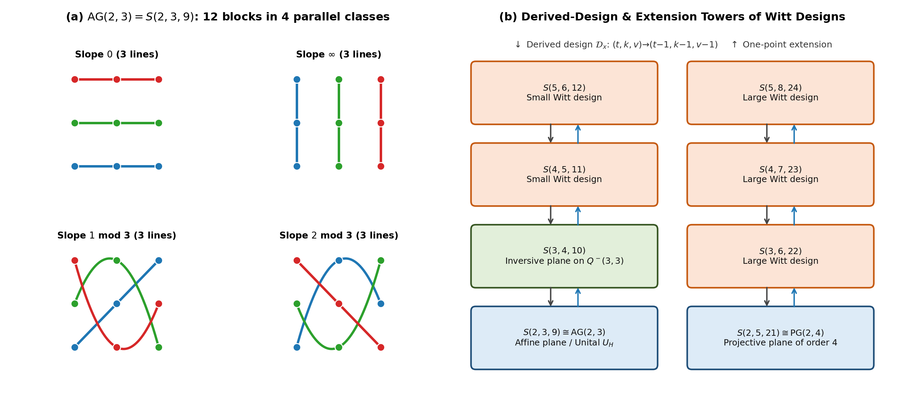

*Figure 8. (a) The $12$ blocks of $\mathrm{AG}(2, 3) = S(2, 3, 9)$ on a $3 \times 3$ array of points, in four parallel classes of three disjoint lines (slopes $0$, $\infty$, $1$ and $2$ mod $3$); colours tell apart the lines within a class. (b) The two towers of Witt designs: a downward arrow takes a derived design, from $(t, k, v)$ to $(t - 1, k - 1, v - 1)$, and an upward arrow is a one-point extension.*

---

### Generalized quadrangles

In a projective plane, every point $x$ outside a line $L$ is collinear with *all* points of $L$, so triangles are everywhere. What happens if we forbid triangles completely by swinging to the opposite extreme: every point $x$ outside a line $L$ is collinear with *precisely one* point of $L$?

#### Definition and why both axioms matter

A partial linear space $\mathcal{S} = (\mathcal{P}, \mathcal{L}, \mathrm{I})$ is called a **generalized quadrangle** (abbreviated **GQ**) if:

1. There exist two lines that have no points in common (disjoint lines exist).
2. For every anti-flag $(x, L)$ (a point $x$ not on a line $L$), there exists a *unique* point $y$ on $L$ collinear with $x$.

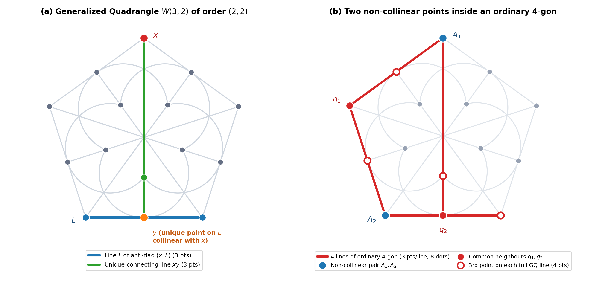

*Figure 9. The generalized quadrangle $W(3, 2)$, the doily: $15$ points and $15$ lines of $3$ points (five sides, five lines through the centre and five arcs; the centre is not a point). (a) For the anti-flag $(x, L)$, $y$ is the unique point of $L$ collinear with $x$. (b) Two noncollinear points $A_1, A_2$ and two of their common neighbours $q_1, q_2$ form an ordinary $4$-gon; the hollow rings mark the third point on each of its four lines.*

Look closely at what these two axioms accomplish together:

- **No triangles can exist.** Suppose $x, y_1, y_2$ formed three mutually noncollinear-line vertices of a triangle (with $x$ off the line $L = y_1 y_2$, joined by distinct lines $x y_1$ and $x y_2$ to two points of $L$). That would give *two* points on $L$ collinear with $x$, violating Axiom 2. Instead, the smallest closed circuits of lines are $4$-sided quadrangles (as in panel (b) of Figure 9), which is why Tits named these geometries *generalized quadrangles*.
- **Why do we need Axiom 1 (two disjoint lines exist)?** Suppose $\mathcal{S}$ consisted of a single line $L$ (no anti-flags at all, so Axiom 2 holds vacuously), or suppose $\mathcal{S}$ were a tree-like star of lines all meeting at one central hub point $p$ with no thin cross-lines (for any $x \neq p$ and any line $L \not\ni x$, $p \in L$ is the unique point on $L$ collinear with $x$, and $p$ lies on *every* line so $(p, L)$ is never an anti-flag). Axiom 1 rules out these degenerate "pencil" configurations cleanly.
- **Automatic self-duality of the class:** Let us check why **the point-line dual $\mathcal{S}^D$ of any GQ $\mathcal{S}$ is again a GQ**. First, does every point $x$ of $\mathcal{S}$ lie on at least two lines (so $\mathcal{S}^D$ is well-defined)? By Axiom 1, there exist two disjoint lines $L_1$ and $L_2$; since $L_1 \cap L_2 = \emptyset$, $x$ misses at least one of them, so Axiom 2 gives at least one line through $x$. Suppose for contradiction that $x$ lay on only one line $M$. Because $M$ must intersect any line missing $x$ (by Axiom 2), if $x \in L_1$ then $L_1 = M$, which would intersect $L_2$, impossible. Thus $x$ lies on neither $L_1$ nor $L_2$, and $M$ intersects $L_1$ at a unique point $y$ and $L_2$ at a unique point $z$ ($y \neq z$ since $L_1 \cap L_2 = \emptyset$). Because $L_1$ has at least two points, pick $y' \in L_1 \setminus \{y\}$. By Axiom 2 applied to $(y', L_2)$, some line $N$ connects $y'$ to a point $w \in L_2$. Then $(x, N)$ is an anti-flag (as $y' \notin M$), so $M$ must intersect $N$ at some point collinear with $y'$, which can only be $y$ (by Axiom 2 on $(y', M)$). That forces $y, y' \in L_1 \cap N$ with $y \neq y'$, so $N = L_1$, contradicting $w \in N \cap L_2$ with $L_1 \cap L_2 = \emptyset$. Hence **every point of a GQ lies on at least two lines**. Swapping points and lines turns two noncollinear points (any $p \in L_1$ has a noncollinear point on $L_2$) into two disjoint lines and preserves Axiom 2 on every anti-flag $(L, x)$, so $\mathcal{S}^D$ is always a GQ.

#### Orders and parameter restrictions for generalized quadrangles

Does every generalized quadrangle have a uniform order $(s, t)$ i.e. do every point and every line follow the same counts? Almost. Here is how the whole family of generalized quadrangles breaks down:

**Thick generalized quadrangles ($s \ge 2$ and $t \ge 2$):** In these geometries, every line has at least 3 points, and every point has at least 3 lines passing through it. A standard theorem of incidence geometry proves that in any thick generalized quadrangle, every line is forced to have the exact same number of points $s + 1$, and every point is forced to lie on the exact same number of lines $t + 1$. Thus, every thick generalized quadrangle has a uniform order $(s, t)$ with $s, t \ge 2$. (For example, the symplectic space $W(3, q)$ has order $(q, q)$, and the elliptic quadric $Q^-(5, q)$ has order $(q, q^2)$.)

**Thin generalized quadrangles (where $t = 1$ or $s = 1$):** One can prove that any generalized quadrangle with $t = 1$ (i.e. it has 2 lines through every point) must be an $(n_1 \times n_2)$-grid (where the points are where rows and columns meet and so have only 2 lines through them), and any generalized quadrangle with $s = 1$ (i.e. any line has 2 points) must be a dual grid $K_{n_1, n_2}$ (i.e. a bipartite graph).

Within these grids and dual grids, there are two subcases. If $n_1 = n_2$ (symmetrical), then all lines have the same size AND all points lie on the same number of lines. So symmetrical grids have a valid order $(s, 1)$ (where $s = n_1 - 1$), and symmetrical dual grids have a valid order $(1, t)$ (where $t = n_1 - 1$).

But if $n_1 \neq n_2$ (nonsymmetrical), then in a nonsymmetrical grid, rows have size $n_2$ and columns have size $n_1$, so there is no single number $s$ for all lines (even though $t = 1$). Dually, in a nonsymmetrical dual grid, points have either $n_1$ or $n_2$ lines through them, so there is no single number $t$ for all points (even though $s = 1$).

When $\mathcal{S}$ is a *finite* generalized quadrangle of order $(s, t)$, two powerful arithmetic restrictions govern $(s, t)$:

**Divisibility condition:** $(s + t)$ must divide $st(s + 1)(t + 1)$.

**Higman's inequalities:** If $s \ge 2$ and $t \ge 2$ (both points and lines are thick), then neither parameter can exceed the square of the other:

$$s \le t^2 \qquad \text{and} \qquad t \le s^2.$$

**Worked test on concrete parameters:**

Take $s = 2, t = 2$ (the "doily" $W(3, 2)$ drawn in Figure 9, with $15$ points and $15$ lines of $3$ points each): $s + t = 4$, and $st(s+1)(t+1) = 4 \cdot 3 \cdot 3 = 36$, which is divisible by $4$ ($36 / 4 = 9$); and $2 \le 2^2 = 4$ satisfies Higman's bound.

What if someone asks whether a thick GQ of order $(s, t) = (2, 5)$ can exist? $s + t = 7$ fails to divide $10 \cdot 3 \cdot 6 = 180$, but a quicker way is Higman's inequality which kills it at a glance: $t = 5 > 2^2 = s^2$, impossible. What about $(s, t) = (2, 3)$? It satisfies Higman's inequality ($3 \le 4$), *but* $s + t = 5$ does not divide $st(s+1)(t+1) = 6 \cdot 3 \cdot 4 = 72$. Thus **no generalized quadrangle of order $(2, 3)$ can exist**, jumping straight from $(2, 2)$ to $(2, 4)$ (where $2 + 4 = 6$ divides $8 \cdot 3 \cdot 5 = 120$, and indeed a classical GQ $Q^-(5, 2)$ of order $(2, 4)$ exists).

---

### Generalized polygons at a glance

Look back at two geometries we have already met. In a **projective plane**, there are no $2$-gons (any two points determine *at most* one line), ordinary $3$-gons (triangles) exist, and *any two elements* (two points, two lines, or a point and a line) can be placed inside an ordinary $3$-gon subgeometry.

In a **generalized quadrangle**, there are no $2$-gons and no $3$-gons, ordinary $4$-gons exist, and *any two elements* can be placed inside an ordinary $4$-gon subgeometry (as we saw in panel (b) of Figure 9).

In 1959, Jacques Tits noticed that this pattern defines an infinite hierarchy of rank-$2$ building blocks for simple groups, one for each polygon number $n \ge 2$.

#### Definition via ordinary $n$-gon subgeometries

For any integer $n \ge 3$, a **generalized $n$-gon** is a partial linear space $\mathcal{S} = (\mathcal{P}, \mathcal{L}, \mathrm{I})$ satisfying three axioms:

**No smaller polygons:** $\mathcal{S}$ contains **no** subgeometries that are ordinary $m$-gons for any $m \in \{3, 4, \dots, n - 1\}$.

**Existence of $n$-gons:** $\mathcal{S}$ contains subgeometries that are ordinary $n$-gons.

**Every pair lies in an $n$-gon ("apartment" property):** For *any* two elements $\{A_1, A_2\} \subseteq \mathcal{P} \cup \mathcal{L}$ (two points, two lines, or one point and one line), there exists a subgeometry $\mathcal{S}' = (\mathcal{P}', \mathcal{L}', \mathrm{I}')$ of $\mathcal{S}$ isomorphic to an ordinary $n$-gon that contains both $A_1$ and $A_2$ ($\{A_1, A_2\} \subseteq \mathcal{P}' \cup \mathcal{L}'$).

Combining this with [generalized $2$-gons](#classes-of-point-line-geometries) (generalized digons, where $|\mathcal{P}|, |\mathcal{L}| \ge 2$ and $\mathrm{I} = \mathcal{P} \times \mathcal{L}$), a point-line geometry is called a **generalized polygon** if it is a generalized $n$-gon for some $n \ge 2$.

Several immediate consequences and structural connections follow right from the axioms:

**Self-duality of the class:** Because ordinary $m$-gons are self-dual and $\{A_1, A_2\} \subseteq \mathcal{P} \cup \mathcal{L}$ treats points and lines completely symmetrically, **the point-line dual of any generalized $n$-gon is again a generalized $n$-gon**.

**Thin examples for every $n \ge 3$:** Every ordinary $n$-gon ($n \ge 3$) is trivially a generalized $n$-gon of order $(s, t) = (1, 1)$.

**Small values of $n$:**
The **generalized $3$-gons** are precisely the **possibly degenerate projective planes** (both nondegenerate projective planes and near-pencils). Why is a near-pencil on $4$ points a generalized $3$-gon? It contains no $m$-gons for $m < 3$ (it is a partial linear space), it contains ordinary triangles ($p$, $x_1$, $x_2$), and any two elements (say two points $x_1, x_2$ on the long line, plus the apex $p$) sit inside a triangle $\{p, x_1, x_2\}$. Notice, however, that a near-pencil on $\ge 4$ points does *not* have a uniform order $(s, t)$ because its lines have mixed sizes $n - 1$ and $2$.

The **generalized $4$-gons** are precisely the **generalized quadrangles**.

**Diameter, near $n$-gons, and doubles:** Every generalized $n$-gon ($n \ge 2$) has diameter $\lfloor n / 2 \rfloor$ (just like walking halfway around an ordinary $n$-gon from one vertex to an opposite vertex).

A connected partial linear space of diameter $d$ is called a **near $2d$-gon** if for every point $p$ and every line $L$, there is a *unique* point on $L$ nearest to $p$. It is called a **near $(2d + 1)$-gon** ($d \ge 1$) if for every $(p, L)$ at distance $d(p, L) \le d - 1$ there is a unique point on $L$ nearest to $p$, while at least one pair $(p', L')$ achieves $d(p', L') = d$ (all points on $L'$ tied at maximal distance $d$ from $p'$, like a vertex opposite the base of a triangle or pentagon). Every generalized $n$-gon ($n \ge 3$) is a near $n$-gon.

Doubling an ordinary $n$-gon subdivides each of its $n$ edges into two, turning it into an ordinary $2n$-gon, and in general, the double of any generalized $n$-gon ($n \ge 2$) is a generalized $2n$-gon (whose lines are all thin, $s = 1$).

#### The Feit–Higman theorem and order bounds

If ordinary thin $n$-gons ($s = t = 1$) exist for *every* $n \ge 3$, you might naturally expect thick finite generalized $n$-gons ($s, t \ge 2$), say thick generalized pentagons ($n = 5$) or heptagons ($n = 7$), to exist as well. One of the biggest shocks in twentieth-century combinatorics, proved by Walter Feit and Graham Higman in 1964 using matrix eigenvalues of the incidence graph, is that almost all values of $n$ are completely forbidden.

**Feit–Higman Theorem.** Let $\mathcal{S}$ be a *finite* generalized $n$-gon ($n \ge 3$) of order $(s, t)$. Then at least one of the following six cases holds:

- $\mathcal{S}$ is an [ordinary $n$-gon](#classes-of-point-line-geometries), with $s = t = 1$ (any $n \ge 3$).
- $\mathcal{S}$ is a [nondegenerate projective plane](#projective-planes-degenerate-vs-nondegenerate) ($n = 3$), with $s = t \ge 2$.
- $\mathcal{S}$ is a **generalized quadrangle** ($n = 4$).
- $\mathcal{S}$ is a **generalized hexagon** ($n = 6$); moreover, if $s \neq 1$ and $t \neq 1$, then $st$ must be a perfect square.
- $\mathcal{S}$ is a **generalized octagon** ($n = 8$); moreover, if $s \neq 1$ and $t \neq 1$, then $2st$ must be a perfect square.
- $\mathcal{S}$ is a **generalized dodecagon** ($n = 12$), in which case *either $s = 1$ or $t = 1$* (it is thin).

**Unpacking the implications.** For $n \ge 3$, thick finite generalized $n$-gons ($s \ge 2$ and $t \ge 2$) can ONLY exist for $n \in \{3, 4, 6, 8\}$. Not a single finite thick generalized pentagon ($5$), heptagon ($7$), nonagon ($9$), decagon ($10$), or even dodecagon ($12$) can ever exist.

Where do the "semithin" generalized dodecagons ($n = 12$ with $s = 1$ or $t = 1$) come from? Remember the double of a point-line geometry. Take any thick finite generalized hexagon ($n = 6$) of order $(q, q)$ (such as the split Cayley hexagon of order $(2, 2)$). Its double is a generalized $2 \times 6 = 12$-gon. In that double, every line is a flag $\{x, L\}$ of size $2$ (so $s + 1 = 2 \implies s = 1$), while every point (coming from an original point or line of the hexagon, each incident with $q + 1$ flags) lies on $t + 1 = q + 1$ lines (so $t = q \ge 2$). Taking its point-line dual swaps $(1, q)$ to $(q, 1)$.

Similarly, doubling a projective plane of order $q$ ($n = 3$) produces a generalized $6$-gon of order $(1, q)$, and doubling a GQ of order $(q, q)$ ($n = 4$) produces a generalized $8$-gon of order $(1, q)$, which explains why the arithmetic conditions "$st$ is a square" ($n = 6$) and "$2st$ is a square" ($n = 8$) explicitly include the hypothesis $s \neq 1 \neq t$. For example, projective planes exist for prime powers, and since $s=1$ for the hexagon we get from doubling it, $q$ must be square but that's impossible for a prime number.

There is a parity constraint on $n = 8$. Because $2st$ must be a perfect square in any thick finite generalized octagon ($s, t \ge 2$), $st$ cannot be odd (twice an odd number is never a square), nor can $s = t$. Unlike projective planes, quadrangles, and hexagons, which all admit thick examples with $s = t = q$, **no finite thick generalized octagon can ever have $s = t$** (for example, the classical Ree–Tits octagons have order $(q, q^2)$ with $q = 2^{2e+1}$ an odd power of $2$, making $2st = 2 q^3 = (2^{3e+2})^2$ a perfect square).

Finally, for every thick finite generalized $2n$-gon (so $s \ge 2, t \ge 2$, and by Feit–Higman $2n \in \{4, 6, 8\}$, meaning $n \in \{2, 3, 4\}$), the parameters $s$ and $t$ cannot be too lopsided:

| Thick Finite Generalized $2n$-Gon ($s, t \ge 2$) | Polygon Type | Arithmetic Square Rule | Mutual Bounds Between $s$ and $t$ | Attribution |
| :--- | :--- | :--- | :--- | :--- |
| $n = 2$ ($2n = 4$) | Generalized quadrangle | none (instead $(s+t) \mid st(s+1)(t+1)$) | $s \le t^2$ and $t \le s^2$ | Higman's bounds |
| $n = 3$ ($2n = 6$) | Generalized hexagon | $st$ is a square | $s \le t^3$ and $t \le s^3$ | Haemers–Roos inequalities |
| $n = 4$ ($2n = 8$) | Generalized octagon | $2st$ is a square | $s \le t^2$ and $t \le s^2$ | Higman's bounds |

## Strongly Regular and Distance-Regular Graphs

Whenever a finite point-line geometry has uniform incidence rules, such as a generalized quadrangle of order $(s, t)$ or a partial geometry, its collinearity graph inherits strict local symmetry. Once we record that graph in its symmetric adjacency matrix $A$, linear algebra gives us three strict feasibility tests that any real geometry must pass.

First, eigenvalue multiplicities count the dimensions of real eigenspaces, so those formulas must work out to nonnegative integers. Second, projecting the vertices onto a unit sphere inside one of those eigenspaces puts a ceiling, called the absolute bound, on how many vertices can fit when only two pairwise angles are allowed. Third, the Krein parameters, which track what happens when we multiply two eigenspace projection matrices entry by entry, can never be negative.

### Basic properties and examples of strongly regular graphs

Regularity says every single vertex sees the same number of neighbours $k$. R. C. Bose strengthened this one step further by asking every *pair* of vertices to see a predictable number of common neighbours, depending only on whether the pair is joined by an edge or not. Then we get Strongly Regular Graphs.

#### Definition, parameters, and the double-counting equation

Recall from [the adjacency matrix and its eigenvalues](#the-adjacency-matrix-and-its-eigenvalues) that a finite graph $\Gamma = (V, E)$, neither empty nor complete, is strongly regular with parameters $(v, k, \lambda, \mu)$, written $\mathrm{SRG}(v, k, \lambda, \mu)$, when it has $v$ vertices, every vertex has $k$ neighbours (the valency), any two adjacent vertices have $\lambda$ common neighbours, and any two distinct nonadjacent vertices have $\mu$ common neighbours.

Note that when $\mu > 0$, any two distinct nonadjacent vertices have a common neighbour, so the diameter is $2$. This holds for every primitive (nondegenerate) strongly regular graph, defined below. It fails only when $\mu = 0$, where, as we will see next, the graph falls apart into disjoint complete graphs.
<!-- terms checked: primitive; Krein parameters; orbitals -->

Why do we exclude empty graphs and complete graphs from the definition? In an empty graph there are no edges, so there are no adjacent pairs of vertices to test, and any number $\lambda$ at all would satisfy the third rule by default. In a complete graph $K_v$ every pair of distinct vertices is adjacent, leaving no nonadjacent pairs to pin down $\mu$. Requiring $\Gamma$ to be neither empty nor complete guarantees $k > 0$ (each vertex has at least one neighbour) and $v > k + 1$ (each vertex $x$ has at least one non-neighbour $z \neq x$).

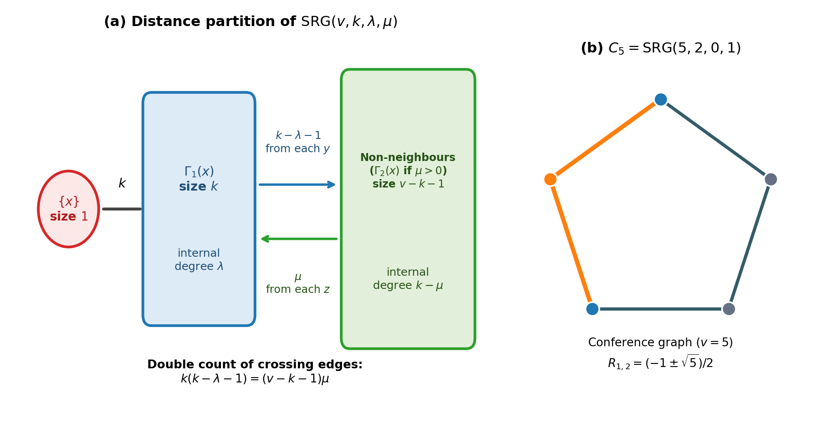

*Figure 10. (a) The distance partition of an $\mathrm{SRG}(v, k, \lambda, \mu)$ around a vertex $x$: each neighbour $y$ sends $k - \lambda - 1$ edges to the non-neighbours, and each non-neighbour $z$ receives $\mu$ edges from the neighbours, so $k(k - \lambda - 1) = (v - k - 1)\mu$. (b) The pentagon $C_5 = \mathrm{SRG}(5, 2, 0, 1)$, a conference graph with eigenvalues $(-1 \pm \sqrt{5})/2$: the orange vertex is joined by the orange edges to its two neighbours (blue), and the two grey vertices are its non-neighbours.*

The four numbers $(v, k, \lambda, \mu)$ cannot be chosen freely. They are tied together by a basic double count around a single vertex.

**Parameter relation for strongly regular graphs.** If $\Gamma$ is an $\mathrm{SRG}(v, k, \lambda, \mu)$, then $k - \lambda - 1 \ge 0$, $v - k - 1 \ge 0$, and

$$k(k - \lambda - 1) = (v - k - 1)\mu.$$

Look at Figure 10(a) to read this equation straight off the diagram. Fix one base vertex $x \in V$ and split the vertex set into three boxes: $\{x\}$ itself ($1$ vertex), the neighbour box $\Gamma_1(x)$ ($k$ vertices), and the non-neighbour box $V \setminus (\{x\} \cup \Gamma_1(x))$ ($v - k - 1 \ge 0$ vertices; when $\mu > 0$, so that $\Gamma$ is connected, this third box is the distance-$2$ sphere $\Gamma_2(x)$). Now count the number $N$ of edges crossing between the neighbour box and the non-neighbour box, meaning pairs $(y, z)$ with $y \in \Gamma_1(x)$, $z \notin \{x\} \cup \Gamma_1(x)$, and $y \sim z$.

Counting from the neighbour box outward, there are $k$ choices for $y \in \Gamma_1(x)$. Since $y$ has valency $k$, it sends $k$ edges out in total: $1$ edge goes back to $x$, and $\lambda$ edges stay inside $\Gamma_1(x)$ because $x$ and $y$ are adjacent and share $\lambda$ common neighbours. The remaining $k - \lambda - 1$ edges from $y$ must cross into the non-neighbour box (which also shows $k - \lambda - 1 \ge 0$), giving $N = k(k - \lambda - 1)$.

Counting from the non-neighbour box inward, there are $v - k - 1$ choices for a vertex $z$ not adjacent to $x$. Because $z$ and $x$ are distinct and nonadjacent, they share $\mu$ common neighbours, which are precisely the $\mu$ vertices $y \in \Gamma_1(x)$ joined to $z$. That gives $N = (v - k - 1)\mu$, and equating the two counts proves $k(k - \lambda - 1) = (v - k - 1)\mu$.

#### Disconnected graphs, complements, and primitive versus imprimitive graphs

Two boundary families (which happen to be complements of each other) show what happens when $\mu$ hits the bottom or top of its possible range, $0 \le \mu \le k$.

First, take $r \ge 2$ separate complete graphs $K_m$ on $m \ge 2$ vertices, with no edges between different copies. This disconnected graph is strongly regular with parameters $(v, k, \lambda, \mu) = (rm, m - 1, m - 2, 0)$: each vertex is joined to the other $m - 1$ vertices in its own clique, two vertices in the same clique share the remaining $m - 2$ vertices of that clique, and two vertices in different cliques share $\mu = 0$ common neighbours. In fact, these are the *only* disconnected strongly regular graphs.

**Characterization of disconnected strongly regular graphs.** For any $\mathrm{SRG}(v, k, \lambda, \mu)$, we have $k \ge \lambda + 1$, and four statements are equivalent: $\Gamma$ is the disjoint union of $r$ complete graphs on $m$ vertices for some $r, m \ge 2$; $k = \lambda + 1$; $\mu = 0$; and $\Gamma$ is not connected.

The first two are equivalent because each component is complete, so it has a valency that is one greater than the number of mutual neighbours that it shares with each neighbour. Note that completeness means there are no non-adjacent vertices. Strictly speaking, the definition of a strongly regular graph $\mathrm{SRG}(v, k, \lambda, \mu)$ excludes complete graphs. A disjoint union of complete graphs, however, does have nonadjacent vertices, with no mutual neighbours between them, which allows us to set $\mu = 0$.

Let us verify that the four conditions are equivalent, using the algebraic conditions as well. Disjoint copies of $K_m$ are clearly disconnected, and in any disconnected SRG, picking two vertices from different components forces $\mu = 0$. Since $k > 0$ and $v - k - 1 > 0$ in $k(k - \lambda - 1) = (v - k - 1)\mu$, having $\mu = 0$ on the right is equivalent to having $k = \lambda + 1$ on the left. Finally, suppose $k = \lambda + 1$. Whenever $x$ and $y$ are adjacent, one of $x$'s $k$ neighbours is $y$, and all $k - 1 = \lambda$ remaining neighbours of $x$ must also be neighbours of $y$. That makes the relation "$x = y$ or $x \sim y$" transitive, so it is an equivalence relation on $V$. Each equivalence class is a complete graph of size $m = k + 1 \ge 2$ with no edges to any other class, partitioning $\Gamma$ into $r = \frac{v}{k + 1} \ge 2$ disjoint complete graphs.

**Complement of a strongly regular graph.** What happens when we pass from $\Gamma$ to its complement $\overline{\Gamma}$? Because $\Gamma$ is neither empty nor complete, $\overline{\Gamma}$ is neither complete nor empty, and flipping edges and non-edges preserves strong regularity. If $\Gamma$ is an $\mathrm{SRG}(v, k, \lambda, \mu)$, then its complement $\overline{\Gamma}$ is an $\mathrm{SRG}(\bar{v}, \bar{k}, \bar{\lambda}, \bar{\mu})$ with

$$\bar{v} = v, \quad \bar{k} = v - k - 1,$$

$$\bar{\lambda} = v - 2k + \mu - 2, \quad \bar{\mu} = v - 2k + \lambda.$$

Each of these four formulas comes from counting in $\Gamma$. The vertex count stays $\bar{v} = v$, and each vertex $x$ is nonadjacent in $\Gamma$ to $\bar{k} = v - k - 1$ other vertices. To find $\bar{\lambda}$, pick two vertices $x$ and $y$ that are adjacent in $\overline{\Gamma}$, meaning $x \nsim y$ in $\Gamma$. Their common neighbours in $\overline{\Gamma}$ are the vertices distinct from $x$ and $y$ that are adjacent to *neither* $x$ nor $y$ in $\Gamma$. In $\Gamma$, $\mu$ vertices are adjacent to both $x$ and $y$, leaving $k - \mu$ adjacent only to $x$ and $k - \mu$ adjacent only to $y$; subtracting $(2k - 2\mu) + \mu = 2k - \mu$ from the $v - 2$ vertices other than $x$ and $y$ gives $\bar{\lambda} = v - 2k + \mu - 2$. To find $\bar{\mu}$, pick $x$ and $y$ that are nonadjacent in $\overline{\Gamma}$, meaning $x \sim y$ in $\Gamma$. Now $\lambda$ vertices are adjacent to both in $\Gamma$, while $2k - 2\lambda$ vertices (a count that already includes $x$ and $y$ themselves, since each is adjacent to the other) are adjacent to just one of $x, y$. Subtracting $(2k - 2\lambda) + \lambda = 2k - \lambda$ from all $v$ vertices leaves $\bar{\mu} = v - 2k + \lambda$ vertices nonadjacent to both in $\Gamma$.

Applying this complement formula to $r \ge 2$ disjoint copies of $K_m$ ($m \ge 2$, parameters $(rm, m - 1, m - 2, 0)$) produces the complete $r$-partite graph with $r$ parts of size $m$, which is an SRG with parameters

$$(\bar{v}, \bar{k}, \bar{\lambda}, \bar{\mu}) = \bigl(rm,\; (r - 1)m,\; (r - 2)m,\; (r - 1)m\bigr).$$

Notice that here $\bar{\mu} = \bar{k} = (r - 1)m$. That characterizes complete multipartite SRGs in general.

**Characterization of complete multipartite strongly regular graphs.** Every $\mathrm{SRG}(v, k, \lambda, \mu)$ satisfies $\mu \le k$, with equality $\mu = k$ if and only if $\Gamma$ is a complete multipartite graph.

Why? If $x$ and $y$ are distinct nonadjacent vertices, their common neighbours $\Gamma_1(x) \cap \Gamma_1(y)$ form a subset of $\Gamma_1(x)$, so $\mu \le k$. In a complete multipartite graph with $r$ parts of size $m$, two nonadjacent vertices sit in the same part and are both joined to all $(r - 1)m$ vertices outside their part, giving $\mu = k = (r - 1)m$. Conversely, suppose $\mu = k$ (since $k > 0$, we have $\mu > 0$, so $\Gamma$ is connected). Whenever two distinct vertices $x$ and $y$ are nonadjacent, they lie at distance $2$ and share all $k$ of each other's neighbours ($\Gamma_1(x) = \Gamma_1(y)$). Having the exact same neighbour set makes "equal or nonadjacent" an equivalence relation on $V$, whose equivalence classes are independent parts with every cross-pair joined by an edge, so $\Gamma$ is complete multipartite.

In both of these boundary families, either $\Gamma$ itself ($\mu = 0$) or its complement $\overline{\Gamma}$ ($\mu = k$, which gives $\bar{\mu} = 0$) falls apart into disconnected complete graphs. To separate genuine strongly regular graphs from those two families, we call a strongly regular graph $\Gamma$ **primitive** (or **nontrivial**) if neither $\Gamma$ nor $\overline{\Gamma}$ is a disjoint union of complete graphs, and **imprimitive** (or **trivial**) otherwise. In parameter terms, $\Gamma$ is primitive precisely when $0 < \mu < k$, in which case both $\Gamma$ and $\overline{\Gamma}$ are connected graphs of diameter $2$.

#### Four classic families of strongly regular graphs

**The pentagon $C_5$.** Shown in Figure 10(b), an ordinary $5$-cycle is an $\mathrm{SRG}(5, 2, 0, 1)$. Each of its $5$ vertices has $k = 2$ neighbours, adjacent vertices share $\lambda = 0$ common neighbours because a $5$-cycle contains no triangles, and any two nonadjacent vertices sit $2$ steps apart along the cycle and share $\mu = 1$ common neighbour. You can check $k(k - \lambda - 1) = 2(1) = 2 = (5 - 2 - 1)(1)$. Plugging $(5, 2, 0, 1)$ into the complement formula returns $(5, 2, 0, 1)$: the non-edges of a pentagon form the inner $5$-pointed star (a pentagram), which is another $5$-cycle, so $C_5$ is self-complementary and primitive.

Note that the pentagon $C_5$ and its complement (the inner $5$-pointed star) are isomorphic, which is the exact definition of a graph being self-complementary.

To see the isomorphism explicitly, label the vertices around the outer pentagon in order as $0, 1, 2, 3, 4 \pmod 5$: $0 \sim 1 \sim 2 \sim 3 \sim 4 \sim 0$.

In the complement $\overline{C_5}$ (the $5$-pointed star), the edges connect vertices that were not connected in the pentagon, namely vertices at step $2$: $0 \sim 2 \sim 4 \sim 1 \sim 3 \sim 0$.

Both graphs are single closed loops of $5$ vertices. If we apply the permutation $x \mapsto 2x \pmod 5$ to the vertex labels (sending $0 \mapsto 0$, $1 \mapsto 2$, $2 \mapsto 4$, $3 \mapsto 1$, $4 \mapsto 3$), the outer cycle $0 \sim 1 \sim 2 \sim 3 \sim 4 \sim 0$ maps directly onto the star cycle $0 \sim 2 \sim 4 \sim 1 \sim 3 \sim 0$.

**Triangular graphs $T(m)$ ($m \ge 4$).** Fix an $m$-element set $\{1, 2, \dots, m\}$. The **triangular graph** $T(m)$ takes all $\binom{m}{2} = \frac{m(m - 1)}{2}$ two-element subsets of $\{1, \dots, m\}$ as its vertices, with an edge joining two distinct $2$-subsets whenever they intersect (share $1$ element). For every $m \ge 4$, $T(m)$ is strongly regular with parameters

$$(v, k, \lambda, \mu) = \left(\frac{m(m - 1)}{2},\; 2(m - 2),\; m - 2,\; 4\right).$$

We can verify each count on concrete subsets. Fix $\{1, 2\}$: a $2$-subset overlapping $\{1, 2\}$ in one element chooses either $1$ or $2$ ($2$ choices) and pairs it with one of the remaining $m - 2$ elements $\{3, \dots, m\}$, giving $k = 2(m - 2)$. For two adjacent vertices like $\{1, 2\}$ and $\{1, 3\}$, a common neighbour either contains $1$ ($\{1, j\}$ for any of the $m - 3$ elements $j \in \{4, \dots, m\}$) or avoids $1$ while meeting both ($\{2, 3\}$ alone), giving $\lambda = (m - 3) + 1 = m - 2$. For two nonadjacent (disjoint) vertices like $\{1, 2\}$ and $\{3, 4\}$, a common neighbour must pick one element from $\{1, 2\}$ and one from $\{3, 4\}$, giving $\mu = 2 \times 2 = 4$ for every $m \ge 4$.

Notice what happens at $m = 4$: $T(4)$ has parameters $(6, 4, 2, 4)$ with $\mu = k = 4$. Among $2$-subsets of $\{1, 2, 3, 4\}$, each pair has only one disjoint partner ($\{1, 2\}$ opposite $\{3, 4\}$, $\{1, 3\}$ opposite $\{2, 4\}$, and $\{1, 4\}$ opposite $\{2, 3\}$). They do not share an edge, whereas each item of a pair shares an edge with every other item in each pair. So $T(4)$ is the imprimitive complete $3$-partite graph with $r = 3$ parts of size $2$ (the octahedron graph: its $6$ vertices and $12$ edges are the vertices and edges of the octahedron, the solid with $8$ triangular faces). For all $m \ge 5$, $k = 2(m - 2) > 4 = \mu$, so $T(m)$ is primitive.

**The Petersen graph $\overline{T(5)}$.** At $m = 5$, $T(5)$ has parameters $(10, 6, 3, 4)$. Its complement $\overline{T(5)}$ is the [Petersen graph](#the-petersen-graph-as-a-packing-puzzle) of Figure 2: its $10$ vertices are the $2$-subsets of $\{1, 2, 3, 4, 5\}$, joined by an edge whenever two $2$-subsets are *disjoint*. Feeding $(10, 6, 3, 4)$ into the complement formula gives $\bar{v} = 10$, $\bar{k} = 10 - 6 - 1 = 3$, $\bar{\lambda} = 10 - 12 + 4 - 2 = 0$, and $\bar{\mu} = 10 - 12 + 3 = 1$, so the Petersen graph is an $\mathrm{SRG}(10, 3, 0, 1)$.

Both $\bar{\lambda} = 0$ and $\bar{\mu} = 1$ are immediate on subsets of $\{1, 2, 3, 4, 5\}$: if two pairs like $\{1, 2\}$ and $\{3, 4\}$ are disjoint (adjacent in Petersen), only element $5$ remains outside them, so no $2$-subset can be disjoint from both ($\bar{\lambda} = 0$); if two pairs like $\{1, 2\}$ and $\{1, 3\}$ overlap (nonadjacent in Petersen), $\{4, 5\}$ is the unique $2$-subset disjoint from both ($\bar{\mu} = 1$).

**Square lattice graphs $L_2(n)$ ($n \ge 2$).** The collinearity graph of a symmetrical $(n \times n)$-grid is called a **square lattice graph** and denoted by **$L_2(n)$**. Its $v = n^2$ vertices are the grid points $(i, j)$ in an $n \times n$ array, joined when they share a row or a column. Each point shares its row with $n - 1$ other points and its column with $n - 1$ other points, giving $k = 2n - 2$. Two points in the same row share only the remaining $\lambda = n - 2$ points of that row. Two points $(i_1, j_1)$ and $(i_2, j_2)$ in different rows and different columns share $\mu = 2$ common neighbours, namely the other two corners $(i_1, j_2)$ and $(i_2, j_1)$ of the rectangle they determine. Thus $L_2(n)$ is an $\mathrm{SRG}(n^2, 2n - 2, n - 2, 2)$ (imprimitive $C_4 \cong K_{2, 2}$ when $n = 2$, and primitive for all $n \ge 3$).

### The adjacency matrix of a strongly regular graph

The adjacency matrix $A$ is our main item of interest. When $\Gamma$ is regular with valency $k$, every row of $A$ contains $k$ ones and $v - k$ zeros, so every row adds up to $k$. As we saw in [the adjacency matrix and its eigenvalues](#the-adjacency-matrix-and-its-eigenvalues), $k$ is an eigenvalue, and its multiplicity is the number of connected components; in particular, when $\Gamma$ is connected, $k$ has multiplicity $1$. Every eigenvalue $\theta$ satisfies $|\theta| \leq k$. If $\Gamma$ is bipartite, its eigenvalues come in pairs $\theta, -\theta$, so $-k$ is an eigenvalue too.

Now let $\Gamma = (V, E)$ be an $\mathrm{SRG}(v, k, \lambda, \mu)$, fix an ordering $(p_1, \dots, p_v)$ of its vertices with adjacency matrix $A$, and write $I$ for the $v \times v$ identity matrix and $J$ for the $v \times v$ all-ones matrix.

#### Eigenvalues of J and the quadratic equation for A

If a graph is connected, regular, and has 3 distinct eigenvalues, it is guaranteed to be an SRG; we prove this converse [below](#the-three-eigenvalue-converse-and-the-bose-mesner-algebra), once the eigenvalues of an SRG are in hand.

If we forget the regular condition however, a non-regular graph can have 3 distinct eigenvalues without being an SRG. For example, the complete bipartite graph $K_{1, 3}$ (a star with 1 hub and 3 leaves) has the three eigenvalues $\sqrt{3}, 0, -\sqrt{3}$, yet it is not an SRG because it is not regular: the hub has degree $3$ and the leaves have degree $1$, so $\mathbf{j}$ is not even an eigenvector.

First recall the eigenvalues of the all-ones matrix $J$ from [the all-ones matrix and commuting matrices](#the-all-ones-matrix-and-commuting-matrices): the $v \times v$ matrix $J$ has eigenvalue $v$ with multiplicity $1$, on $\mathbf{j}$, and eigenvalue $0$ with multiplicity $v - 1$, on the vectors whose coordinates add up to $0$.

Next, look at what happens when we square the adjacency matrix $A$. For any $i, j \in \{1, \dots, v\}$, the $(i, j)$-entry of $A^2$ is $(A^2)_{ij} = \sum_{l=1}^v A_{il} A_{lj}$. A product $A_{il} A_{lj}$ equals $1$ when $p_l$ is adjacent to both $p_i$ and $p_j$, and $0$ otherwise, so $(A^2)_{ij}$ simply counts the vertices adjacent to both $p_i$ and $p_j$. It is the number of 2-step walks between any two vertices.

Every pair of indices $(i, j)$ falls into one of three disjoint cases. On the main diagonal ($i = j$, marked by $I$), $(A^2)_{ii}$ counts all neighbours of $p_i$, which is $k$. Off the diagonal when $p_i$ and $p_j$ are adjacent ($d(p_i, p_j) = 1$, marked by $A$), $(A^2)_{ij}$ counts their common neighbours, which is $\lambda$. Off the diagonal when $p_i$ and $p_j$ are nonadjacent ($d(p_i, p_j) > 1$, marked by $J - I - A$, the adjacency matrix of $\overline{\Gamma}$, which we get by starting from all pairs ($J$), then taking off each vertex paired with itself ($I$) and all adjacent pairs ($A$)), $(A^2)_{ij}$ counts their common neighbours, which is $\mu$. Putting all three cases together gives one quadratic matrix equation for $A$:

$$A^2 = k I + \lambda A + \mu(J - I - A),$$

which rearranges to

$$A^2 + (\mu - \lambda)A + (\mu - k)I = \mu J.$$

**Getting the eigenvalue spectrum.** That quadratic equation determines the full eigenvalue spectrum of every strongly regular graph, splitting into the disconnected case ($\mu = 0$) and the connected case ($\mu \neq 0$).

**Disconnected case ($\mu = 0$).** When $\mu = 0$, $\Gamma$ is the disjoint union of $r = \frac{v}{k + 1} \ge 2$ complete graphs $K_m$ of size $m = k + 1 \ge 2$. Ordering the vertices one complete graph at a time makes $A$ block-diagonal with $r$ blocks equal to $J_m - I_m$. Since $J_m$ has eigenvalues $m$ (multiplicity $1$) and $0$ (multiplicity $m - 1$), subtracting $I_m$ shifts them to $m - 1 = k$ (multiplicity $1$) and $-1$ (multiplicity $m - 1$). Across all $r$ blocks, $\Gamma$ has two distinct eigenvalues: $k$ with multiplicity $r$, and $-1$ with multiplicity $r(m - 1) = v - r$.

**Connected case ($\mu \neq 0$).** When $\mu \neq 0$, $\Gamma$ has one eigenvalue $k$ that we already know of, whose eigenvector is the all-ones column $\mathbf{j}$. Since the adjacency matrix is symmetric, all eigenvectors will be orthogonal, so the remaining eigenvectors must be orthogonal to $\mathbf{j}$.

For any eigenvector $x$ orthogonal to $\mathbf{j}$, since $\mathbf{j}^T x = 0$, it implies $Jx = 0$. When we apply the SRG matrix equation $A^2 + (\mu - \lambda)A + (\mu - k)I = \mu J$ to the eigenvector $x$, the right-hand side vanishes and the eigenvalue $\theta$ must satisfy the quadratic equation:

$$\theta^2 + (\mu - \lambda)\theta + (\mu - k) = 0$$

We will see that there are two distinct eigenvalues $R_1$ and $R_2$ satisfying this equation.

$$R_1 = \frac{1}{2}\left(\lambda - \mu + \sqrt{(\lambda - \mu)^2 + 4(k - \mu)}\right),$$

$$R_2 = \frac{1}{2}\left(\lambda - \mu - \sqrt{(\lambda - \mu)^2 + 4(k - \mu)}\right).$$

The following relations hold:

$$k > R_1 \ge 0 \quad \text{and} \quad R_2 < -1,$$

with $R_1 = 0$ if and only if $\Gamma$ is a complete multipartite graph ($\mu = k$).

Sum of roots: $R_1 + R_2 = \lambda - \mu$

Product of roots: $R_1 R_2 = \mu - k \implies \mu = k + R_1 R_2$ and $\lambda = k + R_1 + R_2 + R_1 R_2$

The eigenvalue $k$ has multiplicity $1$, while $R_1$ and $R_2$ have positive integer multiplicities

$$M_1 = \frac{(R_2 + 1)k(k - R_2)}{\mu(R_2 - R_1)} > 0,$$

$$M_2 = \frac{(R_1 + 1)k(k - R_1)}{\mu(R_1 - R_2)} > 0.$$

Let us walk through how this connected spectrum comes out of $A^2 + (\mu - \lambda)A + (\mu - k)I = \mu J$. Divide by $\mu$ to write $J = \frac{1}{\mu}\bigl(A^2 + (\mu - \lambda)A + (\mu - k)I\bigr)$. If $\theta_1, \theta_2, \dots, \theta_v$ are the $v$ eigenvalues of $A$ (listed with multiplicity), then applying the polynomial on the right sends each $\theta_i$ to an eigenvalue $\frac{1}{\mu}\bigl(\theta_i^2 + (\mu - \lambda)\theta_i + (\mu - k)\bigr)$ of $J$. We already know the $v$ eigenvalues of $J$: $v$ appears once, and $0$ appears $v - 1$ times. Test the valency $\theta = k$: using $(v - k - 1)\mu = k(k - \lambda - 1)$, we get

$$\begin{aligned}
\frac{1}{\mu}\bigl(k^2 + (\mu - \lambda)k + \mu - k\bigr) &= \frac{k(k - \lambda - 1) + \mu(k + 1)}{\mu} \\
&= (v - k - 1) + k + 1 = v.
\end{aligned}$$

That uses up the single copy of $v$ among the eigenvalues of $J$, so $k$ has multiplicity $1$ as an eigenvalue of $A$. Every other eigenvalue of $A$ must therefore map to the eigenvalue $0$ of $J$, so it has to satisfy $X^2 + (\mu - \lambda)X + (\mu - k) = 0$.

Check the discriminant $D = (\lambda - \mu)^2 + 4(k - \mu)$ of this quadratic. Because $k \ge \mu$, we have $D \ge 0$, and $D$ cannot be $0$ because $D = 0$ would require $\lambda = \mu = k$, contradicting $k \ge \lambda + 1$. So the quadratic has two distinct real roots $R_1 > R_2$ given by the square-root formulas above. Since $R_1 R_2 = \mu - k \le 0$, we have $R_1 \ge 0$, with $R_1 = 0$ precisely when $\lambda \le \mu = k$ (which holds if and only if $\Gamma$ is complete multipartite). Also $R_1 < k$ (either because $\Gamma$ is connected and $k$-regular, or directly because $k > \lambda$ and $\mu > 0$ imply $k - \mu < k(k - \lambda) + k\mu$, which is equivalent to $\sqrt{D} < 2k - \lambda + \mu$). And because $\mu \neq 0$ forces $k > \lambda + 1$, we have $(\lambda - \mu)^2 + 4(k - \mu) > (\lambda - \mu + 2)^2$, which means $\lambda - \mu + 2 - \sqrt{D} < 0$, or $R_2 < -1$.

Finally, to find the multiplicities $M_1$ of $R_1$ and $M_2$ of $R_2$ without computing determinants, count the total number of eigenvalues and take the trace of $A$:

$$1 + M_1 + M_2 = v, \quad k \cdot 1 + M_1 R_1 + M_2 R_2 = \operatorname{Tr}(A) = 0.$$

Solving those two linear equations for $M_1$ and $M_2$ gives $M_1 = \frac{R_2(v - 1) + k}{R_2 - R_1}$ and $M_2 = \frac{R_1(v - 1) + k}{R_1 - R_2}$. Using $R_i^2 + (\mu - \lambda)R_i + (\mu - k) = 0$ together with $k(k - \lambda - 1) = (v - k - 1)\mu$ turns those fractions into the factored formulas $M_1 = \frac{(R_2 + 1)k(k - R_2)}{\mu(R_2 - R_1)}$ and $M_2 = \frac{(R_1 + 1)k(k - R_1)}{\mu(R_1 - R_2)}$. Checking signs with $k > R_1 \ge 0$ and $R_2 < -1$ shows that $M_1 > 0$ (both $R_2 + 1$ and $R_2 - R_1$ are negative, while $k, k - R_2, \mu$ are positive) and $M_2 > 0$ (all factors positive), so both $R_1$ and $R_2$ genuinely appear as eigenvalues of $A$.

Substituting the square-root expressions for $R_1$ and $R_2$ into $M_i = \frac{R_{3-i}(v - 1) + k}{R_{3-i} - R_i}$ also writes $M_1$ and $M_2$ directly in terms of $(v, k, \lambda, \mu)$:

$$M_1 = \frac{1}{2}\left(v - 1 + \frac{(v - 1)(\mu - \lambda) - 2k}{\sqrt{(\lambda - \mu)^2 + 4(k - \mu)}}\right),$$

$$M_2 = \frac{1}{2}\left(v - 1 - \frac{(v - 1)(\mu - \lambda) - 2k}{\sqrt{(\lambda - \mu)^2 + 4(k - \mu)}}\right).$$

#### Conference graphs and when eigenvalues are integers

Look at the fraction $\frac{(v - 1)(\mu - \lambda) - 2k}{\sqrt{(\lambda - \mu)^2 + 4(k - \mu)}}$ sitting inside $M_1$ and $M_2$. Because $M_1$ and $M_2$ count eigenspace dimensions, they have to be positive integers. If the discriminant $D = (\lambda - \mu)^2 + 4(k - \mu)$ is not a perfect square, $\sqrt{D}$ is irrational, and the only way $M_1$ and $M_2$ can still be integers is if the numerator $(v - 1)(\mu - \lambda) - 2k$ vanishes completely. When the numerator vanishes, it singles out one special family of graphs.

A strongly regular graph $\Gamma$ with parameters $(v, k, \lambda, \mu)$ is called a **conference graph** if there is an integer $\mu \ge 1$ such that

$$v = 4\mu + 1, \quad k = 2\mu, \quad \lambda = \mu - 1.$$

These are the only parameters that send the numerator to $0$.

In any conference graph, $v = 4\mu + 1$ is odd, the discriminant simplifies to $D = (-1)^2 + 4\mu = 4\mu + 1 = v$, the eigenvalues are $R_1 = \frac{-1 + \sqrt{v}}{2}$ and $R_2 = \frac{-1 - \sqrt{v}}{2}$, and the two multiplicities are equal: $M_1 = M_2 = \frac{1}{2}(v - 1) = 2\mu$. (Plugging $(4\mu + 1, 2\mu, \mu - 1, \mu)$ into our complement formula also returns $(4\mu + 1, 2\mu, \mu - 1, \mu)$, so the complement of a conference graph always has the exact same parameters.)

**Characterization of conference graphs.** For any connected $\mathrm{SRG}(v, k, \lambda, \mu)$ ($\mu > 0$), three conditions are equivalent: $\Gamma$ is a conference graph; $M_1 = M_2$ (because the numerator multiplying $\frac{1}{\sqrt{D}}$ is $0$); and $(v - 1)(\mu - \lambda) = 2k$.

The multiplicity formulas make $M_1 = M_2$ equivalent to $(v - 1)(\mu - \lambda) = 2k$ at a glance, and every conference graph satisfies $M_1 = M_2 = \frac{1}{2}(v - 1)$ (from the multiplicities of the eigenvalues). To go from $(v - 1)(\mu - \lambda) = 2k$ back to conference-graph parameters, recall that $\Gamma$ is not complete, so $v > k + 1$, or $v - 1 > k > 0$. Dividing $2k$ by $v - 1$ traps the integer $\mu - \lambda = \frac{2k}{v - 1}$ strictly between $0$ and $2$. The only integer strictly between $0$ and $2$ is $1$, so $\mu - \lambda = 1$ ($\lambda = \mu - 1$) and $v - 1 = 2k$ ($v = 2k + 1$). Substituting $\lambda = \mu - 1$ and $v = 2k + 1$ into $k(k - \lambda - 1) = (v - k - 1)\mu$ gives $k(k - \mu) = k\mu$, which forces $k = 2\mu$ and $v = 4\mu + 1$.

**Integrality of eigenvalues.** Every eigenvalue of an $\mathrm{SRG}(v, k, \lambda, \mu)$ is an integer, except when $\Gamma$ is a conference graph and $v$ is not a perfect square. Both conditions must hold.

Why? If $\mu = 0$, the eigenvalues are the integers $k$ and $-1$. Suppose $\mu \neq 0$ and not all eigenvalues of $\Gamma$ are integers. Look at $R_{1, 2} = \frac{1}{2}\bigl(\lambda - \mu \pm \sqrt{D}\bigr)$ where $D = (\lambda - \mu)^2 + 4(k - \mu)$. If $D = s^2$ were a perfect square, then $s^2$ and $\lambda - \mu$ would have the same even/odd parity (since $4(k - \mu)$ is even), making $\lambda - \mu \pm s$ even integers and $R_1, R_2$ integers. So $D$ must be a nonsquare. Since $M_1$ and $M_2$ are integers, having $\sqrt{D}$ irrational forces $(v - 1)(\mu - \lambda) = 2k$, which means $\Gamma$ is a conference graph. Then $R_{1, 2} = \frac{-1 \pm \sqrt{v}}{2}$, which fail to be integers precisely when the odd number $v$ is not a square.

Compare two small conference graphs to see both cases happen. At $\mu = 1$, the pentagon $C_5 = \mathrm{SRG}(5, 2, 0, 1)$ is a conference graph whose vertex count $v = 5$ is not a square, so its eigenvalues $2$ and $\frac{-1 \pm \sqrt{5}}{2}$ are irrational. At $\mu = 2$, the $3 \times 3$ square lattice graph $L_2(3) = \mathrm{SRG}(9, 4, 1, 2)$ is also a conference graph, and here $v = 9 = 3^2$ *is* a square, so its eigenvalues $4$, $\frac{-1 + 3}{2} = 1$ (multiplicity $4$), and $\frac{-1 - 3}{2} = -2$ (multiplicity $4$) are all integers.

#### Gram matrices and the absolute bounds

Even when $R_1$ and $R_2$ are integers and $M_1$ and $M_2$ are positive integers, a proposed set of SRG parameters can still fail geometrically if $v$ vertices are too many to fit into an $M_i$-dimensional eigenspace.

The tool that turns an eigenspace into Euclidean geometry is the Gram matrix from [rank, determinants and Gram matrices](#rank-determinants-and-gram-matrices). For vectors $\bar{v}_1, \dots, \bar{v}_m$ in $\mathbb{R}^n$ with the standard dot product $(\bar{x}, \bar{y})$, we write $\operatorname{Gr}(\bar{v}_1, \dots, \bar{v}_m)$ for their Gram matrix, the $m \times m$ matrix whose $(i, j)$-entry is $(\bar{v}_i, \bar{v}_j)$. It is symmetric and positive semidefinite, with rank equal to the dimension of the span $\langle \bar{v}_1, \dots, \bar{v}_m \rangle$, and conversely every symmetric positive semidefinite matrix of rank at most $n$ is the Gram matrix of some vectors in $\mathbb{R}^n$.

**Absolute bounds for primitive strongly regular graphs.** If $\Gamma$ is a primitive strongly regular graph with parameters $(v, k, \lambda, \mu)$ and eigenvalue multiplicities $M_1$ and $M_2$, then

$$v \le \frac{1}{2} M_1(M_1 + 3) \quad \text{and} \quad v \le \frac{1}{2} M_2(M_2 + 3).$$

Let us follow the spherical two-distance argument behind these **absolute bounds**. Pick $\{i, i'\} = \{1, 2\}$, so we isolate the eigenspace of $R_i$ (dimension $M_i$) by killing off the other two eigenvalues $k$ and $R_{i'}$. Form the $v \times v$ symmetric matrix

$$F = \frac{1}{(R_{i'} + 1)k}(A - R_{i'} I)(A - k I).$$

(Because $\Gamma$ is primitive, $R_1 > 0$ and $R_2 < -1$, so $R_{i'} + 1 \neq 0$.) Check the eigenvalues of $F$: both $R_{i'}$ and $k$ map to $0$ (total multiplicity $M_{i'} + 1$), while $R_i$ maps to $\frac{(R_i - R_{i'})(R_i - k)}{(R_{i'} + 1)k} > 0$ with multiplicity $M_i$ (for $i = 1, i' = 2$, $(R_1 - R_2)(R_1 - k) < 0$ and $(R_2 + 1)k < 0$; for $i = 2, i' = 1$, both numerator and denominator are positive). Thus $F$ is symmetric, positive semidefinite, and has rank $M_i > 0$.

Now expand $(A - R_{i'} I)(A - k I) = A^2 - (R_{i'} + k)A + R_{i'} k I$ inside $F$ and substitute $A^2 = k I + \lambda A + \mu(J - I - A)$. Collecting terms expresses $F$ as

$$F = I + \alpha A + \beta(J - I - A),$$

where $\alpha = \frac{\lambda - R_{i'} - k}{(R_{i'} + 1)k}$ and $\beta = \frac{\mu}{(R_{i'} + 1)k}$. Because $F$ is symmetric, positive semidefinite, and of rank $M_i$, we can realize $F = \operatorname{Gr}(\bar{w}_1, \bar{w}_2, \dots, \bar{w}_v)$ for $v$ vectors in $\mathbb{R}^v$ that span an $M_i$-dimensional subspace $W \subseteq \mathbb{R}^v$.

Read what $F = I + \alpha A + \beta(J - I - A)$ tells us about those $v$ vectors $\bar{w}_1, \dots, \bar{w}_v$. Every diagonal entry of $F$ is $1$, so $(\bar{w}_j, \bar{w}_j) = 1$: all $v$ vectors have norm $1$ and lie on the unit sphere $\Omega$ of $W$. Whenever $d(p_{j_1}, p_{j_2}) = 1$, their dot product (the cosine of the angle between them) is $(\bar{w}_{j_1}, \bar{w}_{j_2}) = \alpha$; whenever $d(p_{j_1}, p_{j_2}) = 2$, their dot product is $(\bar{w}_{j_1}, \bar{w}_{j_2}) = \beta$.

Are all $v$ unit vectors $\bar{w}_1, \dots, \bar{w}_v$ distinct? Two unit vectors are equal if and only if their dot product is $1$. First, if $\beta$ were $1$, solving $\frac{\mu}{(R_{i'} + 1)k} = 1$ would give $R_{i'} = \frac{\mu}{k} - 1 \in [-1, 0]$, impossible because $\Gamma$ is primitive ($R_1 > 0$ and $R_2 < -1$). Second, if $\alpha$ were $1$, then every pair of adjacent vertices would have $\bar{w}_{j_1} = \bar{w}_{j_2}$; because $\Gamma$ is connected, walking along paths would force all $v$ vectors $\bar{w}_j$ to be equal, which would make $(\bar{w}_{j_1}, \bar{w}_{j_2}) = 1$ at distance $2$ as well, contradicting $\beta \neq 1$. So $\alpha \neq 1$ and $\beta \neq 1$, and all $v$ vectors $\bar{w}_1, \dots, \bar{w}_v$ on $\Omega$ are mutually distinct.

To bound $v$, work in the real vector space $V_{\Omega}$ of all functions from $\Omega$ to $\mathbb{R}$. Fix an orthonormal basis of the $M_i$-dimensional space $W$, so each $\bar{x} \in W$ has coordinates $(X_1, \dots, X_{M_i})$, with $X_1^2 + \dots + X_{M_i}^2 = 1$ on $\Omega$. Inside $V_{\Omega}$, take the $M_i$ degree-$1$ coordinate functions $f_j(\bar{x}) = X_j$ ($1 \le j \le M_i$) together with the $\frac{M_i(M_i + 1)}{2}$ degree-$2$ functions $f_{j_1, j_2}(\bar{x}) = X_{j_1} X_{j_2}$ ($1 \le j_1 \le j_2 \le M_i$). Those $M_i + \frac{M_i(M_i + 1)}{2} = \frac{M_i(M_i + 3)}{2}$ functions on $\Omega$ are linearly independent: if a linear combination $\sum \lambda_j f_j + \sum \lambda_{j_1, j_2} f_{j_1, j_2}$ vanishes identically on $\Omega$, evaluating at the two unit vectors with $\pm 1$ in coordinate $j$ and $0$ elsewhere gives $\lambda_j + \lambda_{j, j} = -\lambda_j + \lambda_{j, j} = 0$ (so $\lambda_j = \lambda_{j, j} = 0$), and evaluating at the unit vector with $\frac{\sqrt{2}}{2}$ in coordinates $j_1, j_2$ and $0$ elsewhere then gives $\lambda_{j_1, j_2} = 0$ for all $j_1 < j_2$. Thus they span a subspace $V'$ of $V_{\Omega}$ of dimension $\frac{1}{2}M_i(M_i + 3)$.

Now attach to each of our $v$ unit vectors $\bar{w}_j$ ($1 \le j \le v$) the function $f_{\bar{w}_j} : \Omega \to \mathbb{R}$ defined by

$$f_{\bar{w}_j}(\bar{x}) = \frac{\bigl[(\bar{w}_j, \bar{x}) - \alpha\bigr]\bigl[(\bar{w}_j, \bar{x}) - \beta\bigr]}{(1 - \alpha)(1 - \beta)}.$$

Notice that $f_{\bar{w}_j}(\bar{w}_j) = 1$, while for every $j' \neq j$ the dot product $(\bar{w}_j, \bar{w}_{j'})$ is either $\alpha$ or $\beta$, giving $f_{\bar{w}_j}(\bar{w}_{j'}) = 0$. That makes the $v$ functions $f_{\bar{w}_1}, \dots, f_{\bar{w}_v}$ linearly independent: if $\sum_{j=1}^v \lambda_j f_{\bar{w}_j} = 0$ on $\Omega$, plugging in $\bar{x} = \bar{w}_{j'}$ leaves $0 = \lambda_{j'}$ for each $j' \in \{1, \dots, v\}$. Meanwhile, expanding the numerator of $f_{\bar{w}_j}(\bar{x})$ in $(X_1, \dots, X_{M_i})$ produces degree-$2$ terms, degree-$1$ terms, and a constant term $\frac{\alpha\beta}{(1 - \alpha)(1 - \beta)}$, which on $\Omega$ can be rewritten as $\frac{\alpha\beta}{(1 - \alpha)(1 - \beta)}(X_1^2 + \dots + X_{M_i}^2)$ without needing a separate constant function. Hence all $v$ linearly independent functions $f_{\bar{w}_1}, \dots, f_{\bar{w}_v}$ belong to the $\frac{1}{2}M_i(M_i + 3)$-dimensional space $V'$, forcing $v \le \frac{1}{2}M_i(M_i + 3)$.

(To see why primitivity was required in the theorem, check the imprimitive octahedron graph $T(4) \cong K_{2, 2, 2} = \mathrm{SRG}(6, 4, 2, 4)$: here $R_1 = 0$ has $M_1 = 3$ and $R_2 = -2$ has $M_2 = 2$, where $\frac{1}{2}M_2(M_2 + 3) = 5 < 6 = v$. The proof breaks down at $i = 2, i' = 1$ because $\beta = \frac{4}{(0 + 1)4} = 1$, collapsing each opposite nonadjacent pair onto the same unit vector.)

**Worked example: ruling out fake SRG parameters.** Test two plausible parameter quadruples $(v, k, \lambda, \mu)$ against our eigenvalue tests.

First try $(17, 4, 0, 1)$. Double counting passes: $k(k - \lambda - 1) = 4(3) = 12$ matches $(v - k - 1)\mu = 12(1) = 12$. Is it a conference graph? No, $4\mu + 1 = 5 \neq 17$, so any such graph would need integer eigenvalues. Yet the discriminant is $D = (0 - 1)^2 + 4(4 - 1) = 13$, which is not a square ($M_1 = \frac{1}{2}(16 + \frac{8}{\sqrt{13}}) \notin \mathbb{N}$), ruling out $\mathrm{SRG}(17, 4, 0, 1)$ right away.

Second try $(28, 9, 0, 4)$. Double counting passes: $9(8) = 72 = 18(4)$. The discriminant is $D = (0 - 4)^2 + 4(9 - 4) = 36 = 6^2$, giving integer eigenvalues $R_1 = \frac{-4 + 6}{2} = 1$ and $R_2 = \frac{-4 - 6}{2} = -5$. Their multiplicities are

$$M_{1, 2} = \frac{1}{2}\left(27 \pm \frac{27(4 - 0) - 18}{6}\right) = \frac{27 \pm 15}{2},$$

so $M_1 = 21$ and $M_2 = 6$, both clean positive integers. Every basic integrality check passes. Now test the absolute bound: since $0 < 4 < 9$, any $\mathrm{SRG}(28, 9, 0, 4)$ would be primitive, yet at $M_2 = 6$ we get $\frac{1}{2}M_2(M_2 + 3) = \frac{1}{2}(6)(9) = 27 < 28 = v$. Twenty-eight distinct two-angle unit vectors cannot fit on the unit sphere in $\mathbb{R}^6$, so no $\mathrm{SRG}(28, 9, 0, 4)$ exists.

#### The three-eigenvalue converse and the Bose-Mesner algebra

Why does having only two other distinct eigenvalues aside from the valency force an SRG? Because $\Gamma$ is connected, the eigenvalue $k$ has multiplicity $1$ and its eigenspace is spanned by $\mathbf{j}$. So every vector in $\mathbb{R}^v$ can be written as a sum of a component along $\mathbf{j}$ and eigenvectors from the $R_1$ and $R_2$ eigenspaces.

Look at the matrix operator $(A - R_1 I)(A - R_2 I)$. If we apply it to any eigenvector in the $R_1$-eigenspace or $R_2$-eigenspace, it kills that vector (sends it to $0$). But so does the matrix $J$, because $\mathbf{j}^T x = 0$ for every eigenvector $x$ of $R_1$ or $R_2$, so every row of $J$ dotted with $x$ is $0$, so $Jx = 0$.

Now apply $(A - R_1 I)(A - R_2 I)$ to $\mathbf{j}$: since $A\mathbf{j} = k\mathbf{j}$, we get $(k - R_1)(k - R_2)\mathbf{j}$. Similarly, $J\mathbf{j} = v\mathbf{j}$.

Because the matrix $(A - R_1 I)(A - R_2 I)$ and the matrix $\frac{(k - R_1)(k - R_2)}{v} J$ have the exact same action on $\mathbf{j}$ and the exact same action ($0$) on all eigenvectors orthogonal to $\mathbf{j}$, they must be the exact same matrix:

$$(A - R_1 I)(A - R_2 I) = \frac{(k - R_1)(k - R_2)}{v} J$$

Expanding the left-hand side gives:

$$A^2 - (R_1 + R_2)A + R_1 R_2 I = \mu J$$

where $\mu = \frac{(k - R_1)(k - R_2)}{v}$. Reading this matrix equation entry by entry is the definition of an SRG: for every adjacent pair ($A_{ij} = 1$, $I_{ij} = 0$, $J_{ij} = 1$), $(A^2)_{ij}$ must equal the constant $\lambda = \mu + R_1 + R_2$, and for every nonadjacent pair ($A_{ij} = 0$, $I_{ij} = 0$, $J_{ij} = 1$), $(A^2)_{ij}$ must equal the constant $\mu$. That is why a connected regular graph is an SRG if and only if it has 3 distinct eigenvalues.

Moreover, if there were more than two non-valency eigenvalues, we would have applied $(A - R_1 I)(A - R_2 I) \cdots (A - R_n I)$ to $\mathbf{j}$ and ended up with a polynomial of degree $n$ in $A$, whose entries count walks of length up to $n$ between vertices. In algebraic graph theory, this polynomial is called the Hoffman polynomial of the graph. In an SRG, $n = 2$.

Thus, having three distinct eigenvalues is not only a consequence of being a connected strongly regular graph; among connected regular graphs, it characterizes strong regularity completely.

The quadratic relation on $A$ also builds a compact matrix algebra attached to any connected $\mathrm{SRG}(v, k, \lambda, \mu)$. Inside the $v^2$-dimensional real vector space $\mathcal{M}$ of all $v \times v$ real matrices, the identity $A^2 = k I + \lambda A + \mu(J - I - A)$ with $\mu \neq 0$ (and the fact that $I$, $A$, and $J - I - A$ have $1$'s in disjoint positions) implies that $I, A, A^2$ are linearly independent and span a $3$-dimensional subspace $\mathcal{A} = \langle I, A, A^2 \rangle$ containing $J$. Multiplying by $A$ again gives $A^3 = k A + \lambda A^2 + \mu(J A - A - A^2) = k A + \lambda A^2 + \mu(k J - A - A^2) \in \langle I, A, A^2 \rangle$, and by induction $A^i \in \langle I, A, A^2 \rangle$ for every $i \in \mathbb{N}$. So the product $B_1 B_2$ of any two matrices in $\langle I, A, A^2 \rangle$ stays inside $\langle I, A, A^2 \rangle$. Equipped with ordinary matrix multiplication, this $3$-dimensional vector space $\mathcal{A} = \langle I, A, A^2 \rangle$ is called the **Bose-Mesner algebra** of the strongly regular graph $\Gamma$.

#### What can the eigenvalues tell us?

First let's look at what the eigenvector represents. Suppose we have a graph with $v$ vertices. In algebra, how do we represent a subset of vertices $S$ (like a line, a cluster, or a half of the graph)? We represent it by its indicator vector (or characteristic vector) $x \in \mathbb{R}^v$: we put a $1$ at index $i$ if vertex $i$ is in our subset $S$, and a $0$ if it is not.

Now, what happens when we multiply the adjacency matrix $A$ by that indicator vector $x$? Because $A_{ij} = 1$ only when $j$ is a neighbor of $i$, and $x_j = 1$ only when $j$ is in the subset $S$, the number $(Ax)_i$ literally counts how many neighbors vertex $i$ has inside the subset $S$.

So to start with, if we use $\mathbf{j}$, it means our subset is every vertex. The valency $k$ is the number of neighbours in the entire set of vertices.

If we pick a subset of vertices $S$ and create its indicator vector $u$ (putting $1$ for vertices in $S$, and $0$ for vertices outside $S$), for $u$ to be an eigenvector ($Au = \theta u$), two things would have to happen. For every vertex $i$ inside $S$ (where $u_i = 1$), $(Au)_i$ must equal $\theta \cdot 1 = \theta$. That means every vertex in $S$ has $\theta$ neighbors in $S$.

For every vertex $i$ outside $S$ (where $u_i = 0$), $(Au)_i$ must equal $\theta \cdot 0 = 0$. That means every vertex outside $S$ has $0$ neighbors in $S$.

If vertices outside $S$ have $0$ neighbors inside $S$, then $S$ is completely disconnected from the rest of the graph. In a connected graph, no proper subset $S$ has $0$ connections to the outside. Therefore, in a connected graph, a $0$-$1$ indicator vector $u$ of a smaller subset can never be an eigenvector on its own, because vertices outside $S$ still have some positive number of neighbors inside $S$ (so $(Au)_i$ is not $0$ outside $S$).

How do we fix that non-zero spillover outside $S$ so that we get a valid eigenvector? We subtract a fraction of the all-ones vector $\mathbf{j}$. Watch how this works step by step on a concrete geometric object inside an SRG:

Suppose $S$ is a special substructure in our graph (say, a line, a clique, or an independent set) where every vertex inside $S$ has $a$ neighbors inside $S$. Every vertex outside $S$ has $b$ neighbors inside $S$ (with $b > 0$ since the graph is connected).

Write down what $Au$ gives for the $0$-$1$ indicator vector $u$ of $S$. If vertex $i$ is in $S$ ($u_i = 1$): $(Au)_i = a$. If vertex $i$ is outside $S$ ($u_i = 0$): $(Au)_i = b$.

Notice that across the whole graph, the output $(Au)_i$ only takes two values: $a$ (when $u_i = 1$) and $b$ (when $u_i = 0$). We can write that as a single linear equation valid for every vertex $i$:

$$(Au)_i = (a - b)u_i + b$$

Or in vector form, since $\mathbf{j}$ has $1$ at every vertex:

$$Au = (a - b)u + b\mathbf{j}$$

Look at that equation: $u$ fails to be an eigenvector only because of the extra constant term $+ b\mathbf{j}$ (the $b$ neighbors that outside vertices have in $S$).

Because we already know $A\mathbf{j} = k\mathbf{j}$, we can cancel out that extra $+b\mathbf{j}$ term by shifting $u$ by a constant multiple of $\mathbf{j}$. Specifically, set:

$$x = u - c\mathbf{j}$$

where $c = \frac{b}{k - (a - b)}$ is just a constant number. Now multiply $x$ by $A$:

$$Ax = Au - c A\mathbf{j} = (a - b)u + b\mathbf{j} - ck\mathbf{j} = (a - b)\left(u - c\mathbf{j}\right) = (a - b)x$$

Look at what we just found. The shifted indicator vector $x = u - c\mathbf{j}$ is a genuine eigenvector of $A$. Its eigenvalue is $\theta = a - b$: the number of neighbors a vertex in $S$ has inside $S$, minus the number of neighbors a vertex outside $S$ has inside $S$.

And why does the eigenvector $x = u - c\mathbf{j}$ have negative numbers in it? Because we started with the $0$-$1$ indicator vector $u$ (which has $1$ on $S$ and $0$ outside $S$) and subtracted the constant $c$ from every vertex (giving $1 - c$ on $S$ and $-c$ outside $S$) so that the vector is orthogonal to $\mathbf{j}$ and the outside spillover cancels out.

So whenever a subset $S$ has these two constant counts $a$ and $b$, its indicator vector $u$, shifted by the constant $-c\mathbf{j}$ so that its entries sum to zero, is an eigenvector orthogonal to $\mathbf{j}$, and its eigenvalue $\theta = a - b$ is the internal neighbor count $a$ minus the external neighbor count $b$. The converse fails: most eigenvectors do not come from a subset at all. In the pentagon $C_5$, for instance, $a - b$ is always an integer while $R_1$ and $R_2$ are irrational, so no subset of $C_5$ gives an eigenvector orthogonal to $\mathbf{j}$.

Using this exact formula for the eigenvalue $\theta = a - b$ (internal neighbours $a$ minus external neighbours $b$), we can see directly what the two non-valency eigenvalues $R_1 > 0$ and $R_2 < 0$ of an $\mathrm{SRG}(v, k, \lambda, \mu)$ tell us about the subsets inside the graph.

What the positive eigenvalue $R_1 > 0$ tells us ($a > b$): Since $\theta = a - b = R_1 > 0$, we have $a > b$. That means a vertex inside $S$ has more neighbours inside $S$ than a vertex outside $S$ has inside $S$. In other words, $R_1$ governs tightly connected, self-contained clusters (such as cliques or geometric lines).

For example, suppose $S$ is a clique (a line of the geometry, where every pair of points in $S$ is connected) of size $\vert{}S\vert{} = s + 1$, and suppose every point outside the line is connected to $b = 1$ point on the line (just like in a generalized quadrangle).

Every vertex in $S$ is connected to all other $s$ vertices in $S$, so $a = s$. Every vertex outside $S$ is connected to $b = 1$ vertex in $S$. Then $\theta = a - b = s - 1 > 0$, which must equal the positive eigenvalue $R_1$. Thus, $R_1 = s - 1$, telling us the exact size of the lines ($s + 1 = R_1 + 2$) inside the geometry.

What the negative eigenvalue $R_2 < 0$ tells us ($a < b$): Since $\theta = a - b = R_2 < 0$, we have $a < b$. That means a vertex inside $S$ has fewer neighbours inside $S$ than a vertex outside $S$ has. The extreme case of this is when $S$ is an independent set (an ovoid or coclique: a set of vertices with zero edges between them). Because no two vertices in $S$ are connected, every vertex in $S$ has $a = 0$ neighbours inside $S$. Every vertex outside $S$ has $b$ neighbours inside $S$. Plugging $a = 0$ into our eigenvalue rule $\theta = a - b$ immediately forces:

$$R_2 = 0 - b = -b \implies b = -R_2$$

Look at how concrete that is: if an SRG contains a regular independent set $S$, the negative eigenvalue $R_2$ (with its minus sign dropped) literally counts how many neighbours every outside vertex has inside $S$ ($b = -R_2$).

Furthermore, we can use $b = -R_2$ to count the exact number of vertices in $S$ (which is Hoffman's bound):

Each of the $\vert{}S\vert{}$ vertices inside $S$ has degree $k$, and since $a = 0$, all $k$ of its edges go out to the $v - \vert{}S\vert{}$ vertices outside $S$. That gives $\vert{}S\vert{} \cdot k$ edges between $S$ and the outside.

Meanwhile, each of the $v - \vert{}S\vert{}$ vertices outside $S$ sends $b = -R_2$ edges into $S$. That gives $(v - \vert{}S\vert{})(-R_2)$ edges between $S$ and the outside. Equating the two counts of edges between $S$ and the outside gives:

$$\vert{}S\vert{} \cdot k = (v - \vert{}S\vert{})(-R_2) \implies \vert{}S\vert{} = \frac{v(-R_2)}{k - R_2}$$

**Concrete check on the $3 \times 3$ grid $L_2(3)$**

Take the $3 \times 3$ square lattice graph $L_2(3)$, which is an $\mathrm{SRG}(9, 4, 1, 2)$. Using our quadratic formula, its non-valency eigenvalues are $R_1 = 1$ and $R_2 = -2$. What do $R_1 = 1$ and $R_2 = -2$ tell us about subsets $S$ of the $3 \times 3$ grid?

Reading $R_1 = 1$: Let $S$ be a single row of $3$ points. Inside that row, every point is connected to the other $a = 2$ points of the row. Outside that row, every point shares a column with $b = 1$ point of that row. So $\theta = a - b = 2 - 1 = 1 = R_1$. The positive eigenvalue $R_1 = 1$ detects the rows and columns of the grid.

Reading $R_2 = -2$: Let $S$ be $3$ points with no two in the same row or column (like the $3$ points along the main diagonal of the $3 \times 3$ grid, or the transversal in Figure 3(b)). No two points in $S$ share a row or column, so $a = 0$. Every point outside $S$ shares its row with $1$ point of $S$ and its column with $1$ point of $S$, so it has $b = 2$ neighbours in $S$. Thus $\theta = a - b = 0 - 2 = -2 = R_2$, and the size of $S$ is $\frac{9(2)}{4 - (-2)} = 3$. The negative eigenvalue $R_2 = -2$ detects the independent transversal sets of the grid, and $-R_2 = 2$ counts how many diagonal points each off-diagonal point sees.

**An intuitive picture of SRGs.** The two imprimitive extremes of SRGs (which we looked at in the beginning of the SRG section) embody pure $R_1$ behavior and pure $R_2$ behavior and are a good way to think about the spectrum of an SRG.

The disjoint union of cliques $mK_c$ are pure "connected within" sets of points. $\mu = 0$, $R_1 = k = c - 1$, and $R_2 = -1$. Each clique is completely sealed off ($a = k, b = 0$).

The other extreme is the complete multipartite graph $K_{c, c, \dots, c}$. It is a pure "connected outside" set. $\mu = k$, $R_1 = 0$, and $R_2 = -c$. Each independent group has zero internal edges ($a = 0$) and sends all its edges outside ($b = c = -R_2$).

Every primitive SRG lives in the tension between those two extremes: its $R_1$-eigenspace pulls subsets toward acting like the cliques of $mK_c$ (tight sets, lines, subgeometries), while its $R_2$-eigenspace pulls subsets toward acting like the independent parts of $K_{c, \dots, c}$ (ovoids, cocliques, bipartite-like splits).

The $R_1$-subsets and $R_2$-subsets (like ovoids/cocliques, where $a < b$) sit transversely (orthogonally) across each other like warp and weft threads on a loom. For example, take a subset of vertices $S$, but switch from the graph $\Gamma$ to its complement graph $\overline{\Gamma}$ (replacing $A$ with $\overline{A} = J - I - A$), then an eigenvector $x$ of $A$ with eigenvalue $\theta$ satisfies:

$$\overline{A}x = (J - I - A)x = 0 - x - \theta x = (-1 - \theta)x$$

Since $R_1 > 0$ and $R_2 < 0$, this formula swaps the two eigenspaces directly:

$$\overline{R_1} = -1 - R_2, \qquad \overline{R_2} = -1 - R_1$$

A clique/line in $\Gamma$ (which lives in the $R_1 > 0$ eigenspace of $\Gamma$) literally becomes an independent set/coclique in $\overline{\Gamma}$ (which lives in the $\overline{R_2} < 0$ eigenspace of $\overline{\Gamma}$).

Look at our $3 \times 3$ grid $L_2(3)$ in the example. An $R_1$-subset ($a - b = 1 > 0$) is a horizontal row of $3$ points (all connected to each other: $a = 2, b = 1$).

An $R_2$-subset ($a - b = -2 < 0$) is a diagonal transversal of $3$ points (none connected to each other: $a = 0, b = 2$). Because the row eigenvector lies in the $R_1$-eigenspace and the diagonal eigenvector lies in the $R_2$-eigenspace, their shifted indicator vectors are strictly orthogonal ($x_{\text{row}}^T x_{\text{diag}} = 0$).

Unpacking that dot product $x_1^T x_2 = 0$ reveals a remarkable geometric fact: any $R_1$-subset $S_1$ and any $R_2$-subset $S_2$ in an SRG must intersect in the exact average number of vertices $\frac{\vert{}S_1\vert{}\cdot \vert{}S_2\vert{}}{v}$. In $L_2(3)$, every row of $3$ points and every diagonal transversal of $3$ points must intersect in $\frac{3 \times 3}{9} = 1$ point.

Note that a subset and its complement do not lie in different $R$-subsets because they both share the same eigenvalue. Let $S$ be a subset and its outside/complement be $S' = V \setminus S$. Suppose every vertex $x \in S$ has $a$ neighbours inside $S$ (and therefore $k - a$ neighbours outside in $S'$), and every vertex $y \in S'$ has $b$ neighbours inside $S$ (and therefore $k - b$ neighbours inside its own set $S'$).

Now compute the "internal minus external" value $a' - b'$ from the perspective of $y \in S'$. How many neighbours does $y \in S'$ have inside its own set $S'$? Since $y$ has $k$ neighbours in total and $b$ of them go into $S$, it has $a' = k - b$ neighbours inside $S'$. How many neighbours does a vertex $x \notin S'$ (meaning $x \in S$) have inside $S'$? Since $x$ has $k$ neighbours in total and $a$ of them stay inside $S$, it sends $b' = k - a$ edges into $S'$.

Subtract them to find the eigenvalue $\theta'$ of the outside set $S'$:

$$\theta' = a' - b' = (k - b) - (k - a) = a - b = \theta$$

They are identical. We can also see this immediately from the shifted indicator vectors: the indicator vector of $S'$ is $\mathbf{j} - u$, so shifting it orthogonal to $\mathbf{j}$ just gives $-x = -(u - c\mathbf{j})$, which is the exact same eigenvector (just flipped in sign) with the exact same eigenvalue $\theta = a - b$.

Why doesn't the sign of $a - b$ flip when going over to the complement? Because "inward-looking" compares two vertices, not two sets. $S$ is inward-looking when a vertex inside $S$ sees more of $S$ than a vertex outside does, $a > b$. For $S'$ the same comparison reads: a vertex $y \in S'$ sees $k - b$ points of $S'$, while a vertex $x \in S$ sees $k - a$ points of $S'$. Since every vertex has $k$ neighbours in all, $k - b > k - a$ says exactly the same as $a > b$, so when $S$ is "inward-looking", its complement $S'$ is too. (Counting the edges between $S$ and $S'$ gives $\vert{}S\vert{}(k - a) = \vert{}S'\vert{}\, b$, which ties the two counts together but does not by itself make $b$ small: that also depends on how big $S$ and $S'$ are.)

**And what about multiplicity?** The multiplicity of an eigenvalue is the dimension of its eigenspace, so it is an upper bound on the number of linearly independent shifted indicator vectors $x = u - c\mathbf{j}$ that can exist for those structures (and not the raw total count of the structures). The bound need not be reached: in $C_5$ both multiplicities are $2$, yet no subset gives an eigenvector at all.

Because the multiplicity $M_1$ (or $M_2$) is the dimension of the eigenspace, and every shifted indicator vector $x = u - c\mathbf{j}$ of a valid structure lives inside that eigenspace, the structures themselves are often linearly dependent on one another.

Look at our $3 \times 3$ grid $L_2(3)$ where $v = 9$, $k = 4$, $R_1 = 1$, and $R_2 = -2$. Since $M_1 + M_2 = v - 1 = 8$ and $4 + 1 M_1 + (-2) M_2 = 0$, the multiplicities are $M_1 = 4$ and $M_2 = 4$.

Compare the multiplicity $M_1 = 4$ with the actual number of lines (rows and columns) in the $3 \times 3$ grid. There are $3$ horizontal rows and $3$ vertical columns, giving $6$ lines in total, even though $M_1 = 4$. Why is $M_1 = 4$ instead of $6$? Let $u_{r_1}, u_{r_2}, u_{r_3}$ be the $0$-$1$ indicator vectors of the $3$ rows, and $u_{c_1}, u_{c_2}, u_{c_3}$ be the indicator vectors of the $3$ columns. Since the $3$ rows partition the entire $3 \times 3$ grid, adding their indicator vectors gives the all-ones vector:

$$u_{r_1} + u_{r_2} + u_{r_3} = \mathbf{j}$$

When we shift them by $-\frac{1}{3}\mathbf{j}$ to get their eigenvectors $x_{r_1}, x_{r_2}, x_{r_3}$ in the $R_1$-eigenspace, those three eigenvectors add up to the zero vector:

$$x_{r_1} + x_{r_2} + x_{r_3} = 0 \implies x_{r_3} = -x_{r_1} - x_{r_2}$$

So the $3$ row eigenvectors only span a $2$-dimensional subspace (once you know Row $1$ and Row $2$, Row $3$ is forced).

By the exact same logic, the $3$ columns partition the grid ($u_{c_1} + u_{c_2} + u_{c_3} = \mathbf{j}$), so the $3$ column eigenvectors $x_{c_1}, x_{c_2}, x_{c_3}$ also sum to $0$ and span a $2$-dimensional subspace.

Together, the $2$ independent row directions plus the $2$ independent column directions span the entire $2 + 2 = 4$-dimensional eigenspace ($M_1 = 4$).

Now look at the other eigenspace on $L_2(3)$, where $R_2 = -2$ and $M_2 = 4$. The independent sets of size $3$ (picking $3$ points with no two in the same row or column) correspond to the $3! = 6$ permutation matrices of size $3 \times 3$. There are $6$ such independent sets in the grid, yet their shifted indicator vectors all live inside the $4$-dimensional $R_2$-eigenspace ($M_2 = 4$) because of linear dependencies among the $6$ permutations.

In general, the multiplicity $M_i$ acts as a hard algebraic ceiling (a rank bound) on the geometry: the shifted indicator vectors of the structures of one type span a subspace of the eigenspace, so at most $M_i$ of them are linearly independent, although their span can be smaller than the whole eigenspace. If you have a collection of $m$ structures whose shifted indicator vectors are mutually orthogonal (or linearly independent), then $m$ can never exceed the multiplicity: $m \le M_i$. For instance, if $m$ cliques partition the vertex set and each of them is a regular set with eigenvalue $R_1$ (every outside vertex has the same number of neighbours in it, as for the lines of a spread in a generalized quadrangle), their shifted indicator vectors span an $(m - 1)$-dimensional subspace of the $R_1$-eigenspace, forcing $m - 1 \le M_1$.

Everything we derived about the shifted indicator vector $x = u - c\mathbf{j}$, the eigenvalue $\theta = a - b$, and the dimension bound from the multiplicity holds for any $k$-regular graph and not just an SRG.

So in any $k$-regular graph:

If you find a regular subset $S$ where every vertex inside $S$ has $a$ neighbours in $S$ and every vertex outside $S$ has $b$ neighbours in $S$ (what Delsarte called a **completely regular code** of covering radius $1$, or an **intriguing set** / $2$-cell [equitable partition](#understanding-the-number-of-eigenvalues)), then $x = u - c\mathbf{j}$ is guaranteed to be an eigenvector of $A$ with eigenvalue $\theta = a - b$.

For an independent set ($a = 0$) where every outside vertex has $b$ neighbours in $S$, $\theta = -b$ must be one of the negative eigenvalues of the graph, and Hoffman's bound $\vert{}S\vert{} \le \frac{v(-\theta_{\min})}{k - \theta_{\min}}$ holds for every $k$-regular graph (where $\theta_{\min}$ is the smallest eigenvalue of $A$), with equality if and only if every vertex outside $S$ has exactly $b = -\theta_{\min}$ neighbours in $S$.

The multiplicity of the eigenvalue $\theta = a - b$ is still an upper bound on the number of linearly independent shifted indicator vectors of such subsets.

What makes Strongly Regular Graphs (and more generally, distance-regular graphs) special compared to an arbitrary regular graph is the *concentration of the spectrum*:

A generic $k$-regular graph on $v$ vertices might have $v$ different eigenvalues, each with multiplicity $1$. Because the eigenspaces are tiny ($1$-dimensional) and the eigenvalues are usually messy irrational roots of a degree-$v$ polynomial, the graph rarely admits clean integer solutions to $\theta = a - b$, and even if one exists, a $1$-dimensional eigenspace can only hold a single subset $S$ and its complement.

An SRG forces all $v - 1$ non-valency dimensions to collapse into just two huge eigenspaces ($M_1$ and $M_2$) with clean algebraic eigenvalues $R_1$ and $R_2$. That collapse gives the eigenspaces massive dimension (room to pack whole families of lines, grids, ovoids, and spreads) and restricts $\theta = a - b$ to just two possible target values, $R_1$ or $R_2$.

### Distance-regular graphs

A connected strongly regular graph has diameter $2$, and standing at any vertex $x$ splits the graph into $\{x\}$, $\Gamma_1(x)$, and $\Gamma_2(x)$ with uniform edge counts between layers. Norman Biggs extended this layer-by-layer symmetry to graphs of any diameter $d \ge 2$.

#### Distance layers, intersection numbers, and sphere sizes

Pick any base vertex $x$ in a connected finite graph $\Gamma$ of diameter $d \ge 2$, and arrange the vertices of $\Gamma$ into the distance layers $\Gamma_0(x), \Gamma_1(x), \dots, \Gamma_d(x)$ radiating out from $x$. Now stand at some vertex $y$ in layer $i$ (so $d(x, y) = i$). Every edge leaving $y$ must either step one layer closer to $x$ (into $\Gamma_{i-1}(x)$), stay inside the same layer $\Gamma_i(x)$, or step one layer further away from $x$ (into $\Gamma_{i+1}(x)$).

Recall from [the adjacency matrix and its eigenvalues](#the-adjacency-matrix-and-its-eigenvalues) that $\Gamma$ is distance-regular when these three neighbour counts depend only on the distance $i$, and not on which pair of vertices $x$ and $y$ at distance $i$ we chose. The constant counts $a_i, b_i, c_i$ ($i \in \{0, 1, \dots, d\}$) are called the **intersection numbers** of $\Gamma$: $y$ has $c_i$ neighbours at distance $i - 1$ from $x$, $a_i$ at distance $i$ and $b_i$ at distance $i + 1$. Every vertex has valency $k = a_i + b_i + c_i$ for every $i$, with $c_0 = a_0 = 0$, $b_0 = k$, $c_1 = 1$ and $b_d = 0$, and we put $a_j = b_j = c_j = 0$ for every integer $j \notin \{0, 1, \dots, d\}$.

At diameter $d = 2$, the distance-regular graphs are precisely the connected strongly regular graphs, with $(c_0, a_0, b_0) = (0, 0, k)$, $(c_1, a_1, b_1) = (1, \lambda, k - \lambda - 1)$, and $(c_2, a_2, b_2) = (\mu, k - \mu, 0)$.

The intersection numbers also fix the size of every distance sphere $\Gamma_i(x)$. Define $k_0 = 1$ and $k_{i+1} = \frac{k_i b_i}{c_{i+1}}$ for $i \in \{0, 1, \dots, d - 1\}$. Counting the edges between $\Gamma_i(x)$ and $\Gamma_{i+1}(x)$ from both sides gives $\lvert \Gamma_i(x) \rvert b_i = \lvert \Gamma_{i+1}(x) \rvert c_{i+1}$; starting from $\lvert \Gamma_0(x) \rvert = 1 = k_0$, induction gives $\lvert \Gamma_i(x) \rvert = k_i$ for every vertex $x$ and every $i \in \{0, 1, \dots, d\}$ (and $v = k_0 + k_1 + \dots + k_d$).

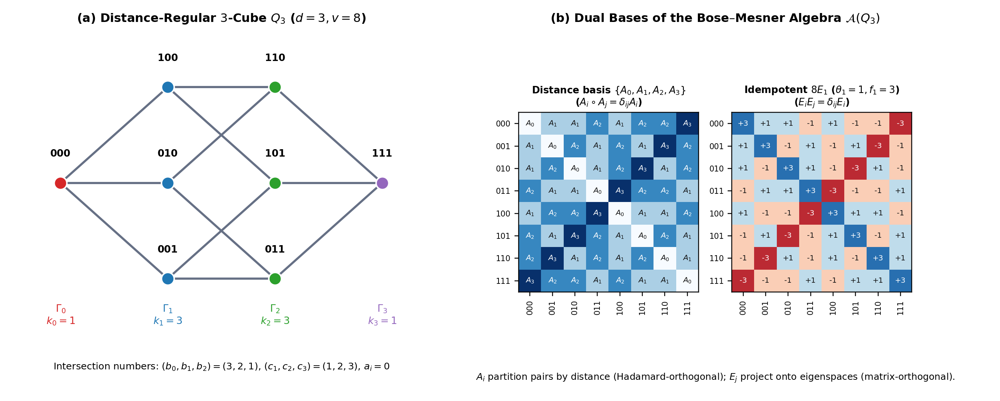

*Figure 11. (a) The $3$-cube $Q_3$ drawn in the distance layers $\Gamma_0, \Gamma_1, \Gamma_2, \Gamma_3$ of the vertex $000$, with sphere sizes $k_i = 1, 3, 3, 1$ and intersection numbers $(b_0, b_1, b_2) = (3, 2, 1)$, $(c_1, c_2, c_3) = (1, 2, 3)$, $a_i = 0$. (b) The two bases of its Bose-Mesner algebra: each cell of the left grid names the distance matrix $A_i$ that has a $1$ there, and the right grid is the idempotent $8E_1$ for $\theta_1 = 1$, with entries $3, 1, -1, -3$ at distances $0, 1, 2, 3$.*

#### Distance matrices, distance polynomials, and the Bose-Mesner algebra

Let $\Gamma$ be a distance-regular graph of diameter $d \ge 2$ on $v$ vertices ordered as $(p_1, \dots, p_v)$, with adjacency matrix $A$. For every integer $i \in \mathbb{Z}$, define the $v \times v$ **distance-$i$ matrix** $A_i$ (for $j, k \in \{1, \dots, v\}$) by setting $(A_i)_{jk} = 1$ if $d(p_j, p_k) = i$ and $(A_i)_{jk} = 0$ otherwise. Then $A_0 = I$, $A_1 = A$, $A_i = 0$ for $i \notin \{0, 1, \dots, d\}$, and $A_0 + A_1 + \dots + A_d = J$ because every pair of vertices sits at one unique distance between $0$ and $d$.

**Three-term recurrence for distance matrices.** In a distance-regular graph we can multiply two distance matrices and expand the product as a linear combination of the others:

$$A_i A_j = \sum_{k=0}^d p_{ij}^k A_k$$

Here the coefficient $p_{ij}^k$ is the number of vertices $z$ at distance $i$ from $x$ and distance $j$ from $y$ when $d(x, y) = k$. Distance-regularity is what makes this number depend only on $i$, $j$ and $k$ and not on the pair $x, y$; in a general graph it depends on the pair, and $A_i A_j$ need not be a combination of distance matrices at all. These $p_{ij}^k$ are also called intersection numbers. Because $p_{ij}^k$ counts vertices, it is a nonnegative integer.

When one factor is $A = A_1$, the relation becomes the three-term recurrence, for every $i \in \{0, 1, \dots, d\}$,

$$A A_i = b_{i-1} A_{i-1} + a_i A_i + c_{i+1} A_{i+1}.$$

To see why, compute the $(j, k)$-entry $(A A_i)_{jk} = \sum_{l=1}^v A_{jl} (A_i)_{lk}$, which counts how many neighbours of $p_j$ lie at distance $i$ from $p_k$ (the neighbours are given by $p_l$). Stand at $p_k$ as the base vertex: by the triangle inequality, $p_j$ has $0$ such neighbours unless $d(p_j, p_k) \in \{i - 1, i, i + 1\}$. When $d(p_j, p_k) = i - 1$ (marked by $A_{i-1}$), $p_j$ has $b_{i-1}$ neighbours one step further out at distance $i$ from $p_k$. When $d(p_j, p_k) = i$ (marked by $A_i$), $p_j$ has $a_i$ neighbours at distance $i$ from $p_k$. And when $d(p_j, p_k) = i + 1$ (marked by $A_{i+1}$), $p_j$ has $c_{i+1}$ neighbours one step closer at distance $i$ from $p_k$.

Because $c_{i+1} \ge 1$ for $0 \le i \le d - 1$, we can divide the recurrence by $c_{i+1}$ and solve for $A_{i+1}$ one step at a time as a polynomial in $A$.

We do this inductively step-by-step, with $A_{-1}$ as the zero matrix $0$ (along with $b_{-1} = 0$), $A_{d+1} = 0$ and $c_{d+1} = 0$, $A_0 = I$ (the vertices are their own 0 neighbours) and $A_1 = A$.

Rearrange the three-term recurrence to isolate $A_{i+1}$ on the left-hand side:

$$A_{i+1} = \frac{1}{c_{i+1}} \bigl( A A_i - a_i A_i - b_{i-1} A_{i-1} \bigr)$$

Unrolling this one step at a time shows how each distance matrix $A_m$ becomes a degree-$m$ polynomial $p_m(A)$ in $A$:

**Base case ($i = 0$):** Since $A_{-1} = 0$, $b_{-1} = 0$, $a_0 = 0$, and $c_1 = 1$, the formula at $i = 0$ simply gives:

$$A_1 = \frac{1}{1}(A I - 0 - 0) = A$$

$A_0 = I$ is a polynomial of degree $0$ in $A$, and $A_1 = A$ is a polynomial of degree $1$ in $A$.

**First inductive step ($i = 1 \implies$ solving for $A_2$):** Plug $i = 1$ into the rearranged recurrence (using $A_0 = I$, $A_1 = A$, and $b_0 = k$):

$$A_2 = \frac{1}{c_2} \bigl( A(A) - a_1 A - b_0 I \bigr) = \frac{1}{c_2} \bigl( A^2 - a_1 A - k I \bigr)$$

In an SRG, $a_1 = \lambda$, $c_2 = \mu$, and $A_2 = J - I - A$ marks the vertices at distance $2$. Plugging those in gives $J - I - A = \frac{1}{\mu}(A^2 - \lambda A - kI)$, which is our exact SRG quadratic equation.

Continuing this induction, we will see that we multiply each previous $A_i$ by $A$ up to $i = d - 1$, and so every distance matrix $A_m$ is a polynomial $p_m(A)$ of exact degree $m$ in $A$. These polynomials $p_0, p_1, \dots, p_d$ are called the **distance polynomials** of the distance-regular graph.

**Distance polynomials, minimal polynomial, and eigenvalue count.** Let $\Gamma$ be a distance-regular graph of diameter $d \ge 2$. For each $i \in \{0, 1, \dots, d\}$, there is a unique polynomial $p_i(X) \in \mathbb{R}[X]$ of degree $i$ satisfying $A_i = p_i(A)$, given by $p_0(X) = 1$, $p_1(X) = X$, and for $1 \le i \le d - 1$,

$$p_{i+1}(X) = \frac{1}{c_{i+1}}\Bigl((X - a_i)p_i(X) - b_{i-1} p_{i-1}(X)\Bigr).$$

Summing $J = A_0 + \dots + A_d$ gives a unique degree-$d$ polynomial $p^*(X) = p_0(X) + p_1(X) + \dots + p_d(X)$ with $J = p^*(A)$. Moreover, the [minimal polynomial](#polynomials-in-a-matrix-and-the-minimal-polynomial) of $A$ has degree $d + 1$ and is proportional to both $(X - b_0)p^*(X)$ and $(X - a_d)p_d(X) - b_{d-1} p_{d-1}(X)$. Consequently, $\Gamma$ has precisely $d + 1$ distinct eigenvalues, the largest of which is $b_0$ with multiplicity $1$.

Let us check the degree and uniqueness step in that theorem. The $d + 1$ matrices $A_0, A_1, \dots, A_d$ have $1$'s in nonempty, mutually disjoint positions, so they are linearly independent in the space of all $v \times v$ real matrices. Since each $A_i$ is a degree-$i$ polynomial in $A$, the powers $A^0, A^1, \dots, A^d$ must also be linearly independent, meaning no nonzero polynomial of degree $d$ or less can annihilate $A$. That forces the minimal polynomial of $A$ to have degree at least $d + 1$ (and makes each $p_i(X)$ and $p^*(X)$ unique).

On the other hand, since $\Gamma$ is $b_0$-regular, $AJ = b_0J \implies (A - b_0 I)J = 0$, so $m(X) = (X - b_0)p^*(X)$ has degree $d + 1$ and satisfies $m(A) = 0$; likewise, setting $i = d$ in $A A_i = b_{i-1} A_{i-1} + a_i A_i + c_{i+1} A_{i+1}$ (where $A_{d+1} = 0$) gives $(A - a_d I)A_d - b_{d-1} A_{d-1} = 0$ at degree $d + 1$. Thus the minimal polynomial of $A$ has degree $d + 1$ and is proportional to both expressions. Because $A$ is real and symmetric, the number of distinct eigenvalues of $A$ equals the degree $d + 1$ of its minimal polynomial, and connectedness gives $b_0$ multiplicity $1$.

The $(d + 1)$-dimensional real vector space

$$\mathcal{A} = \langle I, A, A^2, \dots, A^d \rangle = \langle A_0, A_1, \dots, A_d \rangle,$$

together with standard matrix multiplication, is closed under multiplication (and commutative, since every element is a polynomial in $A$). It is called the **Bose-Mesner algebra** of the distance-regular graph $\Gamma$, and both $\{I, A, \dots, A^d\}$ and $\{A_0, A_1, \dots, A_d\}$ are bases of $\mathcal{A}$.

Just as important, $\mathcal{A}$ carries a second multiplication, the [entrywise (Hadamard or Schur) product](#rank-determinants-and-gram-matrices) $(M \circ N)_{jk} = M_{jk} N_{jk}$ of two $v \times v$ matrices $M$ and $N$. Because $A_0, A_1, \dots, A_d$ are $0$-$1$ matrices with disjoint supports, multiplying them entrywise gives

$$A_i \circ A_j = \delta_{ij} A_i$$

for all $i, j \in \{0, 1, \dots, d\}$, where $\delta_{ij}$ is the Kronecker symbol ($1$ if $i = j$ and $0$ if $i \neq j$). Extending by linearity shows that the Bose-Mesner algebra $\mathcal{A}$ is closed under Hadamard multiplication.

#### Normalized polynomials, standard sequences, and Biggs' multiplicity formula

Recall that $k_i = \lvert \Gamma_i(x) \rvert$ satisfies $k_0 = 1$ and $k_{i+1} c_{i+1} = k_i b_i$. For each $i \in \{0, 1, \dots, d\}$, divide $p_i(X)$ by $k_i$ to define the normalized degree-$i$ polynomial

$$u_i(X) = \frac{p_i(X)}{k_i} \in \mathbb{R}[X]$$

(putting $u_i(X) = 0$ for $i \notin \{0, 1, \dots, d\}$). Then $u_0(X) = 1$ and $u_1(X) = \frac{X}{k}$ where $k = b_0$. Substituting $p_i(X) = k_i u_i(X)$ into $c_{i+1} p_{i+1}(X) + (a_i - X)p_i(X) + b_{i-1} p_{i-1}(X) = 0$ and using $k_{i+1} c_{i+1} = k_i b_i$ cancels $k_i$ across all three terms, giving the symmetric recurrence

$$b_i u_{i+1}(X) + (a_i - X)u_i(X) + c_i u_{i-1}(X) = 0$$

for every $i \in \{0, 1, \dots, d - 1\}$ (valid at $i = 0$ as well), while $k_{d-1} b_{d-1} = k_d c_d$ makes the minimal polynomial of $A$ proportional to $(X - a_d)u_d(X) - c_d u_{d-1}(X)$.

Let $\Theta$ be the set of all $d + 1$ distinct eigenvalues of $\Gamma$. For any $\theta \in \Theta$, the $(d + 1)$-tuple $\bigl(u_0(\theta), u_1(\theta), \dots, u_d(\theta)\bigr)$ is called the **standard sequence or cosine sequence** corresponding to $\theta$. Write $f(\theta)$ for the multiplicity of $\theta$ as an eigenvalue of $A$, and build the matrix

$$E(\theta) = \sum_{i=0}^d u_i(\theta) A_i,$$

$E(\theta)$ can never be the zero matrix because $u_0(\theta) = 1$ and $u_0(\theta)A_0 = I$. Since every $A_i$ with $i \neq 0$ has only $0$ along its diagonal, the diagonal from $A_0$ is unaffected by whatever polynomials we build with $A_i$.

Now multiply the equation by $A$. The LHS becomes $AE(\theta)$. On the right, substitute $A A_i = b_{i-1} A_{i-1} + a_i A_i + c_{i+1} A_{i+1}$.

$$A E(\theta) = \sum_{j=0}^d u_j(\theta) b_{j-1} A_{j-1} + \sum_{j=0}^d u_j(\theta) a_j A_j + \sum_{j=0}^d u_j(\theta) c_{j+1} A_{j+1}$$

What is the total coefficient sitting in front of a specific matrix $A_i$? From the first sum $\sum u_j(\theta) b_{j-1} A_{j-1}$, we get an $A_i$ term when $j - 1 = i$ (meaning $j = i + 1$). That contributes $b_i u_{i+1}(\theta) A_i$. From the second sum $\sum u_j(\theta) a_j A_j$, we get an $A_i$ term when $j = i$. That contributes $a_i u_i(\theta) A_i$. From the third sum $\sum u_j(\theta) c_{j+1} A_{j+1}$, we get an $A_i$ term when $j + 1 = i$ (meaning $j = i - 1$). That contributes $c_i u_{i-1}(\theta) A_i$.

Adding those three contributions together, the total coefficient of $A_i$ inside $A E(\theta)$ is: $c_i u_{i-1}(\theta) + a_i u_i(\theta) + b_i u_{i+1}(\theta)$.

Rearranging the recurrence of the polynomials $u_i(x)$ and plugging in $x = \theta$, we have $c_i u_{i-1}(\theta) + a_i u_i(\theta) + b_i u_{i+1}(\theta) = \theta u_i(\theta)$ for $0 \le i \le d - 1$ and so $\theta u_i(\theta)$ becomes the coefficient of $A_i$. For $i = d$ the coefficient of $A_d$ is just $c_d u_{d-1}(\theta) + a_d u_d(\theta)$.

Does $c_d u_{d-1}(\theta) + a_d u_d(\theta) =\theta u_d(\theta)$ as well? Moving everything to one side is equivalent to: $(\theta - a_d) u_d(\theta) - c_d u_{d-1}(\theta) = 0$.

The degree-$(d+1)$ polynomial $P(X) = (X - a_d)u_d(X) - c_d u_{d-1}(X)$ is a constant multiple of the minimal polynomial of $A$ (it is not monic), and its roots are precisely the $d + 1$ eigenvalues of $A$. So yes, the condition holds for the boundary as well.

So we have:

$$A \cdot E(\theta) = \theta \cdot E(\theta)$$

for every $\theta \in \Theta$. And notice what this says geometrically: every column of the matrix $E(\theta)$ is an eigenvector of $A$ with eigenvalue $\theta$. Take any vector $v$, multiply it by $E(\theta)$ to get $w = E(\theta)v$, and then multiply by $A$:

$$Aw = A E(\theta)v = \theta E(\theta)v = \theta w$$

Every vector that comes out of $E(\theta)$ is automatically an eigenvector of $A$ with eigenvalue $\theta$. In fact, $\frac{f(\theta)}{v} E(\theta)$ is the orthogonal projection matrix onto the $\theta$-eigenspace.

Now because $\mathcal{A}$ is commutative, $A$ can slide between any two factors $E(\theta_1)$ and $E(\theta_2)$: whenever $\theta_1 \neq \theta_2$, we get $\theta_1 E(\theta_1) E(\theta_2) = A E(\theta_1) E(\theta_2) = E(\theta_1) A E(\theta_2) = \theta_2 E(\theta_1) E(\theta_2)$, so $E(\theta_1) \cdot E(\theta_2) = 0$.

Taking the trace of $E(\theta)$ in two ways now gives a formula for the multiplicity $f(\theta)$ of each eigenvalue $\theta \in \Theta$ called **Biggs' multiplicity formula**:

$$f(\theta) = \frac{v}{\sum_{i=0}^d k_i u_i(\theta)^2}.$$

As we check below, $E(\theta)$ completely kills (sends to $0$) every other eigenspace $\theta' \neq \theta$, while scaling every vector inside the $\theta$-eigenspace by a single constant number $\phi(\theta)$. So $E(\theta)$ is a constant multiple of the projection matrix onto the $\theta$-eigenspace, not the projection itself (a projection scales by $1$); the next section shows that the constant is $v / f(\theta)$.

Now let's look at how to compute the trace of $E(\theta)$ in two standard ways from linear algebra. First, sum the diagonal entries. Every diagonal entry of $E(\theta)$ is $1$ (since $A_0$ is the only summand of it with diagonal entries), and there are $v$ rows, so the trace is $v$.

The other way to get the trace is to look at the $\theta$-eigenspace (which has dimension $f(\theta)$). Set $\phi(X) = \sum_{i=0}^d u_i(\theta) p_i(X)$, so $\phi(A) = E(\theta) \neq 0$ (because each distance matrix $A_i$ is generated by the distance polynomial $p_i$ evaluated at the adjacency matrix $A$: $A_i = p_i(A)$) and $\deg(\phi) \le d$.

In linear algebra, if a vector $x$ is an eigenvector of a matrix $A$ with eigenvalue $\lambda$ ($Ax = \lambda x$), then for any polynomial $\phi(X)$, that same vector $x$ is an eigenvector of the matrix $\phi(A)$ with eigenvalue $\phi(\lambda)$.

Take an eigenvector $x$ of $A$ belonging to the eigenvalue $\theta$ ($Ax = \theta x$), then multiplying it by $E(\theta) = \phi(A)$ gives: $E(\theta)x = \phi(A)x = \phi(\theta)x$

So $E(\theta)$ has eigenvalue $\phi(\theta)$ on the $\theta$-eigenspace. On every other eigenspace it is $0$: if $Ax = \theta' x$ with $\theta' \neq \theta$, then $E(\theta)x = \phi(\theta')x$ is a multiple of $x$, so it lies in the $\theta'$-eigenspace, and it is also a $\theta$-eigenvector, because every vector that comes out of $E(\theta)$ is one. Only the zero vector lies in both, so $E(\theta)x = 0$. So the sum of the eigenvalues of $E(\theta)$ is $f(\theta) \cdot \phi(\theta)$.

Setting the two equal gives $v = f(\theta)\phi(\theta)$. Since $p_i(\theta) = k_i u_i(\theta)$, we have $\phi(\theta) = \sum_{i=0}^d u_i(\theta) p_i(\theta) = \sum_{i=0}^d k_i u_i(\theta)^2$, so

$$f(\theta) = \frac{v}{\phi(\theta)} = \frac{v}{\sum_{i=0}^d k_i u_i(\theta)^2}$$

#### Minimal idempotents of the Bose-Mesner algebra

Recall that a matrix $E$ is called **idempotent** if $E^2 = E$. Because $A$ is real and symmetric, we can choose an invertible real $v \times v$ matrix $U$ such that $A' = U^{-1} A U$ is diagonal. The diagonal matrix $A'$ generates a $(d + 1)$-dimensional real algebra $\mathcal{A}'$ consisting entirely of diagonal matrices, and the conjugation map $M \mapsto U^{-1} M U$ is an isomorphism between the algebras $\mathcal{A}$ and $\mathcal{A}'$.

Suppose for concreteness that $v = 4$, and $A$ has $d + 1 = 3$ distinct eigenvalues: $\theta_0 = 2$ (multiplicity $1$), $\theta_1 = 0$ (multiplicity $2$), and $\theta_2 = -2$ (multiplicity $1$). Then:

$$A' = \begin{pmatrix} 2 & 0 & 0 & 0 \\ 0 & 0 & 0 & 0 \\ 0 & 0 & 0 & 0 \\ 0 & 0 & 0 & -2 \end{pmatrix}$$

Now, what is the algebra $\mathcal{A}'$ generated by $A'$? It is the set of all polynomials in $A'$. Because $A'$ is diagonal with equal entries in rows $2$ and $3$, any polynomial $p(A')$ will also be diagonal and will always have the exact same number in rows $2$ and $3$:

$$p(A') = \begin{pmatrix} p(2) & 0 & 0 & 0 \\ 0 & p(0) & 0 & 0 \\ 0 & 0 & p(0) & 0 \\ 0 & 0 & 0 & p(-2) \end{pmatrix}$$

Look at the three "building block" diagonal matrices $E'_{\theta}$ that put $1$'s in the slots belonging to a single eigenvalue $\theta$ and $0$'s everywhere else:

$$E'_2 = \begin{pmatrix} 1 & 0 & 0 & 0 \\ 0 & 0 & 0 & 0 \\ 0 & 0 & 0 & 0 \\ 0 & 0 & 0 & 0 \end{pmatrix}, \quad E'_0 = \begin{pmatrix} 0 & 0 & 0 & 0 \\ 0 & 1 & 0 & 0 \\ 0 & 0 & 1 & 0 \\ 0 & 0 & 0 & 0 \end{pmatrix}, \quad E'_{-2} = \begin{pmatrix} 0 & 0 & 0 & 0 \\ 0 & 0 & 0 & 0 \\ 0 & 0 & 0 & 0 \\ 0 & 0 & 0 & 1 \end{pmatrix}$$

We can see that $A' = \sum_{\theta \in \Theta} \theta E'_\theta$. Note that $E'_\theta$ is idempotent of rank $f(\theta)$. Clearly $\{E'_\theta \mid \theta \in \Theta\}$ is a basis of $\mathcal{A}'$. $\operatorname{Tr}(E'_\theta) = f(\theta)$, and $E'_{\theta_1} E'_{\theta_2} = 0$ for $\theta_1 \neq \theta_2$.

Moreover, any matrix $M'$ in the diagonal algebra $\mathcal{A}'$ is a linear combination of these $d+1$ building blocks: $M' = \sum_{\theta \in \Theta} \lambda_\theta E'_\theta$.

What happens when we square $M'$? All cross-terms $E'_{\theta_1} E'_{\theta_2}$ vanish and $(E'_\theta)^2 = E'_\theta$, squaring a linear combination just squares the coefficients.

$$(M')^2 = \left(\sum_{\theta \in \Theta} \lambda_\theta E'_\theta\right)^2 = \sum_{\theta \in \Theta} \lambda_\theta^2 (E'_\theta)^2 = \sum_{\theta \in \Theta} \lambda_\theta^2 E'_\theta$$

For $M'$ to be idempotent ($(M')^2 = M'$), the coefficients of each basis matrix $E'_\theta$ must match: $\lambda_\theta^2 = \lambda_\theta \quad \text{for every } \theta \in \Theta$. So $\lambda = 0,1$.

Therefore, any idempotent matrix in $\mathcal{A}'$ is made of the building blocks $E'_\theta$. Furthermore, a single building block $E'_\theta$ cannot be split into smaller non-zero idempotents inside $\mathcal{A}'$. So the matrices $E'_\theta$ are called the **minimal (or primitive) idempotents**.

Why go through all this? Because the map $M \mapsto U^{-1} M U$ is an **algebra isomorphism**: it preserves addition, matrix multiplication, ranks, traces, and equations like $E^2 = E$.

Pulling each $E'_\theta$ back into $\mathcal{A}$ by defining $E_\theta = U E'_\theta U^{-1}$ (the projection matrix onto the $\theta$-eigenspace of $A$) carries every one of those properties back to $\mathcal{A}$:

- the matrices $E_\theta$ ($\theta \in \Theta$) form a basis of $\mathcal{A}$, and each $E_\theta$ is an idempotent matrix of $\mathcal{A}$ (and symmetric, since every matrix in $\mathcal{A}$ is a polynomial in the symmetric matrix $A$);
- $\operatorname{rank}(E_\theta) = \operatorname{Tr}(E_\theta) = f(\theta)$;
- $A E_\theta = \theta E_\theta$ and $A = \sum_{\theta \in \Theta} \theta E_\theta$;
- $E_{\theta_1} E_{\theta_2} = 0$ whenever $\theta_1 \neq \theta_2$;
- every idempotent of $\mathcal{A}$ is the sum of a subset of $\{E_\theta \mid \theta \in \Theta\}$.

$E_\theta$ are the minimal idempotents of the Bose-Mesner algebra $\mathcal{A}$, with $E_\theta$ the minimal idempotent corresponding to $\theta$.

How does $E_\theta$ relate to the matrix $E(\theta) = \sum_{i=0}^d u_i(\theta) A_i$? We showed that $E(\theta)$ satisfies $A E(\theta) = \theta E(\theta)$ and has trace $v$, whereas the true minimal idempotent $E_\theta$ satisfies $A E_\theta = \theta E_\theta$ and has trace $f(\theta)$. Because the subspace of matrices in $\mathcal{A}$ satisfying $A M = \theta M$ is $1$-dimensional (spanned by $E_\theta$), $E(\theta)$ is simply $E_\theta$ scaled by $\frac{v}{f(\theta)}$:

$$E_\theta = \frac{f(\theta)}{v} E(\theta) = \frac{f(\theta)}{v} \sum_{i=0}^d u_i(\theta) A_i$$

So the Bose-Mesner algebra $\mathcal{A}$ has two natural bases:

**The Combinatorial Basis $\{A_0, A_1, \dots, A_d\}$:** $0$-$1$ matrices that are idempotent under _entrywise_ (Hadamard) multiplication ($A_i \circ A_i = A_i$ and $A_i \circ A_j = 0$).

**The Spectral Basis $\{E_\theta \mid \theta \in \Theta\}$:** Projection matrices that are idempotent under _standard matrix_ multiplication ($E_\theta^2 = E_\theta$ and $E_{\theta_1} E_{\theta_2} = 0$).

And the standard sequence values $u_i(\theta)$ are literally the change-of-basis coefficients that translate between the distance matrices $A_i$ and the eigenspace projections $E_\theta$.

At the largest eigenvalue $\theta_0 = k = b_0$, we have $k = a_i + b_i + c_i$ for every $i$, so the constant tuple $(1, 1, \dots, 1)$ satisfies the recurrence $k u_i = b_i u_{i+1} + a_i u_i + c_i u_{i-1}$ along with $u_0(k) = 1$ and $u_1(k) = \frac{k}{k} = 1$. Thus the standard sequence for $k = b_0$ is $(1, 1, \dots, 1)$, giving $E(k) = \sum_{i=0}^d A_i = J$, and since $f(k) = 1$, the minimal idempotent corresponding to $k = b_0$ is $\frac{1}{v} J$.

Figure 11(b) illustrates the symmetry between these two bases of $\mathcal{A}$ (writing $\Theta = \{\theta_0, \dots, \theta_d\}$, $E_j = E_{\theta_j}$, $f_j = f(\theta_j)$, and $Q_{ij} = f_j u_i(\theta_j)$):

| Basis of $\mathcal{A}$ | Orthogonal under | Change of basis |
| :--- | :--- | :--- |
| Distance $A_0, \dots, A_d$ | $A_i \circ A_j = \delta_{ij} A_i$ | $E_j = \frac{1}{v}\sum_{i=0}^d Q_{ij} A_i$ |
| Idempotents $E_0, \dots, E_d$ | $E_i E_j = \delta_{ij} E_i$ | $A_i = \sum_{j=0}^d p_i(\theta_j) E_j$ |

---

**Aside:** The Bose-Mesner algebra $\mathcal{A}$ is the exact combinatorial generalization of a commutative **centralizer algebra** (for a transitive action with point stabilizer $H$, also known as the **Hecke algebra** of the pair $(G, H)$) from group representation theory.

When a graph comes from a group action (specifically, when a group $G$ acts transitively on the $v$ vertices such that the orbitals, the orbits of $G$ on pairs of vertices $V \times V$, correspond to the distance relations), the Bose-Mesner algebra $\mathcal{A}$ is literally the centralizer algebra of the permutation representation of $G$.

Here is how the dictionary between the two worlds lines up entry by entry:

Suppose a finite group $G$ acts transitively on a set of vertices $V$ (with $\vert{}V\vert{} = v$). Let $\rho: G \to \operatorname{GL}(\mathbb{R}^v)$ be the permutation representation, where each group element $g \in G$ is represented by a $v \times v$ permutation matrix $P_g$.

The **centralizer algebra** (or commutant) of this action is the algebra of all $v \times v$ matrices $M$ that commute with every permutation matrix $P_g$:

$$\mathcal{C}(G) = \{ M \in \operatorname{Mat}_{v \times v}(\mathbb{R}) \mid M P_g = P_g M \text{ for all } g \in G \}$$

What does the condition $M P_g = P_g M$ actually mean for the entries $M_{xy}$ of the matrix $M$? Unpacking $P_g^{-1} M P_g = M$ at entry $(x, y)$ says:

$$M_{g(x), g(y)} = M_{x, y} \quad \text{for all } g \in G$$

In other words, a matrix $M$ commutes with the group action if and only if $M_{xy}$ is constant on every orbit of $G$ acting on pairs of vertices $V \times V$ (the **orbitals** $O_0, O_1, \dots, O_d$).

If we put $1$ on the $i$-th orbital $O_i$ and $0$ everywhere else, we get the $0$-$1$ basis matrices $A_0, A_1, \dots, A_d$ of the centralizer algebra.

When $G$ acts **distance-transitively** on a graph $\Gamma$ (meaning $G$ can map any pair of vertices at distance $i$ to any other pair at distance $i$), the orbitals $O_i$ are precisely the distance-$i$ relations, and the centralizer algebra $\mathcal{C}(G)$ is literally the Bose-Mesner algebra $\mathcal{A}$.

In representation theory, if we decompose the permutation module $\mathbb{R}^v$ into irreducible representations of $G$:

$$\mathbb{R}^v = V_0 \oplus V_1 \oplus \dots \oplus V_d$$

**Schur's Lemma** tells us what the centralizer algebra $\mathcal{C}(G) = \operatorname{End}_G(\mathbb{R}^v)$ looks like when this decomposition is multiplicity-free (meaning each irreducible $V_\theta$ appears only once, which is equivalent to the centralizer algebra being commutative):

Any matrix $M$ that commutes with $G$ cannot mix different irreducible subspaces $V_{\theta_1}$ and $V_{\theta_2}$, and on each irreducible subspace $V_\theta$, $M$ must act as a scalar multiple $\lambda_\theta I_{V_\theta}$.

Therefore, in a basis adapted to the irreducible subspaces $V_\theta$, every matrix in the centralizer algebra becomes block-diagonal, acting as a single scalar on each block $V_\theta$, which is exactly the diagonal algebra $\mathcal{A}'$ from [minimal idempotents of the Bose-Mesner algebra](#minimal-idempotents-of-the-bose-mesner-algebra).

The minimal idempotents $E_\theta$ of the Bose-Mesner algebra are the **isotypic projection operators** from representation theory that project $\mathbb{R}^v$ orthogonally onto each irreducible representation $V_\theta$, and the eigenvalue multiplicity $f(\theta) = \operatorname{Tr}(E_\theta) = \dim(V_\theta)$ is the degree (dimension) of that irreducible representation.

Even the standard sequence $u_i(\theta)$ has a representation-theoretic name: when $G$ acts distance-transitively with point stabilizer $H = G_x$, $(G, H)$ is a **Gelfand pair**, and the values $u_i(\theta)$ are the **zonal spherical functions** on the double cosets $H \backslash G / H$, while Biggs' multiplicity formula is the **orthogonality relation for spherical characters**.

What Delsarte, Bose, and Mesner realized is that you don't actually need the group $G$ to exist for all of this machinery to work:

Every distance-transitive group action gives a distance-regular graph whose centralizer algebra is a Bose-Mesner algebra. However, many strongly regular graphs and distance-regular graphs have trivial or tiny automorphism groups. For example, there are exactly 32,548 non-isomorphic $\mathrm{SRG}(36, 15, 6, 6)$ graphs (McKay and Spence completed the search, so this is the full count and not just the ones known so far). And of the $15$ conference graphs $\mathrm{SRG}(25, 12, 5, 6)$, known as the Paulus graphs, only the Paley graph $P(25)$ has a group acting transitively on its vertices; the other $14$ have none.

Even when there is no group $G$ for the matrices to commute with, the purely combinatorial regularity condition $A A_i = b_{i-1} A_{i-1} + a_i A_i + c_{i+1} A_{i+1}$ forces the span of $\{A_0, A_1, \dots, A_d\}$ to close under matrix multiplication into a commutative semisimple algebra $\mathcal{A}$ that behaves _as if_ it were the centralizer algebra of a multiplicity-free group action, complete with minimal idempotents $E_\theta$, character tables (the eigenmatrices $P$ and $Q$), and character orthogonality relations.

---

#### Krein parameters and the Krein inequalities

Keep the numbering $\Theta = \{\theta_0, \theta_1, \dots, \theta_d\}$ with $\theta_0 = k = b_0$, $E_i = E_{\theta_i}$, $f_i = f(\theta_i)$, and $Q_{ij} = f_j u_i(\theta_j)$. Under ordinary matrix multiplication, $E_i E_j = \delta_{ij} E_i$. What happens when we take the *Hadamard* (entrywise) product $E_i \circ E_j$ instead? Because $\mathcal{A}$ is closed under Hadamard multiplication and $\{E_0, E_1, \dots, E_d\}$ is a basis of $\mathcal{A}$, there exist unique real numbers $q_{ij}^k \in \mathbb{R}$ ($i, j, k \in \{0, 1, \dots, d\}$) such that

$$E_i \circ E_j = \frac{1}{v} \sum_{k=0}^d q_{ij}^k E_k.$$

The numbers $q_{ij}^k$ are called the **Krein parameters** of the distance-regular graph $\Gamma$. Every single one of them is nonnegative. The $\frac{1}{v}$ is just a standard normalization factor.

These are the exact dual of the intersection numbers $p_{ij}^k$ in the Bose-Mesner algebra. While intersection numbers govern what happens when you multiply the combinatorial basis $A_i$ under standard matrix multiplication, the Krein parameters $q_{ij}^k$ govern what happens when you multiply the spectral basis $E_i$ under entrywise (Hadamard) multiplication.

For the combinatorial numbers $p_{ij}^k$, nonnegativity ($p_{ij}^k \ge 0$) is trivial because you can't have a negative number of vertices. Why must $q_{ij}^k$ also be nonnegative? Because from a matrix viewpoint, $E_i$ and $E_j$ are positive semidefinite projection matrices, so the [Schur product theorem](#rank-determinants-and-gram-matrices) says their Hadamard product $E_i \circ E_j$ is also positive semidefinite, which forces all of its eigenvalues $\frac{1}{v} q_{ij}^k$ to be $\ge 0$.

So if even one $q_{ij}^k$ comes out negative, no such graph can exist. Next, we will look at how to calculate the Krein parameters.

---

**Aside:** In our earlier centralizer algebra analogy, $E_i$ and $E_j$ project onto irreducible representations $V_i$ and $V_j$. Entrywise multiplication corresponds to the pointwise product of functions on $V$, $(f \cdot g)(x) = f(x)g(x)$. This is not the tensor product $f \otimes g$, which is a function on pairs $(x, y)$, but its restriction to the diagonal pairs $(x, x)$. When you multiply an eigenvector from $V_i$ entry-by-entry with an eigenvector from $V_j$, which eigenspaces $V_k$ does the resulting vector land in? The Krein parameter $q_{ij}^k$ measures the overlap of the pointwise product $V_i \circ V_j$ with the eigenspace $V_k$. If $q_{ij}^k = 0$, the pointwise product of an eigenvector in $V_i$ and an eigenvector in $V_j$ is strictly orthogonal to $V_k$.

---

**Krein conditions.** For all $i, j, k \in \{0, 1, \dots, d\}$,

$$\begin{aligned}
v f_k q_{ij}^k &= \sum_{l=0}^d k_l Q_{li} Q_{lj} Q_{lk} \\
&= f_i f_j f_k \sum_{l=0}^d k_l u_l(\theta_i) u_l(\theta_j) u_l(\theta_k) \ge 0.
\end{aligned}$$

Let us trace why $v f_k q_{ij}^k$ equals that sum and why it can never be negative. Write $M(x, y)$ for the $(x, y)$-entry of any matrix $M \in \mathcal{A}$ ($x, y \in V$), and let $S = \sum_{x, y \in V} E_i(x, y) E_j(x, y) E_k(x, y)$ be the sum of all entries of $E_i \circ E_j \circ E_k$.

On the idempotent side, for any two symmetric $v \times v$ matrices $L_1$ and $L_2$, summing all entries of $L_1 \circ L_2$ gives $\sum_{x, y} L_1(x, y) L_2(y, x) = \operatorname{Tr}(L_1 L_2)$. Taking $L_1 = E_i \circ E_j = \frac{1}{v}\sum_{l=0}^d q_{ij}^l E_l$ and $L_2 = E_k$ (using $E_l E_k = \delta_{lk} E_k$ and $\operatorname{Tr}(E_k) = f_k$) gives

$$v^2 S = v^2 \operatorname{Tr}\bigl((E_i \circ E_j) E_k\bigr) = v f_k q_{ij}^k.$$

On the distance-matrix side, expand $E_i$, $E_j$, and $E_k$ via $E_r = \frac{1}{v}\sum_{l=0}^d Q_{lr} A_l$. Because $A_l \circ A_m \circ A_n = 0$ unless $l = m = n$ (where $A_l \circ A_l \circ A_l = A_l$, and the sum of all entries of $A_l$ is $v k_l$), the triple sum collapses to a single sum over $l$:

$$v^2 S = \frac{1}{v} \sum_{l=0}^d Q_{li} Q_{lj} Q_{lk} (v k_l) = \sum_{l=0}^d k_l Q_{li} Q_{lj} Q_{lk}.$$

To see why $S \ge 0$, use the fact that $E_i$, $E_j$, and $E_k$ are symmetric and idempotent ($E_r = E_r^2$), so $E_r(x, y) = \sum_{u \in V} E_r(u, x) E_r(u, y)$. Substituting those three sums into $S = \sum_{x, y \in V} E_i(x, y) E_j(x, y) E_k(x, y)$ separates the $x$-sum from the $y$-sum: setting $q(u, v, w) = \sum_{x \in V} E_i(u, x) E_j(v, x) E_k(w, x)$ for each triple $u, v, w \in V$, we obtain a sum of real squares,

$$S = \sum_{u, v, w \in V} q(u, v, w)^2 \ge 0.$$

**Worked example: the $3$-cube $Q_3$.** Let us run the full distance-regular machinery by hand on the $3$-dimensional cube $Q_3$ from Figure 11(a) ($v = 8$ binary triples $\{0, 1\}^3$, joined when differing in one bit, so diameter $d = 3$).

Standing at `000`, a vertex at distance $i$ has $i$ ones and $3 - i$ zeros: flipping one of the $i$ ones steps closer ($c_i = i$), flipping one of the $3 - i$ zeros steps further ($b_i = 3 - i$), and no single bit-flip preserves weight ($a_i = 0$). That gives sphere sizes $k_0 = 1$, $k_1 = \frac{1 \cdot 3}{1} = 3$, $k_2 = \frac{3 \cdot 2}{2} = 3$, and $k_3 = \frac{3 \cdot 1}{3} = 1$ ($1 + 3 + 3 + 1 = 8$).

Now build the normalized polynomials $u_i(X)$: $u_0(X) = 1$ and $u_1(X) = \frac{X}{3}$. At $i = 1$, $2 u_2(X) - \frac{X^2}{3} + 1 = 0$ gives $u_2(X) = \frac{X^2 - 3}{6}$. At $i = 2$, $u_3(X) - \frac{X(X^2 - 3)}{6} + \frac{2X}{3} = 0$ gives $u_3(X) = \frac{X^3 - 7X}{6}$. Then $(X - a_3)u_3(X) - c_3 u_2(X) = \frac{X^4 - 10X^2 + 9}{6} = \frac{(X^2 - 9)(X^2 - 1)}{6}$, giving the $d + 1 = 4$ eigenvalues $\Theta = \{3, 1, -1, -3\}$.

Test $\theta_1 = 1$: its standard sequence is $(1, \frac{1}{3}, -\frac{1}{3}, -1)$, Biggs' formula gives $f(1) = \frac{8}{1(1) + 3(1/9) + 3(1/9) + 1(1)} = \frac{8}{8/3} = 3$, and $8 E_1 = 3(A_0 + \frac{1}{3}A_1 - \frac{1}{3}A_2 - A_3) = 3 A_0 + A_1 - A_2 - 3 A_3$, matching every $+3, +1, -1, -3$ entry in Figure 11(b). Finally, check a Krein parameter such as $q_{11}^2$ for $\theta_1 = 1$ and $\theta_2 = -1$ (where $\theta_2 = -1$ has standard sequence $(1, -\frac{1}{3}, -\frac{1}{3}, 1)$ and multiplicity $f_2 = 3$):

$$\begin{aligned}
\sum_{l=0}^3 k_l u_l(1)^2 u_l(-1) &= 1 + 3\left(\frac{1}{9}\right)\left(-\frac{1}{3}\right) + 3\left(\frac{1}{9}\right)\left(-\frac{1}{3}\right) + 1 \\
&= 2 - \frac{2}{9} = \frac{16}{9},
\end{aligned}$$

so $8 \cdot 3 \cdot q_{11}^2 = 27 \cdot \frac{16}{9} = 48$, which gives $q_{11}^2 = 2 \ge 0$.

#### Specializing the Krein conditions to connected strongly regular graphs

Now specialize back to diameter $d = 2$, where $\Gamma$ is a connected $\mathrm{SRG}(v, k, \lambda, \mu)$ with eigenvalues $k, R_1, R_2$, sphere sizes $k_0 = 1$, $k_1 = k$, $k_2 = v - k - 1$, and $(c_1, a_1, b_1) = (1, \lambda, k - \lambda - 1)$. Pick either $R \in \{R_1, R_2\}$ and compute its standard sequence $(u_0, u_1, u_2)$: we have $u_0 = 1$, $u_1 = \frac{R}{k}$, and from $b_1 u_2 + (a_1 - R)u_1 + c_1 u_0 = 0$,

$$u_2 = \frac{1}{k - \lambda - 1}\left((R - \lambda)\frac{R}{k} - 1\right) = \frac{R^2 - \lambda R - k}{k(k - \lambda - 1)}.$$

Using $R^2 + (\mu - \lambda)R + (\mu - k) = 0$ rewrites the numerator $R^2 - \lambda R - k$ as $-\mu(R + 1)$, while $k(k - \lambda - 1) = \mu(v - k - 1)$ rewrites the denominator, canceling $\mu > 0$ to leave $u_2 = -\frac{R + 1}{v - k - 1}$. Feeding $(u_0, u_1, u_2)$ into the diagonal Krein condition $\sum_{i=0}^2 k_i u_i^3 \ge 0$ (corresponding to $q_{11}^1 \ge 0$ and $q_{22}^2 \ge 0$) produces the **Krein inequalities for connected strongly regular graphs**:

$$1 + \frac{R_1^3}{k^2} - \frac{(R_1 + 1)^3}{(v - k - 1)^2} \ge 0,$$

$$1 + \frac{R_2^3}{k^2} - \frac{(R_2 + 1)^3}{(v - k - 1)^2} \ge 0.$$

(If you test our earlier fake candidate $\mathrm{SRG}(28, 9, 0, 4)$ here, where $k = 9$, $v - k - 1 = 18$, and $R_2 = -5$, the second inequality gives $1 - \frac{125}{81} + \frac{64}{324} = -\frac{28}{81} < 0$, so $q_{22}^2 \ge 0$ independently rules out $(28, 9, 0, 4)$ as well.)

In any primitive $\mathrm{SRG}(v, k, \lambda, \mu)$ with eigenvalues $\theta_0 = k$, $\theta_1 = R_1 > 0$, and $\theta_2 = R_2 < 0$, almost all the Krein parameters $q_{ij}^k$ are automatically nonnegative (several of them are $0$). The only two that can actually go negative and restrict the parameters are the "self-triple" products $q_{11}^1 \ge 0$ and $q_{22}^2 \ge 0$.

---

**Aside:** If the Krein parameters and generalized intersection numbers remind you of the Christoffel symbols from General Relativity and differential geometry, you're not off the mark. The structural analogy to Christoffel symbols $\Gamma_{ij}^k$ goes beyond the index placement: the two kinds of numbers play closely parallel algebraic roles.

In differential geometry or Lie theory, if you have a basis of vector fields or tangent vectors $\{e_0, e_1, \dots, e_d\}$, a connection (or product) tells you how combining two basis directions $e_i$ and $e_j$ decomposes back into the basis $\{e_k\}$:

$$\nabla_{e_i} e_j = \sum_{k=0}^d \Gamma_{ij}^k e_k$$

In a Bose-Mesner algebra $\mathcal{A}$, you have a single $(d+1)$-dimensional space equipped with two dual products and two natural bases. The intersection numbers $p_{ij}^k$ and Krein parameters $q_{ij}^k$ are the **structure constants** (the "connection coefficients") of those two products.

**Combinatorial connection ($p_{ij}^k$).** It measures how two distance spheres $A_i$ and $A_j$ compose under _path concatenation_ (matrix multiplication) and project onto the distance sphere $A_k$:

$$A_i A_j = \sum_{k=0}^d p_{ij}^k A_k$$

**Spectral connection ($q_{ij}^k$).** It measures how two eigenspace projectors $E_i$ and $E_j$ compose under _pointwise interference_ (Hadamard multiplication) and project onto the eigenspace $E_k$:

$$E_i \circ E_j = \frac{1}{v} \sum_{k=0}^d q_{ij}^k E_k$$

Because both products are commutative ($A_i A_j = A_j A_i$ and $E_i \circ E_j = E_j \circ E_i$), both sets of structure constants are **torsion-free** (symmetric in their lower indices):

$$p_{ij}^k = p_{ji}^k \quad \text{and} \quad q_{ij}^k = q_{ji}^k$$

In Riemannian geometry, you lower an upper index on $\Gamma_{ij}^k$ by contracting with the metric tensor $g_{km}$:

$$\Gamma_{ijk} = \sum_m g_{km} \Gamma_{ij}^m$$

In the Bose-Mesner algebra, each basis has its own natural diagonal **metric tensor** (inner product) defined by the trace or entrywise sum.

On the distance basis $\{A_k\}$, the inner product is $\langle A_k, A_m \rangle = \frac{1}{v}\operatorname{Tr}(A_k A_m) = \delta_{km} k_k$, so the diagonal metric tensor has entries $k_k$ (the valencies of the spheres). Lowering the upper index $k$ on $p_{ij}^k$ by multiplying by $k_k$ gives the fully symmetric 3-index tensor

$$p_{ijk} = k_k p_{ij}^k = \frac{1}{v}\operatorname{Tr}(A_i A_j A_k),$$

which is symmetric under _any_ permutation of $(i, j, k)$ (since it counts triangles of vertices with side lengths $i, j, k$).

On the spectral basis $\{E_k\}$, the inner product is $\langle E_k, E_m \rangle = \operatorname{Tr}(E_k E_m) = \delta_{km} f_k$, so the diagonal metric tensor has entries $f_k$ (the multiplicities of the eigenspaces). Lowering the upper index $k$ on $q_{ij}^k$ by multiplying by $f_k$ gives

$$q_{ijk} = f_k q_{ij}^k = v \sum_{x, y \in V} E_i(x, y) E_j(x, y) E_k(x, y),$$

which is the quantity $v f_k q_{ij}^k$ of the [Krein conditions](#krein-parameters-and-the-krein-inequalities) divided by $v$. Look back at those conditions:

$$v f_k q_{ij}^k = \sum_{l=0}^d k_l Q_{li} Q_{lj} Q_{lk}$$

The right-hand side is completely symmetric in $i, j, k$, whereas $q_{ij}^k$ by itself is not symmetric in $k$. Multiplying $q_{ij}^k$ by the metric component $f_k$ lowers the index $k$ to produce the fully symmetric tensor $q_{ijk} = f_k q_{ij}^k$.

There is even a direct geometric reason why the three-term recurrence behaves like parallel transport:

- In general, $p_{ij}^k$ has three independent indices (and in a graph that is not distance-regular these counts are not even constants, because they depend on the pair of vertices).
- In a distance-regular graph, stepping one unit along an edge ($i = 1$) reduces the connection coefficients $p_{1j}^k$ to a *tridiagonal* connection: from a vertex on sphere $j$, a single step can only take you back to sphere $j - 1$ ($c_j$ ways), keep you on sphere $j$ ($a_j$ ways) or take you out to sphere $j + 1$ ($b_j$ ways), so $p_{1j}^k = 0$ unless $k \in \{j - 1, j, j + 1\}$. In the recurrence $A A_j = b_{j-1} A_{j-1} + a_j A_j + c_{j+1} A_{j+1}$ the same counts appear indexed by the sphere a step starts from: $b_{j-1}$ counts the steps out of sphere $j - 1$ into sphere $j$, and $c_{j+1}$ the steps in from sphere $j + 1$.
- In fact, discrete notions of Ricci curvature (following Ollivier, Lin–Lu–Yau and Bakry–Émery) have been studied on distance-regular graphs, where the curvature of an edge depends on local intersection numbers such as $a_1$, $b_1$ and $c_2$.

---

### Applications to partial geometries and generalized quadrangles

In 1963, R. C. Bose introduced **partial geometries** to study generalized quadrangles, linear spaces, and nets under one common framework whose collinearity graphs are strongly regular.

#### Partial geometries and their collinearity graphs

Recall how a finite [generalized quadrangle](#generalized-quadrangles) of order $(s, t)$ behaves: every line has $s + 1$ points, every point lies on $t + 1$ lines. Moreover, from any point $x$ outside a line $L$, you can reach *just $1$* point of $L$ along a line of the geometry. More simply, any point is either incident with a line or is connected to that line by exactly one other line.

A **partial geometry with parameters $(s, t, \alpha)$** (often written $\mathrm{pg}(s, t, \alpha)$, with integers $s \ge 1$, $t \ge 1$, and $\alpha \ge 1$) relaxes that "just $1$" rule to a fixed constant $\alpha$: it is a finite [partial linear space](#partial-linear-spaces) $\mathcal{S} = (\mathcal{P}, \mathcal{L}, \mathrm{I})$ of order $(s, t)$ (every line has $s + 1$ points and every point lies on $t + 1$ lines) in which, for every point $x$ and every line $L$ not passing through $x$ (every anti-flag $(x, L)$), $x$ is collinear with $\alpha$ points of $L$.

Swapping points and lines turns a partial geometry with parameters $(s, t, \alpha)$ into its [point-line dual](#points-lines-duals-and-doubles) $\mathcal{S}^D$, which is a partial geometry with parameters $(t, s, \alpha)$ (each of the $\alpha$ lines joining an external point $x$ to a point of $L$ in $\mathcal{S}$ becomes one of the $\alpha$ dual points on the dual line $x$ collinear with the dual point $L$).

Check the two extreme values of $\alpha$ ($1 \le \alpha \le \min(s + 1, t + 1)$). When $\alpha = 1$, every point outside a line $L$ is collinear with a *unique* point of $L$, so a partial geometry with parameters $(s, t, 1)$ is a finite generalized quadrangle of order $(s, t)$ (having $s, t \ge 1$ guarantees two disjoint lines automatically: take a line $L$, pick a second line $M$ through some point $y \in L$, pick $x \in M \setminus \{y\}$, and take a second line $N \neq M$ through $x$; since $\alpha = 1$, $y$ is already the lone point of $L$ collinear with $x$, so $N$ misses $L$). At the other extreme, when $\alpha = s + 1$, every external point $x$ is collinear with all $s + 1$ points of $L$, so $\mathcal{S}$ is a linear space ($2$-$(v, s + 1, 1)$ Steiner system) whose collinearity graph is complete.

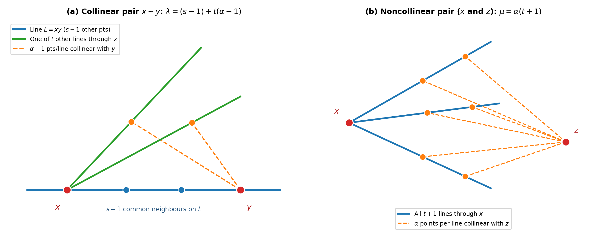

*Figure 12. Counting common neighbours in the collinearity graph of a partial geometry $\mathrm{pg}(s, t, \alpha)$, drawn with $t = 2$ and $\alpha = 2$. (a) For collinear points $x \sim y$: the $s - 1$ other points of the line $xy$, plus $\alpha - 1$ points on each of the $t$ other lines through $x$, give $\lambda = s - 1 + t(\alpha - 1)$. (b) For noncollinear points $x$ and $z$: $\alpha$ points on each of the $t + 1$ lines through $x$ give $\mu = \alpha(t + 1)$.*

Now suppose $\alpha \le s$, so $\mathcal{S}$ is not a linear space and noncollinear pairs of points exist. We can read the parameters $\lambda$ and $\mu$ of the collinearity graph $\Gamma$ of $\mathcal{S}$ straight off the two panels of Figure 12, and $k$ and $v$ follow from short counts.

Start with the valency $k$. Through any point $x$ pass $t + 1$ lines, each containing $s$ points other than $x$, and in a partial linear space no two lines through $x$ share a second point. So $\Gamma$ is regular with valency $k = s(t + 1)$.

For two noncollinear points $x$ and $z$, look at Figure 12(b). None of the $t + 1$ lines through $x$ passes through $z$, so $z$ forms an anti-flag with each of those $t + 1$ lines. On each line through $x$, $z$ is collinear with $\alpha$ points (none equal to $x$, since $z \nsim x$), giving $\mu = \alpha(t + 1) > 0$ common neighbours (which also shows $\Gamma$ is connected).

For two collinear points $x \sim y$, look at Figure 12(a), where $L = xy$ is the unique line joining them. Any point collinear with both $x$ and $y$ sits on one of the $t + 1$ lines through $x$. On $L$ itself, all $s - 1$ remaining points besides $x$ and $y$ are collinear with both. On each of the remaining $t$ lines $M \neq L$ through $x$, $(y, M)$ is an anti-flag, so $y$ is collinear with $\alpha$ points of $M$; one of those $\alpha$ points is $x$ itself, leaving $\alpha - 1$ common neighbours on each of those $t$ lines. Adding the two counts gives $\lambda = s - 1 + t(\alpha - 1)$.

To get the total point count $v$, we double-count collinear connections from a fixed line $L$. The line $L$ contains $s + 1$ points, so there are $v - (s + 1)$ points outside $L$. Now count the number of pairs $(x, y)$ where $x \notin L$ is a point outside $L$, $y \in L$ is a point on $L$, and $x$ is collinear with $y$ ($x \sim y$).

Count from the outside points $x \notin L$: Every point $x \notin L$ is collinear with $\alpha$ points on $L$. Since there are $v - (s + 1)$ points outside $L$, the total number of such pairs $(x, y)$ is: $\bigl(v - (s + 1)\bigr)\alpha$.

Count from the line points $y \in L$: Pick any of the $s + 1$ points $y \in L$. There are $t + 1$ lines passing through $y$ in total. One of those lines is $L$ itself; the remaining $t$ lines through $y$ step outside $L$ (and cannot meet $L$ again because two lines intersect in at most one point). Each of those $t$ lines contains $s$ points outside $L$. Thus, each $y \in L$ is collinear with $st$ points outside $L$. Across all $s + 1$ points $y \in L$, the total number of pairs $(x, y)$ is: $(s + 1)st$. Equate the two counts and solve for $v$:

$$\bigl(v - (s + 1)\bigr)\alpha = (s + 1)st,$$

$$v = (s + 1) + \frac{(s + 1)st}{\alpha} = \frac{(s + 1)(st + \alpha)}{\alpha}.$$

Now let's check if this is an SRG by ascertaining if the relationship between the parameters is satisfied. Plug $k, \lambda, \mu$ into $k(k - \lambda - 1) = (v - k - 1)\mu$. Since $k - \lambda - 1 = s(t + 1) - (s - 1 + t\alpha - t) - 1 = t(s + 1 - \alpha)$, canceling $t + 1$ gives $st(s + 1 - \alpha) = (v - s(t + 1) - 1)\alpha$, and solving for $v$ gives

$$v = 1 + s(t + 1) + \frac{st(s + 1 - \alpha)}{\alpha} = \frac{(s + 1)(st + \alpha)}{\alpha}.$$

In summary, whenever $\alpha \le s$, the collinearity graph $\Gamma$ of a $\mathrm{pg}(s, t, \alpha)$ is a connected $\mathrm{SRG}(v, k, \lambda, \mu)$ with $v = \frac{(s + 1)(st + \alpha)}{\alpha}$, $k = s(t + 1)$, $\lambda = s - 1 + t(\alpha - 1)$, and $\mu = \alpha(t + 1)$.

#### Divisibility conditions

**Divisibility theorem for partial geometries and generalized quadrangles.** If $\mathcal{S}$ is a partial geometry with parameters $(s, t, \alpha)$, then $\alpha(s + t + 1 - \alpha)$ is a divisor of $st(s + 1)(t + 1)$. In particular, if $\mathcal{S}$ is a finite generalized quadrangle of order $(s, t)$ ($\alpha = 1$), then $s + t$ is a divisor of $st(s + 1)(t + 1)$. This is the divisibility condition stated in [orders and parameter restrictions for generalized quadrangles](#orders-and-parameter-restrictions-for-generalized-quadrangles); here is where it comes from.

Let's see how this happens. Still assuming $\alpha \le s$, compute the three eigenvalues $k, R_1, R_2$ of $\Gamma$. Here $\mu - \lambda = \alpha(t + 1) - (s - 1 + t\alpha - t) = \alpha + t - s + 1$ and $\mu - k = (\alpha - s)(t + 1)$, so the quadratic $X^2 + (\mu - \lambda)X + (\mu - k)$ factors cleanly without square roots:

$$X^2 + (\alpha + t - s + 1)X + (\alpha - s)(t + 1) = (X + \alpha - s)(X + t + 1).$$

Therefore the three distinct eigenvalues of $\Gamma$ are $k = s(t + 1)$, $R_1 = s - \alpha \ge 0$, and $R_2 = -t - 1 < -1$. Substituting these into our factored multiplicity formula $M_1 = \frac{(R_2 + 1)k(k - R_2)}{\mu(R_2 - R_1)}$ gives

$$\begin{aligned}
M_1 &= \frac{(-t)s(t + 1)\bigl(s(t + 1) + t + 1\bigr)}{\alpha(t + 1)(-t - 1 - s + \alpha)} \\
&= \frac{st(s + 1)(t + 1)}{\alpha(s + t + 1 - \alpha)}.
\end{aligned}$$

Because $M_1$ must be an integer (and when $\alpha = s + 1$, $\alpha(s + t + 1 - \alpha) = (s + 1)t$ trivially divides $st(s + 1)(t + 1)$), we obtain the divisibility test for partial geometries and its $\alpha = 1$ specialization to generalized quadrangles.

The Divisibility Theorem for partial geometries (and generalized quadrangles) is not new information independent of the SRG: it is the exact algebraic translation of the integrality of the eigenvalue multiplicities ($M_1, M_2 \in \mathbb{Z}$) of the collinearity graph.

Do we get any new parameter restrictions from the geometry that the SRG alone cannot see? No, it is $100\%$ identical to the SRG multiplicity condition $M_1 \in \mathbb{Z}$.

The Divisibility Theorem is useful because, without it, testing whether a candidate triple like $\mathrm{pg}(4, 5, 2)$ can exist requires four separate translation steps. Compute the four SRG parameters, then set up the quadratic equation $\theta^2 + (\mu - \lambda)\theta + (\mu - k) = 0$ and solve for the roots $R_1$ and $R_2$. Then set up the linear system $1 + M_1 + M_2 = v$ and $k + M_1 R_1 + M_2 R_2 = 0$. Then solve for $M_1$ and check if the resulting fraction is an integer. The Divisibility Theorem pre-computes that entire pipeline once and for all in terms of $(s, t, \alpha)$. For $\mathrm{pg}(4, 5, 2)$ it takes one line: $\alpha(s + t + 1 - \alpha) = 2 \cdot 8 = 16$ would have to divide $st(s + 1)(t + 1) = 20 \cdot 5 \cdot 6 = 600$, but $600 / 16 = 37.5$. So $M_1$ would not be an integer, and no $\mathrm{pg}(4, 5, 2)$ exists, even though its point count $v = \frac{5 \cdot 22}{2} = 55$ and line count $b = \frac{55 \cdot 6}{5} = 66$ are whole numbers.

It also helps us see some hidden symmetry. Writing the multiplicity condition explicitly as $\alpha(s + t + 1 - \alpha) \mid st(s + 1)(t + 1)$ reveals a structural symmetry that is completely hidden inside the SRG formula for $M_1$: the expression is visibly symmetric in $s$ and $t$.

In the SRG world, the point graph $\Gamma$ has parameters $(v, k, \lambda, \mu)$, while the line graph (the collinearity graph of the dual geometry $\mathrm{pg}(t, s, \alpha)$) has $b = \frac{v(t + 1)}{s + 1}$ vertices, valency $t(s + 1)$ and its own $\lambda', \mu'$; these differ from the point graph's unless $s = t$. Yet the Divisibility Theorem shows that the geometry and its dual share the exact same arithmetic bottleneck. If $N$ is the $v \times b$ point-line [incidence matrix](#collinearity-graphs-incidence-graphs), then $N N^T = A + (t + 1)I$ and $N^T N$ have the same nonzero eigenvalues with the same multiplicities: $(s + 1)(t + 1)$ once, and $s + t + 1 - \alpha$ with multiplicity $M_1$.

#### Krein bounds and Higman's inequalities

Applying our SRG Krein inequality to the negative eigenvalue $R_2 = -(t + 1)$ bounds $s$ and $t$ directly in terms of each other.

**Krein bounds for partial geometries.** If $\mathcal{S}$ is a partial geometry with parameters $(s, t, \alpha)$, then

$$(s + 1 - 2\alpha)t \le (s - 1)(s + 1 - \alpha)^2,$$

$$(t + 1 - 2\alpha)s \le (t - 1)(t + 1 - \alpha)^2.$$

Because the point-line dual of a $\mathrm{pg}(s, t, \alpha)$ is a $\mathrm{pg}(t, s, \alpha)$, proving the first inequality gives the second automatically. If $\alpha = s + 1$, the first inequality says $-(s + 1)t \le 0$, which holds trivially. So assume $\alpha \le s$, making $\Gamma$ a connected SRG with $k = s(t + 1)$, $v - k - 1 = \frac{st(s + 1 - \alpha)}{\alpha}$, and $R_2 = -(t + 1)$. Plugging $R_2 = -(t + 1)$ into $1 + \frac{R_2^3}{k^2} - \frac{(R_2 + 1)^3}{(v - k - 1)^2} \ge 0$ and canceling $(t + 1)^2$ and $t^2$ gives

$$1 - \frac{t + 1}{s^2} + \frac{t \alpha^2}{(s + 1 - \alpha)^2 s^2} \ge 0.$$

Multiply through by $s^2(s + 1 - \alpha)^2 > 0$:

$$s^2(s + 1 - \alpha)^2 - (t + 1)(s + 1 - \alpha)^2 + \alpha^2 t \ge 0.$$

Now factor $(s + 1)$ out of the left-hand side:

$$(s + 1)\Bigl[(s - 1)(s + 1 - \alpha)^2 - (s + 1 - 2\alpha)t\Bigr] \ge 0.$$

(You can check that factorization directly: $(s + 1)(s - 1)(s + 1 - \alpha)^2 = (s^2 - 1)(s + 1 - \alpha)^2$, while $-t(s + 1)(s + 1 - 2\alpha) = -t(s + 1 - \alpha)^2 + \alpha^2 t$, and adding the two gives $(s^2 - t - 1)(s + 1 - \alpha)^2 + \alpha^2 t$, which is the left-hand side of the previous inequality.) Dividing by $s + 1 > 0$ proves $(s + 1 - 2\alpha)t \le (s - 1)(s + 1 - \alpha)^2$.

Now set $\alpha = 1$ for a finite generalized quadrangle of order $(s, t)$. The two partial-geometry inequalities reduce to

$$(s - 1)t \le (s - 1)s^2 \quad \text{and} \quad (t - 1)s \le (t - 1)t^2.$$

Dividing by $s - 1 > 0$ when $s \neq 1$, and by $t - 1 > 0$ when $t \neq 1$, gives Higman's inequalities, which were stated in [orders and parameter restrictions for generalized quadrangles](#orders-and-parameter-restrictions-for-generalized-quadrangles):

**Higman's inequalities for generalized quadrangles.** Let $\mathcal{S}$ be a finite generalized quadrangle of order $(s, t)$. If $s \neq 1$, then $t \le s^2$. If $t \neq 1$, then $s \le t^2$.

Look at why the hypothesis $s \neq 1$ is genuinely needed in Higman's inequality. In $(s - 1)t \le (s - 1)s^2$, setting $s = 1$ collapses both sides to $0 \le 0$ for every $t$. Geometrically, $s = 1$ means every line has only $2$ points, and the complete bipartite graph $K_{t+1, t+1}$ (a symmetrical dual grid) is a valid generalized quadrangle of order $(1, t)$ for arbitrarily large $t$, such as $t = 100$ even though $s^2 = 1$. Having $(s - 1)$ appear as an explicit factor shows why thin lines ($s = 1$) escape the $t \le s^2$ ceiling, while every thick line size ($s \ge 2$) locks $t$ below $s^2$.

Note that a generalized $n$-gon with $n \ge 5$ is never a partial geometry, and for $n \ge 6$ its collinearity graph has diameter at least $3$, so it is not a strongly regular graph. (For $n = 5$ the only finite examples with an order are the ordinary pentagons, and their collinearity graph $C_5$ is strongly regular.) Instead, the collinearity graph of a generalized $n$-gon of order $(s, t)$ is a distance-regular graph of diameter $d = \lfloor n/2 \rfloor$, which means you apply the exact same Krein parameter machinery ($q_{ij}^k \ge 0$) inside the larger $(d + 1)$-dimensional Bose-Mesner algebra to get the generalized polygon bounds. We will look at this later.

## Hyperplanes and Projective Embeddings of Point-Line Geometries

### Intuition

Recall how a $k$-dimensional [projective subspace](maths_3_projective_geometry.md#vector-spaces-and-projective-geometry) corresponds to a $(k+1)$-dimensional vector subspace of $V$. The points of the projective space are the $1$-dimensional vector subspaces (lines through the origin $0 \in V$), and the projective lines are the $2$-dimensional vector subspaces (planes through $0 \in V$).

We placed a flat $n$-dimensional "screen" (called an [affine chart](maths_3_projective_geometry.md#projective-affine-spaces)) inside $V$ that does not pass through the origin $0$, where the rays from the origin of the vector space intersect to form the points of the projective space. Then we realized that we could just treat the whole ray as an equivalence class and the screen is not so essential after all. Dropping the screen helps because we can treat finite points and points at infinity symmetrically without relying on an arbitrary affine chart.

Now let's do something very similar in the projective space itself. Instead of doing this process with all the points of the projective space, we do it only with a smaller point-line geometry in the projective sapce. The "origin" is chosen as a point that does not lie on that geometry. We then send rays/lines from the origin to every point of the geometry and choose an $n-1$-dimensional space as the screen. Wherever the rays/lines intersect the screen becomes the shadow of that point-line geometry. Now we drop the screen by simply saying the rays from the "origin" to each point (of the point-line geometry) should become the new points and the planes through each point become the new lines. This is the whole process of projective embedding.

### Earlier terms and nondegenerate ambient projective spaces

Throughout this chapter, $\mathcal{S} = (\mathcal{P}, \mathcal{L}, I)$ is a [partial linear space](#partial-linear-spaces), meaning every line has at least two points and any two distinct points lie on at most one common line, so we continue to treat each line $L \in \mathcal{L}$ as its set of points. Recall also that a subset $X \subseteq \mathcal{P}$ is a [subspace](#partial-linear-spaces) when every line meeting $X$ in at least two points lies wholly in $X$, and that $\langle X \rangle$ denotes the smallest subspace containing $X$; when a set of points $Y$ sits inside an ambient projective space $\Sigma$, we write $\langle Y \rangle_\Sigma$ to mark that this span is taken in $\Sigma$ rather than in $\mathcal{S}$.

A [hyperplane](#partial-linear-spaces) of $\mathcal{S}$ was defined earlier as a proper subspace that meets every line; equivalently, it is a proper subset $H \subsetneq \mathcal{P}$ that intersects every line of $\mathcal{S}$ in either a singleton ($1$ point) or the entire line (since any subset with that one-or-all property on lines is automatically a subspace).

We also need to be exact about what counts as an ambient target space $\Sigma$. Earlier, a [projective space](#projective-spaces-of-arbitrary-dimension-and-the-veblenyoung-axiom) (a linear space satisfying the Veblen–Young axiom) was called *irreducible* when every line is thick, with at least $3$ points. For projective planes, nondegenerate was already another word for irreducible, and we use it the same way in every dimension: a **nondegenerate projective space** $\Sigma$ is an irreducible one, so every line of $\Sigma$ has at least $3$ points. A single point or a single thick line still counts. What the word rules out is the degenerate kind with thin lines, such as a [near-pencil](#classes-of-point-line-geometries), which no vector space produces.

We do *not* require $\Sigma$ to have finite dimension. Using our [right-vector-space convention over a skew field $\mathbb{F}$](#linear-algebra-over-finite-fields) (a division ring, whose multiplication need not commute), if $V$ is a right vector space over $\mathbb{F}$ of any dimension at least $2$, possibly infinite, its $1$-dimensional and $2$-dimensional vector subspaces form a nondegenerate projective space $\mathrm{PG}(V)$, whose lines have $\lvert \mathbb{F} \rvert + 1 \ge 3$ points. By [Veblen and Young's classification](#projective-spaces-of-arbitrary-dimension-and-the-veblenyoung-axiom), every nondegenerate projective space of dimension at least $3$ arises as $\mathrm{PG}(V)$ in this way, while dimension $2$ consists of all nondegenerate projective planes, whether [Desarguesian (of the form $\mathrm{PG}(V)$) or non-Desarguesian](#projective-planes-degenerate-vs-nondegenerate).

### Full and quotient projective embeddings

Going back to our intuitive picture, remember how we placed our point-line geometry into our ambient space. Placing a point-line geometry inside a projective space in this clean way gives the kind of embedding we now define.

Embedding a partial linear space $\mathcal{S}$ cleanly inside a projective space $\Sigma$ asks for three things: distinct points of $\mathcal{S}$ stay distinct in $\Sigma$, each line of $\mathcal{S}$ fills an entire projective line of $\Sigma$ with no leftover points on that line, and the embedded points span all of $\Sigma$ so there is no unused ambient space around them. Note that this does not require that all lines of $\Sigma$ are lines of $\mathcal{S}$.

What do we mean by no unused ambient space? It means the embedded points do not all lie flat inside a smaller proper subspace (such as a hyperplane $\mathrm{PG}(n-1, \mathbb{F})$) of $\Sigma = \mathrm{PG}(n, \mathbb{F})$.

Without this rule, you could take a $2\text{D}$ Fano plane $\mathrm{PG}(2, 2)$ and sit it inside a single $2\text{D}$ plane of $\mathrm{PG}(100, 2)$, leaving $98$ extra dimensions of $\mathrm{PG}(100, 2)$ completely empty and irrelevant to the geometry. Requiring the embedding to span the whole ambient space trims away those redundant outer dimensions so that the dimension of $\Sigma$ reflects the true span of the embedded points.

Formally, let $\mathcal{S} = (\mathcal{P}, \mathcal{L}, I)$ be a partial linear space. A **full projective embedding** of $\mathcal{S}$, written

$$\epsilon : \mathcal{S} \to \Sigma,$$

is an injective mapping $\epsilon$ from the point set $\mathcal{P}$ of $\mathcal{S}$ to the point set of a nondegenerate (possibly infinite-dimensional) projective space $\Sigma$ satisfying two geometric conditions: $\epsilon$ maps (the point set of) every line of $\mathcal{S}$ onto a line of $\Sigma$; $\langle \epsilon(\mathcal{P}) \rangle_\Sigma = \Sigma$.

Note that in the notation $\langle \cdot \rangle_\Sigma$, the subscript $\Sigma$ specifies the ambient space or universe within which the span is being taken.

Notice that the first condition makes the embedded copy of $\mathcal{S}$ a [full subgeometry](#partial-linear-spaces) of $\Sigma$ in our earlier sense that every retained line keeps all of its points. (In the wider literature, some authors do not require injectivity (one to one) in the definition of a full projective embedding, and call an injective full projective embedding **faithful**. Here injectivity is part of the definition of a full projective embedding.)

Because $\epsilon$ is injective and maps every line of $\mathcal{S}$ *onto* a full line of $\Sigma$, every line of $\mathcal{S}$ must have the same cardinality as a line of $\Sigma$. That rules out two kinds of geometries immediately. If $\mathcal{S}$ has lines of two different sizes, or if it has a [thin line](#classes-of-point-line-geometries) ($2$ points), then $\mathcal{S}$ has no full projective embedding into any nondegenerate projective space, because all lines of $\Sigma$ share one cardinality of at least $3$. Likewise, if every line of $\mathcal{S}$ has $q + 1$ points for some finite integer $q \ge 2$, any target space $\Sigma$ must have order $q$.

We use the word "full" in the definition to mean lines have no missing points. If the ambient space into which the embedding takes place is $\mathrm{PG}(n, q)$, then each line of the embedding contains $q + 1$ points, just like the lines of the projective space.

For example, let's take a point-line geometry with $9$ points, where one point is a central hub from which $4$ spokes branch out, each with $3$ points (one of which is the hub and two on the spoke). If $q = 2$, the ambient projective line has $2 + 1 = 3$ points. Thus, the image $\epsilon(L)$ covers $100\%$ of the points on that projective line in $\Sigma$. The line is completely "filled up." That is why it is called a full embedding.

If $q = 7$, the ambient projective line in $\mathrm{PG}(n, 7)$ has $8$ points, so the $3$ points of $\epsilon(L)$ only occupy part of the projective line (leaving $5$ "empty" ambient points on that line). That is called a **lax embedding**.

Note that this $4$-spoke hub-spoke geometry can span at most $4$ dimensions, where each spoke lies along a different dimension. You could also map it into $3$ dimensions in $\mathrm{PG}(3, 2)$ by projecting from any of the $10$ points of $\mathrm{PG}(4, 2)$ that miss the $9$ embedded points and their secant lines, keeping all $4$ lines and $9$ points distinct. The $4\text{D}$ and $3\text{D}$ realizations are therefore both full projective embeddings (provided they span $\mathrm{PG}(4, 2)$ and $\mathrm{PG}(3, 2)$ respectively, because a full projective embedding must ensure there is no unused ambient space). However, this $9$-point geometry cannot be fully embedded into $2$ dimensions: $\mathrm{PG}(2, 2)$ has only $7$ points in total and only $3$ lines through any point, whereas our geometry has $9$ points and $4$ lines through the hub (equivalently, no line of $\mathrm{PG}(4, 2)$ avoids the embedded points and their secants). The word "full" has nothing to do with the maximum possible dimension of the geometry and the ambient space.

We also cannot map this hub-spoke geometry into $5$ dimensions, because $9$ points on $4$ concurrent $3$-point lines span at most $\mathrm{PG}(4, 2)$ and there would be leftover ambient space. The full embedding in $\mathrm{PG}(4, 2)$ is called a universal embedding because every full projective embedding of the geometry is isomorphic to a quotient of it, as Ronan's theorem below will confirm. There are two types of universal embeddings, which we will come back to in a bit.

Two full projective embeddings $\epsilon_1 : \mathcal{S} \to \Sigma_1$ and $\epsilon_2 : \mathcal{S} \to \Sigma_2$ of $\mathcal{S}$ are essentially the same embedding when an isomorphism between their ambient projective spaces (a bijection between their point sets that maps lines onto lines, in both directions) carries one map onto the other. We call $\epsilon_1$ and $\epsilon_2$ **isomorphic full projective embeddings**, written $\epsilon_1 \cong \epsilon_2$, if there exists an isomorphism $\phi : \Sigma_1 \to \Sigma_2$ of projective spaces such that $\epsilon_2 = \phi \circ \epsilon_1$ (that is, $\phi(\epsilon_1(p)) = \epsilon_2(p)$ for every $p \in \mathcal{P}$).

#### The three-vane fan example

Imagine an abstract geometry $\mathcal{S}$ consisting of $7$ points and $3$ lines of $3$ points each, all meeting at a single hub point $p_0$:

- Line $L_1 = \{p_0, p_1, p_2\}$
- Line $L_2 = \{p_0, p_3, p_4\}$
- Line $L_3 = \{p_0, p_5, p_6\}$

How many different dimensions $n$ can this exact same $7$-point, $3$-line fan live in?

**In 2D, inside the Fano plane $\mathrm{PG}(2, 2)$.** Take the [Fano plane $\mathrm{PG}(2, 2)$](#points-lines-duals-and-doubles) (Figure 5(a)), which has $7$ points and $7$ lines. Pick one point $p_0$ and keep only the $3$ lines passing through $p_0$, throwing away the other $4$ lines of the Fano plane. The $7$ points still span $\mathrm{PG}(2, 2)$, and the $3$ lines of our fan are complete projective lines of $\mathrm{PG}(2, 2)$. Here, the $3$ lines are *coplanar*.

**In 3D, inside $\mathrm{PG}(3, 2)$.** In $3$-dimensional space $\mathrm{PG}(3, 2)$ (which has $15$ points in total), pick a hub point $p_0$ and choose $3$ lines $L_1, L_2, L_3$ through $p_0$ that are *not coplanar*. Those $3$ axes contain only $7$ of the $15$ points of $\mathrm{PG}(3, 2)$, yet they span the entire $3$-dimensional space $\mathrm{PG}(3, 2)$. And abstractly, the incidence between those $7$ points and $3$ lines is still the exact same $3$-line fan $\mathcal{S}$.

#### Quotient projective embedding

Once we have one full projective embedding $\epsilon : \mathcal{S} \to \Sigma$, we can try to build smaller embeddings of $\mathcal{S}$ by projecting from a point like we did in the intuitive picture, or more generally from a subspace $\alpha$ of $\Sigma$, as drawn in Figure 13 and panel (a) of Figure 15.

Let $\alpha$ be a subspace of $\Sigma$. In [our earlier quotient-space language](#linear-algebra-over-finite-fields), the **quotient projective space** $\Sigma_\alpha$ (also written $\Sigma / \alpha$) is the projective space whose points are the subspaces of $\Sigma$ that contain $\alpha$ as a hyperplane, and whose lines are the subspaces $\beta$ of $\Sigma$ containing $\alpha$ such that $\alpha$ is a hyperplane of a hyperplane of $\beta$, with inclusion as incidence. Now suppose $\alpha$ is disjoint from $\epsilon(\mathcal{P})$, and send each point $p \in \mathcal{P}$ to the point $\langle \alpha, \epsilon(p) \rangle_\Sigma$ of $\Sigma_\alpha$ (which contains $\alpha$ as a hyperplane because $\epsilon(p) \notin \alpha$):

$$\epsilon / \alpha : \mathcal{S} \to \Sigma_\alpha, \quad p \mapsto \langle \alpha, \epsilon(p) \rangle_\Sigma$$

(also written $\epsilon_\alpha$). Because every line $\epsilon(L)$ of $\mathcal{S}$ is a full line of $\Sigma$, having $\alpha$ disjoint from $\epsilon(\mathcal{P})$ already ensures that $\alpha$ misses every line $\epsilon(L)$ and therefore maps every line of $\mathcal{S}$ onto a full line of $\Sigma_\alpha$. Whenever $\epsilon / \alpha$ is a full projective embedding of $\mathcal{S}$ into $\Sigma_\alpha$, it is called a **quotient embedding** (or a quotient of $\epsilon$). If $\alpha = \emptyset$ (the empty subspace), every single point of $\Sigma$ contains $\emptyset$ as a hyperplane, giving $\Sigma_\emptyset = \Sigma$ and $\epsilon_\emptyset = \epsilon$. If $\alpha \neq \emptyset$, then $\epsilon_\alpha = \epsilon / \alpha$ is called a **proper quotient** of $\epsilon$.

For $\epsilon / \alpha$ to remain injective on points, the projection subspace $\alpha$ must satisfy one further condition called **secant avoidance** (panel (a) of Figure 13): $\alpha$ must be disjoint from every projective line $\langle \epsilon(x_1), \epsilon(x_2) \rangle_\Sigma$ for distinct points $x_1, x_2 \in \mathcal{P}$. This includes $\alpha \cap \epsilon(\mathcal{P}) = \emptyset$ and guarantees that $\langle \alpha, \epsilon(x_1) \rangle_\Sigma \neq \langle \alpha, \epsilon(x_2) \rangle_\Sigma$ for $x_1 \neq x_2$. If this condition does not hold, visualize $\alpha$ as a point sitting on the secant line through $\epsilon(x_1)$ and $\epsilon(x_2)$: those two points then project onto the same point $\langle \alpha, \epsilon(x_1) \rangle_\Sigma = \langle \alpha, \epsilon(x_2) \rangle_\Sigma$ in $\Sigma_\alpha$, which means $\epsilon / \alpha$ is no longer injective and so is not a full projective embedding.

Let's visualize this with $\alpha$ chosen as a line in a $3\text{D}$ ambient space (panel (b) of Figure 13). Now the plane containing $\epsilon(p)$ and $\alpha$ becomes a single point in $\Sigma_\alpha$. Think of $\alpha$ as the hinge (spine) of a book standing vertically in $3\text{D}$ space.

Points of $\Sigma_\alpha$ are "pages". Take any point $\epsilon(p)$ in $3\text{D}$ space that is not on the hinge line $\alpha$. Together, the line $\alpha$ and the point $\epsilon(p)$ span a unique flat $2\text{D}$ plane $\pi_p = \langle \alpha, \epsilon(p) \rangle_\Sigma$. As you pick different points around $3\text{D}$ space, you get a bundle of planes all rotating around the same hinge line $\alpha$, like the pages of an open book spinning $360^\circ$ around its spine. Each individual page (plane through $\alpha$) is a single "point" of the quotient space $\Sigma_\alpha$.

Now add a $1\text{D}$ "screen" to measure which page a point $\epsilon(p)$ is on. Pierce that open book with a $1\text{D}$ line $T$ so it does not touch the spine $\alpha$. Every page $\langle \alpha, \epsilon(p) \rangle_\Sigma$ slices that skewer line $T$ in a single point. These are the landing points of the embedding on the "screen".

In $\Sigma = \mathrm{PG}(3, \mathbb{F})$, $\dim(\Sigma) = 3$ and $\dim(\alpha) = 1$. The quotient space $\Sigma_\alpha$ has dimension:

$$\dim(\Sigma_\alpha) = \dim(\Sigma) - \dim(\alpha) - 1 = 3 - 1 - 1 = 1.$$

So projecting $3\text{D}$ space from a line $\alpha$ leaves a $1\text{D}$ projective line (the set of pages around the spine).

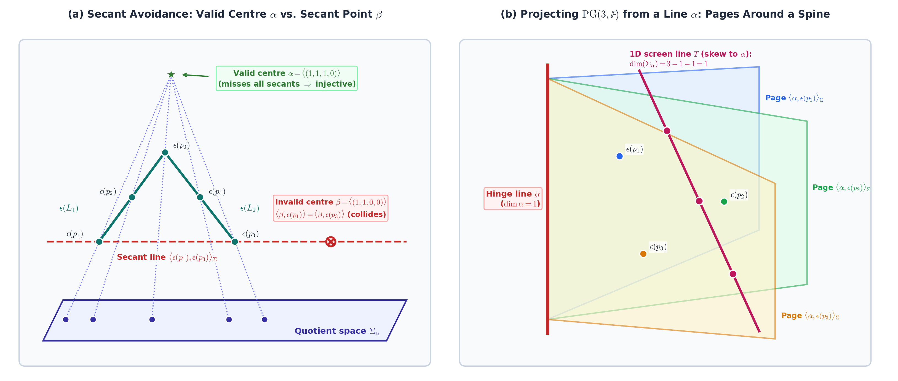

*Figure 13. Quotient projective embeddings $\epsilon / \alpha : \mathcal{S} \to \Sigma_\alpha$. (a) Secant avoidance: a centre $\beta = \langle(1, 1, 0, 0)\rangle$ outside $\epsilon(\mathcal{P})$ that lies on the secant line through $\epsilon(p_1)$ and $\epsilon(p_3)$ collapses both points onto the same ray, whereas $\alpha = \langle(1, 1, 1, 0)\rangle$ avoids all secants and keeps the quotient injective. (b) When $\alpha$ is a $1\text{D}$ line in $\mathrm{PG}(3, \mathbb{F})$, each point $\epsilon(p_i)$ spans a $2\text{D}$ plane ("page") $\langle \alpha, \epsilon(p_i) \rangle_\Sigma$ hinged on the spine $\alpha$, and a skew $1\text{D}$ screen line $T$ records each page as a single point of the $1\text{D}$ quotient $\Sigma_\alpha$.*

### Hyperplanes arising from an embedding

Whenever $\mathcal{S}$ is embedded in a projective space $\Sigma$ via a full projective embedding $\epsilon : \mathcal{S} \to \Sigma$, every projective hyperplane $\Pi$ of the ambient space $\Sigma$ slices $\mathcal{S}$ in a hyperplane $H_\Pi$ of $\mathcal{S}$ (often called a *geometric hyperplane* to distinguish it from the ambient projective hyperplane $\Pi$ of $\Sigma$), given by

$$H_\Pi = \epsilon^{-1}(\Pi \cap \epsilon(\mathcal{P})).$$

How can we be sure that a hyperplane of the ambient space will always slice $\mathcal{S}$ in a hyperplane of $\mathcal{S}$? Because in any projective space $\Sigma$, a projective line $L$ either lies completely inside the hyperplane $\Pi$ or meets $\Pi$ in a single point, and since $\epsilon$ is a full embedding, the points of $\mathcal{S}$ on each line cover the entire projective line in $\Sigma$. Furthermore, $H_\Pi \neq \mathcal{P}$ because $\epsilon(\mathcal{P})$ spans $\Sigma$ and therefore cannot be trapped inside a single hyperplane $\Pi$.

A hyperplane $H$ of $\mathcal{S}$ obtained by slicing $\mathcal{S}$ with an ambient projective hyperplane $\Pi \subset \Sigma$ is said to **arise from** the embedding $\epsilon$, and we denote by

$$\mathcal{H}_\epsilon = \{ H_\Pi \mid \Pi \text{ a hyperplane of } \Sigma \}$$

the set of all hyperplanes of $\mathcal{S}$ that arise from $\epsilon$.

Now suppose we project our embedding $\epsilon : \mathcal{S} \to \Sigma$ from an external point centre $\alpha$ in $\Sigma$ (or more generally, from a subspace $\alpha$ disjoint from the secants of $\epsilon(\mathcal{P})$) to get the quotient embedding $\epsilon / \alpha : \mathcal{S} \to \Sigma_\alpha$. Which ambient projective hyperplanes $\Pi$ of the upstairs space $\Sigma$ survive as projective hyperplanes of the downstairs quotient space $\Sigma_\alpha$?

If the hyperplane $\Pi \subset \Sigma$ contains the point centre $\alpha$ (or contains the subspace $\alpha$), then $\Pi$ is a union of projective lines passing through $\alpha$. In the quotient space $\Sigma_\alpha$, the image $\Pi_\alpha$ is a genuine projective hyperplane of $\Sigma_\alpha$, and it slices the projected geometry in the exact same subset of points $H_\Pi \subset \mathcal{P}$ as $\Pi$ did upstairs.

If the hyperplane $\Pi \subset \Sigma$ does not contain the point $\alpha$ ($\alpha \notin \Pi$), then because $\alpha$ lies outside $\Pi$, every projective line of $\Sigma$ passing through $\alpha$ must pierce the hyperplane $\Pi$ in a unique point. That means when you project from the lightbulb $\alpha$, the hyperplane $\Pi$ acts as a "projection screen" whose rays cover the *entire* quotient space $\Sigma_\alpha$. It no longer slices out a proper codimension-$1$ hyperplane in $\Sigma_\alpha$; projecting from $\alpha$ completely destroys $\Pi$ as a hyperplane.

We will verify this in coordinates on our $3$-vane fan $\mathcal{S}$ in the first worked example below (Figure 14 and panel (b) of Figure 15): the fan has $15$ hyperplanes in total ($7$ through the hub $p_0$ and $8$ missing $p_0$), all $15$ of which are realized upstairs in $\mathrm{PG}(3, 2)$ by its $15$ planes, whereas projecting from a valid point $\alpha \in \mathrm{PG}(3, 2)$ down to the Fano plane $\mathrm{PG}(2, 2)$ keeps only the $7$ planes passing through $\alpha$ and kills the other $8$.

#### How quotients shrink the hyperplane set and make universal embeddings unique

Comparing the hyperplane sets $\mathcal{H}_\epsilon$ of different embeddings gives a strict hierarchy among quotients. Notice as you read the next four results that finite dimension is never assumed: every step holds even when $\Sigma$ is infinite-dimensional.

**Isomorphic embeddings give the same hyperplanes.** Let $\epsilon_1$ and $\epsilon_2$ be two isomorphic full projective embeddings of the partial linear space $\mathcal{S} = (\mathcal{P}, \mathcal{L}, I)$. Then $\mathcal{H}_{\epsilon_1} = \mathcal{H}_{\epsilon_2}$.

To check this, write $\epsilon_1 : \mathcal{S} \to \Sigma_1$ and $\epsilon_2 : \mathcal{S} \to \Sigma_2$, and let $\phi : \Sigma_1 \to \Sigma_2$ be a projective-space isomorphism with $\epsilon_2 = \phi \circ \epsilon_1$. As $\Pi_1$ ranges over all hyperplanes of $\Sigma_1$, its image $\Pi_2 = \phi(\Pi_1)$ ranges bijectively over all hyperplanes of $\Sigma_2$, so $\mathcal{H}_{\epsilon_1} = \mathcal{H}_{\epsilon_2}$.

**Proper quotients lose hyperplanes strictly.** Let $\epsilon_1$ and $\epsilon_2$ be two full projective embeddings of the partial linear space $\mathcal{S} = (\mathcal{P}, \mathcal{L}, I)$ such that $\epsilon_2$ is isomorphic to a quotient of $\epsilon_1$. Then $\mathcal{H}_{\epsilon_2} \subseteq \mathcal{H}_{\epsilon_1}$. If $\epsilon_2$ is isomorphic to a proper quotient of $\epsilon_1$, then $\mathcal{H}_{\epsilon_2}$ is a proper subset of $\mathcal{H}_{\epsilon_1}$ ($\mathcal{H}_{\epsilon_2} \subsetneq \mathcal{H}_{\epsilon_1}$).

By the previous result we may assume $\epsilon_2 = \epsilon_1 / \alpha$ for a subspace $\alpha$ of $\Sigma_1$. Every hyperplane of $\Sigma_\alpha$ has the form $\Pi_\alpha$ for a hyperplane $\Pi$ of $\Sigma_1$ containing $\alpha$, and $\Pi_\alpha$ cuts out the same hyperplane of $\mathcal{S}$ as $\Pi$, so $\mathcal{H}_{\epsilon_2} \subseteq \mathcal{H}_{\epsilon_1}$. Now suppose $\alpha \neq \emptyset$ (panel (a) of Figure 15). Pick a point $x \in \alpha$. Since $\langle \epsilon_1(\mathcal{P}) \rangle_{\Sigma_1} = \Sigma_1$, we can choose a subset $\{y_1, \dots, y_k\} \subseteq \mathcal{P}$ with the fewest possible points ($k \ge 2$ since $x \notin \epsilon_1(\mathcal{P})$, and in fact $k \ge 3$ by secant avoidance) such that $x \in \langle \epsilon_1(y_1), \dots, \epsilon_1(y_k) \rangle_{\Sigma_1}$. By minimality, $\epsilon_1(y_k) \notin \langle \epsilon_1(y_1), \dots, \epsilon_1(y_{k-1}) \rangle_{\Sigma_1}$, so there is a hyperplane $\Pi'$ of $\Sigma_1$ containing $\epsilon_1(y_1), \dots, \epsilon_1(y_{k-1})$ and missing $\epsilon_1(y_k)$. Its slice $H_{\Pi'} \in \mathcal{H}_{\epsilon_1}$ contains $y_1, \dots, y_{k-1}$ and not $y_k$. Also by minimality, $x \notin \langle \epsilon_1(y_1), \dots, \epsilon_1(y_{k-1}) \rangle_{\Sigma_1}$, so $\epsilon_1(y_k) \in \langle \epsilon_1(y_1), \dots, \epsilon_1(y_{k-1}), x \rangle_{\Sigma_1}$; therefore any hyperplane $\Pi$ of $\Sigma_1$ through $\alpha$ that contains $\epsilon_1(y_1), \dots, \epsilon_1(y_{k-1})$ also contains $x$ and hence contains $\langle \epsilon_1(y_1), \dots, \epsilon_1(y_{k-1}), x \rangle_{\Sigma_1}$, which forces $\epsilon_1(y_k) \in \Pi$. Hence no hyperplane of $\Sigma_\alpha$ can cut out $H_{\Pi'}$, giving $H_{\Pi'} \in \mathcal{H}_{\epsilon_1} \setminus \mathcal{H}_{\epsilon_2}$ and $\mathcal{H}_{\epsilon_2} \subsetneq \mathcal{H}_{\epsilon_1}$.

**No full projective embedding is isomorphic to a proper quotient of itself.** A full projective embedding $\epsilon$ of a partial linear space $\mathcal{S} = (\mathcal{P}, \mathcal{L}, I)$ can never be isomorphic to one of its proper quotients.

Indeed, if $\epsilon$ were isomorphic to a proper quotient $\epsilon / \alpha$ ($\alpha \neq \emptyset$), the first result would give $\mathcal{H}_\epsilon = \mathcal{H}_{\epsilon/\alpha}$ while the second gives $\mathcal{H}_{\epsilon/\alpha} \subsetneq \mathcal{H}_\epsilon$, which is impossible.

#### Relatively versus absolutely universal embeddings

Once you can project an embedding down into smaller dimensions via quotients, the natural question is whether you can run the process backward: is there a "largest" master embedding at the top of the hierarchy from which other embeddings are just shadows (quotients)? Write $\epsilon' \ge \epsilon$ when a full projective embedding $\epsilon$ of $\mathcal{S}$ is isomorphic to a quotient of $\epsilon'$. There are maximal embeddings under this quotient order, called universal, and we can distinguish two levels of universality.

**Relatively universal embedding.** A full projective embedding $\tilde{\epsilon}$ of $\mathcal{S}$ is called **relatively universal** if it is not isomorphic to a *proper* quotient of any full projective embedding of $\mathcal{S}$. That is, for any full projective embedding $\epsilon'$ of $\mathcal{S}$, if $\epsilon' \ge \tilde{\epsilon}$, then $\epsilon' \cong \tilde{\epsilon}$ (the projection subspace $\alpha$ must be empty). Ronan proved that every full projective embedding $\epsilon$ is isomorphic to a quotient of a uniquely determined (up to isomorphism) relatively universal embedding $\tilde{\epsilon}$ lying above it.

**Absolutely universal embedding.** A full projective embedding $\tilde{\epsilon} : \mathcal{S} \to \Sigma$ is called **absolutely universal** if *every* full projective embedding $\epsilon$ of $\mathcal{S}$ into *any* nondegenerate projective space is isomorphic to a quotient of $\tilde{\epsilon}$ (that is, $\tilde{\epsilon} \ge \epsilon$ for all full embeddings $\epsilon$ of $\mathcal{S}$).

So a *relatively universal* embedding is a "local peak": you cannot un-project it into a higher dimension without breaking the geometry, so it sits at the top of its own family of shadows.

An *absolutely universal* embedding is the *single global peak*: if a geometry possesses an absolutely universal embedding $\tilde{\epsilon}$, then *every* possible full projective embedding of $\mathcal{S}$ is obtained simply by choosing a secant-avoiding subspace $\alpha$ (your centre of projection) inside $\tilde{\epsilon}$'s ambient space and taking the quotient $\tilde{\epsilon} / \alpha$.

The absolutely universal embedding is unique. Formally, if $\tilde{\epsilon}_1$ and $\tilde{\epsilon}_2$ are two absolutely universal embeddings of a partial linear space $\mathcal{S} = (\mathcal{P}, \mathcal{L}, I)$, then $\tilde{\epsilon}_1$ and $\tilde{\epsilon}_2$ are isomorphic ($\tilde{\epsilon}_1 \cong \tilde{\epsilon}_2$).

Suppose for contradiction that $\tilde{\epsilon}_1$ and $\tilde{\epsilon}_2$ are not isomorphic. Because $\tilde{\epsilon}_1$ is absolutely universal, $\tilde{\epsilon}_2$ is isomorphic to a quotient $\tilde{\epsilon}_1 / \alpha_1$, and since $\tilde{\epsilon}_2 \not\cong \tilde{\epsilon}_1$, we have $\alpha_1 \neq \emptyset$, making $\tilde{\epsilon}_2$ isomorphic to a proper quotient of $\tilde{\epsilon}_1$. By the same reasoning, since $\tilde{\epsilon}_2$ is absolutely universal, $\tilde{\epsilon}_1$ is isomorphic to a proper quotient of $\tilde{\epsilon}_2$. Composing the two projections would make $\tilde{\epsilon}_1$ isomorphic to a proper quotient of itself (and give $\mathcal{H}_{\tilde{\epsilon}_1} \subsetneq \mathcal{H}_{\tilde{\epsilon}_2} \subsetneq \mathcal{H}_{\tilde{\epsilon}_1}$), contradicting the previous result.

### Geometries with three points per line have an absolutely universal embedding

For a general partial linear space, deciding whether any full projective embedding exists is a hard problem, and even when embeddings exist there need not be an absolutely universal one because a geometry can embed over two non-isomorphic fields that are not quotients of any common projective space.

However, when every line of $\mathcal{S}$ has $3$ points, Mark Ronan proved that the hyperplanes of $\mathcal{S}$ settle existence and universality completely.

**Ronan's theorem.** Let $\mathcal{S} = (\mathcal{P}, \mathcal{L}, I)$ be a partial linear space, every line of which is incident with precisely three points. Then three properties hold:

- $\mathcal{S}$ has full projective embeddings if and only if for every two distinct points $x_1$ and $x_2$ of $\mathcal{S}$, there exists a hyperplane of $\mathcal{S}$ containing $x_1$ and not $x_2$ (that is, hyperplanes separate distinct points);
- if $\mathcal{S}$ has a full projective embedding, then $\mathcal{S}$ also has an absolutely universal embedding $\tilde{\epsilon}$ (unique up to isomorphism);
- if $\mathcal{S}$ has a full projective embedding, then all hyperplanes of $\mathcal{S}$ arise from the absolutely universal embedding $\tilde{\epsilon}$ of $\mathcal{S}$.

Why does having $3$ points on every line simplify the picture so cleanly, even though the statement of Ronan's theorem never mentions a field? Under any full projective embedding $\epsilon : \mathcal{S} \to \Sigma$, every $3$-point line of $\mathcal{S}$ maps bijectively onto a full line of the nondegenerate projective space $\Sigma$, so every line of $\Sigma$ also has $3 = 2 + 1$ points. Every nondegenerate projective space with $3$ points per line is isomorphic to $\mathrm{PG}(V)$ for a vector space $V$ over the binary field $\mathbb{F}_2 = \{0, 1\}$ (this also holds in dimension $2$, where the Fano plane $\mathrm{PG}(2, 2)$ is the [unique projective plane of order $2$](#projective-planes-degenerate-vs-nondegenerate)). Over $\mathbb{F}_2$, there is only one field to embed over, and three distinct nonzero vectors $u, v, w$ form a projective line if and only if $u + v + w = 0$.

That also makes both directions of Ronan's point-separation test easy to grasp. In the forward direction, if $\epsilon : \mathcal{S} \to \Sigma$ is a full projective embedding and $x_1 \neq x_2$ in $\mathcal{P}$, injectivity gives $\epsilon(x_1) \neq \epsilon(x_2)$ in $\Sigma$; picking a hyperplane $\Pi$ of $\Sigma$ through $\epsilon(x_1)$ that misses $\epsilon(x_2)$ produces an induced hyperplane $H_\Pi \in \mathcal{H}_\epsilon$ containing $x_1$ and not $x_2$. Conversely, suppose hyperplanes separate every pair of distinct points of $\mathcal{S}$. Take an $\mathbb{F}_2$-vector space $V$ with one basis vector $e_x$ for each point $x \in \mathcal{P}$, form the quotient $\widetilde{V} = V / U$ by the subspace $U$ spanned by $e_x + e_y + e_z$ for every $3$-point line $\{x, y, z\} \in \mathcal{L}$, and send each point $x$ to $\tilde{\epsilon}(x) = \langle e_x + U \rangle$ in $\mathrm{PG}(\widetilde{V})$. The three images of a line add up to zero, so they form a line of $\mathrm{PG}(\widetilde{V})$ as soon as we know that they are distinct and nonzero. The hyperplanes give us that.

Each hyperplane $H$ of $\mathcal{S}$ defines a linear functional $f_H$ on $V$, taking $e_x$ to $1$ when $x \notin H$ and to $0$ when $x \in H$. Every line has $0$ or $2$ points outside $H$, so $f_H$ vanishes on $U$ and is a functional on $\widetilde{V}$. If $H$ contains $x_1$ but not $x_2$, then $f_H$ is $0$ on $e_{x_1} + U$ and $1$ on $e_{x_2} + U$, so these two vectors differ and the second one is nonzero. Every point plays the part of $x_2$ for some pair, so every image is nonzero and distinct points have distinct images. The images span $\widetilde{V}$, so $\tilde{\epsilon}$ is a full projective embedding. The points that $f_H$ sends to $0$ are exactly the points of $H$, so every hyperplane of $\mathcal{S}$ arises from $\tilde{\epsilon}$. Finally, any full projective embedding $\epsilon$ of $\mathcal{S}$ into some $\mathrm{PG}(W)$ over $\mathbb{F}_2$ comes from $\tilde{\epsilon}$: sending each $e_x$ to the vector of $\epsilon(x)$ takes every line relation to zero, so it gives a linear map from $\widetilde{V}$ onto $W$, and $\epsilon$ is isomorphic to the quotient of $\tilde{\epsilon}$ by the subspace that this map sends to zero. That is why $\tilde{\epsilon}$ is absolutely universal.

When lines have four or more points ($\lvert L \rvert \ge 4$), hyperplanes no longer settle existence or universality, and the general theory needs other tools.

#### Why universal embeddings and hyperplanes matter

Once you know a geometry $\mathcal{S}$ has an absolutely universal embedding $\tilde{\epsilon} : \mathcal{S} \to \mathrm{PG}(\widetilde{V})$ (say of dimension $\tilde{n}$), what does it actually buy you, and why are the hyperplanes of $\mathcal{S}$ the centerpiece of the theory?

There are four major reasons why we want to compute the universal embedding and its hyperplanes.

**A complete atlas of all possible embeddings.** Without a universal embedding, someone could hand you an abstract geometry $\mathcal{S}$ and you might find one embedding in $\mathrm{PG}(4, q)$ and another in $\mathrm{PG}(5, q)$, never knowing if there is a further embedding in $\mathrm{PG}(12, q)$ or a completely different embedding in $\mathrm{PG}(4, q)$.

Once you have the *absolutely universal embedding* $\tilde{\epsilon} : \mathcal{S} \to \Sigma_{\text{univ}}$, the search is complete. Every other full projective embedding of $\mathcal{S}$ is guaranteed to be a shadow $\tilde{\epsilon} / \alpha$ obtained by picking a subspace $\alpha \subset \Sigma_{\text{univ}}$ that avoids the secants of $\tilde{\epsilon}(\mathcal{P})$. Under our definition of isomorphic embeddings ($\epsilon_2 = \phi \circ \epsilon_1$, which fixes each point of $\mathcal{S}$), distinct valid centres $\alpha \subset \Sigma_{\text{univ}}$ give non-isomorphic quotients $\tilde{\epsilon} / \alpha$; classifying the orbits of the automorphism group $\mathrm{Aut}(\mathcal{S})$ on the valid projection subspaces $\alpha \subset \Sigma_{\text{univ}}$ classifies all full embeddings of $\mathcal{S}$ up to automorphisms of $\mathcal{S}$.

**Dualizing the problem: hyperplanes as points of the dual space.** Why do we spend so much time talking about the hyperplanes of $\mathcal{S}$? Because in projective geometry, *hyperplanes of $\Sigma$ are points of the dual projective space $\Sigma^*$*.

Suppose $\epsilon : \mathcal{S} \to \Sigma$ is a full projective embedding. Every projective hyperplane $\Pi \subset \Sigma$ slices $\epsilon(\mathcal{P})$ in a hyperplane $H_\Pi = \epsilon^{-1}(\Pi \cap \epsilon(\mathcal{P})) \in \mathcal{H}_\epsilon$ of $\mathcal{S}$. When lines have four or more points ($q \ge 3$), two distinct projective hyperplanes $\Pi_1 \neq \Pi_2$ of $\Sigma$ can cut out the same hyperplane of $\mathcal{S}$: for example, two $4$-point lines of $\mathrm{PG}(2, 3)$ through a point $x$ form a fully embedded $7$-point cross spanning $\mathrm{PG}(2, 3)$, and the other two lines of $\mathrm{PG}(2, 3)$ through $x$ both cut out the singleton $\{x\}$ ($12$ distinct cuts from $13$ projective lines). When every line of $\mathcal{S}$ has $3$ points ($q = 2$, over $\mathbb{F}_2$), however, the map $\Pi \mapsto H_\Pi$ is a bijection.

Over $\mathbb{F}_2$, two different projective hyperplanes $\Pi_1 \neq \Pi_2$ of $\Sigma$ *must* cut out two different hyperplanes $H_{\Pi_1} \neq H_{\Pi_2}$ of $\mathcal{S}$: if $\Pi_1 = \ker(f_1)$ and $\Pi_2 = \ker(f_2)$ met $\epsilon(\mathcal{P})$ in the same subset, the nonzero functional $f_1 + f_2$ would vanish on all of $\epsilon(\mathcal{P})$, so the third hyperplane $\Pi_3 = \ker(f_1 + f_2)$ through $\Pi_1 \cap \Pi_2$ would contain all of $\epsilon(\mathcal{P})$, contradicting $\langle \epsilon(\mathcal{P}) \rangle_\Sigma = \Sigma$. For $3$-point-per-line geometries, this gives a *direct counting formula for the embedding dimension*: if a full embedding $\epsilon : \mathcal{S} \to \mathrm{PG}(n, 2)$ induces $N_\epsilon = \lvert \mathcal{H}_\epsilon \rvert$ hyperplanes of $\mathcal{S}$, then $N_\epsilon$ is the exact number of projective hyperplanes in $\mathrm{PG}(n, 2)$:

$$N_\epsilon = \lvert \mathcal{H}_\epsilon \rvert = 2^{n+1} - 1.$$

*What happens when you project from a point $x \in \Sigma$ ($\epsilon \to \epsilon / \langle x \rangle$)?* As we saw above, a projective hyperplane $\Pi \subset \Sigma$ survives in the quotient space $\Sigma_{\langle x \rangle}$ *if and only if $x \in \Pi$*. Over $\mathbb{F}_2$, flip that statement around using duality: *picking a projection centre $x \in \Sigma$ is equivalent to picking a hyperplane in the dual space $\Sigma^*$, which is just a collection of hyperplanes of $\mathcal{S}$.* Thus, in the $3$-points-per-line setting, instead of hunting for invisible points $x$ floating out in an unknown ambient space $\Sigma$ outside $\mathcal{S}$, you can stay *entirely inside $\mathcal{S}$* and study subsets of hyperplanes of $\mathcal{S}$. Every projection centre $x$ is uniquely identified by the exact list of hyperplanes of $\mathcal{S}$ that survive the projection.

**Describing specific sub-objects inside $\mathcal{S}$ (ovoids, sub-geometries, tangent cones).** In a [polar space](#polar-spaces) or [generalized quadrangle](#generalized-quadrangles) $\mathcal{S}$ (such as the $15$-point doily $W(3, 2)$ in Figure 9), the hyperplanes of $\mathcal{S}$ are not random subsets; they are fundamental geometric sub-objects. *Tangent cones ($x^\perp$)* are the sets of all points collinear with a given point $x \in \mathcal{P}$ (including $x$). *Sub-geometries* are embedded smaller polar spaces (for example, an elliptic or hyperbolic quadric inside a symplectic space). *Ovoids* are sets of points that meet every line in *exactly one* point (a hyperplane of $\mathcal{S}$ that contains no lines at all).

Knowing that every hyperplane of $\mathcal{S}$ arises from a projective hyperplane slice of $\tilde{\epsilon}$ (a famous theorem for classical polar spaces and several near polygons) describes every hyperplane of $\mathcal{S}$, ovoids and sub-geometries included, as a linear hyperplane section $a_0 x_0 + \dots + a_n x_n = 0$ of the universal embedding. If a geometry has an "exceptional" hyperplane that does *not* come from a flat hyperplane slice in $\mathrm{PG}(n, q)$, the universal embedding $\tilde{\epsilon}$ can live in a higher dimension precisely to turn that exceptional hyperplane into a flat hyperplane slice; this is guaranteed when every line has $3$ points (Ronan's third property), though in general not every hyperplane arises from the universal embedding.

**Linearizing the automorphism group $\mathrm{Aut}(\mathcal{S})$ (representation theory).** An abstract point-line geometry $\mathcal{S}$ has an automorphism group $G = \mathrm{Aut}(\mathcal{S})$ of permutations of points and lines. Studying a raw permutation group is hard.

However, if $\mathcal{S}$ has an absolutely universal embedding $\tilde{\epsilon} : \mathcal{S} \to \mathrm{PG}(\widetilde{V})$, the universality property forces *every* automorphism $g \in \mathrm{Aut}(\mathcal{S})$ to lift, uniquely up to a nonzero scalar (and strictly uniquely over $\mathbb{F}_2$), to a linear (or semilinear) transformation of the vector space $\widetilde{V}$. In other words, the universal embedding space $\widetilde{V}$ is a *canonical matrix representation* of $\mathrm{Aut}(\mathcal{S})$ (often related to Weyl modules or spin modules of Lie-type groups: at $q = 2$, for instance, the universal embedding of the symplectic polar space $W(5, 2)$ for $\mathrm{Sp}(6, 2)$ is $15$-dimensional and that of the split Cayley hexagon $H(2)$ for $G_2(2)$ is $14$-dimensional, both larger than their natural $6$- and $7$-dimensional embeddings). The subspaces $\alpha \subset \mathrm{PG}(\widetilde{V})$ that are fixed by $\mathrm{Aut}(\mathcal{S})$ correspond to invariant submodules of $\widetilde{V}$, meaning that projecting by $\alpha$ corresponds to taking quotient modules in representation theory.

In short, the universal embedding turns pure combinatorics ($\mathcal{S}$) into linear algebra ($\widetilde{V}$), and for geometries with three points per line, the hyperplanes of $\mathcal{S}$ are the exact coordinate dual vectors ($\widetilde{V}^*$) that measure the dimension of $\widetilde{V}$ and locate every valid centre of projection without ever leaving $\mathcal{S}$.

### Three worked examples with three-point lines

We can see all three behaviors on small partial linear spaces with $3$-point lines: one whose universal embedding projects onto a proper quotient, one whose universal embedding has no proper quotients, and one that cannot be embedded anywhere.

#### The 3-vane fan: universal embedding in PG(3, 2) and Fano quotient in PG(2, 2)

Look at Figure 14 and panel (b) of Figure 15 below. Let $\mathcal{S} = (\mathcal{P}, \mathcal{L}, I)$ have $7$ points $\mathcal{P} = \{p_0, p_1, p_2, p_3, p_4, p_5, p_6\}$ arranged on $3$ concurrent $3$-point lines fanning out from the hub $p_0$:

$$L_1 = \{p_0, p_1, p_2\}, \quad L_2 = \{p_0, p_3, p_4\}, \quad L_3 = \{p_0, p_5, p_6\}.$$

This fan is not a [$(3, 3, 3)$-star](#classes-of-point-line-geometries). A star also joins points on different rays by thin $2$-point lines, to make a linear space, and those thin lines rule out any full projective embedding. The fan has only the three $3$-point lines $L_1, L_2, L_3$.

First count all hyperplanes $H \subsetneq \mathcal{P}$ of $\mathcal{S}$ by hand, using $\lvert H \cap L_i \rvert \in \{1, 3\}$ on each of the three vanes (Figure 14). If $p_0 \in H$, then $p_0$ already accounts for one point on every $L_i$, so on each vane $H$ must contain either none or both of $\{p_{2i-1}, p_{2i}\}$. Ruling out the choice that takes all three full vanes (which would give $H = \mathcal{P}$), we get $2^3 - 1 = 7$ hyperplanes through $p_0$ (Figure 14(a)): the singleton $\{p_0\}$ (size $1$), the $3$ single lines $L_1, L_2, L_3$ (size $3$), and the $3$ two-vane unions $L_1 \cup L_2, L_1 \cup L_3, L_2 \cup L_3$ (size $5$). If instead $p_0 \notin H$, then $\lvert H \cap L_i \rvert$ cannot be $3$, so $\lvert H \cap L_i \rvert = 1$ on every vane: $H$ picks one point from $\{p_1, p_2\}$, one from $\{p_3, p_4\}$, and one from $\{p_5, p_6\}$, giving $2 \times 2 \times 2 = 8$ three-point [ovoids](#partial-linear-spaces) missing $p_0$ (Figure 14(b)). In total, $\mathcal{S}$ has $7 + 8 = 15$ hyperplanes. They separate every pair of distinct points ($\{p_0\}$ separates $p_0$ from every other point, and the $8$ ovoids separate any two points among $p_1, \dots, p_6$), so Ronan's theorem guarantees an absolutely universal embedding $\tilde{\epsilon}$ from which all $15$ hyperplanes arise.

We can write $\tilde{\epsilon} : \mathcal{S} \to \mathrm{PG}(3, 2)$ explicitly in $\mathbb{F}_2^4$ (writing coordinates $(x_0, x_1, x_2, x_3)$ horizontally to match the figure) by sending the four independent points $p_1, p_3, p_5, p_0$ to the standard basis vectors and fixing $p_2, p_4, p_6$ via the $\mathbb{F}_2$-line rule $\tilde{\epsilon}(p_{2i}) = \tilde{\epsilon}(p_0) + \tilde{\epsilon}(p_{2i-1})$:

$$\begin{aligned} \tilde{\epsilon}(p_0) &= \langle(0, 0, 0, 1)\rangle, \\ \tilde{\epsilon}(p_1) &= \langle(1, 0, 0, 0)\rangle, \quad \tilde{\epsilon}(p_2) = \langle(1, 0, 0, 1)\rangle, \\ \tilde{\epsilon}(p_3) &= \langle(0, 1, 0, 0)\rangle, \quad \tilde{\epsilon}(p_4) = \langle(0, 1, 0, 1)\rangle, \\ \tilde{\epsilon}(p_5) &= \langle(0, 0, 1, 0)\rangle, \quad \tilde{\epsilon}(p_6) = \langle(0, 0, 1, 1)\rangle. \end{aligned}$$

These $7$ vectors are distinct and span $\mathbb{F}_2^4$, so $\tilde{\epsilon}$ is a full projective embedding into $\mathrm{PG}(3, 2)$. As noted [in the prologue](#linear-algebra-over-finite-fields), $\mathrm{PG}(3, 2)$ has $2^4 - 1 = 15$ planes $a_0 x_0 + a_1 x_1 + a_2 x_2 + a_3 x_3 = 0$, one for each nonzero functional $(a_0, a_1, a_2, a_3) \in \mathbb{F}_2^4$, and each plane cuts out a different hyperplane of $\mathcal{S}$ (Figure 14): for example, $x_0 + x_1 + x_2 = 0$ cuts out the singleton $\{p_0\}$, while $x_2 = 0$ cuts out the two-vane union $L_1 \cup L_2 = \{p_0, p_1, p_2, p_3, p_4\}$. Thus $\lvert \mathcal{H}_{\tilde{\epsilon}} \rvert = 15$.

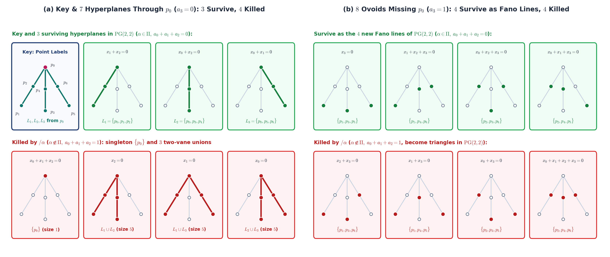

*Figure 14. All $15$ hyperplanes of the $3$-vane fan $\mathcal{S}$ cut out by the $15$ planes $a_0 x_0 + a_1 x_1 + a_2 x_2 + a_3 x_3 = 0$ of $\mathrm{PG}(3, 2)$, grouped by whether they contain $\alpha = \langle(1, 1, 1, 0)\rangle$ ($a_0 + a_1 + a_2 = 0$, green, surviving into $\mathrm{PG}(2, 2)$) or miss $\alpha$ ($a_0 + a_1 + a_2 = 1$, red, killed by the projection). (a) Of the $7$ hyperplanes through $p_0$ ($a_3 = 0$), the $3$ single vanes $L_i$ survive while $\{p_0\}$ and the $3$ two-vane unions $L_i \cup L_j$ are killed. (b) Of the $8$ three-point ovoids missing $p_0$ ($a_3 = 1$), $4$ become the new Fano lines of $\mathrm{PG}(2, 2)$ while the other $4$ become non-collinear triples and are killed.*

Now look for a proper quotient $\epsilon_2 = \tilde{\epsilon} / \alpha : \mathcal{S} \to \mathrm{PG}(2, 2)$ by checking which of the $15 - 7 = 8$ points of $\mathrm{PG}(3, 2) \setminus \tilde{\epsilon}(\mathcal{P})$ miss every secant line of $\tilde{\epsilon}(\mathcal{P})$. Missing the $7$ embedded points is not enough: $\langle(1, 1, 0, 0)\rangle$ is not one of them, but it lies on the secant line through $\tilde{\epsilon}(p_1)$ and $\tilde{\epsilon}(p_3)$ (Figure 13(a)), so projecting from it would send $p_1$ and $p_3$ to the same point. Because each $\tilde{\epsilon}(p_i)$ has at most one $1$ among its first three coordinates $(x_0, x_1, x_2)$, the $7$ embedded points together with all $\binom{7}{2} = 21$ pairwise sums $\tilde{\epsilon}(p_i) + \tilde{\epsilon}(p_j) \pmod{2}$ produce precisely the nonzero vectors with at most two $1$'s in $(x_0, x_1, x_2)$ (covering $13$ of the $15$ points of $\mathrm{PG}(3, 2)$), leaving two valid $0$-dimensional projection centres:

$$\alpha = \langle(1, 1, 1, 0)\rangle \quad \text{and} \quad \alpha' = \langle(1, 1, 1, 1)\rangle.$$

Pick $\alpha = \langle(1, 1, 1, 0)\rangle$. Projecting $\mathrm{PG}(3, 2)$ from $\alpha$ gives $\Sigma_\alpha \cong \mathrm{PG}(2, 2)$, the $7$-point Fano plane, and $\epsilon_2 = \tilde{\epsilon} / \alpha$ maps the $7$ points of $\mathcal{S}$ one-to-one onto the $7$ points of $\mathrm{PG}(2, 2)$ (panel (b) of Figure 15). We can watch our strict-subset proof play out directly on $x = (1, 1, 1, 0) \in \alpha$. Its shortest expression as a sum of embedded points uses $k = 3$ points:

$$(1, 1, 1, 0) = (1, 0, 0, 0) + (0, 1, 0, 0) + (0, 0, 1, 0) = \tilde{\epsilon}(p_1) + \tilde{\epsilon}(p_3) + \tilde{\epsilon}(p_5).$$

Up in $\mathrm{PG}(3, 2)$, the plane $\Pi' : x_2 = 0$ contains $\tilde{\epsilon}(p_1)$ and $\tilde{\epsilon}(p_3)$ while missing $\tilde{\epsilon}(p_5)$ (and missing $\alpha$), cutting out $H' = \{p_0, p_1, p_2, p_3, p_4\} \in \mathcal{H}_{\tilde{\epsilon}}$. Down in the quotient $\mathrm{PG}(2, 2)$, working modulo $(1, 1, 1, 0)$ turns that sum into $\epsilon_2(p_1) + \epsilon_2(p_3) + \epsilon_2(p_5) = 0$, so $\{p_1, p_3, p_5\}$ collapses into a new Fano line (drawn as the dashed red base line in panel (b) of Figure 15). Any line of $\mathrm{PG}(2, 2)$ containing $p_1$ and $p_3$ is that new Fano line and therefore contains $p_5$ too, killing $H'$. Only the $7$ planes of $\mathrm{PG}(3, 2)$ with $a_0 + a_1 + a_2 = 0 \pmod{2}$ (those passing through $\alpha = \langle(1, 1, 1, 0)\rangle$) survive into $\mathcal{H}_{\tilde{\epsilon}/\alpha}$, leaving the $7$ Fano lines ($\lvert \mathcal{H}_{\tilde{\epsilon}/\alpha} \rvert = 7 < 15 = \lvert \mathcal{H}_{\tilde{\epsilon}} \rvert$).

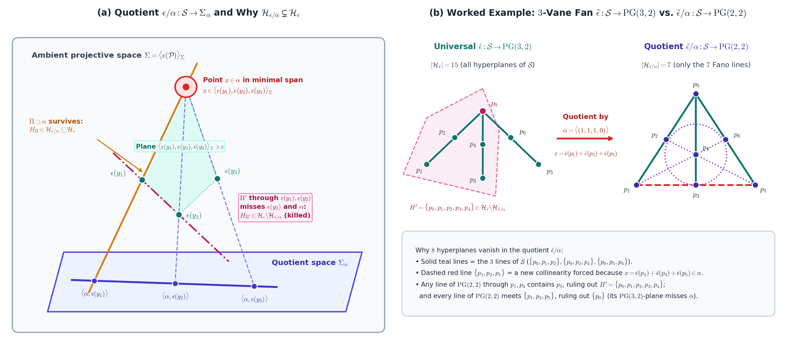

*Figure 15. (a) Why a proper quotient $\epsilon / \alpha$ strictly shrinks the hyperplane set ($\mathcal{H}_{\epsilon/\alpha} \subsetneq \mathcal{H}_\epsilon$): a hyperplane $\Pi \supset \alpha$ projects to a hyperplane $\Pi_\alpha$ of $\Sigma_\alpha$, whereas for $x \in \alpha$ in the span of a minimal set $\{\epsilon(y_1), \epsilon(y_2), \epsilon(y_3)\}$, a hyperplane $\Pi'$ through $\epsilon(y_1), \epsilon(y_2)$ missing $\epsilon(y_3)$ also misses $\alpha$ and is destroyed by the projection. (b) For the $3$-vane fan $\mathcal{S}$, projecting its universal embedding $\tilde{\epsilon} : \mathcal{S} \to \mathrm{PG}(3, 2)$ ($15$ hyperplanes) from $\alpha = \langle(1, 1, 1, 0)\rangle$ onto $\mathrm{PG}(2, 2)$ collapses $\{p_1, p_3, p_5\}$ into a Fano line (dashed red), killing $\Pi' : x_2 = 0$ ($H' = L_1 \cup L_2$) and leaving only the $7$ Fano lines in $\mathcal{H}_{\tilde{\epsilon}/\alpha}$.*

#### The 3-by-3 grid: universal embedding with no proper quotients

Next return to the $3 \times 3$ grid $\mathcal{S} = Q^+(3, 2)$ ($9$ points in $3$ rows and $3$ columns, $6$ lines of $3$ points), embedded in $\mathrm{PG}(3, 2)$ as the hyperbolic quadric $x_0 x_3 + x_1 x_2 = 0$: we already [found earlier](#partial-linear-spaces) (Figure 3) that it has $15$ hyperplanes in total ($9$ five-point crosses $x^\perp$ cut out by tangent planes, and $6$ three-point ovoids cut out by the other $6$ planes, each meeting the quadric in a $3$-point conic), and that all $15$ of them come from the $15$ planes of $\mathrm{PG}(3, 2)$.

Our quotient hierarchy and Ronan's theorem now tell us two further things about this quadric embedding. First, Ronan's theorem gives the grid an absolutely universal embedding, and the quadric embedding is isomorphic to a quotient of it. That quotient cannot be proper: a proper quotient induces strictly fewer hyperplanes than the embedding it comes from, and the quadric embedding already induces all $15$. So $\tilde{\epsilon} : Q^+(3, 2) \to \mathrm{PG}(3, 2)$ is itself the absolutely universal embedding of the grid. Second, $\tilde{\epsilon}$ has *no* proper quotients: projecting $\mathrm{PG}(3, 2)$ from a point, a line or a plane gives the $7$-point Fano plane $\mathrm{PG}(2, 2)$, a $3$-point line or a single point, and none of these can receive $9$ points injectively (equivalently, every one of the $15 - 9 = 6$ points of $\mathrm{PG}(3, 2)$ outside $Q^+(3, 2)$ lies on secant lines joining noncollinear pairs of grid points). Thus the quadric embedding in $\mathrm{PG}(3, 2)$ is the unique full projective embedding of $Q^+(3, 2)$ up to isomorphism.

#### The affine plane AG(2, 3): three points per line, zero hyperplanes, no embedding

Finally recall the [affine plane $\mathrm{AG}(2, 3)$](#unitals-inversive-planes-and-witt-mathieu-designs) over $\mathbb{F}_3$ (Figure 8(a)), the Steiner triple system $S(2, 3, 9)$ with $9$ points and $12$ lines of $3$ points obtained by [deleting one line at infinity](maths_3_projective_geometry.md#projective-affine-spaces) from $\mathrm{PG}(2, 3)$.

It is tempting to object that $\mathrm{AG}(2, 3)$ already sits inside the projective plane $\mathrm{PG}(2, 3)$. Check the line sizes, though: every projective line of $\mathrm{PG}(2, 3)$ has $4$ points, whereas each affine line of $\mathrm{AG}(2, 3)$ has only $3$ points. Including $\mathrm{AG}(2, 3)$ into $\mathrm{PG}(2, 3)$ maps each affine line into three of the four points of a projective line rather than *onto* the full line, so it is not a full projective embedding.

Could $\mathrm{AG}(2, 3)$ have a *full* projective embedding into some other projective space (which would have to be over $\mathbb{F}_2$, since its lines have size $3$)? Use Ronan's theorem and search for a hyperplane $H \subsetneq \mathcal{P}$ of $\mathrm{AG}(2, 3)$, meaning a proper subset meeting each of the $12$ affine lines in $1$ or $3$ points (Figure 16). Clearly $H$ cannot be empty, since $\lvert \emptyset \cap L \rvert = 0$. Pick a point $p \in H$ (Figure 16(a)). The $4$ lines of $\mathrm{AG}(2, 3)$ passing through $p$ partition the remaining $8$ points of $\mathcal{P} \setminus \{p\}$. On each of those $4$ lines, $p$ is already in $H$, so $\lvert H \cap L \rvert \in \{1, 3\}$ leaves either $0$ or $2$ additional points of $H$ on that line (an even number). Adding those four even counts to $p$ itself shows that $\lvert H \rvert$ must be *odd*. Now pick a point $q \notin H$, which exists because $H \neq \mathcal{P}$ (Figure 16(b)). The $4$ lines of $\mathrm{AG}(2, 3)$ through $q$ partition $\mathcal{P} \setminus \{q\}$, and on each of those $4$ lines, having $q \notin H$ rules out $\lvert H \cap L \rvert = 3$ and forces $\lvert H \cap L \rvert = 1$. Summing across the $4$ lines through $q$ gives $\lvert H \rvert = 1 + 1 + 1 + 1 = 4$, which is *even*. No set can have size equal to $4$ and odd at the same time, so $\mathrm{AG}(2, 3)$ has *zero* hyperplanes and, by Ronan's theorem, no full projective embedding at all.

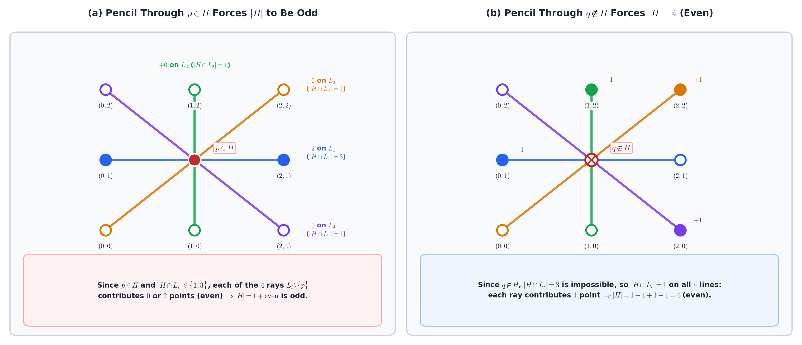

*Figure 16. Why $\mathrm{AG}(2, 3)$ has no hyperplanes (and hence, by Ronan's theorem, no full projective embedding). (a) The $4$ affine lines through any point $p \in H$ partition the other $8$ points into $4$ pairs; since $\lvert H \cap L_i \rvert \in \{1, 3\}$, each pair contributes $0$ or $2$ points to $H$, so $\lvert H \rvert = 1 + \text{even}$ must be odd. (b) The $4$ affine lines through any point $q \notin H$ also partition the other $8$ points into $4$ pairs; since $q \notin H$, each line must meet $H$ in $1$ point, forcing $\lvert H \rvert = 1 + 1 + 1 + 1 = 4$ (even), a contradiction.*

| Geometry $\mathcal{S}$ | Size | Hyperplanes | Full embeddings |
| --- | --- | --- | --- |
| $3$-vane fan | $7$ pts, $3$ lines | $15$ | $\mathrm{PG}(3, 2)$ ($\lvert \mathcal{H}_{\tilde{\epsilon}} \rvert = 15$); quotient $\mathrm{PG}(2, 2)$ ($\lvert \mathcal{H}_{\tilde{\epsilon}/\alpha} \rvert = 7$) |
| Grid $Q^+(3, 2)$ | $9$ pts, $6$ lines | $15$ | $\mathrm{PG}(3, 2)$ ($\lvert \mathcal{H}_{\tilde{\epsilon}} \rvert = 15$); no proper quotients |
| $\mathrm{AG}(2, 3)$ | $9$ pts, $12$ lines | $0$ | None |

## Generalized Polygons

We have already met [projective planes](#projective-planes-degenerate-vs-nondegenerate) ($n = 3$), [generalized quadrangles](#generalized-quadrangles) ($n = 4$), and Jacques Tits's unified [definition of generalized $n$-gons through ordinary $n$-gon subgeometries](#definition-via-ordinary-n-gon-subgeometries), along with the statement of the [Feit–Higman theorem](#the-feithigman-theorem-and-order-bounds) restricting finite thick generalized $n$-gons ($n \ge 3$) to $n \in \{3, 4, 6, 8\}$. Two central questions remain open from that overview. First, how do three qualitative axioms about ordinary $n$-gon subgeometries force such rigid global structure, including unique shortest paths below the diameter, equal degrees for opposite elements, uniform orders $(s, t)$ for all thick polygons, and three equivalent ways to recognize a generalized polygon? Second, how does the distance-regular algebra of the collinearity graph rule out every finite thick generalized $n$-gon outside $n \in \{2, 3, 4, 6, 8\}$?

### Definition and small-n equivalences

#### Recalling the polygon axioms

Recall from our [earlier overview of generalized polygons](#definition-via-ordinary-n-gon-subgeometries) that a [generalized $2$-gon (or generalized digon)](#classes-of-point-line-geometries) has $\lvert \mathcal{P} \rvert, \lvert \mathcal{L} \rvert \ge 2$ with every point incident with every line ($I = \mathcal{P} \times \mathcal{L}$), while for $n \ge 3$ a generalized $n$-gon is a [partial linear space](#partial-linear-spaces) $\mathcal{S} = (\mathcal{P}, \mathcal{L}, I)$ satisfying three axioms on its [ordinary $m$-gon](#classes-of-point-line-geometries) [subgeometries](#partial-linear-spaces), which we label (GP1)–(GP3):

- (GP1) $\mathcal{S}$ has no subgeometries that are ordinary $m$-gons for any $m \in \{3, 4, \dots, n - 1\}$ (vacuous when $n = 3$);
- (GP2) $\mathcal{S}$ has subgeometries that are ordinary $n$-gons;
- (GP3) for every pair $\{A_1, A_2\} \subseteq \mathcal{P} \cup \mathcal{L}$ (two points, two lines, or a point and a line), there is a subgeometry $\mathcal{S}' = (\mathcal{P}', \mathcal{L}', I')$ of $\mathcal{S}$ isomorphic to an ordinary $n$-gon with $\{A_1, A_2\} \subseteq \mathcal{P}' \cup \mathcal{L}'$.

Notice why (GP1)–(GP3) ask for ordinary $n$-gon *subgeometries* rather than [full subgeometries](#partial-linear-spaces): in the Fano plane $\mathrm{PG}(2, 2)$, every line has $3$ points, whereas each side of an ordinary triangle has only $2$ points, so a triangle inside $\mathrm{PG}(2, 2)$ keeps $3$ noncollinear points and their $3$ joining lines while dropping the third point on each line. As noted in [our earlier overview](#definition-via-ordinary-n-gon-subgeometries), the [point-line dual](#points-lines-duals-and-doubles) $\mathcal{S}^D$ of any generalized $n$-gon is again a generalized $n$-gon, every ordinary $n$-gon ($n \ge 3$) is a generalized $n$-gon of order $(1, 1)$, and [grids and dual grids](#classes-of-point-line-geometries) are examples of generalized $4$-gons.

#### Small-n equivalences and reconstructing a polygon from its collinearity graph

As stated earlier, for $n = 3$ and $n = 4$ the axioms (GP1)–(GP3) reduce to familiar incidence rules. Let us check both directions of those two equivalences, and then see why $n \ge 4$ allows the geometry to be rebuilt from its collinearity graph alone.

**Generalized $3$-gons and projective planes.** The generalized $3$-gons are the [possibly degenerate projective planes](#projective-planes-degenerate-vs-nondegenerate) (both nondegenerate projective planes and [near-pencils](#classes-of-point-line-geometries)).

In one direction, suppose $\mathcal{S} = (\mathcal{P}, \mathcal{L}, I)$ is a possibly degenerate projective plane, meaning a linear space in which any two distinct lines meet in a point and three noncollinear points exist. Then (GP1) holds vacuously, three noncollinear points with their three joining lines form an ordinary $3$-gon subgeometry for (GP2), and any two elements $A_1, A_2 \in \mathcal{P} \cup \mathcal{L}$ can be completed to a triangle of three noncollinear points and their three joining lines for (GP3). Conversely, suppose $\mathcal{S}$ is a generalized $3$-gon. By (GP2), $\mathcal{S}$ contains an ordinary $3$-gon subgeometry, which supplies three noncollinear points. Given any two distinct points $x_1, x_2 \in \mathcal{P}$, (GP3) places them inside a triangle, so they lie on a common line and $\mathcal{S}$ is a linear space. Given any two distinct lines $L_1, L_2 \in \mathcal{L}$, (GP3) places them inside a triangle, so they intersect in a point and $\mathcal{S}$ is a possibly degenerate projective plane.

**Generalized $4$-gons and generalized quadrangles.** A partial linear space $\mathcal{S} = (\mathcal{P}, \mathcal{L}, I)$ is a generalized $4$-gon if and only if it is a [generalized quadrangle](#definition-and-why-both-axioms-matter), meaning (GQ1) there exist two disjoint lines and (GQ2) for every anti-flag $(x, L)$, there is a unique point on $L$ collinear with $x$.

Suppose first that $\mathcal{S}$ is a generalized $4$-gon satisfying (GP1)–(GP3) for $n = 4$. Given an anti-flag $(x, L)$, (GP3) places $x$ and $L$ inside an ordinary $4$-gon subgeometry, which provides a point on $L$ collinear with $x$; if $L$ contained two distinct points collinear with $x$, then $x$ and those two points together with $L$ and the two joining lines from $x$ would form an ordinary $3$-gon subgeometry, violating (GP1). Thus (GQ2) holds. To get (GQ1), take an ordinary $4$-gon subgeometry with opposite lines $L_1, L_2$ and connecting lines $L_3, L_4$; the lines $L_1$ and $L_2$ must be disjoint in $\mathcal{S}$, because an intersection point would be collinear with both endpoints of $L_3$, violating (GQ2).

Conversely, suppose $\mathcal{S}$ is a partial linear space satisfying (GQ1) and (GQ2), with disjoint lines $L_1$ and $L_2$. As we verified when introducing generalized quadrangles, (GQ1) and (GQ2) force every point $x$ of $\mathcal{S}$ to lie on at least two lines: if $x \in L_i$, then $x$ lies on $L_i$ and the unique line through $x$ meeting $L_{3-i}$; if $x \notin L_1 \cup L_2$ and the unique lines $M_1, M_2$ from $x$ to $L_1, L_2$ happen to coincide as one line $M$ meeting $L_1$ at $u$ and $L_2$ at $v$, picking a second point $u' \in L_1 \setminus \{u\}$ and joining it to its unique collinear partner $v' \in L_2$ creates a line $M' = u'v'$ disjoint from $M$ (meeting $M$ would give two points $u, u'$ on $L_1$ collinear with the intersection point), and projecting $x$ onto $M'$ gives a second line $M'' \neq M$ through $x$. By (GQ2), $\mathcal{S}$ contains no ordinary $3$-gons, and because every point lies on at least two lines, (GQ2) lets us complete any pair $A_1, A_2 \in \mathcal{P} \cup \mathcal{L}$ to an ordinary $4$-gon subgeometry.

**Collinearity-graph reconstruction for $n \ge 4$.** Recall that the [collinearity graph](#collinearity-graphs-incidence-graphs) $\Gamma$ of $\mathcal{S}$ takes the point set $\mathcal{P}$ as its vertex set, with two distinct points adjacent whenever they are collinear. When $n = 3$, passing from $\mathcal{S}$ to $\Gamma$ loses all line structure: in any projective plane of order $q$, every pair of points is collinear, so $\Gamma$ is the complete graph $K_{q^2+q+1}$ regardless of how the lines are wired. When $n \ge 4$, however, (GP1) forbids ordinary $3$-gon subgeometries. That means three mutually collinear points can never sit on three distinct lines; any set of mutually collinear points must lie on a *single* line of $\mathcal{S}$. Identifying each line with the set of points incident with it, every line of $\mathcal{S}$ is a [clique](#neighbours-valency-and-why-local-counts-miss-global-shape) of $\Gamma$, and because no point outside a line $L$ can be collinear with more than one point of $L$ (which has at least two points), the lines of $\mathcal{S}$ are the maximal cliques of $\Gamma$.

**Reconstructing a generalized polygon from its collinearity graph.** Let $\mathcal{S}_1$ be a generalized $n_1$-gon and $\mathcal{S}_2$ be a generalized $n_2$-gon with $n_1, n_2 \ge 4$, and let $\Gamma_1$ and $\Gamma_2$ be their collinearity graphs. Then $\mathcal{S}_1 \cong \mathcal{S}_2$ if and only if $\Gamma_1 \cong \Gamma_2$.

Clearly $\mathcal{S}_1 \cong \mathcal{S}_2$ implies $\Gamma_1 \cong \Gamma_2$. Conversely, if $\Gamma_1 \cong \Gamma_2$, then both $\mathcal{S}_1$ and $\mathcal{S}_2$ are isomorphic to the point-line geometry whose points are the vertices of $\Gamma_1$ and whose lines are the maximal cliques of $\Gamma_1$, with containment as incidence (which also forces $n_1 = n_2$).

### Basic properties of generalized polygons
A most useful thing to realize about a generalized polygon is that for any point $y$ at distance $i$ from another point $x$, with $1 \le i < \lfloor \frac{n}{2} \rfloor$, there is 1 unique road ($L_{\text{in}}$) leading back toward $x$ (with 1 point $z$ on that road at distance $i - 1$, and $s - 1$ fellow points on that road at distance $i$), and $t$ roads leading strictly further away from $x$ (where all $s$ other points on each of those $t$ roads are at distance $i + 1$). Figure 19(a) draws these layers.

More elaborately, there is only one shortest path (geodesic) between $x$ and $y$. There is no way to branch off from $y$ and still reach $x$ in $i$ steps because among the $t + 1$ lines passing through $y$, only one line ($L_{\text{in}}$) heads back toward $x$. The other $t$ lines all head strictly away from $x$.

The last layer $i = \lfloor \frac{n}{2} \rfloor$ behaves differently, because there is no further layer to step out to. When $n$ is even, all $t + 1$ lines through $y$ head back toward $x$, each containing one point at distance $i - 1$. When $n$ is odd, one line still heads back, but the points on the other $t$ lines stay at the same distance $i$ from $x$.

We will look at these points below.

#### Incidence-graph axioms, geodesics, and diameter

To track paths and cycles cleanly, we use both graphs attached to $\mathcal{S} = (\mathcal{P}, \mathcal{L}, I)$: the collinearity graph $\Gamma$ on $\mathcal{P}$, and the [bipartite](#bipartite-graphs) [incidence graph](#collinearity-graphs-incidence-graphs) $\widetilde{\Gamma}$ on $\mathcal{P} \cup \mathcal{L}$ whose edges are the [flags](#points-lines-duals-and-doubles) $\{x, L\}$. As in the earlier notes, we write $d(\cdot, \cdot)$ for [distance](#paths-geodesics-and-distance) in $\Gamma$ (with distance spheres $\Gamma_i(x)$, $d(x, L) = \min_{y \in L} d(x, y)$, and $d(L_1, L_2) = \min_{y_1 \in L_1, y_2 \in L_2} d(y_1, y_2)$) and $\delta(\cdot, \cdot)$ for distance in $\widetilde{\Gamma}$ (with distance spheres $\widetilde{\Gamma}_i(x)$), linked in any connected geometry by

$$\delta(x, y) = 2\,d(x, y), \qquad \delta(x, L) = 2\,d(x, L) + 1, \qquad \delta(L_1, L_2) = 2\,d(L_1, L_2) + 2$$

for all $x, y \in \mathcal{P}$ and distinct $L, L_1, L_2 \in \mathcal{L}$.

In any partial linear space $\mathcal{S}$, a $2m$-cycle $p_1, L_1, p_2, L_2, \dots, p_m, L_m, p_1$ in $\widetilde{\Gamma}$ ($m \ge 3$) alternates between $m$ distinct points and $m$ distinct lines, so $2m$-cycles of $\widetilde{\Gamma}$ correspond one-to-one with ordinary $m$-gon subgeometries of $\mathcal{S}$ (and $4$-cycles cannot occur because two distinct points share at most one line). For any $n \ge 3$, a partial linear space $\mathcal{S}$ is therefore a generalized $n$-gon if and only if its incidence graph $\widetilde{\Gamma}$ satisfies three properties:

- (GP1') $\widetilde{\Gamma}$ has no cycles of length $2m$ for any $m \in \{3, 4, \dots, n - 1\}$;
- (GP2') $\widetilde{\Gamma}$ has a cycle of length $2n$ (together, (GP1') and (GP2') say that $\widetilde{\Gamma}$ has girth $2n$);
- (GP3') every two vertices of $\widetilde{\Gamma}$ lie in a common cycle of length $2n$.

Panel (a) of Figure 17 revisits $\widetilde{\Gamma}$ for the Fano plane ($n = 3$), the $14$-vertex Heawood graph of girth $2n = 6$ and diameter $n = 3$ that we first met in Figure 5(b), now highlighting an ordinary triangle subgeometry as a red $6$-cycle $(p_1, L_1, p_2, L_2, p_3, L_3)$ and showing how doubling subdivides each flag edge $\{p_i, L_j\}$ with a new vertex. Throughout the rest of this section, let $\mathcal{S}$ be a generalized $n$-gon with $n \ge 3$. Because $\widetilde{\Gamma}$ has girth $2n$, no cycle can be shorter than $2n$, and that single fact governs all shortest paths and the diameter in both $\widetilde{\Gamma}$ and $\Gamma$ (proving in particular the [diameter formula $\lfloor n / 2 \rfloor$ stated earlier](#definition-via-ordinary-n-gon-subgeometries)).

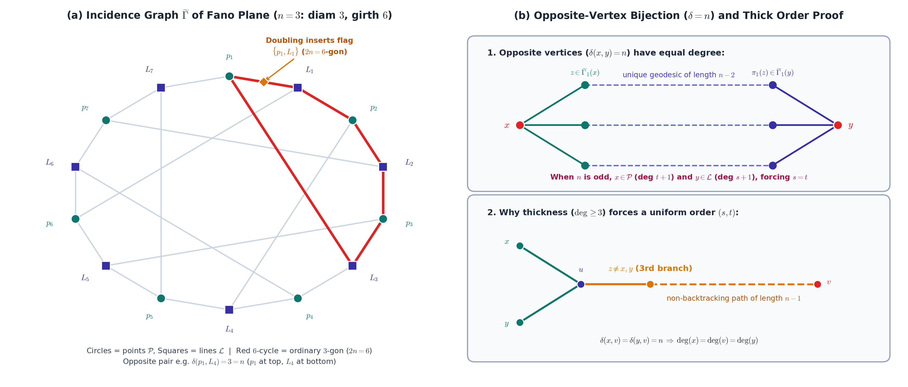

*Figure 17. Geodesics, doubling, and vertex degrees in the incidence graph $\widetilde{\Gamma}$ of a generalized $n$-gon. (a) On the $14$-vertex Heawood graph $\widetilde{\Gamma}$ of $\mathrm{PG}(2, 2)$ ($n = 3$, diameter $3$, girth $6$, cf. Figure 5(b)), an ordinary $3$-gon subgeometry appears as a red $6$-cycle $(p_1, L_1, p_2, L_2, p_3, L_3)$, opposite vertices such as $p_1$ and $L_4$ lie at distance $\delta(p_1, L_4) = 3 = n$, and doubling $\mathrm{PG}(2, 2)$ inserts a flag vertex (orange diamond) on every edge to form a generalized $6$-gon of girth $12$. (b) Top: unique geodesics of length $n - 2$ pair the neighbours of opposite vertices $x, y$ ($\delta(x, y) = n$) bijectively, so $\deg(x) = \deg(y)$ (and $s = t$ when $n$ is odd). Bottom: when every vertex has degree at least $3$, a third branch $uz$ at the common neighbour $u$ of $x$ and $y$ extends to a vertex $v$ at distance $n$ from both, forcing $\deg(x) = \deg(v) = \deg(y)$ and a uniform order $(s, t)$.*

**Geodesics and diameter in the incidence graph $\widetilde{\Gamma}$.** In the incidence graph $\widetilde{\Gamma}$ of a generalized $n$-gon ($n \ge 3$):

- (a) Any two vertices $x$ and $y$ of $\widetilde{\Gamma}$ at distance $i = \delta(x, y) < n$ are joined by a unique shortest path.
- (b) Whenever $1 \le i = \delta(x, y) \le n - 1$, there is a unique neighbour of $y$ at distance $i - 1$ from $x$, so $\lvert \widetilde{\Gamma}_{i-1}(x) \cap \widetilde{\Gamma}_1(y) \rvert = 1$.
- (c) If $x_0, x_1, \dots, x_k$ is any walk in $\widetilde{\Gamma}$ of length $k \le n$ that never steps straight back to the vertex it just left ($x_{r-1} \neq x_{r+1}$ for all $1 \le r \le k - 1$), then $\delta(x_0, x_k) = k$.
- (d) The diameter of $\widetilde{\Gamma}$ is equal to $n$.

Let us verify (a)–(d) in order. For (a), if $x$ and $y$ had two different shortest paths of length $i < n$, walking from $x$ to $y$ along the first path and returning along the second would trace a closed walk of length $2i < 2n$ containing at least one simple cycle of length at most $2i < 2n$, contradicting girth $2n$. Claim (b) follows immediately from (a), because every vertex $u \in \widetilde{\Gamma}_{i-1}(x) \cap \widetilde{\Gamma}_1(y)$ extends a shortest path of length $i - 1$ from $x$ to $u$ by the edge $uy$ into a shortest path of length $i$ from $x$ to $y$.

For (c), suppose for contradiction that $\delta(x_0, x_k) < k$, and let $j$ be the largest index in $\{0, 1, \dots, k\}$ satisfying $\delta(x_0, x_j) = j$. Because $\delta(x_0, x_0) = 0$ and $\delta(x_0, x_1) = 1$ while $\delta(x_0, x_k) < k$, we have $1 \le j \le k - 1$. What is $\delta(x_0, x_{j+1})$? By the triangle inequality it is at most $j + 1$; by the maximality of $j$ it cannot equal $j + 1$; and because $\widetilde{\Gamma}$ is bipartite, the adjacent vertices $x_j$ and $x_{j+1}$ cannot lie at the same distance $j$ from $x_0$. Thus $\delta(x_0, x_{j+1}) = j - 1$. That puts both $x_{j-1}$ and $x_{j+1}$ into $\widetilde{\Gamma}_{j-1}(x_0) \cap \widetilde{\Gamma}_1(x_j)$, and since the walk does not backtrack ($x_{j-1} \neq x_{j+1}$), $x_j$ has two distinct neighbours at distance $j - 1$ from $x_0$, contradicting (b).

For (d), (GP3') places any two vertices of $\widetilde{\Gamma}$ inside a $2n$-cycle, so their distance is at most half the cycle length, giving $\operatorname{diam}(\widetilde{\Gamma}) \le n$. Conversely, walking $n$ steps along one half of a $2n$-cycle gives a non-backtracking walk $x_0, x_1, \dots, x_n$, which achieves $\delta(x_0, x_n) = n$ by (c).

Translating (a)–(d) from $\widetilde{\Gamma}$ to $\Gamma$ via $\delta(x, y) = 2\,d(x, y)$ gives the matching rules in the collinearity graph:

| Property ($n \ge 3$) | In the incidence graph $\widetilde{\Gamma}$ (distance $\delta$) | In the collinearity graph $\Gamma$ (distance $d$) |
| :--- | :--- | :--- |
| Unique shortest path | For $\delta(x, y) = i < n$, a unique shortest path joins $x$ and $y$ | For $d(x, y) \le \lfloor \frac{n-1}{2} \rfloor$, a unique shortest path joins $x$ and $y$ |
| Unique step closer | For $1 \le i = \delta(x, y) \le n - 1$, $\lvert \widetilde{\Gamma}_{i-1}(x) \cap \widetilde{\Gamma}_1(y) \rvert = 1$ | For $1 \le i = d(x, y) \le \lfloor \frac{n-1}{2} \rfloor$, $\lvert \Gamma_{i-1}(x) \cap \Gamma_1(y) \rvert = 1$ |
| Non-backtracking walks | Walk $x_0, \dots, x_k$ with $k \le n$ and $x_{r-1} \neq x_{r+1}$ has $\delta(x_0, x_k) = k$ | Walk $x_0, \dots, x_k$ with $k \le \lfloor \frac{n}{2} \rfloor$ and $x_{r-1}x_r \neq x_r x_{r+1}$ has $d(x_0, x_k) = k$ |
| Diameter | $\operatorname{diam}(\widetilde{\Gamma}) = n$ | $\operatorname{diam}(\Gamma) = \lfloor \frac{n}{2} \rfloor$ |

#### Opposite elements, flag apartments, doubling, near polygons, and orders

The geodesic rules above unlock five further properties of generalized polygons, illustrated in Figure 17(b).

**Opposite vertices in $\widetilde{\Gamma}$ have equal degree.** Start with a general observation about any bipartite graph (not necessarily complete) $G$ of diameter $n \ge 2$ in which $\lvert G_{n-2}(u) \cap G_1(v) \rvert = 1$ whenever $d_G(u, v) = n - 1$. Here, $G_k(u)$ is the set of vertices at distance $k$ from $u$. Essentially, if two vertices $u$ and $v$ are at distance $n - 1$, then standing at $v$, there is one and only one edge out of $v$ that steps closer to $u$ (to distance $n - 2$).

To see why, take any two vertices $x$ and $y$ of $G$ at maximal distance $d_G(x, y) = n$, as in the top box of Figure 17(b). Every neighbour $z \in G_1(x)$ lies at distance $n - 1$ from $y$: its distance from $y$ cannot exceed the diameter $n$, and it cannot equal $n$ because $G$ is bipartite. Therefore $y$ has a unique neighbour $\pi_1(z) \in G_1(y)$ at distance $n - 2$ from $z$. By the same reasoning, each neighbour $w \in G_1(y)$ lies at distance $n - 1$ from $x$ and determines a unique neighbour $\pi_2(w) \in G_1(x)$ at distance $n - 2$ from $w$. Because $d_G(z, \pi_1(z)) = n - 2$, $z$ itself is the unique neighbour of $x$ at distance $n - 2$ from $\pi_1(z)$, so $\pi_2(\pi_1(z)) = z$ for every $z \in G_1(x)$, and likewise $\pi_1(\pi_2(w)) = w$ for every $w \in G_1(y)$. The maps $\pi_1 : G_1(x) \to G_1(y)$ and $\pi_2 : G_1(y) \to G_1(x)$ are inverse bijections, giving $\lvert G_1(x) \rvert = \lvert G_1(y) \rvert$. Since $\widetilde{\Gamma}$ satisfies $\lvert \widetilde{\Gamma}_{n-2}(u) \cap \widetilde{\Gamma}_1(v) \rvert = 1$ at distance $n - 1$, any two vertices of $\widetilde{\Gamma}$ at maximal distance $n$ from each other have the same degree.

**Every two flags lie in a common $2n$-cycle.** Axiom (GP3') states that any two vertices of $\widetilde{\Gamma}$ lie in a $2n$-cycle. In fact, any two flags $\{p_1, L_1\}$ and $\{p_2, L_2\}$ of $\mathcal{S}$ also lie together in a $2n$-cycle of $\widetilde{\Gamma}$ (an ordinary $n$-gon subgeometry containing $p_1, L_1, p_2, L_2$).

To see why, choose $x_1 \in \{p_1, L_1\}$ and $x_2 \in \{p_2, L_2\}$ so that $\delta(x_1, x_2)$ is as large as possible, and let $y_1, y_2$ be the other elements of the two flags. Because $x_1, x_2$ maximize the distance and $\widetilde{\Gamma}$ is bipartite, stepping from $x_2$ to $y_2$ or from $x_1$ to $y_1$ decreases the distance by $1$:

$$\delta(x_1, y_2) = \delta(x_2, y_1) = \delta(x_1, x_2) - 1.$$

If $\delta(x_1, x_2) < n$, then the unique shortest path in $\widetilde{\Gamma}$ between $x_1$ and $x_2$ must begin with $x_1, y_1$ and end with $y_2, x_2$, so it contains all four elements $p_1, L_1, p_2, L_2$; placing $x_1$ and $x_2$ inside a $2n$-cycle via (GP3') must use that unique shortest path between them, so the $2n$-cycle contains both flags. Suppose instead that $\delta(x_1, x_2) = n$. Because $\delta(x_2, y_1) = n - 1$, there is a unique shortest path $\gamma_1$ of length $n$ between $x_1$ and $x_2$ passing through $y_1$, and because $\delta(x_1, y_2) = n - 1$, there is a unique shortest path $\gamma_2$ of length $n$ between $x_1$ and $x_2$ passing through $y_2$. If $\gamma_1 = \gamma_2$, then $\gamma_1$ contains $p_1, L_1, p_2, L_2$, and placing $x_1$ and $x_2$ in a $2n$-cycle via (GP3') completes $\gamma_1$ to a $2n$-cycle: the two halves of that $2n$-cycle between $x_1$ and $x_2$ are paths of length $n$, at least one of them differs from $\gamma_1$, and because any two distinct paths of length $n$ between opposite vertices meet only at their endpoints (otherwise a shorter part would violate uniqueness of geodesics below $n$), that half and $\gamma_1$ form a $2n$-cycle containing $p_1, L_1, p_2, L_2$. If instead $\gamma_1 \neq \gamma_2$, then by the same uniqueness of geodesics below $n$, $\gamma_1$ and $\gamma_2$ meet only at their endpoints $x_1, x_2$, so $\gamma_1$ and $\gamma_2$ together form a $2n$-cycle containing $p_1, L_1, p_2, L_2$.

**Doubling a generalized $n$-gon.** Recall that the [double](#points-lines-duals-and-doubles) $\mathcal{S}'$ of $\mathcal{S} = (\mathcal{P}, \mathcal{L}, I)$ takes $\mathcal{P} \cup \mathcal{L}$ as its point set and the flags $\{x, L\}$ of $\mathcal{S}$ as its thin $2$-point lines, and that [doubling a generalized $n$-gon produces a generalized $2n$-gon](#definition-via-ordinary-n-gon-subgeometries). Our flag-cycle theorem proves this immediately: the incidence graph $\widetilde{\Gamma}'$ of $\mathcal{S}'$ is obtained from $\widetilde{\Gamma}$ by inserting each flag $\{x, L\}$ as a new vertex in the middle of the edge between $x$ and $L$ (as shown by the orange diamond on the Heawood graph in Figure 17(a)). Every cycle of $\widetilde{\Gamma}'$ comes from subdividing a cycle of $\widetilde{\Gamma}$, doubling the girth from $2n$ to $4n$, and because any two vertices or flags of $\widetilde{\Gamma}$ lie in a common $2n$-cycle, any two vertices of $\widetilde{\Gamma}'$ lie in a common $4n$-cycle.

**Thick generalized $n$-gons have an order $(s, t)$, with $s = t$ when $n$ is odd.** Recall that a partial linear space has [order $(s, t)$](#partial-linear-spaces) when every line has $s + 1$ points and every point lies on $t + 1$ lines. Suppose $\mathcal{S}$ is a thick generalized $n$-gon ($n \ge 3$), meaning every line is incident with at least $3$ points and every point is incident with at least $3$ lines. Then $\mathcal{S}$ has an order $(s, t)$, and if $n$ is odd, $s = t$.

Look at the bottom box of Figure 17(b) to see how thickness forces every point to have the same degree and every line to have the same degree. Every vertex of $\widetilde{\Gamma}$ has degree at least $3$. Because $\mathcal{S}$ and $\mathcal{S}^D$ are connected, showing that all points have the same degree and all lines have the same degree reduces to showing that any two vertices $x$ and $y$ of $\widetilde{\Gamma}$ at distance $\delta(x, y) = 2$ have the same degree. Let $u$ be the unique common neighbour of $x$ and $y$ in $\widetilde{\Gamma}$. Because $\deg(u) \ge 3$, we can choose a third neighbour $z$ of $u$ distinct from $x$ and $y$, and without having to backtrack, we can extend the edge $uz$ to a path of length $n - 1$ in $\widetilde{\Gamma}$ ending at some vertex $v$, which means $\delta(x, v) = \delta(y, v) = n$. We can be sure that such a path exists and that for example, $z$ will not "short-circuit" us back to $x$ or $y$ too early because in a generalized $n$-gon, no short cycles of $\lt 2n$ are allowed. Thus we can be sure that there is some $v$ which is at a distance $n$ from both $x$ and $y$. And since opposite vertices at distance $n$ in $\widetilde{\Gamma}$ have equal degree, $\deg(x) = \deg(v) = \deg(y)$. Thus $\mathcal{S}$ has an order $(s, t)$. Moreover, when $n$ is odd, any two vertices $x$ and $y$ at maximal distance $\delta(x, y) = n$ lie in opposite parts of the bipartite graph $\widetilde{\Gamma}$, so one is a point (degree $t + 1$) and the other is a line (degree $s + 1$), and $\deg(x) = \deg(y)$ gives $t + 1 = s + 1$, or $s = t$.

Essentially, it comes down to the fact that every two vertices at distance $2$ in the incidence graph of a thick generalized $n$-gon share an opposite vertex. And since opposite vertices have the same degree, every "alternate" vertex has the same degree. If $n$ is odd, then lines and points form opposite vertices, so $s=t$.

**Halving thin-lined even generalized polygons.** Conversely to doubling, let $\mathcal{S}$ be a generalized $2d$-gon with $d \ge 3$ in which every line is incident with $2$ points. Then $\mathcal{S}$ is isomorphic to the double of a generalized $d$-gon.

To prove this, view $\mathcal{S}$ as a graph $\Gamma$ whose edges are its $2$-point lines. Because $\mathcal{S}$ is a [near $2d$-gon](#definition-via-ordinary-n-gon-subgeometries), every edge $\{x_i, x_{i+1}\}$ contains a unique point nearest to any chosen base vertex $x_0$, so $d(x_0, x_i)$ and $d(x_0, x_{i+1})$ have opposite parity. Along any path or cycle $x_0, x_1, \dots, x_k$ in $\Gamma$, the distance $d(x_0, x_i)$ changes parity at every step, so $d(x_0, x_k)$ and $k$ have the same parity. For a closed cycle ($x_k = x_0$, distance $0$), the length $k$ must therefore be even, which means $\Gamma$ is bipartite. Because the incidence graph $\widetilde{\Gamma}$ of $\mathcal{S}$ is obtained by subdividing each edge of $\Gamma$ once and satisfies (GP1')–(GP3') with $n = 2d$, the bipartite graph $\Gamma$ itself satisfies (GP1')–(GP3') with $n = d$. Thus $\Gamma$ is the incidence graph of a generalized $d$-gon $\mathcal{S}'$. The double $\mathcal{S}''$ of $\mathcal{S}'$ is a generalized $2d$-gon whose collinearity graph is $\Gamma$, and because $2d \ge 6 \ge 4$, our clique-reconstruction theorem gives $\mathcal{S} \cong \mathcal{S}''$.

### Three characterizations of generalized polygons

Checking (GP3) directly requires finding an ordinary $n$-gon subgeometry for every pair of elements. Three characterizations replace (GP3) by simpler global or local conditions.

#### Characterization by diameter and girth of the incidence graph

Recall that [any graph of finite girth $g$ has diameter at least $\lfloor g / 2 \rfloor$](#paths-geodesics-and-distance), so a bipartite graph of girth $2n$ always has diameter at least $n$. Generalized $n$-gons are the geometries that hit that minimum diameter.

**Diameter-and-girth characterization.** Let $n \ge 2$ and let $\mathcal{S} = (\mathcal{P}, \mathcal{L}, I)$ be a point-line geometry. Then $\mathcal{S}$ is a generalized $n$-gon if and only if its incidence graph $\widetilde{\Gamma}$ has diameter $n$ and girth $2n$. To see why the incidence graph $\widetilde{\Gamma}$ of a generalized $n$-gon has diameter at most $n$, let us say the diameter of $\widetilde{\Gamma}$ is greater than $n$. Then there are two vertices $x$ and $y$ of $\widetilde{\Gamma}$ with distance $\delta(x, y) \gt n$. On any cycle of length $2n$, however, we can go between any two vertices around the shorter way in at most $n$ steps, so any two vertices on a $2n$-cycle are at distance at most $n$ from each other. Because $\delta(x, y) \gt n$, the vertices $x$ and $y$ cannot lie on a common $2n$-cycle, and since a $2n$-cycle in $\widetilde{\Gamma}$ is an ordinary $n$-gon subgeometry, this contradicts the requirement (GP3) (or its graph form (GP3')) that any two vertices of $\widetilde{\Gamma}$ must sit on an ordinary $n$-gon subgeometry.

#### Characterization via near 2n-gons

Every generalized $2n$-gon ($n \ge 2$) is a near $2n$-gon satisfying $\lvert \Gamma_{i-1}(x) \cap \Gamma_1(y) \rvert = 1$ whenever $1 \le i = d(x, y) \le n - 1$. Conversely, a near $2n$-gon with that unique-step-closer property is a generalized $2n$-gon as soon as it avoids having points of degree $1$.

**Near $2n$-gon characterization.** Let $\mathcal{S}$ be a near $2n$-gon ($n \ge 2$) such that $\lvert \Gamma_{i-1}(x) \cap \Gamma_1(y) \rvert = 1$ for every $i \in \{1, 2, \dots, n - 1\}$ and every two points $x, y$ with $d(x, y) = i$. Then five conditions are equivalent:

1. $\mathcal{S}$ is a generalized $2n$-gon;
2. for every point $x$ of $\mathcal{S}$, there is a point $y$ at distance $n$ from $x$;
3. $\lvert \Gamma_{n-1}(x) \cap \Gamma_1(y) \rvert \ge 2$ for every two points $x$ and $y$ at distance $n$ from each other;
4. there exist two points $x$ and $y$ at distance $n$ from each other with $\lvert \Gamma_{n-1}(x) \cap \Gamma_1(y) \rvert \ge 2$;
5. every point $x$ is incident with at least two lines.

Let us trace why all five conditions are equivalent. First check that the incidence graph $\widetilde{\Gamma}$ of $\mathcal{S}$ has diameter $2n$. Because $\mathcal{S}$ has diameter $n$, the largest distance in $\widetilde{\Gamma}$ between two points is $2n$. For any point $x$ and line $L$, the near-polygon axiom gives a unique point on $L$ nearest to $x$, which forces $d(x, L) \le n - 1$ and $\delta(x, L) = 2\,d(x, L) + 1 \le 2n - 1$. And for any two lines $L_1, L_2$, picking a point $x_1 \in L_1$ gives $\delta(x_1, L_2) \le 2n - 1$ and hence $\delta(L_1, L_2) \le 2n$.

Second, check that $\lvert \widetilde{\Gamma}_{j-1}(u) \cap \widetilde{\Gamma}_1(v) \rvert = 1$ for every pair of vertices $u, v$ of $\widetilde{\Gamma}$ at distance $j \in \{1, 2, \dots, 2n - 1\}$, across all four combinations of points and lines. If $u = x$ and $v = y$ are two points at distance $\delta(x, y) = 2i$ ($1 \le i \le n - 1$), a line through $y$ at distance $2i - 1$ from $x$ in $\widetilde{\Gamma}$ must contain a point at distance $i - 1$ from $x$, which singles out the unique line $yz$ through the lone point $z \in \Gamma_{i-1}(x) \cap \Gamma_1(y)$. If $u = x$ is a point and $v = L$ is a line at distance $\delta(x, L) = 2i + 1$ where $i = d(x, L)$, a neighbour of $L$ in $\widetilde{\Gamma}$ at distance $2i$ from $x$ is a point of $L$ at distance $i$ from $x$, which is unique because $\mathcal{S}$ is a near polygon. If $u = L$ is a line and $v = x$ is a point at distance $\delta(L, x) = 2i + 1$ where $i = d(x, L)$, then for $i = 0$ ($x \in L$) the line $L$ itself is the unique neighbour of $x$ at distance $0$ from $L$; for $1 \le i \le n - 1$, let $y$ be the unique point of $L$ at distance $i$ from $x$ and let $z$ be the unique point collinear with $x$ at distance $i - 1$ from $y$, so any line $M$ through $x$ containing a point $z'$ at distance $i - 1$ from some point $y' \in L$ has $d(x, y') \le 1 + (i - 1) = i$, forcing $y' = y$, $z' = z$, and $M = xz$. Finally, if $u = L_2$ and $v = L_1$ are two distinct lines at distance $\delta(L_1, L_2) = 2i + 2 < 2n$ (so $i = d(L_1, L_2) \le n - 2$), we need a unique point $x_1 \in L_1$ at distance $i$ from $L_2$. This is clear when $i = 0$; if $i > 0$ and $L_1$ contained two distinct points $x_1 \neq x_1'$ at distance $i$ from $L_2$, let $x_2, x_2' \in L_2$ be the unique points of $L_2$ at distance $i$ from $x_1, x_1'$. We cannot have $x_2 = x_2'$ (or $L_1$ would have two points at distance $i$ from $x_2$), so $d(x_1, x_2') = i + 1 < n$. Letting $x_2''$ be the unique point collinear with $x_2'$ at distance $i - 1$ from $x_1'$ gives $i \le d(x_1, x_2'') \le 1 + (i - 1) = i$, so $x_2'$ would have two distinct neighbours $x_2 \neq x_2''$ at distance $i$ from $x_1$, a contradiction.

Because $\widetilde{\Gamma}$ is bipartite and $\lvert \widetilde{\Gamma}_{j-1}(u) \cap \widetilde{\Gamma}_1(v) \rvert = 1$ for all $1 \le j \le 2n - 1$, $\widetilde{\Gamma}$ contains no cycles shorter than $4n$. If (1) holds, placing $x$ (or $x$ and $y$) inside an ordinary $2n$-gon subgeometry immediately gives (2), (3), (4), and (5). Conversely, suppose any one of (2), (3), (4), or (5) holds. Each one produces two points $u, v \in \mathcal{P}$ at maximal distance $d(u, v) = n$ ($\delta(u, v) = 2n$) such that $v$ lies on at least two lines, and since $\mathcal{S}$ is a near $2n$-gon, every line through $v$ contains a point at distance $n - 1$ from $u$, giving $\lvert \widetilde{\Gamma}_{2n-1}(u) \cap \widetilde{\Gamma}_1(v) \rvert \ge 2$ (under (2), pick any point $v$ on at least two lines and take $u$ at distance $n$ from $v$; under (3) or (4), distinct points in $\Gamma_{n-1}(u) \cap \Gamma_1(v)$ must lie on distinct lines through $v$; under (5), take any two points $u, v$ at distance $n$). Choosing two distinct lines $w_1 \neq w_2$ in $\widetilde{\Gamma}_{2n-1}(u) \cap \widetilde{\Gamma}_1(v)$ and taking the unique shortest paths $\gamma_1, \gamma_2$ of length $2n$ between $u$ and $v$ through $w_1$ and $w_2$ produces a $4n$-cycle in $\widetilde{\Gamma}$. Thus $\widetilde{\Gamma}$ has diameter $2n$ and girth $4n$, so $\mathcal{S}$ is a generalized $2n$-gon by the diameter-and-girth characterization.

#### Characterization via generalized Moore geometries

Our third characterization generalizes the [layer-counting bound we used on the Petersen graph](#the-petersen-graph-as-a-packing-puzzle). In any regular graph of valency $k$ and diameter $d$, counting the vertices at each distance from a fixed vertex $x$ gives $1$ vertex at distance $0$, exactly $k$ at distance $1$ (at most $k$ if multiple edges were allowed), at most $k(k - 1)$ at distance $2$, and in general at most $k(k - 1)^{i-1}$ at distance $i$, so the graph has at most $1 + k + k(k - 1) + \dots + k(k - 1)^{d-1}$ vertices; this upper bound is the **Moore bound**, and a graph of valency $k$ and diameter $d$ that attains it is called a **Moore graph**.

To extend this idea to point-line geometries, let $d, s, t, c$ be positive integers with $d \ge 2$ (and $c \le t + 1$). A **generalized Moore geometry** of type $\mathrm{GM}_d(s, t, c)$ is a partial linear space $\mathcal{S}$ of diameter $d$ and order $(s, t)$ satisfying two distance-stepping rules for every base point $x$. First, if $y$ is a point at distance $i \in \{1, 2, \dots, d - 1\}$ from $x$, there is a unique line through $y$ containing $1$ point at distance $i - 1$ from $x$ and $s$ points at distance $i$ from $x$, while each of the other $t$ lines through $y$ contains (besides $y$) $s$ points at distance $i + 1$ from $x$. Second, if $y$ is a point at maximal distance $d$ from $x$, there are $c$ lines through $y$ containing a (necessarily unique) point at distance $d - 1$ from $x$ (and $s$ points at distance $d$ from $x$), while each of the remaining $t + 1 - c$ lines through $y$ has all $s + 1$ of its points at distance $d$ from $x$.

When $c = 1$, a $\mathrm{GM}_d(s, t, 1)$ is called a **Moore geometry**, and when $s = c = 1$ a $\mathrm{GM}_d(1, t, 1)$ is a Moore graph of valency $k = t + 1$ and diameter $d$ (for example, odd cycles of length $2d + 1 \ge 5$ and the Petersen graph $\mathrm{GM}_2(1, 2, 1)$). At the opposite extreme $c = t + 1$, every line through $y \in \Gamma_d(x)$ steps down to distance $d - 1$ from $x$.

**Generalized Moore geometry characterization.** Let $s, t, d$ be positive integers with $d \ge 2$. Then the generalized Moore geometries of type $\mathrm{GM}_d(s, t, t + 1)$ are the generalized $2d$-gons of order $(s, t)$.

In one direction, if $\mathcal{S}$ is a generalized $2d$-gon of order $(s, t)$, then $\mathcal{S}$ has diameter $d$, the unique-step-closer rule gives the first condition at distance $i \in \{1, \dots, d - 1\}$, and because $\mathcal{S}$ is a near $2d$-gon, every one of the $t + 1$ lines through a point $y$ at distance $d$ from $x$ contains a unique point at distance $d - 1$ from $x$ (so $c = t + 1$). Conversely, suppose $\mathcal{S}$ is a generalized Moore geometry of type $\mathrm{GM}_d(s, t, t + 1)$. Because $c = t + 1$, no line can consist entirely of points at distance $d$ from $x$, so every point-line pair $(x, L)$ has $d(x, L) \le d - 1$, and the first condition guarantees a unique point on $L$ nearest to $x$. Thus $\mathcal{S}$ is a near $2d$-gon with $\lvert \Gamma_{i-1}(x) \cap \Gamma_1(y) \rvert = 1$ for $1 \le i \le d - 1$ in which every point lies on $t + 1 \ge 2$ lines, so $\mathcal{S}$ is a generalized $2d$-gon of order $(s, t)$ by the near $2n$-gon characterization.

Compare $c = t + 1$ with $c = 1$ on the Petersen graph $\mathrm{GM}_2(1, 2, 1)$ ($d = 2, s = 1, t = 2, c = 1$). It is a near $5$-gon of diameter $2$ and girth $5$, yet it is not a generalized $5$-gon: because $c = 1 < 3 = t + 1$, each vertex $y$ at distance $2$ from $x$ has $t + 1 - c = 2$ edges lying entirely inside $\Gamma_2(x)$, so two disjoint edges $L_1, L_2$ at distance $d(L_1, L_2) = 2$ sit at distance $\delta(L_1, L_2) = 2(2) + 2 = 6 > 5$ in the incidence graph $\widetilde{\Gamma}$ (which has girth $10$ and diameter $6$ instead of $5$).

### Generalized quadrangles in detail

#### Grids, dual grids, and the order trichotomy

We now zoom in on generalized polygons of diameter $2$, the generalized quadrangles. When [introducing generalized quadrangles earlier](#orders-and-parameter-restrictions-for-generalized-quadrangles), we stated how they split into grids, dual grids, and quadrangles of order $(s, t)$. Let us now prove those classification theorems.

**Characterization of grids and dual grids among generalized quadrangles.** Let $\mathcal{S}$ be a generalized quadrangle. If every point of $\mathcal{S}$ is incident with $2$ lines, then $\mathcal{S}$ is a grid. Dually, if every line of $\mathcal{S}$ is incident with $2$ points, then $\mathcal{S}$ is a dual grid.

By point-line duality it suffices to prove the second statement. Suppose every line of the generalized quadrangle $\mathcal{S}$ has $2$ points, so $\mathcal{S}$ can be viewed as a triangle-free graph $\Gamma$ of diameter $2$. Fix a point $x$ of $\mathcal{S}$. Because $\Gamma$ has no triangles, no two points of $\Gamma_1(x)$ are adjacent. Now pick any $y \in \Gamma_1(x)$ and any $z \in \Gamma_2(x)$. Since $z$ does not lie on the $2$-point line $xy$, (GQ2) says that $z$ is collinear with a unique point of $xy$; because $z \in \Gamma_2(x)$ is not collinear with $x$, that unique point must be $y$, so $z \sim y$. Thus every point of $\{x\} \cup \Gamma_2(x)$ is collinear with every point of $\Gamma_1(x)$. Because $\Gamma$ has no triangles and $\Gamma_1(x)$ is nonempty, no two points of $\Gamma_2(x)$ can be collinear either. Therefore $\Gamma$ is a complete bipartite graph with parts $\{x\} \cup \Gamma_2(x)$ and $\Gamma_1(x)$, which is a dual grid.

**The order trichotomy for generalized quadrangles.** For any (finite or infinite) generalized quadrangle $\mathcal{S}$, one and only one of three cases holds: $\mathcal{S}$ is a nonsymmetrical grid; $\mathcal{S}$ is a nonsymmetrical dual grid; or $\mathcal{S}$ has an order $(s, t)$ (which covers symmetrical grids of order $(s, 1)$, symmetrical dual grids of order $(1, t)$, and all thick generalized quadrangles).

To prove this, suppose $\mathcal{S}$ is neither a grid nor a dual grid; we must show that $\mathcal{S}$ has an order $(s, t)$. For each point $x$ of $\mathcal{S}$, write $t_x + 1 \ge 2$ for the number of lines through $x$. Whenever two points $x$ and $y$ are noncollinear, (GQ2) pairs each line through $x$ with the unique line through $y$ that meets it, giving a bijection between the lines through $x$ and the lines through $y$, so $t_x = t_y$. Because $\mathcal{S}$ is not a dual grid, our previous result guarantees at least one line $L$ with $3$ or more points. Take any two distinct points $x, y \in L$, pick a third point $u \in L$ distinct from $x$ and $y$, pick a line $L_u \neq L$ through $u$, and pick a point $z \in L_u \setminus \{u\}$. Because $\mathcal{S}$ has no triangles, $z$ is noncollinear with both $x$ and $y$, so $t_x = t_z = t_y$. Hence every point on $L$ lies on the same number of lines $t + 1$. And if $w$ is any point outside $L$, then $w$ is collinear with only one point of $L$ and noncollinear with all remaining points of $L$, which forces $t_w = t$ as well. Since $\mathcal{S}$ is not a grid, some point lies on at least $3$ lines, and repeating the exact same argument in the dual $\mathcal{S}^D$ shows that every line of $\mathcal{S}$ is incident with the same number of points $s + 1$.

When $\mathcal{S} = (\mathcal{P}, \mathcal{L}, I)$ is a finite generalized quadrangle of order $(s, t)$ and $L$ is any line of $\mathcal{S}$, every point outside $L$ lies in $\Gamma_1(L)$ and is collinear with a unique point of $L$. At each of the $s + 1$ points of $L$, there are $t$ lines other than $L$, each holding $s$ points outside $L$, giving

$$\lvert \mathcal{P} \rvert = \lvert L \rvert + \lvert \Gamma_1(L) \rvert = (s + 1) + (s + 1)st = (s + 1)(st + 1)$$

and, by duality, $\lvert \mathcal{L} \rvert = (t + 1)(st + 1)$.

#### Classical generalized quadrangles and their dualities

Recall from the projective geometry notes that every [polar space of rank $2$](maths_3_projective_geometry.md#generalized-quadrangles-o-o) (Witt index $2$, whose maximal singular or [totally isotropic subspaces](#polar-spaces-polarities-and-the-four-line-classes) are lines) has points and lines forming a generalized quadrangle. Over a commutative field $\mathbb{F}$ (or a quadratic extension $\mathbb{F}' / \mathbb{F}$), these classical families are the [nonsingular quadrics](maths_3_projective_geometry.md#orthogonal-polar-spaces-non-degenerate-quadrics-mathcalq) $Q^+(3, \mathbb{F})$ in $\mathrm{PG}(3, \mathbb{F})$, $Q(4, \mathbb{F})$ in $\mathrm{PG}(4, \mathbb{F})$, and $Q^-(5, \mathbb{F}'/\mathbb{F})$ in $\mathrm{PG}(5, \mathbb{F})$, the [nonsingular $\sigma$-Hermitian varieties](maths_3_projective_geometry.md#unitary-hermitian-spaces-mathcalhn-q2) $H(3, \mathbb{F}'/\mathbb{F})$ in $\mathrm{PG}(3, \mathbb{F}')$ and $H(4, \mathbb{F}'/\mathbb{F})$ in $\mathrm{PG}(4, \mathbb{F}')$ for a [separable](#quadrics-over-arbitrary-and-finite-fields) quadratic extension $\mathbb{F}'/\mathbb{F}$ with involutory automorphism $\sigma$, and the [symplectic generalized quadrangle](maths_3_projective_geometry.md#symplectic-spaces-antisymmetric-bilinear-forms) $W(\mathbb{F}) = W(3, \mathbb{F})$ of all points and totally isotropic lines of a symplectic polarity in $\mathrm{PG}(3, \mathbb{F})$. Over a finite field $\mathbb{F}_q$ (with $\mathbb{F}' = \mathbb{F}_{q^2}$ in the Hermitian cases), their [orders and point-line dualities](maths_3_projective_geometry.md#comparison-finite-classical-polar-spaces-over-mathbbf_q-or-mathbbf_q2) are summarized below:

| Classical finite GQ | Ambient space | Order $(s, t)$ | Point count $(s+1)(st+1)$ | Duality and isomorphism relations |
| :--- | :--- | :--- | :--- | :--- |
| $Q^+(3, q)$ | $\mathrm{PG}(3, q)$ | $(q, 1)$ | $(q + 1)^2$ | Symmetrical $(q + 1) \times (q + 1)$ grid |
| $W(q) = W(3, q)$ | $\mathrm{PG}(3, q)$ | $(q, q)$ | $(q + 1)(q^2 + 1)$ | [$W(q) \cong Q(4, q)^D$; and $W(q) \cong Q(4, q)$ if and only if $q$ is even](maths_3_projective_geometry.md#number-of-maximal-isotropic-subspaces) |
| $Q(4, q)$ | $\mathrm{PG}(4, q)$ | $(q, q)$ | $(q + 1)(q^2 + 1)$ | [$Q(4, q) \cong W(q)^D$; self-dual if and only if $q$ is even](maths_3_projective_geometry.md#number-of-maximal-isotropic-subspaces) |
| $Q^-(5, q)$ | $\mathrm{PG}(5, q)$ | $(q, q^2)$ | $(q + 1)(q^3 + 1)$ | $Q^-(5, q)^D \cong H(3, q^2)$ (attains $t = s^2$) |
| $H(3, q^2)$ | $\mathrm{PG}(3, q^2)$ | $(q^2, q)$ | $(q^2 + 1)(q^3 + 1)$ | $H(3, q^2) \cong Q^-(5, q)^D$ (attains $s = t^2$) |
| $H(4, q^2)$ | $\mathrm{PG}(4, q^2)$ | $(q^2, q^3)$ | $(q^2 + 1)(q^5 + 1)$ | Dual $H(4, q^2)^D$ has order $(q^3, q^2)$ |

#### Triads, centers, and the combinatorial proof of Higman's bound

Earlier we proved [Higman's inequality $t \le s^2$ (for $s \ge 2$) from the Krein condition $q_{22}^2 \ge 0$](#krein-bounds-and-higmans-inequalities) on the collinearity graph. A combinatorial counting proof due to Bose and Shrikhande (with the inequality observed by Cameron) reveals what happens inside the generalized quadrangle when $t$ hits the ceiling $s^2$, as illustrated in Figure 18(a).

In a generalized quadrangle $\mathcal{S}$, a **triad** is a set $T = \{x, y, z\}$ of three mutually noncollinear points, and any point $u$ collinear with all three ($u \in x^\perp \cap y^\perp \cap z^\perp$) is called a **center** of $T$.

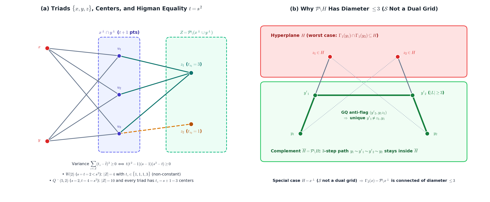

*Figure 18. Triads, centers, and hyperplane complements in generalized quadrangles. (a) For a fixed noncollinear pair $\{x, y\}$ in a finite GQ of order $(s, t)$, the $t + 1$ points of $x^\perp \cap y^\perp$ send lines into $Z = \mathcal{P} \setminus (x^\perp \cup y^\perp)$, where each $z \in Z$ completes $\{x, y\}$ to a triad with $t_z = \lvert x^\perp \cap y^\perp \cap z^\perp \rvert$ centers; nonnegativity of the variance $\sum_{z \in Z}(t_z - \bar{t})^2$ gives $t \le s^2$, with equality if and only if $t_z = s + 1$ is constant. (b) For any hyperplane $H$ of a thick GQ $\mathcal{S}$, two points $y_1, y_2 \in \overline{H} = \mathcal{P} \setminus H$ whose common neighbours all lie in $H$ are joined inside $\overline{H}$ by a $3$-step path $y_1 \sim y'_1 \sim y'_2 \sim y_2$, so $\overline{H}$ has diameter at most $3$.*

**Combinatorial Higman inequality and triad characterization of $t = s^2$.** Let $\mathcal{S} = (\mathcal{P}, \mathcal{L}, I)$ be a finite generalized quadrangle of order $(s, t)$ with $s, t \ge 2$, and let $x, y$ be two arbitrary noncollinear points of $\mathcal{S}$. Then $t \le s^2$, and five conditions are equivalent:

- $t = s^2$;
- every triad of $\mathcal{S}$ has $s + 1$ centers;
- all triads of $\mathcal{S}$ have a constant number of centers;
- all triads of $\mathcal{S}$ containing $x$ have a constant number of centers;
- all triads of $\mathcal{S}$ containing $x$ and $y$ have a constant number of centers.

To prove all of this at once, it is enough to show that $t \le s^2$, with equality if and only if the triads containing the fixed noncollinear pair $\{x, y\}$ have a constant number of centers, and that this constant is then $s + 1$. Let $Z = \mathcal{P} \setminus (x^\perp \cup y^\perp)$ be the set of points noncollinear with both $x$ and $y$ (the points $z$ that complete $\{x, y\}$ to a triad). Because $\lvert \mathcal{P} \rvert = (s + 1)(st + 1)$, $\lvert \{x, y\} \rvert = 2$, $\lvert x^\perp \setminus \{x\} \rvert = \lvert y^\perp \setminus \{y\} \rvert = (t + 1)s$, and $\lvert x^\perp \cap y^\perp \rvert = t + 1$ (with $x \notin y^\perp$ and $y \notin x^\perp$), inclusion-exclusion gives

$$\lvert Z \rvert = (s + 1)(st + 1) - 2 - 2(t + 1)s + (t + 1) = s^2 t - st - s + t > 0.$$

For each $z \in Z$, write $t_z = \lvert x^\perp \cap y^\perp \cap z^\perp \rvert$ for the number of centers of $\{x, y, z\}$. First count in two ways the pairs $(z, u)$ where $z \in Z$ and $u \in x^\perp \cap y^\perp \cap z^\perp$. There are $t + 1$ choices for $u \in x^\perp \cap y^\perp$. Once $u$ is chosen, the $t + 1$ lines through $u$ consist of $ux$, $uy$, and $t - 1$ other lines; on each of those $t - 1$ other lines, all $s$ points other than $u$ belong to $Z$ (none can be collinear with $x$ or $y$ without creating a triangle). That gives

$$\sum_{z \in Z} t_z = (t + 1)(t - 1)s.$$

Next count in two ways the ordered triples $(z, u, u')$ where $z \in Z$ and $u, u' \in x^\perp \cap y^\perp \cap z^\perp$ with $u \neq u'$. There are $t + 1$ choices for $u \in x^\perp \cap y^\perp$, and then $t$ choices for $u' \in (x^\perp \cap y^\perp) \setminus \{u\}$. Because $u$ and $u'$ are distinct common neighbours of $x$ and $y$ and $\mathcal{S}$ has no triangles, $u$ and $u'$ are noncollinear. On each of the $t - 1$ lines through $u$ distinct from $ux$ and $uy$, (GQ2) gives a unique point $z$ collinear with $u'$, and that point $z$ lies in $Z$. Hence

$$\sum_{z \in Z} t_z(t_z - 1) = (t + 1)t(t - 1),$$

and adding our first sum to this one gives

$$\sum_{z \in Z} t_z^2 = (t + 1)(t - 1)(s + t).$$

Let $\bar{t} = \lvert Z \rvert^{-1} \sum_{z \in Z} t_z$ be the average of $t_z$ over $z \in Z$. The variance sum $\sum_{z \in Z} (t_z - \bar{t})^2 \ge 0$ is equivalent to $\lvert Z \rvert \sum_{z \in Z} t_z^2 - \bigl(\sum_{z \in Z} t_z\bigr)^2 \ge 0$, which substitutes and factors as

$$(s^2 t - st - s + t)(t^2 - 1)(s + t) - (t^2 - 1)^2 s^2 = t(t^2 - 1)(s - 1)(s^2 - t) \ge 0.$$

Since $s, t \ge 2$, the factor $t(t^2 - 1)(s - 1)$ is strictly positive, so $s^2 - t \ge 0$, or $t \le s^2$. Equality $t = s^2$ holds if and only if $t_z = \bar{t}$ for every $z \in Z$, in which case substituting $t = s^2$ gives

$$\bar{t} = \frac{(s^2 + 1)(s^2 - 1)s}{s^4 - s^3 + s^2 - s} = \frac{(s^2 + 1)(s + 1)(s - 1)s}{(s^2 + 1)(s - 1)s} = s + 1.$$

We can see the difference between $t < s^2$ and $t = s^2$ on two small classical quadrangles with $s = 2$. In the $15$-point [doily $W(2)$](#definition-and-why-both-axioms-matter) (Figure 9, with $s = t = 2 < s^2$), represent the $15$ points as the $2$-element subsets of $\{1, 2, 3, 4, 5, 6\}$, collinear when disjoint, and fix the noncollinear pair $x = \{1, 2\}$ and $y = \{1, 3\}$. Their $t + 1 = 3$ common neighbours are $\{4, 5\}, \{4, 6\}, \{5, 6\}$, and $Z$ consists of the $\lvert Z \rvert = 4$ subsets $\{1, 4\}, \{1, 5\}, \{1, 6\}, \{2, 3\}$. Each of $\{1, 4\}, \{1, 5\}, \{1, 6\}$ is disjoint from only $1$ of the three common neighbours ($t_z = 1$ center), whereas $z = \{2, 3\}$ is disjoint from all $3$ of them ($t_z = 3$ centers), matching $\sum t_z = 6$ and $\sum t_z^2 = 12$ with positive variance.

In the $27$-point elliptic quadric $Q^-(5, 2)$ ($s = 2, t = 4 = s^2$), each point $x$ has $\lvert x^\perp \rvert = 1 + 2(5) = 11$, leaving $27 - 11 = 16$ choices for a point $y$ noncollinear with $x$ and $\lvert Z \rvert = 10$ choices for a third point $z$ noncollinear with both. That gives $27 \times 16 \times 10 / 6 = 720$ triads in total, and because $t = s^2$ holds, $\sum t_z = 30$ and $\sum t_z^2 = 90$ have variance $10(90) - 30^2 = 0$: every one of the $720$ triads has $s + 1 = 3$ centers.

#### Subquadrangles and hyperplane complements

Recall that in a partial linear space $\mathcal{S} = (\mathcal{P}, \mathcal{L}, I)$, a subset $X \subseteq \mathcal{P}$ is a [subspace](#partial-linear-spaces) when every line meeting $X$ in at least two points lies wholly in $X$, and a [hyperplane](#partial-linear-spaces) is a proper subspace that meets every line. In a generalized quadrangle $\mathcal{S}$, a subgeometry (respectively, a full subgeometry) of $\mathcal{S}$ that is itself a generalized quadrangle is called a **subquadrangle** (respectively, a **full subquadrangle**) of $\mathcal{S}$.

**Subspaces and full subquadrangles.** Let $\mathcal{S} = (\mathcal{P}, \mathcal{L}, I)$ be a generalized quadrangle. If $X$ is a subspace of $\mathcal{S}$ containing two disjoint lines $L_1$ and $L_2$, then the full subgeometry $\widetilde{X}$ induced on $X$ is a full subquadrangle of $\mathcal{S}$. Conversely, every full subquadrangle of $\mathcal{S}$ has the form $\widetilde{Y}$ for some subspace $Y$ of $\mathcal{S}$ containing two disjoint lines.

Why are these two aspects connected? Why is it sufficient for a subspace to just have 2 disjoint lines to become a generalized quadrangle in its own right? The two disjoint lines $L_1, L_2$ are only there to give (GQ1), which asks for two lines that do not meet. The real work is (GQ2), and it has to hold for *every* point $x$ of $X$ and *every* line $L$ of $X$ not through $x$, not only for a point $p_1$ on $L_1$ looking back at $L_2$. Since $X$ is a subspace, lines are "imported" with all their points from the main quadrangle. In $\mathcal{S}$, (GQ2) gives a unique point $y$ on $L$ collinear with $x$, and $y$ is present in the subspace because $L$ is imported whole. How do we know the connecting line $xy$ is present in the subspace? It meets $X$ in the two points $x$ and $y$, and since $X$ is a subspace, the entire line must be in $X$. So $y$ is collinear with $x$ inside the subspace too, and no other point of $L$ can be, since it would already be collinear with $x$ in $\mathcal{S}$. For example, a point $p_1$ on $L_1$ keeps its line back to $L_2$ inside the subspace.

**Connectivity and diameter of hyperplane complements.** Suppose $\mathcal{S}$ is a generalized quadrangle that is not a dual grid, and let $H$ be a hyperplane of $\mathcal{S}$. Then the subgraph of the collinearity graph $\Gamma$ induced on the complement $\overline{H} = \mathcal{P} \setminus H$ is connected and has diameter at most $3$.

The subgraph of the collinearity graph induced on $\overline{H}$ means you start with the collinearity graph $\Gamma$ of the generalized quadrangle $\mathcal{S}$ and delete every point belonging to the hyperplane $H$ (along with any graph edges attached to those deleted points), leaving only the points outside $H$ and the collinearity connections between them.

For a dual grid, $s = 1$, where lines only have $2$ points. Deleting a point means only one point of the line in the complement, which means no two points are collinear, which is why we set the condition.

This theorem is saying that in the full quadrangle $\mathcal{S}$, the collinearity graph $\Gamma$ has diameter $2$ (any two noncollinear points $x, y$ have a common neighbor $z$, giving a path $x \sim z \sim y$ of length $2$). If you delete $H$, it might happen that _all_ $t + 1$ common neighbors of $x$ and $y$ were sitting inside $H$ and got deleted. Even in that worst-case scenario, you never have to take a detour longer than *$3$ steps* ($x \sim w_1 \sim w_2 \sim y$, with $w_1, w_2 \notin H$) to get from $x$ to $y$.

Now for the proof. Let us check both the thin-line case and the thick-line case (drawn in Figure 18(b)). If $\mathcal{S}$ has lines of size $2$, then because $\mathcal{S}$ is not a dual grid, our order trichotomy says that $\mathcal{S}$ is a $(2 \times k)$-grid for some $k \ge 3$, with two lines $L_1, L_2$ of size $k$ and $k$ thin lines of size $2$. Every one of the $k \ge 3$ thin lines meets $H$, so at least one of $L_1, L_2$, say $L_1$, contains at least two points of $H$ and hence lies wholly in $H$. Then $L_2$ meets $H$ in a unique point $x'$ (otherwise $H$ would contain all of $\mathcal{P}$), and if $x$ is the unique point of $L_1$ collinear with $x'$, we have $H = x^\perp$. Its complement $\overline{H} = L_2 \setminus \{x'\}$ consists of $k - 1 \ge 2$ collinear points on $L_2$, so it is connected of diameter $1$.

Now suppose every line of $\mathcal{S}$ has at least $3$ points, and take two distinct points $y_1, y_2 \in \overline{H}$. If $d(y_1, y_2) = 1$, then $y_1$ and $y_2$ are adjacent in $\overline{H}$ and have distance $1$ in $\overline{H}$. If $d(y_1, y_2) = 2$ and $\Gamma_1(y_1) \cap \Gamma_1(y_2) \cap \overline{H} \neq \emptyset$, then a common neighbour in $\overline{H}$ joins $y_1$ to $y_2$ in $2$ steps inside $\overline{H}$. Finally, if $d(y_1, y_2) = 2$ and $\Gamma_1(y_1) \cap \Gamma_1(y_2) \subseteq H$ (the worst case, shown in Figure 18(b)), pick two distinct common neighbours $z_1, z_2 \in \Gamma_1(y_1) \cap \Gamma_1(y_2) \subseteq H$. Because the line $y_2 z_2$ has at least $3$ points and meets $H$ only at $z_2$, we can choose a point $y'_2$ on $y_2 z_2$ distinct from $y_2$ and $z_2$, so $y'_2 \in \overline{H}$. Then $y'_2$ is not collinear with $z_1$ because $y_2$ is the unique point of the line $y_2 z_2$ collinear with $z_1$, and $y'_2$ is not collinear with $y_1$ because $z_2$ is the unique point of $y_2 z_2$ collinear with $y_1$. Therefore, on the line $y_1 z_1$, the unique point $y'_1$ collinear with $y'_2$ is distinct from both $y_1$ and $z_1$, which means $y'_1 \in \overline{H}$ (since $y_1 z_1$ meets $H$ only at $z_1$). The path $y_1, y'_1, y'_2, y_2$ lies wholly inside $\overline{H}$, so $y_1$ and $y_2$ have distance $3$ in $\overline{H}$.

In any generalized quadrangle $\mathcal{S}$, the set $x^\perp$ is a hyperplane for every point $x$ (each line through $x$ lies inside $x^\perp$, and each line missing $x$ meets $x^\perp$ in a unique point by (GQ2)). Applying the theorem to $H = x^\perp$ shows that if $\mathcal{S}$ is not a dual grid, then $\Gamma_2(x) = \mathcal{P} \setminus x^\perp$ is connected and has diameter at most $3$ for every point $x$ of $\mathcal{S}$ (whereas in a dual grid $K_{a, b}$ with $a \ge 3$, a vertex $x$ in the part of size $a$ has $\Gamma_2(x)$ equal to the other $a - 1 \ge 2$ vertices in its own part, an independent set with no edges at all).

### The theorem of Feit and Higman

#### Distance-regularity of the collinearity graph and point counts

Now let $\mathcal{S}$ be a finite generalized $n$-gon ($n \ge 3$) of order $(s, t)$, with collinearity graph $\Gamma$. Recall that a connected graph of diameter $d$ is [distance-regular](#distance-layers-intersection-numbers-and-sphere-sizes) when, for every distance $i \in \{0, 1, \dots, d\}$ and every pair of vertices $x, y$ at distance $i$, the numbers $c_i = \lvert \Gamma_{i-1}(x) \cap \Gamma_1(y) \rvert$, $a_i = \lvert \Gamma_i(x) \cap \Gamma_1(y) \rvert$, and $b_i = \lvert \Gamma_{i+1}(x) \cap \Gamma_1(y) \rvert$ depend only on $i$, and that the sphere sizes $k_i = \lvert \Gamma_i(x) \rvert$ are then determined by $k_0 = 1$ and $k_{i+1} = k_i b_i / c_{i+1}$.

When $n \ge 4$, our geodesic rules (such as a unique geodesic between two vertices) in $\Gamma$ make $\Gamma$ distance-regular of diameter $d = \lfloor \frac{n}{2} \rfloor$, with parameters read straight off Figure 19(a). At $i = 0$, $a_0 = c_0 = 0$ and $b_0 = s(t + 1)$ (the valency $k$ of $\Gamma$: $t + 1$ lines through $x$, each holding $s$ neighbours of $x$).

For $i \in \{1, 2, \dots, d - 1\}$, any point $y \in \Gamma_i(x)$ lies on a unique line containing a (necessarily unique) point at distance $i - 1$ from $x$. Why is there only one such line through $y$? If there were two lines through $y$, each containing a point at distance $i - 1$ (say $z_1$ and $z_2$), then a shortest path from $x$ to $z_1$, the two steps $z_1 \to y \to z_2$, and a shortest path from $z_2$ back to $x$ would close up into a closed walk of length $(i - 1) + 2 + (i - 1) = 2i$ in $\Gamma$. A short closed walk in $\Gamma$ is not a contradiction by itself, since the points of a line already form triangles. The contradiction is in the incidence graph $\widetilde{\Gamma}$, where every step between collinear points becomes two steps (point, line, point). There, the two routes from $x$ to $y$ through $z_1$ and through $z_2$ are two different paths of length $2i$ between the same two vertices, and two such paths always contain a cycle of length at most $2i + 2i = 4i$. Since $i < \frac{n}{2}$, this is less than $2n$, contradicting the girth $2n$ of $\widetilde{\Gamma}$.

Continuing, on this line containing $y$ and the unique point, its other $s - 1$ points lie at distance $i$ from $x$. This is because if another point $z'$ of the line were also at distance $i - 1$, the shortest paths from $x$ to $z$ and to $z'$ together with the step $z \to z'$ would give a closed walk of length $2i - 1$ in $\Gamma$, and in $\widetilde{\Gamma}$ two different paths of length $2i - 1$ from $x$ to the line (one through $z$, one through $z'$), which contain a cycle of length at most $4i - 2 < 2n$. How do we know none of the points are at a distance $i+1$? Because every point on this line is at a distance 1 from $z$ and therefore must have a distance at most $i$, not $i+1$.

Continuing, all $t$ remaining lines through $y$ step out to distance $i + 1$ from $x$. None of their points can be at distance $i$: such a point $w$ on a line $M$ through $y$ would give two different paths of length $2i + 1$ from $x$ to $M$ in $\widetilde{\Gamma}$ (one through $y$, one through $w$), and so a cycle of length at most $4i + 2$, which is less than $2n$ because $i \le \lfloor \frac{n}{2} \rfloor - 1$. None of them can be at distance $i - 1$ either, because then $M$ would be a second line through $y$ containing a point at distance $i - 1$, which we have just ruled out.

This gives $c_i = 1$, $a_i = s - 1$, and $b_i = s(t + 1) - a_i - c_i = st$. At the opposite layer $i = d$ (where $b_d = 0$), if $n = 2d$ is even, then $\mathcal{S}$ is a near $2d$-gon so each of the $t + 1$ lines through $y \in \Gamma_d(x)$ contains $1$ point at distance $d - 1$ from $x$ and $s - 1$ other points at distance $d$ from $x$, giving $c_d = t + 1$ and $a_d = (s - 1)(t + 1)$; if $n = 2d + 1$ is odd, then $d = \frac{n - 1}{2} = \lfloor \frac{n - 1}{2} \rfloor$, so only $1$ line through $y$ contains a unique point at distance $d - 1$ from $x$, giving $c_d = 1$ and $a_d = st + s - 1$.

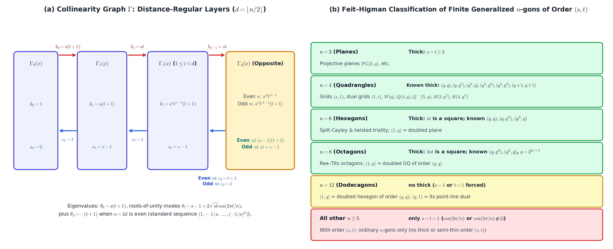

*Figure 19. Distance-regularity of the collinearity graph $\Gamma$ and the Feit–Higman classification. (a) For any finite generalized $n$-gon ($n \ge 4$) of order $(s, t)$, the collinearity graph $\Gamma$ has diameter $d = \lfloor n / 2 \rfloor$, step parameters $b_0 = s(t + 1)$ and $b_i = st$, $c_i = 1$, $a_i = s - 1$ for $1 \le i < d$, and opposite-layer parameters $c_d = t + 1, a_d = (s - 1)(t + 1)$ for even $n$ versus $c_d = 1, a_d = st + s - 1$ for odd $n$. (b) Summary of all finite generalized $n$-gons ($n \ge 3$) having an order $(s, t)$: thick examples occur only for $n \in \{3, 4, 6, 8\}$, semi-thin orders $(1, q)$ or $(q, 1)$ arise from grids, dual grids, and doubles at $n \in \{4, 6, 8, 12\}$, and all other $n \ge 5$ admit only ordinary $n$-gons ($s = t = 1$).*

Multiplying $k_{i+1} = k_i b_i / c_{i+1}$ step by step from $k_0 = 1$ gives the sphere sizes $k_i = \lvert \Gamma_i(x) \rvert$ for every point $x$:

$$k_0 = 1, \qquad k_i = s^i t^{i-1}(t + 1) \quad (1 \le i \le d - 1),$$

$$k_d = \begin{cases} s^d t^{d-1} & \text{if } n \text{ is even } (c_d = t + 1), \\ s^d t^{d-1}(t + 1) & \text{if } n \text{ is odd } (c_d = 1). \end{cases}$$

Notice that the formula for $k_d$ branches on whether $n$ is even or odd, because $c_d = t + 1$ for even $n = 2d$ cancels the factor $t + 1$ in $k_{d-1} b_{d-1} = s^d t^{d-1}(t + 1)$, whereas $c_d = 1$ for odd $n = 2d + 1$ keeps it. Summing $v = k_0 + k_1 + \dots + k_d$ for a finite generalized $2d$-gon of order $(s, t)$ ($d \ge 2$, so $n = 2d$ is even) factors cleanly:

$$v = 1 + (t + 1)s\bigl(1 + st + \dots + (st)^{d-2}\bigr) + s^d t^{d-1} = (s + 1)\bigl(1 + st + (st)^2 + \dots + (st)^{d-1}\bigr).$$

In particular, a finite generalized quadrangle ($2d = 4$) has $v = (s + 1)(1 + st)$ points, a finite generalized hexagon ($2d = 6$) has $v = (s + 1)(1 + st + s^2 t^2)$ points, and a finite generalized octagon ($2d = 8$) has $v = (s + 1)(1 + st + s^2 t^2 + s^3 t^3)$ points.

#### Rational cosines, the bottom eigenvalue, and the spectral proof

Recall from the [Bose–Mesner algebra](#distance-matrices-distance-polynomials-and-the-bose-mesner-algebra) that for a distance-regular graph $\Gamma$ of diameter $d \ge 2$ and valency $k = b_0$, the [normalized polynomials $u_0(X), u_1(X), \dots, u_d(X)$](#normalized-polynomials-standard-sequences-and-biggs-multiplicity-formula) are defined by $u_0(X) = 1$, $u_1(X) = X / k$, and the recurrence $b_i u_{i+1}(X) + (a_i - X)u_i(X) + c_i u_{i-1}(X) = 0$ for $1 \le i \le d - 1$; that the minimal polynomial of $A$ has degree $d + 1$ and is proportional to $(X - a_d)u_d(X) - c_d u_{d-1}(X)$ (so $\Gamma$ has $d + 1$ distinct eigenvalues); and that for each eigenvalue $\theta$ with standard sequence $\bigl(u_0(\theta), \dots, u_d(\theta)\bigr)$, Biggs' multiplicity formula gives $f(\theta) = v / \sum_{i=0}^d k_i u_i(\theta)^2$.

Two short lemmas prepare the proof of the Feit–Higman theorem.

**Rational cosine lemma.** For an integer $n \ge 2$, $\cos\bigl(\frac{2\pi}{n}\bigr)$ is rational if and only if $n \in \{2, 3, 4, 6\}$.

Checking $n \in \{2, 3, 4, 6\}$ gives $\cos\bigl(\frac{2\pi}{n}\bigr) \in \{-1, -\frac{1}{2}, 0, \frac{1}{2}\}$, all rational. For the converse, here are two ways to see why no other $n \ge 2$ works. First, let $\zeta_n = \cos\frac{2\pi}{n} + i \sin\frac{2\pi}{n}$, which satisfies $X^2 - 2\cos\frac{2\pi}{n}\,X + 1 = 0$. If $\cos\frac{2\pi}{n} \in \mathbb{Q}$, the minimal polynomial of $\zeta_n$ over $\mathbb{Q}$ (the $n$-th cyclotomic polynomial, of degree $\varphi(n)$ where $\varphi$ is Euler's totient function) has degree $\varphi(n) \in \{1, 2\}$; writing $\varphi(n) = \frac{n}{p_1 \cdots p_k}(p_1 - 1)\cdots(p_k - 1)$ for the distinct prime factors $p_i$ of $n$ forces each $p_i - 1 \le 2$, so $\{p_1, \dots, p_k\} \subseteq \{2, 3\}$, and checking $2^{k_1} 3^{k_2}$ leaves only $n \in \{2, 3, 4, 6\}$. Second, an elementary argument of Coxeter avoids cyclotomic polynomials altogether: suppose $\cos\phi = \frac{a}{b} \in \mathbb{Q}$ in lowest terms with $b \ge 3$. Then $\cos(2\phi) = 2\cos^2\phi - 1 = \frac{2a^2 - b^2}{b^2}$; when written in lowest terms as $\frac{a'}{b'}$ ($b' > 0$, $\gcd(a', b') = 1$), its denominator is $b' = b^2 > b$ if $b$ is odd and $b' = \frac{b^2}{2} > b$ if $b \ge 4$ is even. Doubling the angle repeatedly ($\phi, 2\phi, 4\phi, 8\phi, \dots$) would therefore produce infinitely many distinct rational numbers $\cos(2^m \phi)$, which is impossible for $\phi = \frac{2\pi}{n}$ because the sequence $\cos\bigl(2^m \frac{2\pi}{n}\bigr)$ takes only finitely many values. Thus $b \in \{1, 2\}$ in lowest terms, giving $\cos\frac{2\pi}{n} \in \{0, \pm 1, \pm\frac{1}{2}\}$ and $n \in \{2, 3, 4, 6\}$.

**Bottom eigenvalue of a finite generalized $2d$-gon.** If $\mathcal{S}$ is a finite generalized $2d$-gon ($d \ge 2$) of order $(s, t)$, then $\theta = -t - 1$ is an eigenvalue of $\Gamma$ with standard sequence $\bigl(1, -\frac{1}{s}, (-\frac{1}{s})^2, \dots, (-\frac{1}{s})^d\bigr)$.

To check this, note that $u_0(\theta) = 1$ and $u_1(\theta) = \frac{-t - 1}{s(t + 1)} = -\frac{1}{s}$. For every $i \in \{1, 2, \dots, d - 1\}$, where $b_i = st$, $a_i = s - 1$, and $c_i = 1$, substituting $u_j(\theta) = (-\frac{1}{s})^j$ into the three-term recurrence gives

$$st\left(-\frac{1}{s}\right)^{i+1} + (s - 1 + t + 1)\left(-\frac{1}{s}\right)^i + 1\left(-\frac{1}{s}\right)^{i-1} = \left(-\frac{1}{s}\right)^{i-1}\left(\frac{t}{s} - \frac{s + t}{s} + 1\right) = 0,$$

so $u_i(-t - 1) = (-\frac{1}{s})^i$ for all $0 \le i \le d$. At the minimal-polynomial boundary $m(X) = (X - a_d)u_d(X) - c_d u_{d-1}(X)$ (with $a_d = (s - 1)(t + 1)$ and $c_d = t + 1$), evaluating at $\theta = -t - 1$ gives

$$\bigl(-t - 1 - (s - 1)(t + 1)\bigr)\left(-\frac{1}{s}\right)^d - (t + 1)\left(-\frac{1}{s}\right)^{d-1} = 0,$$

proving that $\theta = -t - 1$ is a root of the minimal polynomial of $A$ and hence an eigenvalue of $\Gamma$.

We now have everything needed to prove the [Feit–Higman theorem stated earlier](#the-feithigman-theorem-and-order-bounds): any finite generalized $n$-gon $\mathcal{S}$ ($n \ge 3$) of order $(s, t)$ is either an ordinary $n$-gon ($s = t = 1$), or has $n \in \{3, 4, 6, 8, 12\}$ with $s = t \ge 2$ at $n = 3$, $st$ a square at $n = 6$ when $s \neq 1 \neq t$, $2st$ a square at $n = 8$ when $s \neq 1 \neq t$, and $s = 1$ or $t = 1$ at $n = 12$ (so thick finite generalized $n$-gons exist only for $n \in \{2, 3, 4, 6, 8\}$).

Let us walk through C. Roos's distance-regular proof of the Feit–Higman theorem. First dispose of the small cases. By (GP2), $\mathcal{S}$ contains an ordinary $n$-gon subgeometry $\mathcal{S}'$; if $s = t = 1$, then $\mathcal{S} = \mathcal{S}'$ is an ordinary $n$-gon. Assume from now on that at least one of $s, t$ is greater than $1$. If $n = 3$, our small-$n$ equivalence says $\mathcal{S}$ is a projective plane of order $(s, t)$ with $(s, t) \neq (1, 1)$, so it is a nondegenerate projective plane of order $s = t \ge 2$. Assume from now on that $n \ge 4$, so $\Gamma$ is distance-regular of diameter $d = \lfloor \frac{n}{2} \rfloor$ with $d + 1$ distinct eigenvalues (and note that if $n$ is odd, opposite-vertex degree equality between a point and a line at distance $\delta = n$ in $\widetilde{\Gamma}$ gives $s + 1 = t + 1$, so $(s, t) \neq (1, 1)$ forces $s = t > 1$).

Second, parametrize any eigenvalue $\theta$ of $\Gamma$ by choosing a nonzero complex number $\eta \in \mathbb{C} \setminus \{0\}$ such that

$$\theta = \sqrt{st}(\eta + \eta^{-1}) + s - 1.$$

The valency $\theta_0 = k = s(t + 1)$ corresponds to $\eta \in \{\sqrt{st}, \frac{1}{\sqrt{st}}\}$, and when $n$ is even our bottom-eigenvalue lemma gives $\theta_d = -t - 1$, corresponding to $\eta \in \{-\sqrt{\frac{t}{s}}, -\sqrt{\frac{s}{t}}\}$. Now look for all eigenvalues $\theta$ corresponding to $\eta \in \mathbb{C} \setminus \{0, 1, -1, \sqrt{st}, \frac{1}{\sqrt{st}}, -\sqrt{\frac{t}{s}}, -\sqrt{\frac{s}{t}}\}$. For $1 \le i \le d - 1$, substituting $a_i = s - 1$, $b_i = st$, $c_i = 1$, and $\theta - (s - 1) = \sqrt{st}(\eta + \eta^{-1})$ turns the recurrence for $u_i(\theta)$ into a constant-coefficient linear recurrence

$$st\,u_{i+1}(\theta) - \sqrt{st}(\eta + \eta^{-1})u_i(\theta) + u_{i-1}(\theta) = 0,$$

whose characteristic quadratic has roots $\frac{\eta}{\sqrt{st}}$ and $\frac{\eta^{-1}}{\sqrt{st}}$. Matching the initial values $u_0(\theta) = 1$ and $u_1(\theta) = \frac{\theta}{s(t + 1)}$ gives the closed formula

$$u_l(\theta) = \frac{t(\eta^{l+1} - \eta^{-l-1}) + (s - 1)\sqrt{s^{-1}t}(\eta^l - \eta^{-l}) - (\eta^{l-1} - \eta^{-l+1})}{(t + 1)(\eta - \eta^{-1})(\sqrt{st})^l}$$

for every $l \in \{0, 1, \dots, d\}$.

Third, impose the minimal-polynomial boundary equation at layer $d$ (using $a_d = k - c_d$):

$$-c_d u_{d-1}(\theta) + (\theta - k + c_d)u_d(\theta) = 0.$$

Substituting the formula for $u_{d-1}(\theta)$ and $u_d(\theta)$ and dividing by $\theta - s(t + 1) \neq 0$ simplifies this boundary equation to

$$t(\eta^{d+1} - \eta^{-d-1}) + (c_d + s - 1)\sqrt{s^{-1}t}(\eta^d - \eta^{-d}) + (c_d - 1)(\eta^{d-1} - \eta^{-d+1}) = 0.$$

This equation factors cleanly in both parities of $n$. When $n = 2d$ is even, we have $c_d = t + 1$, and the equation factors as

$$(\eta^d - \eta^{-d})\bigl(s + t + (\eta + \eta^{-1})\sqrt{st}\bigr) = 0.$$

Because $\eta \notin \{-\sqrt{\frac{t}{s}}, -\sqrt{\frac{s}{t}}\}$, the second factor is nonzero, forcing $\eta^d = \eta^{-d}$, or $\eta^{2d} = \eta^n = 1$ with $\eta \neq \pm 1$. Since $\eta = e^{2\pi i l / n}$ and $\eta^{-1} = e^{-2\pi i l / n}$ give the same eigenvalue $\theta$, these $n - 2$ roots of unity produce the remaining $d - 1$ distinct eigenvalues of $\Gamma$:

$$\theta_l = s - 1 + 2\sqrt{st}\cos\left(\frac{2\pi l}{n}\right) \qquad (l \in \{1, 2, \dots, d - 1\}).$$

When $n = 2d + 1$ is odd, we have $c_d = 1$ and $s = t$, and dividing by $t$ factors the boundary equation as

$$(\eta + 1)(\eta^d - \eta^{-d-1}) = 0.$$

Because $\eta \neq -1$, this forces $\eta^{2d+1} = \eta^n = 1$ with $\eta \neq 1$. Pairing $\eta = e^{2\pi i l / n}$ with $\eta^{-1}$ produces the remaining $d$ distinct eigenvalues of $\Gamma$:

$$\theta_l = s - 1 + 2s\cos\left(\frac{2\pi l}{n}\right) \qquad (l \in \{1, 2, \dots, d\}).$$

Fourth, apply Biggs' multiplicity condition: because the multiplicity $f(\theta_l) = v / \sum_{i=0}^d k_i u_i(\theta_l)^2$ is a positive integer, the denominator $S(l) = \sum_{i=0}^d k_i u_i(\theta_l)^2$ must be a rational number for every $l$.

When $n = 2d + 1$ is odd (so $s = t > 1$), summing $\sum_{i=0}^d k_i u_i(\theta_l)^2$ gives

$$S_{\text{odd}}(l) = \frac{n}{t + 1}\left(1 + \frac{(t - 1)^2}{2t\bigl(1 - \cos\frac{2\pi l}{n}\bigr)}\right) \in \mathbb{Q}.$$

Because $t > 1$, the numerator $(t - 1)^2$ is nonzero, so rationality of $S_{\text{odd}}(1)$ at $l = 1$ forces $\cos\bigl(\frac{2\pi}{n}\bigr) \in \mathbb{Q}$. By the rational cosine lemma ($n \in \{2, 3, 4, 6\}$), no odd value of $n \ge 5$ is possible.

When $n = 2d$ is even, summing $\sum_{i=0}^d k_i u_i(\theta_l)^2$ for $l \in \{1, 2, \dots, d - 1\}$ gives

$$S(l) = \frac{n}{t + 1}\left(1 + \frac{s(t - 1)^2 + t(s - 1)^2 + 2(s - 1)(t - 1)\sqrt{st}\cos\frac{2\pi l}{n}}{4st \sin^2\frac{2\pi l}{n}}\right) \in \mathbb{Q}.$$

To eliminate $\sqrt{st}\cos\frac{2\pi l}{n}$ even before knowing whether $\sqrt{st}$ is rational, add $S(1)$ and $S(d - 1)$. Because $\frac{2\pi(d - 1)}{n} = \pi - \frac{2\pi}{n}$, we have $\sin^2\frac{2\pi(d - 1)}{n} = \sin^2\frac{2\pi}{n}$ and $\cos\frac{2\pi(d - 1)}{n} = -\cos\frac{2\pi}{n}$ (and at $d = 2$, where $d - 1 = 1$, $\cos\frac{2\pi}{4} = 0$ anyway), so the cosine terms cancel:

$$S(1) + S(d - 1) = \frac{2n}{t + 1}\left(1 + \frac{s(t - 1)^2 + t(s - 1)^2}{4st \sin^2\frac{2\pi}{n}}\right) \in \mathbb{Q}.$$

Since at least one of $s, t$ is greater than $1$, we have $s(t - 1)^2 + t(s - 1)^2 > 0$, so rationality of $S(1) + S(d - 1)$ forces $\sin^2\frac{2\pi}{n} \in \mathbb{Q}$, and hence

$$\cos\left(\frac{4\pi}{n}\right) = 1 - 2\sin^2\left(\frac{2\pi}{n}\right) = \cos\left(\frac{2\pi}{d}\right) \in \mathbb{Q}.$$

Applying the rational cosine lemma to $d$ forces $d \in \{2, 3, 4, 6\}$, so $n = 2d \in \{4, 6, 8, 12\}$.

Finally, suppose both $s > 1$ and $t > 1$, so $(s - 1)(t - 1) \neq 0$. Because $d \in \{2, 3, 4, 6\}$, we already have $\sin^2\frac{2\pi l}{n} = \frac{1}{2}\bigl(1 - \cos\frac{2\pi l}{d}\bigr) \in \mathbb{Q}$ for every $l \in \{1, \dots, d - 1\}$, so rationality of $S(l)$ requires $\sqrt{st}\cos\frac{2\pi l}{n} \in \mathbb{Q}$ for all $l \in \{1, \dots, d - 1\}$:

**Hexagons ($n = 6$, $d = 3$).** Taking $l = 1$ gives $\cos\frac{2\pi}{6} = \frac{1}{2}$, so $\sqrt{st} \in \mathbb{Q}$ and $st$ is a perfect square.

**Octagons ($n = 8$, $d = 4$).** Taking $l = 1$ gives $\cos\frac{2\pi}{8} = \frac{\sqrt{2}}{2}$, so $\sqrt{2st} \in \mathbb{Q}$ and $2st$ is a perfect square.

**Dodecagons ($n = 12$, $d = 6$).** Taking $l = 2$ gives $\cos\frac{4\pi}{12} = \frac{1}{2}$ and hence $\sqrt{st} \in \mathbb{Q}$, whereas taking $l = 1$ gives $\cos\frac{2\pi}{12} = \frac{\sqrt{3}}{2}$ and hence $\frac{\sqrt{3}}{2}\sqrt{st} \in \mathbb{Q}$, impossible since $\sqrt{3}$ is irrational. Thus any finite generalized dodecagon of order $(s, t)$ must have $s = 1$ or $t = 1$.

#### Eigenvalue catalogue and worked test on a hexagon and a pentagon

Collecting $\theta_0 = s(t + 1)$, the roots-of-unity eigenvalues $\theta_l = s - 1 + 2\sqrt{st}\cos\frac{2\pi l}{n}$ ($1 \le l \le d - 1$), and $\theta_d = -t - 1$ gives all $d + 1$ distinct eigenvalues of $\Gamma$ for each of the three even polygon families:

| Generalized $2d$-gon of order $(s, t)$ | Diameter $d$ | Eigenvalues of the collinearity graph $\Gamma$ |
| :--- | :--- | :--- |
| Generalized quadrangle ($2d = 4$) | $2$ | $\theta_0 = s(t + 1),\quad \theta_1 = s - 1,\quad \theta_2 = -t - 1$ |
| Generalized hexagon ($2d = 6$) | $3$ | $\theta_0 = s(t + 1),\quad \theta_1 = s - 1 + \sqrt{st},\quad \theta_2 = s - 1 - \sqrt{st},\quad \theta_3 = -t - 1$ |
| Generalized octagon ($2d = 8$) | $4$ | $\theta_0 = s(t + 1),\quad \theta_1 = s - 1 + \sqrt{2st},\quad \theta_2 = s - 1,\quad \theta_3 = s - 1 - \sqrt{2st},\quad \theta_4 = -t - 1$ |

Compare how Biggs' multiplicity formula behaves on a genuine generalized hexagon of order $(2, 2)$ versus a hypothetical generalized pentagon of order $(2, 2)$. For a generalized hexagon of order $(s, t) = (2, 2)$ ($n = 6, d = 3, st = 4 = 2^2$), the sphere sizes are $k_0 = 1$, $k_1 = 6$, $k_2 = 24$, and $k_3 = 32$, totaling $v = 63$ points. The four eigenvalues from the table are $\theta_0 = 6$, $\theta_1 = 3$, $\theta_2 = -1$, and $\theta_3 = -3$, with denominators $S(1) = 3$, $S(2) = \frac{7}{3}$, and $\sum k_i (-1/2)^{2i} = \frac{9}{2}$, giving the positive integer multiplicities $f(6) = 1$, $f(3) = \frac{63}{3} = 21$, $f(-1) = \frac{63}{7/3} = 27$, and $f(-3) = \frac{63}{9/2} = 14$ ($1 + 21 + 27 + 14 = 63$).

For a hypothetical generalized pentagon of order $(s, t) = (2, 2)$ ($n = 5, d = 2$), the sphere sizes would be $k_0 = 1$, $k_1 = 6$, and $k_2 = 24$ ($v = 31$), with $\theta_1 = 1 + 4\cos\frac{2\pi}{5} = \sqrt{5}$ and

$$S_{\text{odd}}(1) = \frac{5}{3}\left(1 + \frac{1}{4\bigl(1 - \cos\frac{2\pi}{5}\bigr)}\right) = \frac{25 + \sqrt{5}}{12},$$

which is irrational, so the required multiplicity $f(\sqrt{5}) = 31 / S_{\text{odd}}(1)$ is not even a rational number.

#### Understanding the number of eigenvalues

As we saw in [what can the eigenvalues tell us?](#what-can-the-eigenvalues-tell-us), the eigenvalues of the spectrum have an intuitive meaning about how different portions of a graph connect. Specifically, in a DRG, the distance levels act as uniform "subsets" that trade off internal and external connections.

Fix a base point $x$ and slice the entire geometry into the $d + 1$ concentric distance spheres ("subsets"):

$$V_0 = \{x\}, \quad V_1 = \Gamma_1(x), \quad V_2 = \Gamma_2(x), \quad \dots, \quad V_d = \Gamma_d(x)$$

In a general irregular graph, two vertices in the same subset $V_i$ might have completely different numbers of neighbors inside $V_i$ vs. outside in $V_{i-1}$ and $V_{i+1}$. However, as we saw from the Unique Geodesic rule in a generalized $n$-gon, *every single point $y \in V_i$ sees the exact same local connection numbers*:

- **$a_i$ neighbors inside its own subset $V_i$** (the $s - 1$ points you reach by sliding "sideways" along the incoming line $L_{\text{in}}$).
- **$c_i$ neighbors in the inward subset $V_{i-1}$** ($1$ point for $i < d$, or $t + 1$ points at the opposite shell $i = d$ when $n = 2d$).
- **$b_i$ neighbors in the outward subset $V_{i+1}$** ($st$ points along the $t$ outward lines).

Because those numbers $(c_i, a_i, b_i)$ depend *only on the level $i$* and not on which specific point $y \in V_i$ you picked, the partition $\{V_0, V_1, \dots, V_d\}$ is what algebraic graph theorists call an **equitable partition**.

Because every point in $V_i$ has the exact same internal connectivity ($a_i$) and external connectivity ($c_i$ inward, $b_i$ outward), the giant $\lvert \mathcal{P} \rvert \times \lvert \mathcal{P} \rvert$ adjacency matrix $A$ of the collinearity graph collapses onto a tiny $(d + 1) \times (d + 1)$ **tridiagonal intersection matrix** $B$ that only tracks how the $d + 1$ subsets talk to each other:

$$B = \begin{pmatrix} a_0 & b_0 & 0 & \dots & 0 \\ c_1 & a_1 & b_1 & \dots & 0 \\ 0 & c_2 & a_2 & \dots & 0 \\ \vdots & \vdots & \vdots & \ddots & b_{d-1} \\ 0 & 0 & 0 & c_d & a_d \end{pmatrix}$$

For a generalized hexagon ($n = 6$, diameter $d = 3$) of order $(s, t)$, there are $d + 1 = 4$ distance subsets ($V_0, V_1, V_2, V_3$), and this matrix is literally $4 \times 4$:

$$B = \begin{pmatrix} 0 & s(t+1) & 0 & 0 \\ 1 & s-1 & st & 0 \\ 0 & 1 & s-1 & st \\ 0 & 0 & t+1 & (s-1)(t+1) \end{pmatrix}$$

The [distance-regular graphs section](#distance-matrices-distance-polynomials-and-the-bose-mesner-algebra) showed that the minimal polynomial of the giant adjacency matrix $A$ has degree $d + 1$, so $A$ has exactly $d + 1$ distinct eigenvalues, and these are the eigenvalues of the tiny matrix $B$: the eigenvector equation of $B$ is the [standard-sequence recurrence](#normalized-polynomials-standard-sequences-and-biggs-multiplicity-formula) $\theta u_i = c_i u_{i-1} + a_i u_i + b_i u_{i+1}$.

Why does $A^{d+1}$ add nothing new? The reason is the [Bose-Mesner algebra](#distance-matrices-distance-polynomials-and-the-bose-mesner-algebra). The $d + 1$ distance matrices $A_0, A_1, \dots, A_d$ span the same space as $I, A, \dots, A^d$, and this space is closed under multiplication. So $A^{d+1} = A \cdot A^d$ lies in it, and can be written as a linear combination of $I, A, A^2, \dots, A^d$.

That is why a distance-regular graph of diameter $d$ has *exactly $d + 1$ distinct eigenvalues*: one eigenvalue for each independent mode of oscillation across the $d + 1$ distance shells. (Any connected graph of diameter $d$ has *at least* $d + 1$; distance-regularity is what caps the number at $d + 1$.)

The generalized hexagon has $4$ concentric shells $V_0, V_1, V_2, V_3$, which yields $4$ eigenvalues:

**$\theta_0 = s(t + 1)$ (All shells in phase):** The constant eigenvector where all shells have weight $+1$.

**$\theta_1 = s - 1 + \sqrt{st}$ and $\theta_2 = s - 1 - \sqrt{st}$ (The intermediate shell oscillations):** Look at the middle shells $V_1$ and $V_2$ in the matrix $B$ above. Both have internal "sideways" degree $a_1 = a_2 = s - 1$ (from the line-cliques). The $\pm \sqrt{st}$ term comes from the geometric mean of stepping inward ($c_2 = 1$) vs. stepping outward ($b_1 = st$) between shell $V_1$ and shell $V_2$. One eigenvalue ($\theta_1 > 0$) puts $V_1$ and $V_2$ in cohesive alignment along the lines; the other ($\theta_2$) alternates their signs so they push against each other across the step from $d = 1$ to $d = 2$.

**$\theta_3 = -(t + 1)$ (Maximum alternation across lines):** Every point on a line has weights summing to $0$, representing pure outward opposition between adjacent distance levels.

In a generalized quadrangle ($d = 2$, $3$ shells $V_0, V_1, V_2$), you only have $3$ eigenvalues: the total degree $s(t+1)$, the internal "line-clique" sideways connectivity $s - 1$, and the external "ovoid/opposition" connectivity $-(t + 1)$.

In a generalized hexagon ($d = 3$, $4$ shells $V_0, V_1, V_2, V_3$), the middle region splits into *two* concentric shells ($V_1$ and $V_2$) that both have sideways clique connectivity $s - 1$ inside themselves, and couple to each other via $1$ step inward and $st$ steps outward, splitting that single middle eigenvalue $s - 1$ into the pair $(s - 1) \pm \sqrt{st}$.

### Known orders for finite generalized polygons

Which parameter pairs $(s, t)$ allowed by the [Feit–Higman theorem and the Higman and Haemers–Roos bounds](#the-feithigman-theorem-and-order-bounds) are actually known to occur for finite generalized polygons? Figure 19(b) summarizes the complete list of known orders.

#### Known thick finite generalized polygons

When both $s > 1$ and $t > 1$ (every line has at least $3$ points and every point lies on at least $3$ lines), every known finite generalized polygon belongs to one of three polygon families, where $q$ denotes a prime power.

**Thick generalized quadrangles ($n = 4$).** Every known finite generalized quadrangle that is neither a grid nor a dual grid has order $(q, q)$ (such as $W(q)$ and $Q(4, q)$), $(q, q^2)$ (such as $Q^-(5, q)$), $(q^2, q)$ (such as $H(3, q^2)$), $(q^2, q^3)$ (such as $H(4, q^2)$), $(q^3, q^2)$ (such as the point-line dual of $H(4, q^2)$), or $(q - 1, q + 1)$ for a prime power $q \ge 3$ (constructions of Ahrens and Szekeres, of Hall, and of Payne), together with their point-line duals of order $(q + 1, q - 1)$.

**Thick generalized hexagons ($n = 6$).** Every known finite generalized hexagon of order $(s, t)$ with $s, t > 1$ has one of three orders, all constructed by Tits from algebraic groups of types $G_2$ and ${}^3D_4$: $(q, q)$ for the **split-Cayley hexagons** and their point-line duals; $(q, q^3)$ for the **dual twisted triality hexagons**; and $(q^3, q)$ for the **twisted triality hexagons** (notice that $st$ is $q^2$ or $q^4$, always a square).

**Thick generalized octagons ($n = 8$).** Every known finite generalized octagon of order $(s, t)$ with $s, t > 1$ has order $(q, q^2)$ for the Ree–Tits octagons or $(q^2, q)$ for their point-line duals, where $q = 2^{2e+1}$ ($e \in \mathbb{N}$) is an odd power of $2$, matching [our earlier squareness and parity check](#the-feithigman-theorem-and-order-bounds); the smallest Ree–Tits octagon, at $e = 0$ and $q = 2$, has order $(2, 4)$ and $(2 + 1)(1 + 8 + 64 + 512) = 1{,}755$ points.

#### Thin and semi-thin orders via doubling

When $s = 1$ or $t = 1$, our characterization and halving theorems show that the thin and semi-thin examples noted [in our earlier Feit–Higman overview](#the-feithigman-theorem-and-order-bounds) exhaust *all* finite generalized polygons that have an order $(s, t)$. For $s = t = 1$ and any $d \ge 3$, every generalized $d$-gon of order $(1, 1)$ is an ordinary $d$-gon. For $n = 4$, our grid and dual-grid characterization shows that every generalized quadrangle of order $(s, 1)$ is a symmetrical grid and every generalized quadrangle of order $(1, t)$ is a symmetrical dual grid. And for $2d \in \{6, 8, 12\}$ (so $d \in \{3, 4, 6\}$), our thin-line halving theorem proves that every finite generalized $2d$-gon of order $(1, t)$ is isomorphic to the double of a generalized $d$-gon of symmetric order $(t, t)$ (a projective plane of order $t$ at $2d = 6$, a generalized quadrangle of order $(t, t)$ at $2d = 8$, or a generalized hexagon of order $(t, t)$ at $2d = 12$), while every generalized $2d$-gon of order $(s, 1)$ is the point-line dual of one of order $(1, s)$.

Why must we keep the words "of order $(s, t)$" in that classification? Because doubling *any* generalized $d$-gon produces a generalized $2d$-gon, even when the starting $d$-gon has asymmetric order $(s_0, t_0)$ with $s_0 \neq t_0$. For instance, doubling a dual twisted triality hexagon of order $(q, q^3)$ (or doubling $Q^-(5, 2)$ of order $(2, 4)$) produces a finite non-ordinary generalized $12$-gon (or $8$-gon) whose lines all have $2$ points, but whose points have two different degrees ($q + 1$ for points coming from lines of the hexagon, and $q^3 + 1$ for points coming from points of the hexagon). Such a double is a valid finite generalized $12$-gon, but it has no order $(s, t)$; requiring the double to have an order $(1, t)$ forces the halved $d$-gon to have symmetric order $(t, t)$.

## Polar Spaces

In the earlier projective geometry notes we met [polar spaces from sesquilinear forms](maths_3_projective_geometry.md#polar-spaces-polarity), their [one-or-all axiom](maths_3_projective_geometry.md#one-or-all-axiom), and [the Veldkamp-Tits axioms](maths_3_projective_geometry.md#the-classical-tits-veldkamp-definition-of-polar-spaces) expressed in terms of singular subspaces. This chapter answers three questions that take the theory from finite coordinate examples to general incidence geometry. First, if we forget the ambient projective space and keep only the points and lines of a polar space, why do three simple point-line axioms suffice to rebuild all singular subspaces and their projective geometry? Second, when we define a polar space from a sesquilinear form over an arbitrary skew field, what symmetry and diagonal conditions on the form are required so that its isotropic points and lines satisfy those axioms? Third, how do the classical families of polar spaces behave over general fields, and why do finite fields collapse them into so few canonical models?

<!-- terms checked: Veblen-Young theorem; nonsingular; perfect; centre -->

### Buekenhout-Shult polar spaces

#### Axioms and equivalence with Veldkamp-Tits polar spaces

The geometric meaning of [the one-or-all axiom](maths_3_projective_geometry.md#one-or-all-axiom), its "no hollow triangles" consequence, and the subspace-based [Veldkamp-Tits definition of polar spaces](maths_3_projective_geometry.md#the-classical-tits-veldkamp-definition-of-polar-spaces) are introduced in the earlier projective geometry notes. Here we package the point-line version into a three-axiom system on a [partial linear space](#partial-linear-spaces) and show that it carries the same information as the Veldkamp-Tits system.

A **Buekenhout-Shult polar space** is a [partial linear space](#partial-linear-spaces) $\mathcal{S} = (\mathcal{P}, \mathcal{L}, \mathrm{I})$ with $|\mathcal{P}| > 1$ satisfying three axioms.

**$\mathrm{(BS1)}$ (one-or-all axiom).** For every line $L$ and every point $x \notin L$, $x$ is collinear with either one or all points of $L$.

**$\mathrm{(BS2)}$ (non-degeneracy).** No point of $\mathcal{S}$ is collinear with all other points of $\mathcal{S}$.

**$\mathrm{(BS3)}$ (finite rank).** Every strictly ascending chain $S_0 \subsetneq S_1 \subsetneq \cdots \subsetneq S_k$ of [singular subspaces](#partial-linear-spaces) of $\mathcal{S}$ has finite length.

Each axiom rules out a specific degeneracy. Axiom $\mathrm{(BS1)}$ forces the neighbourhood $x^\perp$ of any point $x$ to meet every line $L$ either in a single point or in all of $L$. Axiom $\mathrm{(BS2)}$ excludes cones: if a point $c$ were collinear with every point of $\mathcal{S}$, $c$ would sit in the radical of the underlying form and every maximal singular subspace would pass through $c$. Axiom $\mathrm{(BS3)}$ ensures that every singular subspace lies in a maximal singular subspace of finite dimension, matching the finite-rank assumption in the Veldkamp-Tits axioms.

To pass between the subspace and point-line viewpoints, we truncate or rebuild the singular subspaces. Given a Veldkamp-Tits polar space $\Pi = (\mathcal{P}, \Sigma)$ of rank $n \ge 1$, its **point-line truncation** $\mathcal{S}_\Pi = (\mathcal{P}, \mathcal{L})$ takes $\mathcal{P}$ as its point set and the projective lines in $\Sigma$ as its line set (so $\mathcal{L} = \emptyset$ when $n = 1$). Conversely, given a Buekenhout-Shult polar space $\mathcal{S} = (\mathcal{P}, \mathcal{L})$, we form the system $\Pi_{\mathcal{S}} = (\mathcal{P}, \Sigma)$, where $\Sigma$ is the collection of all [singular subspaces](#partial-linear-spaces) of $\mathcal{S}$ with the induced point-line structure $\widetilde{S}$ on each $S \in \Sigma$.

For every Veldkamp-Tits polar space $\Pi$ of rank $n \ge 1$, the point-line geometry $\mathcal{S}_\Pi$ is a Buekenhout-Shult polar space whose singular subspaces are precisely the members of $\Sigma$. Conversely, for every Buekenhout-Shult polar space $\mathcal{S}$, the singular-subspace system $\Pi_{\mathcal{S}} = (\mathcal{P}, \Sigma)$ is a Veldkamp-Tits polar space of some finite rank $n \ge 1$; all maximal singular subspaces of $\mathcal{S}$ are [projective spaces](#projective-spaces-of-arbitrary-dimension-and-the-veblenyoung-axiom) of the same projective dimension $n - 1$, and this integer $n \ge 1$ is the **rank** of $\mathcal{S}$ (matching [the rank of a polar space](maths_3_projective_geometry.md#the-rank-of-a-polar-space) in the earlier projective geometry notes). These two constructions invert each other up to isomorphism: for any Veldkamp-Tits polar space $\Pi$ and Buekenhout-Shult polar space $\mathcal{S}$,

$$\mathcal{S}_\Pi \cong \mathcal{S} \Longleftrightarrow \Pi \cong \Pi_{\mathcal{S}}.$$

The subsections below assemble the geometric pieces needed to build $\Pi_{\mathcal{S}}$ from $\mathcal{S}$: why every clique generates a singular projective space, why $x^\perp$ cuts any generator in a hyperplane, and why two disjoint generators exist.

In fact, even the line set $\mathcal{L}$ can be recovered from the [collinearity graph](#collinearity-graphs-incidence-graphs) $\Gamma$ of $\mathcal{S}$: two Buekenhout-Shult polar spaces $\mathcal{S}_1$ and $\mathcal{S}_2$ are isomorphic if and only if their collinearity graphs $\Gamma_1$ and $\Gamma_2$ are isomorphic. Why does the graph remember the lines? In any Buekenhout-Shult polar space, a subset of $\mathcal{P}$ is a maximal singular subspace (a generator) if and only if it is a [maximal clique](#neighbours-valency-and-why-local-counts-miss-global-shape) of $\Gamma$, and in a Veldkamp-Tits polar space every non-maximal singular subspace (including every line) is the intersection of the generators containing it. Any graph isomorphism $\Gamma_1 \to \Gamma_2$ preserves maximal cliques and their intersections, so it maps lines of $\mathcal{S}_1$ bijectively onto lines of $\mathcal{S}_2$.

When $n = 1$, a Buekenhout-Shult polar space has $|\mathcal{P}| \ge 2$ points and no lines ($\mathcal{L} = \emptyset$), so its collinearity graph is edgeless. As soon as $\mathcal{S}$ contains at least one line ($n \ge 2$), its collinearity graph $\Gamma$ is connected and has [diameter](#paths-geodesics-and-distance) $2$. Indeed, $\mathrm{(BS2)}$ ensures that not all points are collinear, and by $\mathrm{(BS1)}$ every point lies on a line; for any two noncollinear points $x, y$, taking a line through $x$ and a point $z$ on it collinear with $y$ gives a path $x \sim z \sim y$ of length $2$.

#### Disjoint lines and opposite lines

How can two disjoint lines $L_1$ and $L_2$ sit inside a Buekenhout-Shult polar space $\mathcal{S}$? Applying $\mathrm{(BS1)}$ between points of $L_1$ and $L_2$ restricts their mutual collinearity pattern to three possibilities.

**Case 1 (all-to-all collinear).** Every point of $L_1$ is collinear with every point of $L_2$.

**Case 2 (a unique hub on each line).** There is a unique point $x_1 \in L_1$ collinear with all points of $L_2$, and a unique point $x_2 \in L_2$ collinear with all points of $L_1$. Every other point $y_1 \in L_1 \setminus \{x_1\}$ has $x_2$ as its unique neighbour on $L_2$, and every other point $y_2 \in L_2 \setminus \{x_2\}$ has $x_1$ as its unique neighbour on $L_1$.

**Case 3 (bijective projection, opposite lines).** Every point $x_1 \in L_1$ is collinear with a unique point $\pi_{1,2}(x_1) \in L_2$, every point $x_2 \in L_2$ is collinear with a unique point $\pi_{2,1}(x_2) \in L_1$, and the maps $\pi_{1,2} : L_1 \to L_2$ and $\pi_{2,1} : L_2 \to L_1$ are mutual inverses (hence bijections).

To see why no other pattern can occur, count the points of $L_1$ that are collinear with all of $L_2$. Two or more give case 1 (then every point of $L_2$ sees at least two points of $L_1$, and hence all of $L_1$ by $\mathrm{(BS1)}$); one gives case 2; none means every point of $L_1$ sees a unique point of $L_2$, and these choices are all distinct (since a shared neighbour on $L_2$ would see two points of $L_1$ and hence all of $L_1$), giving case 3.

Case 3 occurs for every line of $\mathcal{S}$: for every line $L_1$ of a Buekenhout-Shult polar space $\mathcal{S}$, there exists a disjoint line $L_2$ such that $L_1$ and $L_2$ stand in the bijective projection of case 3. As an immediate consequence, for every line $L$ of $\mathcal{S}$ and every point $x \in L$, there exists a point $y \in \mathcal{P}$ collinear with $x$ and noncollinear with every point of $L \setminus \{x\}$ (namely $y = \pi_{1,2}(x)$ on an opposite line $L_2$).

**Worked example (all three disjoint-line patterns in $Q^+(7, 2)$):** Why do we go up to the hyperbolic quadric $Q^+(7, 2)$ of rank $4$ in $\mathrm{PG}(7, 2)$ (defined over $\mathbb{F}_2$ by $q(X) = X_1X_2 + X_3X_4 + X_5X_6 + X_7X_8 = 0$, with $135$ points and $1575$ lines of $3$ points each) to see all three cases at once? Because case 1 requires two disjoint lines inside a common singular subspace, which spans a projective $3$-space $\mathrm{PG}(3, 2)$ and therefore requires rank $n \ge 4$.

Fix the standard basis $e_1, \dots, e_8$ of $\mathbb{F}_2^8$, where $B(X, Y) = X_1Y_2 + X_2Y_1 + \cdots + X_7Y_8 + X_8Y_7$, and fix the totally singular line

$$L_1 = \langle e_1, e_3 \rangle = \{e_1,\; e_3,\; e_1 + e_3\}.$$

Choosing three different totally singular lines $L_2$ disjoint from $L_1$ realizes all three cases (Figure 20):

**Case 1 (All-to-all):** Take $L_2 = \langle e_5, e_7 \rangle = \{e_5, e_7, e_5 + e_7\}$. Every basis vector in $\{e_1, e_3\}$ is orthogonal to every vector in $\{e_5, e_7\}$, so all $3 \times 3 = 9$ pairs between $L_1$ and $L_2$ are collinear and $\langle L_1 \cup L_2 \rangle = \langle e_1, e_3, e_5, e_7 \rangle \cong \mathrm{PG}(3, 2)$ is a generator.

**Case 2 (Unique hub on each line):** Take $L_2 = \langle e_5, e_4 \rangle = \{e_5, e_4, e_4 + e_5\}$. Since $B(e_1, e_4) = B(e_1, e_5) = 0$, the point $x_1 = e_1 \in L_1$ is collinear with all $3$ points of $L_2$. Symmetrically, $x_2 = e_5 \in L_2$ is collinear with all $3$ points of $L_1$. Meanwhile $B(e_3, e_4) = 1$, so neither $e_3$ nor $e_1 + e_3$ is collinear with $e_4$ or $e_4 + e_5$, leaving $5$ collinear pairs in a double star centered at $x_1 = e_1$ and $x_2 = e_5$.

**Case 3 (Bijective projection):** Take $L_2 = \langle e_4, e_2 \rangle = \{e_4, e_2, e_2 + e_4\}$. Here $B(e_1, e_2) = 1$ and $B(e_3, e_4) = 1$, so each point of $L_1$ has a unique orthogonal partner on $L_2$:

$$\pi_{1,2}(e_1) = e_4, \qquad \pi_{1,2}(e_3) = e_2, \qquad \pi_{1,2}(e_1 + e_3) = e_2 + e_4.$$

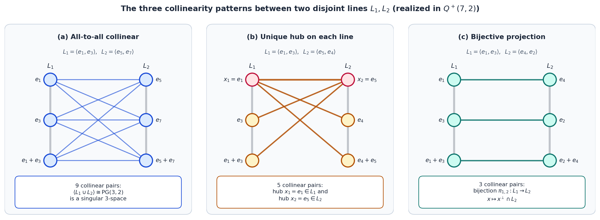

*Figure 20. The three collinearity patterns between two disjoint lines $L_1 = \langle e_1, e_3 \rangle$ and $L_2$ in a Buekenhout-Shult polar space, realized in $Q^+(7, 2)$ over $\mathbb{F}_2$: (a) all $9$ point pairs are collinear and span a singular $3$-space $\mathrm{PG}(3, 2)$; (b) a unique hub $x_1 = e_1 \in L_1$ is collinear with all of $L_2$ and a unique hub $x_2 = e_5 \in L_2$ is collinear with all of $L_1$; (c) orthogonal projection defines a bijection $\pi_{1,2} : L_1 \to L_2$.*

#### Common neighbours, distance-2 subgraphs, and the complement graph

Take two noncollinear points $a$ and $b$ in a Buekenhout-Shult polar space $\mathcal{S}$ that contains lines, and look at their set of common neighbours

$$S_{a,b} := \Gamma_1(a) \cap \Gamma_1(b) = a^\perp \cap b^\perp.$$

Because $a^\perp$ and $b^\perp$ are [subspaces](#partial-linear-spaces) of $\mathcal{S}$ by $\mathrm{(BS1)}$, their intersection $S_{a,b}$ is a subspace of $\mathcal{S}$, and the induced geometry $\widetilde{S_{a,b}}$ is itself a Buekenhout-Shult polar space of rank $n - 1$ (Figure 21). Indeed, lines inside $S_{a,b}$ are full lines of $\mathcal{S}$, so $\mathrm{(BS1)}$ and $\mathrm{(BS3)}$ are inherited directly, while $\mathrm{(BS2)}$ follows from the single-touch property on lines through $a$ and $b$. Up to isomorphism, this common-neighbour polar space $\widetilde{S_{a,b}}$ is the same rank-$(n-1)$ polar space that the earlier projective geometry notes reach as the [residue of a point](maths_3_projective_geometry.md#residues-give-local-to-global-classification-and-induction).

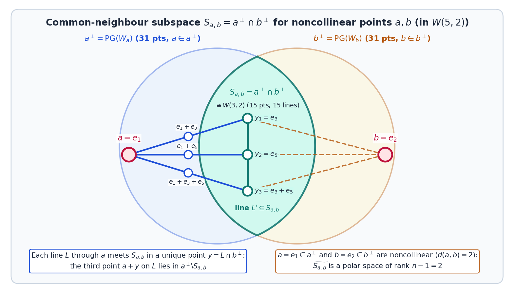

*Figure 21. For two noncollinear points $a = e_1$ and $b = e_2$ in $W(5, 2)$, the common-neighbour subspace $S_{a,b} = a^\perp \cap b^\perp$ carries the $15$-point, $15$-line polar space $W(3, 2)$ of rank $2$; each $3$-point line through $a$ meets $S_{a,b}$ in a unique point $y = L \cap b^\perp$, while its third point $a + y$ lies in $a^\perp \setminus S_{a,b}$.*

When every line of $\mathcal{S}$ is **thick** (contains at least $3$ points), both the distance-$2$ sphere around a point and the non-collinearity relation across $\mathcal{S}$ are connected. First, if $\mathcal{S}$ contains lines and every line has at least $3$ points, then for every point $x$ the subgraph $\Gamma_x$ induced by $\Gamma$ on the distance-$2$ sphere $\Gamma_2(x) = \mathcal{P} \setminus x^\perp$ is connected and has diameter at most $3$ (generalizing the distance-$2$ connectedness proved for generalized quadrangles in [the chapter on generalized polygons](#subquadrangles-and-hyperplane-complements)). Second, if every line of $\mathcal{S}$ has at least $3$ points, the [complement graph](#neighbours-valency-and-why-local-counts-miss-global-shape) $\Gamma^C$ of the collinearity graph $\Gamma$ (where two points are adjacent when they are *noncollinear* in $\mathcal{S}$) is connected. Noncollinear points $x, y$ are already adjacent in $\Gamma^C$; for collinear $x, y$, take a third point $z$ on the line $xy$ and a point $u$ collinear with $z$ but with no other point of $xy$, so that $x, u, y$ is a path of noncollinear steps.

#### Singular subspaces, projective structure, and opposite generators

Four structural properties of singular subspaces explain why every Buekenhout-Shult polar space $\mathcal{S}$ satisfies the Veldkamp-Tits subspace axioms $\mathrm{(VT1)}$–$\mathrm{(VT4)}$.

First, cliques generate singular subspaces: if $X \subseteq \mathcal{P}$ is any set of mutually collinear points of $\mathcal{S}$, the [generated subspace](#partial-linear-spaces) $\langle X \rangle$ is a singular subspace of $\mathcal{S}$. Recall from [partial linear spaces](#partial-linear-spaces) that $\langle X \rangle = \bigcup_{i \in \mathbb{N}} X_i$, where $X_0 = X$ and $X_{i+1}$ adds all points on lines through two points of $X_i$; applying $\mathrm{(BS1)}$ to a line in $X_i$ and a point in $X_i$ shows by induction on $i$ that all points of $X_i$ remain mutually collinear.

Second, a point outside a singular subspace cuts it in a hyperplane and swaps generators. For any singular subspace $S$ of $\mathcal{S}$ and any point $x \in \mathcal{P} \setminus S$, the set $x^\perp \cap S$ of points of $S$ collinear with $x$ is either all of $S$ or a [hyperplane](#partial-linear-spaces) of $\widetilde{S}$ (as seen for classical polar spaces in [the algebraic hyperplane cut](maths_3_projective_geometry.md#tying-back-to-algebra)). When $S$ is a *maximal* singular subspace, $x^\perp \cap S$ is a hyperplane of $\widetilde{S}$ and $\langle x, x^\perp \cap S \rangle$ is also a maximal singular subspace of $\mathcal{S}$: if $\langle x, x^\perp \cap S \rangle$ were properly contained in a larger singular subspace, a line through $x$ inside that larger subspace would contain a point outside $S$ collinear with every point of $S$, contradicting the maximality of $S$.

Third, every singular subspace is a projective space. Define a **plane** of $\mathcal{S}$ to be the singular subspace $\pi(x, L) := \langle \{x\} \cup L \rangle$ generated by a line $L$ and a point $x \notin L$ collinear with all points of $L$. Given any plane $\pi = \pi(x, L)$, one can first find a point $y'$ collinear with all of $L$ and not with $x$, and then refine that choice to a point $y \in \mathcal{P}$ whose orthogonal set cuts the plane in the single line $y^\perp \cap \pi(x, L) = L$. Because $y \notin \pi$, the hyperplane-cut property says that $y^\perp \cap \pi = L$ is a hyperplane of $\widetilde{\pi}$, so every line of $\widetilde{\pi}$ meets $L$. By the Veblen-Young theorem for [projective spaces of arbitrary dimension](#projective-spaces-of-arbitrary-dimension-and-the-veblenyoung-axiom), the induced geometry $\widetilde{S}$ on every singular subspace $S$ of $\mathcal{S}$ is a projective space (and every plane $\widetilde{\pi}$ is a projective plane).

Fourth, disjoint maximal singular subspaces always exist and force all generators to have the same dimension: if $\mathcal{S}$ has a maximal singular subspace $S$ of projective dimension $n - 1$, then there exists a second singular subspace $S'$ of dimension $n - 1$ disjoint from $S$. To find $S'$, take two generators of dimension $n - 1$ meeting in as small a subspace as possible; if they still meet, swapping one of them through a point noncollinear with a point of the intersection gives a smaller intersection. Together, these four properties verify all four Veldkamp-Tits axioms $\mathrm{(VT1)}$–$\mathrm{(VT4)}$ for $\Pi_{\mathcal{S}}$.

### Polar spaces from sesquilinear forms

#### Skew fields, anti-automorphisms, and rescaling sesquilinear forms

Why we work with right vector spaces $V$ over a skew field $\mathbb{F}$ and how Wedderburn's theorem makes every finite skew field commutative are explained in [linear algebra over finite fields](#linear-algebra-over-finite-fields). Coordinate Gram matrices $G$, congruence $P^T G P$, and the radical $\operatorname{rad}(f)$ are introduced in [bilinear and sesquilinear forms in coordinates](#bilinear-and-sesquilinear-forms-in-coordinates) and [forms and orthogonality](maths_3_projective_geometry.md#forms-orthogonality) in the earlier projective geometry notes. Here we develop the general skew-field algebra that explains why only $(\sigma, \epsilon)$-Hermitian forms can produce polar spaces.

When $\mathbb{F}$ is a skew field (division ring) whose multiplication is not necessarily commutative, we need three algebraic notions. The **opposite skew field** $\mathbb{F}^\circ$ has the same additive group as $\mathbb{F}$ but reverses the order of multiplication: $x \cdot_{\mathbb{F}^\circ} y := yx$. The **centre** of $\mathbb{F}$ is the commutative subfield $Z(\mathbb{F}) := \{x \in \mathbb{F} \mid xy = yx \text{ for all } y \in \mathbb{F}\}$ (so $Z(\mathbb{F}) = \mathbb{F}$ whenever $\mathbb{F}$ is a field). An **anti-automorphism** of $\mathbb{F}$ is a bijection $\sigma : \mathbb{F} \to \mathbb{F}$ (equivalently, an isomorphism $\mathbb{F} \to \mathbb{F}^\circ$) satisfying

$$(x + y)^\sigma = x^\sigma + y^\sigma \qquad \text{and} \qquad (xy)^\sigma = y^\sigma x^\sigma \qquad \text{for all } x, y \in \mathbb{F}.$$

Notice the reversed order $(xy)^\sigma = y^\sigma x^\sigma$: over a commutative field an anti-automorphism is just a field automorphism, whereas over a noncommutative skew field the identity map $\sigma = 1$ is *not* an anti-automorphism. Conjugating an anti-automorphism $\sigma$ by any nonzero scalar $\mu \in \mathbb{F}^*$ produces another anti-automorphism $\sigma' : \mathbb{F} \to \mathbb{F}$ defined by

$$x^{\sigma'} := \mu x^\sigma \mu^{-1} \qquad (\text{for all } x \in \mathbb{F}).$$

Let $V$ be a right vector space over a skew field $\mathbb{F}$ and let $\sigma$ be an anti-automorphism of $\mathbb{F}$. A **$\sigma$-sesquilinear form** on $V$ is a map $f : V \times V \to \mathbb{F}$ that is additive in each argument and satisfies

$$f(v_1 \lambda_1,\; v_2 \lambda_2) = \lambda_1^\sigma f(v_1, v_2) \lambda_2 \qquad \text{for all } v_1, v_2 \in V \text{ and } \lambda_1, \lambda_2 \in \mathbb{F}.$$

As in [bilinear and sesquilinear forms in coordinates](#bilinear-and-sesquilinear-forms-in-coordinates), $\sigma$ acts on the first scalar $\lambda_1$ pulled out on the left, while $\lambda_2$ pulls out on the right so that $\lambda_1^\sigma f(v_1, v_2)\lambda_2$ respects the reversed multiplication of $\sigma$. A **sesquilinear form** on $V$ is a $\sigma$-sesquilinear form for some anti-automorphism $\sigma$; when $\sigma = 1$ (which requires $\mathbb{F}$ to be a field), $f$ is a bilinear form, and the identically zero map $f = 0$ is the **trivial** sesquilinear form.

If $f_1$ and $f_2$ are $\sigma$-sesquilinear forms on $V$, their pointwise sum $(f_1 + f_2)(v, w) := f_1(v, w) + f_2(v, w)$ is again a $\sigma$-sesquilinear form. Left multiplication by a nonzero scalar $\mu \in \mathbb{F}^*$, however, twists $\sigma$: the rescaled form $(\mu f)(v, w) := \mu f(v, w)$ is a $\sigma'$-sesquilinear form with twisted anti-automorphism $x^{\sigma'} = \mu x^\sigma \mu^{-1}$, because $(\mu f)(v_1 \lambda_1, v_2 \lambda_2) = \mu \lambda_1^\sigma f(v_1, v_2) \lambda_2 = (\mu \lambda_1^\sigma \mu^{-1}) \mu f(v_1, v_2) \lambda_2 = \lambda_1^{\sigma'} (\mu f)(v_1, v_2) \lambda_2$. In particular, when $\mu \in Z(\mathbb{F}) \setminus \{0\}$ (and therefore for every $\mu \in \mathbb{F}^*$ when $\mathbb{F}$ is a field), $\mu x^\sigma \mu^{-1} = x^\sigma$ and $\mu f$ remains a $\sigma$-sesquilinear form with the same $\sigma$.

#### Reflexive forms and the ($\sigma, \epsilon$)-Hermitian classification

As introduced in [forms and orthogonality](maths_3_projective_geometry.md#forms-orthogonality) and [bilinear and sesquilinear forms in coordinates](#bilinear-and-sesquilinear-forms-in-coordinates), a sesquilinear form $f$ is reflexive when $f(v, w) = 0 \iff f(w, v) = 0$ (so orthogonality is symmetric), its radical is $\operatorname{rad}(f) = \{v \in V \mid f(v, w) = 0 \text{ for all } w \in V\}$, and $f$ is nondegenerate when $\operatorname{rad}(f) = \{0\}$.

Why is symmetry of orthogonality enough to pin down the algebraic shape of $f$? Fix an anti-automorphism $\sigma$ of $\mathbb{F}$ and a nonzero scalar $\epsilon \in \mathbb{F}^*$. A $\sigma$-sesquilinear form $f$ on $V$ is called a **$(\sigma, \epsilon)$-Hermitian form** if

$$f(w, v) = f(v, w)^\sigma \epsilon \qquad \text{for all } v, w \in V.$$

Every $(\sigma, \epsilon)$-Hermitian form is immediately reflexive, because $f(v, w) = 0 \implies f(w, v) = 0^\sigma \epsilon = 0$. If $f$ is a $(\sigma, \epsilon)$-Hermitian form and $\mu \in \mathbb{F}^*$, then the rescaled form $\mu f$ is a $(\sigma', \epsilon')$-Hermitian form with

$$x^{\sigma'} = \mu x^\sigma \mu^{-1} \qquad \text{and} \qquad \epsilon' = \mu (\mu^\sigma)^{-1} \epsilon.$$

Moreover, if $f$ is a *nontrivial* $(\sigma, \epsilon)$-Hermitian form on $V$, swapping $v$ and $w$ twice gives $f(v, w) = f(w, v)^\sigma \epsilon = (f(v, w)^\sigma \epsilon)^\sigma \epsilon = \epsilon^\sigma f(v, w)^{\sigma^2} \epsilon$, which forces the three identities

$$\epsilon^{\sigma + 1} := \epsilon^\sigma \epsilon = 1, \qquad \epsilon^{\sigma^2} = \epsilon, \qquad \text{and} \qquad \lambda^{\sigma^2} = \epsilon \lambda \epsilon^{-1} \quad \text{for all } \lambda \in \mathbb{F}.$$

In particular, $\sigma^2$ is an inner automorphism of $\mathbb{F}$, so $\sigma^2 = 1$ whenever $\mathbb{F}$ is a commutative field. Conversely, when $\dim(V) \ge 2$, the nondegenerate reflexive $\sigma$-sesquilinear forms on $V$ are precisely the nondegenerate $(\sigma, \epsilon)$-Hermitian forms on $V$ for some $\epsilon \in \mathbb{F}^*$: for each $v \in V$, the two linear functionals $w \mapsto f(v, w)$ and $w \mapsto f(w, v)^{\sigma^{-1}}$ have the same kernel $\langle v \rangle^\perp$ by reflexivity and are therefore scalar multiples of each other, and comparing linearly independent vectors shows that the scalar $\epsilon$ is independent of $v$.

Now assume $\mathbb{F}$ is a commutative field. Then $\sigma^2 = 1$ for every nontrivial $(\sigma, \epsilon)$-Hermitian form, and the classification splits into $\sigma = 1$ versus $\sigma \neq 1$, giving [the Birkhoff-von Neumann three-family split](maths_3_projective_geometry.md#3-types-of-polar-spaces) from the earlier projective geometry notes.

When $\sigma = 1$, a $(1, -1)$-Hermitian form with $f(v, v) = 0$ for all $v \in V$ is an alternating bilinear form, and a $(1, 1)$-Hermitian form ($f(w, v) = f(v, w)$) is a symmetric bilinear form (both written in coordinates in [bilinear and sesquilinear forms in coordinates](#bilinear-and-sesquilinear-forms-in-coordinates)). Every $(\sigma, \epsilon)$-Hermitian form with $\sigma = 1$ is either alternating or symmetric, and so is every reflexive bilinear form on $V$. Notice why the condition $f(v, v) = 0$ must be stated explicitly for alternating forms: when $\sigma = 1$, $\epsilon^2 = 1$ gives $\epsilon \in \{1, -1\}$, and if $\operatorname{char}(\mathbb{F}) \neq 2$ then $\epsilon = -1$ automatically forces $f(v, v) = -f(v, v) \implies f(v, v) = 0$, whereas in characteristic $2$ we have $-1 = 1$, so a symmetric bilinear form satisfies $f(w, v) = f(v, w)$ without necessarily satisfying $f(v, v) = 0$.

When $\sigma \neq 1$ and $\sigma^2 = 1$, a $(\sigma, 1)$-Hermitian form is a Hermitian form ($f(w, v) = f(v, w)^\sigma$), and a $(\sigma, -1)$-Hermitian form is called an **anti-Hermitian form** ($f(w, v) = -f(v, w)^\sigma$). For any nontrivial $(\sigma, \epsilon)$-Hermitian form $f$ with $\sigma \neq 1$ over a field $\mathbb{F}$, there exist nonzero scalars $\mu_1, \mu_2 \in \mathbb{F}^*$ such that $\mu_1 f$ is Hermitian ($\epsilon' = 1$) and $\mu_2 f$ is anti-Hermitian ($\epsilon'' = -1$). Because rescaling $f$ by a nonzero scalar does not change which vectors are orthogonal, anti-Hermitian and general $(\sigma, \epsilon)$-Hermitian forms over a field produce the same polar spaces as Hermitian forms.

**Worked example (rescaling an anti-Hermitian form to a Hermitian form over $\mathbb{F}_9$):** Take $\mathbb{F}_9 = \mathbb{F}_3[i]/(i^2 + 1)$ with $i^2 = -1 = 2$ and the order-$2$ Frobenius automorphism $\sigma(a + bi) = (a + bi)^3 = a + b i^3 = a - bi$. Suppose $f$ is an anti-Hermitian form ($\epsilon = -1$) on $V = \mathbb{F}_9^2$, so $f(w, v) = -f(v, w)^\sigma$.

Multiply $f$ by $\mu = i \in \mathbb{F}_9^*$. Since $i^\sigma = -i$, the new multiplier is

$$\epsilon' = \mu (\mu^\sigma)^{-1} \epsilon = i (-i)^{-1} (-1) = (-1)(-1) = 1.$$

Thus $if$ is an ordinary Hermitian form ($(if)(w, v) = ((if)(v, w))^\sigma$) with the same isotropic points and orthogonal pairs as $f$.

#### Trace-valued forms and the characteristic 2 obstruction

To build a polar space from a nondegenerate $(\sigma, \epsilon)$-Hermitian form $f$, we need one further condition called being **trace-valued**. For any $(\sigma, \epsilon)$-Hermitian form $f$ on $V$, the following three conditions are equivalent, and a form satisfying them is called a **trace-valued** $(\sigma, \epsilon)$-Hermitian form.

**Condition 1.** There exists a $\sigma$-sesquilinear form $g$ on $V$ such that

$$f(v, w) = g(v, w) + g(w, v)^\sigma \epsilon \qquad \text{for all } v, w \in V.$$

**Condition 2.** For every vector $v \in V$, the diagonal value $f(v, v)$ lies in the trace-like subgroup

$$T_{\sigma, \epsilon} := \{\eta + \eta^\sigma \epsilon \mid \eta \in \mathbb{F}\}.$$

**Condition 3.** For some basis $B$ of $V$ (and hence for every basis), $f(b, b) \in T_{\sigma, \epsilon}$ for all $b \in B$.

Condition 3 suffices because expanding $v = \sum_i b_i \lambda_i$ pairs the off-diagonal terms into sums $\lambda_i^\sigma f(b_i, b_j) \lambda_j + \lambda_j^\sigma f(b_j, b_i) \lambda_i$ of the form $\eta + \eta^\sigma \epsilon$. Rescaling preserves this property: for any $\mu \in \mathbb{F}^*$, $\mu f$ is trace-valued if and only if $f$ is trace-valued.

Over a commutative field $\mathbb{F}$, almost every $(\sigma, \epsilon)$-Hermitian form is automatically trace-valued. Every alternating bilinear form ($\sigma = 1, \epsilon = -1$, where $\eta - \eta = 0$ and $f(v, v) = 0$) is trace-valued; every symmetric bilinear form ($\sigma = 1, \epsilon = 1$) in characteristic $\operatorname{char}(\mathbb{F}) \neq 2$ is trace-valued because $f(v, v) = \eta + \eta$ for $\eta = \frac{1}{2} f(v, v)$; and every $(\sigma, \epsilon)$-Hermitian form with $\sigma \neq 1$ is trace-valued. The sole exception over a field is a symmetric bilinear form in characteristic $\operatorname{char}(\mathbb{F}) = 2$ that is *not* alternating ($f(v, v) \neq 0$ for some $v$), because in characteristic $2$ with $\sigma = 1, \epsilon = 1$ we have $\eta + \eta^\sigma \epsilon = 2\eta = 0$, so $T_{1, 1} = \{0\}$.

Why must non-alternating symmetric bilinear forms in characteristic $2$ be excluded? Look at how lines meet the set $X_f$ of isotropic points $\langle v \rangle$ ($f(v, v) = 0$) of $\mathrm{PG}(V)$. If $f$ is a nondegenerate *trace-valued* $(\sigma, \epsilon)$-Hermitian form on $V$ and $v_1 \in V \setminus \{0\}$ is an isotropic vector ($f(v_1, v_1) = 0$) with orthogonal hyperplane $W_{v_1} := \{w \in V \mid f(v_1, w) = 0\}$, then every projective line $L$ through $\langle v_1 \rangle$ not contained in $\mathrm{PG}(W_{v_1})$ contains at least one more isotropic point besides $\langle v_1 \rangle$. Indeed, pick $\langle v_2 \rangle \in L \setminus \mathrm{PG}(W_{v_1})$, scaled so that $f(v_1, v_2) = 1$; then $f(v_2, v_1) = f(v_1, v_2)^\sigma \epsilon = \epsilon$, so for any scalar $\mu \in \mathbb{F}$,

$$f(v_1 \mu + v_2,\; v_1 \mu + v_2) = \mu^\sigma + \epsilon \mu + f(v_2, v_2).$$

Because $f$ is trace-valued, $-f(v_2, v_2) = \eta + \eta^\sigma \epsilon$ for some $\eta \in \mathbb{F}$ (the set $T_{\sigma, \epsilon}$ is closed under negation), and setting $\mu = \epsilon^{-1}\eta$ gives $\epsilon\mu = \eta$ and $\mu^\sigma = \eta^\sigma (\epsilon^\sigma)^{-1} = \eta^\sigma \epsilon$ (because $\epsilon^\sigma \epsilon = 1$), so $\mu^\sigma + \epsilon\mu = \eta + \eta^\sigma \epsilon = -f(v_2, v_2)$, producing a second isotropic point $\langle v_1 \mu + v_2 \rangle \in L$. By contrast, for a non-alternating symmetric form in $\operatorname{char}(\mathbb{F}) = 2$, $\mu^\sigma + \epsilon \mu = 2\mu = 0$, so $f(v_1 \mu + v_2, v_1 \mu + v_2) = f(v_2, v_2) \neq 0$ for all $\mu$, and the isotropic points sit inside a single hyperplane instead of forming a polar space; in $\operatorname{char}(\mathbb{F}) = 2$, orthogonal polar spaces must be defined by quadratic forms rather than symmetric bilinear forms, as explained in [quadrics in characteristic 2](maths_3_projective_geometry.md#quadrics-redux). As an immediate consequence of the second-isotropic-point property, for any nondegenerate trace-valued $(\sigma, \epsilon)$-Hermitian form $f$ with $X_f \neq \emptyset$, the isotropic points span the ambient projective space ($\langle X_f \rangle = \mathrm{PG}(V)$).

**Here's a simpler explanation of all this.** Consider that we only know *one isotropic point* $\langle v_1 \rangle$ ($f(v_1, v_1) = 0$), and we pick an *arbitrary second point* $\langle v_2 \rangle$ on $L$ that is probably *not* isotropic ($f(v_2, v_2) \neq 0$). We then try to slide along the line $L$ using the parameter $\mu$ to *find* a second isotropic point $\langle v_1\mu + v_2 \rangle$.

**How the two line equations connect.** Suppose you stand at an isotropic point $\langle v_1 \rangle$ ($f(v_1, v_1) = 0$) and shoot a line $L$ out in a direction that does not lie in the hyperplane $\mathrm{PG}(W_{v_1})$ of points orthogonal to $\langle v_1 \rangle$. You grab *any* other point $\langle v_2 \rangle$ on that line to help you write coordinates on $L$, normalized so $f(v_1, v_2) = 1$. (This normalization is always possible: $f(v_1, v_2) \neq 0$, since otherwise $f(v_1, \cdot)$ would vanish on both $v_1$ and $v_2$ and so on all of $L$, putting $L$ inside $\mathrm{PG}(W_{v_1})$.)

Because you grabbed $\langle v_2 \rangle$ at random, $f(v_2, v_2)$ is likely some nonzero "error" value, not $0$. Now look at what happens when you move along the line to a general point $\langle v_1\mu + v_2 \rangle$:

$$f(v_1 \mu + v_2,\; v_1 \mu + v_2) = \mu^\sigma \underbrace{f(v_1, v_1)}_{0} \mu + \underbrace{(\mu^\sigma + \epsilon\mu)}_{\text{cross-term}} + \underbrace{f(v_2, v_2)}_{\text{error to cancel}}.$$

For $\langle v_1\mu + v_2 \rangle$ to be a second isotropic point on $L$, this sum must equal $0$:

$$\mu^\sigma + \epsilon\mu = -f(v_2, v_2).$$

Look closely at the left side versus the right side.

**The left side** ($\mu^\sigma + \epsilon\mu$). As you vary $\mu \in \mathbb{F}$ to slide along the line $L$, the cross-term between $v_1$ and $v_2$ can *only* produce values of the shape $\mu^\sigma + \epsilon\mu$. This is exactly the shape $\eta + \eta^\sigma\epsilon$: putting $\eta = \epsilon\mu$ gives $\eta + \eta^\sigma\epsilon = \epsilon\mu + \mu^\sigma\epsilon^\sigma\epsilon = \epsilon\mu + \mu^\sigma$, because $\epsilon^\sigma\epsilon = 1$. So the cross-term takes every value in $T_{\sigma, \epsilon}$ and no other values.

**The right side** ($-f(v_2, v_2)$). This is the diagonal value of $v_2$, with a minus sign, that you *need* the cross-term to cancel out.

If $-f(v_2, v_2)$ is *not* of the shape $\eta + \eta^\sigma\epsilon$, then no choice of $\mu$ can ever cancel $f(v_2, v_2)$, and your line $L$ fails to hit a second isotropic point.

**What does "trace-valued" actually mean?** Why is the set $T_{\sigma, \epsilon} = \{\eta + \eta^\sigma\epsilon \mid \eta \in \mathbb{F}\}$ called "trace-like", and a form whose diagonal values lie in it "trace-valued"? The name comes from field theory and Galois theory.

**Field trace.** In a quadratic field extension (like $\mathbb{C}/\mathbb{R}$ where $\sigma(z) = \bar{z}$, or $\mathbb{F}_{q^2}/\mathbb{F}_q$ where $\sigma(x) = x^q$), the **field trace** of an element $\eta$ is defined as the sum of $\eta$ and its conjugate:

$$\mathrm{Tr}(\eta) = \eta + \eta^\sigma.$$

Notice that when $\epsilon = 1$, the set $T_{\sigma, 1} = \{\eta + \eta^\sigma \mid \eta \in \mathbb{F}\}$ is literally the set of all field traces. (And when $\sigma = 1$, $\epsilon = 1$ in characteristic $\neq 2$, $\eta + \eta = 2\eta$, which can produce any element of the field.)

**Matrix symmetrization (Condition 1).** Similarly, in matrix terms, take any matrix $G = (g_{ij})$, the Gram matrix of a $\sigma$-sesquilinear form $g$ in a basis (as in [bilinear and sesquilinear forms in coordinates](#bilinear-and-sesquilinear-forms-in-coordinates)), and let $G^\dagger$ be its transpose with $\sigma$ applied to every entry. The Gram matrix of $f(v, w) = g(v, w) + g(w, v)^\sigma \epsilon$ is $F = G + G^\dagger \epsilon$, with entries $g_{ij} + g_{ji}^\sigma \epsilon$, so every diagonal entry of $F$ automatically becomes $g_{ii} + g_{ii}^\sigma \epsilon \in T_{\sigma, \epsilon}$.

So a form $f$ is called trace-valued if all of its diagonal values $f(v, v)$ are guaranteed to live inside $T_{\sigma, \epsilon}$.

Geometrically, *"trace-valued" means: the diagonal self-product $f(v_2, v_2)$ never produces a value that the off-diagonal cross-term $(\mu^\sigma + \epsilon\mu)$ cannot cancel.* Because the cross-term takes every value in $T_{\sigma, \epsilon}$, requiring $f(v_2, v_2) \in T_{\sigma, \epsilon}$ guarantees you can always solve $\mu^\sigma + \epsilon\mu = -f(v_2, v_2)$ and find a second isotropic point on every line through $\langle v_1 \rangle$ that does not lie in $\mathrm{PG}(W_{v_1})$.

**What goes wrong in characteristic 2?** Over a commutative field $\mathbb{F}$, $T_{\sigma, \epsilon}$ is big enough to contain every possible $f(v,v)$ in almost every case, *except one*: a symmetric bilinear form ($\sigma = 1, \epsilon = 1$) in characteristic $2$ ($\operatorname{char}(\mathbb{F}) = 2$, such as $\mathbb{F}_2$) where $f(v, v)$ is not identically zero.

Take $\mathbb{F}_2$ (where $1 + 1 = 0$ and $-1 = 1$), with $\sigma = 1$ and $\epsilon = 1$.

**The cross-term dies completely.** For any $\mu \in \mathbb{F}_2$, the cross-term is

$$\mu^\sigma + \epsilon\mu = \mu + \mu = 2\mu = 0.$$

So the trace-like subgroup is completely trivial: $T_{1, 1} = \{0\}$. Being trace-valued in this case requires $f(v, v) \in \{0\}$ for all $v$, meaning $f(v, v) = 0$ everywhere (which is called an *alternating* or *symplectic* form).

**What if $f$ is not trace-valued in $\operatorname{char}(\mathbb{F}) = 2$?** Suppose we take the nondegenerate symmetric bilinear form (dot product) on $V = \mathbb{F}_2^3$:

$$f(x, y) = x_1 y_1 + x_2 y_2 + x_3 y_3 \pmod 2.$$

Let's check its diagonal values $f(x, x)$ using the fact that $x_i^2 = x_i$ in $\mathbb{F}_2$:

$$f(x, x) = x_1^2 + x_2^2 + x_3^2 = x_1 + x_2 + x_3 \pmod 2.$$

This form has two notable features.

It is not trace-valued: for $v_2 = (1, 0, 0)$, $f(v_2, v_2) = 1 \notin T_{1, 1} = \{0\}$.

Its isotropic points $X_f$ are trapped in a single hyperplane. The equation $f(x, x) = x_1 + x_2 + x_3 = 0$ is a *linear* equation in characteristic $2$, because $(x_1 + x_2 + x_3)^2 = x_1^2 + x_2^2 + x_3^2$ (squaring a sum in characteristic $2$ leaves no cross terms, since each cross term $2x_ix_j$ is $0$; this is sometimes called the "freshman's dream"). So the isotropic points $X_f$ form the line $x_1 + x_2 + x_3 = 0$ of $\mathrm{PG}(2, 2)$, made of the three points $(1, 1, 0)$, $(1, 0, 1)$ and $(0, 1, 1)$, completely failing to span $\mathrm{PG}(2, 2)$ even though $f$ is nondegenerate.

**Why did the argument above break here?** Take the isotropic point $v_1 = (1, 1, 0)$ (since $1 + 1 + 0 = 0$) and a non-orthogonal point $v_2 = (1, 0, 0)$ (so $f(v_1, v_2) = 1$ and $f(v_2, v_2) = 1$). Now try to find a second isotropic point on the line $L = \langle v_1, v_2 \rangle$:

$$f(v_1\mu + v_2,\; v_1\mu + v_2) = \underbrace{2\mu}_{0} + f(v_2, v_2) = 0 + 1 = 1 \neq 0.$$

Because the cross-term $2\mu$ vanishes in characteristic $2$, varying $\mu$ does *nothing* to cancel $f(v_2, v_2) = 1$. The line $L$ does not lie in $\mathrm{PG}(W_{v_1})$ (as $f(v_1, v_2) = 1 \neq 0$), yet it meets $X_f$ in only $1$ point, $\langle v_1 \rangle$.

That is why non-alternating symmetric bilinear forms in $\operatorname{char}(\mathbb{F}) = 2$ are excluded by the trace-valued condition: in characteristic $2$, bilinear symmetrization kills the cross-terms of $f(x, x)$ ($x_i x_j + x_j x_i = 2 x_i x_j = 0$), so $f(x, x) = \sum_i f(e_i, e_i)\, x_i^2$ adds up like a linear form ($f(x + y, x + y) = f(x, x) + f(y, y)$), and its zero locus collapses into a subspace instead of curving across the space. Over a finite field, where every element is a square, $f(x, x)$ is the square of a linear form and the subspace is a hyperplane, as in the example.

#### Polar spaces, polarities, and the four line classes

Why a projective line $\langle v_1, v_2 \rangle$ is totally isotropic if and only if $f(v_1, v_1) = f(v_2, v_2) = f(v_1, v_2) = 0$, and how a nondegenerate reflexive form defines a [polarity](maths_3_projective_geometry.md#polarity) $\zeta : \mathrm{PG}(V) \to \mathrm{PG}(V)^*$ sending each subspace $\mathrm{PG}(U)$ to $\mathrm{PG}(U^\perp)$, are covered in the earlier projective geometry notes.

Let $f$ be a nondegenerate trace-valued $(\sigma, \epsilon)$-Hermitian form on a right vector space $V$ with $\dim(V) \ge 2$, let $\mathcal{P} = X_f$ be the set of isotropic points of $\mathrm{PG}(V)$, and let $\mathcal{L}$ be the set of totally isotropic lines of $\mathrm{PG}(V)$, forming the point-line incidence structure $\mathcal{S}_f = (\mathcal{P}, \mathcal{L})$. Whenever $\mathcal{P} \neq \emptyset$, $\mathcal{S}_f$ satisfies $\mathrm{(BS1)}$ and $\mathrm{(BS2)}$, and the singular subspaces of $\mathcal{S}_f$ are precisely the **totally isotropic subspaces** of $\mathrm{PG}(V)$ (subspaces $\alpha = \mathrm{PG}(U)$ on which $f|_{U \times U} = 0$, equivalently $\alpha \subseteq \alpha^\zeta$ under the polarity $\zeta$). If every totally isotropic subspace of $\mathrm{PG}(V)$ is finite-dimensional (in particular, whenever $\dim(V) < \infty$) and $\mathcal{P} \neq \emptyset$, then $\mathcal{S}_f = (\mathcal{P}, \mathcal{L})$ is a Buekenhout-Shult polar space and the collection $\Sigma$ of totally isotropic subspaces of $\mathrm{PG}(V)$ forms a Veldkamp-Tits polar space $(\mathcal{P}, \Sigma)$.

Because the line through two isotropic points is totally isotropic precisely when those two points are orthogonal, the form $f$ partitions all lines of the ambient projective space $\mathrm{PG}(V)$ into four classes (Figure 22):

- **$\mathcal{L}_1$ (Totally isotropic lines):** Lines of $\mathrm{PG}(V)$ wholly contained in $\mathcal{P}$ on which any two points are mutually orthogonal ($L \in \mathcal{L}$).

- **$\mathcal{L}_2$ (Tangent lines):** Lines of $\mathrm{PG}(V)$ meeting $\mathcal{P}$ in a single point ($|L \cap \mathcal{P}| = 1$).

- **$\mathcal{L}_3$ (Exterior / passant lines):** Lines of $\mathrm{PG}(V)$ disjoint from $\mathcal{P}$ ($L \cap \mathcal{P} = \emptyset$).

- **$\mathcal{L}_4$ (Hyperbolic / secant lines):** Lines of $\mathrm{PG}(V)$ containing at least two isotropic points that are *not* mutually orthogonal ($L \notin \mathcal{L}_1$ and $|L \cap \mathcal{P}| \ge 2$).

For every isotropic point $x = \langle v_1 \rangle \in \mathcal{P}$, the lines through $x$ belonging to $\mathcal{L}_1 \cup \mathcal{L}_2$ are precisely the lines through $x$ contained in the **tangent hyperplane** $T_x := \mathrm{PG}(W_{v_1}) = x^\zeta$, while every line through $x$ not contained in $T_x$ belongs to $\mathcal{L}_4$.

Which points of a hyperbolic line $L \in \mathcal{L}_4$ are isotropic? Such a line is spanned by two of its isotropic points $\langle v_1 \rangle$ and $\langle v_2 \rangle$ that are not orthogonal, with $v_2$ rescaled so that

$$f(v_1, v_1) = 0, \quad f(v_2, v_2) = 0, \quad f(v_1, v_2) = 1.$$

Every projective point on $L$ can be written as $\langle v_1 + v_2\eta \rangle$, where $\eta \in \mathbb{F}$ is a scalar from the field, written on the right because $V$ is a right vector space. Of course, $\langle v_2 \rangle$ itself doesn't fit into this expression but it does lie on the line (think of this as the "point at infinity" on the line).

As $\eta$ ranges over all elements of the field $\mathbb{F}$, the expression $\langle v_1 + v_2\eta \rangle$ sweeps through every other point on the line $L$, starting from $\langle v_1 \rangle$ at $\eta = 0$.

Now we test the remaining points $\langle v_1 + v_2\eta \rangle$ by plugging $v_1 + v_2\eta$ into the $(\sigma, \epsilon)$-Hermitian form $f$. Because $\sigma$ acts on the first slot, a scalar $\eta$ pulled out of the first slot becomes $\eta^\sigma$ on the left, while one pulled out of the second slot stays $\eta$ on the right:

$$f(v_1 + v_2\eta,\; v_1 + v_2\eta) = f(v_1, v_1) + f(v_1, v_2)\eta + \eta^\sigma f(v_2, v_1) + \eta^\sigma f(v_2, v_2)\eta.$$

Using $f(v_1, v_1) = 0$, $f(v_2, v_2) = 0$, $f(v_1, v_2) = 1$, and the $(\sigma, \epsilon)$-Hermitian symmetry $f(v_2, v_1) = f(v_1, v_2)^\sigma \epsilon = 1^\sigma \epsilon = \epsilon$, the first and last terms vanish, leaving

$$f(v_1 + v_2\eta,\; v_1 + v_2\eta) = \eta + \eta^\sigma \epsilon.$$

So $\langle v_1 + v_2\eta \rangle$ is isotropic exactly when $\eta + \eta^\sigma \epsilon = 0$, and the isotropic points of $L$ are $\langle v_2 \rangle$ together with one point $\langle v_1 + v_2\eta \rangle$ for each solution $\eta$ of this equation ($\eta = 0$ gives $\langle v_1 \rangle$):

$$L \cap \mathcal{P} = \{\langle v_2 \rangle\} \cup \{\langle v_1 + v_2 \eta \rangle \mid \eta \in \mathbb{F},\; \eta + \eta^\sigma \epsilon = 0\}.$$

**Worked example (comparing $\eta + \eta^\sigma \epsilon = 0$ across the three classical families):** Look at how the single equation $\eta + \eta^\sigma \epsilon = 0$ explains the different secant-line (also called hyperbolic) sizes in Figure 22(b):

**Orthogonal ($Q^+(3, 3)$ in $\mathrm{PG}(3, 3)$, $\sigma = 1, \epsilon = 1$ over $\mathbb{F}_3$):** Here $\eta + \eta^\sigma \epsilon = 2\eta = 0 \implies \eta = 0$ only. Thus every hyperbolic line $L \in \mathcal{L}_4$ meets $Q^+(3, 3)$ in *precisely $2$ points* ($\langle v_1 \rangle$ and $\langle v_2 \rangle$) out of the $4$ points on $L$. Across the $130$ lines of $\mathrm{PG}(3, 3)$, there are $8$ totally isotropic lines in $\mathcal{L}_1$, $32$ tangent lines in $\mathcal{L}_2$, $18$ exterior lines in $\mathcal{L}_3$, and $72$ hyperbolic lines in $\mathcal{L}_4$.

**Hermitian ($H(3, 4)$ in $\mathrm{PG}(3, 4)$, $\sigma(\eta) = \eta^2, \epsilon = 1$ over $\mathbb{F}_4 = \{0, 1, \omega, \omega^2\}$):** Here $\eta + \eta^2 = 0 \implies \eta \in \mathbb{F}_2 = \{0, 1\}$. Thus every hyperbolic line $L \in \mathcal{L}_4$ meets $H(3, 4)$ in $1 + 2 = 3$ points ($\langle v_2 \rangle$, $\langle v_1 \rangle$, and $\langle v_1 + v_2 \rangle$), forming a Baer subline $\mathrm{PG}(1, 2)$ inside $\mathrm{PG}(1, 4)$.

**Symplectic ($W(3, 3)$ in $\mathrm{PG}(3, 3)$, $\sigma = 1, \epsilon = -1$ over $\mathbb{F}_3$):** Here $\eta + \eta^\sigma \epsilon = \eta - \eta = 0$ holds for *every* $\eta \in \mathbb{F}_3$. Thus every hyperbolic line $L \in \mathcal{L}_4$ contains all $4$ of its points in $\mathcal{P}$ (since every point of $\mathrm{PG}(3, 3)$ is isotropic), so $\mathcal{L}_2 = \mathcal{L}_3 = \emptyset$, while the $130$ lines of $\mathrm{PG}(3, 3)$ split into $40$ totally isotropic lines in $\mathcal{L}_1$ (where $f(v_1, v_2) = 0$) and $90$ hyperbolic lines in $\mathcal{L}_4$ (where $f(v_1, v_2) \neq 0$).

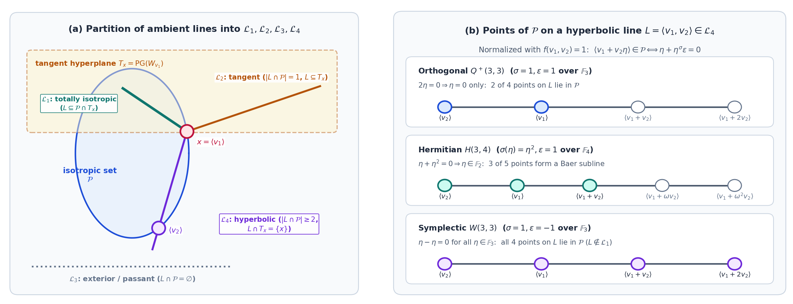

*Figure 22. (a) Partition of the lines of $\mathrm{PG}(V)$ into $\mathcal{L}_1$ (totally isotropic), $\mathcal{L}_2$ (tangent, $|L \cap \mathcal{P}| = 1$), $\mathcal{L}_3$ (exterior, $L \cap \mathcal{P} = \emptyset$), and $\mathcal{L}_4$ (hyperbolic, $|L \cap \mathcal{P}| \ge 2$), with $\mathcal{L}_1 \cup \mathcal{L}_2$ at $x = \langle v_1 \rangle$ lying in the tangent hyperplane $T_x = \mathrm{PG}(W_{v_1})$ and $L \in \mathcal{L}_4$ meeting $T_x$ only at $x$. (b) On a normalized hyperbolic line $L = \langle v_1, v_2 \rangle \in \mathcal{L}_4$, the equation $\eta + \eta^\sigma \epsilon = 0$ selects $2$ points in $Q^+(3, 3)$, $3$ points (a Baer subline) in $H(3, 4)$, and all $4$ points in $W(3, 3)$.*

### Classical families of polar spaces

#### Finite field norm, trace, and square identities

The Frobenius automorphism $x \mapsto x^p$ of $\mathbb{F}_q$ ($q = p^h$) and why $\mathbb{F}_q$ has a unique order-$2$ automorphism $x \mapsto x^{\sqrt{q}}$ if and only if $q$ is a square are covered in [the field automorphism](maths_3_projective_geometry.md#the-field-automorphism) in the earlier projective geometry notes. To see why finite fields admit far fewer non-isomorphic quadratic and Hermitian forms than infinite fields, we record two elementary counting facts about squares in $\mathbb{F}_q$ and norms and traces in $\mathbb{F}_{q^2}$.

First, consider squares in $\mathbb{F}_q$. When $q$ is even ($\operatorname{char}(\mathbb{F}_q) = 2$), the squaring map $x \mapsto x^2$ is the Frobenius automorphism of $\mathbb{F}_q$, so every element of $\mathbb{F}_q$ is a square (with a unique square root). When $q$ is odd, the squaring homomorphism $\mathbb{F}_q^* \to \mathbb{F}_q^*$, $x \mapsto x^2$, has kernel $\{1, -1\}$ of size $2$, so $\mathbb{F}_q$ has $(q - 1)/2$ nonzero squares, $1$ zero square (giving $(q + 1)/2$ squares in total), and $(q - 1)/2$ nonsquares, and the product of any two nonsquares is a square. Moreover, *every* element $\lambda \in \mathbb{F}_q$ is a sum of two squares: when $q$ is odd, both $S = \{x^2 \mid x \in \mathbb{F}_q\}$ and $\lambda - S := \{\lambda - y^2 \mid y \in \mathbb{F}_q\}$ have size $(q + 1)/2$, and since $(q + 1)/2 + (q + 1)/2 = q + 1 > |\mathbb{F}_q|$, the pigeonhole principle forces $S \cap (\lambda - S) \neq \emptyset$, giving $x^2 + y^2 = \lambda$.

Second, let $\sigma(\lambda) = \lambda^q$ be the unique order-$2$ automorphism of $\mathbb{F}_{q^2}$ with fixed field $\mathbb{F}_q$. As shown in [the Witt index and norm calculation](maths_3_projective_geometry.md#index-or-rank) in the earlier projective geometry notes, the norm map $\lambda \mapsto \lambda^{q+1}$ from $\mathbb{F}_{q^2}$ onto $\mathbb{F}_q$ is surjective ($\mathbb{F}_q = \{\lambda^{q+1} \mid \lambda \in \mathbb{F}_{q^2}\}$). Similarly, for every $\eta \in \mathbb{F}_q$, the trace equation $x^q + x = \eta$ has *precisely $q$ solutions* $x \in \mathbb{F}_{q^2}$: the map $T(x) = x^q + x$ is $\mathbb{F}_q$-linear from $\mathbb{F}_{q^2}$ into $\mathbb{F}_q$, and as a polynomial of degree $q$ its kernel $\ker(T) = \{x \in \mathbb{F}_{q^2} \mid x^q + x = 0\}$ has at most $q$ elements, so rank-nullity $|\operatorname{im}(T)| = q^2 / |\ker(T)| \ge q$ forces $|\ker(T)| = q$ and $\operatorname{im}(T) = \mathbb{F}_q$.

#### Uniform rank reduction across symplectic, orthogonal, and Hermitian families

The standard coordinate equations, canonical bases, and point and generator counts for [symplectic polar spaces](maths_3_projective_geometry.md#symplectic-spaces-antisymmetric-bilinear-forms), [unitary and Hermitian polar spaces](maths_3_projective_geometry.md#unitary-hermitian-spaces-mathcalhn-q2), [orthogonal quadrics](maths_3_projective_geometry.md#orthogonal-polar-spaces-non-degenerate-quadrics-mathcalq), and [the finite classical comparison table](maths_3_projective_geometry.md#comparison-finite-classical-polar-spaces-over-mathbbf_q-or-mathbbf_q2) are established in the earlier projective geometry notes.

Over an arbitrary field $\mathbb{F}$, each classical family of rank $n \ge 1$ is defined by adding $n$ orthogonal [hyperbolic pairs](maths_3_projective_geometry.md#example-building-the-symplectic-form-w3-3-in-pg3-3) (each spanned by two isotropic vectors with $f = 1$ between them) to a rank-$0$ [anisotropic core](maths_3_projective_geometry.md#other-properties_2) (what is left over: a subspace with no isotropic vectors at all, of dimension $0$, $1$, or $2$ here). Taking the two noncollinear points $a = \langle e_{2n-1} \rangle$ and $b = \langle e_{2n} \rangle$ of the last hyperbolic pair (or $a = \langle e_{2n+1} \rangle$ and $b = \langle e_{2n+2} \rangle$ in the elliptic family), their span is a hyperbolic line $L = \langle a, b \rangle$, and intersecting $a^\perp \cap b^\perp = \mathrm{PG}(L^\perp)$ strips off the last hyperbolic pair and drops the rank by $1$ in the same way across every family (as illustrated for $W(5, 2)$ in Figure 21):

| Polar space family $\mathcal{S}$ of rank $n$ | Ambient space | Defining form / isotropic equation | Common-neighbour space $\widetilde{S_{a,b}}$ |
| --- | --- | --- | --- |
| Symplectic $W(2n-1, \mathbb{F})$ | $\mathrm{PG}(2n-1, \mathbb{F})$ | $f(X,Y) = \sum_{i=1}^n (X_{2i-1}Y_{2i} - X_{2i}Y_{2i-1})$ | $W(2n-3, \mathbb{F})$ |
| Hyperbolic quadric $Q^+(2n-1, \mathbb{F})$ | $\mathrm{PG}(2n-1, \mathbb{F})$ | $\sum_{i=1}^n X_{2i-1}X_{2i} = 0$ | $Q^+(2n-3, \mathbb{F})$ |
| Parabolic quadric $Q(2n, \mathbb{F})$ | $\mathrm{PG}(2n, \mathbb{F})$ | $X_0^2 + \sum_{i=1}^n X_{2i-1}X_{2i} = 0$ | $Q(2n-2, \mathbb{F})$ |
| Elliptic quadric $Q^-(2n+1, \mathbb{F}'/\mathbb{F})$ | $\mathrm{PG}(2n+1, \mathbb{F})$ | $X_1^2 + t_1 X_1X_2 + t_2 X_2^2 + \sum_{i=2}^{n+1} X_{2i-1}X_{2i} = 0$ | $Q^-(2n-1, \mathbb{F}'/\mathbb{F})$ |
| Odd-dim Hermitian $H(2n-1, \mathbb{F}/\mathbb{F}_\sigma)$ | $\mathrm{PG}(2n-1, \mathbb{F})$ | $\sum_{i=1}^n (X_{2i-1}^\sigma X_{2i} + X_{2i}^\sigma X_{2i-1}) = 0$ | $H(2n-3, \mathbb{F}/\mathbb{F}_\sigma)$ |
| Even-dim Hermitian $H(2n, \mathbb{F}/\mathbb{F}_\sigma)$ | $\mathrm{PG}(2n, \mathbb{F})$ | $X_0^{\sigma+1} + \sum_{i=1}^n (X_{2i-1}^\sigma X_{2i} + X_{2i}^\sigma X_{2i-1}) = 0$ | $H(2n-2, \mathbb{F}/\mathbb{F}_\sigma)$ |

In every row of the table, induction on $n$ from the rank-$1$ base case ($W(1, \mathbb{F})$, $Q^+(1, \mathbb{F})$, $Q(2, \mathbb{F})$, $Q^-(3, \mathbb{F}'/\mathbb{F})$, $H(1, \mathbb{F}/\mathbb{F}_\sigma)$, or $H(2, \mathbb{F}/\mathbb{F}_\sigma)$, each of which has no lines and therefore has maximal singular subspaces of dimension $0$) confirms that every generator has projective dimension $n - 1$.

#### Quadrics over arbitrary and finite fields

For a quadric $Q$ defined by a quadratic form $q$ with associated bilinear polar form $f(v, w) = q(v + w) - q(v) - q(w)$, a point $x = \langle v \rangle \in Q$ is called a **singular point of the quadric $Q$** if $v \in \operatorname{rad}(f)$ (so every line through $x$ is tangent or contained in $Q$, making $Q$ a cone), and $Q$ is **nonsingular** when $Q \cap \mathrm{PG}(\operatorname{rad}(f)) = \emptyset$. Do not confuse a singular point of $Q$ (a cone apex) with a *totally singular subspace* of $Q$ (a subspace $\mathrm{PG}(U) \subseteq Q$, which is a singular subspace of the polar space). Why the polar form $f$ of the parabolic quadric $Q(2n, \mathbb{F}) : X_0^2 + X_1X_2 + \cdots + X_{2n-1}X_{2n} = 0$ is nondegenerate when $\operatorname{char}(\mathbb{F}) \neq 2$, and why in $\operatorname{char}(\mathbb{F}) = 2$ it has a $1$-dimensional radical $\operatorname{rad}(f) = \langle e_0 \rangle$ whose projective point $p = \langle e_0 \rangle \notin Q(2n, \mathbb{F})$ is the nucleus, are explained in [bilinear and sesquilinear forms in coordinates](#bilinear-and-sesquilinear-forms-in-coordinates), [quadratic sets in finite projective spaces](maths_3_projective_geometry.md#quadratic-sets-in-finite-projective-spaces), and [the characteristic-2 nucleus and symplectic projection](maths_3_projective_geometry.md#other-properties_2) in the earlier projective geometry notes.

Over an arbitrary field $\mathbb{F}$, three phenomena appear for quadrics that are invisible if one looks only at finite fields. First, consider lines through the nucleus $p = \langle e_0 \rangle = (1:0:\cdots:0)$ of $Q(2n, \mathbb{F})$ in $\operatorname{char}(\mathbb{F}) = 2$. Every line $L$ of $\mathrm{PG}(2n, \mathbb{F})$ through $p$ passes through a unique point $(0:a_1:\cdots:a_{2n})$ in the hyperplane $X_0 = 0$, and a general point $(X_0:a_1:\cdots:a_{2n})$ on $L \setminus \{p\}$ lies on $Q(2n, \mathbb{F})$ if and only if

$$X_0^2 = a_1 a_2 + \cdots + a_{2n-1} a_{2n}.$$

Since $x \mapsto x^2$ is injective in characteristic $2$, this equation has *at most one* solution $X_0 \in \mathbb{F}$ on every line through $p$. A field $\mathbb{F}$ of characteristic $p > 0$ is called **perfect** if the Frobenius map $x \mapsto x^p$ is surjective (so in characteristic $2$, $\mathbb{F}$ is perfect if and only if every element of $\mathbb{F}$ is a square; every finite field $\mathbb{F}_{2^h}$ is perfect, whereas the rational function field $\mathbb{F}_2(t)$ is not because $t$ has no square root in $\mathbb{F}_2(t)$). Thus in $\operatorname{char}(\mathbb{F}) = 2$, every line of $\mathrm{PG}(2n, \mathbb{F})$ through the nucleus $p$ meets $Q(2n, \mathbb{F})$ in at most one point, and *every* line through $p$ meets $Q(2n, \mathbb{F})$ in *precisely one point* if and only if $\mathbb{F}$ is a perfect field.

Second, elliptic quadrics depend on a quadratic field extension $\mathbb{F}'/\mathbb{F}$. Adding an irreducible homogeneous binary quadratic polynomial

$$p(X_1, X_2) = X_1^2 + t_1 X_1 X_2 + t_2 X_2^2 \in \mathbb{F}[X_1, X_2]$$

to $n$ hyperbolic pairs defines $Q^-(2n+1, \mathbb{F}'/\mathbb{F}) : p(X_1, X_2) + X_3X_4 + \cdots + X_{2n+1}X_{2n+2} = 0$ in $\mathrm{PG}(2n+1, \mathbb{F})$. Two irreducible binary quadratics $p_1(X_1, X_2)$ and $p_2(X_1, X_2)$ over $\mathbb{F}$ are equivalent up to an invertible linear change of variables and a nonzero scalar multiple if and only if their roots in an algebraic closure $\overline{\mathbb{F}}$ generate the same quadratic field extension $\mathbb{F}' = \mathbb{F}(\theta_1) = \mathbb{F}(\theta_2) \subseteq \overline{\mathbb{F}}$. A quadratic extension $\mathbb{F}'/\mathbb{F}$ generated by a root of $X^2 + t_1 X + t_2 = 0$ is **separable** if the polynomial has two distinct roots in $\overline{\mathbb{F}}$, and **inseparable** if its two roots coincide (which occurs only when $\operatorname{char}(\mathbb{F}) = 2$ and $t_1 = 0$, with $t_2 \in \mathbb{F} \setminus \mathbb{F}^2$ a nonsquare over an imperfect field). When $\mathbb{F}'/\mathbb{F}$ is separable, the polar form $f$ is nondegenerate across all $2n + 2$ coordinates and defines the **elliptic quadric** $Q^-(2n+1, \mathbb{F}'/\mathbb{F})$. Over a finite field $\mathbb{F}_q$, there is a unique quadratic extension $\mathbb{F}_{q^2}/\mathbb{F}_q$ in $\overline{\mathbb{F}_q}$ (and it is separable), giving a unique elliptic quadric $Q^-(2n+1, q)$ in $\mathrm{PG}(2n+1, q)$. Over the rationals $\mathbb{Q}$, by contrast, different square-free integers $d$ give distinct quadratic extensions $\mathbb{Q}(\sqrt{d})/\mathbb{Q}$ and quadrics that no linear change of coordinates can match.

---

**Note (pseudo-elliptic quadrics over imperfect fields of characteristic $2$).** If $\operatorname{char}(\mathbb{F}) = 2$ and $\mathbb{F}$ is *not* perfect (such as $\mathbb{F} = \mathbb{F}_2(t)$), one can choose $t_1 = 0$ and a nonsquare $t_2 \in \mathbb{F} \setminus \mathbb{F}^2$ to form an **inseparable** quadratic extension $\mathbb{F}' = \mathbb{F}(\sqrt{t_2})$. The resulting nonsingular quadric $Q^-(2n+1, \mathbb{F}'/\mathbb{F}) : X_1^2 + t_2 X_2^2 + X_3X_4 + \cdots + X_{2n+1}X_{2n+2} = 0$ is called a **pseudo-elliptic quadric**: because $t_1 = 0$, the alternating polar form $f$ vanishes on the entire line $\mathrm{PG}(\langle e_1, e_2 \rangle)$, giving a $2$-dimensional radical disjoint from $Q$. Over finite fields, every field of characteristic $2$ is perfect, so pseudo-elliptic quadrics never occur in $\mathrm{PG}(m, q)$.

---

Third, how does the classification of nonsingular quadrics of Witt index $n \ge 1$ over an arbitrary field compare with the finite classification? As shown in [the Witt decomposition into hyperbolic planes and an anisotropic core](maths_3_projective_geometry.md#other-properties_2) and [the hyperbolic-pair basis construction](maths_3_projective_geometry.md#example-building-the-symplectic-form-w3-3-in-pg3-3) in the earlier projective geometry notes, pairing two disjoint generators of projective dimension $n - 1$ splits off an orthogonal sum $U = U_1 \oplus U_2$ of $n$ hyperbolic planes of vector dimension $2n$, leaving an anisotropic subspace $U^\perp$ ($Q \cap \mathrm{PG}(U^\perp) = \emptyset$). Over an infinite field like $\mathbb{R}$, the anisotropic core $U^\perp$ can have arbitrarily large dimension (since $X_1^2 + \cdots + X_k^2 = 0$ has no nonzero real solutions), which is why the general classification restricts to $\dim(V) \in \{2n, 2n+1, 2n+2\}$: $Q \cong Q^+(2n-1, \mathbb{F})$ when $\dim(V) = 2n$, $Q \cong Q(2n, \mathbb{F})$ when $\dim(V) = 2n + 1$, and $Q \cong Q^-(2n+1, \mathbb{F}'/\mathbb{F})$ when $\dim(V) = 2n + 2$. Over a finite field $\mathbb{F}_q$, Chevalley-Warning guarantees that every conic in $\mathrm{PG}(2, q)$ has a point (for odd $q$, after diagonalizing a ternary form, two of the three coefficients lie in the same square class since there are only two classes of nonzero elements, so rescaling a variable makes them equal and reduces the equation to $X^2 + Y^2 = cZ^2$, which the sum-of-two-squares fact solves); this forces $\dim(U^\perp) \le 2$ automatically and recovers the three finite families $Q^+(2n-1, q)$, $Q(2n, q)$, and $Q^-(2n+1, q)$.

#### Hermitian varieties over arbitrary and finite fields

The finite Hermitian varieties $H(m, q^2)$ over $\mathbb{F}_{q^2}$ with involution $\sigma(x) = x^q$, their canonical equations, and why secant lines meet $H(m, q^2)$ in Baer sublines $\mathrm{PG}(1, q)$ are introduced in [unitary and Hermitian polar spaces](maths_3_projective_geometry.md#unitary-hermitian-spaces-mathcalhn-q2) in the earlier projective geometry notes. Here we state what generalizes to arbitrary fields with an order-$2$ automorphism $\sigma$.

Let $\mathbb{F}$ be a commutative field equipped with an automorphism $\sigma$ of order $2$ ($\sigma \neq 1, \sigma^2 = 1$), and let $\mathbb{F}_\sigma := \{\lambda \in \mathbb{F} \mid \lambda^\sigma = \lambda\}$ be its **fixfield** (so $\mathbb{F}$ is a quadratic extension of $\mathbb{F}_\sigma$, and when $\mathbb{F} = \mathbb{F}_{q^2}$ we have $\mathbb{F}_\sigma = \mathbb{F}_q$). Inside any projective line $\mathrm{PG}(1, \mathbb{F})$, choosing two linearly independent vectors $v_1, v_2$ and fanning out all $\mathbb{F}_\sigma$-combinations $\langle v_1 \lambda_1 + v_2 \lambda_2 \rangle$ with $(\lambda_1, \lambda_2) \in \mathbb{F}_\sigma^2 \setminus \{(0, 0)\}$ defines a **Baer-$\mathbb{F}_\sigma$-subline** $\mathrm{PG}(1, \mathbb{F}_\sigma)$.

For a nonzero Hermitian form $f$ on a vector space $V$ over $\mathbb{F}$ ($f(w, v) = f(v, w)^\sigma$), the isotropic point set $\mathcal{H}_f := X_f$ in $\mathrm{PG}(V)$ is a **Hermitian variety** (and a **Hermitian curve** when $\dim(\mathrm{PG}(V)) = 2$), which is **nonsingular** when $\operatorname{rad}(f) = \{0\}$. On the projective line $\mathrm{PG}(1, \mathbb{F})$, the rank-$1$ base case $H(1, \mathbb{F}/\mathbb{F}_\sigma)$ defined by $X_1^\sigma Y_2 + X_2^\sigma Y_1$ consists of $(1:0)$ together with the points $(-\eta : 1)$ satisfying $\eta + \eta^\sigma = 0$. Picking $\lambda_1 \in \mathbb{F} \setminus \mathbb{F}_\sigma$ and setting $\lambda_2 = \lambda_1 - \lambda_1^\sigma \neq 0$ gives $\lambda_2 + \lambda_2^\sigma = 0$, so the solutions of $\eta + \eta^\sigma = 0$ are $\eta = -\lambda_2 t$ for $t \in \mathbb{F}_\sigma$; thus the points of $H(1, \mathbb{F}/\mathbb{F}_\sigma)$ are $(1:0)$ and $(\lambda_2 t : 1)$ ($t \in \mathbb{F}_\sigma$), which are the $\mathbb{F}_\sigma$-combinations of the basis vectors $e_1' = (\lambda_2, 0)$ and $e_2' = (0, 1)$, forming a Baer-$\mathbb{F}_\sigma$-subline. Together with the hyperbolic-line formula $\eta + \eta^\sigma = 0$, this shows that every line of $\mathrm{PG}(V)$ meets a nonsingular Hermitian variety $\mathcal{H}_f$ in $0$ points, $1$ point, a Baer-$\mathbb{F}_\sigma$-subline, or the whole line.

For a nonsingular nonempty Hermitian variety $\mathcal{H}_f$ of finite Witt index $n \ge 1$ in $\mathrm{PG}(V)$, pairing two disjoint generators of dimension $n - 1$ again splits off $n$ hyperbolic planes $X_1^\sigma Y_2 + X_2^\sigma Y_1 + \cdots + X_{2n-1}^\sigma Y_{2n} + X_{2n}^\sigma Y_{2n-1}$ of total dimension $2n$, leaving an anisotropic orthogonal complement $U^\perp$. Over an infinite field like $\mathbb{C}/\mathbb{R}$, the anisotropic core $U^\perp$ can have arbitrarily large dimension (since $X_1\bar{X}_1 + \cdots + X_k\bar{X}_k = 0$ has no nonzero complex solutions), so the general classification assumes $\dim(V) \in \{2n, 2n+1\}$. When $\dim(V) = 2n$, $\mathcal{H}_f \cong H(2n-1, \mathbb{F}/\mathbb{F}_\sigma)$. When $\dim(V) = 2n + 1$, $U^\perp = \langle e_0 \rangle$ is $1$-dimensional with $f(e_0, e_0) = a \in \mathbb{F}_\sigma^*$; dividing the entire form $f$ by $a$ normalizes $(a^{-1}f)(e_0, e_0) = 1$, and rescaling the second vector of each hyperbolic pair by $a$ restores $(a^{-1}f)(e_{2i-1}, e_{2i}a) = a^{-1}a = 1$ (since $a^\sigma = a$), so $\mathcal{H}_f \cong H(2n, \mathbb{F}/\mathbb{F}_\sigma)$ holds over *every* field $\mathbb{F}$ without any norm assumption. Over a finite field $\mathbb{F}_{q^2}$, surjectivity of the norm map $\lambda \mapsto \lambda^{q+1}$ onto $\mathbb{F}_q$ ensures that every Hermitian variety on $\mathrm{PG}(1, q^2)$ is nonempty and hence forces $\dim(U^\perp) \le 1$, recovering the unique finite family $H(m, q^2)$ from [the Witt index calculation](maths_3_projective_geometry.md#index-or-rank) in the earlier projective geometry notes.

#### Isomorphism between parabolic and symplectic polar spaces

In [the finite classical comparison table](maths_3_projective_geometry.md#comparison-finite-classical-polar-spaces-over-mathbbf_q-or-mathbbf_q2) of the earlier projective geometry notes, the parabolic quadric $Q(2n, q)$ in $\mathrm{PG}(2n, q)$ and the symplectic polar space $W(2n-1, q)$ in $\mathrm{PG}(2n-1, q)$ have the same rank $n$, the same number of points $(q^{2n} - 1)/(q - 1)$, and the same number of generators $(q + 1)(q^2 + 1)\cdots(q^n + 1)$, and [the characteristic-2 nucleus note](maths_3_projective_geometry.md#other-properties_2) records that $Q(2n, 2^h) \cong W(2n-1, 2^h)$. Over an arbitrary field $\mathbb{F}$ with $n \ge 2$, the exact criterion requires both characteristic $2$ and perfectness:

$$Q(2n, \mathbb{F}) \cong W(2n-1, \mathbb{F}) \Longleftrightarrow \operatorname{char}(\mathbb{F}) = 2 \text{ and } \mathbb{F} \text{ is a perfect field.}$$

In particular, over a finite field $\mathbb{F}_q$ with $n \ge 2$, $Q(2n, q) \cong W(2n-1, q)$ if and only if $q$ is even.

To see how the isomorphism works when $\operatorname{char}(\mathbb{F}) = 2$ and $\mathbb{F}$ is perfect (Figure 23), write $Q(2n, \mathbb{F}) : X_0^2 + X_1X_2 + \cdots + X_{2n-1}X_{2n} = 0$ in $\mathrm{PG}(2n, \mathbb{F})$ with nucleus $p = \langle e_0 \rangle = (1:0:\cdots:0)$, and view $W(2n-1, \mathbb{F})$ inside the hyperplane $H = \{X_0 = 0\} \cong \mathrm{PG}(2n-1, \mathbb{F})$ with coordinates $(X_1 : \cdots : X_{2n})$ and alternating form $f'(X, Y) = X_1Y_2 + X_2Y_1 + \cdots + X_{2n-1}Y_{2n} + X_{2n}Y_{2n-1}$. Projecting from the nucleus $p$ onto $H$ sends each point $x = (X_0 : X_1 : \cdots : X_{2n}) \in Q(2n, \mathbb{F})$ to

$$\theta(x) := (X_1 : X_2 : \cdots : X_{2n}) \in \mathrm{PG}(2n-1, \mathbb{F}).$$

By our nucleus-line theorem above, because $\mathbb{F}$ is a perfect field of characteristic $2$, every line through $p$ meets $Q(2n, \mathbb{F})$ in *precisely one* point, so $\theta$ is a bijection from the point set of $Q(2n, \mathbb{F})$ onto the point set of $W(2n-1, \mathbb{F})$. Moreover, since $e_0$ lies in the radical of the polar form $f$ of $Q(2n, \mathbb{F})$, two points $x, y \in Q(2n, \mathbb{F})$ are orthogonal under $f$ if and only if $\theta(x)$ and $\theta(y)$ are orthogonal under $f'$. By the collinearity-graph theorem at the start of this chapter, a bijection of point sets that preserves collinearity in both directions is an isomorphism of polar spaces $Q(2n, \mathbb{F}) \xrightarrow{\sim} W(2n-1, \mathbb{F})$.

Conversely, why is $Q(2n, \mathbb{F}) \not\cong W(2n-1, \mathbb{F})$ when $\operatorname{char}(\mathbb{F}) \neq 2$ or $\mathbb{F}$ is imperfect? Taking [residues](maths_3_projective_geometry.md#residues-give-local-to-global-classification-and-induction) reduces the question to rank $2$, and in rank $2$ a further combinatorial property of generalized quadrangles tells $Q(4, \mathbb{F})$ and $W(3, \mathbb{F})$ apart unless $\mathbb{F}$ is perfect of characteristic $2$. That argument lies outside these notes.

**Worked example (projecting $Q(4, 2)$ from its nucleus onto the doily $W(3, 2)$):** In $\mathrm{PG}(4, 2)$ ($31$ points over the perfect field $\mathbb{F}_2$), consider the parabolic quadric

$$Q(4, 2) : X_0^2 + X_1X_2 + X_3X_4 = 0$$

with nucleus $p = (1:0:0:0:0)$ (Figure 23). For each of the $15$ points $w = (X_1:X_2:X_3:X_4) \in \mathrm{PG}(3, 2)$, the line of $\mathrm{PG}(4, 2)$ joining $p$ to $(0:X_1:X_2:X_3:X_4)$ contains two non-nucleus points: $(0:X_1:X_2:X_3:X_4)$ and $(1:X_1:X_2:X_3:X_4)$. Since $X_0^2 = X_0$ in $\mathbb{F}_2$, the quadric equation forces

$$X_0 = X_1X_2 + X_3X_4$$

uniquely on every ray through $p$. On the $9$ points of $\mathrm{PG}(3, 2)$ where $X_1X_2 + X_3X_4 = 0$ (the $3 \times 3$ hyperbolic grid $Q^+(3, 2)$ inside $H$), the unique point on $Q(4, 2)$ has $X_0 = 0$ and stays put in $H$; on the $6$ points of $\mathrm{PG}(3, 2)$ where $X_1X_2 + X_3X_4 = 1$, the unique point on $Q(4, 2)$ lies in the lifted layer $X_0 = 1$ and projects down to $H$. For example, the three points

$$u = (0:1:0:0:0), \qquad v = (1:0:0:1:1), \qquad u + v = (1:1:0:1:1)$$

form a totally singular line $L$ of $Q(4, 2)$ meeting $H$ at the hinge point $u$, and $\theta$ projects them onto $(1:0:0:0)$, $(0:0:1:1)$, and $(1:0:1:1)$, which form a totally isotropic line $\theta(L)$ of the doily $W(3, 2)$ (seen earlier in Figure 9 of [generalized quadrangles](#definition-and-why-both-axioms-matter)).

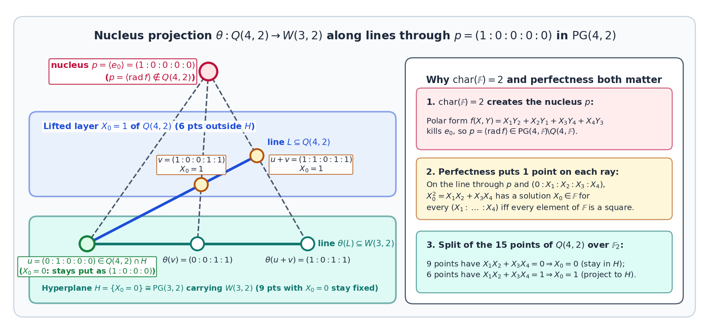

*Figure 23. In $\mathrm{PG}(4, 2)$, projecting from the nucleus $p = (1:0:0:0:0)$ onto the hyperplane $H = \{X_0 = 0\} \cong \mathrm{PG}(3, 2)$ fixes the $9$ points of $Q(4, 2) \cap H$ ($X_0 = 0$, such as $u = (0:1:0:0:0)$) and projects the $6$ lifted points with $X_0 = 1$ (such as $v$ and $u + v$) along rays through $p$ onto $H$, mapping the $15$ lines of $Q(4, 2)$ bijectively onto the $15$ lines of $W(3, 2)$.*

Finally, for the hyperbolic quadric $Q^+(2n-1, \mathbb{F})$, why its maximal singular subspaces split into two families $\mathcal{M}^+$ and $\mathcal{M}^-$ according to the parity of $(n - 1) - \dim(\alpha \cap \beta)$, why every singular subspace of projective dimension $n - 2$ lies in precisely two generators, why $Q^+(3, \mathbb{F})$ is a grid (discussed in [points, lines, duals, and doubles](#points-lines-duals-and-doubles)), and why $Q^+(5, \mathbb{F})$ is the Klein quadric are covered in [properties of hyperbolic quadratic sets](maths_3_projective_geometry.md#some-properties-of-parabolic-elliptic-hyperbolic-quadratic-sets), [counting maximal isotropic subspaces](maths_3_projective_geometry.md#number-of-maximal-isotropic-subspaces), and [the Klein quadric](maths_3_projective_geometry.md#example-klein-quadric-mathcalq5-k-in-mathrmpg5-k) in the earlier projective geometry notes.

## Designs

In earlier chapters (such as [partial geometries](#partial-geometries-and-their-collinearity-graphs) and [generalized quadrangles](#generalized-quadrangles)), we required two lines to intersect in *at most one* point (a [partial linear space](#partial-linear-spaces)). **Design theory** relaxes this intersection rule and shifts the focus entirely to **combinatorial balance**: instead of asking how lines intersect, we ask that every subset of $t$ points lies inside the exact same number of blocks. Because two blocks in a design $\mathcal{S} = (\mathcal{P}, \mathcal{B}, \mathrm{I})$ are allowed to share $2, 3,$ or more points, lines are traditionally called **blocks**, which is why the line set is written $\mathcal{B}$ rather than $\mathcal{L}$.

Let $v, k, t, \lambda$ be positive integers satisfying $v \ge k \ge t$ and $k \ge 2$. A finite [point-line geometry](#point-line-geometries) $\mathcal{S} = (\mathcal{P}, \mathcal{B}, \mathrm{I})$ is called a **$t$-design with parameters $(v, k, \lambda)$**, or shortly a **$t$-$(v, k, \lambda)$-design**, if it has $v$ points in total, $\mathcal{B}$ is nonempty with every block incident with $k$ points, every $t$ distinct points of $\mathcal{P}$ lie together in $\lambda$ blocks, and no two distinct blocks have the exact same set of points (written $\{x \in \mathcal{P} \mid x\,\mathrm{I}\,B_1\} \neq \{x \in \mathcal{P} \mid x\,\mathrm{I}\,B_2\}$ for $B_1 \neq B_2$). Some texts allow duplicate blocks, which are called designs with repeated blocks; here they are excluded, so we usually treat each block $B \in \mathcal{B}$ directly as a $k$-element subset of $\mathcal{P}$, with set membership $x \in B$ as incidence $x\,\mathrm{I}\,B$.

When $\lambda = 1$, every set of $t$ distinct points lies in a *unique* block of size $k$. A $t$-$(v, k, 1)$-design is called a **Steiner system** and denoted by **$S(t, k, v)$**. Notice the swap in parameter order between the two notations: $t$-$(v, k, \lambda)$ puts the total point count $v$ before $k$, whereas $S(t, k, v)$ lists the sizes from smallest to largest ($t \le k \le v$). Sometimes $S_\lambda(t, k, v)$ is also written for a general $t$-$(v, k, \lambda)$-design.

Two small cases have standard names. An $S(2, 3, v)$ is called a **Steiner triple system**, where blocks have size $3$, and every $2$ points lie in a unique triple, so it is a finite [linear space](#partial-linear-spaces) with lines of size $3$. An $S(3, 4, v)$ is called a **Steiner quadruple system** where blocks have size $4$, and every $3$ points lie in a unique quadruple.

Three basic facts govern $t$-designs and tie their $t = 2$ Steiner systems to projective and affine geometry. First, if a design is a $t$-design, it is also a $(t-1)$-design and so on i.e. an $s$-design where $s \in \{1, 2, \dots, t\}$. For example, in any $3$-design, not only does every triple of points lie in $\lambda$ blocks, every *pair* of points also lies in a fixed number of blocks, and every *single* point lies in a fixed number of blocks. This is called **downward heredity**.

Second, for each $n \ge 2$, the Steiner systems $S(2, n + 1, n^2 + n + 1)$ are precisely the [projective planes of order $n$](#projective-planes-degenerate-vs-nondegenerate).

Third, for each $n \ge 2$, the Steiner systems $S(2, n, n^2)$ are precisely the **affine planes of order $n$**. An **affine plane** is a [linear space](#partial-linear-spaces) in which, for every [anti-flag](#definition-and-why-both-axioms-matter) $(x, L)$, exactly one line through $x$ misses $L$, and which has three noncollinear points; lines are **parallel** if they are equal or disjoint, and an affine plane has **order $n$** when its lines have $n$ points. Recall that you get an affine plane of order $n$ from a projective plane of order $n$ by deleting one "line at infinity" along with all $n + 1$ of its points: $(n^2 + n + 1) - (n + 1) = n^2$ points remain, and every other line loses its single point at infinity and drops to size $n$, creating parallel classes of disjoint lines. Over a finite field $\mathbb{F}_q$ in any dimension $n \ge 2$, the **Desarguesian affine space** [$\mathrm{AG}(n, q)$](maths_3_projective_geometry.md#projective-affine-spaces) takes the vector space $\mathbb{F}_q^n$ ($q^n$ points) as its point set and all shifted $1$-dimensional cosets $a + \langle u \rangle$ ($u \neq 0$, each of size $q$) as its lines.

For every dimension $n \ge 2$, both $\mathrm{PG}(n, 2)$ (projective lines over $\mathbb{F}_2$ have $2 + 1 = 3$ points, giving $v = 2^{n+1} - 1$) and $\mathrm{AG}(n, 3)$ (affine lines over $\mathbb{F}_3$ have $3$ points, giving $v = 3^n$) are linear spaces with lines of size $3$, so both are Steiner triple systems. At $n = 2$, $\mathrm{PG}(2, 2)$ is the [Fano plane](#points-lines-duals-and-doubles) $S(2, 3, 7)$, and $\mathrm{AG}(2, 3)$ is $S(2, 3, 9)$, whose $12$ blocks split into $4$ parallel classes of $3$ disjoint lines each (drawn in panel (a) of Figure 8).

### The downward cascade

We mentioned this above. Let's look closer. Any $t$-$(v, k, \lambda)$-design is also an **$s$-$(v, k, \lambda_s)$-design** for every $s \in \{1, 2, \dots, t\}$, where the number of blocks containing any set $X$ of $s$ points is the constant:

$$\lambda_s = \frac{\binom{v-s}{t-s}}{\binom{k-s}{t-s}}\lambda$$

If we take $s = 1$ we see that every single point in a $t$-design lies in the exact same number of blocks. In a $2$-$(v, k, \lambda)$-design, this constant number of blocks through each point (denoted $\lambda_1$) is universally denoted by **$r$** (the replication number).

$$r = \lambda_1 = \frac{\binom{v-1}{2-1}}{\binom{k-1}{2-1}}\lambda = \frac{v - 1}{k - 1}\lambda_2 \quad (\lambda_2 = \lambda)$$

Additionally, although the theorem states $s \in \{1, \dots, t\}$, the formula works for $s = 0$ ($X = \emptyset$, which is contained in *every* block). Plugging in $s = 0$ gives the total number of blocks $b = \vert{}\mathcal{B}\vert{} = \lambda_0$:

$$b = \frac{\binom{v}{t}}{\binom{k}{t}}\lambda$$

For a $2$-$(v, k, \lambda)$-design, substituting $r = \frac{v-1}{k-1}\lambda$ into $b = \frac{v(v-1)}{k(k-1)}\lambda = \frac{v}{k}r$ (or double-counting flags in the next subsection) gives another fundamental formula: $vr = bk$.

To prove the general result that a $t$-design is also an $s$-design for any $s \le t$, fix an $s$-point subset $X \subseteq \mathcal{P}$ and write $\lambda_X$ for the number of blocks containing $X$. We need to show that $\lambda_X$ depends only on $s$, so $\lambda_X = \lambda_s$ is the exact same number for every $s$-point subset.

Let us count the $\lambda_X$ blocks $B$ containing $X$ by extending $X$ to a $t$-point set $Y$. Start with $s$ points in $X$. Take $t - s$ extra points from outside $X$ to build a $t$-point set $Y$ containing $X$. There are $\binom{v-s}{t-s}$ ways to build such a $t$-point set $Y$.

For each such $Y$, the $t$-design rule triggers and gives you $\lambda$ blocks $B$ containing $Y$ and since $X \subset Y \subset B$, those blocks also contain $X$. So across all choices of $Y$, we find $\binom{v-s}{t-s}\lambda$ block occurrences. But this isn't the final answer for the number of blocks containing $X$ because the exact same block $B$ gets found over and over again by different sets $Y$. Look at a single block $B$ of size $k$ that contains $X$. Besides the $s$ points of $X$, that block $B$ has $k - s$ other points sitting inside it. Whenever you picked your $t - s$ extra points from inside that same block $B$ to form $Y$, the $t$-design rule handed you back that exact same block $B$.

How many different $t$-point sets $Y$ (with $X \subset Y$) sit inside that single block $B$? Exactly $\binom{k-s}{t-s}$. That means in the total tally of $\binom{v-s}{t-s}\lambda$, every single valid block $B$ containing $X$ was counted $\binom{k-s}{t-s}$ times (once for each $Y$ sitting inside $B$).

To fix the overcounting, simply divide the total tally by how many times each block was counted:

$$\lambda_X = \text{Number of distinct blocks containing } X = \frac{\text{Total tally of }(Y, B)\text{ matches}}{\text{Times each block } B \text{ was counted}} = \frac{\binom{v-s}{t-s}\lambda}{\binom{k-s}{t-s}}$$

Because the right-hand side depends only on the size $s = \vert{}X\vert{}$ and not on which $s$ points we chose, $\lambda_X = \lambda_s$ is constant across all $s$-subsets $X$.

Because $\lambda_s$ counts the number of blocks containing an $s$-element set $X$, $\lambda_s$ must be an integer for every single $s \in \{0, 1, \dots, t\}$. This gives $t$ separate arithmetic divisibility rules that the four parameters $(t, v, k, \lambda)$ must satisfy before a $t$-design can possibly exist:

$$\binom{k - s}{t - s} \;\Bigg\vert{}\; \binom{v - s}{t - s}\lambda \quad \text{for every } s = 0, 1, \dots, t - 1$$

Look at what this forces for a Steiner Triple System $S(2, 3, v)$ (where $t = 2$, $k = 3$, $\lambda = 1$):

$s = 1$ condition ($r \in \mathbb{Z}$): $\binom{3-1}{2-1} \mid \binom{v-1}{2-1}(1) \implies 2 \mid (v - 1)$, so $v$ must be odd ($v \equiv 1, 3, 5 \pmod 6$).

$s = 0$ condition ($b \in \mathbb{Z}$): $\binom{3}{2} \mid \binom{v}{2}(1) \implies 3 \mid \frac{v(v-1)}{2} \implies 6 \mid v(v - 1)$, which rules out $v \equiv 5 \pmod 6$ since $5 \cdot 4 = 20$ is not divisible by $6$.

Combining those two double-counting divisibility checks immediately proves that a Steiner Triple System $S(2, 3, v)$ can only exist if $v \equiv 1 \text{ or } 3 \pmod 6$ (e.g., $v = 3, 7, 9, 13, 15, 19, \dots$).

We can also determine $\lambda_s$ via double counting. This is pretty much the same thing as above, but is a lot easier to formulate. Before doing so, let's look at how we choose our double counting variables.

#### The principle of double counting

Let's start with the flag count behind $vr = bk$ (we met the same kind of count for partial geometries in [divisibility conditions](#divisibility-conditions), where it gave the number of lines). In a design where every block has $k$ points and every point lies in $r$ blocks, suppose you know the number of blocks $b$, the block size $k$, and the replication number $r$, and your one unknown is the total number of points $v$.

We have two types of objects: points ($p$, where the unknown $v$ lives) and blocks ($B$, where the known total $b$ lives). Because you know the local degree from both sides, how many blocks hit a point ($r$) and how many points sit on a block ($k$), you form the [bipartite graph](#bipartite-graphs) between points and blocks and count the edges (the flags $(p, B)$ with $p \in B$):

$$\underbrace{v}_{\text{unknown}} \cdot r = \text{Total Flags }(p, B) = \underbrace{b}_{\text{known}} \cdot k$$

So the principle is to find two objects that we can split into bipartite sets and then link up via edges. For the designs situation, we only know the relationship between $Y$ and $B$ i.e. how many blocks does a subset of points $Y$ occur in. So we take the number of subsets $Y$ on one side and the number of blocks on the other side. How do we form edges i.e. flags like we did in the point-block case above? By looking for incidence i.e. the subsets that lie in the blocks. But there is no parameter of $X$ here, which is what we are interested in.

So instead, we use the sets $Y$ containing $X$ on one side of the bipartite graph and the blocks $B$ containing $X$ on the other. The incidence relation is $Y$ contained in $B$.

$$(\text{Subsets } Y \text{ with } X \subseteq Y) \times (\text{Blocks per } Y) = \text{Total Flags }(Y, B) = (\text{Total blocks } B) \times (\text{Subsets } Y \text{ per block } B)$$

$$\binom{v-s}{t-s} \times \lambda = \text{Total Flags }(Y, B) = \lambda_X \times \binom{k-s}{t-s}$$

Pinning the chain at $X$ ($X \subseteq Y \subseteq B$) is simply the algebraic way of saying: "restrict our universe to the blocks containing $X$, so that the total number of blocks in our restricted universe is $\lambda_X$, and the $s$ locked-in points of $X$ subtract $s$ from $v$, $k$, and $t$."

To see this double count and the downward cascade on a concrete $3$-design, take the affine space $\mathrm{AG}(3, 2)$ over $\mathbb{F}_2$, whose $v = 8$ points are the binary triples $\mathbb{F}_2^3$ (the vertices of the $3$-cube) and whose blocks are the affine planes ($2$-dimensional cosets of size $k = 4$, which are the four-point subsets with coordinate sum $000$ mod $2$: the $6$ cube faces, $6$ diagonal planes, and $2$ parity tetrahedra). Any $3$ points in $\mathbb{F}_2^3$ are automatically noncollinear (since affine lines over $\mathbb{F}_2$ have size $2$) and span a unique affine plane ($4$-point coset $\{x, y, z, x + y + z\}$), so the planes of $\mathrm{AG}(3, 2)$ form the Steiner quadruple system $S(3, 4, 8)$ with $\lambda_3 = \lambda = 1$. Running the downward cascade gives $\lambda_2 = \frac{\binom{8-2}{3-2}}{\binom{4-2}{3-2}}(1) = \frac{6}{2} = 3$ blocks through every pair of points, $\lambda_1 = r = \frac{\binom{7}{2}}{\binom{3}{2}}(1) = \frac{21}{3} = 7$ blocks through every point, and $\lambda_0 = b = \frac{\binom{8}{3}}{\binom{4}{3}}(1) = \frac{56}{4} = 14$ blocks in total. Figure 24 shows the $s = 2$ step for the edge $X = \{000, 001\}$.

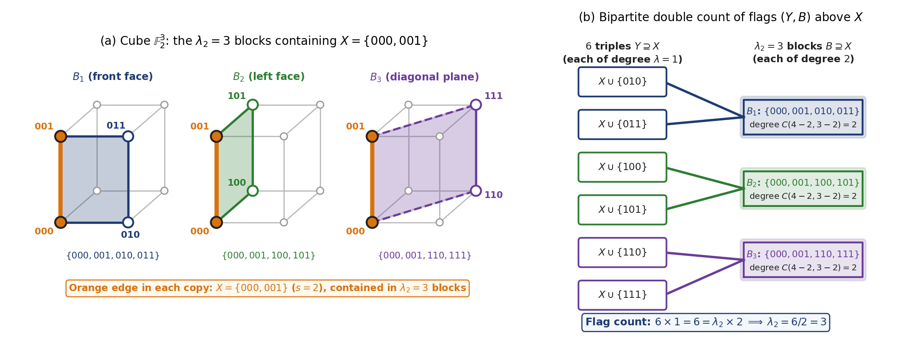

*Figure 24. Double counting $(Y, B)$ flags above $X = \{000, 001\}$ ($s = 2$) in the Steiner quadruple system $\mathrm{AG}(3, 2) = S(3, 4, 8)$, whose points are the $8$ vertices of the cube $\mathbb{F}_2^3$ and whose $14$ blocks are the four-point subsets with coordinate sum $000$. (a) The $\lambda_2 = 3$ blocks containing $X = \{000, 001\}$, shown on three copies of the cube: the front face $B_1$, the left face $B_2$, and the diagonal plane $B_3$. (b) The bipartite flag graph between the $\binom{8-2}{3-2} = 6$ triples $Y \supseteq X$ (left, each in $\lambda = 1$ block) and the $\lambda_2 = 3$ blocks $B \supseteq X$ (right, each containing $\binom{4-2}{3-2} = 2$ such triples): $6 \times 1 = 6$ edges $= 3 \times 2$, giving $\lambda_2 = 6/2 = 3$.*

### The incidence matrix and Fisher's inequality

We look at a few properties of $2$-designs. The first comes from the seemingly paradoxical question, can a non-trivial $2$-design (where blocks are smaller than the whole point set, $v > k$) have fewer blocks than points ($b < v$)? Never. In any $2$-$(v, k, \lambda)$-design with $v > k$, there are always at least as many blocks as points ($b \ge v$). This is **Fisher's Inequality**, and its proof is one of the first triumphs of linear algebra in combinatorics. Recall the [incidence matrix](#collinearity-graphs-incidence-graphs) of a geometry. For a design it is the $v \times b$ matrix $M$ with rows indexed by the points $p_1, \dots, p_v$, columns indexed by the blocks $B_1, \dots, B_b$, and entry $M_{ij} = 1$ when $p_i \,\mathrm{I}\, B_j$ and $0$ otherwise. We show that $M$ has rank $v$, and since the rank of a $v \times b$ matrix cannot exceed its number of columns $b$, we immediately get $b \ge v$.

The proof takes three steps:

$r > \lambda$: Every point lies in strictly more than $\lambda$ blocks. Why? Pick a block $B$ containing $x$. Since $v > k$, there is a point $y \notin B$. The pair $\{x, y\}$ lies in $\lambda$ blocks, none of which can be $B$ because $y \notin B$. Together with $B$, that gives at least $\lambda + 1$ blocks through $x$, so $r \ge \lambda + 1 > \lambda$.

$\operatorname{rank}(M) = v$: First, the [Gram matrix](#rank-determinants-and-gram-matrices) $M M^T$ is given by

$$M M^T = (r - \lambda)I + \lambda J \qquad \text{and} \qquad \det(M M^T) = \bigl(r + (v - 1)\lambda\bigr)(r - \lambda)^{v - 1}$$

Why is $M M^T = (r - \lambda)I + \lambda J$? Entry $(i, j)$ of $M M^T$ is the dot product of row $p_i$ and row $p_j$, which counts how many mutual neighbours they have i.e. how many blocks contain both $p_i$ and $p_j$. On the diagonal ($p_i = p_j$), a single point lies in $r$ blocks. Off the diagonal ($p_i \neq p_j$), two distinct points lie in $\lambda$ blocks.

There is also an intuition behind the determinant from [the all-ones matrix and commuting matrices](#the-all-ones-matrix-and-commuting-matrices) in the prologue. The all-ones matrix $J = jj^T$ has eigenvalue $v$ (multiplicity $1$, on the all-ones vector $j$) and eigenvalue $0$ (multiplicity $v - 1$, on vectors in $j^\perp$ orthogonal to $j$), so $\lambda J$ has eigenvalues $\lambda v$ (multiplicity $1$) and $0$ (multiplicity $v - 1$). Adding $(r - \lambda)I$ shifts those eigenvalues by $r - \lambda$, giving $r - \lambda + v\lambda = r + (v - 1)\lambda$ (multiplicity $1$) and $r - \lambda$ (multiplicity $v - 1$). Multiplying the eigenvalues gives $\det(M M^T) = \bigl(r + (v - 1)\lambda\bigr)(r - \lambda)^{v-1}$. For the Fano plane ($r = 3$, $\lambda = 1$), this is the matrix $M M^T = 2I + J$ met in the prologue.

Because $r > \lambda$, our determinant $\det(M M^T) = \bigl(r + (v - 1)\lambda\bigr)(r - \lambda)^{v-1}$ is strictly positive ($\neq 0$). Thus the $v \times v$ matrix $M M^T$ is invertible and has full rank $v$; since $\operatorname{rank}(M M^T) \le \operatorname{rank}(M) \le v$ (in fact $\operatorname{rank}(M M^T) = \operatorname{rank}(M)$ over $\mathbb{R}$, as shown in [rank, determinants and Gram matrices](#rank-determinants-and-gram-matrices)), this forces $\operatorname{rank}(M) = v$.

Fisher's Inequality ($b \ge v$): Since $M$ is a $v \times b$ matrix of rank $v$, and the rank of a matrix cannot exceed its number of columns $b$, we must have $b \ge \operatorname{rank}(M) = v$. Figure 25 illustrates this rank argument on $\mathrm{AG}(2, 3) = S(2, 3, 9)$, where $M$ is $9 \times 12$ and $M M^T = 3I + J$ has full rank $9 \le 12 = b$.

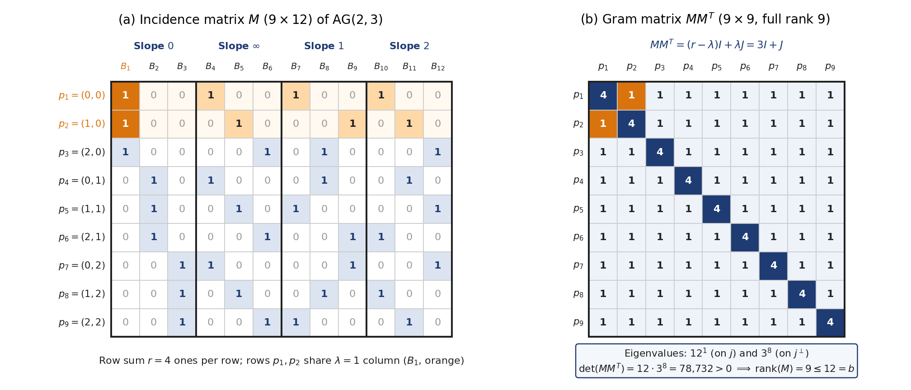

*Figure 25. Fisher's inequality on $\mathrm{AG}(2, 3) = S(2, 3, 9)$ ($v = 9$, $b = 12$, $k = 3$, $r = 4$, $\lambda = 1$). (a) The $9 \times 12$ incidence matrix $M$, with columns grouped into the four parallel classes of Figure 8(a) (slopes $0$, $\infty$, $1$, and $2$ mod $3$). Highlighted rows $p_1 = (0, 0)$ and $p_2 = (1, 0)$ each have $r = 4$ ones and overlap in $\lambda = 1$ column ($B_1$). (b) The $9 \times 9$ Gram matrix $M M^T = 3I + J$, with $r = 4$ on the diagonal and $\lambda = 1$ off the diagonal; its eigenvalues are $4 + 8(1) = 12$ (once, on $j$) and $4 - 1 = 3$ (eight times, on $j^\perp$), giving $\det(M M^T) = 12 \cdot 3^8 = 78{,}732 > 0$ and $\operatorname{rank}(M) = 9 \le 12 = b$.*

Because $r > \lambda \ge 1$ when $v > k$, every point is incident with at least $r \ge 2$ blocks. We know that a point-line geometry has at least $2$ points on every line; therefore, when we swap points and blocks to form the [point-line dual](#points-lines-duals-and-doubles) $\mathcal{S}^D$, every "line" of $\mathcal{S}^D$ (which is a point of $\mathcal{S}$) has $r \ge 2$ "points" (blocks of $\mathcal{S}$), ensuring $\mathcal{S}^D$ is a valid point-line geometry.

### Projective and affine planes as Steiner systems

[As we said](#designs), the Steiner systems $S(2, n + 1, n^2 + n + 1)$ (with $n \ge 2$) are precisely the projective planes of order $n$. In the forward direction, a [projective plane of order $n$](#projective-planes-degenerate-vs-nondegenerate) is a linear space ($\lambda = 1$) with $k = n + 1$ points on every line and $v = n^2 + n + 1$ points in total, so it is an $S(2, n + 1, n^2 + n + 1)$. For the converse, there is a subtlety: a $2$-$(v, k, 1)$ Steiner system $S(2, k, v)$ only guarantees that every two points lie on a unique line and every line has $k$ points. It says nothing directly about whether every two lines intersect (projective plane) or whether each anti-flag has a unique parallel (affine plane). The total number of points $v$ alone decides which of the two behaviours occurs, through $r$. Let's see how.

Here $v = n^2 + n + 1$ and $k = n + 1$. By our formula for $r$, the number of lines through any point $x$ is $r = \frac{(n^2 + n + 1) - 1}{(n + 1) - 1} = n + 1$. Take any two distinct lines $L_1$ and $L_2$, and pick a point $x \in L_2 \setminus L_1$. Then $x$ must send a connecting line to each of the $n + 1$ points on $L_1$, and these $n + 1$ connecting lines are all distinct (if two of them were equal, that line would contain $x$ and two points of $L_1$, so it would have to be $L_1$ itself, contradicting $x \notin L_1$). That uses up all $r = n + 1$ lines through $x$. So *every* line through $x$, including $L_2$, is forced to hit $L_1$, and no parallel lines can exist. The plane also has four points with no three collinear, which a nondegenerate projective plane needs: pick two points $a, b$ of $L_1$; pick a line $M$ through $x$ meeting $L_1$ in a third point $c$ (possible because $L_1$ has $n + 1 \ge 3$ points); and pick a point $d$ of $M$ other than $x$ and $c$ (possible because $M$ has $n + 1 \ge 3$ points). Then no three of $a, b, x, d$ are collinear: the only line through $a$ and $b$ is $L_1$, which misses $x$ and $d$, and the only line through $x$ and $d$ is $M$, which misses $a$ and $b$. Its lines have $n + 1$ points, so its order is $n$.

Similarly, the Steiner systems **$S(2, n, n^2)$** (with $n \ge 2$) are precisely the affine planes of order $n$. In the forward direction, an affine plane of order $n$ is a linear space ($\lambda = 1$) with $k = n$ points per line; fixing a point $x$ and a line $L$ of size $n$ not through $x$, $x$ lies on $n$ lines meeting $L$ plus $1$ line missing $L$, so $r = n + 1$ lines pass through $x$, each holding $n - 1$ other points and giving $v = 1 + (n + 1)(n - 1) = n^2$ points in total, an $S(2, n, n^2)$. Conversely, in any $S(2, n, n^2)$, we have $v = n^2$ and $k = n$, so the number of lines through any point $x$ is $r = \frac{n^2 - 1}{n - 1} = n + 1$. Now if you take a line $L$ (which has $n$ points) and a point $x \notin L$, $x$ sends $n$ distinct connecting lines to hit the $n$ points of $L$. Since $x$ has $r = n + 1$ lines in total, there is $(n + 1) - n = 1$ line left over through $x$ that misses $L$ completely, and since $r = n + 1 \ge 3$, two distinct lines through $x$ immediately supply three noncollinear points. Figure 26 compares this line count for $n = 3$.

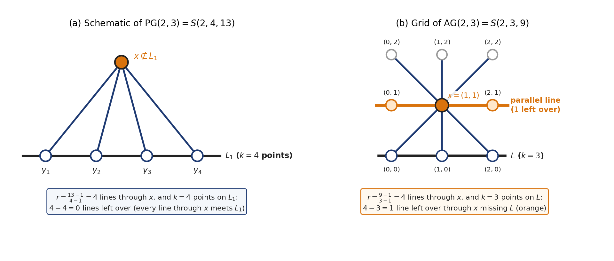

*Figure 26. Why $r$ decides the parallel postulate at $n = 3$. (a) Local schematic of $\mathrm{PG}(2, 3) = S(2, 4, 13)$ (showing only one line $L_1$ and the lines through $x \notin L_1$): $L_1$ has $k = 4$ points, and joining $x$ to each of them uses all $r = 4$ lines through $x$, so every line through $x$ meets $L_1$. (b) In $\mathrm{AG}(2, 3) = S(2, 3, 9)$ on the $3 \times 3$ grid of Figure 8(a), the bottom row $L$ has $k = 3$ points; from the centre point $x = (1, 1)$, three lines (the middle column and the two diagonals) join $x$ to the three points of $L$, leaving $(n + 1) - n = 1$ line through $x$ (the middle row) disjoint from $L$.*

### Building new designs from old ones

Once you have a design $\mathcal{S}$, there are three natural surgical operations you can perform on it to get new designs, defined in turn below:

Zoom in at a point $x$ ($\mathcal{S}_x$): keep only the blocks passing through $x$, and delete $x$ from them.

Delete a point $x$ and its blocks ($\mathcal{S}^x$): keep only the blocks that *miss* $x$.

Flip every entry of the incidence matrix ($\overline{\mathcal{S}}$, sending $M \mapsto J - M$): replace every block $B$ with its complement $\mathcal{P} \setminus B$.

Here are the exact parameters and definitions of each.

**Internal Structure / Derived Design $\mathcal{S}_x$:** Let $\mathcal{S}$ be a $t$-$(v, k, \lambda)$-design with $t \ge 2$ and $k \ge 3$, and fix a point $x \in \mathcal{P}$. The [internal structure](#points-lines-duals-and-doubles) $\mathcal{S}_x$ (also called the [derived design](#unitals-inversive-planes-and-witt-mathieu-designs) at $x$) has point set $\mathcal{P} \setminus \{x\}$ and blocks $\{B \setminus \{x\} \mid x \in B \in \mathcal{B}\}$: because $t \ge 2$ puts every point $y \neq x$ in $\lambda_2 \ge 1$ blocks with $x$, the general internal-structure point set $x^\perp \setminus \{x\}$ becomes all of $\mathcal{P} \setminus \{x\}$, and blocks shortened at $x$ stay distinct because $B = (B \setminus \{x\}) \cup \{x\}$.

Deleting $x$ leaves $v - 1$ points, shrinks every block through $x$ to size $k - 1$, and any $t - 1$ points in $\mathcal{P} \setminus \{x\}$ join with $x$ to form a $t$-point set in $\mathcal{S}$, which lies in $\lambda$ blocks through $x$. Thus $\mathcal{S}_x$ is a $(t - 1)$-$(v - 1, k - 1, \lambda)$-design (for instance, deriving $\mathrm{AG}(3, 2) = S(3, 4, 8)$ at any point $x$ gives the Fano plane $\mathrm{PG}(2, 2) = S(2, 3, 7)$, just like the derived-design steps in the extension towers of Figure 8(b)).

**External Structure $\mathcal{S}^x$:** Let $\mathcal{S}$ be a $t$-$(v, k, \lambda)$-design with $t \ge 2$ and $v > k$, and fix a point $x \in \mathcal{P}$. The **external structure $\mathcal{S}^x = (\mathcal{P}^x, \mathcal{B}^x, \mathrm{I}^x)$** (often called the *residual design* in design theory) takes $\mathcal{B}^x$ to be all blocks of $\mathcal{S}$ *not* containing $x$, and $\mathcal{P}^x$ to be all points incident with at least one such block.

Take any $t - 1$ points $X \subset \mathcal{P} \setminus \{x\}$. By [the downward cascade](#the-downward-cascade), $X$ lies in $\lambda_{t-1}$ blocks of $\mathcal{S}$ in total. How many of those blocks also contain $x$? Those are the blocks containing the $t$-point set $X \cup \{x\}$, which is $\lambda$. Subtracting the $\lambda$ blocks that hit $x$ leaves $\lambda_{t-1} - \lambda$ blocks that miss $x$. Here $\lambda_{t-1} > \lambda$ because $X \cup \{x\}$ already lies in $\lambda \ge 1$ blocks, so at least one block $B$ through $X$ exists; then $v > k$ gives a point $y \notin B$, and the $\lambda$ blocks through $X \cup \{y\}$ are all distinct from $B$, giving at least $\lambda + 1$ blocks through $X$. Moreover, since $v > k \ge t$, every point $y \in \mathcal{P} \setminus \{x\}$ belongs to at least one $(t - 1)$-subset $X \subseteq \mathcal{P} \setminus \{x\}$, which lies in $\lambda_{t-1} - \lambda \ge 1$ blocks missing $x$, forcing $\mathcal{P}^x = \mathcal{P} \setminus \{x\}$.

$\mathcal{S}^x$ has point set $\mathcal{P}^x = \mathcal{P} \setminus \{x\}$ and is a **$(t - 1)$-$(v - 1, k, \lambda_{t-1} - \lambda)$-design**, where $\lambda_{t-1} > \lambda$ is the constant number of blocks of $\mathcal{S}$ containing any $(t - 1)$-point set.

**Complementary Design $\overline{\mathcal{S}}$:** Let $\mathcal{S} = (\mathcal{P}, \mathcal{B}, \mathrm{I})$ be a $2$-$(v, k, \lambda)$-design with $v - k \ge 2$ (so every block misses at least $2$ points). The **complementary design $\overline{\mathcal{S}} = (\overline{\mathcal{P}}, \overline{\mathcal{B}}, \overline{\mathrm{I}})$** keeps the same points and blocks ($\overline{\mathcal{P}} = \mathcal{P}, \overline{\mathcal{B}} = \mathcal{B}$) but flips the incidence relation: a point $p$ is incident with $B$ in $\overline{\mathcal{S}}$ if and only if $p$ is not in $B$ in $\mathcal{S}$.

$\overline{\mathcal{S}}$ is a $2$-$(v, v - k, b - 2r + \lambda)$-design (with $b - 2r + \lambda \ge 1$).

Why is the new $\overline{\lambda}$ equal to $b - 2r + \lambda \ge 1$ (by inclusion-exclusion)? Take any two distinct points $x_1, x_2$. We want to know how many blocks $B \in \mathcal{B}$ miss both $x_1$ and $x_2$ out of $b$ total blocks.

In $\mathcal{S}$, $\lambda$ blocks contain both $x_1$ and $x_2$; $r - \lambda$ blocks contain $x_1$ but not $x_2$; and $r - \lambda$ blocks contain $x_2$ but not $x_1$. Subtracting these from $b$ leaves $b - (r - \lambda) - (r - \lambda) - \lambda = b - 2r + \lambda$ blocks that miss both $x_1$ and $x_2$. To see that $b - 2r + \lambda \ge 1$, pick any block $B \in \mathcal{B}$; since $v - k \ge 2$, there exist two distinct points $x_1, x_2 \in \mathcal{P} \setminus B$, and $B$ itself is one of the $b - 2r + \lambda$ blocks missing both $x_1$ and $x_2$.

We can do a bit more here. Fix two disjoint sets of points, a set $U$ of size $i$ and a set $W$ of size $j$ (with $i + j \le t$), and ask: how many blocks $B$ contain all of $U$ and none of $W$? Remarkably, in any $t$-$(v, k, \lambda)$-design, this number is also a constant $\lambda_i^j$ (independent of which points you pick for $U$ and $W$), given by

$$\lambda_i^j = \frac{\binom{v - i - j}{k - i}}{\binom{v}{k}} b = \sum_{m=0}^j (-1)^m \binom{j}{m} \lambda_{i+m}.$$

Both expressions follow from the downward cascade. For the alternating sum, apply inclusion-exclusion over the $j$ conditions "$z \in B$" for $z \in W$: for each $m$-element subset $Z \subseteq W$ ($\binom{j}{m}$ choices), the set $U \cup Z$ has size $i + m \le t$ and lies in $\lambda_{i+m}$ blocks, giving $\lambda_i^j = \sum_{m=0}^j (-1)^m \binom{j}{m} \lambda_{i+m}$. For the single binomial quotient, move one point $z \in W$ out of $W$: the $\lambda_i^{j-1}$ blocks containing $U$ and missing $W \setminus \{z\}$ split into the $\lambda_i^j$ blocks that also miss $z$ and the $\lambda_{i+1}^{j-1}$ blocks that contain $U \cup \{z\}$ and miss $W \setminus \{z\}$, giving the Pascal-triangle recurrence $\lambda_i^j = \lambda_i^{j-1} - \lambda_{i+1}^{j-1}$ (or $\lambda_i^{j-1} = \lambda_i^j + \lambda_{i+1}^{j-1}$). At $j = 0$, $\lambda_i^0 = \lambda_i = \frac{\binom{v-i}{t-i}}{\binom{k-i}{t-i}}\lambda = \frac{\binom{v-i}{k-i}}{\binom{v}{k}}b$, and induction on $j$ using $\binom{v-i-(j-1)}{k-i} - \binom{v-(i+1)-(j-1)}{k-(i+1)} = \binom{v-i-j}{k-i}$ gives $\lambda_i^j = \frac{\binom{v-i-j}{k-i}}{\binom{v}{k}}b$.

Look at the special cases of this rule for a $2$-$(v, k, \lambda)$-design ($t = 2$):

$i = 2, j = 0$ (Blocks containing $x_1$ and $x_2$): $\lambda_2^0 = \lambda$.

$i = 1, j = 1$ (Blocks containing $x_1$ but missing $x_2$): $\lambda_1^1 = \lambda_1 - \lambda_2 = r - \lambda$.

$i = 0, j = 2$ (Blocks missing both $x_1$ and $x_2$): $\lambda_0^2 = \lambda_0 - 2\lambda_1 + \lambda_2 = b - 2r + \lambda$ (which is the exact parameter of the complementary design).

$i = 0, j = 1$ (Blocks missing a single point $x$): $\lambda_0^1 = b - r$ (which is the number of blocks in the external structure $\mathcal{S}^x$).

Figure 27 shows how splitting the incidence matrix at a point $x$ carves out $\mathcal{S}_x$ and $\mathcal{S}^x$ simultaneously, and how the numbers $\lambda_i^j$ sit inside a Pascal-like triangle where each entry is the sum of the two entries directly below it ($\lambda_i^{j-1} = \lambda_{i+1}^{j-1} + \lambda_i^j$).

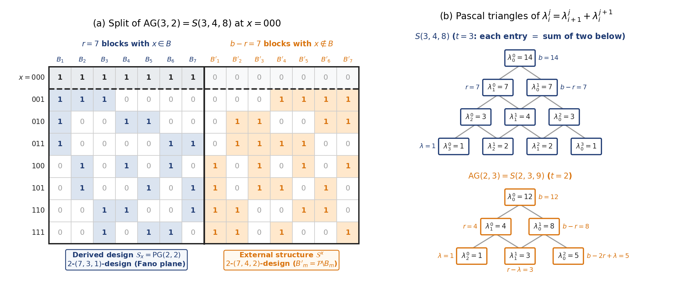

*Figure 27. (a) The $8 \times 14$ incidence matrix of $\mathrm{AG}(3, 2) = S(3, 4, 8)$ split at $x = 000$: the $r = 7$ blocks containing $x$ on the left give the derived design $\mathcal{S}_x = \mathrm{PG}(2, 2) = S(2, 3, 7)$ on the $7$ rows $\mathcal{P} \setminus \{x\}$, and the $b - r = 7$ blocks missing $x$ on the right give the external structure $\mathcal{S}^x$, a $2$-$(7, 4, 2)$-design. Placing each block missing $x$ in the same column order as its parallel partner through $x$ makes the bit flip $B \mapsto \mathcal{P} \setminus B$ visible: in this design (though not in a general $t$-design), $\mathcal{S}^x$ is the complement of $\mathcal{S}_x$ because every plane of $\mathrm{AG}(3, 2)$ through $x$ has a unique parallel plane missing $x$. (b) The triangles of block-avoidance numbers $\lambda_i^j$ for $S(3, 4, 8)$ and $\mathrm{AG}(2, 3) = S(2, 3, 9)$, with $b = \lambda_0^0$, $r = \lambda_1^0$, $b - r = \lambda_0^1$, $r - \lambda = \lambda_1^1$, and $b - 2r + \lambda = \lambda_0^2$ labelled; each entry equals the sum of the two entries below it.*

Why stop here? Let's go further with $2$-designs. Up to now, we fixed a set of points $X$ and double-counted flags with blocks. What if we turn the tables, fix a single block $B_0$, and double-count flags between the points of $B_0$ and the other $b - 1$ blocks $B \neq B_0$?

For each other block $B \neq B_0$, let $n_B = \vert{}B \cap B_0\vert{}$ be the number of points where $B$ intersects $B_0$. First, we double-count pairs $(x, B)$ where $x \in B_0 \cap B$ and $B \neq B_0$.

From the points $x \in B_0$: There are $k$ points in $B_0$, and each lies in $r - 1$ blocks other than $B_0$.

From the blocks $B \neq B_0$: Each block $B$ contributes $n_B$ points in $B_0 \cap B$.

$$\sum_{B \neq B_0} n_B = k(r - 1)$$

Now let's double-count triples $(\{x, y\}, B)$ where $\{x, y\} \subseteq B_0 \cap B$ and $B \neq B_0$.

From pairs $\{x, y\} \subseteq B_0$: There are $\binom{k}{2}$ pairs of points in $B_0$, and each pair lies in $\lambda - 1$ blocks other than $B_0$.

From blocks $B \neq B_0$: Each block $B$ with $n_B$ points in $B_0$ contains $\binom{n_B}{2}$ pairs inside $B_0 \cap B$.

$$\sum_{B \neq B_0} \binom{n_B}{2} = \binom{k}{2}(\lambda - 1)$$

For a quick check on $\mathrm{AG}(2, 3) = S(2, 3, 9)$ ($b = 12, k = 3, r = 4, \lambda = 1$), fix any line $B_0$: the $2$ other lines in $B_0$'s parallel class meet $B_0$ in $n_B = 0$ points, while the $9$ lines in the other three parallel classes each meet $B_0$ in $n_B = 1$ point, giving $\sum_{B \neq B_0} n_B = 2(0) + 9(1) = 9 = 3(4 - 1) = k(r - 1)$ and $\sum_{B \neq B_0} \binom{n_B}{2} = 0 = \binom{3}{2}(1 - 1) = \binom{k}{2}(\lambda - 1)$.

This last pair of double-counting equations (measuring the first and second moments of block intersections $n_B$) is the classical combinatorial engine behind block-intersection bounds, and it gives an alternative variance proof of Fisher's Inequality $b \ge v$. Write $\bar{n} = \frac{1}{b-1}\sum_{B \neq B_0} n_B = \frac{k(r-1)}{b-1}$ for the average intersection size. Using $n_B^2 = 2\binom{n_B}{2} + n_B$, the two moment sums combine to give

$$\sum_{B \neq B_0} n_B^2 = 2\sum_{B \neq B_0} \binom{n_B}{2} + \sum_{B \neq B_0} n_B = k(k - 1)(\lambda - 1) + k(r - 1).$$

Because $(b - 1)\sum_{B \neq B_0} (n_B - \bar{n})^2 = (b - 1)\sum_{B \neq B_0} n_B^2 - \bigl(\sum_{B \neq B_0} n_B\bigr)^2 \ge 0$ (equivalently, by Cauchy-Schwarz on the $b - 1$ numbers $n_B$), substituting $b = \frac{vr}{k}$ and $\lambda(v - 1) = r(k - 1)$ (so $\lambda = \frac{r(k-1)}{v-1}$) into the left-hand side factors it cleanly:

$$(b - 1)\sum_{B \neq B_0} n_B^2 - \left(\sum_{B \neq B_0} n_B\right)^2 = \frac{r(r - k)(v - k)^2}{v - 1} = \frac{kr(v - k)^2}{v(v - 1)}(b - v) \ge 0.$$

When $v > k$, the factor $\frac{kr(v - k)^2}{v(v - 1)}$ is strictly positive, forcing $b \ge v$ (equivalently $r \ge k$), with equality $b = v$ if and only if $n_B = \bar{n}$ for every block $B \neq B_0$ (in which case $r = k$ gives $n_B = \frac{k(k-1)}{v-1} = \lambda$ for every $B \neq B_0$).

<!-- terms checked: design theory; blocks; Steiner system; Steiner triple system; Steiner quadruple system; affine plane; parallel -->
