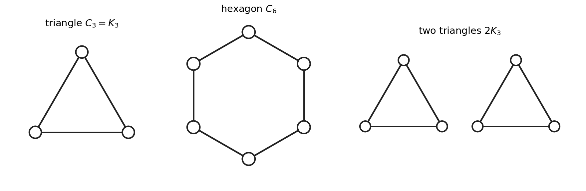
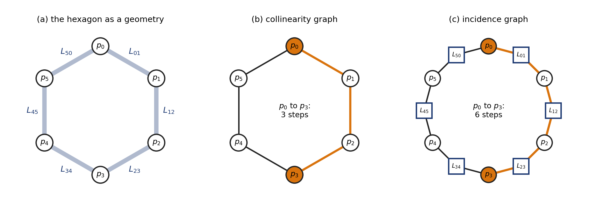
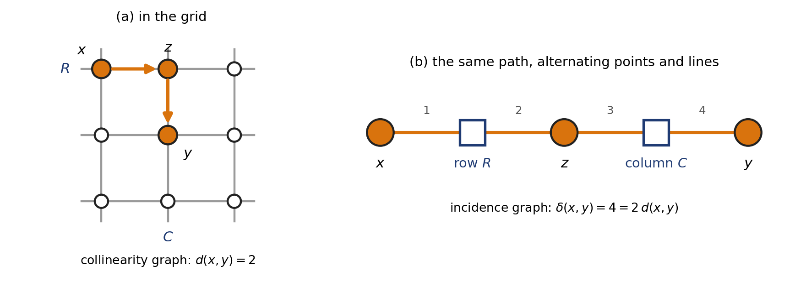
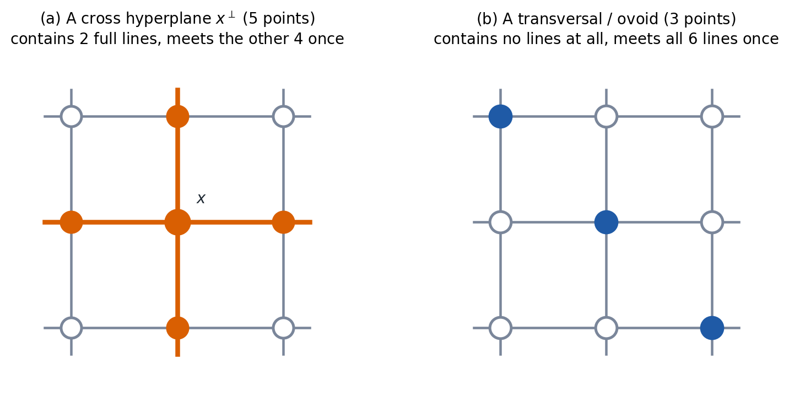

# Maths 4 - Incidence Geometry

**How to read these notes.** These notes are pre-reading for a first course in incidence geometry. Read a chapter here before studying its topic in full, and the full treatment should then read easily. Where a notion goes by more than one name, we give the alternatives. Later chapters will add the classical groups.

The notes build on the earlier projective geometry notes, cited by that name, which supply projective spaces over finite fields, quadrics, the Fano plane and the classical polar spaces. The prologue gathers the linear algebra the later chapters lean on; skim it now and return when a chapter links to it.

One convention: vector spaces are right vector spaces, with scalars written on the right and coordinates as column vectors, whereas the earlier projective geometry notes used left vector spaces. The prologue explains why this changes nothing over a field ([right vector spaces](#linear-algebra-over-finite-fields)).

## Prologue: The Linear Algebra We Need

How do you prove that a finite geometry cannot exist? Counting gets surprisingly far, but some lists of numbers pass every count and still describe nothing. The sharpest tools in these notes turn a geometry into a matrix and ask about its eigenvalues, its eigenspaces and its rank. An eigenspace has a whole-number dimension; a positive semidefinite matrix has no negative eigenvalue; a matrix with independent rows has at least as many columns as rows. Each of these innocent facts rules out a family of would-be geometries in a later chapter.

Most of what follows is core linear algebra, with a few items a physics degree may have skipped. Each topic gets a small example and a line saying where it is used. One example runs throughout:

$$A = \begin{pmatrix} 0 & 1 & 1 \\ 1 & 0 & 1 \\ 1 & 1 & 0 \end{pmatrix}.$$

Label the corners of a triangle $1, 2, 3$, and put a $1$ in row $x$, column $y$ when corners $x$ and $y$ are joined by an edge, and $0$ otherwise. The result is $A$, which the next chapter calls [the adjacency matrix](#the-adjacency-matrix-and-its-eigenvalues) of the triangle.

### Eigenvalues and eigenspaces

A number $\theta$ is an eigenvalue of a square matrix $A$ when $Av = \theta v$ for some nonzero vector $v$. The eigenvectors for $\theta$, together with $0$, form the eigenspace $V_\theta = \ker(A - \theta I)$. Two numbers measure how much of $\theta$ there is. The *algebraic multiplicity* is its multiplicity as a root of the characteristic polynomial $\det(XI - A)$. The *geometric multiplicity* is $\dim V_\theta$. The second is never larger than the first, and $A$ is diagonalizable exactly when the two agree for every eigenvalue.

For the running example, $\det(XI - A) = (X-2)(X+1)^2$. The eigenvalue $2$ has the eigenvector $j = (1,1,1)^T$, because every row of $A$ sums to $2$. For $\theta = -1$, note that $(Ax)_i = (x_1 + x_2 + x_3) - x_i$. Since $Av = \theta v$, we have $(x_1 + x_2 + x_3) - x_i = -1\cdot x_i$ and cancelling the $x_i$ on both side, we see every vector in the plane $x_1 + x_2 + x_3 = 0$ is an eigenvector. That plane has dimension $2$, equal to the algebraic multiplicity. Compare

$$N = \begin{pmatrix} 1 & 1 \\ 0 & 1 \end{pmatrix},$$

whose characteristic polynomial is $(X-1)^2$ but whose only eigenvectors are the multiples of $(1,0)^T$. Its two multiplicities are $2$ and $1$, and it cannot be diagonalized.

Similar matrices $P^{-1}AP$ (where $P$ represents a change of basis and is invertible) have the same characteristic polynomial, so they have the same eigenvalues with the same multiplicities.

**Where it is used.** The next chapter shows that the eigenvalues of a graph do not depend on how its vertices are labelled ([the adjacency matrix and its eigenvalues](#the-adjacency-matrix-and-its-eigenvalues)). In the chapter on [strongly regular graphs](#the-adjacency-matrix-of-a-strongly-regular-graph), the decisive test is that a multiplicity, being the dimension of an eigenspace, must be a whole number.

### Real symmetric matrices and the spectral theorem

Almost every matrix in the graph chapters is real and symmetric, and such matrices are as well behaved as matrices get. Their eigenvalues are real. Eigenvectors for different eigenvalues are orthogonal: if $Au = \theta u$ and $Av = \tau v$, then

$$\theta \langle u, v\rangle = \langle Au, v\rangle = \langle u, Av\rangle = \tau \langle u, v\rangle,$$

so $\langle u, v\rangle = 0$ when $\theta \neq \tau$. And there is an orthonormal basis of eigenvectors, so the two multiplicities always agree and we can simply say "multiplicity".

The spectral theorem packages all this. Let $E_\theta$ be the [orthogonal projector](#projectors-trace-and-positive-semidefinite-matrices) onto $V_\theta$. Then

$$A = \sum_\theta \theta E_\theta, \qquad \sum_\theta E_\theta = I, \qquad E_\theta E_\tau = 0 \ \text{ for } \theta \neq \tau.$$

This is the decomposition of an observable in quantum mechanics, with $E_\theta = \sum |v\rangle\langle v|$ over an orthonormal basis of $V_\theta$.

In the running example, the projector onto the line through $j$ is $E_2 = jj^T/3$, with every entry $1/3$, and the projector onto the plane is $E_{-1} = I - E_2$, with diagonal entries $2/3$ and off-diagonal entries $-1/3$. Then $2E_2 - E_{-1}$ has diagonal entries $0$ and off-diagonal entries $2/3 + 1/3 = 1$: it is $A$.

**Where it is used.** Adjacency matrices are real and symmetric, which is why a graph's eigenvalues are real ([the adjacency matrix and its eigenvalues](#the-adjacency-matrix-and-its-eigenvalues)). The decomposition $A = \sum_\theta \theta E_\theta$ is the backbone of [distance-regular graphs](#distance-regular-graphs), where $E_\theta$ is also called a minimal idempotent.

### Projectors, trace and positive semidefinite matrices

An **orthogonal projector** of a subspace $U$ is a matrix $E$ which takes a vector and returns the portion of the vector inside the subspace. Here's how it works. Every subspace $U \subseteq \mathbb{R}^n$ splits the entire space into two mutually perpendicular pieces: the target subspace $U$ (the image of $E$) and its orthogonal complement $U^\perp$ (the kernel of $E$), so that $\mathbb{R}^n = U \oplus U^\perp$. Every vector $v \in \mathbb{R}^n$ can be uniquely written as the sum of two perpendicular vectors: $v = v_\parallel + v_\perp$, where $v_\parallel \in U$ lies completely inside the subspace, and $v_\perp \in U^\perp$ is perpendicular to every vector in $U$.

When you multiply $v$ by the matrix $E$, it acts as a linear filter on those two components:

$$Ev = E(v_\parallel + v_\perp) = Ev_\parallel + Ev_\perp = 1\cdot v_\parallel + 0\cdot v_\perp = v_\parallel$$

It leaves the in-plane part $v_\parallel$ untouched (eigenvalue $1$). It annihilates the perpendicular part $v_\perp$ (eigenvalue $0$).

It's properties are $E^2 = E$ (doing it twice is the same as doing it once) and $E^T = E$ (it projects at right angles). Its eigenvalues are $0$ and $1$ as we saw: vectors in its image are fixed, and vectors orthogonal to the image are sent to $0$.

The trace, the sum of the diagonal entries, equals the sum of the eigenvalues counted with multiplicity, and $\operatorname{tr}(BC) = \operatorname{tr}(CB)$. For a projector the trace counts the eigenvalues equal to $1$, so $\operatorname{tr} E = \operatorname{rank} E$, the dimension of the image. In the running example $\operatorname{tr} E_2 = 3 \cdot \tfrac13 = 1$ and $\operatorname{tr} E_{-1} = 3 \cdot \tfrac23 = 2$, the dimensions of the two eigenspaces.

Trace equations pin down multiplicities. In the running example $\operatorname{tr} A = 0 = 2 + 2\cdot(-1)$, and $\operatorname{tr} A^2 = \sum_{i,l} A_{il}^2$, which for a symmetric matrix of zeros and ones counts its ones, is $6 = 2^2 + 2\cdot(-1)^2$. Knowing only the eigenvalues $2$ and $-1$ and that their multiplicities add up to $3$, either equation tells us how often each occurs.

A symmetric matrix $M$ is **positive semidefinite** when $x^T M x \geq 0$ for every vector $x$; equivalently, all its eigenvalues are $\geq 0$. Density matrices are the familiar case. Projectors are positive semidefinite, since $x^T E x = x^T E^T E x = |Ex|^2$.

**Where it is used.** In the chapter on [strongly regular graphs](#the-adjacency-matrix-of-a-strongly-regular-graph), the equation $\operatorname{tr} A = 0$ turns the eigenvalues into multiplicities. Positive semidefiniteness drives two inequalities proved there and in [distance-regular graphs](#distance-regular-graphs), the absolute bound and the Krein conditions.

### Polynomials in a matrix and the minimal polynomial

A polynomial $p(X) = c_0 + c_1 X + \dots + c_m X^m$ can be evaluated at a square matrix: $p(A) = c_0 I + c_1 A + \dots + c_m A^m$. Polynomials in the same matrix commute, and if $Av = \theta v$ then $p(A)v = p(\theta)v$: $p(A)$ has the eigenvalues $p(\theta)$ on the same eigenvectors.

The **minimal polynomial** of $A$ is the monic polynomial $m_A$ (leading coefficient $1$) of least degree with $m_A(A) = 0$; any nonzero scalar multiple of it is also called a minimal polynomial. It divides every polynomial that sends $A$ to $0$, including the characteristic polynomial (Cayley–Hamilton). Its roots are exactly the eigenvalues: if $Av = \theta v$ then $0 = m_A(A)v = m_A(\theta)v$, so $m_A(\theta) = 0$.

In the running example, $A^2$ has diagonal entries $2$ and off-diagonal entries $1$, so $A^2 = A + 2I$. Since $A$ is not a multiple of $I$, no polynomial of degree $1$ works, and

$$m_A(X) = X^2 - X - 2 = (X-2)(X+1).$$

It has degree $2$, although $A$ is $3 \times 3$ and its characteristic polynomial $(X-2)(X+1)^2$ has degree $3$.

You know minimal polynomials from field theory, where the minimal polynomial of an element $\alpha$ over a field $K$ is always irreducible. Here $m_A$ factors, and the difference is zero divisors. In a field, $g(\alpha)h(\alpha) = 0$ forces $g(\alpha) = 0$ or $h(\alpha) = 0$, so a factorization would produce a smaller polynomial. Matrices can multiply to zero without either being zero: $(A - 2I)(A + I) = 0$ here. For a matrix, "minimal" means least degree and nothing more.

The factorization carries information: a real matrix is diagonalizable over $\mathbb{R}$ exactly when its minimal polynomial has distinct real roots $\theta_1, \dots, \theta_s$. The reason is a set of projectors built from $A$:

$$E_i = \prod_{l \neq i} \frac{A - \theta_l I}{\theta_i - \theta_l},$$

the Lagrange polynomial that is $1$ at $\theta_i$ and $0$ at the other roots, evaluated at $A$. These add up to $I$, as the polynomials add up to $1$, and $(A - \theta_i I)E_i$ is a multiple of $m_A(A) = 0$, so each $E_i$ maps into the eigenspace of $\theta_i$; the eigenspaces fill the space. A repeated root signals failure ($N$ above has $m_N = (X-1)^2$, since $(N - I)^2 = 0 \neq N - I$), and so does a missing real root (a rotation by $90^\circ$ has $X^2 + 1$). For a real symmetric matrix, $m_A = \prod (X - \theta)$ over its distinct eigenvalues, so the degree of $m_A$ is the number of distinct eigenvalues, and the $E_i$ are exactly the orthogonal projectors onto the eigenspaces. In the example, $E_2 = (A + I)/3$ and $E_{-1} = (2I - A)/3$.

**Where it is used.** For [strongly regular graphs](#the-adjacency-matrix-of-a-strongly-regular-graph), a quadratic equation holds for the adjacency matrix on the vectors orthogonal to the all-ones vector, giving two eigenvalues there and, with one more on the all-ones vector, three in all. For [distance-regular graphs](#distance-regular-graphs), the degree of the minimal polynomial counts the eigenvalues. Projectors written as polynomials in $A$ appear in both.

### The all-ones matrix and commuting matrices

Write $j$ for the column vector with every entry $1$, and $J = jj^T$ for the square matrix with every entry $1$. The earlier projective geometry notes used $J$ for the matrix of a symplectic form; in these notes $J$ is always the all-ones matrix. For any $x$, $Jx = (x_1 + \dots + x_n)\,j$. So the $n \times n$ matrix $J$ has eigenvalue $n$ on $j$, and eigenvalue $0$ on the $(n-1)$-dimensional space $j^\perp$ of vectors whose entries sum to zero. Also $J^2 = nJ$.

Matrices of the form $aI + bJ$ come up constantly, and their eigenvalues can be read off: $a + nb$ once, on $j$, and $a$ with multiplicity $n - 1$, on $j^\perp$. Hence

$$\det(aI + bJ) = (a + nb)\,a^{n-1}.$$

The running example $A = J - I$ has eigenvalues $2$ once and $-1$ twice, as found above. In the next chapter the $7 \times 7$ matrix $2I + J$ appears; its eigenvalues are $9$ once and $2$ six times, and its determinant is $9 \cdot 2^6 = 576$, which is not zero.

Commuting symmetric matrices can be diagonalized together: if $AB = BA$ and $Av = \theta v$, then $A(Bv) = \theta\, Bv$, so $B$ maps each eigenspace of $A$ into itself and can be diagonalized inside it. The typical case: if every row and column of $A$ sums to $k$, then $AJ = JA = kJ$, so we may take $j$ as one eigenvector and all the others in $j^\perp$, where $J$ acts as $0$. On $j^\perp$, any equation in $A$, $I$ and $J$ loses its $J$ terms.

**Permutation matrices.** A permutation matrix $P$ has exactly one $1$ in each row and each column, and $0$ elsewhere. It is orthogonal, $P^T = P^{-1}$, and $PJ = JP = J$. Renumbering the rows and columns of $A$ by the same permutation replaces $A$ by the similar matrix $P^TAP$, with the same eigenvalues. And $P$ commutes with $A$ exactly when $P^TAP = A$, as every permutation of three indices does for the running example.

**Where it is used.** Relabelling a graph is conjugation by a permutation matrix ([the adjacency matrix and its eigenvalues](#the-adjacency-matrix-and-its-eigenvalues)). The matrix $2I + J$ counts incidences in the Fano plane ([point-line geometries](#point-line-geometries)), and a relative of it gives [Fisher's inequality](#fishers-inequality). Dropping $J$ on $j^\perp$ is the first step for [strongly regular graphs](#the-adjacency-matrix-of-a-strongly-regular-graph). The permutation matrices commuting with $A$ are the symmetries of a graph, and the matrices commuting with all of them form the commutant you know from group theory, which returns in [distance-regular graphs](#distance-regular-graphs).

### Rank, determinants and Gram matrices

The rank of a matrix is the dimension of its column space; for a symmetric matrix it is the number of nonzero eigenvalues, counted with multiplicity. The determinant is the product of the eigenvalues, so a square matrix is invertible exactly when its determinant is nonzero.

One rank fact does real work later. For a real matrix $M$,

$$\operatorname{rank}(MM^T) = \operatorname{rank} M.$$

The reason: if $MM^Tx = 0$, then $0 = x^TMM^Tx = |M^Tx|^2$, so $M^Tx = 0$; thus $MM^T$ and $M^T$ have the same kernel, hence the same rank. So if $M$ has $n$ rows and $MM^T$ is invertible, $M$ has at least $n$ columns. The step $|M^Tx|^2 = 0 \Rightarrow M^Tx = 0$ fails over $\mathbb{F}_2$: for $M = (1 \;\; 1)$, $MM^T = (2) = (0)$ although $M$ has rank $1$. This is one reason why the zero-one matrices of a geometry are taken over $\mathbb{R}$.

The **Gram matrix** of vectors $v_1, \dots, v_m$ in $\mathbb{R}^n$ is the $m \times m$ matrix $G$ with $G_{il} = \langle v_i, v_l \rangle$. If the $v_i$ are the columns of a matrix $V$, then $G = V^TV$. So $G$ is symmetric, positive semidefinite ($x^TGx = |Vx|^2$), and of rank equal to the dimension of the span of the $v_i$. It records the vectors up to rotation: their lengths and angles, nothing else.

Conversely, every positive semidefinite matrix $M$ of rank $r$ is a Gram matrix of vectors in $\mathbb{R}^r$. Write $M = \sum \theta\, uu^T$ over an orthonormal basis of eigenvectors $u$, with exactly $r$ of the $\theta$ positive. Stack the $r$ rows $\sqrt{\theta}\, u^T$ into a matrix $B$; then $M = B^TB$, the Gram matrix of the columns of $B$.

For example, three unit vectors in the plane at $120^\circ$ to each other have inner products $1$ and $\cos 120^\circ = -\tfrac12$, so their Gram matrix is

$$\begin{pmatrix} 1 & -\tfrac12 & -\tfrac12 \\ -\tfrac12 & 1 & -\tfrac12 \\ -\tfrac12 & -\tfrac12 & 1 \end{pmatrix} = \tfrac32\, E_{-1},$$

of rank $2$, as it must be for vectors in a plane. Read backwards, the projector $E_{-1}$ of the running example *is* a configuration of three vectors at $120^\circ$. Project the three standard basis vectors $e_i$ onto the plane $x_1 + x_2 + x_3 = 0$: the Gram matrix of the projections is $E_{-1}$ itself, because $\langle Ee_i, Ee_l\rangle = (E^TE)_{il} = E_{il}$. This is the idea behind the absolute bound for strongly regular graphs. A small eigenspace must hold one vector per vertex with only a few different angles between them, and there is a limit: $\mathbb{R}^m$ holds at most $m(m+3)/2$ unit vectors with only two different angles between them.

The **entrywise product** of two matrices of the same shape multiplies them entry by entry: $(B \circ C)_{il} = B_{il} C_{il}$. It is also called the Hadamard or Schur product. The **Schur product theorem** says that the entrywise product of two positive semidefinite matrices is positive semidefinite. With Gram matrices the proof is one line. Write $B$ as the Gram matrix of vectors $u_i$ and $C$ as the Gram matrix of vectors $w_i$; then $B \circ C$ is the Gram matrix of the tensor products $u_i \otimes w_i$, because

$$\langle u \otimes w,\, u' \otimes w' \rangle = \langle u, u' \rangle \langle w, w' \rangle,$$

the rule for the inner product of two product states of a pair of qubits. For instance, $E_{-1} \circ E_{-1}$ has diagonal entries $4/9$ and off-diagonal entries $1/9$, so it equals $\tfrac13 I + \tfrac19 J$, with eigenvalues $\tfrac13 + \tfrac39 = \tfrac23$ once and $\tfrac13$ twice: positive, as promised.

One more identity is needed only for the Krein conditions in [distance-regular graphs](#distance-regular-graphs): for symmetric $B$ and $C$, the sum of all the entries of $B \circ C$ is $\operatorname{tr}(BC)$. For $E_{-1} \circ E_{-1}$ both sides equal $2$.

**Where it is used.** The rank argument is [Fisher's inequality](#fishers-inequality). Gram matrices give the absolute bound for [strongly regular graphs](#the-adjacency-matrix-of-a-strongly-regular-graph), and the Schur product theorem gives the Krein conditions for [distance-regular graphs](#distance-regular-graphs).

### Linear algebra over finite fields

This section is used only from the chapter on [hyperplanes and projective embeddings](#hyperplanes-and-projective-embeddings) onwards and can be skipped until then. It sharpens two tools from the earlier notes' construction of $PG(n, q)$ from $\mathbb{F}_q^{n+1}$, hyperplanes as kernels and quotient spaces, after a convention.

**Right vector spaces.** In these notes, scalars multiply vectors on the right, $v\lambda$, and coordinates are column vectors, so a matrix acts by $v \mapsto Mv$. The earlier projective geometry notes used left vector spaces and row vectors. Over a field the two conventions describe the same objects, and every finite skew field is a field (Wedderburn's theorem). The choice matters only over a genuine skew field such as the quaternions, in [polar spaces from sesquilinear forms](#polar-spaces-from-sesquilinear-forms).

**Linear functionals and hyperplanes.** A linear functional is a linear map $\varphi: V \to \mathbb{F}_q$. In coordinates, $\varphi(x) = a^Tx = a_0x_0 + \dots + a_nx_n$ for a coefficient vector $a$: the earlier notes wrote $a$ as the column of hyperplane coordinates $[a_0, \dots, a_n]$, and as a functional it acts as the row $a^T$. A nonzero $\varphi$ has a hyperplane as its kernel, every hyperplane arises this way, and two nonzero functionals have the same kernel exactly when one is a scalar multiple of the other. So the hyperplanes of $PG(n, q)$ correspond to the nonzero functionals up to scalars, and there are as many hyperplanes as points, $(q^{n+1} - 1)/(q - 1)$. Over $\mathbb{F}_2$ the only nonzero scalar is $1$, so hyperplanes and nonzero functionals match one to one: $PG(3, 2)$ has $2^4 - 1 = 15$ planes, and $PG(4, 2)$ has $2^5 - 1 = 31$ hyperplanes.

**Quotient spaces.** For a subspace $U$ of $V$, the quotient $V/U$ has the cosets $v + U$ as its elements, and $\dim(V/U) = \dim V - \dim U$. Its subspaces correspond to the subspaces of $V$ that contain $U$, the bijection the earlier notes used to count subspaces through a fixed one. In particular, a projective point of $V/U$ is a subspace of $V$ one dimension larger than $U$ and containing it.

For example, take $V = \mathbb{F}_2^4$ and $U = \langle c \rangle$ with $c = (1,0,0,1)^T$; any nonzero $c$ would do, and this one returns in [what projection loses](#what-projection-loses). Then $V/U \cong \mathbb{F}_2^3$. A point of the quotient is a line of $PG(3, 2)$ through the point $\langle c \rangle$. Each such line holds two points $p$ and $p + c$ besides $c$, so the $14$ other points fall into $7$ pairs, the $7$ points of a Fano plane. This is projection from $c$: each pair looks like one point when seen from $c$.

**Where it is used.** A hyperplane of $PG(n, q)$, the kernel of a single functional, cuts out a hyperplane of any geometry sitting inside $PG(n, q)$, and projection from a point is a quotient ([giving a geometry coordinates](#giving-a-geometry-coordinates) and [what projection loses](#what-projection-loses)). Quotients also build [quotient polar spaces](#quotient-polar-spaces).

### Bilinear and sesquilinear forms in coordinates

This section is used only from the chapter on [polar spaces](#polar-spaces) onwards, apart from one example in [what projection loses](#what-projection-loses), and can be skipped until then. It handles the forms behind the earlier notes' polar spaces through their matrices.

Fix a basis $e_0, \dots, e_n$ of $V$. A bilinear form $f$ is determined by its Gram matrix $G$, with $G_{il} = f(e_i, e_l)$: the same idea as before, all pairings of the basis vectors. For coordinate vectors $x$ and $y$,

$$f(x, y) = x^T G y.$$

The form is symmetric when $G^T = G$, and alternating when $G^T = -G$ with zero diagonal.

Changing the basis changes $G$ by congruence. If the new basis vectors are the columns of an invertible $P$, so that $x = Px'$, the new Gram matrix is $G' = P^TGP$. This is not similarity: the eigenvalues of $G$ mean nothing for a form, but its rank does not change.

The radical of $f$, met in the earlier notes, is the set of vectors orthogonal to everything:

$$\operatorname{rad} f = \{ v : f(v, w) = 0 \text{ for all } w \}.$$

For a symmetric or alternating form it is the null space of $G$, and $f$ is nondegenerate (radical $0$) exactly when $\det G \neq 0$.

Two examples over $\mathbb{F}_2$:

- The form $f(x, y) = x_0y_1 + x_1y_0 + x_2y_3 + x_3y_2$ on $\mathbb{F}_2^4$ has the Gram matrix with $G_{01} = G_{10} = G_{23} = G_{32} = 1$ and all other entries $0$. Its determinant is $1$, so $f$ is nondegenerate. It is alternating, since $f(x, x) = 2x_0x_1 + 2x_2x_3 = 0$ over $\mathbb{F}_2$. Its totally isotropic lines give the $15$-point geometry of [generalized quadrangles](#generalized-quadrangles).
- The quadratic form $\Phi(x) = x_0^2 + x_1x_2 + x_3x_4$ on $\mathbb{F}_2^5$ has the polar form $f(x, y) = \Phi(x + y) - \Phi(x) - \Phi(y) = 2x_0y_0 + x_1y_2 + x_2y_1 + x_3y_4 + x_4y_3$. Over $\mathbb{F}_2$ the term $2x_0y_0$ vanishes, so the first row and column of $G$ are zero and $\operatorname{rad} f = \langle e_0 \rangle$. The quadric $\Phi = 0$ itself, with its $15$ points, is still the nondegenerate parabolic quadric $Q(4, 2)$ of the earlier notes, and $\langle e_0 \rangle$ is its nucleus.

**Sesquilinear forms.** A sesquilinear form twists one slot by a field automorphism $\sigma$, such as complex conjugation, or $a \mapsto a^q$ on $\mathbb{F}_{q^2}$. In these notes $\sigma$ acts on the first slot,

$$f(v\lambda, w\mu) = \lambda^\sigma f(v, w)\, \mu,$$

just as Dirac's $\langle v | w \rangle$ is antilinear in the bra. The earlier projective geometry notes put $\sigma$ on the second slot. The two conventions are mirror images: $f(v, w)$ in one is $f(w, v)$ in the other.

In coordinates, $f(x, y) = (x^\sigma)^T G y$, where $x^\sigma$ applies $\sigma$ to each entry, and a change of basis gives $G' = (P^\sigma)^T G P$. The form is Hermitian when $f(w, v) = f(v, w)^\sigma$ for all $v, w$. For example, let $\mathbb{F}_4 = \{0, 1, \omega, \omega^2\}$ with $\omega^2 = \omega + 1$, and let $\sigma(a) = a^2$, which swaps $\omega$ and $\omega^2$ and fixes $0$ and $1$. The form $f(x, y) = x_0^2 y_0 + x_1^2 y_1$ on $\mathbb{F}_4^2$ has $G = I$ and is Hermitian. A vector is isotropic when $f(x, x) = x_0^3 + x_1^3 = 0$. Every nonzero element of $\mathbb{F}_4$ has cube $1$ (the multiplicative group has order $3$), so $x_0^3 + x_1^3$ is $1 + 1 = 0$ when both coordinates are nonzero and $1$ otherwise. Of the $5$ points of $PG(1, 4)$, the $3$ points $\langle (1, a)^T \rangle$ with $a \neq 0$ are isotropic.

**Where it is used.** Forms in coordinates are the language of [polar spaces from sesquilinear forms](#polar-spaces-from-sesquilinear-forms) and [the classical polar spaces](#the-classical-polar-spaces), and the radical of a polar form is the nucleus used in [what projection loses](#what-projection-loses).

<!-- terms checked: positive semidefinite; minimal polynomial; entrywise product -->

## Graphs and Point-Line Geometries

Suppose someone describes a finite geometry by its counts: so many points on each line, so many lines through each point. Does it exist? Building one settles the question one way; proving that none exists is harder, and the strongest method in these notes runs through graphs. A geometry gives two graphs, one joining points that share a line and one joining each point to the lines through it. A graph gives a matrix, and for regular enough geometries its eigenvalues and their multiplicities follow from the counts alone. Multiplicities are dimensions of eigenspaces, so they must be whole numbers; counts that force a fractional one describe nothing. That argument rules out families of quadrangles in [strongly regular graphs](#strongly-regular-and-distance-regular-graphs) and most generalized polygons in [the Feit–Higman theorem](#the-feithigman-theorem-and-order-bounds). A rank argument bounds designs (points and blocks, with every two points in the same number of blocks) in [Fisher's inequality](#fishers-inequality).

This chapter sets up the language: first graphs, with one small graph that shows how much simple rules can force, then point-line geometries and the two graphs each one carries.

### Graphs

Graphs come first, because the tools of later chapters work on graphs.

#### Neighbours and regularity

A graph $\Gamma = (V, E)$ is a nonempty set $V$ of vertices and a set $E$ of edges, each edge being a set of two vertices. The letters $V$ and $E$ name the vertices and edges only in this definition, because later chapters need them for other things: $V$ for a vector space, and $E$ for a projector, as in the prologue. After this we say "vertices" and "edges" in words. Because an edge is a set of two vertices, there are no loops (an edge from a vertex to itself) and no repeated edges. Two vertices joined by an edge are **adjacent**, or **neighbours**, and we write $x \sim y$. The number of neighbours of $x$ is its **valency**, also called its degree. The graph is **regular** with valency $k$ when every vertex has exactly $k$ neighbours. An isomorphism of graphs is a bijection of the vertices that maps the edges exactly onto the edges, and an isomorphism of a graph to itself is an automorphism. A simple graph is one where every edge has exactly two vertices (called a thin line, which will be defined better later), and every line has exactly two vertices. Two vertices lie on at most one edge.

Some names save words. $C_n$ is the $n$-cycle: $n$ vertices round a ring, each joined to the next. $K_n$ is the **complete graph** on $n$ vertices, with every pair joined, and a graph with no edges at all is **empty**. Putting graphs side by side, with no edges between them, gives their **disjoint union**, and $2K_3$ is the disjoint union of two triangles. Figure 1 shows the triangle $C_3 = K_3$, the hexagon $C_6$ and $2K_3$.

*Figure 1. Three graphs in which every vertex has exactly two neighbours: the triangle $C_3 = K_3$, the hexagon $C_6$ and two separate triangles $2K_3$.*

All three are regular with valency $2$, yet they are different graphs. The hexagon and the two triangles even have the same numbers of vertices and edges, yet one is a single ring and the other falls apart. Valency is local information, and it cannot tell these graphs apart.

#### Cliques and subgraphs

A **clique** is a set of mutually adjacent vertices. A **maximal clique** is a clique that no larger clique contains. In the two triangles, each triangle is a maximal clique. The hexagon has no triangles, so its maximal cliques are its six edges. Maximal does not mean largest. Take a triangle on the vertices $1, 2, 3$ and add a fourth vertex $4$ joined only to $3$. The edge $\{3, 4\}$ is then a maximal clique, because no vertex is adjacent to both $3$ and $4$, even though the triangle is a bigger clique.

Cliques come back three times. A disjoint union of cliques is one of the trivial cases of [strongly regular graphs](#complements-cliques-and-the-trivial-cases). And the lines of most [generalized polygons](#generalized-polygons), like the [generators of a polar space](maths_3_projective_geometry.md#polar-spaces-polarity), turn out to be exactly the maximal cliques of a graph built from the geometry, so the geometry can be rebuilt from that graph.

A **subgraph** is part of a graph: a nonempty set of its vertices, with some of the edges between them. The **subgraph induced** on a nonempty set $X$ of vertices keeps every edge with both ends in $X$. So an induced subgraph is fixed by its vertices alone, while a general subgraph may also drop edges. In the hexagon, with vertices $0, 1, \dots, 5$ round the ring, the subgraph induced on $\{0, 1, 2\}$ has the two edges $\{0, 1\}$ and $\{1, 2\}$. Dropping the edge $\{1, 2\}$ as well gives a subgraph that is not induced. In this language, a clique is a set of vertices whose induced subgraph is complete.

Induced subgraphs are how later chapters ask whether part of a geometry still hangs together. For example, in [generalized quadrangles](#subquadrangles-and-the-three-kinds-of-hyperplane), the points outside a hyperplane, joined when they lie on a common line, form a connected graph.

#### Paths, geodesics and distance

A **path** of length $k$ is a sequence $x_0, x_1, \dots, x_k$ of distinct vertices in which consecutive vertices are adjacent. The **distance** $d(x, y)$ is the length of a shortest path from $x$ to $y$, and $d(x, y) = \infty$ if there is none. A shortest path is a **geodesic**, or geodesic path. The **diameter** of $\Gamma$ is the largest distance between two of its vertices. The graph is **connected** when every distance is finite, and its **connected components** are its maximal connected pieces.

In the hexagon, opposite vertices are $3$ apart, joined by two geodesics, one each way round, and the diameter is $3$. In the two triangles, no path leads from one triangle to the other: the graph is disconnected, with two components, and its diameter is $\infty$.

Distance is global information that valency cannot see. It matters most in [generalized polygons](#basic-properties-of-generalized-polygons), where two objects closer together than the diameter are joined by a unique geodesic.

#### Cycles, girth and bipartite graphs

A **cycle** of length $k$ is a closed path: vertices $x_0, x_1, \dots, x_k = x_0$ with $k \geq 3$, consecutive vertices adjacent, and $x_0, \dots, x_{k-1}$ distinct. The **girth** is the length of a shortest cycle, and it is $\infty$ if there is no cycle. The hexagon has girth $6$; the two triangles have girth $3$. Girth and diameter are linked: a graph of finite girth $g$ has diameter at least $\lfloor g/2 \rfloor$. A shortest cycle has no shortcuts, since a shortcut would close a shorter cycle, so two opposite vertices on it are $\lfloor g/2 \rfloor$ apart.

A graph is **bipartite** when its vertices split into two sides with every edge crossing from one side to the other. Colour the hexagon's vertices black and white alternately and every edge crosses; round the triangle, alternating colours cannot close up. The rule is: a graph is bipartite exactly when it has no cycle of odd length.

One direction is quick. In a bipartite graph, each step along a cycle crosses to the other side, so a walk round the cycle is back on its starting side only after an even number of steps. Every cycle therefore has even length.

The other direction needs a colouring. Take a graph with no odd cycle, and work in one connected component at a time. Pick a base vertex $x$, and colour each vertex black if its distance from $x$ is even and white if it is odd. Every edge should now join a black vertex to a white one.

Suppose an edge $yz$ joined two vertices of the same colour, so that $d(x,y)$ and $d(x,z)$ are both even or both odd. Go from $x$ to $y$ along a shortest path, cross the edge to $z$, and return to $x$ along a shortest path. This round trip takes $d(x,y) + 1 + d(x,z)$ steps, which is odd. It may pass through a vertex twice, so it is a closed walk (a round trip that may revisit vertices) rather than a cycle.

An odd closed walk always contains an odd cycle. If the walk passes through some vertex twice, cut it there into two shorter closed walks. Their lengths add up to an odd number, so one of them is odd; keep that one and repeat. The walk gets shorter each time, so the process stops at an odd closed walk that visits no vertex twice, which is an odd cycle. The graph has no odd cycle, so no such edge $yz$ exists, and the colouring splits the vertices into two sides.

Bipartite graphs return at once: every [incidence graph](#two-graphs-two-distances-two-matrices) is bipartite, with points on one side and lines on the other. The parity argument returns in [generalized polygons](#basic-properties-of-generalized-polygons).

#### The Petersen graph as a puzzle

Here is a puzzle that shows how much simple rules can force. Suppose every vertex has exactly $3$ neighbours, and any two vertices are at most $2$ steps apart. How many vertices can there be?

Stand at a vertex $x$, with its $3$ neighbours. Each has at most $2$ further neighbours, so at most $3 \cdot 2 = 6$ vertices lie at distance $2$, and nothing is further away: at most $1 + 3 + 6 = 10$ vertices. This count is the **Moore bound** for valency $3$ and diameter $2$.

To reach $10$, nothing can be lost in this count. The $3$ neighbours of $x$ and the $6$ vertices at distance $2$ must be $9$ different vertices. Two things could spoil the count:

- an edge between two neighbours $y$ and $z$ of $x$: then $z$ is one of the two further neighbours of $y$, but $z$ lies at distance $1$ from $x$, not $2$;
- a vertex $w$ at distance $2$ that is a further neighbour of two different neighbours $y$ and $z$ of $x$: then $w$ is counted twice.

Either way, fewer than $6$ vertices lie at distance $2$, and the total falls below $10$. So neither happens. Since $x$ was any vertex, neither happens anywhere in the graph.

The first fact rules out triangles, and the second rules out $4$-cycles. Each also counts common neighbours.

- **No triangles.** A triangle through $x$ would be $x$ together with two adjacent neighbours of $x$. The same fact shows that adjacent vertices $x$ and $y$ have no common neighbour, since a common neighbour would be a neighbour of $x$ adjacent to $y$.
- **No $4$-cycles.** In a $4$-cycle $x, y, w, z$, the vertex $w$ opposite $x$ is not adjacent to $x$, or $x, y, w$ would be a triangle. So $w$ lies at distance $2$ and is reached from $x$ through both $y$ and $z$. The same fact shows that two non-adjacent vertices $x$ and $w$ have exactly one common neighbour. Since the diameter is $2$, $w$ lies at distance $2$ from $x$, and each common neighbour is a separate path of length $2$ from $x$ to $w$, of which there is exactly one.

A cycle of length $3$ is a triangle and a cycle of length $4$ is a $4$-cycle, so every cycle has length at least $5$, and the girth is at least $5$.

Such a graph exists: take as vertices the ten $2$-element subsets of $\{1, 2, 3, 4, 5\}$, and join two subsets when they are disjoint. This is the **Petersen graph**, drawn in Figure 2 in the usual way, as a pentagon and a five-pointed star.

To check that it works, we would seem to need to check every pair of vertices. But the definition treats the five symbols alike, so renaming the symbols does not change the graph. For example, swapping $1$ and $5$ everywhere turns $2$-subsets into $2$-subsets and keeps disjoint ones disjoint. A renaming can take any two disjoint subsets to $\{1, 2\}$ and $\{3, 4\}$. For example, $\{2, 5\}$ and $\{1, 3\}$ go there under $2 \to 1$, $5 \to 2$, $1 \to 3$, $3 \to 4$, $4 \to 5$. Likewise, a renaming can take any two subsets that share a symbol to $\{1, 2\}$ and $\{1, 3\}$. So it is enough to check one adjacent pair, $\{1, 2\}$ and $\{3, 4\}$, and one non-adjacent pair, $\{1, 2\}$ and $\{1, 3\}$:

- valency $3$: the subset $\{1, 2\}$ is disjoint from exactly the three $2$-subsets of $\{3, 4, 5\}$;
- adjacent vertices share no neighbour: a common neighbour of $\{1, 2\}$ and $\{3, 4\}$ would have to avoid $1, 2, 3, 4$, which leaves only the single element $5$;
- non-adjacent vertices share exactly one neighbour: $\{1, 2\}$ and $\{1, 3\}$ have the single common neighbour $\{4, 5\}$.

So the diameter is $2$, and the girth is $5$: the outer pentagon in Figure 2 is a $5$-cycle.

*Figure 2. The Petersen graph. A vertex labelled $12$ is the subset $\{1, 2\}$, and two vertices are joined when their subsets are disjoint. Each outer vertex is joined to its two neighbours on the pentagon and to one vertex of the inner star. Where two edges of the star cross without a circle, there is no vertex.*

**Extreme and rigid.** The Petersen graph is **extreme**: it is as large as the count allows, since no graph with valency $3$ and diameter $2$ has more than $10$ vertices. It is also **rigid**: it is the only graph of that size, in the sense that any graph with valency $3$, diameter $2$ and $10$ vertices is the Petersen graph with its vertices renamed. Here is why it is rigid.

Draw $x$ at the top, its three neighbours $a$, $b$, $c$ below it, and the two further neighbours of each of them below that: $a_1, a_2$ under $a$, $b_1, b_2$ under $b$, and $c_1, c_2$ under $c$. That accounts for all $10$ vertices. Each of the $6$ vertices on the bottom row has one edge, to the vertex above it, and needs two more.

- The new edges cannot go up: $x$, $a$, $b$ and $c$ already have their $3$ neighbours.
- A bottom vertex cannot be joined to its partner: the edge $a_1a_2$ would close the triangle $a, a_1, a_2$.
- A bottom vertex cannot be joined to both vertices of another pair: edges $a_1b_1$ and $a_1b_2$ would close the $4$-cycle $a_1, b_1, b, b_2$.

So $a_1$ has exactly one neighbour among $b_1, b_2$ and one among $c_1, c_2$, and the same goes for every bottom vertex. Between the pairs $\{a_1, a_2\}$ and $\{b_1, b_2\}$, that leaves two possibilities: the edges $a_1b_1$ and $a_2b_2$, or the edges $a_1b_2$ and $a_2b_1$. The same holds between $a$'s pair and $c$'s pair, and between $b$'s pair and $c$'s pair, so there are $2 \cdot 2 \cdot 2 = 8$ ways to finish the graph. Four of them close a triangle on the bottom row, such as $a_1, b_1, c_1$, which is not allowed. The other four are really one graph. Swapping the names $b_1$ and $b_2$ changes two of the three choices at once (between $a$'s and $b$'s pairs, and between $b$'s and $c$'s pairs), and swapping within $a$'s or $c$'s pair does the same for its two choices. These swaps turn each of the four graphs into each of the others, so the four are one graph with different labels. The Petersen graph, drawn this way from any vertex, is one of them, so all four are the Petersen graph.

**Why this matters.** Two demands pulled against each other here. The first is that the graph has no **short cycles**, meaning cycles shorter than a length the problem fixes. Here the short cycles are the triangles and the $4$-cycles, and forbidding them makes the girth at least $5$. Then no vertex within two steps of $x$ can be reached in two different ways, so every step away from $x$ reaches only new vertices, and the graph spreads out fast. The second is that every two vertices are at most $2$ steps apart, which holds the graph in. Together the two demands made the graph extreme and rigid: they fixed the number of vertices exactly and left only one way to build it. The same two demands drive [generalized polygons](#generalized-polygons). There the graph is the incidence graph, short cycles are again forbidden, and its diameter is half its girth, the smallest diameter that girth allows ([cycles and girth](#cycles-girth-and-bipartite-graphs)).

The counts of common neighbours, $0$ for adjacent pairs and $1$ for non-adjacent pairs, are the same everywhere. Regular graphs with both counts constant are called strongly regular, the subject of [strongly regular graphs](#strongly-regular-graphs).

#### The adjacency matrix and its eigenvalues

Now we turn a graph into a matrix. Let a finite graph have $v$ vertices (as in later chapters, $v$ counts vertices). Its **adjacency matrix** $A$ is the $v \times v$ matrix, with rows and columns indexed by the vertices, whose entry $A_{xy}$ is $1$ when $x \sim y$ and $0$ otherwise. Its entries are $0$ and $1$, but it is a real matrix, not one over $\mathbb{F}_2$: the arguments below use inequalities. $A$ is symmetric, so its eigenvalues are real and it has an orthonormal basis of eigenvectors ([real symmetric matrices](#real-symmetric-matrices-and-the-spectral-theorem)).

Writing $A$ down needs an order for the vertices. But let's say you changed the order. You would then have $P^TAP$ as the adjacency matrix, where $P$ is a permutation matrix (it changes the order of vertices). This will have the same eigenvalues and multiplicities ([permutation matrices](#the-all-ones-matrix-and-commuting-matrices)). These eigenvalues are therefore the eigenvalues of $\Gamma$ itself. The list of eigenvalues is sometimes called the spectrum of $\Gamma$.

**Reading the matrix.** A vector $w$ with one entry per vertex can be pictured as a number written on each vertex: $w_y$ is the number on vertex $y$. Multiplying by $A$ gives a new vector. Row $y$ of $A$ has a $1$ in the column of each neighbour of $y$ and $0$ elsewhere, so $(Aw)_y$ is the sum of the numbers on the neighbours of $y$.

**Finding eigenvectors.** In this picture, $Aw = \theta w$ says that at every vertex, the numbers on the neighbours add up to $\theta$ times the number on the vertex itself. That makes a guess quick to check. The guesses themselves come from the shape of the graph, not from trying numbers at random. Here is how it goes for the triangle, with vertices $1, 2, 3$.

Start with the same number on every vertex, say $1$. Each vertex sees two neighbours carrying $1$ each, which add up to $2$, so $(1, 1, 1)$ is an eigenvector with eigenvalue $2$. The same guess works in any regular graph: with valency $k$, each vertex sees $k$ neighbours carrying $1$, so the all-ones vector is an eigenvector with eigenvalue $k$.

Next, look for eigenvectors orthogonal to $(1, 1, 1)$, since eigenvectors of a symmetric matrix for different eigenvalues are orthogonal ([real symmetric matrices](#real-symmetric-matrices-and-the-spectral-theorem)). Being orthogonal to $(1, 1, 1)$ means that the entries add up to $0$. In the triangle each vertex is joined to both others, so the sum on the neighbours of $y$ is the total $w_1 + w_2 + w_3$ minus $w_y$. When the total is $0$, that is $-w_y$. So every vector whose entries add up to $0$ is an eigenvector with eigenvalue $-1$. Nothing is standardized here: $(1, -1, 0)$ is simply the easiest such vector to write down, and $(2, -1, -1)$ would do as well. To check $(1, -1, 0)$ directly: vertex $1$ has the neighbours $2$ and $3$, so $(Aw)_1 = -1 + 0 = -1$; likewise $(Aw)_2 = 1 + 0 = 1$ and $(Aw)_3 = 1 - 1 = 0$. So $Aw = (-1, 1, 0) = -w$. The vectors with entries adding up to $0$ form a plane, so $-1$ has multiplicity $2$, as the prologue found from the characteristic polynomial ([eigenvalues and eigenspaces](#eigenvalues-and-eigenspaces)).

Two more guesses are worth knowing. In a regular bipartite graph with valency $k$, put $1$ on one side and $-1$ on the other. Each vertex then sees $k$ neighbours carrying the opposite sign, so the eigenvalue is $-k$; in the hexagon this gives $-2$. And when turning or reflecting a graph leaves it unchanged, look for a vector that the symmetry only multiplies by a number. The cycle is the main example.

**The eigenvalues of a cycle.** Number the vertices of the $n$-cycle $0, 1, \dots, n-1$ round the ring, so that the neighbours of $y$ are $y - 1$ and $y + 1$, counting modulo $n$. Turning the ring by one step does not change the graph. So we look for an eigenvector that changes in the simplest possible way as we go round: each step multiplies the number on the vertex by the same complex number $\zeta$, so that $w_y = \zeta^y$. After $n$ steps we are back where we started, so $\zeta^n = 1$, and $\zeta = \omega^m$ for some $m$ in $0, 1, \dots, n-1$, where $\omega = e^{2\pi i/n}$. This vector is a wave running round the ring, the discrete version of the plane wave $e^{ikx}$ of quantum mechanics; physicists call a wave of this kind on a ring of atoms a Bloch wave. Adding up the numbers on the two neighbours of $y$ gives

$$(Aw)_y = w_{y-1} + w_{y+1} = (\zeta^{-1} + \zeta)\, w_y ,$$

so $w$ is an eigenvector with eigenvalue $\zeta + \zeta^{-1} = 2\cos(2\pi m/n)$. The $n$ choices of $m$ give $n$ eigenvectors. They are independent, because two of them with different $m$ are orthogonal for the complex inner product: their inner product is $\sum_y \eta^y$ with $\eta = \omega^{m'-m}$, an $n$-th root of unity other than $1$, and $1 + \eta + \dots + \eta^{n-1} = (\eta^n - 1)/(\eta - 1) = 0$. So this is the full list. For the hexagon, $m = 0, 1, \dots, 5$ give the eigenvalues $2, 1, -1, -2, -1, 1$. For the triangle, $m = 0, 1, 2$ give $2, -1, -1$, as found above.

**Graphs in pieces.** The two triangles have no edges between them. List the vertices of one triangle first and then the other. The adjacency matrix is then two copies of the triangle's matrix down the diagonal, with zeros everywhere else, so its eigenvalues are the triangle's eigenvalues twice over.

For the graphs of Figure 1:

| Graph | Eigenvalues, with multiplicities |
| --- | --- |
| triangle $C_3$ | $2$ once, $-1$ twice |
| hexagon $C_6$ | $2$ once, $1$ twice, $-1$ twice, $-2$ once |
| two triangles $2K_3$ | $2$ twice, $-1$ four times |

Later chapters write a multiplicity as an exponent, so the hexagon's list becomes $2, 1^2, (-1)^2, -2$; the exponent counts, it is not a power.

**What the eigenvalues of a regular graph show.** Let $\Gamma$ be a finite regular graph with valency $k$. Then:

- $k$ is an eigenvalue, and its multiplicity is the number of connected components;
- every eigenvalue $\theta$ satisfies $|\theta| \leq k$;
- if $\Gamma$ is bipartite, its eigenvalues come in pairs $\theta, -\theta$; in particular $-k$ is an eigenvalue.

All three come from looking at the eigenvector's values one vertex at a time. For the bound, take an eigenvector $w$ and a vertex $y$ where $|w_y|$ is largest. Then

$$|\theta|\,|w_y| = \Big|\sum_{z \sim y} w_z\Big| \leq k\,|w_y|,$$

so $|\theta| \leq k$. For the first claim, the all-ones vector $j$ has $(Aj)_y = k$ at every vertex, so $Aj = kj$; more generally, any vector that is constant on each component is an eigenvector for $k$. Conversely, suppose $Aw = kw$, and pick a vertex $y$ where $w_y$ is largest within its component. Then $k\,w_y$ is a sum of $k$ neighbour values, each at most $w_y$, so all of them equal $w_y$. The maximum spreads to the neighbours, then to theirs, and fills the component. So $w$ is constant on each component, and the eigenspace of $k$ has one dimension for each component. For the third claim, flip the sign of an eigenvector $w$ on one side: the neighbours of each vertex lie on the other side, so the new vector has eigenvalue $-\theta$.

Regularity is what makes $j$ an eigenvector, and finiteness gives a largest entry (on an infinite graph the argument works for bounded eigenvectors, using a supremum).

Check the table: the connected, bipartite hexagon has $2$ once and pairs $\pm 2$, $\pm 1$; the two triangles have $2$ twice and no $-2$. For a connected regular graph the last claim reverses: if $Aw = -kw$, all neighbours of a vertex where $|w_y|$ is largest carry $-w_y$, this spreads with alternating signs, and the signs of $w$ give the two sides. So the number of pieces shows up as the multiplicity of $k$, and bipartiteness as the eigenvalue $-k$: global facts, read off from eigenvalues.

---

**Aside: walkers and electrons on a graph.** A random walker stepping to a uniformly chosen neighbour has transition matrix $A/k$, whose $(y, z)$ entry is the probability of stepping from $y$ to $z$. Its eigenvalue $1$ has one dimension per component, where probability gets trapped; the eigenvalue $-1$ of a bipartite graph means the walker swaps sides forever. The tight-binding model of an electron in a molecule gives each atom one orbital $|y\rangle$, with $\langle y|H|z\rangle = -\gamma$ for bonded atoms and $0$ otherwise, so $H = -\gamma A$ and the eigenvalues of $A$ are energy levels. For benzene, a hexagon of carbon atoms, the table gives $\mp 2\gamma$ once each and $\mp\gamma$ twice each; the $\pm\theta$ pairing is the model's sublattice symmetry.

---

---

**Note: which valencies can reach the Moore bound?** For valency $k$ and diameter $2$ the same count allows $k^2 + 1$ vertices. [Hoffman and Singleton showed in 1960](https://doi.org/10.1147/rd.45.0497) that only $k = 2$ (the pentagon), $3$ (Petersen), $7$ (a $50$-vertex graph now named after them) and possibly $57$, [still open](https://arxiv.org/abs/2210.09577), reach it, using the whole-number test of [strongly regular graphs](#the-adjacency-matrix-of-a-strongly-regular-graph).

---

More graph words, such as complements, multipartite graphs and distance-regular graphs, arrive where they are first used, in [strongly regular and distance-regular graphs](#strongly-regular-and-distance-regular-graphs).

### Point-line geometries

A graph has one kind of object, joined in pairs. A geometry has two kinds, points and lines, and a line may hold many points. Which graph should stand for a geometry, and which information does each choice keep?

#### Points, lines and incidence

A **point-line geometry** $\mathcal{S} = (\mathcal{P}, \mathcal{L}, I)$ consists of a nonempty set $\mathcal{P}$ of points, a set $\mathcal{L}$ of lines (disjoint from $\mathcal{P}$, possibly empty), and an **incidence relation** $I \subseteq \mathcal{P} \times \mathcal{L}$, such that every line is incident with at least two points. The letter $I$ also names the identity matrix; context always tells them apart. We write $x \, I \, L$, and say that $x$ lies on $L$ or that $L$ goes through $x$. Points on a common line are **collinear**.

A line is a label, not a set of points. Two points $x, y$ and two lines $L, M$, each through both points, form a geometry whose two lines have the same point set (a [digon](#classes-of-point-line-geometries)). Labels keep points and lines on an equal footing, so that swapping them gives a geometry again whenever it can. When distinct lines have distinct point sets, as in every example below, we treat lines as sets of points.

An isomorphism of geometries is a pair of bijections, one on the points and one on the lines, that keeps incidence and non-incidence; an isomorphism of a geometry to itself is an automorphism. A **flag** is an incident pair $(x, L)$, and an **anti-flag** is a non-incident pair. Counting incidences means counting flags. Anti-flags are what later axioms test: the axiom of a [generalized quadrangle](#generalized-quadrangles) says what a point sees of a line not through it.

For a point $x$, write $x^\perp$ for the set of points collinear with $x$, together with $x$ itself. Mind the difference from graphs: $x$ lies in $x^\perp$, while a vertex is not its own neighbour. The symbol echoes the earlier notes' $x^\perp$, the points orthogonal to $x$: in a polar space, the two sets agree on the points of the polar space ([polar spaces](maths_3_projective_geometry.md#polar-spaces-polarity) in the earlier projective geometry notes).

**Duals.** The **dual** $\mathcal{S}^D$ of $\mathcal{S}$ swaps the roles: its points are the lines of $\mathcal{S}$, its lines are the points of $\mathcal{S}$, and incidence is unchanged. This needs every point of $\mathcal{S}$ to lie on at least two lines, so that each new line has at least two points. $\mathcal{S}$ is **self-dual** when $\mathcal{S}^D \cong \mathcal{S}$.

Lines come in two sizes that matter. A line is **thin** if it has exactly two points, and **thick** if it has at least three. A graph is a geometry with only thin lines: its points are the vertices and its lines are the edges.

Two examples carry the rest of the chapter, both from the earlier projective geometry notes.

The Fano plane $PG(2, 2)$ has as points the $7$ nonzero vectors of $\mathbb{F}_2^3$, and as lines the $7$ sets $\{x : a_0x_0 + a_1x_1 + a_2x_2 = 0\}$, one for each nonzero $a$. We write $[a_0a_1a_2]$ for that line. Every line has $3$ points and every point lies on $3$ lines. The Fano plane is self-dual: send the point $a$ to the line $[a]$, and the line $[a]$ to the point $a$. Since $a \cdot x = x \cdot a$, the point $x$ lies on the line $[a]$ exactly when the point $a$ lies on the line $[x]$, so incidence is kept.

The $3 \times 3$ grid is the hyperbolic quadric $Q^+(3, 2)$: the $9$ points of $PG(3, 2)$ with $x_0x_3 + x_1x_2 = 0$, together with the $6$ lines lying on it. (The earlier notes wrote $x_0x_3 - x_1x_2$, which is the same equation over $\mathbb{F}_2$.) The earlier notes set out its points as a $3 \times 3$ table whose rows and columns are the two reguli, so we call its $6$ lines rows and columns. Every point lies on $2$ lines, and every row meets every column.

The dual of the grid looks quite different. Its points are the $3$ rows and $3$ columns, and its lines are the $9$ grid points, each now a thin line joining the row and the column through it. This is the graph $K_{3,3}$, three vertices on each side with every vertex joined to the three opposite, seen as a geometry: a [dual grid](#classes-of-point-line-geometries). Duality has turned thick lines into thin ones.

#### Two graphs, two distances, two matrices

Each geometry carries two graphs. The **collinearity graph**, also called the point graph, has the points as vertices, with two distinct points adjacent when they are collinear. The **incidence graph** has the points and the lines as vertices, with a point adjacent to a line when they are incident; its edges are the flags. The incidence graph is bipartite, with points on one side and lines on the other.

The simplest picture of both graphs comes from a hexagon read as a geometry, as in Figure 3: its six corners are the points, and its six sides are the lines, each holding two points (the [ordinary hexagon](#classes-of-point-line-geometries) of the next chapter). Every line holds just two points, so each line becomes a single edge of the collinearity graph, and the collinearity graph is the hexagon $C_6$ again. In the incidence graph each side gets a vertex of its own, sitting between its two points, so the ring of $6$ becomes a ring of $12$ in which points and lines alternate. A step from one point to the next becomes two steps, point to line to point, so $p_0$ and $p_3$ are $3$ steps apart in the collinearity graph and $6$ in the incidence graph. The incidence graph has girth $12$ and diameter $6$, the two numbers that will make the hexagon a [generalized hexagon](#generalized-polygons).

*Figure 3. (a) A hexagon as a geometry: the points $p_0, \dots, p_5$ are its corners, and the line $L_{01}$ is the side holding $p_0$ and $p_1$, and so on round the ring. (b) Its collinearity graph is the $6$-cycle; a shortest path from $p_0$ to $p_3$ (orange) has $3$ steps. (c) Its incidence graph is the $12$-cycle, with circles for points and squares for lines; the same path now passes through a line between each two points and has $6$ steps.*

The incidence graph is the collinearity graph of the **double** of $\mathcal{S}$, whose points are all the points and lines of $\mathcal{S}$ and whose lines are the flags, each written as the set $\{x, L\}$ of its two points. A geometry and its dual have the same double, and so the same incidence graph with the sides swapped. The grid and $K_{3,3}$ share a double with $9 + 6 = 15$ points and $18$ lines, one for each flag of the grid. Doubles return in [generalized polygons](#definition-via-ordinary-n-gon-subgeometries), where doubling a polygon doubles its number of sides, and in [which polygons exist](#the-feithigman-theorem-and-order-bounds).

The two graphs keep different information. The collinearity graph forgets the lines: in the Fano plane any two points are collinear, so its collinearity graph is $K_7$, which is also the collinearity graph of a single line with $7$ points. The incidence graph forgets nothing: once we know which side holds the points, the geometry can be read straight off it.

Figure 4 shows the Fano plane beside its incidence graph, the Heawood graph of the earlier notes, with $14$ vertices, $21$ edges and valency $3$.

*Figure 4. Left: the Fano plane, with each point labelled by its coordinates over $\mathbb{F}_2$; the circle is the seventh line. Right: its incidence graph, the Heawood graph. Dots are points, squares are lines, and the square $[a_0a_1a_2]$ is the line $a_0x_0 + a_1x_1 + a_2x_2 = 0$. Edges join each line to its three points; crossings of edges are not vertices.*

**Two distances.** We need both graphs: generalized polygons are defined through distances in the incidence graph, while eigenvalues see the collinearity graph. Write $d$ for distance in the collinearity graph and $\delta$ (read "delta") for distance in the incidence graph. For a point $x$ and a line $L$, let $d(x, L)$ be the smallest distance from $x$ to a point of $L$; for two lines, let $d(L, M)$ be the smallest distance between a point of $L$ and a point of $M$. Then, for points $x, y$ and distinct lines $L, M$ of a connected geometry (one whose collinearity graph is connected),

$$\delta(x, y) = 2\,d(x, y), \qquad \delta(x, L) = 2\,d(x, L) + 1, \qquad \delta(L, M) = 2\,d(L, M) + 2.$$

Figure 5 shows why. A path $x_0, x_1, \dots, x_k$ in the collinearity graph becomes an alternating path $x_0, L_1, x_1, \dots, L_k, x_k$ in the incidence graph by inserting a line through each consecutive pair, which doubles its length; deleting the lines halves it again. A path to a line runs to its nearest point and takes one more step, and a path between lines takes one more step at each end. In the grid, a point and a line not through it have $d = 1$ and $\delta = 3$, and two rows have $d = 1$ and $\delta = 4$.

*Figure 5. (a) In the grid, $x$ and $y$ lie in different rows and columns, and the path $x, z, y$ has length $d(x, y) = 2$. (b) In the incidence graph, the same path visits the row $R$ through $x$ and $z$ and the column $C$ through $z$ and $y$, so $\delta(x, y) = 4$. Dots are points, squares are lines.*

**Partial linear spaces and order.** A geometry is a **partial linear space** when two distinct points lie on at most one common line; equivalently, two distinct lines share at most one point. In the incidence graph this says that there is no $4$-cycle, since a $4$-cycle $x, L, y, M$ is the digon pattern. We then write $xy$ for the line through two distinct collinear points $x$ and $y$. A **linear space** is a partial linear space in which any two distinct points lie on exactly one line. The Fano plane is one; the grid is not, since two points in different rows and columns share no line.

A partial linear space has **order** $(s, t)$ when every line has $s + 1$ points and every point lies on $t + 1$ lines. The shift by one makes a projective plane of order $q$ have order $(q, q)$, and the hexagon, with its edges as lines, order $(1, 1)$. The Fano plane has order $(2, 2)$, the grid $(2, 1)$, and both $K_{3,3}$ and the double of the Fano plane $(1, 2)$. Not every geometry has an order; the [chapter on classes of point-line geometries](#classes-of-point-line-geometries) gives examples.

**Two matrices.** For a finite geometry, the **incidence matrix** $M$ has a row for each point and a column for each line, with entry $1$ when the point lies on the line and $0$ otherwise; like the adjacency matrix, it is real. The adjacency matrix $A$ of the collinearity graph is the **collinearity matrix**, and its eigenvalues are called the eigenvalues of the geometry. Here $J$ is the all-ones matrix of [the prologue](#the-all-ones-matrix-and-commuting-matrices), not the symplectic $J$ of the earlier notes.

The two matrices are tied together. The $(x, y)$ entry of $MM^T$ counts the lines through both $x$ and $y$. In a partial linear space with $t + 1$ lines through every point, that is $t + 1$ on the diagonal, and off the diagonal $1$ or $0$ as $x$ and $y$ are collinear or not. So

$$MM^T = (t + 1)I + A.$$

In the Fano plane $A = J - I$, so $MM^T = 2I + J$, with eigenvalues $9$ once and $2$ six times ([the rule for $aI + bJ$](#the-all-ones-matrix-and-commuting-matrices)) and determinant $576 \neq 0$. So $M$ has rank $7$, and by the [rank fact](#rank-determinants-and-gram-matrices) the Fano plane needs at least $7$ lines; it has exactly $7$. This is [Fisher's inequality](#fishers-inequality) in miniature.

**Axioms become graph properties.** The Heawood graph has girth $6$: it is bipartite, a partial linear space has no $4$-cycle, and three non-collinear points with their joining lines form a $6$-cycle. Its diameter is $3$, since two points or two lines are at $\delta = 2$ and a point and a line at $\delta = 1$ or $3$. The grid's incidence graph has girth $8$ (the grid has no triangle) and diameter $4$. In both, the diameter is half the girth, the smallest it can be ([cycles, girth and bipartite graphs](#cycles-girth-and-bipartite-graphs)). The Fano plane is a generalized $3$-gon and the grid a generalized $4$-gon in the language of [generalized polygons](#generalized-polygons), where this pattern becomes the definition.

#### Subspaces and what a set generates

In a partial linear space, a set $X$ of points is a **subspace** if every line with at least two points in $X$ has all its points in $X$. The whole point set is a subspace, and an intersection of subspaces is a subspace. So every set $X$ lies in a smallest subspace, the subspace **generated** by $X$. A set that generates the whole point set is a generating set, and the smallest size of a generating set is the **generating index**. A subspace is **convex**, or **geodetically closed**, if it also contains every point on every shortest path, in the collinearity graph, between two of its points. Every line is convex, since two of its points are adjacent and a shortest path between them has no other points. Convex subspaces matter most for near polygons and dual polar spaces, which these notes do not cover.

The generated subspace can be built from below. Start with $X_0 = X$, and get $X_{i+1}$ by adding every point of every line with at least two points in $X_i$. The union of $X_0 \subseteq X_1 \subseteq \dots$ is the subspace generated by $X$: each step stays inside any subspace containing $X$, and the union is a subspace, because any two of its points lie in some $X_i$ and the next step fills in their line.

Why count generators? If a geometry sits inside a projective space with its lines as full projective lines, each closure step stays inside the span of the starting points, so the generating index bounds the vector dimension of the space the geometry spans ([giving a geometry coordinates](#giving-a-geometry-coordinates)).

In the Fano plane, with the labels of Figure 4, start from $100, 010, 001$. The three lines joining them add $110, 101, 011$, and the line through $100$ and $011$ adds $111$. Two points generate only their line, so the generating index is $3$, which is $\dim \mathbb{F}_2^3$, and one more than the projective dimension, as for every projective space ([projective spaces](#projective-spaces-of-arbitrary-dimension-and-the-veblenyoung-axiom)). In the grid, the four points of a $2 \times 2$ corner fill out two rows and two columns, $8$ points, and the ninth lies on a row with two of them. Three points are not enough:

- three collinear points generate their line;
- three points with no two collinear are already a subspace;
- otherwise filling in a shared line brings in a second line and stops at a cross of $5$ points, a row and a column.

So the generating index of the grid is $4$, the vector dimension of its space $PG(3, 2)$. Mind the clash with rank: the grid is the polar space $Q^+(3, 2)$ of rank $2$ in the earlier notes, yet it needs $4$ generators.

A subspace is **singular** if its points are pairwise collinear. In the Fano plane every subspace is singular; in the grid the singular subspaces are the empty set, the single points and the six lines. Singular subspaces are the building blocks of [polar spaces](maths_3_projective_geometry.md#polar-spaces-polarity), and the closure above is the tool that shows they are projective spaces in [from one-or-all to Tits's axioms](#from-one-or-all-to-titss-axioms).

A subgeometry keeps some of the points, some of the lines, each with at least two of its points, and the incidences among them; it is **full** when every line it keeps keeps all of its points. A nonempty subspace with the lines inside it is a full subgeometry. Full subgeometries return as the [full subquadrangles of generalized quadrangles](#subquadrangles-and-the-three-kinds-of-hyperplane).

#### Hyperplanes, ovoids and the view from a point

When a geometry sits inside a projective space, each hyperplane of the space cuts out a set of its points. Can such sets be recognized from the geometry alone? A projective hyperplane is a proper subspace that meets every line, and the definition carries over: in a partial linear space, a **hyperplane** is a subspace, other than the whole point set, that meets every line. So each line lies inside it or meets it in exactly one point. Unlike a projective hyperplane, it may contain no line at all; it is then an **ovoid**, a set of points meeting every line in exactly one point.

The grid shows how varied hyperplanes can be. It has exactly $15$ of them, of two shapes, shown in Figure 6:

- $9$ **crosses**, one for each point $x$: the row and the column through $x$, which together form $x^\perp$, with $5$ points;
- $6$ ovoids, with one point in each row and each column, like three rooks on a $3 \times 3$ board that cannot attack each other; there are $3! = 6$ of them.

*Figure 6. The two shapes of hyperplane in the $3 \times 3$ grid, whose lines are the three rows and three columns. (a) The cross $x^\perp$: the row and the column through $x$. (b) An ovoid: one point in each row and each column.*

There is nothing else. A hyperplane $H$ containing a row (or, symmetrically, a column) holds a point $y$ of another row; the column through $y$ then has two points in $H$, giving a cross, and one more point would bring in everything. A hyperplane containing no line is an ovoid.

Mind the clash of words: the earlier notes' ovoid was a set of points of $PG(3, q)$, no three collinear, whose tangent lines at each point fill a plane (an elliptic quadric, for instance), defined by the surrounding space rather than by the geometry's own lines.

Hyperplanes need not look flat: a cross looks like a plus sign, and an ovoid like a scatter of points. Yet here they come from flat things: the $15$ hyperplanes are exactly the sections of the quadric by the $15$ planes of $PG(3, 2)$. The $9$ tangent planes cut out crosses; the tangent plane $x_3 = 0$ at $(1{:}0{:}0{:}0)$ meets the quadric in the earlier notes' row $g_1$ and column $h_1$. The other $6$ cut out ovoids, the earlier notes' $3$-point conics; the plane $x_1 + x_2 = 0$ meets it in $(1{:}0{:}0{:}0)$, $(0{:}0{:}0{:}1)$ and $(1{:}1{:}1{:}1)$. Whether the hyperplanes of a geometry always come from hyperplanes of a surrounding space is the question of [giving a geometry coordinates](#giving-a-geometry-coordinates).

**The view from a point.** If every line through a point $x$ has at least three points, the **internal structure** at $x$ has as points the points of $x^\perp$ other than $x$, and as lines the lines through $x$, each keeping its points other than $x$. In a partial linear space it is just the lines through $x$ with $x$ removed, and these are pairwise disjoint, since two lines through $x$ share no other point. (In the Fano plane: $6$ points on $3$ disjoint $2$-point lines.) It becomes interesting for designs, where two blocks through a point can share several points; there it is the [derived design](#unitals-inversive-planes-and-witt-mathieu-designs), the blocks through a point with that point removed, put to work in the Witt designs. Mind the clash with the earlier notes' residue of a point, whose points were the lines through it: here the lines through $x$ stay lines.

With the words in place, [a catalogue of point-line geometries](#classes-of-point-line-geometries) meets the families that the rest of these notes study, starting with small geometries that test these definitions.

<!-- terms checked: subspace; hyperplane -->

## Classes of Point-Line Geometries

Before investigating individual geometries in depth, it helps to build a working catalogue of the main families of point-line geometries.

Before meeting spaces built from algebra or field theory, it is useful to name eight elementary point-line geometries. They appear constantly as extreme cases, degenerate cases, or building blocks inside larger theorems.

**A point:** A point-line geometry with a single point ($|\mathcal{P}| = 1$), no lines ($\mathcal{L} = \emptyset$), and empty incidence ($\mathrm{I} = \emptyset$).

**A line:** A linear space with exactly one line ($|\mathcal{L}| = 1$) and at least two points, all of which lie on that unique line.

**Graphs and circular spaces:** Any simple graph $\Gamma = (V, E)$ (where $V \neq \emptyset$ is the vertex set and $E$ is a set of $2$-element subsets of $V$) can be viewed directly as a partial linear space whose points are the vertices $V$ and whose lines are the edges $E$, all of which are **thin** ($2$ points per line). When $\Gamma = K_n$ is the complete graph on $n \ge 3$ vertices (every pair of vertices joined by a $2$-point edge), this partial linear space is called a **circular space**. It is called circular because no $3$ points on a circle are collinear, making all lines thin, just like the complete graph. Furthermore, in a complete graph, every line has exactly 2 points, just like the secant of a circle.

**Generalized $2$-gons (generalized digons):** A point-line geometry $(\mathcal{P}, \mathcal{L}, \mathrm{I})$ with $|\mathcal{P}| \ge 2$, $|\mathcal{L}| \ge 2$, and $\mathrm{I} = \mathcal{P} \times \mathcal{L}$, meaning **every point is incident with every line**.

A generalized digon is the classic example of a geometry that is **not** a partial linear space and where lines **cannot** be treated as subsets of points. Every line $L \in \mathcal{L}$ has the exact same set of incident points, namely all of $\mathcal{P}$. Keeping $\mathcal{P}$ and $\mathcal{L}$ as abstract disjoint sets linked by $\mathrm{I}$ in the definition of a point-line geometry is what allows generalized digons to exist cleanly.

**Ordinary $n$-gons ($n \ge 3$):** A partial linear space isomorphic to the $n$ vertices $\mathcal{P} = \{1, 2, \dots, n\}$ and $n$ thin edges $\mathcal{L} = \{\{1, 2\}, \{2, 3\}, \dots, \{n - 1, n\}, \{n, 1\}\}$ of an ordinary polygon, with containment as incidence. When $n = 3$, an ordinary $3$-gon (triangle) is the same thing as a circular space on $3$ vertices. Every ordinary $n$-gon is self-dual: swapping vertices and edges of an $n$-sided polygon yields another $n$-sided polygon.

**Near-pencils:** A **near-pencil** is a linear space in which one line contains *every point except one*.

Suppose a near-pencil has $n$ points in total ($n \ge 3$). Then $n - 1$ of the points, say $x_1, x_2, \dots, x_{n-1}$, all sit on one long line $L_0$, while a single outsider point $p$ sits off $L_0$ (panel (a) of Figure 7 shows $n = 5$). Because a near-pencil is a linear space, $p$ must be joined to each $x_i$ by a unique line, and none of these connecting lines can hit a second point $x_j$ on $L_0$ (otherwise it would share two points with $L_0$). That forces the remaining lines to be the $n - 1$ thin lines $\{p, x_1\}, \{p, x_2\}, \dots, \{p, x_{n-1}\}$.

So a near-pencil on $n$ points always has $n$ lines as well: one line of size $n - 1$ and $n - 1$ lines of size $2$. When $n = 3$, the "long" line also has size $2$, so a near-pencil on $3$ points is an ordinary $3$-gon. Also, the point-line dual of any near-pencil is again a near-pencil: the $n - 1$ thin lines through $p$ become $n - 1$ dual points all sitting on the dual line $p$, while $L_0$ becomes the lone outsider point. Here, we have every line meeting at a point, except for $L_0$.

**$(k_1, k_2, \dots, k_s)$-stars and $(k_1, k_2)$-crosses:** Let $s \ge 2$ and let $k_1, k_2, \dots, k_s \ge 2$ be integers. A **$(k_1, k_2, \dots, k_s)$-star** is a linear space having a distinguished hub point $p$ through which pass $s$ lines $L_1, \dots, L_s$ of respective sizes $|L_i| = k_i$, while **every line not passing through $p$ is thin** (size $2$). Because it is a linear space, every point on $L_i \setminus \{p\}$ is joined to every point on $L_j \setminus \{p\}$ ($i \neq j$) by a thin $2$-point line, and there are no other points in the geometry. When $s = 2$, a $(k_1, k_2)$-star is called a **$(k_1, k_2)$-cross**.

Note that a near-pencil on $n$ points is just the special case of a $(k_1, 2)$-cross where $k_1 = n - 1$, and the crossing point is one of the points on $L_0$, or equivalently a $(2, 2, \dots, 2)$-star with $n - 1$ rays of size $2$ where one of the outer points is viewed as the hub.

For example, consider a $(3, 3, 4)$-star (here $s = 3$). There are 3 lines through the hub $p$, containing 3, 3, and 4 points respectively (so 2, 2, and 3 points outside $p$, giving $1 + 2 + 2 + 3 = 8$ points in total). Every other line connects one point from one ray to one point on another ray, and has size 2. There are $(2 \times 2) + (2 \times 3) + (2 \times 3) = 16$ such thin lines. Total lines in the space: $3 + 16 = 19$ lines (three of sizes 3, 3, 4, and sixteen of size 2). There is no single line uniting the 3 rays outside $p$.

A circular space is also a special case. Remember that a circular space is a linear space on $n \ge 3$ points in which every line is thin (contains exactly 2 points). Because every pair of distinct points must lie on a unique 2-point line, a circular space on $n$ points is simply the complete graph $K_n$.

A $(2, 2, \dots, 2)$-star with $n - 1$ rays of size $2$ connects every pair of outer points by its own separate two-point line rather than putting them on one long line, so a $(2, 2, \dots, 2)$-star is a circular space $K_n$ (matching a near-pencil only when $n = 3$).

**$(n_1 \times n_2)$-grids and dual grids:** Given sets $X_1, X_2$ of sizes $n_1 \ge 2$ and $n_2 \ge 2$, an **$(n_1 \times n_2)$-grid** is a partial linear space isomorphic to the Cartesian product point set $X_1 \times X_2$, whose lines are the $n_1$ "rows" $\{i\} \times X_2$ ($i \in X_1$, each of size $n_2$) and the $n_2$ "columns" $X_1 \times \{j\}$ ($j \in X_2$, each of size $n_1$). Through every point $(i, j)$ pass exactly $2$ lines (its row and its column), so every $(n_1 \times n_2)$-grid has $t = 1$ (where every point is incident with $t+1$ lines). The grid is called **symmetrical** if $n_1 = n_2$ (in which case it has order $(n_1 - 1, 1)$) and **nonsymmetrical** if $n_1 \neq n_2$ (in which case lines have two different sizes, so it has no single parameter $s$ which would say every line has $s+1$ points).

Its point-line dual is called a **(symmetrical or nonsymmetrical) dual grid**. What does a dual grid look like? First, note that two row-lines never intersect, and two column-lines never intersect, while every row-line meets every column-line in a unique grid point $(i, j)$. This unique point becomes a thin $2$-point line in the dual. The $n_1$ row-lines and $n_2$ column-lines become two disjoint sets of points of sizes $n_1$ and $n_2$. Therefore, **dual grids are precisely the complete bipartite graphs $K_{n_1, n_2}$ with $n_1, n_2 \ge 2$**, viewed as partial linear spaces with thin lines.

The hyperbolic quadric $Q^+(3,q)$ in $\text{PG}(3,q)$ is a symmetrical $(q+1) \times (q+1)$ grid of order $(s, t) = (q, 1)$. Its lines split into two families of $q+1$ mutually skew lines (the regulus and the opposite regulus), where every line of the first regulus intersects every line of the second regulus in a unique point.

*Figure 7. Four elementary geometries. (a) A near-pencil on $5$ points: one line of size $4$, and four thin lines joining the outside point $p$ to it. (b) A $(3, 4)$-cross: two lines of $3$ and $4$ points through the hub $p$, and the six thin lines joining their other points. (c) A nonsymmetrical $2 \times 3$ grid ($6$ points, $5$ lines) and its dual grid $K_{2,3}$ ($5$ points, $6$ thin lines). (d) A generalized digon with $3$ points and $3$ lines, drawn as its incidence graph: every point lies on every line.*

| Elementary Geometry | Point Count $\lvert\mathcal{P}\rvert$ | Line Count $\lvert\mathcal{L}\rvert$ | Line Sizes | Linear Space? | Self-Dual? |
| :--- | :--- | :--- | :--- | :--- | :--- |
| Point | $1$ | $0$ | none | vacuously yes | dual undefined |
| Line (size $k \ge 2$) | $k$ | $1$ | $k$ | yes | dual undefined |
| Circular space ($K_n, n \ge 3$) | $n$ | $\binom{n}{2}$ | all $2$ (thin) | yes | only for $n = 3$ |
| Generalized digon | $m \ge 2$ | $n \ge 2$ | all $m$ | no (not even partial linear) | iff $m = n$ |
| Ordinary $n$-gon ($n \ge 3$) | $n$ | $n$ | all $2$ (thin) | only for $n = 3$ | yes |
| Near-pencil ($n \ge 3$) | $n$ | $n$ | one of $n-1$, and $n-1$ of $2$ | yes | yes |
| $(k_1, \dots, k_s)$-star | $1 + \sum_{i=1}^s (k_i - 1)$ | $s + \sum_{i < j}(k_i - 1)(k_j - 1)$ | $k_1, \dots, k_s$, rest $2$ | yes | iff near-pencil |
| $(n_1 \times n_2)$-grid ($n_i \ge 2$) | $n_1 n_2$ | $n_1 + n_2$ | $n_1$ of size $n_2$; $n_2$ of size $n_1$ | no | yes if $n_1 = n_2 = 2$; no otherwise (dual is $K_{n_1, n_2}$) |

Why is the star self-dual only when it is a near-pencil? A star is a linear space, meaning if it is self-dual, the dual has to be a linear space too. If a star is not a near-pencil, it always contains two disjoint lines (one of the rays $L_i$ and a thin line connecting two other rays), so its dual has pairs of points with no line between them and fails to be a linear space. Conversely, every near-pencil on $n$ points has $n$ points, $n$ lines, and every pair of lines meets in a unique point, making it self-dual.

### Projective planes: degenerate vs. nondegenerate

A **projective plane** is a linear space $\mathcal{S}$ satisfying two axioms:

1. Any two distinct lines of $\mathcal{S}$ meet in a unique point.
2. There exist three noncollinear points.

Because three noncollinear points $x_1, x_2, x_3$ determine three lines $x_1 x_2, x_2 x_3, x_3 x_1$ that do not all pass through a common point (three nonconcurrent lines), swapping points and lines preserves every axiom: **the point-line dual of any projective plane is again a projective plane**.

Pause and ask: is requiring *three* noncollinear points enough to give a rich plane like the Fano plane? Look back at panel (a) of Figure 7: in a **near-pencil** on $n \ge 3$ points, every two points determine a unique line, *every two lines intersect in a unique point* (two thin lines meet at $p$, and each thin line $\{p, x_i\}$ meets the long line at $x_i$), and $p, x_1, x_2$ are three noncollinear points. So near-pencils satisfy the two axioms above, even though almost all their points are collapsed onto a single line.

To separate genuine planes from near-pencils, we strengthen "three noncollinear points" to four:

- A projective plane is **irreducible** (or **nondegenerate**) if it contains **four points, no three of which are collinear** (a quadrangle).
- Otherwise, it is **reducible** (or **degenerate**). The degenerate projective planes are **precisely the near-pencils**.

We now show why in any nondegenerate projective plane $\mathcal{S}$, every line has the same number of points, which also equals the number of lines in the plane.

Take any two lines $L_1$ and $L_2$. Because the plane is nondegenerate, there is an external point $p$ lying on neither line. Draw the lines through $p$. In a projective plane, every point $x$ on $L_1$ connects to $p$ by a unique line $px$. That line $px$ must intersect $L_2$ in a unique point $x'$ (since any two lines in a projective plane intersect). Thus, the rays through $p$ pair up every point $x \in L_1$ with a unique point $x' \in L_2$, and simultaneously pair every point on $L_1$ with a unique line through $p$:

$$\text{Points on } L_1 \longleftrightarrow \text{Lines through } p \longleftrightarrow \text{Points on } L_2$$

Because all three sets are in one-to-one correspondence, $\vert{}L_1\vert{} = \vert{}L_2\vert{} = \text{deg}(p)$. Since $L_1, L_2$ are arbitrary, every line has the same number of points $s + 1$, and every point has the same number of lines $s + 1$ passing through it.

$s$ (possibly infinite) and $\ge 2$ is called the **order** of the projective plane. When $s$ is finite, double counting flags starting from one point $p$ (each of the $s + 1$ lines through $p$ holds $s$ additional points, covering all of $\mathcal{P}$) gives:

$$|\mathcal{P}| = |\mathcal{L}| = 1 + (s + 1)s = s^2 + s + 1.$$

### Projective spaces of arbitrary dimension and the Veblen–Young axiom

In dimension $3$ or higher, we cannot require every two lines to intersect, because skew lines exist in $3$-space. How do we express "no parallel lines exist inside any plane" purely in terms of points and lines, without mentioning planes first? That is the job of the **Veblen–Young axiom**:

A **projective space** is a linear space $\mathcal{S}$ satisfying the **Veblen–Young axiom** $(\star)$:

> $(\star)$ Whenever $L_1$ and $L_2$ are two distinct lines meeting at a point $z$, and we pick two distinct points $x_1, y_1 \in L_1 \setminus \{z\}$ and two distinct points $x_2, y_2 \in L_2 \setminus \{z\}$, the lines $x_1 x_2$ and $y_1 y_2$ must intersect in a point.

*Figure 8. (a) The Veblen–Young axiom: the lines $L_1$ and $L_2$ meet at $z$, and for points $x_1, y_1$ on $L_1$ and $x_2, y_2$ on $L_2$ the lines $x_1 x_2$ and $y_1 y_2$ must meet, here at $w$. (b) The Fano plane $\mathrm{PG}(2, 2) = S(2, 3, 7)$, each point labelled by its coordinates; the circle is the seventh line.*

Look at panel (a) of Figure 8 to see why $(\star)$ works. The lines $L_1$ and $L_2$ meet at $z$, so they lie in a common $2$-dimensional flat sheet. In an affine (Euclidean) plane, you could pick $x_1 x_2$ parallel to $y_1 y_2$, and those two crossbar lines would never meet. Forcing $x_1 x_2$ and $y_1 y_2$ to meet kills off parallel lines inside every $2$-dimensional sheet while still allowing skew lines elsewhere in $3$-space. In fact, the Veblen–Young axiom $(\star)$ is completely equivalent to:

> $(\star')$ Whenever $x_1, x_2, x_3$ are three noncollinear points of $\mathcal{S}$, the subspace $X = \langle x_1, x_2, x_3 \rangle$ they generate carries the induced geometry of a (possibly degenerate) **projective plane**.

Just as with planes, we distinguish thick projective spaces from glued-together pieces:

- A projective space is **irreducible** if **every line is thick** (incident with at least $3$ points). If at least one line is thin (incident with only $2$ points), the projective space is **reducible**. For a projective space of dimension at least $2$, irreducibility is equivalent to requiring every generated plane $\langle x_1, x_2, x_3 \rangle$ of three noncollinear points to be an *irreducible* projective plane.
- The **dimension** of a projective space $\mathcal{S}$ is defined via its generating index $N_{\mathcal{S}}$ (the minimum number of points needed to generate $\mathcal{S}$):

$$\dim(\mathcal{S}) = N_{\mathcal{S}} - 1.$$

Why subtract $1$? Because a single point requires $N_{\mathcal{S}} = 1$ generator and has dimension $0$; a line is generated by $N_{\mathcal{S}} = 2$ distinct points and has dimension $1$; and a projective plane is generated by $N_{\mathcal{S}} = 3$ noncollinear points $x_1, x_2, x_3$ and has dimension $2$ (any point $y \neq x_1$ lies on the line $x_1 y$, which intersects $x_2 x_3$ at some point $w$, so $y$ lies on $x_1 w$ and is generated by $\{x_1, x_2, x_3\}$). By convention, if $\Sigma$ denotes the collection of all subspaces of $\mathcal{S}$, we often refer to the pair $(\mathcal{P}, \Sigma)$ itself as a projective space, and we declare the empty structure $(\emptyset, \{\emptyset\})$ to be a projective space of **dimension $-1$** ($N = 0$ generators).

### Combinatorial designs

Projective and affine planes have the striking uniformity that *every* pair of distinct points lies on $1$ line, and *every* line has the exact same size $k$. Combinatorial design theory generalizes this symmetry in two directions: instead of demanding balance for pairs ($t = 2$) of points, we can demand balance for arbitrary $t$-tuples of points; and instead of requiring $1$ line per $t$-tuple, we can require any constant number $\lambda$ of lines.

#### Definition and notations: $t$-designs and Steiner systems

In a design $\mathcal{S} = (\mathcal{P}, \mathcal{B}, \mathrm{I})$, lines are traditionally called **blocks**, which is why the line set is written $\mathcal{B}$.

Let $v, k, t, \lambda$ be positive integers satisfying $v \ge k \ge t$ and $k \ge 2$. A finite point-line geometry $\mathcal{S} = (\mathcal{P}, \mathcal{B}, \mathrm{I})$ is called a **$t$-design with parameters $(v, k, \lambda)$**, or shortly a **$t$-$(v, k, \lambda)$-design**, if it has $v$ points in total, $\mathcal{B}$ is nonempty with every block incident with $k$ points, every $t$ distinct points of $\mathcal{P}$ lie together in $\lambda$ blocks, and no two distinct blocks have the exact same set of points (written $\{x \in \mathcal{P} \mid x\,\mathrm{I}\,B_1\} \neq \{x \in \mathcal{P} \mid x\,\mathrm{I}\,B_2\}$ for $B_1 \neq B_2$). Because duplicate blocks are forbidden, we usually treat each block directly as a $k$-point subset of $\mathcal{P}$, with containment as incidence.

When $\lambda = 1$, every set of $t$ distinct points lies in a *unique* block of size $k$. A $t$-$(v, k, 1)$-design is called a **Steiner system** and denoted by **$S(t, k, v)$**. Notice the swap in parameter order between the two notations: $t$-$(v, k, \lambda)$ puts the total point count $v$ before $k$, whereas $S(t, k, v)$ lists the sizes from smallest to largest ($t \le k \le v$). Sometimes $S_\lambda(t, k, v)$ is also written for a general $t$-$(v, k, \lambda)$-design.

Two small cases have standard names. An $S(2, 3, v)$ is called a **Steiner triple system** (blocks have size $3$, and every $2$ points lie in a unique triple, so it is a finite linear space with lines of size $3$). An $S(3, 4, v)$ is called a **Steiner quadruple system** (blocks have size $4$, and every $3$ points lie in a unique quadruple).

Three basic facts connect $t$-designs to projective and affine geometry.

First, if a design is a $t$-design, it is also a $(t-1)$-design and so on i.e. an $s$-design where $s \in \{1, 2, \dots, t\}$. For example, in any $3$-design, not only does every triple of points lie in $\lambda$ blocks, every *pair* of points also lies in a fixed number of blocks, and every *single* point lies in a fixed number of blocks. This is called downward heredity.

Second, for each $n \ge 2$, the Steiner systems $S(2, n + 1, n^2 + n + 1)$ are precisely the projective planes of order $n$.

Third, for each $n \ge 2$, the Steiner systems $S(2, n, n^2)$ are precisely the **affine planes of order $n$**. Recall that you get an affine plane of order $n$ from a projective plane of order $n$ by deleting one "line at infinity" along with all $n + 1$ of its points: $(n^2 + n + 1) - (n + 1) = n^2$ points remain, and every other line loses its single point at infinity and drops to size $n$, creating parallel classes of disjoint lines. Over a finite field $\mathbb{F}_q$ in any dimension $n \ge 1$, the **Desarguesian affine space** $\mathrm{AG}(n, q)$ takes the vector space $\mathbb{F}_q^n$ ($q^n$ points) as its point set and all shifted $1$-dimensional cosets $a + \langle u \rangle$ ($u \neq 0$, each of size $q$) as its lines.

For every dimension $n \ge 1$, both $\mathrm{PG}(n, 2)$ (projective lines over $\mathbb{F}_2$ have $2 + 1 = 3$ points, giving $v = 2^{n+1} - 1$) and $\mathrm{AG}(n, 3)$ (affine lines over $\mathbb{F}_3$ have $3$ points, giving $v = 3^n$) are linear spaces with lines of size $3$, so both are Steiner triple systems. At $n = 2$, $\mathrm{PG}(2, 2)$ is the Fano plane $S(2, 3, 7)$, and $\mathrm{AG}(2, 3)$ is $S(2, 3, 9)$, whose $12$ blocks split into $4$ parallel classes of $3$ disjoint lines each (drawn in panel (a) of Figure 9).

#### Unitals, inversive planes, and Witt (Mathieu) designs

Beyond projective and affine spaces, three celebrated geometric and group-theoretic families of Steiner systems appear throughout finite geometry:

**Unitals $S(2, n + 1, n^3 + 1)$ and Hermitian curves.** A Steiner system of type $S(2, n + 1, n^3 + 1)$ is called a **unital**. To see where $n^3 + 1$ points and $(n + 1)$-point lines come from naturally, work inside the projective plane $\mathrm{PG}(2, q^2)$ over a square-order finite field $\mathbb{F}_{q^2}$. After a suitable choice of projective coordinates, a **Hermitian curve** $\mathcal{H}$ in $\mathrm{PG}(2, q^2)$ has equation

$$X_0^{q+1} + X_1^{q+1} + X_2^{q+1} = 0.$$

We can verify that this is Hermitian with the Frobenius automorphism $\bar{x} = x^q$ by applying $f(X, X) = \sigma(f(X, X))$. There are two ways to check this. The first way is with the underlying two-variable sesquilinear form:

$$f(X, Y) = X_0 Y_0^q + X_1 Y_1^q + X_2 Y_2^q$$

It is linear in $X$ and $\sigma$-semilinear in $Y$, and it satisfies the Hermitian symmetry condition $f(Y, X) = \sigma(f(X, Y))$ because:

$$\sigma(f(X, Y)) = (X_0 Y_0^q + X_1 Y_1^q + X_2 Y_2^q)^q = X_0^q (Y_0^q)^q + X_1^q (Y_1^q)^q + X_2^q (Y_2^q)^q = Y_0 X_0^q + Y_1 X_1^q + Y_2 X_2^q = f(Y, X)$$

Here we used two properties of $\mathbb{F}_{q^2}$:

In characteristic $p$ (where $q$ is a power of $p$), raising a sum to the power $q$ distributes across addition: $(a + b)^q = a^q + b^q$.

For any element $y \in \mathbb{F}_{q^2}$, $y^{q^2} = y$.

Set $Y = X$ to get the diagonal evaluation: $f(X, X) = X_0^{q+1} + X_1^{q+1} + X_2^{q+1}$

The second way is to apply $\sigma$ to $f(X, X)$, we get:

$$\sigma(f(X, X)) = (X_0^{q+1} + X_1^{q+1} + X_2^{q+1})^q = (X_0^{q+1})^q + (X_1^{q+1})^q + (X_2^{q+1})^q$$

Look at the exponent on each term: $(X_i^{q+1})^q = X_i^{q^2 + q} = X_i^{q^2} \cdot X_i^q$. Since $X_i \in \mathbb{F}_{q^2}$, we have $X_i^{q^2} = X_i$, so:

$$X_i^{q^2} \cdot X_i^q = X_i \cdot X_i^q = X_i^{q+1}$$

Therefore, $\sigma(f(X, X)) = f(X, X)$.
The curve $\mathcal{H}$ contains $q^3 + 1$ points, and every line of $\mathrm{PG}(2, q^2)$ meets $\mathcal{H}$ in either $1$ point (a tangent) or $q + 1$ points (a secant). Taking $\mathcal{H}$ as the point set and keeping only the lines of $\mathrm{PG}(2, q^2)$ that meet $\mathcal{H}$ in $q + 1$ points produces a linear space $\mathcal{U}_{\mathcal{H}}$: any two points of $\mathcal{H}$ determine a unique line of $\mathrm{PG}(2, q^2)$, which already hits $\mathcal{H}$ twice and must therefore be a $(q + 1)$-point secant. So $\mathcal{U}_{\mathcal{H}}$ is a Steiner system $S(2, q + 1, q^3 + 1)$, and hence a unital.

Since $\sigma(f(X, X)) = f(X, X)$, $f(X, X)$ always takes values in the fixed subfield $\mathbb{F}_q$ (just as $H(x, x)$ over $\mathbb{C}$ always takes values in the real subfield $\mathbb{R}$). The Hermitian curve is the locus of points where this $\mathbb{F}_q$-valued norm equals $0$.

**Worked example ($q = 2$ in $\mathrm{PG}(2, 4)$).** Let us carry this out by hand for $q = 2$. Write $\mathbb{F}_4 = \{0, 1, \alpha, \alpha + 1\}$ (remember $\alpha$ is kind of like $i$ and the "alpha" field elements can be read as $1 \cdot \alpha + 0$ and $1\cdot \alpha + 1$). Coefficients are added modulo $2$: $1 + 1 = 0$ and $\alpha + \alpha = 0$, and $\alpha^2 + \alpha + 1 = 0$ (because it is the only quadratic polynomial over $\mathbb{F}_2$ that has no roots in $\mathbb{F}_2$). The only such polynomial is $x^2 + x + 1$. Raising elements of $\mathbb{F}_4$ to the power $q + 1 = 3$ sends $0^3 = 0$, while $1^3 = 1$, $\alpha^3 = \alpha(\alpha + 1) = \alpha^2 + \alpha = 1$, and $(\alpha + 1)^3 = 1$. Every nonzero element of $\mathbb{F}_4$ cubes to $1$.

So in $\mathrm{PG}(2, 4)$, the equation $X_0^3 + X_1^3 + X_2^3 = 0$ just adds $1$ once for each nonzero coordinate of $(X_0 : X_1 : X_2)$. In characteristic $2$, a sum of $1$'s vanishes only when an even number of terms are nonzero. Since $(0 : 0 : 0)$ is excluded, a point of $\mathrm{PG}(2, 4)$ lies on $\mathcal{H}$ if and only if two of its coordinates are nonzero and one coordinate is $0$. There are $3$ choices for which coordinate is $0$; scaling the first nonzero coordinate to $1$ leaves $3$ choices $\{1, \alpha, \alpha + 1\}$ for the remaining slot, giving $3 \times 3 = 9 = 2^3 + 1$ points on $\mathcal{H}$:

$$(0 : 1 : 1),\; (0 : 1 : \alpha),\; (0 : 1 : \alpha + 1),$$

$$(1 : 0 : 1),\; (1 : 0 : \alpha),\; (1 : 0 : \alpha + 1),$$

$$(1 : 1 : 0),\; (1 : \alpha : 0),\; (1 : \alpha + 1 : 0).$$

Test two lines of $\mathrm{PG}(2, 4)$ against $\mathcal{H}$. The line $X_0 = 0$ has $5$ points in $\mathrm{PG}(2, 4)$: $(0 : 1 : 0)$, $(0 : 0 : 1)$, $(0 : 1 : 1)$, $(0 : 1 : \alpha)$, and $(0 : 1 : \alpha + 1)$. The last three lie on $\mathcal{H}$, so $X_0 = 0$ is one of the $12$ secant blocks of $\mathcal{U}_{\mathcal{H}}$. Meanwhile, the line $X_1 + X_2 = 0$ contains $(1 : 0 : 0)$, $(0 : 1 : 1)$, $(1 : 1 : 1)$, $(\alpha : 1 : 1)$, and $(\alpha + 1 : 1 : 1)$. Only $(0 : 1 : 1)$ has two nonzero coordinates, so this line touches $\mathcal{H}$ at a single point and is one of the $9$ tangents. Thus $\mathcal{U}_{\mathcal{H}}$ is an $S(2, 3, 9)$, which by our $S(2, n, n^2)$ rule is an affine plane of order $3$, necessarily isomorphic to $\mathrm{AG}(2, 3)$.

**Finite inversive planes $S(3, q + 1, q^2 + 1)$.** A Steiner system of type $S(3, q + 1, q^2 + 1)$ is called a **finite inversive plane**. Think of a sphere in ordinary $3$-space: any $3$ distinct points on a sphere determine a unique plane slice, which cuts the sphere in a circle.

In $\mathrm{PG}(3, q)$, the finite-field counterpart of a sphere is an **elliptic quadric** $Q^-(3, q)$, meaning a nonsingular quadric of $\mathrm{PG}(3, q)$ that contains points ($q^2 + 1$ of them) *but contains no lines*. Because $Q^-(3, q)$ contains no straight lines, no three points of $Q^-(3, q)$ are ever collinear in $\mathrm{PG}(3, q)$. So any $3$ distinct points of $Q^-(3, q)$ span a unique plane $\alpha$ of $\mathrm{PG}(3, q)$, and $\alpha$ slices $Q^-(3, q)$ in a nonsingular conic (a finite "circle") of $q + 1$ points. Taking the points of $Q^-(3, q)$ as points and these conic plane-sections as blocks yields a finite inversive plane $S(3, q + 1, q^2 + 1)$, called **classical** (or **Miquelian**).

For $q = 3$, this produces an $S(3, 4, 10)$, which is an example of a Steiner quadruple system; up to isomorphism, there is only one inversive plane of type $S(3, 4, 10)$, namely this classical one. What does this mean?

For a given parameter set $S(3, k, v)$, there can often be multiple non-isomorphic Steiner systems that have the exact same parameters $(3, k, v)$, meaning they have the same number of points and block sizes, but their blocks are wired together in fundamentally different ways. For example, for $q = 8$, there are two non-isomorphic inversive planes of type $S(3, 9, 65)$: the classical one built from the elliptic quadric $Q^-(3, 8)$ and a second non-classical one built from a Suzuki-Tits ovoid.

Saying that the classical inversive plane is the only one of type $S(3, 4, 10)$ up to isomorphism means that if we take any set of $10$ points and arrange $4$-element subsets (blocks) so that every $3$ points lie in a unique block, the resulting incidence structure is guaranteed to be isomorphic to the plane sections of $Q^-(3, 3)$. There is only one structural way to wire an $S(3, 4, 10)$ together.

By "wired differently" we mean if we label all the points from $1$ to $n$, the connection pattern is so different that no possible renaming of the points can make the two structures match.

Why are these Steiner systems referred to as inversive planes? In classical Euclidean geometry, the inversive plane (or Möbius plane) is constructed by taking the ordinary affine plane $\mathbb{R}^2$ and adding a single point at infinity, $\infty$. In this extended plane, a straight line together with $\infty$ is treated as a circle of infinite radius passing through $\infty$. Under this unification, every pair of circles intersects in at most two points, any three distinct points determine a unique circle, and the geometry is preserved by geometric inversion across any circle (which can swap straight lines and ordinary circles) and by fractional linear (Möbius) transformations $z \mapsto \frac{az+b}{cz+d}$. Through stereographic projection from the north pole $\infty$, this extended plane $\mathbb{R}^2 \cup \{\infty\}$ maps directly onto the unit sphere $S^2$ in $\mathbb{R}^3$, where both ordinary circles and lines-plus-$\infty$ correspond to planar cross-sections of the sphere.

Over a finite field $\mathbb{F}_q$, an $S(3, q+1, q^2+1)$ does the exact same thing: if we pick any point $\infty$ of the $q^2+1$ points and remove it, the remaining $q^2$ points and the blocks that passed through $\infty$ (now of size $q$) form an affine plane of order $q$, while the elliptic quadric $Q^-(3, q)$ acts as the finite sphere under stereographic projection. Because it is the direct finite analogue of the classical geometry of circles and geometric inversion, it is called an inversive plane.

**The five Mathieu (Witt) designs, derived designs, and extensions.** Outside infinite families, Carmichael and Witt proved that for each of the five parameter triples

$$(t, k, v) \in \{(4, 5, 11),\; (5, 6, 12),\; (3, 6, 22),\; (4, 7, 23),\; (5, 8, 24)\},$$

there is a unique Steiner system $S(t, k, v)$ up to isomorphism. These five Steiner systems are called the **Mathieu** or **Witt designs**. The systems $S(4, 5, 11)$ and $S(5, 6, 12)$ are called the **small Mathieu** (or **small Witt**) designs, while $S(3, 6, 22)$, $S(4, 7, 23)$, and $S(5, 8, 24)$ are called the **large Mathieu** (or **large Witt**) designs.

Notice how the three numbers in each group shift by $1$ together. That comes from zooming in on a single point of a geometry. In any point-line geometry $\mathcal{S}$ where every line through a chosen point $x$ has size at least $3$, the **internal structure** $\mathcal{S}_x$ at $x$ takes $x^\perp \setminus \{x\}$ (all points collinear with $x$, other than $x$ itself) as its points, and takes all lines of $\mathcal{S}$ through $x$ (each with $x$ removed) as its lines.

Suppose $\mathcal{D}$ is a $t$-$(v, k, \lambda)$-design with $t \ge 2$ and $k \ge 3$, and pick any point $x$ of $\mathcal{D}$. Because $t \ge 2$, $\mathcal{D}$ is at least a $2$-design, so $x$ shares blocks with *every* other point of $\mathcal{D}$; removing $x$ leaves all $v - 1$ remaining points. Keeping only blocks that contained $x$, and deleting $x$ from each of them, trims every kept block from size $k$ down to size $k - 1 \ge 2$. And if you pick any $t - 1$ distinct points among the remaining $v - 1$ points, putting $x$ back beside them gives $t$ distinct points of $\mathcal{D}$, which lie together in $\lambda$ blocks of $\mathcal{D}$ (all containing $x$, so all surviving in $\mathcal{D}_x$).

Therefore $\mathcal{D}_x$ is a $(t - 1)$-$(v - 1, k - 1, \lambda)$-design, called the **derived design of $\mathcal{D}$ with respect to $x$**. In the reverse direction, $\mathcal{D}$ is called an **extension** of $\mathcal{D}_x$, and a design is called **extendable** if it has at least one extension.

When $\mathcal{D}$ is a Steiner system $S(t, k, v)$ ($t \ge 2, k \ge 3$), any derived design $\mathcal{D}_x$ is a Steiner system $S(t - 1, k - 1, v - 1)$. In particular, the derived design of any Steiner quadruple system $S(3, 4, v)$ is a Steiner triple system $S(2, 3, v - 1)$, and every inversive plane $S(3, q + 1, q^2 + 1)$ is an extension of an affine plane $S(2, q, q^2)$ of order $q$ (deleting one point $x$ from the sphere $Q^-(3, q)$ and keeping only circles through $x$ turns those circles into the lines of an affine plane, just like stereographic projection).

Panel (b) of Figure 9 shows how the Witt designs stack into two extension towers. On the right, $S(5, 8, 24)$ extends $S(4, 7, 23)$, which extends $S(3, 6, 22)$, which extends $S(2, 5, 21)$, the projective plane of order $4$. On the left, $S(5, 6, 12)$ extends $S(4, 5, 11)$, which extends the inversive plane $S(3, 4, 10)$, which extends $S(2, 3, 9) \cong \mathrm{AG}(2, 3)$, the affine plane of order $3$.

*Figure 9. (a) The $12$ blocks of $\mathrm{AG}(2, 3) = S(2, 3, 9)$ on a $3 \times 3$ array of points, in four parallel classes of three disjoint lines (slopes $0$, $\infty$, $1$ and $2$ mod $3$); colours tell apart the lines within a class. (b) The two towers of Witt designs: a downward arrow takes a derived design, from $(t, k, v)$ to $(t - 1, k - 1, v - 1)$, and an upward arrow is a one-point extension.*

---

### Generalized quadrangles

In a projective plane, every point $x$ outside a line $L$ is collinear with **all** points of $L$, so triangles are everywhere. What happens if we forbid triangles completely by swinging to the opposite extreme: every point $x$ outside a line $L$ is collinear with **precisely one** point of $L$?

#### Definition and why both axioms matter

A partial linear space $\mathcal{S} = (\mathcal{P}, \mathcal{L}, \mathrm{I})$ is called a **generalized quadrangle** (abbreviated **GQ**) if:

1. There exist two lines that have no points in common (disjoint lines exist).
2. For every anti-flag $(x, L)$ (a point $x$ not on a line $L$), there exists a **unique** point $y$ on $L$ collinear with $x$.

*Figure 10. The generalized quadrangle $W(3, 2)$, the doily: $15$ points and $15$ lines of $3$ points (five sides, five lines through the centre and five arcs; the centre is not a point). (a) For the anti-flag $(x, L)$, $y$ is the unique point of $L$ collinear with $x$. (b) Two noncollinear points $A_1, A_2$ and two of their common neighbours $q_1, q_2$ form an ordinary $4$-gon; the hollow rings mark the third point on each of its four lines.*

Look closely at what these two axioms accomplish together:

- **No triangles can exist.** Suppose $x, y_1, y_2$ formed three mutually noncollinear-line vertices of a triangle (with $x$ off the line $L = y_1 y_2$, joined by distinct lines $x y_1$ and $x y_2$ to two points of $L$). That would give *two* points on $L$ collinear with $x$, violating Axiom 2. Instead, the smallest closed circuits of lines are $4$-sided quadrangles (as in panel (b) of Figure 10), which is why Tits named these geometries *generalized quadrangles*.
- **Why do we need Axiom 1 (two disjoint lines exist)?** Suppose $\mathcal{S}$ consisted of a single line $L$ (no anti-flags at all, so Axiom 2 holds vacuously), or suppose $\mathcal{S}$ were a tree-like star of lines all meeting at one central hub point $p$ with no thin cross-lines (for any $x \neq p$ and any line $L \not\ni x$, $p \in L$ is the unique point on $L$ collinear with $x$, and $p$ lies on *every* line so $(p, L)$ is never an anti-flag). Axiom 1 rules out these degenerate "pencil" configurations cleanly.
- **Automatic self-duality of the class:** Let us check why **the point-line dual $\mathcal{S}^D$ of any GQ $\mathcal{S}$ is again a GQ**. First, does every point $x$ of $\mathcal{S}$ lie on at least two lines (so $\mathcal{S}^D$ is well-defined)? By Axiom 1, there exist two disjoint lines $L_1$ and $L_2$; since $L_1 \cap L_2 = \emptyset$, $x$ misses at least one of them, so Axiom 2 gives at least one line through $x$. Suppose for contradiction that $x$ lay on only one line $M$. Because $M$ must intersect any line missing $x$ (by Axiom 2), if $x \in L_1$ then $L_1 = M$, which would intersect $L_2$, impossible. Thus $x$ lies on neither $L_1$ nor $L_2$, and $M$ intersects $L_1$ at a unique point $y$ and $L_2$ at a unique point $z$ ($y \neq z$ since $L_1 \cap L_2 = \emptyset$). Because $L_1$ has at least two points, pick $y' \in L_1 \setminus \{y\}$. By Axiom 2 applied to $(y', L_2)$, some line $N$ connects $y'$ to a point $w \in L_2$. Then $(x, N)$ is an anti-flag (as $y' \notin M$), so $M$ must intersect $N$ at some point collinear with $y'$, which can only be $y$ (by Axiom 2 on $(y', M)$). That forces $y, y' \in L_1 \cap N$ with $y \neq y'$, so $N = L_1$, contradicting $w \in N \cap L_2$ with $L_1 \cap L_2 = \emptyset$. Hence **every point of a GQ lies on at least two lines**. Swapping points and lines turns two noncollinear points (any $p \in L_1$ has a noncollinear point on $L_2$) into two disjoint lines and preserves Axiom 2 on every anti-flag $(L, x)$, so $\mathcal{S}^D$ is always a GQ.

#### Orders and parameter restrictions for generalized quadrangles

Does every generalized quadrangle have a uniform order $(s, t)$ i.e. do every point and every line follow the same counts? Almost. Here is how the whole family of generalized quadrangles breaks down:

**Thick generalized quadrangles ($s \ge 2$ and $t \ge 2$):** In these geometries, every line has at least 3 points, and every point has at least 3 lines passing through it. A standard theorem of incidence geometry proves that in any thick generalized quadrangle, every line is forced to have the exact same number of points $s + 1$, and every point is forced to lie on the exact same number of lines $t + 1$. Thus, every thick generalized quadrangle has a uniform order $(s, t)$ with $s, t \ge 2$. (For example, the symplectic space $W(3, q)$ has order $(q, q)$, and the elliptic quadric $Q^-(5, q)$ has order $(q, q^2)$.)

**Thin generalized quadrangles (where $t = 1$ or $s = 1$):** One can prove that any generalized quadrangle with $t = 1$ (i.e. it has 2 lines through every point) must be an $(n_1 \times n_2)$-grid (where the points are where rows and columns meet and so have only 2 lines through them), and any generalized quadrangle with $s = 1$ (i.e. any line has 2 points) must be a dual grid $K_{n_1, n_2}$ (i.e. a bipartite graph).

Within these grids and dual grids, there are two subcases. If $n_1 = n_2$ (symmetrical), then all lines have the same size AND all points lie on the same number of lines. So symmetrical grids have a valid order $(s, 1)$ (where $s = n_1 - 1$), and symmetrical dual grids have a valid order $(1, t)$ (where $t = n_1 - 1$).

But if $n_1 \neq n_2$ (nonsymmetrical), then in a nonsymmetrical grid, rows have size $n_2$ and columns have size $n_1$, so there is no single number $s$ for all lines (even though $t = 1$). Dually, in a nonsymmetrical dual grid, points have either $n_1$ or $n_2$ lines through them, so there is no single number $t$ for all points (even though $s = 1$).

When $\mathcal{S}$ is a **finite** generalized quadrangle of order $(s, t)$, two powerful arithmetic restrictions govern $(s, t)$:

**Divisibility condition:** $(s + t)$ must divide $st(s + 1)(t + 1)$.

**Higman's inequalities:** If $s \ge 2$ and $t \ge 2$ (both points and lines are thick), then neither parameter can exceed the square of the other:

$$s \le t^2 \qquad \text{and} \qquad t \le s^2.$$

**Worked test on concrete parameters:**

Take $s = 2, t = 2$ (the "doily" $W(3, 2)$ drawn in Figure 10, with $15$ points and $15$ lines of $3$ points each): $s + t = 4$, and $st(s+1)(t+1) = 4 \cdot 3 \cdot 3 = 36$, which is divisible by $4$ ($36 / 4 = 9$); and $2 \le 2^2 = 4$ satisfies Higman's bound.

What if someone asks whether a thick GQ of order $(s, t) = (2, 5)$ can exist? $s + t = 7$ fails to divide $10 \cdot 3 \cdot 6 = 180$, but a quicker way is Higman's inequality which kills it at a glance: $t = 5 > 2^2 = s^2$, impossible. What about $(s, t) = (2, 3)$? It satisfies Higman's inequality ($3 \le 4$), *but* $s + t = 5$ does not divide $st(s+1)(t+1) = 6 \cdot 3 \cdot 4 = 72$. Thus **no generalized quadrangle of order $(2, 3)$ can exist**, jumping straight from $(2, 2)$ to $(2, 4)$ (where $2 + 4 = 6$ divides $8 \cdot 3 \cdot 5 = 120$, and indeed a classical GQ $Q^-(5, 2)$ of order $(2, 4)$ exists).

---

### Polar spaces
We will not speak about these as they are covered in the projective geometry notes.

### Generalized polygons

Look back at two geometries we have already met. In a **projective plane**, there are no $2$-gons (any two points determine *at most* one line), ordinary $3$-gons (triangles) exist, and *any two elements* (two points, two lines, or a point and a line) can be placed inside an ordinary $3$-gon subgeometry.

In a **generalized quadrangle**, there are no $2$-gons and no $3$-gons, ordinary $4$-gons exist, and *any two elements* can be placed inside an ordinary $4$-gon subgeometry (as we saw in panel (b) of Figure 10).

In 1959, Jacques Tits noticed that this pattern defines an infinite hierarchy of rank-$2$ building blocks for simple groups, one for each polygon number $n \ge 2$.

#### Definition via ordinary $n$-gon subgeometries

For any integer $n \ge 3$, a **generalized $n$-gon** is a partial linear space $\mathcal{S} = (\mathcal{P}, \mathcal{L}, \mathrm{I})$ satisfying three axioms:

**No smaller polygons:** $\mathcal{S}$ contains **no** subgeometries that are ordinary $m$-gons for any $m \in \{3, 4, \dots, n - 1\}$.

**Existence of $n$-gons:** $\mathcal{S}$ contains subgeometries that are ordinary $n$-gons.

**Every pair lies in an $n$-gon ("apartment" property):** For *any* two elements $\{A_1, A_2\} \subseteq \mathcal{P} \cup \mathcal{L}$ (two points, two lines, or one point and one line), there exists a subgeometry $\mathcal{S}' = (\mathcal{P}', \mathcal{L}', \mathrm{I}')$ of $\mathcal{S}$ isomorphic to an ordinary $n$-gon that contains both $A_1$ and $A_2$ ($\{A_1, A_2\} \subseteq \mathcal{P}' \cup \mathcal{L}'$).

Combining this with **generalized $2$-gons** (generalized digons, where $|\mathcal{P}|, |\mathcal{L}| \ge 2$ and $\mathrm{I} = \mathcal{P} \times \mathcal{L}$), a point-line geometry is called a **generalized polygon** if it is a generalized $n$-gon for some $n \ge 2$.

Several immediate consequences and structural connections follow right from the axioms:

**Self-duality of the class:** Because ordinary $m$-gons are self-dual and $\{A_1, A_2\} \subseteq \mathcal{P} \cup \mathcal{L}$ treats points and lines completely symmetrically, **the point-line dual of any generalized $n$-gon is again a generalized $n$-gon**.

**Thin examples for every $n \ge 3$:** Every ordinary $n$-gon ($n \ge 3$) is trivially a generalized $n$-gon of order $(s, t) = (1, 1)$.

**Small values of $n$:**
The **generalized $3$-gons** are precisely the **possibly degenerate projective planes** (both nondegenerate projective planes and near-pencils). Why is a near-pencil on $4$ points a generalized $3$-gon? It contains no $m$-gons for $m < 3$ (it is a partial linear space), it contains ordinary triangles ($p$, $x_1$, $x_2$), and any two elements (say two points $x_1, x_2$ on the long line, plus the apex $p$) sit inside a triangle $\{p, x_1, x_2\}$. Notice, however, that a near-pencil on $\ge 4$ points does *not* have a uniform order $(s, t)$ because its lines have mixed sizes $n - 1$ and $2$.

The **generalized $4$-gons** are precisely the **generalized quadrangles**.

**Diameter, near $n$-gons, and doubles:** Every generalized $n$-gon ($n \ge 2$) has diameter $\lfloor n / 2 \rfloor$ (just like walking halfway around an ordinary $n$-gon from one vertex to an opposite vertex).

A connected partial linear space of diameter $d$ is called a **near $2d$-gon** if for every point $p$ and every line $L$, there is a *unique* point on $L$ nearest to $p$. It is called a **near $(2d + 1)$-gon** ($d \ge 1$) if for every $(p, L)$ at distance $d(p, L) \le d - 1$ there is a unique point on $L$ nearest to $p$, while at least one pair $(p', L')$ achieves $d(p', L') = d$ (all points on $L'$ tied at maximal distance $d$ from $p'$, like a vertex opposite the base of a triangle or pentagon). Every generalized $n$-gon ($n \ge 3$) is a near $n$-gon.

Doubling an ordinary $n$-gon subdivides each of its $n$ edges into two, turning it into an ordinary $2n$-gon, and in general, the double of any generalized $n$-gon ($n \ge 2$) is a generalized $2n$-gon (whose lines are all thin, $s = 1$).

#### The Feit–Higman theorem and order bounds

If ordinary thin $n$-gons ($s = t = 1$) exist for *every* $n \ge 3$, you might naturally expect thick finite generalized $n$-gons ($s, t \ge 2$), say thick generalized pentagons ($n = 5$) or heptagons ($n = 7$), to exist as well. One of the biggest shocks in twentieth-century combinatorics, proved by Walter Feit and Graham Higman in 1964 using matrix eigenvalues of the incidence graph, is that almost all values of $n$ are completely forbidden.

> **Feit–Higman Theorem.** Let $\mathcal{S}$ be a **finite** generalized $n$-gon ($n \ge 3$) of order $(s, t)$. Then at least one of the following six cases holds:
>
> 1. $\mathcal{S}$ is an **ordinary $n$-gon**, with $s = t = 1$ (any $n \ge 3$).
> 2. $\mathcal{S}$ is a **nondegenerate projective plane** ($n = 3$), with $s = t \ge 2$.
> 3. $\mathcal{S}$ is a **generalized quadrangle** ($n = 4$).
> 4. $\mathcal{S}$ is a **generalized hexagon** ($n = 6$); moreover, if $s \neq 1$ and $t \neq 1$, then $st$ must be a perfect square.
> 5. $\mathcal{S}$ is a **generalized octagon** ($n = 8$); moreover, if $s \neq 1$ and $t \neq 1$, then $2st$ must be a perfect square.
> 6. $\mathcal{S}$ is a **generalized dodecagon** ($n = 12$), in which case **either $s = 1$ or $t = 1$** (it is thin).

**Unpacking the implications.** For $n \ge 3$, thick finite generalized $n$-gons ($s \ge 2$ and $t \ge 2$) can ONLY exist for $n \in \{3, 4, 6, 8\}$. Not a single finite thick generalized pentagon ($5$), heptagon ($7$), nonagon ($9$), decagon ($10$), or even dodecagon ($12$) can ever exist.

Where do the "semithin" generalized dodecagons ($n = 12$ with $s = 1$ or $t = 1$) come from? Remember the double of a point-line geometry. Take any thick finite generalized hexagon ($n = 6$) of order $(q, q)$ (such as the split Cayley hexagon of order $(2, 2)$). Its double is a generalized $2 \times 6 = 12$-gon. In that double, every line is a flag $\{x, L\}$ of size $2$ (so $s + 1 = 2 \implies s = 1$), while every point (coming from an original point or line of the hexagon, each incident with $q + 1$ flags) lies on $t + 1 = q + 1$ lines (so $t = q \ge 2$). Taking its point-line dual swaps $(1, q)$ to $(q, 1)$.

Similarly, doubling a projective plane of order $q$ ($n = 3$) produces a generalized $6$-gon of order $(1, q)$, and doubling a GQ of order $(q, q)$ ($n = 4$) produces a generalized $8$-gon of order $(1, q)$, which explains why the arithmetic conditions "$st$ is a square" ($n = 6$) and "$2st$ is a square" ($n = 8$) explicitly include the hypothesis $s \neq 1 \neq t$. For example, projective planes exist for prime powers, and since $s=1$ for the hexagon we get from doubling it, $q$ must be square but that's impossible for a prime number.

There is a parity constraint on $n = 8$. Because $2st$ must be a perfect square in any thick finite generalized octagon ($s, t \ge 2$), $st$ cannot be odd (twice an odd number is never a square), nor can $s = t$. Unlike projective planes, quadrangles, and hexagons, which all admit thick examples with $s = t = q$, **no finite thick generalized octagon can ever have $s = t$** (for example, the classical Ree–Tits octagons have order $(q, q^2)$ with $q = 2^{2e+1}$ an odd power of $2$, making $2st = 2 q^3 = (2^{3e+2})^2$ a perfect square).

Finally, for every thick finite generalized $2n$-gon (so $s \ge 2, t \ge 2$, and by Feit–Higman $2n \in \{4, 6, 8\}$, meaning $n \in \{2, 3, 4\}$), the parameters $s$ and $t$ cannot be too lopsided:

| Thick Finite Generalized $2n$-Gon ($s, t \ge 2$) | Polygon Type | Arithmetic Square Rule | Mutual Bounds Between $s$ and $t$ | Attribution |
| :--- | :--- | :--- | :--- | :--- |
| $n = 2$ ($2n = 4$) | Generalized quadrangle | none (instead $(s+t) \mid st(s+1)(t+1)$) | $s \le t^2$ and $t \le s^2$ | Higman's bounds |
| $n = 3$ ($2n = 6$) | Generalized hexagon | $st$ is a square | $s \le t^3$ and $t \le s^3$ | Haemers–Roos inequalities |
| $n = 4$ ($2n = 8$) | Generalized octagon | $2st$ is a square | $s \le t^2$ and $t \le s^2$ | Higman's bounds |
