# Maths 4 - Incidence Geometry

**How to read these notes.** These notes are pre-reading for a first course in incidence geometry. Read a chapter here before studying its topic in full, and the full treatment should then read easily. Where a notion goes by more than one name, we give the alternatives. Later chapters will add the classical groups.

The notes build on the earlier projective geometry notes, cited by that name, which supply projective spaces over finite fields, quadrics, the Fano plane and the classical polar spaces. The prologue gathers the linear algebra the later chapters lean on; skim it now and return when a chapter links to it.

One convention: vector spaces are right vector spaces, with scalars written on the right and coordinates as column vectors, whereas the earlier projective geometry notes used left vector spaces. The prologue explains why this changes nothing over a field ([right vector spaces](#linear-algebra-over-finite-fields)).

## Prologue: The Linear Algebra We Need

How do you prove that a finite geometry cannot exist? Counting gets surprisingly far, but some lists of numbers pass every count and still describe nothing. The sharpest tools in these notes turn a geometry into a matrix and ask about its eigenvalues, its eigenspaces and its rank. An eigenspace has a whole-number dimension; a positive semidefinite matrix has no negative eigenvalue; a matrix with independent rows has at least as many columns as rows. Each of these innocent facts rules out a family of would-be geometries in a later chapter.

Most of what follows is core linear algebra, with a few items a physics degree may have skipped. Each topic gets a small example and a line saying where it is used. One example runs throughout:

$$A = \begin{pmatrix} 0 & 1 & 1 \\ 1 & 0 & 1 \\ 1 & 1 & 0 \end{pmatrix}.$$

The next chapter will call it [the adjacency matrix](#the-adjacency-matrix-and-its-eigenvalues) of a triangle.

### Eigenvalues and eigenspaces

A number $\theta$ is an eigenvalue of a square matrix $A$ when $Av = \theta v$ for some nonzero vector $v$. The eigenvectors for $\theta$, together with $0$, form the eigenspace $V_\theta = \ker(A - \theta I)$. Two numbers measure how much of $\theta$ there is. The *algebraic multiplicity* is its multiplicity as a root of the characteristic polynomial $\det(XI - A)$. The *geometric multiplicity* is $\dim V_\theta$. The second is never larger than the first, and $A$ is diagonalizable exactly when the two agree for every eigenvalue.

For the running example, $\det(XI - A) = (X-2)(X+1)^2$. The eigenvalue $2$ has the eigenvector $j = (1,1,1)^T$, because every row of $A$ sums to $2$. For $\theta = -1$, note that $(Ax)_i = (x_1 + x_2 + x_3) - x_i$. Since $Av = \theta v$, we have $(x_1 + x_2 + x_3) - x_i = -1\cdot x_i$ and cancelling the $x_i$ on both side, we see every vector in the plane $x_1 + x_2 + x_3 = 0$ is an eigenvector. That plane has dimension $2$, equal to the algebraic multiplicity. Compare

$$N = \begin{pmatrix} 1 & 1 \\ 0 & 1 \end{pmatrix},$$

whose characteristic polynomial is $(X-1)^2$ but whose only eigenvectors are the multiples of $(1,0)^T$. Its two multiplicities are $2$ and $1$, and it cannot be diagonalized.

Similar matrices $P^{-1}AP$ (where $P$ represents a change of basis and is invertible) have the same characteristic polynomial, so they have the same eigenvalues with the same multiplicities.

**Where it is used.** The next chapter shows that the eigenvalues of a graph do not depend on how its vertices are labelled ([the adjacency matrix and its eigenvalues](#the-adjacency-matrix-and-its-eigenvalues)). In the chapter on [strongly regular graphs](#the-adjacency-matrix-of-a-strongly-regular-graph), the decisive test is that a multiplicity, being the dimension of an eigenspace, must be a whole number.

### Real symmetric matrices and the spectral theorem

Almost every matrix in the graph chapters is real and symmetric, and such matrices are as well behaved as matrices get. Their eigenvalues are real. Eigenvectors for different eigenvalues are orthogonal: if $Au = \theta u$ and $Av = \tau v$, then

$$\theta \langle u, v\rangle = \langle Au, v\rangle = \langle u, Av\rangle = \tau \langle u, v\rangle,$$

so $\langle u, v\rangle = 0$ when $\theta \neq \tau$. And there is an orthonormal basis of eigenvectors, so the two multiplicities always agree and we can simply say "multiplicity".

The spectral theorem packages all this. Let $E_\theta$ be the [orthogonal projector](#projectors-trace-and-positive-semidefinite-matrices) onto $V_\theta$. Then

$$A = \sum_\theta \theta E_\theta, \qquad \sum_\theta E_\theta = I, \qquad E_\theta E_\tau = 0 \ \text{ for } \theta \neq \tau.$$

This is the decomposition of an observable in quantum mechanics, with $E_\theta = \sum |v\rangle\langle v|$ over an orthonormal basis of $V_\theta$.

In the running example, the projector onto the line through $j$ is $E_2 = jj^T/3$, with every entry $1/3$, and the projector onto the plane is $E_{-1} = I - E_2$, with diagonal entries $2/3$ and off-diagonal entries $-1/3$. Then $2E_2 - E_{-1}$ has diagonal entries $0$ and off-diagonal entries $2/3 + 1/3 = 1$: it is $A$.

**Where it is used.** Adjacency matrices are real and symmetric, which is why a graph's eigenvalues are real ([the adjacency matrix and its eigenvalues](#the-adjacency-matrix-and-its-eigenvalues)). The decomposition $A = \sum_\theta \theta E_\theta$ is the backbone of [distance-regular graphs](#distance-regular-graphs), where $E_\theta$ is also called a minimal idempotent.

### Projectors, trace and positive semidefinite matrices

An **orthogonal projector** of a subspace $U$ is a matrix $E$ which takes a vector and returns the portion of the vector inside the subspace. Here's how it works. Every subspace $U \subseteq \mathbb{R}^n$ splits the entire space into two mutually perpendicular pieces: the target subspace $U$ (the image of $E$) and its orthogonal complement $U^\perp$ (the kernel of $E$), so that $\mathbb{R}^n = U \oplus U^\perp$. Every vector $v \in \mathbb{R}^n$ can be uniquely written as the sum of two perpendicular vectors: $v = v_\parallel + v_\perp$, where $v_\parallel \in U$ lies completely inside the subspace, and $v_\perp \in U^\perp$ is perpendicular to every vector in $U$.

When you multiply $v$ by the matrix $E$, it acts as a linear filter on those two components:

$$Ev = E(v_\parallel + v_\perp) = Ev_\parallel + Ev_\perp = 1\cdot v_\parallel + 0\cdot v_\perp = v_\parallel$$

It leaves the in-plane part $v_\parallel$ untouched (eigenvalue $1$). It annihilates the perpendicular part $v_\perp$ (eigenvalue $0$).

It's properties are $E^2 = E$ (doing it twice is the same as doing it once) and $E^T = E$ (it projects at right angles). Its eigenvalues are $0$ and $1$ as we saw: vectors in its image are fixed, and vectors orthogonal to the image are sent to $0$.

The trace, the sum of the diagonal entries, equals the sum of the eigenvalues counted with multiplicity, and $\operatorname{tr}(BC) = \operatorname{tr}(CB)$. For a projector the trace counts the eigenvalues equal to $1$, so $\operatorname{tr} E = \operatorname{rank} E$, the dimension of the image. In the running example $\operatorname{tr} E_2 = 3 \cdot \tfrac13 = 1$ and $\operatorname{tr} E_{-1} = 3 \cdot \tfrac23 = 2$, the dimensions of the two eigenspaces.

Trace equations pin down multiplicities. In the running example $\operatorname{tr} A = 0 = 2 + 2\cdot(-1)$, and $\operatorname{tr} A^2 = \sum_{i,l} A_{il}^2$, which for a symmetric matrix of zeros and ones counts its ones, is $6 = 2^2 + 2\cdot(-1)^2$. Knowing only the eigenvalues $2$ and $-1$ and that their multiplicities add up to $3$, either equation tells us how often each occurs.

A symmetric matrix $M$ is **positive semidefinite** when $x^T M x \geq 0$ for every vector $x$; equivalently, all its eigenvalues are $\geq 0$. Density matrices are the familiar case. Projectors are positive semidefinite, since $x^T E x = x^T E^T E x = |Ex|^2$.

**Where it is used.** In the chapter on [strongly regular graphs](#the-adjacency-matrix-of-a-strongly-regular-graph), the equation $\operatorname{tr} A = 0$ turns the eigenvalues into multiplicities. Positive semidefiniteness drives two inequalities proved there and in [distance-regular graphs](#distance-regular-graphs), the absolute bound and the Krein conditions.

### Polynomials in a matrix and the minimal polynomial

A polynomial $p(X) = c_0 + c_1 X + \dots + c_m X^m$ can be evaluated at a square matrix: $p(A) = c_0 I + c_1 A + \dots + c_m A^m$. Polynomials in the same matrix commute, and if $Av = \theta v$ then $p(A)v = p(\theta)v$: $p(A)$ has the eigenvalues $p(\theta)$ on the same eigenvectors.

The **minimal polynomial** of $A$ is the monic polynomial $m_A$ (leading coefficient $1$) of least degree with $m_A(A) = 0$; any nonzero scalar multiple of it is also called a minimal polynomial. It divides every polynomial that sends $A$ to $0$, including the characteristic polynomial (Cayley–Hamilton). Its roots are exactly the eigenvalues: if $Av = \theta v$ then $0 = m_A(A)v = m_A(\theta)v$, so $m_A(\theta) = 0$.

In the running example, $A^2$ has diagonal entries $2$ and off-diagonal entries $1$, so $A^2 = A + 2I$. Since $A$ is not a multiple of $I$, no polynomial of degree $1$ works, and

$$m_A(X) = X^2 - X - 2 = (X-2)(X+1).$$

It has degree $2$, although $A$ is $3 \times 3$ and its characteristic polynomial $(X-2)(X+1)^2$ has degree $3$.

You know minimal polynomials from field theory, where the minimal polynomial of an element $\alpha$ over a field $K$ is always irreducible. Here $m_A$ factors, and the difference is zero divisors. In a field, $g(\alpha)h(\alpha) = 0$ forces $g(\alpha) = 0$ or $h(\alpha) = 0$, so a factorization would produce a smaller polynomial. Matrices can multiply to zero without either being zero: $(A - 2I)(A + I) = 0$ here. For a matrix, "minimal" means least degree and nothing more.

The factorization carries information: a real matrix is diagonalizable over $\mathbb{R}$ exactly when its minimal polynomial has distinct real roots $\theta_1, \dots, \theta_s$. The reason is a set of projectors built from $A$:

$$E_i = \prod_{l \neq i} \frac{A - \theta_l I}{\theta_i - \theta_l},$$

the Lagrange polynomial that is $1$ at $\theta_i$ and $0$ at the other roots, evaluated at $A$. These add up to $I$, as the polynomials add up to $1$, and $(A - \theta_i I)E_i$ is a multiple of $m_A(A) = 0$, so each $E_i$ maps into the eigenspace of $\theta_i$; the eigenspaces fill the space. A repeated root signals failure ($N$ above has $m_N = (X-1)^2$, since $(N - I)^2 = 0 \neq N - I$), and so does a missing real root (a rotation by $90^\circ$ has $X^2 + 1$). For a real symmetric matrix, $m_A = \prod (X - \theta)$ over its distinct eigenvalues, so the degree of $m_A$ is the number of distinct eigenvalues, and the $E_i$ are exactly the orthogonal projectors onto the eigenspaces. In the example, $E_2 = (A + I)/3$ and $E_{-1} = (2I - A)/3$.

**Where it is used.** For [strongly regular graphs](#the-adjacency-matrix-of-a-strongly-regular-graph), a quadratic equation holds for the adjacency matrix on the vectors orthogonal to the all-ones vector, giving two eigenvalues there and, with one more on the all-ones vector, three in all. For [distance-regular graphs](#distance-regular-graphs), the degree of the minimal polynomial counts the eigenvalues. Projectors written as polynomials in $A$ appear in both.

### The all-ones matrix and commuting matrices

Write $j$ for the column vector with every entry $1$, and $J = jj^T$ for the square matrix with every entry $1$. The earlier projective geometry notes used $J$ for the matrix of a symplectic form; in these notes $J$ is always the all-ones matrix. For any $x$, $Jx = (x_1 + \dots + x_n)\,j$. So the $n \times n$ matrix $J$ has eigenvalue $n$ on $j$, and eigenvalue $0$ on the $(n-1)$-dimensional space $j^\perp$ of vectors whose entries sum to zero. Also $J^2 = nJ$.

Matrices of the form $aI + bJ$ come up constantly, and their eigenvalues can be read off: $a + nb$ once, on $j$, and $a$ with multiplicity $n - 1$, on $j^\perp$. Hence

$$\det(aI + bJ) = (a + nb)\,a^{n-1}.$$

The running example $A = J - I$ has eigenvalues $2$ once and $-1$ twice, as found above. In the next chapter the $7 \times 7$ matrix $2I + J$ appears; its eigenvalues are $9$ once and $2$ six times, and its determinant is $9 \cdot 2^6 = 576$, which is not zero.

Commuting symmetric matrices can be diagonalized together: if $AB = BA$ and $Av = \theta v$, then $A(Bv) = \theta\, Bv$, so $B$ maps each eigenspace of $A$ into itself and can be diagonalized inside it. The typical case: if every row and column of $A$ sums to $k$, then $AJ = JA = kJ$, so we may take $j$ as one eigenvector and all the others in $j^\perp$, where $J$ acts as $0$. On $j^\perp$, any equation in $A$, $I$ and $J$ loses its $J$ terms.

**Permutation matrices.** A permutation matrix $P$ has exactly one $1$ in each row and each column, and $0$ elsewhere. It is orthogonal, $P^T = P^{-1}$, and $PJ = JP = J$. Renumbering the rows and columns of $A$ by the same permutation replaces $A$ by the similar matrix $P^TAP$, with the same eigenvalues. And $P$ commutes with $A$ exactly when $P^TAP = A$, as every permutation of three indices does for the running example.

**Where it is used.** Relabelling a graph is conjugation by a permutation matrix ([the adjacency matrix and its eigenvalues](#the-adjacency-matrix-and-its-eigenvalues)). The matrix $2I + J$ counts incidences in the Fano plane ([point-line geometries](#point-line-geometries)), and a relative of it gives [Fisher's inequality](#fishers-inequality). Dropping $J$ on $j^\perp$ is the first step for [strongly regular graphs](#the-adjacency-matrix-of-a-strongly-regular-graph). The permutation matrices commuting with $A$ are the symmetries of a graph, and the matrices commuting with all of them form the commutant you know from group theory, which returns in [distance-regular graphs](#distance-regular-graphs).

### Rank, determinants and Gram matrices

The rank of a matrix is the dimension of its column space; for a symmetric matrix it is the number of nonzero eigenvalues, counted with multiplicity. The determinant is the product of the eigenvalues, so a square matrix is invertible exactly when its determinant is nonzero.

One rank fact does real work later. For a real matrix $M$,

$$\operatorname{rank}(MM^T) = \operatorname{rank} M.$$

The reason: if $MM^Tx = 0$, then $0 = x^TMM^Tx = |M^Tx|^2$, so $M^Tx = 0$; thus $MM^T$ and $M^T$ have the same kernel, hence the same rank. So if $M$ has $n$ rows and $MM^T$ is invertible, $M$ has at least $n$ columns. The step $|M^Tx|^2 = 0 \Rightarrow M^Tx = 0$ fails over $\mathbb{F}_2$: for $M = (1 \;\; 1)$, $MM^T = (2) = (0)$ although $M$ has rank $1$. This is one reason why the zero-one matrices of a geometry are taken over $\mathbb{R}$.

The **Gram matrix** of vectors $v_1, \dots, v_m$ in $\mathbb{R}^n$ is the $m \times m$ matrix $G$ with $G_{il} = \langle v_i, v_l \rangle$. If the $v_i$ are the columns of a matrix $V$, then $G = V^TV$. So $G$ is symmetric, positive semidefinite ($x^TGx = |Vx|^2$), and of rank equal to the dimension of the span of the $v_i$. It records the vectors up to rotation: their lengths and angles, nothing else.

Conversely, every positive semidefinite matrix $M$ of rank $r$ is a Gram matrix of vectors in $\mathbb{R}^r$. Write $M = \sum \theta\, uu^T$ over an orthonormal basis of eigenvectors $u$, with exactly $r$ of the $\theta$ positive. Stack the $r$ rows $\sqrt{\theta}\, u^T$ into a matrix $B$; then $M = B^TB$, the Gram matrix of the columns of $B$.

For example, three unit vectors in the plane at $120^\circ$ to each other have inner products $1$ and $\cos 120^\circ = -\tfrac12$, so their Gram matrix is

$$\begin{pmatrix} 1 & -\tfrac12 & -\tfrac12 \\ -\tfrac12 & 1 & -\tfrac12 \\ -\tfrac12 & -\tfrac12 & 1 \end{pmatrix} = \tfrac32\, E_{-1},$$

of rank $2$, as it must be for vectors in a plane. Read backwards, the projector $E_{-1}$ of the running example *is* a configuration of three vectors at $120^\circ$. Project the three standard basis vectors $e_i$ onto the plane $x_1 + x_2 + x_3 = 0$: the Gram matrix of the projections is $E_{-1}$ itself, because $\langle Ee_i, Ee_l\rangle = (E^TE)_{il} = E_{il}$. This is the idea behind the absolute bound for strongly regular graphs. A small eigenspace must hold one vector per vertex with only a few different angles between them, and there is a limit: $\mathbb{R}^m$ holds at most $m(m+3)/2$ unit vectors with only two different angles between them.

The **entrywise product** of two matrices of the same shape multiplies them entry by entry: $(B \circ C)_{il} = B_{il} C_{il}$. It is also called the Hadamard or Schur product. The **Schur product theorem** says that the entrywise product of two positive semidefinite matrices is positive semidefinite. With Gram matrices the proof is one line. Write $B$ as the Gram matrix of vectors $u_i$ and $C$ as the Gram matrix of vectors $w_i$; then $B \circ C$ is the Gram matrix of the tensor products $u_i \otimes w_i$, because

$$\langle u \otimes w,\, u' \otimes w' \rangle = \langle u, u' \rangle \langle w, w' \rangle,$$

the rule for the inner product of two product states of a pair of qubits. For instance, $E_{-1} \circ E_{-1}$ has diagonal entries $4/9$ and off-diagonal entries $1/9$, so it equals $\tfrac13 I + \tfrac19 J$, with eigenvalues $\tfrac13 + \tfrac39 = \tfrac23$ once and $\tfrac13$ twice: positive, as promised.

One more identity is needed only for the Krein conditions in [distance-regular graphs](#distance-regular-graphs): for symmetric $B$ and $C$, the sum of all the entries of $B \circ C$ is $\operatorname{tr}(BC)$. For $E_{-1} \circ E_{-1}$ both sides equal $2$.

**Where it is used.** The rank argument is [Fisher's inequality](#fishers-inequality). Gram matrices give the absolute bound for [strongly regular graphs](#the-adjacency-matrix-of-a-strongly-regular-graph), and the Schur product theorem gives the Krein conditions for [distance-regular graphs](#distance-regular-graphs).

### Linear algebra over finite fields

This section is used only from the chapter on [hyperplanes and projective embeddings](#hyperplanes-and-projective-embeddings) onwards and can be skipped until then. It sharpens two tools from the earlier notes' construction of $PG(n, q)$ from $\mathbb{F}_q^{n+1}$, hyperplanes as kernels and quotient spaces, after a convention.

**Right vector spaces.** In these notes, scalars multiply vectors on the right, $v\lambda$, and coordinates are column vectors, so a matrix acts by $v \mapsto Mv$. The earlier projective geometry notes used left vector spaces and row vectors. Over a field the two conventions describe the same objects, and every finite skew field is a field (Wedderburn's theorem). The choice matters only over a genuine skew field such as the quaternions, in [polar spaces from sesquilinear forms](#polar-spaces-from-sesquilinear-forms).

**Linear functionals and hyperplanes.** A linear functional is a linear map $\varphi: V \to \mathbb{F}_q$. In coordinates, $\varphi(x) = a^Tx = a_0x_0 + \dots + a_nx_n$ for a coefficient vector $a$: the earlier notes wrote $a$ as the column of hyperplane coordinates $[a_0, \dots, a_n]$, and as a functional it acts as the row $a^T$. A nonzero $\varphi$ has a hyperplane as its kernel, every hyperplane arises this way, and two nonzero functionals have the same kernel exactly when one is a scalar multiple of the other. So the hyperplanes of $PG(n, q)$ correspond to the nonzero functionals up to scalars, and there are as many hyperplanes as points, $(q^{n+1} - 1)/(q - 1)$. Over $\mathbb{F}_2$ the only nonzero scalar is $1$, so hyperplanes and nonzero functionals match one to one: $PG(3, 2)$ has $2^4 - 1 = 15$ planes, and $PG(4, 2)$ has $2^5 - 1 = 31$ hyperplanes.

**Quotient spaces.** For a subspace $U$ of $V$, the quotient $V/U$ has the cosets $v + U$ as its elements, and $\dim(V/U) = \dim V - \dim U$. Its subspaces correspond to the subspaces of $V$ that contain $U$, the bijection the earlier notes used to count subspaces through a fixed one. In particular, a projective point of $V/U$ is a subspace of $V$ one dimension larger than $U$ and containing it.

For example, take $V = \mathbb{F}_2^4$ and $U = \langle c \rangle$ with $c = (1,0,0,1)^T$; any nonzero $c$ would do, and this one returns in [what projection loses](#what-projection-loses). Then $V/U \cong \mathbb{F}_2^3$. A point of the quotient is a line of $PG(3, 2)$ through the point $\langle c \rangle$. Each such line holds two points $p$ and $p + c$ besides $c$, so the $14$ other points fall into $7$ pairs, the $7$ points of a Fano plane. This is projection from $c$: each pair looks like one point when seen from $c$.

**Where it is used.** A hyperplane of $PG(n, q)$, the kernel of a single functional, cuts out a hyperplane of any geometry sitting inside $PG(n, q)$, and projection from a point is a quotient ([giving a geometry coordinates](#giving-a-geometry-coordinates) and [what projection loses](#what-projection-loses)). Quotients also build [quotient polar spaces](#quotient-polar-spaces).

### Bilinear and sesquilinear forms in coordinates

This section is used only from the chapter on [polar spaces](#polar-spaces) onwards, apart from one example in [what projection loses](#what-projection-loses), and can be skipped until then. It handles the forms behind the earlier notes' polar spaces through their matrices.

Fix a basis $e_0, \dots, e_n$ of $V$. A bilinear form $f$ is determined by its Gram matrix $G$, with $G_{il} = f(e_i, e_l)$: the same idea as before, all pairings of the basis vectors. For coordinate vectors $x$ and $y$,

$$f(x, y) = x^T G y.$$

The form is symmetric when $G^T = G$, and alternating when $G^T = -G$ with zero diagonal.

Changing the basis changes $G$ by congruence. If the new basis vectors are the columns of an invertible $P$, so that $x = Px'$, the new Gram matrix is $G' = P^TGP$. This is not similarity: the eigenvalues of $G$ mean nothing for a form, but its rank does not change.

The radical of $f$, met in the earlier notes, is the set of vectors orthogonal to everything:

$$\operatorname{rad} f = \{ v : f(v, w) = 0 \text{ for all } w \}.$$

For a symmetric or alternating form it is the null space of $G$, and $f$ is nondegenerate (radical $0$) exactly when $\det G \neq 0$.

Two examples over $\mathbb{F}_2$:

- The form $f(x, y) = x_0y_1 + x_1y_0 + x_2y_3 + x_3y_2$ on $\mathbb{F}_2^4$ has the Gram matrix with $G_{01} = G_{10} = G_{23} = G_{32} = 1$ and all other entries $0$. Its determinant is $1$, so $f$ is nondegenerate. It is alternating, since $f(x, x) = 2x_0x_1 + 2x_2x_3 = 0$ over $\mathbb{F}_2$. Its totally isotropic lines give the $15$-point geometry of [generalized quadrangles: a first look](#generalized-quadrangles-a-first-look).
- The quadratic form $\Phi(x) = x_0^2 + x_1x_2 + x_3x_4$ on $\mathbb{F}_2^5$ has the polar form $f(x, y) = \Phi(x + y) - \Phi(x) - \Phi(y) = 2x_0y_0 + x_1y_2 + x_2y_1 + x_3y_4 + x_4y_3$. Over $\mathbb{F}_2$ the term $2x_0y_0$ vanishes, so the first row and column of $G$ are zero and $\operatorname{rad} f = \langle e_0 \rangle$. The quadric $\Phi = 0$ itself, with its $15$ points, is still the nondegenerate parabolic quadric $Q(4, 2)$ of the earlier notes, and $\langle e_0 \rangle$ is its nucleus.

**Sesquilinear forms.** A sesquilinear form twists one slot by a field automorphism $\sigma$, such as complex conjugation, or $a \mapsto a^q$ on $\mathbb{F}_{q^2}$. In these notes $\sigma$ acts on the first slot,

$$f(v\lambda, w\mu) = \lambda^\sigma f(v, w)\, \mu,$$

just as Dirac's $\langle v | w \rangle$ is antilinear in the bra. The earlier projective geometry notes put $\sigma$ on the second slot. The two conventions are mirror images: $f(v, w)$ in one is $f(w, v)$ in the other.

In coordinates, $f(x, y) = (x^\sigma)^T G y$, where $x^\sigma$ applies $\sigma$ to each entry, and a change of basis gives $G' = (P^\sigma)^T G P$. The form is Hermitian when $f(w, v) = f(v, w)^\sigma$ for all $v, w$. For example, let $\mathbb{F}_4 = \{0, 1, \omega, \omega^2\}$ with $\omega^2 = \omega + 1$, and let $\sigma(a) = a^2$, which swaps $\omega$ and $\omega^2$ and fixes $0$ and $1$. The form $f(x, y) = x_0^2 y_0 + x_1^2 y_1$ on $\mathbb{F}_4^2$ has $G = I$ and is Hermitian. A vector is isotropic when $f(x, x) = x_0^3 + x_1^3 = 0$. Every nonzero element of $\mathbb{F}_4$ has cube $1$ (the multiplicative group has order $3$), so $x_0^3 + x_1^3$ is $1 + 1 = 0$ when both coordinates are nonzero and $1$ otherwise. Of the $5$ points of $PG(1, 4)$, the $3$ points $\langle (1, a)^T \rangle$ with $a \neq 0$ are isotropic.

**Where it is used.** Forms in coordinates are the language of [polar spaces from sesquilinear forms](#polar-spaces-from-sesquilinear-forms) and [the classical polar spaces](#the-classical-polar-spaces), and the radical of a polar form is the nucleus used in [what projection loses](#what-projection-loses).

<!-- terms checked: positive semidefinite; minimal polynomial; entrywise product -->

## Graphs and Point-Line Geometries

Suppose someone describes a finite geometry by its counts: so many points on each line, so many lines through each point. Does it exist? Building one settles the question one way; proving that none exists is harder, and the strongest method in these notes runs through graphs. A geometry gives two graphs, one joining points that share a line and one joining each point to the lines through it. A graph gives a matrix, and for regular enough geometries its eigenvalues and their multiplicities follow from the counts alone. Multiplicities are dimensions of eigenspaces, so they must be whole numbers; counts that force a fractional one describe nothing. That argument rules out families of quadrangles in [strongly regular graphs](#strongly-regular-and-distance-regular-graphs) and most generalized polygons in [the Feit–Higman theorem](#the-feithigman-theorem). A rank argument bounds designs (points and blocks, with every two points in the same number of blocks) in [Fisher's inequality](#fishers-inequality).

This chapter sets up the language: first graphs, with one small graph that shows how much simple rules can force, then point-line geometries and the two graphs each one carries.

### Graphs

Graphs come first, because the tools of later chapters work on graphs.

#### Neighbours and regularity

A graph $\Gamma = (V, E)$ is a nonempty set $V$ of vertices and a set $E$ of edges, each edge being a set of two vertices. The letters $V$ and $E$ name the vertices and edges only in this definition, because later chapters need them for other things: $V$ for a vector space, and $E$ for a projector, as in the prologue. After this we say "vertices" and "edges" in words. Because an edge is a set of two vertices, there are no loops (an edge from a vertex to itself) and no repeated edges. Two vertices joined by an edge are **adjacent**, or **neighbours**, and we write $x \sim y$. The number of neighbours of $x$ is its **valency**, also called its degree. The graph is **regular** with valency $k$ when every vertex has exactly $k$ neighbours. An isomorphism of graphs is a bijection of the vertices that maps the edges exactly onto the edges, and an isomorphism of a graph to itself is an automorphism.

Some names save words. $C_n$ is the $n$-cycle: $n$ vertices round a ring, each joined to the next. $K_n$ is the complete graph on $n$ vertices, with every pair joined. $2K_3$ is two separate triangles: two copies of $K_3$ side by side with no edge between them. Figure 1 shows the triangle $C_3 = K_3$, the hexagon $C_6$ and $2K_3$.

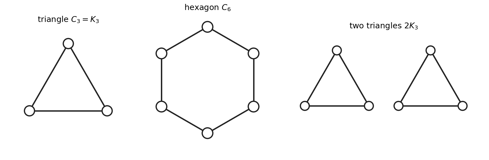

*Figure 1. Three graphs in which every vertex has exactly two neighbours: the triangle $C_3 = K_3$, the hexagon $C_6$ and two separate triangles $2K_3$.*

All three are regular with valency $2$, yet they are different graphs. The hexagon and the two triangles even have the same numbers of vertices and edges, yet one is a single ring and the other falls apart. Valency is local information, and it cannot tell these graphs apart.

**Cliques.** A **clique** is a set of mutually adjacent vertices. A **maximal clique** is a clique that no larger clique contains. In the two triangles, each triangle is a maximal clique. The hexagon has no triangles, so its maximal cliques are its six edges. Maximal does not mean largest. Take a triangle on the vertices $1, 2, 3$ and add a fourth vertex $4$ joined only to $3$. The edge $\{3, 4\}$ is then a maximal clique, because no vertex is adjacent to both $3$ and $4$, even though the triangle is a bigger clique.

Cliques come back three times. A disjoint union of cliques is one of the trivial cases of [strongly regular graphs](#complements-cliques-and-the-trivial-cases). And the lines of most [generalized polygons](#what-is-being-generalized), like the [generators of a polar space](#back-to-titss-axioms), turn out to be exactly the maximal cliques of a graph built from the geometry, so the geometry can be rebuilt from that graph.

#### Paths, geodesics and distance

A **path** of length $k$ is a sequence $x_0, x_1, \dots, x_k$ of distinct vertices in which consecutive vertices are adjacent. The **distance** $d(x, y)$ is the length of a shortest path from $x$ to $y$, and $d(x, y) = \infty$ if there is none. A shortest path is a **geodesic**, or geodesic path. The **diameter** of $\Gamma$ is the largest distance between two of its vertices. The graph is **connected** when every distance is finite, and its **connected components** are its maximal connected pieces.

In the hexagon, opposite vertices are $3$ apart, joined by two geodesics, one each way round, and the diameter is $3$. In the two triangles, no path leads from one triangle to the other: the graph is disconnected, with two components, and its diameter is $\infty$.

Distance is global information that valency cannot see. It matters most in [generalized polygons](#basic-properties-of-generalized-polygons), where two objects closer together than the diameter are joined by a unique geodesic.

#### Cycles, girth and bipartite graphs

A **cycle** of length $k$ is a closed path: vertices $x_0, x_1, \dots, x_k = x_0$ with $k \geq 3$, consecutive vertices adjacent, and $x_0, \dots, x_{k-1}$ distinct. The **girth** is the length of a shortest cycle, and it is $\infty$ if there is no cycle. The hexagon has girth $6$; the two triangles have girth $3$. Girth and diameter are linked: a graph of finite girth $g$ has diameter at least $\lfloor g/2 \rfloor$. A shortest cycle has no shortcuts, since a shortcut would close a shorter cycle, so two opposite vertices on it are $\lfloor g/2 \rfloor$ apart.

A graph is **bipartite** when its vertices split into two sides with every edge crossing from one side to the other. Colour the hexagon's vertices black and white alternately and every edge crosses; round the triangle, alternating colours cannot close up. That is the whole story: a graph is bipartite exactly when it has no cycle of odd length.

Along a cycle the colours alternate, so a bipartite graph has only even cycles. Conversely, colour each vertex by the parity of its distance from a base vertex $x$ of its component. An edge $yz$ inside one colour would give a closed walk (a round trip that may revisit vertices) from $x$ to $y$, across to $z$ and back, of odd length $d(x,y) + 1 + d(x,z)$. A shortest odd closed walk is a cycle, since a repeated vertex would split it into two shorter closed walks, one of them odd. So without odd cycles, the colouring works.

Bipartite graphs return at once: every [incidence graph](#two-graphs-two-distances-two-matrices) is bipartite, with points on one side and lines on the other. The parity argument returns in [generalized polygons](#basic-properties-of-generalized-polygons).

#### The Petersen graph as a puzzle

Here is a puzzle that shows how much simple rules can force. Suppose every vertex has exactly $3$ neighbours, and any two vertices are at most $2$ steps apart. How many vertices can there be?

Stand at a vertex $x$, with its $3$ neighbours. Each has at most $2$ further neighbours, so at most $3 \cdot 2 = 6$ vertices lie at distance $2$, and nothing is further away: at most $1 + 3 + 6 = 10$ vertices. This count is the **Moore bound** for valency $3$ and diameter $2$.

Reaching $10$ needs all $6$ vertices at distance $2$ to be distinct, each reached from $x$ along exactly one path of length $2$. Since $x$ was any vertex, two things follow everywhere:

- no two neighbours of $x$ are adjacent, so there is no triangle, and adjacent vertices have no common neighbour;
- no vertex is reached twice, so there is no $4$-cycle, and two non-adjacent vertices have exactly one common neighbour.

So the girth is at least $5$. Such a graph exists: take as vertices the ten $2$-element subsets of $\{1, 2, 3, 4, 5\}$, and join two subsets when they are disjoint. This is the **Petersen graph**, drawn in Figure 2 in the usual way, as a pentagon and a five-pointed star. Renaming $1, \dots, 5$ turns any adjacent pair into $\{1, 2\}, \{3, 4\}$ and any non-adjacent pair into $\{1, 2\}, \{1, 3\}$, so one check of each kind covers all cases:

- valency $3$: the subset $\{1, 2\}$ is disjoint from exactly the three $2$-subsets of $\{3, 4, 5\}$;
- adjacent vertices share no neighbour: a common neighbour of $\{1, 2\}$ and $\{3, 4\}$ would have to avoid $1, 2, 3, 4$, which leaves only the single element $5$;
- non-adjacent vertices share exactly one neighbour: $\{1, 2\}$ and $\{1, 3\}$ have the single common neighbour $\{4, 5\}$.

So the diameter is $2$, and the girth is $5$: the outer pentagon in Figure 2 is a $5$-cycle.

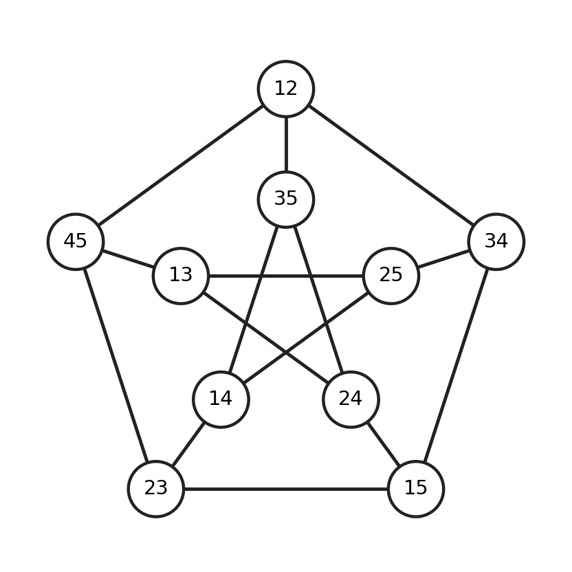

*Figure 2. The Petersen graph. A vertex labelled $12$ is the subset $\{1, 2\}$, and two vertices are joined when their subsets are disjoint. Each outer vertex is joined to its two neighbours on the pentagon and to one vertex of the inner star. Where two edges of the star cross without a circle, there is no vertex.*

The structure is rigid as well as extreme: up to relabelling, the Petersen graph is the only such graph. Below each neighbour of $x$ hang its two further neighbours. Each of these $6$ vertices needs two more edges, but not to its partner (a triangle) nor to both vertices of another pair (a $4$-cycle), so it has one neighbour in each other pair. Between two pairs that leaves $2$ matchings, $8$ choices in all, and the $4$ without a triangle all give the Petersen graph. Forbidding short cycles while keeping every vertex close forces an exact size and a rigid structure. That is the theme of [generalized polygons](#generalized-polygons-a-first-look), whose incidence graphs have no short cycles and yet the smallest diameter the girth allows, half the girth.

The counts of common neighbours, $0$ for adjacent pairs and $1$ for non-adjacent pairs, are the same everywhere. Regular graphs with both counts constant are called strongly regular, the subject of [strongly regular graphs](#strongly-regular-graphs).

#### The adjacency matrix and its eigenvalues

Now we turn a graph into a matrix. Let a finite graph have $v$ vertices (as in later chapters, $v$ counts vertices). Its **adjacency matrix** $A$ is the $v \times v$ matrix, with rows and columns indexed by the vertices, whose entry $A_{xy}$ is $1$ when $x \sim y$ and $0$ otherwise. Its entries are $0$ and $1$, but it is a real matrix, not one over $\mathbb{F}_2$: the arguments below use inequalities. $A$ is symmetric, so its eigenvalues are real and it has an orthonormal basis of eigenvectors ([real symmetric matrices](#real-symmetric-matrices-and-the-spectral-theorem)).

Writing $A$ down needs an order for the vertices, but another order replaces $A$ by $P^TAP$ for a permutation matrix $P$, with the same eigenvalues and multiplicities ([permutation matrices](#the-all-ones-matrix-and-commuting-matrices)). So these are the eigenvalues of $\Gamma$ itself; some texts call the list the spectrum of $\Gamma$.

The matrix is easy to read: $(Aw)_y$ is the sum of $w_z$ over the neighbours $z$ of $y$. So $Aw = \theta w$ says that at every vertex, the values at the neighbours add up to $\theta$ times the value at the vertex. On the $n$-cycle, with vertices $0, 1, \dots, n-1$ round the ring, try a Bloch wave $w_y = \omega^{my}$, where $\omega = e^{2\pi i/n}$. Each vertex $y$ has the neighbours $y \pm 1$, so $(Aw)_y = (\omega^m + \omega^{-m})\, w_y$, and the eigenvalues are $2\cos(2\pi m/n)$ for $m = 0, 1, \dots, n-1$. The two triangles have the triangle's eigenvalues twice over, since the adjacency matrix of a graph in pieces is block diagonal. So, for the graphs of Figure 1:

| Graph | Eigenvalues, with multiplicities |
| --- | --- |
| triangle $C_3$ | $2$ once, $-1$ twice |
| hexagon $C_6$ | $2$ once, $1$ twice, $-1$ twice, $-2$ once |
| two triangles $2K_3$ | $2$ twice, $-1$ four times |

Later chapters write a multiplicity as an exponent, so the hexagon's list becomes $2, 1^2, (-1)^2, -2$; the exponent counts, it is not a power.

**What the eigenvalues of a regular graph show.** Let $\Gamma$ be a finite regular graph with valency $k$. Then:

- $k$ is an eigenvalue, and its multiplicity is the number of connected components;
- every eigenvalue $\theta$ satisfies $|\theta| \leq k$;
- if $\Gamma$ is bipartite, its eigenvalues come in pairs $\theta, -\theta$; in particular $-k$ is an eigenvalue.

All three come from looking at the eigenvector's values one vertex at a time. For the bound, take an eigenvector $w$ and a vertex $y$ where $|w_y|$ is largest. Then

$$|\theta|\,|w_y| = \Big|\sum_{z \sim y} w_z\Big| \leq k\,|w_y|,$$

so $|\theta| \leq k$. For the first claim, the all-ones vector $j$ has $(Aj)_y = k$ at every vertex, so $Aj = kj$; more generally, any vector that is constant on each component is an eigenvector for $k$. Conversely, suppose $Aw = kw$, and pick a vertex $y$ where $w_y$ is largest within its component. Then $k\,w_y$ is a sum of $k$ neighbour values, each at most $w_y$, so all of them equal $w_y$. The maximum spreads to the neighbours, then to theirs, and fills the component. So $w$ is constant on each component, and the eigenspace of $k$ has one dimension for each component. For the third claim, flip the sign of an eigenvector $w$ on one side: the neighbours of each vertex lie on the other side, so the new vector has eigenvalue $-\theta$.

Regularity is what makes $j$ an eigenvector, and finiteness gives a largest entry (on an infinite graph the argument works for bounded eigenvectors, using a supremum).

Check the table: the connected, bipartite hexagon has $2$ once and pairs $\pm 2$, $\pm 1$; the two triangles have $2$ twice and no $-2$. For a connected regular graph the last claim reverses: if $Aw = -kw$, all neighbours of a vertex where $|w_y|$ is largest carry $-w_y$, this spreads with alternating signs, and the signs of $w$ give the two sides. So the number of pieces shows up as the multiplicity of $k$, and bipartiteness as the eigenvalue $-k$: global facts, read off from eigenvalues.

---

**Aside: walkers and electrons on a graph.** A random walker stepping to a uniformly chosen neighbour has transition matrix $A/k$, whose $(y, z)$ entry is the probability of stepping from $y$ to $z$. Its eigenvalue $1$ has one dimension per component, where probability gets trapped; the eigenvalue $-1$ of a bipartite graph means the walker swaps sides forever. The tight-binding model of an electron in a molecule gives each atom one orbital $|y\rangle$, with $\langle y|H|z\rangle = -\gamma$ for bonded atoms and $0$ otherwise, so $H = -\gamma A$ and the eigenvalues of $A$ are energy levels. For benzene, a hexagon of carbon atoms, the table gives $\mp 2\gamma$ once each and $\mp\gamma$ twice each; the $\pm\theta$ pairing is the model's sublattice symmetry.

---

---

**Note: which valencies can reach the Moore bound?** For valency $k$ and diameter $2$ the same count allows $k^2 + 1$ vertices. [Hoffman and Singleton showed in 1960](https://doi.org/10.1147/rd.45.0497) that only $k = 2$ (the pentagon), $3$ (Petersen), $7$ (a $50$-vertex graph now named after them) and possibly $57$, [still open](https://arxiv.org/abs/2210.09577), reach it, using the whole-number test of [strongly regular graphs](#the-adjacency-matrix-of-a-strongly-regular-graph).

---

More graph words, such as complements, multipartite graphs and distance-regular graphs, arrive where they are first used, in [strongly regular and distance-regular graphs](#strongly-regular-and-distance-regular-graphs).

### Point-line geometries

A graph has one kind of object, joined in pairs. A geometry has two kinds, points and lines, and a line may hold many points. Which graph should stand for a geometry, and which information does each choice keep?

#### Points, lines and incidence

A **point-line geometry** $\mathcal{S} = (\mathcal{P}, \mathcal{L}, I)$ consists of a nonempty set $\mathcal{P}$ of points, a set $\mathcal{L}$ of lines (disjoint from $\mathcal{P}$, possibly empty), and an **incidence relation** $I \subseteq \mathcal{P} \times \mathcal{L}$, such that every line is incident with at least two points. The letter $I$ also names the identity matrix; context always tells them apart. We write $x \, I \, L$, and say that $x$ lies on $L$ or that $L$ goes through $x$. Points on a common line are **collinear**.

A line is a label, not a set of points. Two points $x, y$ and two lines $L, M$, each through both points, form a geometry whose two lines have the same point set (a [digon](#small-geometries-that-test-the-definitions)). Labels keep points and lines on an equal footing, so that swapping them gives a geometry again whenever it can. When distinct lines have distinct point sets, as in every example below, we treat lines as sets of points.

An isomorphism of geometries is a pair of bijections, one on the points and one on the lines, that keeps incidence and non-incidence; an isomorphism of a geometry to itself is an automorphism. A **flag** is an incident pair $(x, L)$, and an **anti-flag** is a non-incident pair. Counting incidences means counting flags. Anti-flags are what later axioms test: the axiom of a [generalized quadrangle](#generalized-quadrangles-a-first-look) says what a point sees of a line not through it.

For a point $x$, write $x^\perp$ for the set of points collinear with $x$, together with $x$ itself. Mind the difference from graphs: $x$ lies in $x^\perp$, while a vertex is not its own neighbour. The symbol echoes the earlier notes' $x^\perp$, the points orthogonal to $x$: in a polar space, the two sets agree on the points of the polar space ([polar spaces: a first look](#polar-spaces-a-first-look)).

**Duals.** The **dual** $\mathcal{S}^D$ of $\mathcal{S}$ swaps the roles: its points are the lines of $\mathcal{S}$, its lines are the points of $\mathcal{S}$, and incidence is unchanged. This needs every point of $\mathcal{S}$ to lie on at least two lines, so that each new line has at least two points. $\mathcal{S}$ is **self-dual** when $\mathcal{S}^D \cong \mathcal{S}$.

Lines come in two sizes that matter. A line is **thin** if it has exactly two points, and **thick** if it has at least three. A graph is a geometry with only thin lines: its points are the vertices and its lines are the edges.

Two examples carry the rest of the chapter, both from the earlier projective geometry notes.

The Fano plane $PG(2, 2)$ has as points the $7$ nonzero vectors of $\mathbb{F}_2^3$, and as lines the $7$ sets $\{x : a_0x_0 + a_1x_1 + a_2x_2 = 0\}$, one for each nonzero $a$. We write $[a_0a_1a_2]$ for that line. Every line has $3$ points and every point lies on $3$ lines. The Fano plane is self-dual: send the point $a$ to the line $[a]$, and the line $[a]$ to the point $a$. Since $a \cdot x = x \cdot a$, the point $x$ lies on the line $[a]$ exactly when the point $a$ lies on the line $[x]$, so incidence is kept.

The $3 \times 3$ grid is the hyperbolic quadric $Q^+(3, 2)$: the $9$ points of $PG(3, 2)$ with $x_0x_3 + x_1x_2 = 0$, together with the $6$ lines lying on it. (The earlier notes wrote $x_0x_3 - x_1x_2$, which is the same equation over $\mathbb{F}_2$.) The earlier notes set out its points as a $3 \times 3$ table whose rows and columns are the two reguli, so we call its $6$ lines rows and columns. Every point lies on $2$ lines, and every row meets every column.

The dual of the grid looks quite different. Its points are the $3$ rows and $3$ columns, and its lines are the $9$ grid points, each now a thin line joining the row and the column through it. This is the graph $K_{3,3}$, three vertices on each side with every vertex joined to the three opposite, seen as a geometry: a [dual grid](#small-geometries-that-test-the-definitions). Duality has turned thick lines into thin ones.

#### Two graphs, two distances, two matrices

Each geometry carries two graphs. The **collinearity graph**, also called the point graph, has the points as vertices, with two distinct points adjacent when they are collinear. The **incidence graph** has the points and the lines as vertices, with a point adjacent to a line when they are incident; its edges are the flags. The incidence graph is bipartite, with points on one side and lines on the other.

The incidence graph is the collinearity graph of the **double** of $\mathcal{S}$, whose points are all the points and lines of $\mathcal{S}$ and whose lines are the flags, each written as the set $\{x, L\}$ of its two points. A geometry and its dual have the same double, and so the same incidence graph with the sides swapped. The grid and $K_{3,3}$ share a double with $9 + 6 = 15$ points and $18$ lines, one for each flag of the grid. Doubles return in [generalized polygons](#basic-properties-of-generalized-polygons), where doubling a polygon doubles its number of sides, and in [which polygons exist](#which-polygons-exist).

The two graphs keep different information. The collinearity graph forgets the lines: in the Fano plane any two points are collinear, so its collinearity graph is $K_7$, which is also the collinearity graph of a single line with $7$ points. The incidence graph forgets nothing: once we know which side holds the points, the geometry can be read straight off it.

Figure 3 shows the Fano plane beside its incidence graph, the Heawood graph of the earlier notes, with $14$ vertices, $21$ edges and valency $3$.

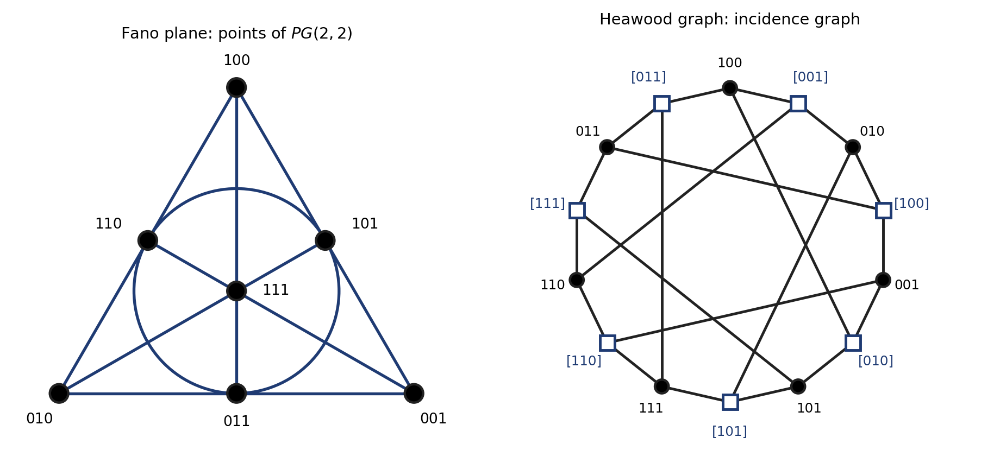

*Figure 3. Left: the Fano plane, with each point labelled by its coordinates over $\mathbb{F}_2$; the circle is the seventh line. Right: its incidence graph, the Heawood graph. Dots are points, squares are lines, and the square $[a_0a_1a_2]$ is the line $a_0x_0 + a_1x_1 + a_2x_2 = 0$. Edges join each line to its three points; crossings of edges are not vertices.*

**Two distances.** We need both graphs: generalized polygons are defined through distances in the incidence graph, while eigenvalues see the collinearity graph. Write $d$ for distance in the collinearity graph and $\delta$ (read "delta") for distance in the incidence graph. For a point $x$ and a line $L$, let $d(x, L)$ be the smallest distance from $x$ to a point of $L$; for two lines, let $d(L, M)$ be the smallest distance between a point of $L$ and a point of $M$. Then, for points $x, y$ and distinct lines $L, M$ of a connected geometry (one whose collinearity graph is connected),

$$\delta(x, y) = 2\,d(x, y), \qquad \delta(x, L) = 2\,d(x, L) + 1, \qquad \delta(L, M) = 2\,d(L, M) + 2.$$

Figure 4 shows why. A path $x_0, x_1, \dots, x_k$ in the collinearity graph becomes an alternating path $x_0, L_1, x_1, \dots, L_k, x_k$ in the incidence graph by inserting a line through each consecutive pair, which doubles its length; deleting the lines halves it again. A path to a line runs to its nearest point and takes one more step, and a path between lines takes one more step at each end. In the grid, a point and a line not through it have $d = 1$ and $\delta = 3$, and two rows have $d = 1$ and $\delta = 4$.

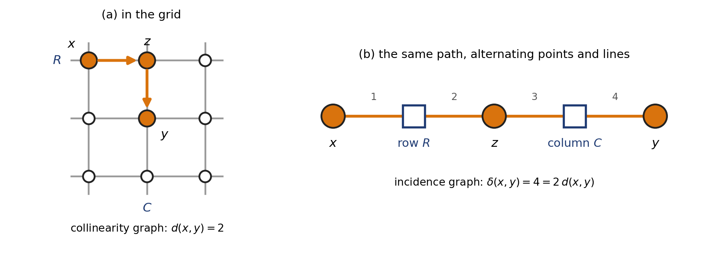

*Figure 4. (a) In the grid, $x$ and $y$ lie in different rows and columns, and the path $x, z, y$ has length $d(x, y) = 2$. (b) In the incidence graph, the same path visits the row $R$ through $x$ and $z$ and the column $C$ through $z$ and $y$, so $\delta(x, y) = 4$. Dots are points, squares are lines.*

**Partial linear spaces and order.** A geometry is a **partial linear space** when two distinct points lie on at most one common line; equivalently, two distinct lines share at most one point. In the incidence graph this says that there is no $4$-cycle, since a $4$-cycle $x, L, y, M$ is the digon pattern. We then write $xy$ for the line through two distinct collinear points $x$ and $y$. A **linear space** is a partial linear space in which any two distinct points lie on exactly one line. The Fano plane is one; the grid is not, since two points in different rows and columns share no line.

A partial linear space has **order** $(s, t)$ when every line has $s + 1$ points and every point lies on $t + 1$ lines. The shift by one makes a projective plane of order $q$ have order $(q, q)$, and the hexagon, with its edges as lines, order $(1, 1)$. The Fano plane has order $(2, 2)$, the grid $(2, 1)$, and both $K_{3,3}$ and the double of the Fano plane $(1, 2)$. Not every geometry has an order; the [gallery chapter](#small-geometries-that-test-the-definitions) gives examples.

**Two matrices.** For a finite geometry, the **incidence matrix** $M$ has a row for each point and a column for each line, with entry $1$ when the point lies on the line and $0$ otherwise; like the adjacency matrix, it is real. The adjacency matrix $A$ of the collinearity graph is the **collinearity matrix**, and its eigenvalues are called the eigenvalues of the geometry. Here $J$ is the all-ones matrix of [the prologue](#the-all-ones-matrix-and-commuting-matrices), not the symplectic $J$ of the earlier notes.

The two matrices are tied together. The $(x, y)$ entry of $MM^T$ counts the lines through both $x$ and $y$. In a partial linear space with $t + 1$ lines through every point, that is $t + 1$ on the diagonal, and off the diagonal $1$ or $0$ as $x$ and $y$ are collinear or not. So

$$MM^T = (t + 1)I + A.$$

In the Fano plane $A = J - I$, so $MM^T = 2I + J$, with eigenvalues $9$ once and $2$ six times ([the rule for $aI + bJ$](#the-all-ones-matrix-and-commuting-matrices)) and determinant $576 \neq 0$. So $M$ has rank $7$, and by the [rank fact](#rank-determinants-and-gram-matrices) the Fano plane needs at least $7$ lines; it has exactly $7$. This is [Fisher's inequality](#fishers-inequality) in miniature.

**Axioms become graph properties.** The Heawood graph has girth $6$: it is bipartite, a partial linear space has no $4$-cycle, and three non-collinear points with their joining lines form a $6$-cycle. Its diameter is $3$, since two points or two lines are at $\delta = 2$ and a point and a line at $\delta = 1$ or $3$. The grid's incidence graph has girth $8$ (the grid has no triangle) and diameter $4$. In both, the diameter is half the girth, the smallest it can be ([cycles, girth and bipartite graphs](#cycles-girth-and-bipartite-graphs)). The Fano plane is a generalized $3$-gon and the grid a generalized $4$-gon in the language of [generalized polygons: a first look](#generalized-polygons-a-first-look), where this pattern becomes the definition.

#### Subspaces and what a set generates

In a partial linear space, a set $X$ of points is a **subspace** if every line with at least two points in $X$ has all its points in $X$. The whole point set is a subspace, and an intersection of subspaces is a subspace. So every set $X$ lies in a smallest subspace, the subspace **generated** by $X$. A set that generates the whole point set is a generating set, and the smallest size of a generating set is the **generating index**.

The generated subspace can be built from below. Start with $X_0 = X$, and get $X_{i+1}$ by adding every point of every line with at least two points in $X_i$. The union of $X_0 \subseteq X_1 \subseteq \dots$ is the subspace generated by $X$: each step stays inside any subspace containing $X$, and the union is a subspace, because any two of its points lie in some $X_i$ and the next step fills in their line.

Why count generators? If a geometry sits inside a projective space with its lines as full projective lines, each closure step stays inside the span of the starting points, so the generating index bounds the vector dimension of the space the geometry spans ([giving a geometry coordinates](#giving-a-geometry-coordinates)).

In the Fano plane, with the labels of Figure 3, start from $100, 010, 001$. The three lines joining them add $110, 101, 011$, and the line through $100$ and $011$ adds $111$. Two points generate only their line, so the generating index is $3$, which is $\dim \mathbb{F}_2^3$, and one more than the projective dimension, as for every projective space ([projective spaces revisited](#projective-spaces-revisited)). In the grid, the four points of a $2 \times 2$ corner fill out two rows and two columns, $8$ points, and the ninth lies on a row with two of them. Three points are not enough:

- three collinear points generate their line;
- three points with no two collinear are already a subspace;
- otherwise filling in a shared line brings in a second line and stops at a cross of $5$ points, a row and a column.

So the generating index of the grid is $4$, the vector dimension of its space $PG(3, 2)$. Mind the clash with rank: the grid is the polar space $Q^+(3, 2)$ of rank $2$ in the earlier notes, yet it needs $4$ generators.

A subspace is **singular** if its points are pairwise collinear. In the Fano plane every subspace is singular; in the grid the singular subspaces are the empty set, the single points and the six lines. Singular subspaces are the building blocks of [polar spaces](#polar-spaces-a-first-look), and the closure above is the tool that shows they are projective spaces in [from one-or-all to Tits's axioms](#from-one-or-all-to-titss-axioms).

A subgeometry keeps some of the points, some of the lines, each with at least two of its points, and the incidences among them; it is **full** when every line it keeps keeps all of its points. A nonempty subspace with the lines inside it is a full subgeometry. Full subgeometries return as the subquadrangles of [generalized quadrangles in depth](#generalized-quadrangles-in-depth).

#### Hyperplanes, ovoids and the view from a point

When a geometry sits inside a projective space, each hyperplane of the space cuts out a set of its points. Can such sets be recognized from the geometry alone? A projective hyperplane is a proper subspace that meets every line, and the definition carries over: in a partial linear space, a **hyperplane** is a subspace, other than the whole point set, that meets every line. So each line lies inside it or meets it in exactly one point. Unlike a projective hyperplane, it may contain no line at all; it is then an **ovoid**, a set of points meeting every line in exactly one point.

The grid shows how varied hyperplanes can be. It has exactly $15$ of them, of two shapes, shown in Figure 5:

- $9$ **crosses**, one for each point $x$: the row and the column through $x$, which together form $x^\perp$, with $5$ points;
- $6$ ovoids, with one point in each row and each column, like three rooks on a $3 \times 3$ board that cannot attack each other; there are $3! = 6$ of them.

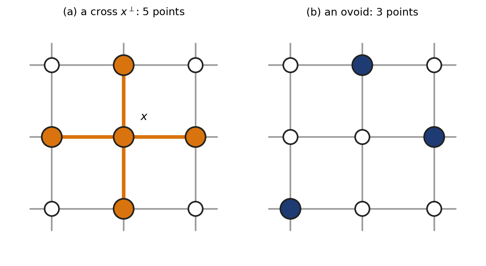

*Figure 5. The two shapes of hyperplane in the $3 \times 3$ grid, whose lines are the three rows and three columns. (a) The cross $x^\perp$: the row and the column through $x$. (b) An ovoid: one point in each row and each column.*

There is nothing else. A hyperplane $H$ containing a row (or, symmetrically, a column) holds a point $y$ of another row; the column through $y$ then has two points in $H$, giving a cross, and one more point would bring in everything. A hyperplane containing no line is an ovoid.

Mind the clash of words: the earlier notes' ovoid was a set of points of $PG(3, q)$, no three collinear, whose tangent lines at each point fill a plane (an elliptic quadric, for instance), defined by the surrounding space rather than by the geometry's own lines.

Hyperplanes need not look flat: a cross looks like a plus sign, and an ovoid like a scatter of points. Yet here they come from flat things: the $15$ hyperplanes are exactly the sections of the quadric by the $15$ planes of $PG(3, 2)$. The $9$ tangent planes cut out crosses; the tangent plane $x_3 = 0$ at $(1{:}0{:}0{:}0)$ meets the quadric in the earlier notes' row $g_1$ and column $h_1$. The other $6$ cut out ovoids, the earlier notes' $3$-point conics; the plane $x_1 + x_2 = 0$ meets it in $(1{:}0{:}0{:}0)$, $(0{:}0{:}0{:}1)$ and $(1{:}1{:}1{:}1)$. Whether the hyperplanes of a geometry always come from hyperplanes of a surrounding space is the question of [giving a geometry coordinates](#giving-a-geometry-coordinates).

**The view from a point.** If every line through a point $x$ has at least three points, the **internal structure** at $x$ has as points the points of $x^\perp$ other than $x$, and as lines the lines through $x$, each keeping its points other than $x$. In a partial linear space that is all it is: the lines through $x$ with $x$ removed, pairwise disjoint, since two lines through $x$ share no other point. (In the Fano plane: $6$ points on $3$ disjoint $2$-point lines.) It becomes interesting for designs, where two blocks through a point can share several points; there it is the [derived design](#designs-a-first-look), the blocks through a point with that point removed, put to work in [new designs from old](#new-designs-from-old). Mind the clash with the earlier notes' residue of a point, whose points were the lines through it: here the lines through $x$ stay lines.

With the words in place, [a gallery of geometries](#a-gallery-of-geometries) meets the families that the rest of these notes study, starting with small geometries that test these definitions.

<!-- terms checked: subspace; hyperplane -->

## A Gallery of Geometries

The first chapter gave us a language for points, lines and incidence, generous enough that almost anything qualifies. The geometries worth studying are those where one local rule holds everywhere: every two points lie on a line, or each point sees exactly one point of each line, or there are no short cycles. Which families do such rules produce, and what does the smallest member of each look like?

This chapter is a survey, with few proofs; each family returns later with the tools to prove things. [Designs](#designs-a-first-look) return in the chapter on [designs](#designs), and [generalized quadrangles](#generalized-quadrangles-a-first-look) in [from geometries to graphs and back](#from-geometries-to-graphs-and-back), where eigenvalues show that some cannot exist. [Polar spaces](#polar-spaces-a-first-look) and [generalized polygons](#generalized-polygons-a-first-look) each get a chapter of their own. We start with geometries so small that their only job is to test the definitions.

### Small geometries that test the definitions

Every definition has edge cases, and the smallest geometries show them. Each example below tests a word from [the first chapter](#point-line-geometries); Figure 6 draws them, and the table at the end names the word each one tests.

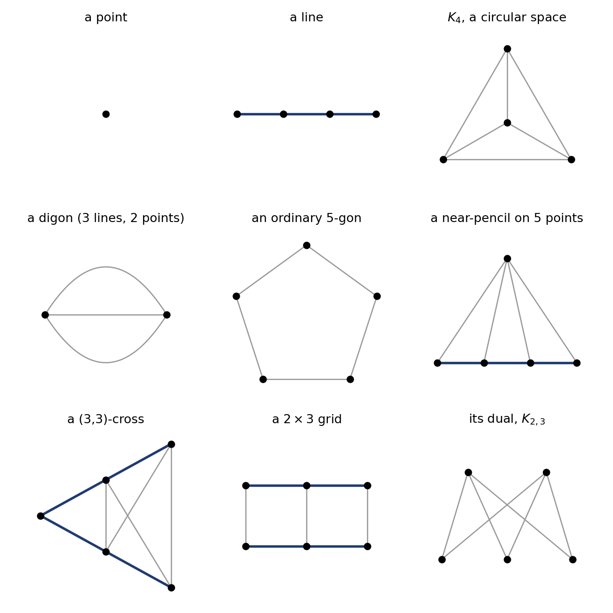

*Figure 6. Small geometries that test the definitions. Dark lines are thick (at least three points), grey lines thin (two points). Top: a point; a line; $K_4$ as a linear space. Middle: a digon with two points and three lines; an ordinary 5-gon; a near-pencil on 5 points. Bottom: a (3,3)-cross; a $2 \times 3$ grid; its dual $K_{2,3}$. A crossing without a dot is not a point.*

**Points, lines and graphs.** The simplest geometries are **a point**, with no lines, and **a line**, at least two points on one line. A graph is a geometry whose lines, its edges, are all thin. The complete graph $K_n$ with $n \geq 3$ is then a linear space in which no line has a third point, a **circular space**.

**The digon.** A **generalized digon** has at least two points and at least two lines, with every point on every line. All its lines have the same point set, which is why the first chapter made incidence a relation instead of treating lines as point sets. It is the $n = 2$ case of the generalized polygons at the end of this chapter.

**The ordinary $n$-gon, and thick versus thin.** For $n \geq 3$, the **ordinary $n$-gon** has points $1, 2, \dots, n$ and lines $\{1,2\}, \{2,3\}, \dots, \{n-1, n\}, \{n, 1\}$. Its collinearity graph is the cycle $C_n$, and it is self-dual. It is the earlier notes' simple $n$-angle, not their complete $n$-angle, which joins every pair of points.

The ordinary $n$-gon is the model of a thin geometry. [The first chapter](#point-line-geometries) called a line thin when it has exactly two points and thick when it has at least three. We now extend both words to whole geometries:

- a geometry is **thick** if every line has at least three points and every point lies on at least three lines;
- it is **thin** if every line has exactly two points and every point lies on exactly two lines, as in an ordinary polygon.

Many geometries are thick one way and thin the other: a grid with three points per line, met below, has thick lines but two lines through each point, while $K_4$ and the double of the Fano plane have thin lines but three lines through each point. Several theorems about generalized polygons hold only for thick ones, and their exceptions live in these in-between cases.

**Near-pencils.** A **near-pencil** is a linear space with one line through every point but one. On $n$ points it has that line and $n - 1$ thin lines to the extra point, $n$ lines in all; on $3$ points it is a triangle. The near-pencils will turn out to be the [degenerate projective planes](#projective-spaces-revisited).

**Crosses.** Take a point $p$ on two lines with $k_1, k_2 \geq 2$ points, and join every remaining pair of points, one from each line, by a thin line. This linear space is a **$(k_1, k_2)$-cross** (with more lines through $p$, a star): the shape of a cross $x^\perp$ in the first chapter's $3 \times 3$ grid, completed to a linear space. The $(3,3)$-cross, with $5$ points and $6$ lines, will break the Veblen–Young axiom.

**Grids and dual grids.** For sets $X_1, X_2$ of sizes $n_1, n_2 \geq 2$, the **$(n_1 \times n_2)$-grid** has points $X_1 \times X_2$, and as lines the rows $\{i\} \times X_2$ and columns $X_1 \times \{j\}$. It is symmetrical when $n_1 = n_2$ and **nonsymmetrical** otherwise. Its dual, a **dual grid**, has the rows and columns as points, and each old point becomes a thin line joining its row to its column. So a dual grid is the **complete bipartite graph** $K_{n_1, n_2}$, with sides of $n_1$ and $n_2$ vertices and every vertex joined to the whole other side, like the first chapter's $K_{3,3}$.

**Example: the $2 \times 3$ grid.** Its rows have $3$ points and its columns $2$, so it has no order $(s, t)$. Yet it obeys the quadrangle rule of the earlier projective geometry notes: for a line $L$ and a point $x$ off it, exactly one point of $L$ is collinear with $x$, along the column of $x$ if $L$ is a row and along its row if $L$ is a column. The earlier notes wrote quadrangles as $GQ(s, t)$, assuming an order; this example shows that an order is not automatic, so [the definition below](#generalized-quadrangles-a-first-look) does without one.

| Geometry | Points | Lines | The word it tests |
| --- | --- | --- | --- |
| a point | $1$ | $0$ | geometry: the set of lines may be empty |
| a line | $k \geq 2$ | $1$ | linear space |
| $K_n$, a circular space | $n$ | $n(n-1)/2$ | thin and thick: thin lines, yet $n - 1$ lines per point |
| digon | $\geq 2$ | $\geq 2$ | incidence: lines are not sets of points |
| ordinary $n$-gon | $n$ | $n$ | thin |
| near-pencil on $n$ points | $n$ | $n$ | degenerate projective plane |
| $(3,3)$-cross | $5$ | $6$ | the Veblen–Young axiom |
| $2 \times 3$ grid | $6$ | $5$ | order |
| $K_{2,3}$, a dual grid | $5$ | $6$ | dual: the dual of a GQ, again without an order |

### Projective spaces revisited

The cross is a linear space that is not a projective space, and the near-pencil is a projective space of the thinnest kind. Which axiom must be added, and which of the earlier notes' axioms can we drop?

#### Projective spaces with thin lines allowed

**The Veblen–Young axiom.** The earlier projective geometry notes built projective spaces from axioms about subspaces and dimensions, and named this axiom without stating it. It says: if $L_1$ and $L_2$ are distinct lines through a point $z$, and $x_i, y_i$ are distinct points of $L_i$ other than $z$, then the lines $x_1x_2$ and $y_1y_2$ meet. In a picture: the line $y_1y_2$ meets two sides of the triangle $zx_1x_2$ away from their common corner, so it must meet the third side. A **projective space** is a linear space satisfying this axiom. The earlier notes' axioms ended with Fano's postulate, that every line has at least three points; here it is dropped.

The cross fails the axiom. With $x_1, y_1$ on one thick line of the $(3,3)$-cross and $x_2, y_2$ on the other, the lines $x_1x_2$ and $y_1y_2$ are disjoint thin lines. The near-pencil passes cheaply: the axiom has content only where two thick lines meet, and a near-pencil has a single thick line.

**Projective planes.** A **projective plane** is a linear space in which every two lines meet and there are three non-collinear points. It is **nondegenerate** if it has four points with no three collinear. A nondegenerate plane has an order $q \geq 2$, possibly infinite: every line has $q + 1$ points and every point lies on $q + 1$ lines, so its order in the sense of the first chapter is $(q, q)$. We write $q$ for the order of any plane, even one not built from a field. The other planes, the **degenerate** ones, are exactly the near-pencils: in a near-pencil two lines always meet while every four points include three on the long line, and one checks the converse.

**Why allow thin lines?** Because polar spaces need them. Their singular subspaces must be projective spaces, and in the earlier notes' octahedron, a polar space of rank 3 with two points on every line, the maximal singular subspaces are the $8$ triangles, planes with only thin lines ([polar spaces: a first look](#polar-spaces-a-first-look)). A projective space is **irreducible** if every line is thick, and **reducible** otherwise. For planes the two pairs of words agree: a nondegenerate plane has $q + 1 \geq 3$ points on every line, and a near-pencil has thin lines.

Figure 7 shows a small reducible space. Take two disjoint 3-point lines $A = \{a_1, a_2, a_3\}$ and $B = \{b_1, b_2, b_3\}$, and add the nine thin lines $\{a_i, b_j\}$. That gives $6$ points and $11$ lines, with every two points on exactly one line. The Veblen–Young axiom holds, again for free, since no point lies on two thick lines; yet no $PG(n, \mathbb{F})$ has thin lines.

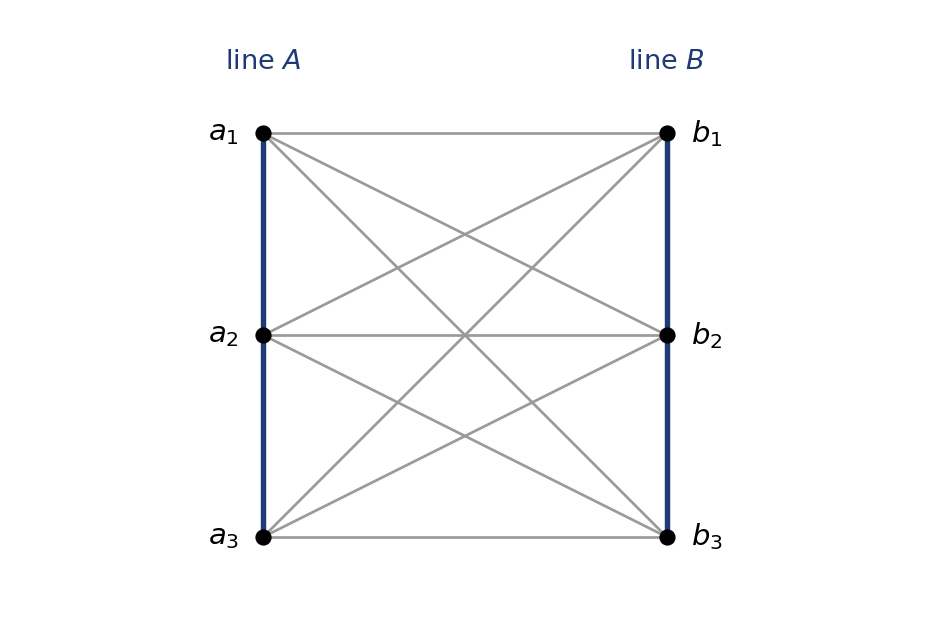

*Figure 7. Two 3-point lines glued into a reducible projective space: the thick lines $A$ and $B$, and nine thin grey lines joining each $a_i$ to each $b_j$. A crossing that carries no dot is not a point.*

In general, take irreducible projective spaces on disjoint point sets and add a thin line through every pair of points from different pieces. This is their **direct sum**, and every reducible projective space is a direct sum of irreducible ones: the glued pair of two lines, a triangle of three points.

**Dimension.** The dimension of a projective space is its generating index ([the first chapter](#point-line-geometries)) minus one, which gives $n$ for $PG(n, \mathbb{F})$. In the glued pair three points never suffice: $a_1, a_2$ bring in all of $A$, and $A \cup \{b_1\}$ is already a subspace, a near-pencil, so a degenerate plane sits inside. Four points $a_1, a_2, b_1, b_2$ generate everything, so the dimension is $3$, as for two skew lines of $PG(3, \mathbb{F})$.

By a convention outside the definition of a geometry, which asks for a point, the empty set is a projective space of dimension $-1$. This lets the rule sorting the generators of a hyperbolic quadric into two families read without cases: generators $M$ and $L$ of $Q^+(2n-1, \mathbb{F})$ are in the same family exactly when $n - 1 - \dim(M \cap L)$ is even. In the grid ($n = 2$) two rows meet in $\emptyset$, and $1 - (-1)$ is even; a row and a column meet in a point, and $1 - 0$ is odd ([the classical polar spaces](#the-classical-polar-spaces)).

#### Why planes are the exception

For a right vector space $V$ over a skew field $\mathbb{F}$, $PG(V)$ has the 1-dimensional subspaces as points and the 2-dimensional ones as lines; it has dimension $\dim V - 1$ and is written $PG(n, \mathbb{F})$, or $PG(n, q)$ over the field with $q$ elements. Such spaces are **Desarguesian**, and irreducible. The classification due to Veblen and Young says how close this comes to everything: an irreducible projective space is a point, a line with at least three points, a nondegenerate projective plane, or $PG(n, \mathbb{F})$ with $n \geq 3$ over a skew field. Finite skew fields are fields, by Wedderburn's theorem ([linear algebra over finite fields](#linear-algebra-over-finite-fields)), so the finite ones of dimension at least 3 are the $PG(n, q)$.

Planes are the exception because they lack room: the earlier notes showed that a plane inside a 3-dimensional space satisfies Desargues' theorem, which builds coordinates, while a plane on its own need not, like their octonion plane.

---

**Aside: which orders do finite planes have?** Every known finite nondegenerate plane has prime-power order; for orders $2, 3, 4, 5, 7, 8$ the only plane is $PG(2, q)$, and there are four of order $9$. The theorem of [Bruck and Ryser](https://doi.org/10.4153/CJM-1949-009-2) says that if a plane of order $q$ exists and $q$ leaves remainder 1 or 2 on division by 4, then $q$ is a sum of two squares; this rules out $6, 14, 21, 22, 30, \dots$. Order $10$ passes that test and was ruled out by a large computer search ([Lam, Thiel and Swiercz, 1989](https://doi.org/10.4153/CJM-1989-049-4)). The smallest order still undecided is $12$.

---

### Designs: a first look

A projective plane of order $q$ has $q^2 + q + 1$ points, $q + 1$ points on each line, and one line through any two points. None of these counts mentions coordinates. So forget the coordinates and keep the counts: which uniform counts survive, and what carries them?

#### Designs from familiar geometries

**The definition.** Let $v \geq k \geq t \geq 1$ and $\lambda \geq 1$ be integers with $k \geq 2$. A **$t$-$(v, k, \lambda)$ design**, read "a $t$-design with parameters $v$, $k$, lambda", is a finite geometry such that:

- it has $v$ points;
- it has at least one line, and every line has exactly $k$ points;
- every $t$ distinct points lie on exactly $\lambda$ common lines;
- distinct lines have distinct point sets.

The lines of a design are called **blocks**, and by the last condition a block can be treated as a set of points. Two letters are reused: the block size $k$ was a valency in the first chapter, and $t$, the **strength** of the design, has nothing to do with the $t$ of an order $(s, t)$. A design with $\lambda = 1$ is a **Steiner system**, written $S(t, k, v)$; note that $v$ moves to the end. An $S(2, 3, v)$ is a **Steiner triple system**.

**How many blocks?** Count the pairs (a set of $t$ points, a block containing it) in two ways. Each of the $\binom{v}{t}$ sets lies in $\lambda$ blocks, and each of the $b$ blocks contains $\binom{k}{t}$ of the sets, so

$$b = \lambda \binom{v}{t} \Big/ \binom{k}{t},$$

which must be a whole number. [Every $t$-design is an $s$-design](#every-t-design-is-an-s-design) refines this count.

**Triple systems from familiar spaces.** The Fano plane is an $S(2, 3, 7)$, and every $PG(n, 2)$ is a Steiner triple system: $PG(3, 2)$ is an $S(2, 3, 15)$ with $35$ blocks. So are the earlier notes' affine spaces $AG(n, 3)$, whose lines are the sets $\{u, u + w, u + 2w\}$: $AG(2, 3)$ is an $S(2, 3, 9)$ with $12$ blocks.

Axiomatically, an **affine plane** is a linear space with three non-collinear points, in which for every point $x$ and line $L$ not through $x$ exactly one line through $x$ misses $L$. All its lines turn out to have the same number $q$ of points, its order; the smallest is $K_4$, of order 2. A projective plane of order $q$ is an $S(2, q+1, q^2+q+1)$, and an affine plane of order $q$ is an $S(2, q, q^2)$. For $q \geq 2$ the converse holds too, by a short count in [every $t$-design is an $s$-design](#every-t-design-is-an-s-design), so for planes the counts recover the whole geometry.

#### Designs on curved point sets, and extensions

**Unitals.** A **unital** is an $S(2, q+1, q^3+1)$; here $q$ is not the order of a plane. The standard example is the Hermitian curve

$$X_0^{q+1} + X_1^{q+1} + X_2^{q+1} = 0$$

in $PG(2, q^2)$, with $q^3 + 1$ points. Every line meets it in $1$ or $q + 1$ points (the earlier notes' Baer sublines), and the $(q+1)$-point sections are the blocks; for $q = 3$ this is the earlier notes' 28-point unital, an $S(2, 4, 28)$. The case $q = 2$ holds a surprise. Over $\mathbb{F}_4$ every nonzero element has cube $1$, so the curve $X_0^3 + X_1^3 + X_2^3 = 0$ consists of the $9$ points with exactly one zero coordinate, and its twelve 3-point sections form an $S(2, 3, 9)$. Through a point off a block pass four blocks, three meeting it and one missing it, so this is an affine plane of order 3. The coordinate lines $X_0 = 0$, $X_1 = 0$, $X_2 = 0$ cut out three disjoint blocks, one class of parallel lines. The affine plane of order 3 is unique, so the unital is $AG(2, 3)$: a curve in characteristic 2 and a plane in characteristic 3 carry the same design.

**Inversive planes.** An **inversive plane** is an $S(3, q+1, q^2+1)$. The classical one, also called Miquelian, lives on an elliptic quadric $Q^-(3, q)$ of $PG(3, q)$, the quadric with $q^2 + 1$ points and no lines, an ovoid in the earlier notes' sense. A plane meets it in one point or in a conic of $q + 1$ points, and the conics are the blocks, called circles, as on a sphere over the reals. Three points of the quadric are never collinear, so they lie on exactly one circle. For $q = 3$ this gives an $S(3, 4, 10)$ with $30$ circles.

**Derived designs and extensions.** Fix a point $x$ of a $t$-$(v, k, \lambda)$ design with $t \geq 2$ and $k \geq 3$. Since $t \geq 2$, every other point shares a block with $x$, so the internal structure at $x$ ([the first chapter](#point-line-geometries)) has all $v - 1$ other points, and as lines the blocks through $x$ minus $x$. This **derived design** is a $(t-1)$-$(v-1, k-1, \lambda)$ design, because $t - 1$ points together with $x$ lie on exactly $\lambda$ blocks. The original design is an **extension** of its derived design, and a design is **extendable** if it has an extension.

Deriving is easy; extending is the hard, reverse question. Any three points of $\mathbb{F}_2^3$ lie in exactly one of the $14$ planes of $AG(3, 2)$, so these 4-point sets form an $S(3, 4, 8)$, whose derived design at any point is the Fano plane. Going further would need an $S(4, 5, 9)$, with $b = \binom{9}{4} / \binom{5}{4} = 126/5$ blocks, so the Fano plane extends one step and no further. And just as stereographic projection from a point of a sphere turns the circles through it into lines, the derived design of an inversive plane $S(3, q+1, q^2+1)$ is an affine plane $S(2, q, q^2)$.

**The Witt designs.** The most famous chains of extensions run through five Steiner systems, the **Witt designs**, also called Mathieu designs: $S(5, 8, 24)$, $S(4, 7, 23)$, $S(3, 6, 22)$, $S(5, 6, 12)$ and $S(4, 5, 11)$. Each exists and is unique (Carmichael and Witt; we quote this), and each arrow takes a derived design:

$$S(5, 8, 24) \to S(4, 7, 23) \to S(3, 6, 22) \to S(2, 5, 21),$$

$$S(5, 6, 12) \to S(4, 5, 11) \to S(3, 4, 10) \to S(2, 3, 9).$$

The first chain ends in the projective plane of order 4; the second passes the inversive plane above and ends in $AG(2, 3)$. The block counts are $759, 253, 77, 21$ and $132, 66, 30, 12$. The symmetry groups of the Witt designs give the five Mathieu groups $M_{11}$, $M_{12}$, $M_{22}$, $M_{23}$, $M_{24}$, which are sporadic: simple groups in no infinite family. Extensions are rare: the two chains stop there, since an $S(6, 9, 25)$ or an $S(6, 7, 13)$ would need a fractional number of blocks.

### Generalized quadrangles: a first look

A design joins everything: every $t$ points lie on a block. A generalized quadrangle goes the other way. Most pairs of points lie on no common line, and all that is kept is a rule for how a point sees a line.

#### Each point sees exactly one point of a line

**The axioms.** A **generalized quadrangle**, or GQ, is a partial linear space with two properties:

- there are two lines with no common point;
- for every anti-flag $(x, L)$, a point $x$ not on a line $L$, exactly one point of $L$ is collinear with $x$.

The second axiom forbids triangles and gives each point a unique foot on every line. The first throws out cheap solutions of the second: a single line has no anti-flags, and in a **fan**, several lines through one point $p$ and no other lines, every point sees only $p$. Both axioms survive swapping points and lines, so the dual of a GQ is a GQ. The second is the one-or-all axiom without the "all", and the GQs are exactly the polar spaces of rank 2 ([polar spaces: a first look](#polar-spaces-a-first-look)). No order is assumed: the $2 \times 3$ grid is a GQ without one.

**Counting from a line.** Suppose the GQ has an order $(s, t)$. Fix a line $L$. Each of its $s + 1$ points lies on $t$ further lines with $s$ further points each, so it reaches $st$ points off $L$. Every point $y$ off $L$ is reached exactly once, from the one point of $L$ collinear with $y$. Hence

$$\lvert \mathcal{P} \rvert = (s+1) + (s+1)st = (s+1)(st+1).$$

The dual argument gives $(t+1)(st+1)$ lines. And each point $x$ is collinear with exactly $s(t+1)$ other points: $t + 1$ lines through $x$, $s$ further points on each, and no overlaps because two lines share at most one point.

The $3 \times 3$ grid has order $(2, 1)$: the formulas give $9$ points, $6$ lines and $4$ points collinear with each point. For $(s, t) = (2, 3)$ a quadrangle would have $3 \cdot 7 = 21$ points and $4 \cdot 7 = 28$ lines, and each point would be collinear with $8$ others and not with the remaining $12$. Every count is a whole number, so counting alone raises no objection; we come back to this case below.

**The doily.** The smallest thick GQ comes from the earlier notes' recipe for $W(3, 3)$, run over $\mathbb{F}_2$. Take all $15$ points of $PG(3, 2)$, written as 4-bit strings, so that $0101$ is the point $\langle (0, 1, 0, 1)^T \rangle$. Take the nondegenerate alternating form

$$f(x, y) = x_0y_1 + x_1y_0 + x_2y_3 + x_3y_2$$

from [the prologue](#bilinear-and-sesquilinear-forms-in-coordinates). A line of $PG(3, 2)$ is a triple $\{a, b, a + b\}$, and it is totally isotropic exactly when $f(a, b) = 0$, since $f(a, a) = f(b, b) = 0$. The lines of the geometry $W(3, 2)$ are these totally isotropic lines.

For a point $a$, the points $b$ with $f(a, b) = 0$ form a plane of $PG(3, 2)$ through $a$: $a$ and six others, pairing up into $3$ lines through $a$. So the order is $(2, 2)$, and the formulas give $15$ points and $15$ lines. The second GQ axiom is linear algebra: for $x$ off a line $L = \{a, b, a + b\}$, the linear map $y \mapsto f(x, y)$ vanishes at one point of $L$ or at all three, and all three would make $\langle x, a, b \rangle$ a 3-dimensional totally isotropic subspace of $\mathbb{F}_2^4$, more than half the dimension. The lines $\{1000, 0010, 1010\}$ and $\{0100, 0001, 0101\}$ are disjoint, so $W(3, 2)$ is a GQ of order $(2, 2)$.

Figure 8 shows its usual drawing, source of the nickname **doily**; $W(3, 2)$ is also written $W(2)$. Read two lines off it. The straight line from $0001$ at the top through the centre passes $1001$ and ends at $1000$: indeed $f(0001, 1000) = 0$ and $0001 + 1000 = 1001$. The arc through $1100$ continues through the inner points $1111$ and $0011$: $f(1100, 0011) = 0$ and $1100 + 0011 = 1111$. But $f(0001, 0010) = 1$, so $0001$ and $0010$ are not collinear in the doily, although they lie on a line of $PG(3, 2)$. As for the earlier notes' $W(3, 3)$, the doily has every point of its ambient space, and only the lines tell the two apart.

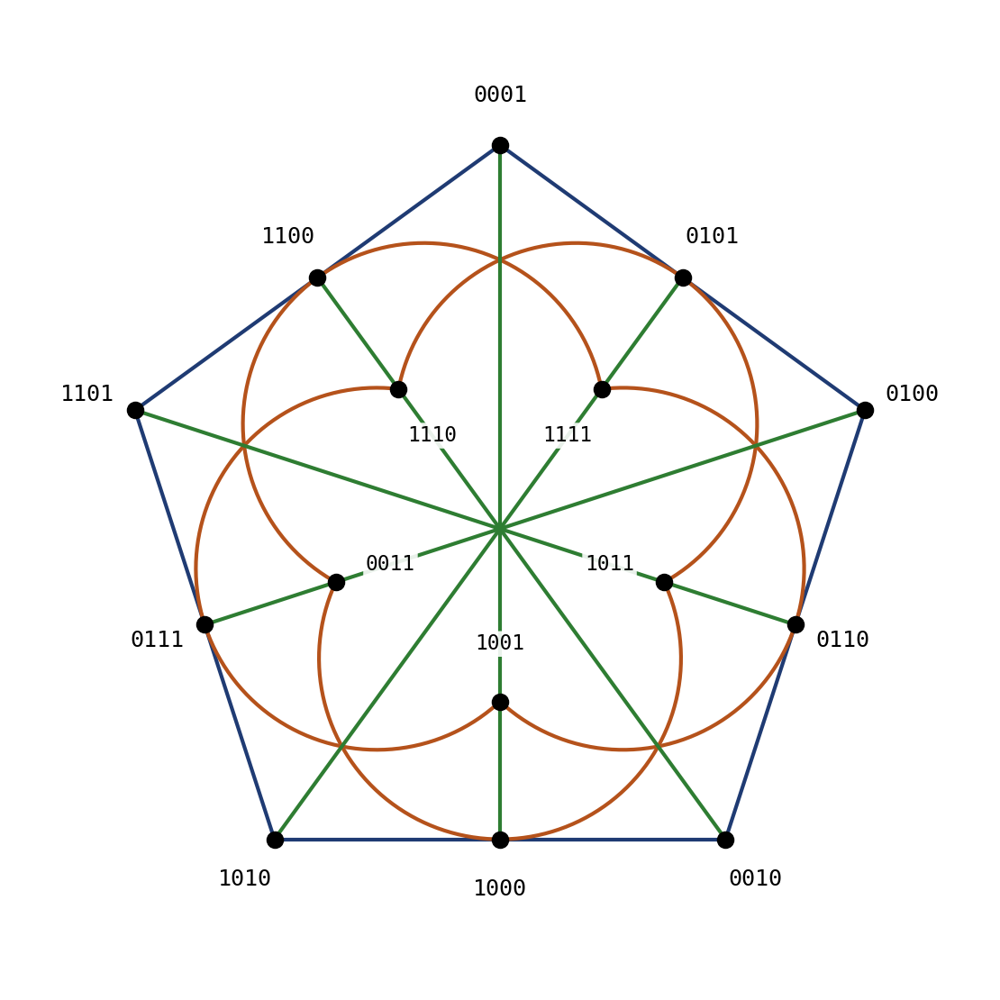

*Figure 8. The doily, the generalized quadrangle $W(3, 2)$. Each point of $PG(3, 2)$ is labelled by its coordinates $x_0x_1x_2x_3$; the labels of the five inner points sit beside their dots. The $15$ lines are the five blue sides of the pentagon, the five green straight lines through the centre and the five orange arcs; each has $3$ points, and each point lies on $3$ lines. The centre and the other crossings without a dot are not points. The drawn triples were checked by computer to be exactly the totally isotropic lines of $f$.*

---

**Aside: the doily is two qubits.** Read a label $x_0x_1x_2x_3$ as the two-qubit Pauli operator $X^{x_0}Z^{x_1} \otimes X^{x_2}Z^{x_3}$, up to a phase (so $XZ$ is $Y$ up to a factor $-i$). On one qubit, $X^aZ^b$ and $X^{a'}Z^{b'}$ commute exactly when $ab' + ba' = 0$ modulo 2, so $f$ is the commutation test. The straight line $\{0001, 1001, 1000\}$ is $\{I \otimes Z, X \otimes Z, X \otimes I\}$: three commuting operators, with $(I \otimes Z)(X \otimes I) = X \otimes Z$ matching $0001 + 1000 = 1001$. With the identity, each line is the stabilizer group, up to signs, of a two-qubit state; this one stabilizes $|{+}\rangle|0\rangle$. Fifteen lines with four sign choices give the $60$ two-qubit stabilizer states. The Paulis return in [geometries with three points per line](#geometries-with-three-points-per-line).

---

**What comes later.** Three facts about quadrangles are stated here and proved later.

- Every GQ is a nonsymmetrical grid, a nonsymmetrical dual grid, or has an order $(s, t)$ ([generalized quadrangles in depth](#generalized-quadrangles-in-depth)).
- If a finite GQ has order $(s, t)$, then $s + t$ divides $st(s+1)(t+1)$ ([from geometries to graphs and back](#from-geometries-to-graphs-and-back)).
- Higman's inequalities: if $s, t \geq 2$, then $t \leq s^2$ and $s \leq t^2$. They are proved twice, with eigenvalues ([from geometries to graphs and back](#from-geometries-to-graphs-and-back)) and by counting ([generalized quadrangles in depth](#generalized-quadrangles-in-depth)).

The divisibility test settles $(s, t) = (2, 3)$ at once: $5$ does not divide $2 \cdot 3 \cdot 3 \cdot 4 = 72$, so the 21-point quadrangle does not exist. Here the test is only stated; proving it, from the eigenvalues of the collinearity graph, is the work of the [next chapter](#strongly-regular-and-distance-regular-graphs).

#### Who's who of the doily

The doily returns under other names, and each later appearance links back here.

| Name | What it records | Where |
| --- | --- | --- |
| $W(3, 2)$, also written $W(2)$ | the symplectic polar space of rank 2: all points of $PG(3, 2)$, with the lines totally isotropic for $f$ | this section; [polar spaces from sesquilinear forms](#polar-spaces-from-sesquilinear-forms) |
| GQ of order $(2, 2)$ | $15$ points and $15$ lines, $3$ points per line and $3$ lines per point | this section |
| $Q(4, 2)$ | the same geometry, as the quadric $x_0^2 + x_1x_2 + x_3x_4 = 0$ of $PG(4, 2)$ | [polar spaces: a first look](#polar-spaces-a-first-look); proof in [the classical polar spaces](#the-classical-polar-spaces) |
| two-qubit Paulis | the points are Paulis up to a phase, the lines commuting triples | the Aside above; [geometries with three points per line](#geometries-with-three-points-per-line) |

### Polar spaces: a first look

In a quadrangle, a point off a line sees exactly one of its points. Allow the other option, a point that sees the whole line, and quadrangles become the rank 2 case of the earlier notes' polar spaces.

#### Two axiom systems, recapped

Polar spaces defined by Tits's axioms are also called **Veldkamp–Tits polar spaces**, with the earlier notes' five items regrouped as four: (VT1) is items 1 and 3, (VT2) is item 2, (VT3) the cone axiom, item 4, and (VT4) item 5. The **generators**, or maximal singular subspaces, have the largest dimension, $n - 1$, where $n$ is the rank.

Two things are new. A singular subspace may be empty, of dimension $-1$, or reducible, like the octahedron's triangles. And rank 1 is allowed: the generators are single points, and the space is a set of at least two points with no lines. In rank 2 the points and lines form a GQ, and every GQ arises from exactly one polar space of rank 2. (The earlier notes called the rank of a quadratic set its index $t$; here $t$ is kept for orders.)

The one-or-all version gives **Buekenhout–Shult polar spaces**: partial linear spaces, other than a single point, such that

- (BS1) for every point $x$ and line $L$ not through $x$, either one point or all points of $L$ are collinear with $x$;
- (BS2) no point is collinear with all the other points;
- (BS3) every strictly increasing chain of singular subspaces is finite.

(BS2) excludes cones: a fan satisfies (BS1), but its centre sees everything, like the vertex of a cone. (BS3) keeps the rank finite. Buekenhout and Shult proved that the two systems describe the same objects; the proof is sketched in [from one-or-all to Tits's axioms](#from-one-or-all-to-titss-axioms).

#### The classical families at a glance

Over a finite field $\mathbb{F}_q$ the classical families are these.

| Symbol | Ambient space | Equation in suitable coordinates | Rank |
| --- | --- | --- | --- |
| $Q^+(2n-1, q)$, hyperbolic | $PG(2n-1, q)$ | $X_0X_1 + X_2X_3 + \dots + X_{2n-2}X_{2n-1} = 0$ | $n$ |
| $Q(2n, q)$, parabolic | $PG(2n, q)$ | $X_0^2 + X_1X_2 + \dots + X_{2n-1}X_{2n} = 0$ | $n$ |
| $Q^-(2n+1, q)$, elliptic | $PG(2n+1, q)$ | $g(X_0, X_1) + X_2X_3 + \dots + X_{2n}X_{2n+1} = 0$, with $g$ irreducible | $n$ |
| $H(2n-1, q^2)$, Hermitian | $PG(2n-1, q^2)$ | $X_0X_1^q + X_1X_0^q + X_2X_3^q + X_3X_2^q + \dots = 0$ | $n$ |
| $H(2n, q^2)$, Hermitian | $PG(2n, q^2)$ | $X_0^{q+1} + X_1X_2^q + X_2X_1^q + \dots = 0$ | $n$ |
| $W(2n-1, q)$, symplectic | $PG(2n-1, q)$ | all points; the lines are totally isotropic for a nondegenerate alternating form | $n$ |

The singular subspaces are the subspaces inside the quadric or Hermitian variety, or for $W$ the totally isotropic ones. Over a finite field the ambient dimension, written $m$, can only be $2n - 1$, $2n$ or $2n + 1$. The same equations work over any field that allows them (an irreducible $g$ for $Q^-$, an automorphism $\sigma$ of order 2 in place of $x \mapsto x^q$ for $H$), giving $Q^+(2n-1, \mathbb{F})$ and so on. Over some infinite fields of characteristic 2 the elliptic family has a variant, the pseudo-elliptic quadric, defined in [the classical polar spaces](#the-classical-polar-spaces) together with the inseparable extensions behind it. A quadric is called nonsingular, a form nondegenerate: in characteristic 2 the nonsingular quadric $Q(4, 2)$ has a degenerate bilinear form, whose radical is its nucleus ([the prologue](#bilinear-and-sesquilinear-forms-in-coordinates)).

**Example: three quadrangles over $\mathbb{F}_2$.** With $n = 2$, all three quadric families give GQs with $3$ points per line:

- the grid $Q^+(3, 2)$, with $9$ points and order $(2, 1)$ (the first chapter's $x_0x_3 + x_1x_2 = 0$, coordinates renamed);
- $Q(4, 2)$: $x_0^2 + x_1x_2 + x_3x_4 = 0$, with $15$ points and order $(2, 2)$, isomorphic to the doily ([the classical polar spaces](#the-classical-polar-spaces));
- $Q^-(5, 2)$: $x_0^2 + x_0x_1 + x_1^2 + x_2x_3 + x_4x_5 = 0$, with $27$ points, $45$ lines and order $(2, 4)$; here $g = x_0^2 + x_0x_1 + x_1^2$ is irreducible, as it equals $1$ at $(1, 0)$, $(0, 1)$ and $(1, 1)$.

The Hermitian quadrangles need $\mathbb{F}_4$: $H(3, 4)$ has $45$ points and $27$ lines, with order $(4, 2)$, and it is the dual of $Q^-(5, 2)$.

**Which orders occur with three points per line?** For $s = 2$, the two facts stated for [quadrangles](#generalized-quadrangles-a-first-look) already decide. Higman's inequality gives $t \leq 4$, and $2 + t$ must divide $6t(t+1)$, which holds for $t = 1, 2, 4$ but fails for $t = 3$, since $5$ does not divide $72$. So $t \in \{1, 2, 4\}$, and the three quadrics above realise all three.

**When symplectic and parabolic coincide.** That the doily is both $W(3, 2)$ and $Q(4, 2)$ is no accident. For $n \geq 2$, $Q(2n, \mathbb{F}) \cong W(2n-1, \mathbb{F})$ exactly when $\mathbb{F}$ is perfect of characteristic 2, meaning that every element is a square. Finite fields of characteristic 2 are perfect, since squaring is injective and so onto, so $Q(2n, q) \cong W(2n-1, q)$ exactly when $q$ is even. The proof projects the quadric from its nucleus ([the classical polar spaces](#the-classical-polar-spaces)).

### Generalized polygons: a first look

A quadrangle has no triangles, and any two of its elements lie in a common ordinary quadrangle. Read that way, the GQ axioms are rung $n = 4$ of a ladder: rung $n$ forbids ordinary polygons with fewer than $n$ sides and puts every two elements on an ordinary $n$-gon.

**The definition.** For $n \geq 3$, a **generalized $n$-gon** is a partial linear space such that:

- it contains no ordinary $m$-gon with $3 \leq m < n$ as a subgeometry;
- any two elements, points or lines, lie in a common subgeometry that is an ordinary $n$-gon.

A generalized 2-gon is a digon, and a **generalized polygon** is a generalized $n$-gon for some $n \geq 2$. The axioms treat points and lines alike, so duals of generalized polygons are generalized polygons.

**The same definition in the incidence graph.** An ordinary $m$-gon in the geometry is exactly a $2m$-cycle in the incidence graph, alternating between points and lines, and a partial linear space has no 4-cycles. So the first axiom says the incidence graph has girth at least $2n$, and the second that every two vertices lie on a common $2n$-cycle. This is equivalent to a cleaner pair, diameter $n$ and girth $2n$ ([recognizing generalized polygons](#recognizing-generalized-polygons)): every two elements are close, and there are no shortcuts.

**Examples.** An ordinary $n$-gon is a thin generalized $n$-gon: its incidence graph is a single $2n$-cycle. The Fano plane is a generalized 3-gon, since its incidence graph, the Heawood graph, has girth $6$ and diameter $3$. In general the generalized 3-gons are exactly the projective planes, degenerate ones included: two lines in a common triangle meet, and two points in one are collinear. The generalized 4-gons are the GQs; the incidence graphs of the grid and the doily have girth $8$ and diameter $4$. Thick means thick in the sense of [the first section](#small-geometries-that-test-the-definitions).

**Named only: the split Cayley hexagon.** The smallest thick generalized hexagons have order $(2, 2)$, and the best known is the **split Cayley hexagon** $H(2)$, also spelt split-Cayley, with $63$ points and $63$ lines. Its construction, from the exceptional group $G_2$, lies outside these notes, and we do not use the earlier notes' incomplete sketch of it. Despite the letter, $H(2)$ has nothing to do with the Hermitian $H(m, q^2)$. Any hexagon of order $(2, 2)$ has $63$ points, as [the Feit–Higman theorem](#the-feithigman-theorem) counts. So with $3$ points per line and $3$ lines per point, the rungs $n = 3, 4, 6$ need $7$, $15$ and $63$ points, the Fano plane, the doily and $H(2)$: forbidding longer short cycles makes the geometry grow fast.

**What comes later.** The chapter on generalized polygons proves or explains these facts.

- Feit and Higman: a finite thick generalized $n$-gon has $n \in \{3, 4, 6, 8\}$; moreover $st$ is a square for hexagons and $2st$ for octagons, so no octagon has order $(2, 2)$, and finite 12-gons with an order have $s = 1$ or $t = 1$ ([the Feit–Higman theorem](#the-feithigman-theorem)). Thick octagons also satisfy Higman's inequalities, and thick hexagons $t \leq s^3$ and $s \leq t^3$ (Haemers and Roos), but these notes prove neither.
- The double of a generalized $n$-gon is a generalized $2n$-gon; the double of the Fano plane, with $14$ points and $21$ thin lines, is a hexagon of order $(1, 2)$ ([basic properties of generalized polygons](#basic-properties-of-generalized-polygons)).
- In a generalized $2d$-gon every point has a unique nearest point on every line. Geometries with this property are called near polygons ([basic properties of generalized polygons](#basic-properties-of-generalized-polygons)).

> **In short.** Each family here is one local rule plus a clause against trivial solutions. A projective plane needs three non-collinear points (a nondegenerate one, four in general position), a GQ two disjoint lines, a polar space no point collinear with everything, a generalized $n$-gon ordinary $n$-gons. What the clauses throw out are the small geometries of the first section, such as a line or a near-pencil, and the fan.

<!-- terms checked: a point; a line; projective space; degenerate; blocks; generators; thin; thick; irreducible; generalized $n$-gon -->

## Strongly Regular and Distance-Regular Graphs

<!-- terms checked: strongly regular; distance-regular; complement; walk; standard sequence; minimal idempotents; primitive -->

Take a generalized quadrangle with 3 points on every line and 4 lines through every point, so that its order is $(s,t) = (2,3)$. The counts from [the first look at generalized quadrangles](#generalized-quadrangles-a-first-look) give it $(s+1)(st+1) = 21$ points and $(t+1)(st+1) = 28$ lines. Each point is collinear with $s(t+1) = 8$ others and non-collinear with the remaining 12.

Every check we can make by counting comes out whole. The 21 points, each on 4 lines, give 84 flags, and so do the 28 lines with 3 points each. Fix a point $x$ and count pairs $(z, y)$ with $z$ collinear with $x$, and $y$ collinear with $z$ but not with $x$. Each of the 8 points $z$ has 6 such $y$ (2 more points on each of its 3 other lines; none is collinear with $x$, or there would be a triangle). Each of the 12 points $y$ has 4 such $z$, one on each line through $x$, by the quadrangle axiom. Both ways the count is 48.

Everything agrees, and yet no such quadrangle exists. The gallery noted that a divisibility test, proved in this chapter, rules it out: $s + t$ must divide $st(s+1)(t+1)$, and $5$ does not divide $72$. But nothing in the counting explains why such a test should hold. This chapter builds the tool that proves it, the adjacency matrix from [the chapter on graphs](#graphs) pushed much further, and the last section derives the test and, with it, Higman's bound $t \le s^2$.

### Strongly regular graphs

The Petersen graph from [the chapter on graphs](#graphs) answered a puzzle: if every vertex has 3 neighbours and any two vertices are at most two steps apart, there are at most $1 + 3 + 6 = 10$ vertices, and the Petersen graph reaches 10. Reaching 10 forced two adjacent vertices never to share a neighbour, and two non-adjacent vertices always to share exactly one. Two numbers describe every pair of vertices at once. Graphs like this are the subject of this section.

#### Two counts for every pair of vertices

A finite graph $\Gamma$ is **strongly regular** with parameters $(v, k, \lambda, \mu)$ if:

- it has $v$ vertices;
- it is regular with valency $k$;
- any two adjacent vertices have exactly $\lambda$ common neighbours;
- any two distinct non-adjacent vertices have exactly $\mu$ common neighbours.

We write $\mathrm{srg}(v,k,\lambda,\mu)$, and read $\lambda$ and $\mu$ as "lambda" and "mu". The graph must have at least one edge and must not be complete. With no edges $\lambda$ would describe nothing, and in a complete graph there are no non-adjacent pairs for $\mu$ to describe. The letters $v$, $k$ and $\lambda$ also name the parameters of a [design](#designs-a-first-look), where they count points, the points in a block, and the blocks through two points. The context always says which is meant.

We write $\Gamma_1(x)$ for the set of neighbours of a vertex $x$. Later, $\Gamma_i(x)$ will be the set of vertices at distance $i$ from $x$.

**The first test: counting.** Fix a vertex $x$. Its $k$ neighbours form $\Gamma_1(x)$, and the other $v - k - 1$ vertices are non-neighbours. Count the edges between these two sets in two ways.

- A neighbour $y$ of $x$ has $k$ neighbours of its own. One is $x$, and $\lambda$ lie in $\Gamma_1(x)$ (they are the common neighbours of $x$ and $y$). That leaves $k - \lambda - 1$ edges from $y$ to non-neighbours of $x$.
- A non-neighbour $z$ of $x$ has exactly $\mu$ neighbours in $\Gamma_1(x)$ (its common neighbours with $x$).

So

$$
k(k - \lambda - 1) = (v - k - 1)\mu .
$$

For the Petersen graph this reads $3 \cdot 2 = 6 \cdot 1$. Figure 9 shows the 6 edges, counted from above and from below.

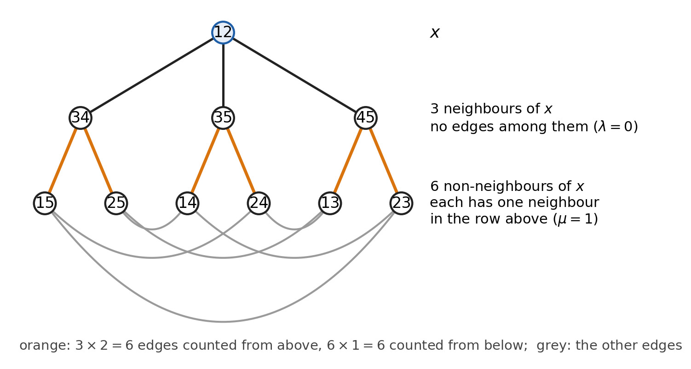

*Figure 9. The Petersen graph (2-subsets of $\{1,\dots,5\}$, joined when disjoint) seen from $x = 12$. The three neighbours of $x$ share no neighbour with $x$ ($\lambda = 0$), so each sends $k - \lambda - 1 = 2$ edges down (orange). Each of the six non-neighbours receives exactly $\mu = 1$ of them. Grey edges join non-neighbours; where two drawn edges cross there is no vertex.*

For $\mu > 0$ the identity can be solved for $v$: $v = 1 + k + k(k-\lambda-1)/\mu$. For the Petersen graph that is $1 + 3 + 6 = 10$, the same count as in the puzzle. So once $k$, $\lambda$ and $\mu > 0$ are chosen, the number of vertices is forced, and it has to come out a whole number.

**Examples.**

- The Petersen graph is $\mathrm{srg}(10, 3, 0, 1)$.
- The **square lattice graph** $L_2(3)$ is the collinearity graph of the $3\times 3$ grid: its nine points, joined when they lie on a common line (a row or a column). Each point has 2 others in its row and 2 in its column, so $k = 4$. Two points in one row share the third point of that row, so $\lambda = 1$. Two points in different rows and columns share the two other corners of their rectangle, so $\mu = 2$. This gives $\mathrm{srg}(9, 4, 1, 2)$. The $n \times n$ grid gives $L_2(n) = \mathrm{srg}(n^2, 2n-2, n-2, 2)$.
- The **triangular graph** $T(m)$, for $m \ge 4$, has the 2-subsets of $\{1, \dots, m\}$ as vertices, joined when they meet. Two meeting pairs $\{a,b\}$ and $\{a,c\}$ have common neighbours $\{a, x\}$ for the $m-3$ values of $x$ outside $\{a,b,c\}$, plus $\{b,c\}$, so $\lambda = m-2$. Two disjoint pairs $\{a,b\}$ and $\{c,d\}$ have exactly four common neighbours, $\{a,c\}$, $\{a,d\}$, $\{b,c\}$ and $\{b,d\}$, so $\mu = 4$. In all, $T(m) = \mathrm{srg}\big(\tfrac{m(m-1)}{2}, 2(m-2), m-2, 4\big)$, and $T(5) = \mathrm{srg}(10, 6, 3, 4)$.

In each case a rule about how sets meet delivers constant $\lambda$ and $\mu$ for free. That is why geometries, whose lines are sets of points meeting in controlled ways, are a rich source of strongly regular graphs.

**The opening quadrangle.** Its collinearity graph would be strongly regular too. It has $v = 21$ and $k = 8$. Two collinear points have as common neighbours the third point of their line and nothing else, since a common neighbour off the line would see two points of that line, against the quadrangle axiom. So $\lambda = 1$. Two non-collinear points $x$, $y$ have exactly one common neighbour on each of the 4 lines through $y$, so $\mu = 4$. The graph would be $\mathrm{srg}(21, 8, 1, 4)$, and its counting test is exactly the $8 \cdot 6 = 12 \cdot 4$ of the opening.

**A ledger of tests.** This chapter builds four tests that a parameter set must pass before a graph can exist:

- counting, the identity above;
- integrality: certain multiplicities computed from the parameters must be whole numbers;
- the absolute bound: an upper bound on $v$ in terms of those multiplicities;
- the Krein conditions: certain numbers computed from the parameters must be non-negative.

We keep a ledger of a few candidates and fill it in as each test arrives. Two of the candidates are made up: nobody has a graph for them, and they were chosen because they pass the first test.

| Candidate | Where it comes from | Counting |
| --- | --- | --- |
| $(10, 3, 0, 1)$ | the Petersen graph | pass: $3\cdot 2 = 6 \cdot 1$ |
| $(11, 3, 0, 1)$ | the Petersen graph with a vertex too many | fail: $3 \cdot 2 \ne 7 \cdot 1$ |
| $(15, 7, 2, 4)$ | made up | pass: $7 \cdot 4 = 7 \cdot 4$ |
| $(28, 9, 0, 4)$ | made up | pass: $9 \cdot 8 = 18 \cdot 4$ |
| $(21, 8, 1, 4)$ | the opening quadrangle of order $(2,3)$ | pass: $8 \cdot 6 = 12 \cdot 4$ |

#### Complements, cliques and the trivial cases

The **complement** $\overline{\Gamma}$ of a graph $\Gamma$ has the same vertices, with two distinct vertices adjacent exactly when they are not adjacent in $\Gamma$. (The bar means complement here, not complex conjugation.) The complement of a strongly regular graph is strongly regular, with parameters

$$
(\bar v, \bar k, \bar\lambda, \bar\mu) = (v,\ v - k - 1,\ v - 2k + \mu - 2,\ v - 2k + \lambda).
$$

To see $\bar\lambda$, take $x$, $y$ non-adjacent in $\Gamma$. Of the other $v - 2$ vertices, $\mu$ are adjacent to both and $2(k - \mu)$ to exactly one, which leaves $v - 2k + \mu - 2$ adjacent to neither. For $\bar\mu$, take $x$, $y$ adjacent in $\Gamma$. Now each has only $k - 1$ neighbours among the other $v - 2$ vertices. Of those vertices, $\lambda$ are adjacent to both and $2(k - 1 - \lambda)$ to exactly one, which leaves $v - 2 - \lambda - 2(k - 1 - \lambda) = v - 2k + \lambda$. The Petersen graph and $T(5)$ are complements of each other, since two 2-subsets of a 5-set either meet or are disjoint, and the formula sends $(10,3,0,1)$ to $(10, 6, 3, 4)$.

Two families satisfy the definition for a dull reason.

- A [clique](#neighbours-and-regularity) is a set of mutually adjacent vertices. The disjoint union of $r \ge 2$ cliques of size $m \ge 2$ is $\mathrm{srg}(rm, m-1, m-2, 0)$. Conversely, $\mu = 0$ forces this shape. Two vertices at distance 2 would have a common neighbour, so no two vertices are at distance 2. Each connected component is then a clique, and regularity makes the cliques equal in size. So a strongly regular graph is disconnected exactly when $\mu = 0$.
- A **complete multipartite** graph has its vertices split into $r \ge 2$ parts of size $m \ge 2$, with two vertices adjacent exactly when they lie in different parts. It is the complement of $r$ disjoint cliques, and it is $\mathrm{srg}(rm, (r-1)m, (r-2)m, (r-1)m)$, with $\mu = k$. Conversely, $\mu = k$ forces this shape. Two non-adjacent vertices then have the same $k$ neighbours, so non-adjacency is an equivalence relation, and its classes are the parts. Two examples: $T(4) = \mathrm{srg}(6, 4, 2, 4)$, whose parts are the complementary pairs $\{12, 34\}$, $\{13, 24\}$, $\{14, 23\}$; and the complete bipartite graph $K_{3,3}$ ([defined in the gallery](#small-geometries-that-test-the-definitions)), which is $\mathrm{srg}(6, 3, 0, 3)$.

A strongly regular graph is **primitive**, or nontrivial, if neither it nor its complement is a disjoint union of cliques. By the two characterizations, that means $0 < \mu < k$, or equivalently that both $\Gamma$ and $\overline{\Gamma}$ are connected. The others are imprimitive, or trivial. The absolute bound in the next section fails for them, and the paragraph "Why primitive" there shows how.

The name comes from permutation groups. If a transitive group has rank 3, meaning three orbits on ordered pairs (the diagonal and two symmetric orbits), each non-diagonal orbit is the edge set of a strongly regular graph, the two graphs being complements. Since a transitive group is primitive exactly when all such orbit graphs are connected, the group is primitive exactly when the graph is.

### The adjacency matrix of a strongly regular graph

The counts $\lambda$ and $\mu$ are statements about pairs of vertices. A matrix has one entry for each pair, so it can hold all of these statements at once. Then linear algebra takes over.

#### A quadratic equation for the adjacency matrix

A **walk** of length $\ell$ from $x$ to $y$ is a sequence $x = x_0, x_1, \dots, x_\ell = y$ in which consecutive vertices are adjacent. Unlike a path, a walk may repeat vertices. The entry $(A^\ell)_{xy}$ of a power of the adjacency matrix counts the walks of length $\ell$ from $x$ to $y$. For $\ell = 2$, $(A^2)_{xy} = \sum_z A_{xz} A_{zy}$ counts the vertices $z$ adjacent to both $x$ and $y$. That number is:

- $k$ if $x = y$, since a walk can go out to any neighbour and back;
- $\lambda$ if $x$ and $y$ are adjacent;
- $\mu$ if they are distinct and not adjacent.

The matrices $I$, $A$ and $J - I - A$ pick out exactly these three kinds of pairs ($J$ is [the all-ones matrix](#the-all-ones-matrix-and-commuting-matrices)). So the whole definition fits in one line:

$$
A^2 = kI + \lambda A + \mu (J - I - A).
$$

Now the eigenvalues, and here symmetry does its work. $A$ is real and symmetric, so by [the spectral theorem](#real-symmetric-matrices-and-the-spectral-theorem) $\mathbb{R}^v$ has an orthonormal basis of eigenvectors of $A$. One of them can be the all-ones vector $j$ (normalized), because regularity gives $Aj = kj$, and then the rest are orthogonal to $j$. For $w$ orthogonal to $j$, every entry of $Jw$ is the sum of the entries of $w$, which is $0$; so $Jw = 0$. If $Aw = \theta w$ with $w \perp j$, applying the identity above to $w$ gives $\theta^2 w = k w + \lambda\theta w - \mu w - \mu\theta w$, that is,

$$
\theta^2 + (\mu - \lambda)\theta + (\mu - k) = 0 .
$$

So apart from $k$, every eigenvalue is a root of one quadratic. Call the roots $R_1$ and $R_2$:

$$
R_{1} = \tfrac12\big(\lambda - \mu + \sqrt{D}\big), \qquad R_{2} = \tfrac12\big(\lambda - \mu - \sqrt{D}\big), \qquad D = (\lambda - \mu)^2 + 4(k - \mu).
$$

The common neighbours of $x$ and $y$ are among the $k$ neighbours of $x$, so $\mu \le k$ and $D \ge 0$. In fact $D > 0$, since $D = 0$ would need $\lambda = \mu = k$, and counting forbids $\lambda = k$. So $R_1 > R_2$ are real and distinct.

**A connected strongly regular graph has exactly three eigenvalues, $k > R_1 > R_2$.** Here connected means $\mu > 0$.

- $k$ has multiplicity 1, because the graph is connected (the chapter on graphs).
- $k$ is not a root of the quadratic, since $k^2 + (\mu - \lambda)k + \mu - k = k(k - \lambda - 1) + \mu(k+1) > 0$. No eigenvalue exceeds $k$ (the chapter on graphs again), so $k > R_1$.
- Both roots occur. If only one root $R$ did, $A - RI$ would kill every vector orthogonal to $j$. Being symmetric, it would then map everything into the span of $j$, so $A - RI = cJ$ for some number $c$. All off-diagonal entries of $A$ would then equal $c$, and the graph would be complete or edgeless, both excluded.

---

**Note: what if $\mu = 0$?** Then counting gives $k = \lambda + 1$, the quadratic is $\theta^2 - (k-1)\theta - k = (\theta - k)(\theta + 1)$, and $R_1 = k$, $R_2 = -1$. That fits disjoint cliques: $k$ appears once per clique, as [the chapter on graphs](#graphs) showed for components.

---

**The Petersen graph without a determinant.** Here $\lambda = 0$ and $\mu = 1$, so the quadratic is $\theta^2 + \theta - 2 = (\theta - 1)(\theta + 2)$, with roots $1$ and $-2$. Let them have multiplicities $a$ and $b$. The multiplicities add up to the size of the matrix, so $1 + a + b = 10$. The trace of $A$ is the sum of its eigenvalues with multiplicity ([recalled in the prologue](#projectors-trace-and-positive-semidefinite-matrices)), and it is 0 because there are no loops, so $3 + a - 2b = 0$. Together these give $a = 5$, $b = 4$, and the eigenvalues are $3, 1^5, (-2)^4$ in the shorthand of the chapter on graphs. No $10 \times 10$ determinant was needed: the definition alone fixed the eigenvalues and their multiplicities.

#### Multiplicities must be whole numbers

The Petersen computation works for any connected strongly regular graph. Write $M_1$ and $M_2$ for the multiplicities of $R_1$ and $R_2$. (The incidence matrix of a [point-line geometry](#point-line-geometries) is also called $M$; the subscripts keep the two apart.) Then

$$
1 + M_1 + M_2 = v, \qquad k + M_1 R_1 + M_2 R_2 = 0 .
$$

$M_1$ counts how many of the $v$ eigenvalues of $A$, listed with multiplicity, equal $R_1$. For a symmetric matrix this is the dimension of the eigenspace of $R_1$ ([see the prologue](#eigenvalues-and-eigenspaces)), and a dimension counts the vectors in a basis. So $M_1$ and $M_2$ are whole numbers. The force of this lies in the two equations: they fix $M_1$ and $M_2$ from the parameters alone, before any graph is built. A parameter set that makes them fractional belongs to no graph.

To get a formula, subtract $R_2$ times the first equation from the second: $M_1(R_1 - R_2) = -k - (v-1)R_2$. Now substitute $R_1 - R_2 = \sqrt{D}$ and $R_2 = \frac12(\lambda - \mu - \sqrt{D})$, and do the same for $M_2$:

$$
M_{1} = \frac12\left( v - 1 - \frac{2k + (v-1)(\lambda - \mu)}{\sqrt{D}} \right), \qquad
M_{2} = \frac12\left( v - 1 + \frac{2k + (v-1)(\lambda - \mu)}{\sqrt{D}} \right).
$$

For the Petersen graph, $2k + 9(\lambda - \mu) = -3$ and $\sqrt{D} = 3$, giving $M_1 = 5$ and $M_2 = 4$ again.

**A candidate that fails.** Take $(15, 7, 2, 4)$, which passed counting. The quadratic is $\theta^2 + 2\theta - 3 = (\theta - 1)(\theta + 3)$. The two equations are $M_1 + M_2 = 14$ and $7 + M_1 - 3M_2 = 0$, so $M_2 = 21/4$ and $M_1 = 35/4$. Its adjacency matrix would need an eigenspace of dimension $35/4$, so there is no such graph.

**Irrational eigenvalues are fine.** Suppose $D$ is not a perfect square, so that $R_1$ and $R_2$ are irrational. The formulas give $M_2 - M_1 = \big(2k + (v-1)(\lambda - \mu)\big)/\sqrt{D}$. The left side is an integer and the numerator is an integer, so with $\sqrt{D}$ irrational the numerator must vanish. That gives $2k = (v-1)(\mu - \lambda)$ and $M_1 = M_2 = (v-1)/2$. Then $\mu - \lambda = 2k/(v-1)$ lies strictly between 0 and 2, because $v - 1 > k$ in a graph that is not complete. So $\mu - \lambda = 1$ and $v = 2k + 1$. Counting then reads $k(k - \lambda - 1) = k\mu$, so $k = 2\mu$. The parameters are

$$
(v, k, \lambda, \mu) = (4\mu + 1,\ 2\mu,\ \mu - 1,\ \mu),
$$

and such a graph is called a **conference graph** (after conference matrices, which first arose in telephone conference networks and give examples).

The pentagon $C_5 = \mathrm{srg}(5, 2, 0, 1)$ is the smallest. Its quadratic is $\theta^2 + \theta - 1$, so its eigenvalues are $2$ and $\frac{-1 \pm \sqrt5}{2}$, each of the last two twice. A conference graph can also have integer eigenvalues: $L_2(3) = \mathrm{srg}(9, 4, 1, 2)$ has the conference parameters with $\mu = 2$, and its eigenvalues are $4, 1^4, (-2)^4$. For a conference graph $D = 1 + 4\mu = v$, so its eigenvalues are irrational exactly when $v$ is not a square.

So irrational eigenvalues occur only in this one family. Everywhere else, integrality is a test on integer eigenvalues as well as on whole multiplicities, and the lesson is: eigenvalues may be irrational, but dimensions can never be fractions.

---

**Note: why a square $D$ gives integer roots.** $D = (\lambda - \mu)^2 + 4(k - \mu)$ differs from $(\lambda - \mu)^2$ by a multiple of 4, so $\sqrt D$ and $\lambda - \mu$ have the same parity, and $\frac12(\lambda - \mu \pm \sqrt D)$ are integers.

---

**Ledger update.** Integrality kills $(15, 7, 2, 4)$. The Petersen graph passes with multiplicities 5 and 4. The made-up $(28, 9, 0, 4)$ has quadratic $\theta^2 + 4\theta - 5 = (\theta - 1)(\theta + 5)$ and multiplicities 21 and 6, so it passes too. The opening quadrangle's row stays open until the last section, which derives the divisibility test from this one and settles every quadrangle at once.

#### Three eigenvalues and the absolute bound

The converse of the three-eigenvalue result also holds: a connected regular graph with exactly three distinct eigenvalues is strongly regular. So strong regularity can be read off the eigenvalues alone, and the next section extends this to $d + 1$ eigenvalues for diameter $d$.

The idea goes through [the minimal polynomial](#polynomials-in-a-matrix-and-the-minimal-polynomial). Call the eigenvalues $k$, $\theta_1$ and $\theta_2$. A symmetric matrix is diagonalizable, so its minimal polynomial has one simple root for each distinct eigenvalue, here $(X - k)(X - \theta_1)(X - \theta_2)$. Put $B = (A - \theta_1 I)(A - \theta_2 I)$. Then $(A - kI)B = 0$, so every column of $B$ lies in the eigenspace of $k$, which for a connected $k$-regular graph is spanned by $j$. So every column of $B$ is a multiple of $j$. Since $B$ is symmetric, every row is a multiple of $j^{T}$ as well, and $B = cJ$ for some number $c$. Expanding $B$ shows that $A^2$ is a combination of $I$, $A$ and $J$. The entries of $A^2$ count common neighbours, so those counts depend only on whether the two vertices are equal, adjacent or neither. That is strong regularity.

Both hypotheses matter. Two disjoint 4-cycles, $2C_4$, form a regular graph with exactly three eigenvalues, $2^2, 0^4, (-2)^2$. But it is not connected, and $\mu$ is not constant: opposite corners of one square share 2 neighbours, while vertices in different squares share none. The star $K_{1,3}$, one vertex joined to three others, is connected with three eigenvalues, $\sqrt3, 0^2, -\sqrt3$, but it is not regular.

**The absolute bound.** For a primitive strongly regular graph,

$$
v \le \tfrac12 M_1(M_1 + 3) \qquad \text{and} \qquad v \le \tfrac12 M_2 (M_2 + 3).
$$

The bound is called absolute because it involves only a multiplicity, not $k$, $\lambda$ or $\mu$: a small eigenspace cannot hold many vertices. The proof is a crowding argument. Step 1 puts one unit vector per vertex into an eigenspace of dimension $M$. Step 2 shows that only two angles occur between them. Step 3 turns each vector into a quadratic function on the sphere, and these $v$ functions are independent in a space of dimension $\frac12 M(M+3)$.

*Step 1.* Let $E$ be the [orthogonal projector](#projectors-trace-and-positive-semidefinite-matrices) onto an eigenspace $W$ of dimension $M$ (for $R_1$ or for $R_2$). It is a polynomial in $A$. The span of $I$, $A$ and $J$ is closed under multiplication, because $A^2$ lies in it, $AJ = JA = kJ$ and $J^2 = vJ$. So $E$ is a combination of $I$, $A$ and $J$, and its diagonal is constant, equal to $\operatorname{tr}E / v = M/v$. Project each standard basis vector $e_x$ onto $W$. Since $E$ is symmetric and $E^2 = E$, $\langle E e_x, E e_y \rangle = E_{xy}$, so $E$ is the [Gram matrix](#rank-determinants-and-gram-matrices) of the $v$ projected vectors: positive semidefinite, of rank $M$. Rescaling by $\sqrt{v/M}$ gives unit vectors $w_x$ whose Gram matrix $F = (v/M)E$ has ones on the diagonal. This $F$ is often written as $(A - R I)(A - kI)$ divided by a constant, where $R$ is the other eigenvalue; it is the same matrix, the projector rescaled.

*Step 2.* $F = I + \rho_1 A + \rho_2 (J - I - A)$ for two numbers $\rho_1$ and $\rho_2$, the cosines of the angles between $w_x$ and $w_y$ for adjacent and for non-adjacent pairs. They differ: if $\rho_1 = \rho_2$, then $E$ would be a combination of $I$ and $J$ alone, whose eigenspaces are the span of $j$ and all of $j^\perp$, so $E$ could not project onto just one of the two eigenspaces inside $j^\perp$. Primitivity makes both cosines different from 1, so distinct vertices give distinct vectors:

- If $\rho_2 = 1$, two non-adjacent vertices $x$, $y$ would have $w_x = w_y$, hence the same inner product with every $w_z$. Since $\rho_1 \ne \rho_2$, that means $x$ and $y$ have the same neighbours, so $\mu = k$, which primitivity forbids.
- If $\rho_1 = 1$, adjacent vertices would share a vector. Following paths in the connected graph, all vertices would, and then $\rho_2 = 1$ too.

*Step 3.* For each vertex $x$, define on the unit sphere of $W$

$$
g_x(\xi) = \frac{\big(\langle w_x, \xi\rangle - \rho_1\big)\big(\langle w_x, \xi\rangle - \rho_2\big)}{(1 - \rho_1)(1 - \rho_2)} .
$$

Then $g_x(w_x) = 1$, and $g_x(w_y) = 0$ for every $y \ne x$, because $\langle w_x, w_y\rangle$ is $\rho_1$ or $\rho_2$. So if $\sum_x c_x g_x = 0$, evaluating at $w_y$ gives $c_y = 0$ for every vertex $y$: the $v$ functions are linearly independent. Each $g_x$ is a polynomial of degree at most 2 in the coordinates $\xi_1, \dots, \xi_M$ of $\xi$. On the sphere its constant term can be rewritten as a constant times $\xi_1^2 + \dots + \xi_M^2$. So every $g_x$ lies in the span of the $M$ coordinates $\xi_a$ and the $\frac12 M(M+1)$ products $\xi_a \xi_b$ with $a \le b$, a space of dimension $\frac12 M(M+3)$. Independent vectors can't outnumber the dimension, so $v \le \frac12 M(M+3)$.

**Why "primitive".** In the trivial families an eigenvalue can keep a tiny multiplicity however large the graph grows: $K_{m,m}$ is connected, bipartite and $m$-regular, so by the argument in the chapter on graphs its eigenvalue $-m$ occurs exactly once. For $K_{3,3} = \mathrm{srg}(6, 3, 0, 3)$, the eigenvalues are $3, 0^4, (-3)^1$, and the bound for $M = 1$ is $\frac12 \cdot 1 \cdot 4 = 2 < 6$. In the one-dimensional eigenspace of $-3$, spanned by $(1,1,1,-1,-1,-1)$, the six projected vectors land on just two points, one for each side. Step 3 needs distinct points, and an imprimitive graph doesn't supply them.

**A candidate that fails the bound.** $(28, 9, 0, 4)$ passed counting and integrality, with $M_2 = 6$. The bound allows at most $\frac12 \cdot 6 \cdot 9 = 27$ vertices, and the candidate has 28. So there is no such graph. This is a third test, and integrality could not have done its job. The bound 27 is attained: the elliptic quadric $Q^-(5,2)$ from the [first look at polar spaces](#polar-spaces-a-first-look) has 27 points, and its collinearity graph, met in the last section, has an eigenvalue of multiplicity exactly 6. The made-up candidate misses by one vertex.

### Distance-regular graphs

A connected strongly regular graph has diameter 2. That suits quadrangles, but longer polygons need more room. A [generalized $n$-gon](#generalized-polygons-a-first-look) has an incidence graph of diameter $n$ (proved in the chapter on polygons), and distances between points in the collinearity graph are half those in the incidence graph, so the collinearity graph has diameter $\lfloor n/2 \rfloor$: 3 for hexagons, 4 for octagons. Two counts $\lambda$ and $\mu$ cannot describe such graphs; we need counts at every distance.

This section has two destinations.

- **In this chapter:** the Krein conditions. The last section needs only their diameter-2 case, the inequality at the end of the last subsection, together with the short standard sequence it is computed from. It turns into Higman's bound $t \le s^2$.
- **In the chapter on polygons:** the shell counts, the distance-$i$ matrices and the multiplicity formula $f(\theta)$ drive [the Feit–Higman theorem](#the-feithigman-theorem). For $n \ge 3$, thick finite generalized $n$-gons exist only for $n = 3, 4, 6, 8$.

We do the general case once, because the Feit–Higman theorem needs it, and the strongly regular case falls out at $d = 2$. The route runs through distance shells, distance-$i$ matrices as polynomials in $A$, standard sequences and multiplicities, and projectors, with one example throughout: the cube.

#### Watching distance shells grow

The **cube graph** has the eight binary triples $000, 001, \dots, 111$ as vertices, with two triples adjacent when they differ in exactly one coordinate. It is the graph of corners and edges of an ordinary cube. (The earlier projective geometry notes used the cube as a geometry with faces too. Here we keep only corners and edges.) The distance between two triples is the number of coordinates in which they differ.

The **shell** $\Gamma_i(x)$ is the set of vertices at distance $i$ from $x$, and $k_i$ is its size. (So $k_1 = k$, the valency; do not confuse $k_i$ with $k$ itself.) From $x = 000$ the cube's shells have sizes $1, 3, 3, 1$.

Now stand at a vertex $y$ at distance $i$ from $x$, and sort the neighbours of $y$ by their distance from $x$:

- $c_i = |\Gamma_{i-1}(x) \cap \Gamma_1(y)|$ of them step back, to distance $i - 1$;
- $a_i = |\Gamma_{i}(x) \cap \Gamma_1(y)|$ of them step across, staying at distance $i$;
- $b_i = |\Gamma_{i+1}(x) \cap \Gamma_1(y)|$ of them step out, to distance $i + 1$.

A connected graph of diameter $d$ is **distance-regular** if these three numbers depend only on $i$, not on the choice of $x$ and $y$. The numbers $a_i$, $b_i$, $c_i$ are the **intersection numbers**, or parameters, of the graph; the name records that each counts the intersection of two sets of vertices. As shorthand we list them in the intersection array $\{b_0, \dots, b_{d-1}; c_1, \dots, c_d\}$. Every neighbour goes somewhere, so $c_i + a_i + b_i = k$. At the ends, $c_0 = a_0 = b_d = 0$, and $c_1 = 1$ (a neighbour of $x$ steps back only to $x$).

In the cube, $y$ at distance $i$ differs from $x$ in $i$ coordinates. Flipping one of those $i$ coordinates steps back; flipping one of the other $3 - i$ steps out; no flip keeps the distance. So $c_i = i$, $a_i = 0$, $b_i = 3 - i$, and the array is $\{3, 2, 1; 1, 2, 3\}$. Figure 10 shows the shells and these counts.

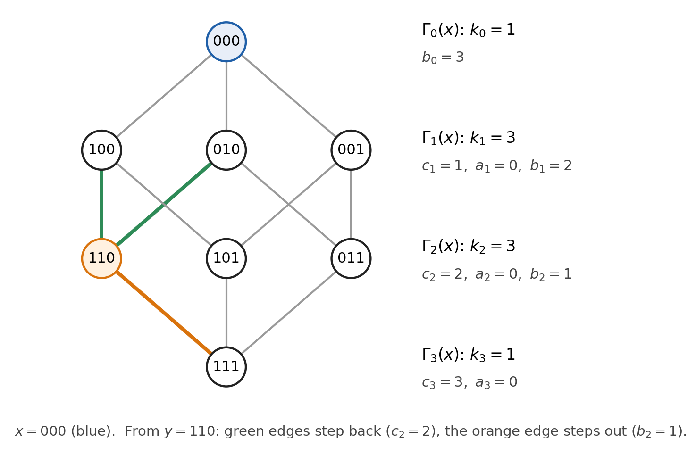

*Figure 10. The cube graph in shells around $x = 000$. Row $i$ is $\Gamma_i(x)$, the vertices that differ from $x$ in $i$ coordinates. From $y = 110$ two edges step back to $\Gamma_1(x)$ (green) and one steps out to $\Gamma_3(x)$ (orange). The counts beside each row are the same for every vertex of that row and every choice of $x$. Where two drawn edges cross there is no vertex.*

The shell sizes follow from the intersection numbers. Count the edges between $\Gamma_i(x)$ and $\Gamma_{i+1}(x)$: each vertex of the inner shell sends $b_i$ of them out, and each vertex of the outer shell receives $c_{i+1}$. So $k_i b_i = k_{i+1} c_{i+1}$, and

$$
k_{i+1} = \frac{k_i\, b_i}{c_{i+1}} .
$$

For the cube: $k_1 = 1 \cdot 3/1 = 3$, $k_2 = 3 \cdot 2/2 = 3$, $k_3 = 3 \cdot 1/3 = 1$. The intersection numbers alone determine the number of vertices, $1 + 3 + 3 + 1 = 8$.

The cube is not the graph of a geometry, but incidence graphs of generalized polygons are distance-regular too. The Heawood graph, the incidence graph of the Fano plane from [the chapter on geometries](#point-line-geometries), has array $\{3, 2, 2; 1, 1, 3\}$ and shells $1, 3, 6, 4$. From a point: 3 lines, then the 6 other points, then the 4 lines missing the point.

The connected strongly regular graphs are exactly the distance-regular graphs of diameter 2, with $c_1 = 1$, $a_1 = \lambda$, $b_1 = k - \lambda - 1$, $c_2 = \mu$ and $a_2 = k - \mu$. The shell formula gives $k_2 = k(k - \lambda - 1)/\mu$, and $k_2 = v - k - 1$: the counting test of the first section is the first rung of this ladder.

#### A small algebra controls the graph

Put the shells into matrices. The **distance-$i$ matrix** $A_i$ has $(A_i)_{xy} = 1$ when $d(x,y) = i$ and $0$ otherwise. So $A_0 = I$, $A_1 = A$, and $A_0 + A_1 + \dots + A_d = J$. Each pair of vertices has exactly one distance, so the $A_i$ have 1s in disjoint positions.

Multiplying by $A$ moves one step:

$$
A A_i = b_{i-1} A_{i-1} + a_i A_i + c_{i+1} A_{i+1} .
$$

The $(x,y)$ entry of $AA_i$ counts the neighbours $z$ of $x$ with $d(z, y) = i$. One step changes the distance to $y$ by at most one, so this is zero unless $d(x,y)$ is $i - 1$, $i$ or $i + 1$. Looking from $y$: if $d(x,y) = i + 1$, the right $z$ are the neighbours of $x$ one step closer to $y$, and there are $c_{i+1}$ of them. If $d(x,y) = i$ there are $a_i$, and if $d(x,y) = i - 1$ there are $b_{i-1}$.

Solve this for $A_{i+1}$. That needs $c_{i+1} \ne 0$, which holds because the graph is connected: every vertex at distance $i + 1$ has a neighbour at distance $i$. So $A_{i+1}$ is $A A_i$ minus lower terms, divided by $c_{i+1}$. By induction, each $A_i$ is a polynomial of degree $i$ in $A$, with leading term $A^i/(c_1 c_2 \cdots c_i)$. The whole induction rests on $c_{i+1} \ne 0$. For the cube, the row $i = 1$ reads $A \cdot A = 3I + 2A_2$, and the row $i = 2$ reads $AA_2 = 2A + 3A_3$, so

$$
A_2 = \tfrac12 (A^2 - 3I), \qquad A_3 = \tfrac16 (A^3 - 7A).
$$

**Exactly $d + 1$ eigenvalues.** The $A_i$ have disjoint supports, so they are linearly independent. Writing $A_0, \dots, A_d$ in terms of $I, A, \dots, A^d$ is a triangular change of basis with nonzero diagonal (the leading coefficients), so $I, A, \dots, A^d$ are independent too. So no polynomial of degree $d$ or less kills $A$. The last row of the recurrence, $AA_d = b_{d-1}A_{d-1} + a_d A_d$, has no $A_{d+1}$, and written in powers of $A$ it is a polynomial of degree $d + 1$ that does kill $A$. So [the minimal polynomial](#polynomials-in-a-matrix-and-the-minimal-polynomial) has degree exactly $d + 1$. For a symmetric matrix it has one simple root per distinct eigenvalue, so a distance-regular graph of diameter $d$ has exactly $d + 1$ distinct eigenvalues. For the cube, the row $i = 3$ reads $AA_3 = A_2$, which becomes $A^4 - 10A^2 + 9I = 0$, so the eigenvalues are $\pm1$ and $\pm3$.

**An algebra of distance matrices.** The span $\mathcal{A}$ of $I, A, \dots, A^d$ is the same as the span of $A_0, \dots, A_d$. It is $(d+1)$-dimensional, closed under matrix multiplication (products of polynomials in $A$ are polynomials in $A$, reduced by the minimal polynomial), and commutative. This is the **Bose–Mesner algebra** of the graph; for a connected strongly regular graph it is the span of $I$, $A$ and $J$.

The algebra is also closed under a second product, the [entrywise product](#rank-determinants-and-gram-matrices) $\circ$ (also called the Hadamard or Schur product). The distance-$i$ matrices have disjoint supports, so $A_i \circ A_j = A_i$ if $i = j$ and $0$ otherwise. An algebra closed under two different products will be the source of the Krein conditions.

The lesson: an $8 \times 8$ matrix problem has become a short recurrence. Everything about the cube's adjacency matrix is stored in the numbers $\{3, 2, 1; 1, 2, 3\}$.

---

**Aside: the Bose–Mesner algebra as a commutant.**

Any pair of corners of the cube at distance $i$ can be carried to any other such pair by one of its 48 symmetries (permute the coordinates, then flip any of them). A graph with this property is called **distance-transitive**: its symmetry group has rank $d + 1$, one orbit on ordered pairs per distance, and rank 3 is the strongly regular case.

Write $P_g$ for the [permutation matrix](#the-all-ones-matrix-and-commuting-matrices) of a symmetry $g$. A matrix $X$ commutes with every $P_g$ exactly when $X_{g(x)g(y)} = X_{xy}$ for all $g$, that is, when $X$ is constant on each orbit on ordered pairs. For a distance-transitive graph these orbits are the distance classes. So the commutant of the permutation representation is the span of $A_0, \dots, A_d$: it is the Bose–Mesner algebra.

Representation theory reads this backwards. By a consequence of Schur's lemma (unrelated to the Schur product), a complex commutant is commutative exactly when no irreducible constituent occurs twice. So each constituent occurs once, and their $d + 1$ projectors span the commutant. The $d + 1$ eigenspace projectors of $A$ lie in the same algebra, so the constituents are exactly the eigenspaces. For the cube they happen to be real: under its 48 symmetries $\mathbb{R}^8$ splits into irreducible pieces of dimensions $1, 3, 3, 1$, the eigenspaces of $A$.

The converse fails. The Shrikhande graph (vertices $\mathbb{Z}_4 \times \mathbb{Z}_4$, with $x \sim y$ when $x - y$ is $\pm(1,0)$, $\pm(0,1)$ or $\pm(1,1)$) is $\mathrm{srg}(16, 6, 2, 2)$, but its 192 symmetries have rank 4, not 3, so its commutant is bigger than its Bose–Mesner algebra. A proof that a geometry cannot exist has no symmetry to assume, which is why the theory is built on counts.

---

#### Standard sequences and multiplicities

For the Feit–Higman theorem we need the dimension of each eigenspace, computed from the intersection numbers alone. Here is how.

Let $E_\theta$ be the orthogonal projector onto the eigenspace of $\theta$. It is a polynomial in $A$, namely $\prod_{\theta' \ne \theta}(A - \theta' I)/(\theta - \theta')$, so it lies in $\mathcal{A}$. It is therefore a combination of the distance-$i$ matrices, and its $(x,y)$ entry depends only on $d(x,y)$. Write

$$
E_\theta = \kappa \sum_{i=0}^{d} u_i A_i, \qquad u_0 = 1,
$$

so that the number $\kappa$ is the diagonal entry and $u_i$ is the entry at distance $i$ relative to it.

There is a picture behind the $u_i$. The projected vectors $E_\theta e_x$ all have the same length $\sqrt{\kappa}$, and $\langle E_\theta e_x, E_\theta e_y \rangle = (E_\theta)_{xy}$. So $u_i$ is the cosine of the angle between the projections of two vertices at distance $i$. The eigenspace draws the graph, and the $u_i$ record the drawing.

**Finding the $u_i$.** Impose $AE_\theta = \theta E_\theta$. Expand $AE_\theta$ with the recurrence of the previous subsection and collect the terms in each $A_i$:

$$
AE_\theta = \kappa \sum_{i=0}^{d} \big( b_i u_{i+1} + a_i u_i + c_i u_{i-1} \big) A_i ,
$$

with $u_{-1} = u_{d+1} = 0$. Comparing coefficients with $\theta E_\theta$ gives

$$
b_i u_{i+1} + (a_i - \theta) u_i + c_i u_{i-1} = 0, \qquad u_0 = 1, \quad u_1 = \frac{\theta}{k} .
$$

(The row $i = 0$ reads $k u_1 = \theta u_0$.) The $u_i$ depend on $\theta$, and we write $u_i(\theta)$ when that matters. The sequence $(u_0(\theta), \dots, u_d(\theta))$ is the **standard sequence** of $\theta$.

**The multiplicity.** Write $f(\theta)$ for the multiplicity of $\theta$. For a strongly regular graph, $f(R_1)$ and $f(R_2)$ are the $M_1$ and $M_2$ of the previous section. (The letter $f$ will name a form in the chapter on polar spaces.) The multiplicity is the rank of $E_\theta$, which equals the trace. All diagonal entries are $\kappa$, so $f(\theta) = v \kappa$. Now use $E_\theta^2 = E_\theta$ on a diagonal entry. Since $E_\theta$ is symmetric, $(E_\theta^2)_{xx} = \sum_y (E_\theta)_{xy}^2$, and there are $k_i$ vertices $y$ at distance $i$ from $x$, so this is $\kappa^2 \sum_i k_i u_i^2$. It must equal $\kappa$, so $\kappa = 1/\sum_i k_i u_i^2$, and

$$
f(\theta) = \frac{v}{\sum_{i=0}^{d} k_i\, u_i(\theta)^2} .
$$

**The cube.** For $\theta = 1$: $u_1 = 1/3$. The row $i = 1$ gives $2u_2 + (0 - 1)\tfrac13 + 1 = 0$, so $u_2 = -1/3$. The row $i = 2$ gives $u_3 + (0-1)(-\tfrac13) + 2 \cdot \tfrac13 = 0$, so $u_3 = -1$. Then $\sum k_i u_i^2 = 1 + \tfrac39 + \tfrac39 + 1 = \tfrac83$, and $f(1) = 8 \big/ \tfrac83 = 3$. All four eigenvalues:

| $\theta$ | standard sequence $(u_0, u_1, u_2, u_3)$ | $\sum_i k_i u_i^2$ | $f(\theta)$ |
| --- | --- | --- | --- |
| $3$ | $(1, 1, 1, 1)$ | $8$ | $1$ |
| $1$ | $(1, \tfrac13, -\tfrac13, -1)$ | $\tfrac83$ | $3$ |
| $-1$ | $(1, -\tfrac13, -\tfrac13, 1)$ | $\tfrac83$ | $3$ |
| $-3$ | $(1, -1, 1, -1)$ | $8$ | $1$ |

The multiplicities add up to 8, as they must. Read each row as a drawing.

- **$\theta = 1$.** Neighbours sit at cosine $\tfrac13$, vertices two apart at $-\tfrac13$, and opposite corners at $-1$. Those are exactly the angles between the corners $(\pm1, \pm1, \pm1)/\sqrt3$ of a cube in $\mathbb{R}^3$, so this 3-dimensional eigenspace draws the cube graph as a cube.
- **$\theta = -1$.** Opposite corners land on the same point (cosine 1), and the four resulting points are at cosine $-\tfrac13$ from each other: a regular tetrahedron.
- **$\theta = 3$ and $\theta = -3$.** The drawing collapses to a single point, and to two opposite points, one for each side of the bipartition.

The lesson: local data, the counts at each step, determine global data, the dimensions of the eigenspaces. In the chapter on polygons this formula, fed with a generalized polygon's intersection numbers, gives the Feit–Higman theorem.

---

**Note: a second route to the same formula.** Some proofs take one trace in two ways; here is the pattern. Write $A_i = p_i(A)$ with $p_i$ the polynomial of degree $i$ found above. Dividing its recurrence $c_{i+1}p_{i+1} + (a_i - X)p_i + b_{i-1}p_{i-1} = 0$ by $k_i$, and using $k_{i+1}c_{i+1} = k_i b_i$ and $k_{i-1}b_{i-1} = k_i c_i$, shows that the polynomials $p_i(X)/k_i$ satisfy the recurrence of the $u_i$, with the same start. So $u_i(\theta) = p_i(\theta)/k_i$. Now $E(\theta) = \sum_i u_i(\theta) A_i = (v/f(\theta))E_\theta$ has ones on its diagonal, so its trace is $v$. On the eigenspace of $\theta$ each $A_i = p_i(A)$ acts as the number $p_i(\theta) = k_i u_i(\theta)$, so $E(\theta)$ acts as $\sum_i k_i u_i(\theta)^2$ there, and as 0 on the other eigenspaces. Its trace is therefore also $f(\theta)\sum_i k_i u_i(\theta)^2$, and equating the two traces gives the formula.

---

#### Projectors and Krein positivity

The projectors $E_\theta$ are also called the **minimal idempotents** of $\mathcal{A}$: "idempotent" means $E^2 = E$, and "minimal" means $E_\theta$ is not a sum of two nonzero idempotents of $\mathcal{A}$. They satisfy $E_\theta E_{\theta'} = 0$ for $\theta \ne \theta'$ and add up to $I$, and $A = \sum_\theta \theta\, E_\theta$ is the [spectral decomposition](#real-symmetric-matrices-and-the-spectral-theorem), written the way an observable is written in quantum mechanics. There are $d + 1$ of them, independent, inside the $(d+1)$-dimensional $\mathcal{A}$, so they form a second basis of it.

Number the eigenvalues $\theta_0 = k, \theta_1, \dots, \theta_d$, and write $E_i = E_{\theta_i}$ and $f_i = f(\theta_i)$. For a strongly regular graph, take $\theta_1 = R_1$ and $\theta_2 = R_2$. Since the standard sequence of $k$ is $(1, \dots, 1)$, $E_0 = J/v$.

Each basis is made for one product. The distance-$i$ matrices behave simply under $\circ$ ($A_i \circ A_j = \delta_{ij} A_i$), and the projectors under ordinary multiplication ($E_i E_j = \delta_{ij} E_i$). Under the other product, the distance-$i$ matrices obey the recurrence. For the projectors, $E_i \circ E_j$ lies in $\mathcal{A}$, so it is some combination of projectors:

$$
E_i \circ E_j = \frac1v \sum_{h=0}^{d} q_{ij}^{h} E_h .
$$

The numbers $q_{ij}^h$ are the **Krein parameters** (here $q$ is not the size of a field). All three indices label eigenvalues; the third is often written $k$, but we keep that letter for the valency.

**The cube: products of Fourier modes.** For $a \in \mathbb{F}_2^3$, let $\varphi_a$ be the vector $x \mapsto (-1)^{a \cdot x}$; these are the Fourier modes of $\mathbb{Z}_2^3$. Flipping coordinate $m$ of $x$ multiplies $\varphi_a(x)$ by $-1$ if $a_m = 1$ and by $+1$ otherwise. So $A\varphi_a = (3 - 2\,\mathrm{wt}(a))\varphi_a$, where $\mathrm{wt}(a)$ counts the 1s in $a$. The eigenvalues $3, 1, -1, -3$ belong to the modes of weight $0, 1, 2, 3$. The modes are orthogonal, each of squared length 8, so

$$
E_{\theta=1} = \tfrac18 \sum_{\mathrm{wt}(a) = 1} \varphi_a \varphi_a^{T},
\qquad
E_{\theta=1} \circ E_{\theta=1} = \tfrac1{64} \sum_{\mathrm{wt}(a) = \mathrm{wt}(b) = 1} (\varphi_a \circ \varphi_b)(\varphi_a \circ \varphi_b)^{T} .
$$

The entrywise product of two modes is a mode, $\varphi_a \circ \varphi_b = \varphi_{a+b}$. The 3 terms with $a = b$ give $\varphi_0 \varphi_0^T = J = 8E_{\theta=3}$. The 6 terms with $a \ne b$ give each of the 3 modes of weight 2 twice, $2 \cdot 8 E_{\theta=-1}$ in all. So

$$
E_{\theta=1} \circ E_{\theta=1} = \tfrac1{64}\big(24 E_{\theta=3} + 16 E_{\theta=-1}\big) = \tfrac18 \big( 3 E_{\theta=3} + 2 E_{\theta=-1} \big),
$$

with Krein parameters 3 and 2, and 0 for the other two eigenvalues. This is a selection rule: two weight-1 vectors add to weight 0 or 2, never 1 or 3, much as Clebsch–Gordan rules decide which angular momenta appear in a product of two. Krein parameters say which eigenspaces appear in an entrywise product of two, and how strongly.

**The Krein conditions: every $q_{ij}^h \ge 0$.** Projectors are positive semidefinite, and by [the Schur product theorem](#rank-determinants-and-gram-matrices) the entrywise product of positive semidefinite matrices is positive semidefinite. So $E_i \circ E_j$ has no negative eigenvalues, and its eigenvalue on the eigenspace of $\theta_h$ is $q_{ij}^h / v$. A proof by an explicit sum of squares is the same computation, unpackaged.

Why is this a test? Because $q_{ij}^h$ can be computed from the intersection numbers alone, and nothing in the counting forces it to be non-negative. To get the formula, sum all entries of $E_i \circ E_j \circ E_h$ in two ways.

- Directly. From the previous subsection, $E_i = \frac{f_i}{v} \sum_l u_l(\theta_i) A_l$. So an entry at distance $l$ is $\frac{f_i f_j f_h}{v^3}\, u_l(\theta_i) u_l(\theta_j) u_l(\theta_h)$, and there are $v k_l$ ordered pairs at distance $l$.
- Through traces. For symmetric $X$ and $Y$, the sum of all entries of $X \circ Y$ is $\operatorname{tr}(XY)$. With $X = E_i \circ E_j$ and $Y = E_h$ this gives $\frac1v \sum_l q_{ij}^l \operatorname{tr}(E_l E_h) = q_{ij}^h f_h / v$.

Equating the two sums,

$$
q_{ij}^{h} = \frac{f_i f_j}{v} \sum_{l=0}^{d} k_l\, u_l(\theta_i)\, u_l(\theta_j)\, u_l(\theta_h) ,
$$

so the Krein conditions say that $\sum_l k_l\, u_l(\theta_i) u_l(\theta_j) u_l(\theta_h) \ge 0$ for all $i, j, h$. (Multiplied by $v f_h$, the identity is often written with the abbreviation $Q_{li} = f_i u_l(\theta_i)$.) For the cube with eigenvalues $1, 1, -1$, the sum is $1 - \tfrac19 - \tfrac19 + 1 = \tfrac{16}{9}$, and $q = \tfrac{3 \cdot 3}{8} \cdot \tfrac{16}{9} = 2$, the weight found above.

**The strongly regular case.** Here $d = 2$. For $R = R_1$ or $R_2$, $u_0 = 1$ and $u_1 = R/k$. The row $i = 1$ of the recurrence gives $(k - \lambda - 1)u_2 = (R - \lambda)R/k - 1$. The quadratic says $R^2 = (\lambda - \mu)R + k - \mu$, so $(R - \lambda)R - k = -\mu(R + 1)$. Counting says $k(k - \lambda - 1) = \mu(v - k - 1)$. Together,

$$
u_2 = -\frac{R + 1}{v - k - 1} .
$$

Take all three eigenvalues in the Krein condition equal to $R$. With $k_0 = 1$, $k_1 = k$ and $k_2 = v - k - 1$, the sum $\sum_l k_l u_l^3 \ge 0$ becomes

$$
1 + \frac{R^3}{k^2} - \frac{(R+1)^3}{(v-k-1)^2} \ge 0 .
$$

These are the conditions $q_{11}^1 \ge 0$ (for $R = R_1$) and $q_{22}^2 \ge 0$ (for $R = R_2$), and this is the inequality the last section uses. We state without proof that every other Krein parameter of a strongly regular graph is automatically non-negative ([Brouwer and van Lint, 1984](https://ir.cwi.nl/pub/1817)). So these two inequalities are the whole Krein test.

**Ledger update.** The Petersen graph passes, with values $\tfrac89$ for $R = 1$ and $\tfrac{5}{36}$ for $R = -2$. The candidate $(28, 9, 0, 4)$ fails: for $R = -5$ the left side is $1 - \tfrac{125}{81} + \tfrac{64}{324} = -\tfrac{28}{81}$. So that candidate is killed twice, by the absolute bound and by Krein. The two tests are independent, though: $(64, 30, 18, 10)$ passes counting, integrality and Krein but breaks the absolute bound ($64 > 44$), while $(154, 51, 8, 21)$ passes the absolute bound ($154 \le 252$) but has Krein value $-\tfrac{88}{2601}$ for $R = -15$.

### From geometries to graphs and back

Now we take the four tests back to geometry.

#### From a geometry to graph parameters

**Generalized quadrangles, counted directly.** Let $\Gamma$ be the collinearity graph of a generalized quadrangle of order $(s,t)$.

- It has $v = (s+1)(st+1)$ vertices ([from the gallery](#generalized-quadrangles-a-first-look)).
- A point lies on $t + 1$ lines, each with $s$ further points, and two lines meet in at most one point. So $k = s(t+1)$.
- Two collinear points share the other $s - 1$ points of their line. A common neighbour off the line would see two points of that line, against the axiom. So $\lambda = s - 1$.
- For non-collinear $x$ and $y$, each of the $t + 1$ lines through $y$ has exactly one point collinear with $x$. These points are distinct, and every common neighbour lies on some line through $y$. So $\mu = t + 1$.

So $\Gamma = \mathrm{srg}\big((s+1)(st+1),\ s(t+1),\ s-1,\ t+1\big)$. The quadratic factorizes:

$$
\theta^2 + (t + 2 - s)\theta - (s-1)(t+1) = (\theta - s + 1)(\theta + t + 1),
$$

so the eigenvalues are $k = s(t+1)$, $R_1 = s - 1$ and $R_2 = -(t+1)$. For the multiplicities, go back to $M_1(R_1 - R_2) = -k - (v-1)R_2$. Here $R_1 - R_2 = s + t$, and $-k - (v-1)R_2 = (t+1)(v - 1 - s) = (t+1)(s+1)st$, since $v - 1 - s = (s+1)st$. So

$$
M_1 = \frac{st(s+1)(t+1)}{s + t}, \qquad M_2 = v - 1 - M_1 = \frac{s^2(st+1)}{s+t} .
$$

**Three quadrangles with three points per line.** The examples from the gallery all have $s = 2$:

- the grid, order $(2,1)$, gives $\mathrm{srg}(9, 4, 1, 2)$, the square lattice graph $L_2(3)$ of the first section;
- [the doily](#generalized-quadrangles-a-first-look) $W(3,2)$, order $(2,2)$, gives $\mathrm{srg}(15, 6, 1, 3)$ with eigenvalues $6, 1^9, (-3)^5$, another face of the doily (see the [who's who](#whos-who-of-the-doily));
- [$Q^-(5,2)$](#polar-spaces-a-first-look), order $(2,4)$, gives $\mathrm{srg}(27, 10, 1, 5)$ with eigenvalues $10, 1^{20}, (-5)^6$.

(A computer check on the doily and on $Q^-(5,2)$, each built from its equation, confirms these values.) The last example sits on two edges at once. Its absolute bound for $M_2 = 6$ is $\frac12 \cdot 6 \cdot 9 = 27$, exactly its number of points, as promised in the previous section. Its Krein inequality for $R_2 = -5$ is $1 - \tfrac{125}{100} + \tfrac{64}{256} = 0$, with equality.

The lesson: the axioms of the geometry turn into neighbour counts, and the counts turn into eigenvalues.

---

**Aside: partial geometries.** A **partial geometry** $\mathrm{pg}(s, t, \alpha)$ is a partial linear space of [order $(s,t)$](#point-line-geometries) in which, for every anti-flag $(x, L)$, exactly $\alpha$ points of $L$ are collinear with $x$. With $\alpha = 1$ this is the quadrangle axiom, so $\mathrm{pg}(2, 2, 1)$ is another face of the doily (see the [who's who](#whos-who-of-the-doily)). With $\alpha = s + 1$ every two points are collinear, the collinearity graph is complete, and the theory assumes $\alpha \le s$. Counting from a line $L$ as in the gallery, its points reach $(s+1)st$ points off $L$, each $\alpha$ times, so $v = (s+1)(st + \alpha)/\alpha$. Similar counts give $\mathrm{srg}\big(v,\ s(t+1),\ s - 1 + t(\alpha - 1),\ \alpha(t+1)\big)$, with eigenvalues $s - \alpha$ and $-(t+1)$. The Krein inequality for $-(t+1)$, with denominators cleared, reads $s^2(s+1-\alpha)^2 - (t+1)(s+1-\alpha)^2 + \alpha^2 t \ge 0$. It has a factor $s + 1$, because it vanishes at $s = -1$ (substitute, and the terms cancel). Dividing by $s + 1$ leaves $(s + 1 - 2\alpha)t \le (s-1)(s+1-\alpha)^2$, which for $\alpha = 1$ is the bound of the next subsection.

---

#### When a quadrangle cannot exist

Now the opening quadrangle, of order $(2,3)$. Its collinearity graph would be $\mathrm{srg}(21, 8, 1, 4)$, which passes counting. Its eigenvalues would be $8$, $s - 1 = 1$ and $-(t+1) = -4$. The multiplicities satisfy $1 + M_1 + M_2 = 21$ and $8 + M_1 - 4M_2 = 0$, which give

$$
M_1 = \frac{72}{5}, \qquad M_2 = \frac{28}{5} .
$$

If such a quadrangle existed, the adjacency matrix of its collinearity graph would be a real symmetric $21 \times 21$ matrix with an eigenspace of dimension $72/5$. No vector space has dimension $72/5$. So there is no generalized quadrangle of order $(2,3)$. Every count in the opening was whole, and the contradiction only shows up in the dimension of an eigenspace. The candidate even satisfies Higman's bound below ($3 \le 2^2$) and both Krein inequalities, so integrality alone is what kills it.

**Divisibility.** In general $M_1 = st(s+1)(t+1)/(s+t)$ must be an integer, and then $M_2 = v - 1 - M_1$ is one too. So $s + t$ divides $st(s+1)(t+1)$. This is the test quoted in the gallery and in the opening, and now we see why it holds. For order $(2,3)$: $5$ does not divide $72$.

**Higman's bound from Krein.** Take $R = R_2 = -(t+1)$ in the strongly regular Krein inequality. Here $v - k - 1 = s^2 t$, and $(R + 1)^3 = -t^3$. So

$$
1 - \frac{(t+1)^3}{s^2(t+1)^2} + \frac{t^3}{s^4 t^2}
= 1 - \frac{t+1}{s^2} + \frac{t}{s^4}
= \frac{(s^2 - 1)(s^2 - t)}{s^4} \ge 0 .
$$

If $s \ge 2$, the factor $s^2 - 1$ is positive, so $t \le s^2$. If $s = 1$ the inequality says nothing, and rightly so. A quadrangle with two points per line is a [dual grid](#small-geometries-that-test-the-definitions), the complete bipartite graph $K_{t+1, t+1}$ read as a geometry, and it exists for every $t$. The dual of a quadrangle of order $(s,t)$ is a quadrangle of order $(t,s)$, so the same argument gives $s \le t^2$ when $t \ge 2$. This is Higman's bound: for a generalized quadrangle of order $(s,t)$ with $s, t \ge 2$, $t \le s^2$ and $s \le t^2$. The other Krein inequality, for $R_1 = s - 1$, holds for every $s$ and $t$ and adds nothing.

Equality $t = s^2$ is the case where the Krein inequality becomes an equation, as for $Q^-(5,2)$. The chapter on polygons gives [a second proof of $t \le s^2$](#generalized-quadrangles-in-depth). It counts triads, triples of pairwise non-collinear points, and also explains what equality means geometrically.

**All quadrangles with three points per line.** Take $s = 2$. Divisibility asks that $t + 2$ divide $6t(t+1)$. Modulo $t + 2$, $t$ is $-2$, so $6t(t+1)$ is $6 \cdot (-2)(-1) = 12$. So $t + 2$ divides 12, and $t \in \{1, 2, 4, 10\}$.

- $t = 1, 2, 4$ are the grid, the doily and $Q^-(5,2)$, which all exist.
- $t = 10$ gives $\mathrm{srg}(63, 22, 1, 11)$ with multiplicities 55 and 7. It passes integrality, but Higman forbids $t = 10 > 4$. (The absolute bound kills it as well: $\frac12 \cdot 7 \cdot 10 = 35 < 63$.)

So a generalized quadrangle with three points per line has $t = 1$, $2$ or $4$, and each of these exists. Two tests, divisibility and Higman's bound, leave exactly the three that exist.

**The finished ledger.**

| Parameters | Source | Counting | Integrality | Absolute bound | Krein | Exists? |
| --- | --- | --- | --- | --- | --- | --- |
| $(10,3,0,1)$ | Petersen graph | pass | pass: $5, 4$ | pass: $10 \le 14$ | pass | yes |
| $(11,3,0,1)$ | Petersen plus one | fail | | | | no |
| $(15,7,2,4)$ | made up | pass | fail: $\tfrac{35}{4}, \tfrac{21}{4}$ | | pass | no |
| $(28,9,0,4)$ | made up | pass | pass: $21, 6$ | fail: $28 > 27$ | fail | no |
| $(9,4,1,2)$ | grid, order $(2,1)$ | pass | pass: $4, 4$ | pass: $9 \le 14$ | pass | yes |
| $(15,6,1,3)$ | doily, order $(2,2)$ | pass | pass: $9, 5$ | pass: $15 \le 20$ | pass | yes |
| $(21,8,1,4)$ | quadrangle of order $(2,3)$ | pass | fail: $\tfrac{72}{5}, \tfrac{28}{5}$ | | pass | no |
| $(27,10,1,5)$ | $Q^-(5,2)$, order $(2,4)$ | pass | pass: $20, 6$ | equality: $27 = 27$ | equality | yes |
| $(63,22,1,11)$ | quadrangle of order $(2,10)$ | pass | pass: $55, 7$ | fail: $63 > 35$ | fail | no |

The absolute bound column quotes the smaller of the two bounds. Its blank cells are where a multiplicity is a fraction and the bound makes no sense; the Krein inequalities can still be evaluated there. Once counting fails, nothing else is worth computing.

> **In short.** The axioms of a geometry fix the neighbour counts of its collinearity graph. The counts fix a polynomial equation for the adjacency matrix, and the equation fixes the eigenvalues and their multiplicities. Since multiplicities are dimensions, they must be whole numbers, they must leave room for every vertex, and the projectors onto their eigenspaces must multiply entrywise with non-negative weights. In the chapter on polygons the same chain runs at every distance, and it ends at [the Feit–Higman theorem](#the-feithigman-theorem).

## Hyperplanes and Projective Embeddings

The doily has turned up twice already. In [the first look at generalized quadrangles](#generalized-quadrangles-a-first-look) it was all 15 points of $PG(3,2)$ with the 15 lines that are totally isotropic for a symplectic form. In [the first look at polar spaces](#polar-spaces-a-first-look) it was the 15 points of the quadric $Q(4,2)$ in $PG(4,2)$. That is one abstract geometry with coordinates in two different dimensions. So when does an abstract point-line geometry sit inside a projective space with its lines as full projective lines? In how many ways can it do so, and is one of the ways the best?

The chapter on [strongly regular and distance-regular graphs](#strongly-regular-and-distance-regular-graphs) asked whether a geometry can exist at all. This chapter asks how to give one coordinates. The bookkeeping device is the hyperplane. Every embedding hands the geometry some of its hyperplanes, by slicing with ambient hyperplanes. Squashing an embedding into a smaller space (projecting it) loses some of them. For geometries with three points on every line, one embedding produces all of them. Two later parts of the notes build on this. The section on [generalized quadrangles in depth](#generalized-quadrangles-in-depth) explains why the doily's hyperplanes come in three kinds. The chapter on [the classical polar spaces](#the-classical-polar-spaces) uses the projection built here to show that $Q(2n,F)$ and $W(2n-1,F)$ are the same polar space when $F$ is a perfect field of characteristic 2, for instance a finite one.

### Giving a geometry coordinates

Let $\mathcal{S} = (\mathcal{P}, \mathcal{L}, \mathrm{I})$ be a partial linear space (two points on at most one line; see [point-line geometries](#point-line-geometries)). A **full projective embedding** of $\mathcal{S}$ is an injective map $\epsilon$ from the points of $\mathcal{S}$ to the points of a projective space $\Sigma = PG(V)$, where $V$ is a vector space over a skew field, possibly of infinite dimension, such that:

1. $\epsilon$ maps the points of every line of $\mathcal{S}$ onto all the points of a line of $\Sigma$;
2. the image $\epsilon(\mathcal{P})$ spans $\Sigma$.

We write $\epsilon : \mathcal{S} \to \Sigma$ and usually say "embedding" for short. Each condition has a job:

- *Injective* keeps distinct points distinct. Some authors drop this condition and call the injective embeddings *faithful*; here every embedding is injective.
- *Full* means a line of $\mathcal{S}$ becomes a whole projective line, not just some of the points of one. This is what makes ambient hyperplanes useful. A hyperplane $\Pi$ of $\Sigma$ meets each line of $\Sigma$ in one point or contains it, so the set $\epsilon^{-1}(\epsilon(\mathcal{P}) \cap \Pi)$ meets each line of $\mathcal{S}$ in one point or all of it. It is a hyperplane of $\mathcal{S}$ in the sense of [point-line geometries](#point-line-geometries): a proper subspace that meets every line.
- *Spanning* means no wasted coordinates. It also makes the slice above a proper subset, since $\Pi$ cannot contain a spanning set.

A hyperplane of $\mathcal{S}$ obtained this way is said to **arise from** $\epsilon$. Two embeddings $\epsilon_1 : \mathcal{S} \to \Sigma_1$ and $\epsilon_2 : \mathcal{S} \to \Sigma_2$ are **isomorphic** if some isomorphism $\phi : \Sigma_1 \to \Sigma_2$ satisfies $\epsilon_2 = \phi \circ \epsilon_1$. Here $\circ$ is composition of maps, not the entrywise product of matrices that the [distance-regular graphs](#distance-regular-graphs) section wrote with the same symbol. An isomorphism of projective spaces carries hyperplanes to hyperplanes, so isomorphic embeddings produce exactly the same hyperplanes of $\mathcal{S}$. The set of arising hyperplanes is an invariant we can count.

Three embeddings we already know:

- **The grid.** The $3 \times 3$ grid is the hyperbolic quadric $x_0x_3 + x_1x_2 = 0$ in $PG(3,2)$. The earlier projective geometry notes wrote $x_0x_3 - x_1x_2$, which is the same equation over $\mathbb{F}_2$, and set out its nine points as a table with rows $g_1, g_2, g_3$ and columns $h_1, h_2, h_3$. Rows and columns are full lines of $PG(3,2)$, and the four unit vectors lie on the quadric, so the inclusion map is an embedding. As [point-line geometries](#point-line-geometries) showed, the 15 planes of $PG(3,2)$ slice out all 15 hyperplanes of the grid: the 9 tangent planes give the crosses $x^\perp$ (5 points) and the other 6 give the ovoids (3 points, one in each row and each column).
- **The doily as $W(3,2)$.** All 15 points of $PG(3,2)$, with the 15 lines totally isotropic for $x_0y_1 + x_1y_0 + x_2y_3 + x_3y_2$. The inclusion is again an embedding. A plane of $PG(3,2)$ is the polar plane of exactly one point $x$, and it slices out $x^\perp$: the point $x$ and the three lines through it, 7 points. So this embedding produces 15 hyperplanes, all of the form $x^\perp$.
- **The doily as $Q(4,2)$.** The quadric $x_0^2 + x_1x_2 + x_3x_4 = 0$ in $PG(4,2)$ has 15 points and contains 15 lines, three through each point. It is the same geometry (the doily's [who's who](#whos-who-of-the-doily) lists it under $Q(4,2)$), and we will see the isomorphism explicitly in a moment.

The doily has full embeddings in two different dimensions. Is one of them better, and how are they related?

### What projection loses

Think of the torch from the earlier projective geometry notes. Stand at a point $c$ of $\Sigma = PG(V)$ and record, for every other point $p$, the line through $c$ and $p$. These lines are the points of a projective space one dimension lower: it is $PG(V/\langle c \rangle)$, built on the quotient vector space (see [linear algebra over finite fields](#linear-algebra-over-finite-fields)). The torch casts a shadow, and two points throw the same shadow exactly when they lie on a common line through $c$.

The same works with a subspace $\alpha = PG(A)$ of $\Sigma$ as the centre of projection. The quotient space $\Sigma_\alpha$ has as its points the subspaces $\langle \alpha, p \rangle$ with $p \notin \alpha$, which contain $\alpha$ as a hyperplane. It is $PG(V/A)$. Projecting an embedding $\epsilon$ from $\alpha$ gives the map $\epsilon/\alpha : p \mapsto \langle \alpha, \epsilon(p) \rangle$.

When is $\epsilon/\alpha$ again a full embedding? Spanning is automatic. Lines survive as long as $\alpha$ contains no image point: then a line $\epsilon(L)$ misses $\alpha$, and its shadows are all the points of one line of $\Sigma_\alpha$. Injectivity is the real constraint. The points $p$ and $q$ throw the same shadow exactly when the line through $\epsilon(p)$ and $\epsilon(q)$ meets $\alpha$. For collinear $p, q$ that line is $\epsilon(L)$, already safe. Call the line joining the images of two non-collinear points a **secant**, as for quadrics. So:

> The centre $\alpha$ must contain no image point and miss every secant $\langle \epsilon(p), \epsilon(q) \rangle$. Then $\epsilon/\alpha$ is a full embedding, called a **quotient** of $\epsilon$; it is a **proper quotient** if $\alpha \neq \emptyset$.

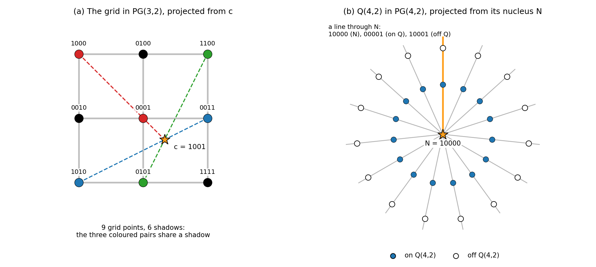

*Figure 11. (a) The grid $x_0x_3 + x_1x_2 = 0$ in $PG(3,2)$, laid out as in the earlier projective geometry notes (grey: its six lines). The point $c = (1,0,0,1)$ is not on the grid, but it lies on three secants (dashed), each through two grid points of one colour. Projected from $c$, the nine points throw only six shadows. (b) The quadric $Q(4,2)$ and its nucleus $N = (1,0,0,0,0)$. Each of the 15 lines through $N$ has three points: $N$, one point of the quadric (filled) and one point off it (open). No line through $N$ is a secant, so projection from $N$ keeps all 15 points apart.*

**A centre that fails.** Take the grid and $c = (1,0,0,1)$. It is not on the grid, since $x_0x_3 + x_1x_2 = 1$. But $c + (1,0,0,0) = (0,0,0,1)$, so $c$ lies on the secant through the grid points $(1,0,0,0)$ and $(0,0,0,1)$. In the same way it lies on the secants $\{(1,0,1,0), (0,0,1,1)\}$ and $\{(1,1,0,0), (0,1,0,1)\}$. Projected from $c$, the nine points give six shadows (Figure 11a). No other centre does better, for a one-line reason: a quotient would live in $PG(2,2)$ or in something smaller, where any two lines meet, while the grid has two disjoint rows, and an injective map cannot make disjoint lines meet.

**A centre that works: the nucleus.** The earlier projective geometry notes met the nucleus of the parabolic quadric: in characteristic 2 the polar form has a one-dimensional radical, through which all the tangent hyperplanes pass. As in [the prologue](#bilinear-and-sesquilinear-forms-in-coordinates), write the quadratic form as $\Phi(x) = x_0^2 + x_1x_2 + x_3x_4$. Its polar form is

$$f(x,y) = \Phi(x+y) - \Phi(x) - \Phi(y) = x_1y_2 + x_2y_1 + x_3y_4 + x_4y_3 ,$$

since $(x_0 + y_0)^2 = x_0^2 + y_0^2$ in characteristic 2. The radical is $N = (1,0,0,0,0)$, and $\Phi(N) = 1$, so $N$ is off the quadric.

For any point $p$, we have $\Phi(p + N) = \Phi(p) + \Phi(N) + f(p,N) = \Phi(p) + 1$. So of the two points other than $N$ on the line through $N$ and $p$, exactly one lies on $Q(4,2)$. Every line through $N$ meets the quadric once: $N$ is on no secant (Figure 11b). A computer check of all 16 points off the quadric shows that $N$ is the only one with this property; each of the other 15 lies on 4 secants.

Projection from $N$ just forgets $x_0$. It sends the 15 points of $Q(4,2)$ bijectively onto the 15 points of $PG(3,2)$. A line of $Q(4,2)$ has $f = 0$ between any two of its points, and $f$ only sees $x_1, \dots, x_4$, so its shadow is a line totally isotropic for $x_1y_2 + x_2y_1 + x_3y_4 + x_4y_3$. That is the doily's symplectic form with the coordinates renamed. So the projection of $Q(4,2)$ from its nucleus is $W(3,2)$, and the doily's embedding in $PG(3,2)$ is a proper quotient of its embedding in $PG(4,2)$.

**Counting what is lost.** The 31 hyperplanes of $PG(4,2)$ slice $Q(4,2)$ in three ways:

| Slice of $Q(4,2)$ | How many | Points | Contains $N$? |
| --- | --- | --- | --- |
| tangent hyperplane, giving $x^\perp$ (a point and its three lines) | 15 | 7 | yes |
| a grid $Q^+(3,2)$ | 10 | 9 | no |
| an elliptic quadric $Q^-(3,2)$ | 6 | 5 | no |

At a point $x$ of the quadric, the tangent hyperplane $\{y : f(x,y) = 0\}$ contains $N$, because $N$ is in the radical. $PG(4,2)$ has exactly 15 hyperplanes through $N$, so these are all of them. A hyperplane missing $N$ is a $PG(3,2)$ on which $f$ has no radical left, so the quadric cuts it in a nondegenerate quadric of $PG(3,2)$: a grid with 9 points or an elliptic quadric with 5 (earlier notes). To count them, note that each point of $Q(4,2)$ lies on 15 hyperplanes, 7 of which contain its line to $N$; so it lies on 8 of the 16 hyperplanes missing $N$. If $a$ of these are grids and $b$ elliptic quadrics, then $a + b = 16$ and $9a + 5b = 15 \cdot 8$, so $a = 10$ and $b = 6$. Each elliptic quadric meets every line of $Q(4,2)$ in one point, so it is an ovoid of the doily in the sense of [point-line geometries](#point-line-geometries), and also an ovoid in the earlier notes' sense.

The hyperplanes of the quotient $PG(3,2)$ are the shadows of the hyperplanes of $PG(4,2)$ through $N$. So $W(3,2)$ in $PG(3,2)$ produces exactly the 15 hyperplanes $x^\perp$, as we found directly, and the 10 grids and 6 ovoids are lost in the projection. This 15 against 31 is another face of the doily (see its [who's who](#whos-who-of-the-doily)). Why every hyperplane of a quadrangle is some $x^\perp$, an ovoid or a smaller quadrangle is explained in [generalized quadrangles in depth](#generalized-quadrangles-in-depth).

**Projection always loses hyperplanes.** Every hyperplane of $\Sigma_\alpha$ is the shadow of a hyperplane of $\Sigma$ through $\alpha$, and the two slice out the same points of $\mathcal{S}$. So $\epsilon/\alpha$ can only produce hyperplanes that $\epsilon$ already produces, and, as for the doily, a proper quotient always loses some (see the Note below).

An embedding $\tilde{\epsilon}$ of $\mathcal{S}$ is **absolutely universal** (often just "universal") if every full embedding of $\mathcal{S}$ is isomorphic to a quotient of $\tilde{\epsilon}$. It is the biggest embedding, from which all the others are shadows. *A universal embedding, when one exists, is unique up to isomorphism.* In finite dimension this is a dimension count: two universal embeddings would each be a quotient of the other, and a proper quotient has smaller dimension, so both centres are empty. Whether a universal embedding exists is another matter, and for geometries with three points per line there is a clean answer.

---

**Note: does uniqueness need finite dimension?** No. Take a point $x$ in a nonempty centre $\alpha$. It lies in the span of finitely many image points; take a smallest such set $\epsilon(y_1), \dots, \epsilon(y_k)$, where $k \ge 2$ because $x$ is not an image point. Some hyperplane of $\Sigma$ contains $\epsilon(y_1), \dots, \epsilon(y_{k-1})$ but not $\epsilon(y_k)$. No hyperplane through $\alpha$ does that, because one containing $\epsilon(y_1), \dots, \epsilon(y_{k-1})$ also contains $x$, and by minimality $x$ and those $k-1$ points span $\epsilon(y_k)$. So the slice of that first hyperplane arises from $\epsilon$ but not from $\epsilon/\alpha$: a proper quotient always produces strictly fewer hyperplanes, so it is never isomorphic to $\epsilon$. A quotient of a quotient is again a quotient (project from the span of both centres). Two non-isomorphic universal embeddings would therefore make each a proper quotient of itself, which is impossible in any dimension.

---

### Geometries with three points per line

If every line of $\mathcal{S}$ has exactly three points, a full embedding can only live over $\mathbb{F}_2$. A line of $\mathcal{S}$ becomes a whole projective line, which has $|F| + 1$ points, and $|F| + 1 = 3$ forces $F = \mathbb{F}_2$ (a skew field with two elements is $\mathbb{F}_2$). Hyperplanes are then easy to test by hand: a proper subset $H$ is a hyperplane exactly when every line has 1 or 3 of its points in $H$, that is, 0 or 2 points outside it.

For these geometries [Ronan (1987)](https://doi.org/10.1016/S0195-6698%2887%2980009-4) proved a theorem that we state without proof:

> **Ronan's theorem.** Let $\mathcal{S}$ be a partial linear space with exactly three points on every line.
>
> 1. $\mathcal{S}$ has a full projective embedding if and only if hyperplanes separate points: for any two distinct points $x_1, x_2$ some hyperplane contains $x_1$ but not $x_2$.
> 2. If $\mathcal{S}$ has an embedding, it has an absolutely universal one.
> 3. Every hyperplane of $\mathcal{S}$ then arises from the universal embedding.

The condition in (1) is clearly necessary. Ambient hyperplanes separate the points of $\Sigma$, and an embedding is injective, so some ambient hyperplane contains $\epsilon(x_1)$ but not $\epsilon(x_2)$, and its slice separates $x_1$ from $x_2$. The content of the theorem is that this is also enough.

Part (3) lets us read off the size of the universal embedding by counting hyperplanes. Over $\mathbb{F}_2$, distinct ambient hyperplanes $\Pi_1 \ne \Pi_2$ always slice out distinct hyperplanes of $\mathcal{S}$. The reason is that the three hyperplanes of $\Sigma$ through $\Pi_1 \cap \Pi_2$ cover every point. If $\Pi_1$ and $\Pi_2$ had the same slice, every image point would lie in $\Pi_1 \cap \Pi_2$ or outside both, hence in the third hyperplane, and the image would not span. Since $PG(m-1, 2)$ has $2^m - 1$ hyperplanes, a geometry whose universal embedding lives in $PG(m-1,2)$ has exactly $2^m - 1$ hyperplanes.

- **The grid** has $15 = 2^4 - 1$ hyperplanes, so its universal embedding lives in $PG(3,2)$. The quadric we started with is a quotient of it in a space of the same dimension, so its centre is empty and the two are isomorphic. Since no centre works, it is the grid's only embedding.
- **The doily** has $31 = 2^5 - 1$ hyperplanes: the 15 sets $x^\perp$, the 10 grids and the 6 ovoids. A computer search through all $2^{15}$ subsets finds exactly these, and [generalized quadrangles in depth](#generalized-quadrangles-in-depth) shows that no other kind is possible. So its universal embedding lives in $PG(4,2)$, and by the same dimension argument $Q(4,2)$ is it. Every other embedding is a quotient of this one, and the nucleus is the only possible centre, so the doily has exactly two embeddings: $Q(4,2)$ in $PG(4,2)$, which produces 31 hyperplanes, and its shadow $W(3,2)$ in $PG(3,2)$, which produces 15.

So the answer to the opening question is yes, there is a best embedding, and for geometries with three points per line its dimension is a hyperplane count.

---

**Aside: the doily's ten grids are Mermin–Peres squares.**

Recall from [the gallery's two-qubit Aside](#generalized-quadrangles-a-first-look) that the doily's points are the 15 two-qubit Pauli operators other than $I \otimes I$, up to phase, and its lines are the commuting triples. Commuting observables can be measured together, and their outcomes ($\pm 1$ each) multiply like the operators: if $ABC = -I$, the three outcomes multiply to $-1$. Now take the square

$$\begin{array}{ccc} X \otimes I & I \otimes X & X \otimes X \\ I \otimes Z & Z \otimes I & Z \otimes Z \\ X \otimes Z & Z \otimes X & Y \otimes Y \end{array}$$

Each row and each column is a commuting triple. All three rows and the first two columns multiply to $+I$, and the third column to $-I$. Suppose each operator had a fixed outcome $\pm 1$, the same whichever row or column it is measured with. Multiply the outcomes along all six lines: each outcome is used twice, so the total is $+1$, yet the six products must give $(+1)^5(-1) = -1$. So no such fixed values exist; the outcome depends on what is measured alongside it, which is called contextuality. This is a Mermin–Peres square. As bit strings its nine operators are $1000, 0010, 1010; 0001, 0100, 0101; 1001, 0110, 1111$, and they form one of the doily's 10 grids. A computer check shows that all ten grids are such squares (with the operators written as tensor products of $I, X, Y, Z$, nine have one $-I$ line and one has three). They are the 10 hyperplanes that $Q(4,2)$ sees and $W(3,2)$ in $PG(3,2)$ does not, so only the bigger embedding sees all the Mermin–Peres squares of two qubits.

---

<!-- terms checked: quotient; isomorphic -->

## Generalized Polygons

An ordinary polygon exists for every number of sides. Now thicken it: put at least three points on every line and at least three lines through every point, and keep the rule that makes it a polygon, namely no shortcuts (no ordinary polygons with fewer sides) while any two elements still lie on a common $n$-gon. Among finite polygons of this kind, only $n = 3, 4, 6$ and $8$ survive. Why should the number of sides care about thickness?

The answer is the Feit–Higman theorem, the destination promised when [distance-regular graphs](#distance-regular-graphs) were built: the geometry forces exact counts on its point graph, the counts force the eigenvalues, and the multiplicities must be whole numbers. The route runs through the basic properties and recognition tests, then the quadrangles, where polygons meet polar spaces, then the theorem, and finally what is known to exist.

### What is being generalized

Recall the definition from [the first look at generalized polygons](#generalized-polygons-a-first-look). A generalized $n$-gon, for $n \ge 3$, is a partial linear space with no ordinary $m$-gons for $3 \le m < n$, in which any two elements (points or lines) lie in a common ordinary $n$-gon. In the incidence graph this says: the girth is $2n$, and any two vertices lie on a common cycle of length $2n$. The definition treats points and lines alike, so the dual of a generalized $n$-gon is again a generalized $n$-gon.

The two smallest cases are old friends.

- **$n = 3$.** These are the projective planes, possibly degenerate (a degenerate one is a near-pencil, see [small geometries that test the definitions](#small-geometries-that-test-the-definitions)). Two points lie in a common triangle, so some line joins them; two lines lie in a common triangle, so they meet.
- **$n = 4$.** These are the generalized quadrangles, and for them the axioms simplify to the two in [the first look at generalized quadrangles](#generalized-quadrangles-a-first-look): two disjoint lines exist, and for every anti-flag $(x, L)$ exactly one point of $L$ is collinear with $x$.

From $n = 4$ on, the point graph carries everything. With no triangles in the geometry, a set of mutually collinear points (a [clique](#neighbours-and-regularity)) cannot spread over two lines, because three mutually collinear points not on one line form a triangle. So the maximal cliques of the point graph are exactly the lines, and the geometry can be rebuilt from its graph: the points are the vertices and the lines are the maximal cliques. Two generalized $n$-gons with $n \ge 4$ are isomorphic exactly when their point graphs are. This does not even need an order: in the $2 \times 3$ grid, a quadrangle with lines of two sizes, the maximal cliques are exactly its 2 rows and 3 columns.

This fails for $n = 3$. In a projective plane any two points are collinear, so the point graph is complete and remembers only the number of points. There are four projective planes of order 9, no two of them isomorphic, and all four have the same point graph $K_{91}$, since $9^2 + 9 + 1 = 91$. So from $n = 4$ on we may work with the point graph alone, and the Feit–Higman theorem is a theorem about that graph.

### Basic properties of generalized polygons

Throughout this section $\mathcal{S}$ is a generalized $n$-gon with $n \ge 3$. As in [point-line geometries](#point-line-geometries), $\delta$ is distance in the incidence graph and $d$ is distance in the point graph; between two points $\delta = 2d$.

#### Unique shortest paths and opposite elements

Two vertices of the incidence graph at distance $i < n$ are joined by exactly one geodesic (a shortest path, see [graphs](#graphs)). Two different shortest paths of length $i$ would together contain a cycle of length at most $2i < 2n$, below the girth. Call a walk that never immediately goes back along the edge it just used a **non-backtracking walk**. The same argument shows that a non-backtracking walk of length at most $n$ is a geodesic. Four consequences follow:

- the incidence graph has diameter $n$, since any two vertices sit on a common $2n$-cycle, and opposite vertices of a $2n$-cycle are exactly $n$ apart;
- the point graph has diameter $\lfloor n/2 \rfloor$;
- if $y$ is at incidence distance $i < n$ from $x$, then exactly one neighbour of $y$ is one step closer to $x$;
- every vertex lies on a $2n$-cycle, so it has at least two neighbours, and any geodesic from $x$ can be closed into a $2n$-cycle: extend it by a non-backtracking walk until it reaches a vertex $z$ at distance $n$ from $x$, then return from $z$ through a second neighbour along the geodesic back to $x$. The two paths of length $n$ from $x$ to $z$ together make a cycle of length $2n$, since a shared inner vertex would close a shorter cycle.

Two elements at incidence distance $n$, the largest possible, are called **opposite**. Since the incidence graph is bipartite, opposite elements have the same type for even $n$ and are a point and a line for odd $n$. In a quadrangle, opposite points are non-collinear points and opposite lines are disjoint lines. In a projective plane, a point is opposite every line not through it.

Opposite elements have the same number of neighbours: as many lines through a point, or points on a line. The reason is that their neighbours pair off (Figure 12). Let $x$ and $y$ be opposite, and let $z$ be a neighbour of $x$. Then $z$ is at distance $n - 1$ from $y$ ($n + 1$ is beyond the diameter, and $n$ has the wrong parity), so there is a unique geodesic from $z$ to $y$, and it reaches $y$ through one neighbour $\psi(z)$ of $y$. Going back, the walk $x, z, \dots, \psi(z)$ has length $n - 1$ and does not backtrack, so it is the geodesic from $\psi(z)$ to $x$, and it arrives through $z$. The same construction run from $y$ therefore undoes $\psi$, and $\psi$ is a bijection between the neighbours of $x$ and those of $y$.

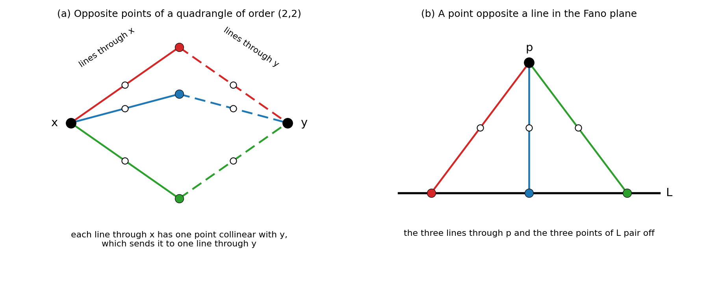

*Figure 12. (a) Two non-collinear points $x$ and $y$ of a quadrangle of order $(2,2)$, such as the doily. Each line through $x$ (solid) has exactly one point collinear with $y$ (filled), and that point lies on exactly one line through $y$ (dashed), so the three lines through $x$ pair off with the three lines through $y$. Open dots are the third points of the lines. (b) In the Fano plane a point $p$ is opposite every line $L$ not through it; each line through $p$ meets $L$ in one point, so lines through $p$ pair off with points of $L$.*

#### Thickness gives an order

Recall from [small geometries that test the definitions](#small-geometries-that-test-the-definitions) that a geometry is thick when it has at least three points on every line and at least three lines through every point, and thin when it has exactly two of each, like an ordinary polygon. *A thick generalized $n$-gon has an order $(s,t)$, and $s = t$ when $n$ is odd.*

The idea is to link any two vertices $x, y$ at incidence distance 2, with common neighbour $u$, through a third vertex opposite both. Thickness gives $u$ a third neighbour $z$. Walk from $u$ through $z$ for $n - 1$ steps without backtracking, and call the end vertex $v$. Then $x, u, z, \dots, v$ is a non-backtracking walk of length $n$, so $v$ is opposite $x$, and in the same way opposite $y$. By the pairing, $x$, $y$ and $v$ have the same number of neighbours. Any two points are linked by a chain of such steps, so all points lie on the same number $t + 1$ of lines, and likewise all lines carry the same number $s + 1$ of points. For odd $n$ a point can be opposite a line, so $s + 1 = t + 1$.

Two examples, one thick and one not:

- **The Fano plane.** A point is opposite each line not through it, so the 3 lines through a point match the 3 points on a line: $s = t = 2$.
- **The $2 \times 3$ grid.** Each point lies on only two lines, so a row and a column through a common point $u$ have no third line through $u$ to link them. Opposite lines are two rows or two columns, so rows match rows and columns match columns, but rows keep 3 points and columns 2: no order.

The lesson is that thickness spreads one count over the whole geometry.

#### Doubling and near polygons

Doubling a generalized polygon doubles its number of sides. Recall from [point-line geometries](#point-line-geometries) that the double has the old points and lines as its points and the flags as its 2-point lines. Its incidence graph is the old one with every edge subdivided, so the girth doubles to $4n$. To put any two vertices of the double on a common $4n$-cycle, we need any two flags of $\mathcal{S}$ on a common ordinary $n$-gon, and that holds. From the flags $\{p_1, L_1\}$ and $\{p_2, L_2\}$ pick the element $x_1$ of the first and the element $x_2$ of the second that are farthest apart. If $\delta(x_1, x_2) < n$, the other element of each flag is one step closer to the other flag (since $x_1, x_2$ is the farthest pair), so it lies on the unique geodesic from $x_1$ to $x_2$, and that geodesic closes into a $2n$-cycle as above. If $\delta(x_1, x_2) = n$, the geodesics from $x_1$ to $x_2$ through the other two elements either coincide, and close up as above, or are two different geodesics of length $n$, which together form a $2n$-cycle.

For example, the double of the Fano plane has $7 + 7 = 14$ points and 21 lines (the 21 flags), with 2 points per line and 3 lines per point: a generalized hexagon of order $(1,2)$. Its point graph is the incidence graph of the Fano plane, the Heawood graph, with girth 6 and diameter 3.

Distances from a point to a line also behave well. A **near polygon** is a partial linear space of finite diameter in which, for every point $x$ and every line $L$, the line $L$ has a unique point nearest to $x$. If the diameter is $d$, it is a near $2d$-gon. A generalized $2d$-gon is a near $2d$-gon. Put $x$ and $L$ in a common ordinary $2d$-gon: there $L$ is at distance at most $d - 1$ from $x$, and below that distance unique geodesics make the nearest point unique. Odd polygons are different: in the Fano plane a point off a line is collinear with all three points of the line, so no point of the line is the nearest one.

### Recognizing generalized polygons

The definition asks for an $n$-gon through every pair of elements, which is tedious to check. There are easier tests.

#### Diameter n and girth 2n

*A geometry is a generalized $n$-gon if and only if its incidence graph has diameter $n$ and girth $2n$.* This holds for every $n \ge 3$, and it is the definition used in much of the literature. The "only if" direction was shown above. For the "if" direction, girth $2n$ and diameter $n$ give unique geodesics below distance $n$ and the pairing of neighbours of opposite vertices, by the arguments above. Then two steps finish the job:

1. Every vertex $x$ has at least two neighbours. Take a $2n$-cycle and its vertex $y$ farthest from $x$. Then $y$ is at distance $n$, since otherwise a neighbour of $y$ on the cycle would be farther still. So $x$ and $y$ are opposite, $y$ has two neighbours on the cycle, and by the pairing so does $x$.
2. Any two vertices $x, y$ lie on a $2n$-cycle. Extend the geodesic from $x$ through $y$ by a non-backtracking walk until it reaches a vertex $z$ opposite $x$. Then $z$ has a second neighbour $u$ off this path, and the geodesic from $u$ back to $x$ closes the path into a cycle of length $2n$ (as before, a shared inner vertex would close a shorter cycle).

#### Near polygons, thin lines and the cube

Nearness alone does not forbid shortcuts, and the cube shows it. Take the cube graph from [distance-regular graphs](#distance-regular-graphs) as a geometry: its 8 vertices are the points and its 12 edges are 2-point lines. It is a near hexagon. Its diameter is 3, and since the graph is bipartite the two ends of an edge are never equally far from a vertex, so every line has a unique nearest point. But two vertices at distance 2 have two common neighbours ($c_2 = 2$ in the intersection numbers), and each square face of the cube is a 4-cycle of points, an 8-cycle in the incidence graph. So the incidence graph has girth 8 rather than 12, and the cube is a near hexagon that is not a generalized hexagon. "No shortcuts" lives in the girth.

The recognition test also tells us what thin lines allow. *A generalized $2d$-gon with $d \ge 3$ and exactly two points on every line is the double of a generalized $d$-gon.* Such a geometry is just a graph whose edges are the lines. It is a near polygon, so the two ends of each edge are at different distances from any base point $x_0$; distances along an edge differ by one, so the parity of the distance to $x_0$ flips at every step. Every closed walk therefore has even length, and by [the parity test for bipartite graphs](#graphs) the graph is bipartite. So it is the incidence graph of a geometry whose points and lines are its two colour classes. Halving the $2d$-gon's incidence numbers, this graph has diameter $d$ and girth $2d$, so by the test above the geometry is a generalized $d$-gon, and $\mathcal{S}$ is its double. This is why thin polygons will turn out to add no new examples.

---

**Aside: a second test, and Moore graphs.**

For even $n = 2d$ there is a second recognition test, through near polygons, which we state without proof. Say that a near $2d$-gon has unique back-steps if, whenever $y$ is at distance $i < d$ from $x$, exactly one neighbour of $y$ is at distance $i - 1$ from $x$; the cube fails this. *A near $2d$-gon with unique back-steps is a generalized $2d$-gon exactly when every point lies on at least two lines.* A wider family sits around the polygons. A **generalized Moore geometry** $GM_d(s,t,c)$ has order $(s,t)$, diameter $d$ and a polygon's distance shells up to distance $d - 1$ (worked out in [the polygon fixes its shell counts](#the-polygon-fixes-its-shell-counts)), and a point at distance $d$ from $x$ has exactly $c$ lines leading one step closer to $x$. The case $c = t + 1$ is exactly the generalized $2d$-gons of order $(s,t)$. The case $c = 1$ with $s = 1$ gives a **Moore graph**: a regular graph of valency $k$ and diameter $d$ with the largest number of vertices allowed, $1 + k + k(k-1) + \dots + k(k-1)^{d-1}$. The Petersen graph is one, and $1 + 3 + 6 = 10$ is the bound found in [the Petersen puzzle](#graphs).

---

### Generalized quadrangles in depth

At $n = 4$ polygons meet polar spaces: generalized quadrangles are exactly the polar spaces of rank 2 ([polar spaces: a first look](#polar-spaces-a-first-look)). This section shows that an order is nearly automatic, proves Higman's bound again in a way that explains equality, and sorts out the hyperplanes, which explains the doily's 15, 10 and 6 from [what projection loses](#what-projection-loses).

#### Grid, dual grid, or an order

A quadrangle in which every point lies on exactly two lines is a grid, and one in which every line has exactly two points is a dual grid. *Every generalized quadrangle is exactly one of the following: a nonsymmetrical grid, a nonsymmetrical dual grid, or a quadrangle with an order $(s,t)$.* Here "nonsymmetrical" means $n_1 \ne n_2$ for an $n_1 \times n_2$ grid, since symmetrical grids and their duals have orders $(s,1)$ and $(1,t)$.

The idea uses the pairing again: non-collinear points are opposite, so they lie on equally many lines. If the quadrangle is not a dual grid, some line $L$ has at least three points. For $x, y$ on $L$, a point $z$ off $L$ on another line through a third point of $L$ is collinear with neither, so $x$, $z$ and $y$ lie on equally many lines, say $t + 1$. A point off $L$ is collinear with only one point of $L$, so it too lies on $t + 1$ lines. Dually, if it is not a grid, all lines have the same number $s + 1$ of points. From here on every quadrangle has an order.

The classical quadrangles, with their orders and their sizes for $q = 2$, are below; the equations are in [polar spaces: a first look](#polar-spaces-a-first-look), and $W(q)$ is common shorthand for $W(3,q)$.

| Quadrangle | Order $(s,t)$ | Points $(s+1)(st+1)$ | At $q = 2$ |
| --- | --- | --- | --- |
| $Q^+(3,q)$ | $(q,1)$ | $(q+1)^2$ | 9, the grid |
| $Q(4,q)$ and $W(q)$ | $(q,q)$ | $(q+1)(q^2+1)$ | 15, the doily |
| $Q^-(5,q)$ | $(q,q^2)$ | $(q+1)(q^3+1)$ | 27 |
| $H(3,q^2)$ | $(q^2,q)$ | $(q^2+1)(q^3+1)$ | 45 |
| $H(4,q^2)$ | $(q^2,q^3)$ | $(q^2+1)(q^5+1)$ | 165 |

The orders appear in the earlier projective geometry notes' table of polar spaces, and [the classical polar spaces](#the-classical-polar-spaces) derives them again. Three isomorphisms are worth knowing, stated here without proof: the dual of $W(q)$ is $Q(4,q)$; the dual of $H(3,q^2)$ is $Q^-(5,q)$; and $W(q) \cong Q(4,q)$ exactly when $q$ is even. For even $q$ the isomorphism is the projection from the nucleus in [what projection loses](#what-projection-loses). So for even $q$ the quadrangle $W(q)$ is self-dual. For $q = 2$ this is another face of the doily (see its [who's who](#whos-who-of-the-doily)): it is isomorphic to its own dual.

#### Triads and a second proof of Higman's bound

[From geometries to graphs and back](#from-geometries-to-graphs-and-back) proved Higman's bound, $t \le s^2$ for a quadrangle of order $(s,t)$ with $s, t \ge 2$, from a Krein parameter. A second proof, by counting alone, also shows what happens at equality.

A **triad** is a set of three mutually non-collinear points, and a **centre** of a triad (also spelled "center"; unrelated to the centre of a projection in the embeddings chapter) is a point collinear with all three.

Fix two non-collinear points $x$ and $y$. Each line through $x$ carries exactly one point collinear with $y$, so $x$ and $y$ have $t + 1$ common neighbours, and no two of these are collinear (that would make a triangle with $x$). These $t + 1$ points are the candidates for centres of every triad $\{x, y, z\}$. Let $Z$ be the set of points collinear with neither $x$ nor $y$. Each of $x$, $y$ is collinear with $s(t+1)$ points other than itself, and $t + 1$ of these are shared, so

$$|Z| = (s+1)(st+1) - 2 - 2s(t+1) + (t+1) = s^2t - st - s + t .$$

For $z \in Z$ let $t_z$ be the number of centres of the triad $\{x, y, z\}$. Two double counts pin down the first two moments of $t_z$:

- **Pairs.** $\sum_{z \in Z} t_z = (t+1)(t-1)s$. For each of the $t + 1$ common neighbours $u$ of $x$ and $y$, the points of $Z$ collinear with $u$ are the points other than $u$ on the $t - 1$ lines through $u$ other than $ux$ and $uy$: $s$ on each.
- **Triples.** $\sum_{z \in Z} t_z(t_z - 1) = (t+1)t(t-1)$. Choose an ordered pair $u \ne u'$ of common neighbours of $x$ and $y$, in $(t+1)t$ ways. Since $u$ and $u'$ are not collinear, they have $t + 1$ common neighbours, among them $x$ and $y$. As we just saw for $x$ and $y$, no two common neighbours of a non-collinear pair are collinear, so the other $t - 1$ are collinear with neither $x$ nor $y$: they all lie in $Z$.

Adding gives $\sum t_z^2 = (t+1)(t-1)(s+t)$. A variance is never negative, so $|Z| \sum t_z^2 - \left(\sum t_z\right)^2 \ge 0$. Expanding, $(s^2t - st - s + t)(s+t) - (t^2-1)s^2 = s^3t - s^2t - st^2 + t^2 = t(s-1)(s^2-t)$, so

$$|Z| \sum t_z^2 - \Big(\sum t_z\Big)^2 = (t^2-1)\Big[(s^2t - st - s + t)(s+t) - (t^2-1)s^2\Big] = t\,(t^2-1)(s-1)(s^2-t) .$$

For $s, t \ge 2$ the first three factors are positive, so $t \le s^2$. Equality holds exactly when the variance is zero, that is, when every $t_z$ equals the mean $(t+1)(t-1)s/|Z|$, which for $t = s^2$ works out to $s + 1$. Since $x$ and $y$ were arbitrary: *$t = s^2$ exactly when every triad has the same number of centres, and that number is then $s + 1$.*

Two examples, both checked by computer over all triads (Figure 13):

- **$Q^-(5,2)$**, of order $(2,4)$, sits on the bound. Here $|Z| = 10$, and every triad has exactly $3 = s + 1$ centres.
- **The doily**, of order $(2,2)$, sits strictly below it. Here $|Z| = 4$ and the counts are $3, 1, 1, 1$. Check: their sum is $6 = (t+1)(t-1)s$ and the sum of their squares is $12 = (t+1)(t-1)(s+t)$. Triads in the doily have 1 or 3 centres, so the number is not constant: another face of the doily (see its [who's who](#whos-who-of-the-doily)).

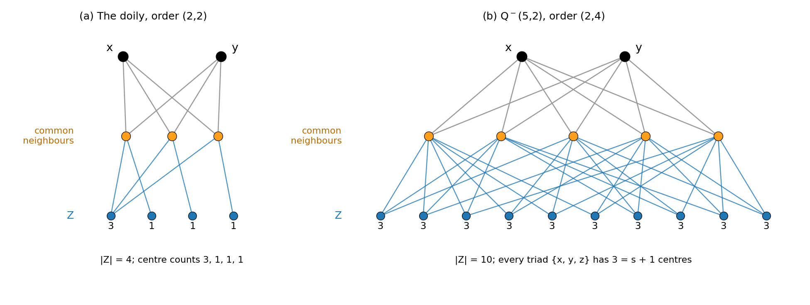

*Figure 13. Edges join collinear points; only edges between the rows are drawn. Top: two non-collinear points $x$ and $y$. Middle (orange): their $t + 1$ common neighbours, the possible centres. Bottom: the set $Z$ of points collinear with neither, each labelled with its number of centres $t_z$. (a) In the doily ($t = 2 < s^2$) the counts are $3, 1, 1, 1$. (b) In $Q^-(5,2)$ ($t = 4 = s^2$) all ten points of $Z$ see exactly three centres. Computed from the coordinates of both quadrangles.*

In the Krein proof, equality $t = s^2$ is exactly where the Krein parameter is zero. The counting proof says what that zero means in the geometry: the number of centres stops fluctuating.

---

**Aside: a heat capacity for triads.**

In statistical mechanics the heat capacity of a system in contact with a reservoir is $C = (\langle E^2 \rangle - \langle E \rangle^2)/(k_B T^2)$, a variance, so it can never be negative. The triad argument is the same move. The two double counts fix the mean and the mean square of $t_z$ over $Z$, and "variance at least zero" turns them into an inequality between $s$ and $t$. Zero variance means that every $z$ sees the same number of centres, just as zero heat capacity would mean an energy that never fluctuates.

---

#### Subquadrangles and the three kinds of hyperplane

A **subquadrangle** of a quadrangle is a full subgeometry ([point-line geometries](#point-line-geometries)) that is itself a generalized quadrangle. A subspace containing two disjoint lines always carries one. For an anti-flag $(x, L)$ inside the subspace, the unique point of $L$ collinear with $x$ is on $L$, so it is in the subspace, and the line joining it to $x$ has two points in the subspace and so lies in it. Without two disjoint lines a subspace can be something smaller, such as a single line or a star of lines through one point.

This gives a classification of hyperplanes, a consequence worth stating on its own: *every hyperplane $H$ of a generalized quadrangle is $x^\perp$ for some point $x$, an ovoid, or the point set of a subquadrangle.*

- *$H$ contains no line.* Then it meets every line in exactly one point, which makes it an ovoid ([point-line geometries](#point-line-geometries)).
- *$H$ contains two disjoint lines.* Then it carries a subquadrangle.
- *$H$ contains lines, but any two of them meet.* There are at least two. If $L$ is one, there is a line disjoint from $L$ (a point off $L$ lies on at least two lines, and only one of them meets $L$); it meets $H$ in a point $m$ off $L$, and the line joining $m$ to its collinear point on $L$ has two points in $H$, so it lies in $H$. No three of the lines in $H$ form a triangle, so they all pass through one point $x$. The axiom then forces $H = x^\perp$. A point $y$ of $H$ not collinear with $x$ would be collinear with a point $z \ne x$ of a line of $H$ through $x$, and then $yz$ would be a line of $H$ not through $x$, a contradiction. So $H \subseteq x^\perp$. Conversely, if a line $L'$ through $x$ met $H$ only in $x$, take $y \ne x$ on $L'$ and another line $M$ through $y$. The point where $M$ meets $H$ is collinear with $x$ and with $y$, so it lies on $L'$, so it is $y$, which is not in $H$. So $x^\perp \subseteq H$.

Counting lines shows that an ovoid of a quadrangle of order $(s,t)$ has $st + 1$ points. There are $(t+1)(st+1)$ lines, and $t + 1$ of them pass through each point of the ovoid. In the doily the three kinds are the 15 sets $x^\perp$ (7 points each), the 6 ovoids (5 points) and 10 subquadrangles, which are $3 \times 3$ grids (9 points): exactly the 15, 6 and 10 of [what projection loses](#what-projection-loses).

---

**Note: what does a hyperplane leave behind?** The points outside a hyperplane $H$, joined when collinear (this is not the complement graph of the strongly regular graphs chapter), form a connected graph of diameter at most 3, unless the quadrangle is a dual grid. Here is the idea when lines have at least three points (the remaining case, a grid with two-point columns, is a short check). Take two outside points $y_1, y_2$ at distance 2 whose common neighbours $z_1, z_2, \dots$ all lie in $H$. A third point $y_2'$ on the line $y_2z_2$ is outside $H$ and collinear with neither $z_1$ nor $y_1$, so the point $y_1'$ of the line $y_1z_1$ collinear with $y_2'$ is outside $H$ too, and $y_1, y_1', y_2', y_2$ avoids $H$. Dual grids really are exceptions: in $K_{3,3}$, viewed as a dual grid, one side is an ovoid and leaves behind three points with no edges between them. The case $H = x^\perp$ says that the points opposite $x$ form a connected graph of diameter at most 3.

---

### The Feit–Higman theorem

This is the payoff of the machinery built in [distance-regular graphs](#distance-regular-graphs). The theorem is due to [Feit and Higman (1964)](https://doi.org/10.1016/0021-8693%2864%2990028-6), and the eigenvalue proof below has five steps:

1. A finite generalized $n$-gon with $n \ge 4$ and an order $(s,t)$ has a distance-regular point graph. Thickness is not needed, only the order.
2. Rescale the recurrence for the standard sequence so that its solutions are powers of a single number $\eta$; each eigenvalue is then $\theta = \sqrt{st}\,(\eta + \eta^{-1}) + s - 1$.
3. The last distance shell forces $\eta$ to be an $n$-th root of unity, so the eigenvalues are $\theta = s - 1 + 2\sqrt{st}\cos(2\pi l/n)$, together with $s(t+1)$ and, for even $n$, $-(t+1)$.
4. The multiplicities, from the formula in [distance-regular graphs](#distance-regular-graphs), must be whole numbers, so in particular rational.
5. Rational cosines are rare, which leaves $n \in \{4, 6, 8, 12\}$; thickness then rules out $n = 12$ and gives the square conditions for $n = 6$ and $8$.

Throughout, $\mathcal{S}$ is a finite generalized $n$-gon with $n \ge 4$, order $(s,t)$ and $v$ points, and $d = \lfloor n/2 \rfloor$ is the diameter of its point graph. As a bare letter $d$ is this diameter, so $n = 2d$ or $2d + 1$; $d(x,y)$ is still a distance.

#### The polygon fixes its shell counts

Fix a point $x$ and let $\Gamma_i(x)$ be the set of points at distance $i$ from $x$. For $y \in \Gamma_i(x)$, count the neighbours of $y$ one step back, in the same shell, and one step out: the intersection numbers $c_i$, $a_i$, $b_i$ of [distance-regular graphs](#distance-regular-graphs). Unique geodesics settle them (Figure 14).

- **The base point.** All $k = s(t+1)$ neighbours of $x$ are one step out: $b_0 = s(t+1)$.
- **Middle shells, $1 \le i \le d - 1$.** Exactly one line through $y$ has a point closer to $x$, and it has exactly one such point; its other $s - 1$ points are in the same shell as $y$. The other $t$ lines through $y$ lead outward, $s$ points each. So $c_i = 1$, $a_i = s - 1$, $b_i = st$.
- **The last shell, $n$ even.** Now $y$ is opposite $x$, every line through $y$ is at incidence distance $n - 1$ from $x$, and each has exactly one point at distance $d - 1$. So $c_d = t + 1$, $a_d = (s-1)(t+1)$, $b_d = 0$.
- **The last shell, $n$ odd.** Now $y$ is at incidence distance $n - 1$ from $x$, so a unique geodesic leaves one line back. The other $t$ lines through $y$ are opposite $x$, and all their points stay at distance $d$. So $c_d = 1$, $a_d = st + s - 1$, $b_d = 0$.

These numbers depend only on $i$, not on $x$ and $y$, so the point graph is distance-regular. All we used was the order.

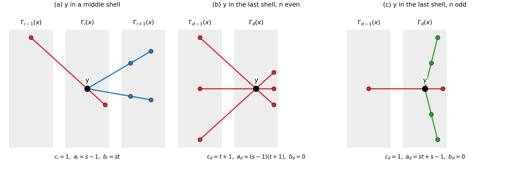

*Figure 14. The $t + 1 = 3$ lines through a point $y$ at distance $i$ from $x$, in a polygon of order $(2,2)$; grey bands are distance shells around $x$. (a) In a middle shell one line goes back (red) and $t$ lines go out (blue). (b) In the last shell of an even polygon every line goes back. (c) In the last shell of an odd polygon one line goes back and the other $t$ lines (green) stay inside the last shell.*

The shell sizes follow from $k_{i+1} = k_i b_i / c_{i+1}$:

$$k_0 = 1, \qquad k_i = s^i t^{i-1}(t+1) \quad (1 \le i \le d-1), \qquad k_d = \begin{cases} s^d t^{d-1} & n \text{ even}, \\ s^d t^{d-1}(t+1) & n \text{ odd}. \end{cases}$$

Adding up for even $n = 2d$ gives $v = (s+1)\left(1 + st + \dots + (st)^{d-1}\right)$, which for quadrangles is the familiar $(s+1)(st+1)$. For example, any hexagon of order $(2,2)$, such as the split Cayley hexagon $H(2)$, has shells $1, 6, 24, 32$ and so 63 points. A thin example is the double of the Fano plane, a hexagon of order $(1,2)$: its shells are $1, 3, 6, 4$, the 14 vertices of the Heawood graph. It is distance-regular although it is not thick. Its eigenvalues $\pm\sqrt{2}$ (six times each) show that irrational eigenvalues are allowed; only multiplicities must be whole.

#### Eigenvalues are cosines

For a number $\theta$, the standard sequence of [distance-regular graphs](#distance-regular-graphs) starts at $u_0 = 1$, $u_1 = \theta/k$ with $k = s(t+1)$, and continues by $b_i u_{i+1} + (a_i - \theta) u_i + c_i u_{i-1} = 0$. In the middle shells this reads

$$st\, u_{i+1} + (s - 1 - \theta)\, u_i + u_{i-1} = 0, \qquad 1 \le i \le d-1 .$$

They produce $u_0, \dots, u_d$ for any $\theta$. The number $\theta$ is an eigenvalue exactly when the last equation, at $i = d$, holds as well:

$$c_d\, u_{d-1} + (a_d - \theta)\, u_d = 0 .$$

If all the equations hold, the vector whose entry at $y$ is $u_{d(x,y)}$ is an eigenvector with eigenvalue $\theta$: applying $A$ gives at $y$ the value $c_i u_{i-1} + a_i u_i + b_i u_{i+1}$ for $y$ at distance $i$, and the equations say this is $\theta u_i$. Conversely, if $\theta$ is an eigenvalue, row $x$ of its projector $E_\theta$, read by distance, is a multiple of the standard sequence, and $AE_\theta = \theta E_\theta$ gives every equation, the last one included. So the middle equations are the bulk, and the last shell supplies a boundary condition.

The middle equations have constant but lopsided coefficients ($st$ against 1). Rescaling balances them: put $u_i = w_i / (\sqrt{st})^i$, and they become

$$w_{i+1} + w_{i-1} = \frac{\theta - s + 1}{\sqrt{st}}\, w_i .$$

Write the right-hand coefficient as $\eta + \eta^{-1}$, which is possible for some nonzero complex $\eta$ since it means solving a quadratic; $\eta$ and $\eta^{-1}$ give the same $\theta$. We use $\eta$ rather than $\lambda$, which already counts common neighbours in a strongly regular graph. So $\theta = \sqrt{st}\,(\eta + \eta^{-1}) + s - 1$. For $\eta \ne \pm 1$ the recurrence is solved by powers of $\eta$, and fitting $w_0 = 1$ and $w_1 = \sqrt{st}\,\theta/k$ gives

$$w_i = C_+\eta^i + C_-\eta^{-i}, \qquad C_+ = \frac{t\eta + \sigma - \eta^{-1}}{(t+1)(\eta - \eta^{-1})}, \qquad \sigma = (s-1)\sqrt{t/s},$$

where $C_-$ is $C_+$ with $\eta$ and $\eta^{-1}$ swapped, and $C_+ + C_- = 1$. At $\eta = \pm 1$ the two powers coincide and this form fails; we will not need those two values of $\theta$.

Now apply the boundary condition. Substituting $w_{d-1}$ and $w_d$ into the last equation and simplifying is direct algebra (we checked it by computer for every $n$ from 4 to 12). Up to a nonzero factor, the last equation becomes $(\theta - k)$ times

- for even $n = 2d$: $\quad \left(s + t + (\eta + \eta^{-1})\sqrt{st}\right)\left(1 + \eta^2 + \eta^4 + \dots + \eta^{2(d-1)}\right) = 0$;
- for odd $n = 2d + 1$, where $s = t$ (a point and a line can be opposite): $\quad 1 + \eta + \eta^2 + \dots + \eta^{n-1} = 0$.

Read off the roots. The factor $\theta - k$ gives the valency $k = s(t+1)$. In the even case, the first bracket vanishes when $\theta = -(t+1)$; its standard sequence is simply $u_i = (-1/s)^i$, as one checks directly. The geometric sums vanish exactly when $\eta$ is an $n$-th root of unity other than $\pm 1$ (for even $n$, when $\eta^2$ is a $d$-th root of unity other than 1). Then $\eta + \eta^{-1} = 2\cos(2\pi l/n)$, and

$$\theta_l = s - 1 + 2\sqrt{st}\,\cos\frac{2\pi l}{n},$$

for $l = 1, \dots, d-1$ (even $n$) or $l = 1, \dots, d$ (odd $n$). With $k$ and, for even $n$, $-(t+1)$, that is $d + 1$ distinct eigenvalues, which is all that a distance-regular graph of diameter $d$ has. So the excluded values $\eta = \pm 1$ add nothing. Some checks:

- **Quadrangles**, $n = 4$: $l = 1$ gives $s - 1 + 2\sqrt{st}\cos(\pi/2) = s - 1$, the eigenvalue found in [from geometries to graphs and back](#from-geometries-to-graphs-and-back).
- **Hexagons**, $n = 6$: $s - 1 \pm \sqrt{st}$. For order $(2,2)$ the eigenvalues are $6, 3, -1, -3$.
- **Octagons**, $n = 8$: $s - 1 \pm \sqrt{2st}$ and $s - 1$.
- **Ordinary polygons**, $s = t = 1$: $\theta_l = 2\cos(2\pi l/n)$, the eigenvalues of the cycle $C_n$.

The last check is the picture to keep: apart from $k$ (and $-(t+1)$ for even $n$), the eigenvalues of a generalized $n$-gon are those of the ordinary $n$-gon it generalizes, $2\cos(2\pi l/n)$, scaled by $\sqrt{st}$ and shifted by $s - 1$.

---

**Aside: a string of beads closed into a ring.**

Beads of mass $m$ on a string, joined by springs of stiffness $\kappa$, have normal modes: at angular frequency $\omega$, bead $j$ swings with amplitude $w_j$, where $w_{j+1} + w_{j-1} = (2 - m\omega^2/\kappa)\, w_j$. That is the rescaled recurrence, with $2\cos\varphi$ in place of $\eta + \eta^{-1}$ and the standing waves $\cos(\varphi j)$ and $\sin(\varphi j)$ as solutions. The ends of the string decide which $\varphi$ are allowed, and closing the string into a ring of $n$ beads forces $n\varphi$ to be a multiple of $2\pi$. Now fold the ring around one bead: beads at the same distance from it form a shell, and the ring becomes a short string of $d + 1$ shells, from the chosen bead to the bead or pair of beads opposite it. The shells of a generalized $n$-gon around a point $x$ are this folded ring, and the vanishing geometric sums above are exactly the ring condition, with $\varphi = 2\pi l/n$.

---

#### Whole-number multiplicities limit n

The multiplicity of $\theta$ is $f(\theta) = v / \sum_{i=0}^{d} k_i u_i(\theta)^2$ ([distance-regular graphs](#distance-regular-graphs)). It is a whole number, so the sum

$$S(\theta) = \sum_{i=0}^{d} k_i\, u_i(\theta)^2$$

must be rational. For even $n$ and $\theta = \theta_l$ the sum comes out simple, because $\eta^{2d} = 1$ and $\eta^2 \ne 1$:

- shell 0 contributes $k_0 u_0^2 = 1$;
- in the middle shells $k_i u_i^2 = k_i w_i^2/(st)^i = \frac{t+1}{t}\, w_i^2$, with $w_i^2 = C_+^2\eta^{2i} + 2C_+C_- + C_-^2\eta^{-2i}$. The full geometric sums $\sum_{i=0}^{d-1} \eta^{\pm 2i}$ vanish, so over $i = 1, \dots, d-1$ each is $-1$, and the middle shells give $\frac{t+1}{t}\left(2(d-1)C_+C_- - C_+^2 - C_-^2\right)$;
- the last shell has $k_d u_d^2 = w_d^2/t$, and $w_d = \eta^d(C_+ + C_-) = \pm 1$ because $\eta^{-d} = \eta^d$, so it contributes $1/t$.

The oscillating parts have cancelled, much as the cross terms of a standing wave average out over whole periods. Adding up, with $C_+^2 + C_-^2 = 1 - 2C_+C_-$:

$$S = 1 + \frac{1}{t} + \frac{t+1}{t}\big(2dC_+C_- - 1\big) = \frac{n(t+1)}{t}\, C_+C_- .$$

Multiplying out $C_+C_-$, with $(\eta - \eta^{-1})^2 = -4\sin^2(2\pi l/n)$ and $\eta^2 + \eta^{-2} = 2 - 4\sin^2(2\pi l/n)$, gives

$$S(l) = \frac{n}{t+1}\left(1 + \frac{s(t-1)^2 + t(s-1)^2 + 2(s-1)(t-1)\sqrt{st}\,\cos\frac{2\pi l}{n}}{4st\,\sin^2\frac{2\pi l}{n}}\right).$$

A check against something we already know: for a quadrangle, $n = 4$ and $l = 1$, the cosine is 0 and the sine is 1, and the formula gives $S(1) = (s+t)(st+1)/\big(st(t+1)\big)$. So the eigenvalue $s - 1$ has multiplicity

$$\frac{v}{S(1)} = \frac{(s+1)(st+1) \cdot st(t+1)}{(s+t)(st+1)} = \frac{st(s+1)(t+1)}{s+t},$$

exactly the $M_1$ of [from geometries to graphs and back](#from-geometries-to-graphs-and-back). The divisibility condition proved there is the $n = 4$ case of the argument that follows.

**Even $n = 2d$.** Add the terms for $l = 1$ and $l = d - 1$. Since $\cos(2\pi(d-1)/n) = \cos(\pi - 2\pi/n) = -\cos(2\pi/n)$, the cosine terms cancel and the sines agree:

$$S(1) + S(d-1) = \frac{2n}{t+1}\left(1 + \frac{s(t-1)^2 + t(s-1)^2}{4st\,\sin^2\frac{2\pi}{n}}\right).$$

The numerator $s(t-1)^2 + t(s-1)^2$ is zero only for the ordinary polygon $s = t = 1$. Otherwise rationality forces $\sin^2(2\pi/n)$ to be rational, hence also $\cos(4\pi/n) = 1 - 2\sin^2(2\pi/n)$, and $4\pi/n = 2\pi/d$. So *$\cos(2\pi/d)$ must be rational*. Note that the argument constrains $\cos(2\pi/d)$, not $\cos(2\pi/n)$, which is why octagons survive even though $\cos(2\pi/8) = 1/\sqrt{2}$ is irrational.

Rational cosines of this kind are rare: *$\cos(2\pi/m)$ is rational only for $m = 1, 2, 3, 4, 6$*, where it equals $1, -1, -\tfrac12, 0, \tfrac12$. A doubling argument shows why. Suppose $\cos\varphi = a/b$ in lowest terms with $b \ge 3$. Then $\cos 2\varphi = 2\cos^2\varphi - 1 = (2a^2 - b^2)/b^2$, and in lowest terms its denominator is $b^2$ (if $b$ is odd) or $b^2/2$ (if $b$ is even), larger than $b$ either way. So $\cos\varphi, \cos 2\varphi, \cos 4\varphi, \dots$ have ever larger denominators and are all different. For example, $\tfrac13 \to -\tfrac79 \to \tfrac{17}{81} \to -\tfrac{5983}{6561}$. But for $\varphi = 2\pi/m$ the angles $2^j\varphi$ take only finitely many values modulo $2\pi$. So $b \le 2$, the cosine is one of $0, \pm\tfrac12, \pm 1$, and $m \in \{1, 2, 3, 4, 6\}$.

With $d \ge 2$ this leaves $d \in \{2, 3, 4, 6\}$, so $n \in \{4, 6, 8, 12\}$.

**Thickness finishes the even case.** For $d \in \{2,3,4,6\}$ every $\sin^2(2\pi l/n) = (1 - \cos(2\pi l/d))/2$ is rational, so rationality of each single $S(l)$ makes $(s-1)(t-1)\sqrt{st}\cos(2\pi l/n)$ rational. If $s, t \ge 2$, then $\sqrt{st}\cos(2\pi l/n)$ is rational for every $l$:

- $n = 4$: $\cos(\pi/2) = 0$, no condition;
- $n = 6$: $l = 1$ gives $\sqrt{st}/2$, so $st$ is a square;
- $n = 8$: $l = 1$ gives $\sqrt{st}/\sqrt{2}$, so $2st$ is a square;
- $n = 12$: $l = 2$ gives $\sqrt{st}/2$ and $l = 1$ gives $\sqrt{3st}/2$, so both $\sqrt{st}$ and $\sqrt{3}\sqrt{st}$ are rational, which is impossible. So there is no thick generalized 12-gon.

When $s = 1$ or $t = 1$ the factor $(s-1)(t-1)$ vanishes and the cosine term with it, which is how thin 12-gons escape. The conditions are visible in the numbers (multiplicities listed by decreasing eigenvalue, computed from the formula):

| $n$ | $(s,t)$ | Multiplicities | Verdict |
| --- | --- | --- | --- |
| 6 | $(2,2)$ | $1, 21, 27, 14$ | $st = 4$, a square: allowed, as $H(2)$ shows |
| 6 | $(2,3)$ | $1$, about $45.67$, $64.23$, $18.11$ | $st = 6$: impossible |
| 8 | $(2,4)$ | $1, 351, 650, 675, 78$ | $2st = 16$: allowed |
| 8 | $(2,2)$ | $1$, about $51.59$, $76.5$, $83.41$, $42.5$ | $2st = 8$: impossible |
| 12 | $(1,2)$ | $1, 21, 27, 28, 27, 21, 1$ | thin: allowed, the double of $H(2)$, with 126 points |
| 5 | $(2,2)$ | $1$, about $13.66$, $16.34$ | odd and thick: impossible |
| 5 | $(1,1)$ | $1, 2, 2$ | the ordinary pentagon |

**Odd $n = 2d + 1 \ge 5$.** Here $s = t$, and the same computation gives

$$S(l) = \frac{n}{t+1}\left(1 + \frac{(t-1)^2}{2t\left(1 - \cos\frac{2\pi l}{n}\right)}\right).$$

If $t \ge 2$, rationality for $l = 1$ forces $\cos(2\pi/n)$ to be rational, so $n \in \{1, 2, 3, 4, 6\}$, and no odd $n \ge 5$ is left. A thick pentagon of order $(2,2)$ would have 31 points (shells $1, 6, 24$) and eigenvalues $6$ and $\pm\sqrt{5}$, with the fractional multiplicities in the table. The ordinary pentagon survives because $(t-1)^2 = 0$: then $S = 5/2$ and both multiplicities are $5/(5/2) = 2$, the pentagon of [the adjacency matrix of a strongly regular graph](#the-adjacency-matrix-of-a-strongly-regular-graph), with eigenvalues $(-1 \pm \sqrt{5})/2$ twice each.

Put together, with the case $n = 3$ handled directly (projective planes have $s = t$), this is the theorem.

> **The Feit–Higman theorem.** Let $\mathcal{S}$ be a finite generalized $n$-gon, $n \ge 3$, of order $(s,t)$. Then one of the following holds:
>
> - $s = t = 1$ and $\mathcal{S}$ is an ordinary $n$-gon;
> - $n = 3$ and $\mathcal{S}$ is a projective plane of order $s = t \ge 2$;
> - $n = 4$;
> - $n = 6$, and $st$ is a square unless $s = 1$ or $t = 1$;
> - $n = 8$, and $2st$ is a square unless $s = 1$ or $t = 1$;
> - $n = 12$, and $s = 1$ or $t = 1$.
>
> In particular, a thick finite generalized $n$-gon has $n \in \{3, 4, 6, 8\}$.

> **In short.** Apart from $k$ (and $-(t+1)$ for even $n$), a generalized polygon has the spectrum of the ordinary polygon it generalizes, a ring of $n$ beads, scaled by $\sqrt{st}$ and shifted by $s - 1$. The multiplicities must be whole numbers, and only rings of 3, 4, 6 and 8 beads (12 if one of $s, t$ is 1) allow that.

### Which polygons exist

Passing every test does not build a polygon: the tests say which orders are allowed, and actual polygons come from constructions, almost all of them from groups. Every known finite thick generalized quadrangle, hexagon and octagon has one of the following orders, up to duality (the dual of a polygon of order $(s,t)$ has order $(t,s)$):

| $n$ | Known orders $(s,t)$ | Examples | Smallest, with its number of points |
| --- | --- | --- | --- |
| 4 | $(q,q)$ | $W(q)$, $Q(4,q)$ | the doily, 15 |
| 4 | $(q,q^2)$, $(q^2,q)$ | $Q^-(5,q)$, $H(3,q^2)$ | 27 and 45 |
| 4 | $(q^2,q^3)$, $(q^3,q^2)$ | $H(4,q^2)$ and its dual | 165 and 297 |
| 4 | $(q-1,q+1)$, $(q+1,q-1)$, $q \ge 3$ | for even $q$, $T_2^*(O)$ and its dual | $(3,5)$ with 64 and $(5,3)$ with 96 |
| 6 | $(q,q)$ | split Cayley hexagons $H(q)$ and their duals | $H(2)$, 63 |
| 6 | $(q^3,q)$, $(q,q^3)$ | twisted triality hexagons and their duals | $(8,2)$ with 2457 and $(2,8)$ with 819 |
| 8 | $(q,q^2)$, $(q^2,q)$, $q = 2^{2e+1}$ | Ree–Tits octagons and their duals | $(2,4)$ with 1755 and $(4,2)$ with 2925 |

Here $q$ is a prime power. For $q = 3$ the order $(q-1, q+1) = (2,4)$ is already that of $Q^-(5,2)$, so the first new order in that row is $(3,5)$. For even $q$, the quadrangle $T_2^*(O)$ is concrete: take a plane $\pi$ of $PG(3,q)$ and a hyperoval $O$ in it (the earlier notes' oval plus its nucleus); the points are the $q^3$ points off $\pi$, and the lines are the lines meeting $\pi$ in a point of $O$, each keeping its $q$ points off $\pi$.

The hexagon and octagon families each come with a large symmetry group, a finite analogue of a Lie group. The group $G_2(q)$ acts on the split Cayley hexagons, ${}^3D_4(q)$ (a twisted form of $D_4$, built with its triality symmetry) on the twisted triality hexagons, and ${}^2F_4(q)$ on the Ree–Tits octagons. Their constructions are beyond these notes. Every known order involves a prime power, but whether that must be so is an open question.

The smallest Ree–Tits octagon has order $(2,4)$, so $2st = 16$ is a square, as the Feit–Higman theorem demands. Its shells are

$$1,\quad s(t+1) = 10,\quad s^2t(t+1) = 80,\quad s^3t^2(t+1) = 640,\quad s^4t^3 = 1024,$$

which add up to 1755 points. It also sits exactly on Higman's bound for octagons, $t \le s^2$, from [the first look at generalized polygons](#generalized-polygons-a-first-look). The arithmetic allows it, and a construction provides it.

Thin polygons add no new examples. A generalized $2d$-gon of order $(1,t)$ with $2d \in \{6, 8, 12\}$ is the double of a generalized $d$-gon of order $(t,t)$ ([near polygons, thin lines and the cube](#near-polygons-thin-lines-and-the-cube)): a projective plane of order $t$, a quadrangle of order $(t,t)$, or a hexagon of order $(t,t)$. Order $(s,1)$ gives the duals of such doubles, $(1,1)$ the ordinary polygons, and the thin quadrangles are the grids and dual grids. So, as far as anyone knows, the thick polygons of the table and the projective planes are the whole story.

<!-- terms checked: opposite; near polygon; triad; centre; subquadrangle; Moore graph; generalized Moore geometry; non-backtracking walk -->

## Polar Spaces

Polar spaces began as algebra. Take a vector space with a form on it (quadratic, alternating or Hermitian), keep the subspaces on which the form vanishes, and look at how they meet. That is how the earlier projective geometry notes met them. The axioms came later, in three steps.

1. Veldkamp, in 1959, listed ten properties that these geometries share, so that they could be studied without coordinates.
2. Tits cut the list to four axioms about singular subspaces, in [his 1974 lecture notes on buildings](https://doi.org/10.1007/978-3-540-38349-9). They are also called the Veldkamp–Tits axioms; we call them Tits's axioms.
3. In the same year, [Buekenhout and Shult](https://doi.org/10.1007/BF00183207) replaced them by one rule about a point and a line, the one-or-all axiom, plus two mild conditions.

The earlier notes stated the last step without proof. So the question for this chapter is how much one rule about a point and a line can rebuild. The answer is all of it: read in the point graph, one-or-all recovers the projective spaces inside a polar space, their common top dimension, and two disjoint ones. Then we ask which forms give polar spaces, and prove two facts the earlier course stated without proof: the quotient at a point is a polar space of rank one less, and the generators of a hyperbolic quadric fall into two families.

**Why general fields, and what survives over $\mathbb{F}_q$.** Tits's classification of polar spaces of rank at least 3 runs over skew fields and arbitrary fields, so the theory is built there. Over $\mathbb{F}_q$ much of it disappears: finite skew fields are fields (Wedderburn's theorem, [Linear algebra over finite fields](#linear-algebra-over-finite-fields)), the trace-valued condition holds automatically except for symmetric forms in characteristic 2, and [pseudo-elliptic quadrics](#pseudo-elliptic-quadrics-a-characteristic-2-warning) need a non-square in characteristic 2, which no finite field has. What survives is characteristic 2 itself: quadrics need a quadratic form, a nucleus appears, and the parabolic and symplectic spaces coincide. The In short at the end of the chapter collects these threads.

**What we keep from Tits's axioms.** Tits's axioms ([Polar spaces: a first look](#polar-spaces-a-first-look)) describe a polar space of rank $n$ by its singular subspaces: projective spaces of dimension at most $n-1$, possibly with thin lines, closed under intersection; a point outside a generator (a maximal singular subspace, of dimension $n-1$) sees a hyperplane of it and spans another generator with it; and some two generators are disjoint. We need three further facts.

- Every singular subspace is the intersection of two generators.
- Two generators meeting in dimension $n-1-k$ are joined by a chain of $k$ steps, each to a generator meeting the previous one in a hyperplane.
- Every singular subspace is disjoint from some generator.

We quote the first, which the earlier notes stated; the other two are proved in [Back to Tits's axioms](#back-to-titss-axioms). The easy half of the equivalence is immediate. A point outside a generator sees a hyperplane of it, which meets any line of the generator in one point or contains it, so one-or-all holds; it never sees the whole generator, which gives (BS2); and dimensions stop at $n-1$, which gives (BS3). The next section proves the converse.

### From one-or-all to Tits's axioms

Rank 2 gave the generalized quadrangles of [Generalized quadrangles: a first look](#generalized-quadrangles-a-first-look), where a point off a line never sees all of it; now the "all" comes into play. The Buekenhout–Shult axioms ([Polar spaces: a first look](#polar-spaces-a-first-look)) ask of a partial linear space other than a single point: (BS1), one-or-all, a point not on a line is collinear with one or all of its points; (BS2), no point is collinear with every other point; (BS3), every strictly ascending chain of singular subspaces (subspaces of pairwise collinear points, [Point-line geometries](#point-line-geometries)) is finite. The Buekenhout–Shult theorem says that these imply Tits's axioms. The proof works in the point graph, in five steps.

1. Read the axioms in the point graph. Two disjoint lines then sit in one of three ways, and the third, in which each point sees exactly one point of the other line, can always be found.
2. For non-collinear points $a$ and $b$, the common neighbours $a^\perp \cap b^\perp$ form a polar space of rank one less.
3. A clique generates a singular subspace, and a point outside a singular subspace sees all of it or a hyperplane of it.
4. Steps 1 to 3 produce, for a line in a plane, a point whose perp meets the plane in exactly that line. That gives the Veblen–Young axiom, so singular subspaces are projective spaces.
5. All generators then have the same dimension, and two of them are disjoint: Tits's axioms.

Steps 1 to 4 go by point-chasing, walking along lines and applying one-or-all at each corner. Until step 5 defines it, read "rank at least $k$" as "there is a singular subspace of dimension $k-1$".

#### What the axioms say about the point graph

This is step 1. Write $x^\perp$ for $x$ and the points collinear with it ([Point-line geometries](#point-line-geometries)). (BS2) forbids a "universal apex", a vertex adjacent to all others, like the vertex of a cone; (BS3) will give a finite rank. With lines present, the point graph has diameter 2: a point not collinear with $x$ sees a point of any line through $x$.

**Two disjoint lines.** By one-or-all, a point that sees two points of a line sees all of it. For disjoint lines $L_1$ and $L_2$ that leaves three patterns.

- All-to-all: every point of $L_1$ is collinear with every point of $L_2$.
- Apex-to-apex: exactly one point of each line sees all of the other line, and every other point sees only the apex opposite.
- Matching: every point sees exactly one point of the other line, which pairs the lines off.

```
            all-to-all          apex-to-apex          matching
            b1  b2  b3          b1  b2  b3          b1  b2  b3
     a1      *   *   *           *   *   *           *   .   .
     a2      *   *   *           *   .   .           .   *   .
     a3      *   *   *           *   .   .           .   .   *

  Rows: the points of L1.  Columns: the points of L2.  * marks a
  collinear pair.  In the middle pattern, a1 and b1 are the apexes.
```

Why only these? If two points of $L_1$ see all of $L_2$, every point of $L_2$ sees two points of $L_1$, hence all. If no point of $L_1$ sees all of $L_2$, then no point $b$ of $L_2$ sees all of $L_1$, or a point of $L_1$ seeing another point of $L_2$ would see two of them. So apexes come on both lines or on neither, and with one on each side every other point sees just the opposite apex.

The rank decides which patterns occur: a generalized quadrangle has only the matching, the apex pattern needs the singular plane spanned by $a_1$ and $L_2$ (step 3 below), so rank at least 3, and all-to-all needs a singular 3-space, so rank at least 4. On the Klein quadric $x_0x_1 + x_2x_3 + x_4x_5 = 0$ over $\mathbb{F}_2$, of rank 3, the 4,200 pairs of disjoint lines split into 2,520 apex-to-apex pairs and 1,680 matchings, with no all-to-all.

**The matching can always be found.** For every line $L_1$ there is a line matched with it. The chase uses (BS2) twice.

- Pick $x$ on $L_1$ and a point $u$ not collinear with $x$; $u$ sees a single point $y \neq x$ of $L_1$.
- Pick a point $v$ not collinear with $y$; $v$ sees a single point $x' \neq y$ of $L_1$.
- On the line $uy$, let $u'$ be the point collinear with $v$; it is not $y$. It sees only $y$ on $L_1$: if it saw all of $L_1$, then $x$ would see $u'$ and $y$, two points of $uy$, and hence $u$.
- The two points $u'$ and $v$ of the line $u'v$ see different single points of $L_1$. So the lines are disjoint (a common point would be seen by both), and the pattern is the matching, since in the apex pattern such points see the same apex.

The consequence we use: every point $x$ of a line $L$ has a neighbour that sees no other point of $L$, namely the point paired with $x$ on the line matched with $L$. Call it a **separating point** for $x$ on $L$. It drives steps 2 and 4.

#### A smaller polar space inside

This is step 2. Fix non-collinear points $a$ and $b$ in a polar space with lines. We write their common neighbours as $a^\perp \cap b^\perp$, also written $\Gamma_1(a) \cap \Gamma_1(b)$ with the shells of [Distance-regular graphs](#distance-regular-graphs). It is a subspace: if it contains two collinear points, $a$ sees two points of the line joining them, hence all of it, and so does $b$. One-or-all and (BS3) are inherited by the points and lines inside it. The content is (BS2). Suppose $x$ in $a^\perp \cap b^\perp$ saw all of $a^\perp \cap b^\perp$, and take a point $y$ not collinear with $x$.

- The point $y$ sees exactly one point $z$ of the line $ax$, and $z \neq x$.
- The point $b$ sees only $x$ on the line $ax$, since $b$ is not collinear with $a$. So $z$ is not collinear with $b$, and $b$ sees a point $y' \neq z$ of the line $zy$.
- The point $a$ sees a point $x' \neq b$ of the line $y'b$. Then $x'$ lies in $a^\perp \cap b^\perp$, so $x$ sees $x'$.
- Now $x$ sees $b$ and $x'$ on the line $y'b$, so it sees $y'$; and it sees $z$ and $y'$ on the line $zy$, so it sees $y$. Contradiction.

Why rank one less? Every line through $a$ has exactly one point collinear with $b$, because $b$ cannot see a whole line through $a$. This pairs the lines through $a$ with the points of $a^\perp \cap b^\perp$, and more generally the singular subspaces through $a$ with those of $a^\perp \cap b^\perp$, one dimension down (once step 3 has made dimension meaningful). Two examples:

- in the doily, with $a = \langle (1,0,0,0) \rangle$ and $b = \langle (0,1,0,0) \rangle$, $a^\perp \cap b^\perp$ is the three pairwise non-collinear points of the line $x_0 = x_1 = 0$: rank 1, one point per line through $a$;
- on the Klein quadric, with $a = \langle e_0 \rangle$ and $b = \langle e_1 \rangle$, it is the $3 \times 3$ grid $x_0 = x_1 = 0$, $x_2x_3 + x_4x_5 = 0$: rank 2, one point per line through $a$.

#### Recovering projective subspaces

These are steps 3 and 4.

**Cliques fill subspaces.** The subspace generated by a set is built in rounds ([Point-line geometries](#point-line-geometries)), each adding every point on a line through two points already present. If the points so far are pairwise collinear, so are the new ones: an old point sees the two points spanning a new point's line, hence the new point, and two new points are handled by the same argument twice. So a [clique](#neighbours-and-regularity) of pairwise collinear points generates a singular subspace. On the Klein quadric, the pairwise collinear points $e_0$, $e_2$, $e_4$ gain $e_0+e_2$, $e_0+e_4$ and $e_2+e_4$ in the first round and $e_0+e_2+e_4$ in the second, filling the singular Fano plane $x_1 = x_3 = x_5 = 0$: the earlier notes' "no hollow triangles".

**A point outside.** Let $S$ be a singular subspace and $x$ a point outside it. Then $x^\perp \cap S$ is a subspace of $S$ that meets every line of $S$, by one-or-all, so it is $S$ or a hyperplane of $S$ in the sense of [Point-line geometries](#point-line-geometries). If $S$ is a generator, it cannot be all of $S$, or $x$ and $S$ would span a bigger singular subspace. So $x$ sees a hyperplane $Y$ of $S$, and $x$ and $Y$ span another generator $M$. To check that $M$ is maximal, suppose a point $z$ outside $M$ saw all of $M$, and take $s$ in $S$ outside $Y$. Then $s$ does not see $x$, so it sees one point $w \neq x$ of the line $xz$. That point sees $Y$ (as $x$ and $z$ do) and $s$, hence all of $S$; and $w$ is not in $S$, since otherwise $w$ would lie in $x^\perp \cap S = Y \subseteq M$ and pull $z$ into $M$. So $S$ was not maximal, a contradiction. That is Tits's third axiom, waiting for dimensions.

**Veblen–Young.** A singular subspace is a linear space; to be a projective space it must also satisfy the Veblen–Young axiom of [Projective spaces revisited](#projective-spaces-revisited). Take two lines through a point $x$, with points $u_1, v_1$ on one and $u_2, v_2$ on the other; we need $u_1u_2$ to meet $v_1v_2$. Both of these lines lie in the subspace $E$ generated by $x$ and $L = u_1u_2$, also called a plane. Suppose some point $a$ has $a^\perp \cap E = L$. Then $L$ is a hyperplane of $E$, so it meets every line of $E$, including $v_1v_2$. Finding $a$ takes two chases.

1. First, a point whose perp contains $L$ but not $x$. Take a point $v \neq u_1$ of $L$, and the separating point $z$ for $u_1$ on the line $xu_1$, which sees $u_1$ but not $x$. If $z$ also sees $v$, it sees all of $L$, and we are done. If not, $z$ sees neither $x$ nor $v$, so it sees exactly one point $m$ of the line $xv$. Both $u_1$ and $m$ lie in the smaller polar space $v^\perp \cap z^\perp$ of step 2, and they are collinear, since $u_1$ sees $x$ and $v$. Inside that smaller space, take the separating point $y$ for $u_1$ on the line $u_1m$. It sees $u_1$ and $v$, hence all of $L$. It does not see $m$, so it does not see $x$, or it would see two points of the line $xv$.
2. Second, such a $y$ sees nothing of $E$ outside $L$. Suppose it saw a point $z'$ of $E$ outside $L$. The first chase, run for $z'$ in place of $x$, gives a point $y_1$ that sees $L$ but not $z'$. Let $y_2$ be the point of the line $yz'$ that $y_1$ sees, and $y_3$ the point of the line $y_1y_2$ that $x$ sees; then $y_3 \neq y_2$, since $x$ sees only $z'$ on $yz'$. Each point of $L$ sees $y$ and $z'$, hence $y_2$, and then $y_1$ and $y_2$, hence $y_3$. So $y_3$ sees $L$ and $x$, hence all of $E$, including $z'$. Now $z'$ sees $y_2$ and $y_3$, hence $y_1$: a contradiction.

So every singular subspace is a projective space, possibly reducible since thin lines are allowed ([Projective spaces revisited](#projective-spaces-revisited)). The separating point never needed thick lines.

#### Back to Tits's axioms

This is step 5. By (BS3) every singular subspace is finite-dimensional, since an infinite-dimensional projective space contains an infinite ascending chain. All generators have the same dimension: replacing a generator $M_1$ by the one spanned by a point $x$ of $M_2$ outside $M_1$ and the hyperplane of $M_1$ that $x$ sees keeps the dimension and enlarges the meet with $M_2$ by exactly one dimension (inside the new generator, the new meet cuts that hyperplane in just the old meet), and repeating reaches $M_2$. Counted step by step, this is the chain fact of the chapter opening. Call the common dimension $n-1$, and check Tits's axioms.

- Singular subspaces are projective spaces of dimension at most $n-1$: step 4.
- Intersections of singular subspaces are singular: clear.
- A point outside a generator sees a hyperplane of it and spans a new generator with it: step 3.
- Two generators are disjoint. Take generators $M_1$, $M_2$ with the smallest possible intersection, and suppose it contains a point $x$. A point $y$ not collinear with $x$ sees a hyperplane $Y$ of $M_1$, which misses $x$, and spans with it a generator $M_3$ with $M_1 \cap M_3 = Y$. A point of $M_2 \cap M_3$ sees $x$ (both lie in $M_2$) and $Y$ (both lie in $M_3$), hence all of $M_1$, so it lies in $M_1$ by maximality. So $M_2 \cap M_3 = M_1 \cap M_2 \cap Y$, a hyperplane of $M_1 \cap M_2$, against minimality. The same argument with $M_2$ replaced by any singular subspace proves the third fact of the chapter opening.

This proves the Buekenhout–Shult theorem. From now on "polar space" means either kind, and we switch freely between the two languages.

**The point graph knows everything.** By step 3, the maximal cliques of the point graph are exactly the generators, and every singular subspace is the intersection of two generators. So two polar spaces are isomorphic exactly when their point graphs are: a bijection of points that keeps both collinearity and non-collinearity is already an isomorphism. This is how [When symplectic and parabolic coincide](#when-symplectic-and-parabolic-coincide) shows that two polar spaces which look different are the same.

### Polar spaces from sesquilinear forms

Which forms give polar spaces? The answer narrows like a funnel.

1. Collinearity is symmetric, so orthogonality must be: the form must be reflexive.
2. A nondegenerate reflexive form is $(\sigma,\epsilon)$-Hermitian, a shape defined below.
3. Rescaling turns that shape into one of three: alternating, symmetric or Hermitian.
4. One more condition, trace-valued, guarantees enough isotropic points.
5. Then the isotropic points and totally isotropic lines form a polar space.

This builds examples. Tits's classification shows that in rank at least 3, with thick lines, one also needs quadratic forms (for characteristic 2), their skew-field relatives the pseudo-quadratic forms, and two kinds of exception in rank 3.

#### Why scalars change sides

As throughout these notes, scalars sit on the right, $v\lambda$, and a $\sigma$-sesquilinear form satisfies $f(v\lambda, w\mu) = \lambda^\sigma f(v,w)\,\mu$, with $\sigma$ on the first slot as in Dirac's bra and Gram matrix $G$ ([Bilinear and sesquilinear forms in coordinates](#bilinear-and-sesquilinear-forms-in-coordinates)). Over a skew field the side matters. Pulling $\lambda\mu$ out of $f(v\lambda\mu, w)$ at once gives $(\lambda\mu)^\sigma f(v,w)$, and one scalar at a time gives $\mu^\sigma\lambda^\sigma f(v,w)$. So $\sigma$ must be an **anti-automorphism**: an additive bijection with $(\lambda\mu)^\sigma = \mu^\sigma\lambda^\sigma$, the earlier notes' point in their aside on which slot carries $\sigma$. Quaternion conjugation is one: $\overline{ij} = -k = \bar{j}\,\bar{i}$, while $\bar{i}\,\bar{j} = k$. On a field it is an ordinary automorphism. (In the chapter on distance-regular graphs $f(\theta)$ was a multiplicity; here $f$ is a form.)

#### Two-way orthogonality forces three families

Collinearity is symmetric, so the form must be reflexive: $f(v,w) = 0$ exactly when $f(w,v) = 0$. It should also be nondegenerate, with radical $0$, since an isotropic vector of the radical would be orthogonal to every point and break (BS2). A $\sigma$-sesquilinear form is **$(\sigma,\epsilon)$-Hermitian**, for a fixed nonzero scalar $\epsilon$, if

$$f(w,v) = f(v,w)^\sigma\,\epsilon \quad \text{for all } v, w .$$

Such a form is visibly reflexive. The converse proves the earlier notes' Birkhoff–von Neumann theorem: **when $\dim V \geq 2$, every nondegenerate reflexive form is $(\sigma,\epsilon)$-Hermitian for some $\epsilon$.** The only subtle part is which side each scalar sits on. Fix $v$ and compare the maps $w \mapsto f(v,w)$ and $w \mapsto f(w,v)^{\sigma^{-1}}$. Both are linear; for the second, $\sigma^{-1}$ also reverses products, so

$$f(w\lambda, v)^{\sigma^{-1}} = \bigl(\lambda^\sigma f(w,v)\bigr)^{\sigma^{-1}} = f(w,v)^{\sigma^{-1}}\lambda .$$

Reflexivity gives them the same kernel, a hyperplane. Two linear functionals on a right vector space with the same kernel differ by a scalar on the left: $f(w,v)^{\sigma^{-1}} = \gamma_v f(v,w)$. Applying $\sigma$ reverses the product and moves the scalar to the right: $f(w,v) = f(v,w)^\sigma \epsilon_v$ with $\epsilon_v = \gamma_v^\sigma$. For independent $u$ and $v$, a vector $w$ orthogonal to one but not the other (nondegeneracy) gives $\epsilon_u = \epsilon_{u+v} = \epsilon_v$; dependent vectors are compared through a third, independent one, which is where $\dim V \geq 2$ is used.

Applying the rule twice to a pair with $f(v,w) = 1$ gives $\epsilon^\sigma\epsilon = 1$, and in general shows that $\sigma^2$ is conjugation by $\epsilon$; on a field, $\sigma^2 = 1$.

**If $\sigma = 1$**, $F$ is a field and $\epsilon = \pm 1$. With $\epsilon = 1$ the form is symmetric. With $\epsilon = -1$ outside characteristic 2, $f(v,v) = -f(v,v)$ forces $f(v,v) = 0$: alternating. In characteristic 2, $-1 = 1$, so the form is symmetric, and the alternating forms are the symmetric ones with $f(v,v) = 0$ for all $v$.

**If $\sigma \neq 1$**, rescale. Multiplying $f$ by a nonzero $\mu$ keeps orthogonality, so the geometry, but changes the labels: $\mu f$ is $(\sigma', \epsilon')$-Hermitian with

$$x^{\sigma'} = \mu\, x^\sigma \mu^{-1}, \qquad \epsilon' = \mu\,(\mu^\sigma)^{-1}\epsilon .$$

A suitable $\mu$ gives $\epsilon' = 1$, a Hermitian form with $\sigma^2 = 1$: over a field, $\mu = 1 + \epsilon^{-1}$ works when $\epsilon \neq -1$, and $\mu = a - a^\sigma$, for any $a$ with $a^\sigma \neq a$, when $\epsilon = -1$. On a field only $\epsilon$ moves, but on a skew field rescaling changes $\sigma$ itself. The form $\bar{v}_0 w_0 + \bar{v}_1 w_1$ on $\mathbb{H}^2$ is Hermitian for conjugation; times $\mu = i$, its anti-automorphism becomes $x \mapsto i\,\bar{x}\,i^{-1}$, which negates $i$ but fixes $j$ and $k$, and $\epsilon' = -1$. Neither label is intrinsic; only the family is.

So the funnel has three outlets, the families of the earlier notes: alternating forms (symplectic), symmetric forms (orthogonal) and Hermitian forms (unitary). In characteristic 2 the symmetric outlet is narrow: as the next subsection shows, a trace-valued symmetric form there is alternating, so the bilinear form cannot describe a quadric, and [The classical polar spaces](#the-classical-polar-spaces) uses the quadratic form instead.

#### Why trace-valued forms

Let $f$ be a nondegenerate $(\sigma,\epsilon)$-Hermitian form, with the isotropic points as points and the totally isotropic lines as lines; by reflexivity, $\langle v_1, v_2 \rangle$ is totally isotropic exactly when $f(v_1,v_1) = f(v_2,v_2) = f(v_1,v_2) = 0$.

**One-or-all is free.** For an isotropic point $x = \langle v \rangle$ and a totally isotropic line $L$ not through it, the points $\langle w \rangle$ of $L$ collinear with $x$ are those with $f(v,w) = 0$. With $v$ fixed this is one linear equation on the 2-dimensional space of $L$, so its solutions are one point or all of $L$. (BS1) needs only reflexivity and sesquilinearity.

**(BS2) needs more.** For an isotropic point $x = \langle v_1 \rangle$ write $x^\zeta = \{\langle w \rangle : f(v_1,w) = 0\}$, the hyperplane of $\mathrm{PG}(V)$ orthogonal to $x$. From here on, $x^\zeta$ always means this hyperplane of the ambient space, non-isotropic points included, and $x^\perp$ keeps its meaning inside the polar space: the isotropic points of $x^\zeta$. We need an isotropic point outside $x^\zeta$. Take $v_2$ with $f(v_1,v_2) = 1$ and look for a second isotropic point on $\langle v_1, v_2 \rangle$:

$$f(v_2 + v_1\lambda,\; v_2 + v_1\lambda) = f(v_2,v_2) + \epsilon\lambda + \lambda^\sigma .$$

With $\nu = -\epsilon\lambda$, the last two terms are $-(\nu + \nu^\sigma\epsilon)$, so a solution exists exactly when $f(v_2,v_2)$ has the form $\nu + \nu^\sigma\epsilon$. Call $f$ **trace-valued** if

$$f(v,v) \in \{\nu + \nu^\sigma\epsilon : \nu \in F\} \quad \text{for every } v .$$

Over $\mathbb{F}_{q^2}$ with $\epsilon = 1$, $\nu + \nu^q$ is [the field trace](#a-finite-field-toolkit) $T(\nu)$, hence the name. With this condition every line through $x$ that leaves $x^\zeta$ carries a second isotropic point, not collinear with $x$. So (BS2) holds, the isotropic points span $\mathrm{PG}(V)$, and $x^\zeta$ is the tangent hyperplane at $x$: the lines through $x$ inside it are tangents or totally isotropic.

The condition usually costs nothing. Outside characteristic 2 it always holds: take $\nu = f(v,v)/2$. Over a field with $\sigma \neq 1$ it holds too: after rescaling to $\epsilon = 1$, $f(v,v)$ lies in the fixed field of $\sigma$, and $\lambda \mapsto \lambda + \lambda^\sigma$ maps onto it. Over fields it bites only in characteristic 2 with $\sigma = 1$, where $\nu + \nu = 0$, so trace-valued means alternating. Over skew fields of characteristic 2 it is a genuine hypothesis.

Trace-valued is sufficient, not necessary. In characteristic 2, $f(v+w, v+w) = f(v,v) + f(w,w)$ for a symmetric form, so the isotropic vectors form a subspace, on which $f$ is alternating, and the geometry is whatever that alternating form gives. The dot product $\sum v_iw_i$ over $\mathbb{F}_2$ is symmetric, nondegenerate and not alternating, and its isotropic vectors are those with $\sum x_i = 0$.

- On $\mathbb{F}_2^4$ they give the 7 points of a plane, only 3 of whose lines are totally isotropic, all through $j = (1,1,1,1)$. Since $j$ is orthogonal to every isotropic point, the geometry is a cone and (BS2) fails; the line through $j$ and $(1,0,0,0)$ leaves $j^\zeta$ without a second isotropic point.
- On $\mathbb{F}_2^5$ they give 15 points, now without $(1,1,1,1,1)$, and the alternating form on them is nondegenerate: its 15 points and 15 totally isotropic lines form the doily.

Two more conditions are needed: isotropic points must exist (the form $\sum x_iy_i$ on $\mathbb{R}^4$ has none), and totally isotropic subspaces must be finite-dimensional, as they are when $V$ is. Then **the isotropic points and totally isotropic lines of a nondegenerate trace-valued $(\sigma,\epsilon)$-Hermitian form form a polar space**, whose singular subspaces are the totally isotropic subspaces. When $\dim V$ is finite, $f$ also gives a polarity $U \mapsto U^\zeta$, sending a subspace to the subspace orthogonal to all of it (the earlier notes wrote $P^\pi$), and $U$ is totally isotropic exactly when $U \subseteq U^\zeta$.

#### Counting isotropic points on a line

The computation above also counts the isotropic points on a line $\langle v_1, v_2 \rangle$ with both $v_i$ isotropic and $f(v_1,v_2) = 1$: they are $\langle v_1 \rangle$, $\langle v_2 \rangle$ and the $\langle v_1 + v_2\kappa \rangle$ with $\kappa \neq 0$ and $\kappa + \kappa^\sigma\epsilon = 0$. This one equation gives the three patterns that the earlier notes found family by family.

- Alternating ($\sigma = 1$, $\epsilon = -1$): $\kappa - \kappa = 0$ always, so every point of the line is isotropic.
- Symmetric, characteristic not 2: $2\kappa = 0$ has no nonzero solution, so the line meets the quadric in 2 points.
- Hermitian over $\mathbb{F}_{q^2}$: $\kappa + \kappa^q = 0$ has $q-1$ nonzero solutions, so the line has $q+1$ isotropic points.

For example, the 9-point unital of [Designs: a first look](#designs-a-first-look), the Hermitian curve $x_0^3 + x_1^3 + x_2^3 = 0$ over $\mathbb{F}_4$, meets every line in 1 or $q + 1 = 3$ points, never all, so it is a polar space of rank 1.

### Quotient polar spaces

#### Looking from a singular subspace

Quotients are the tool for induction on the rank: [The classical polar spaces](#the-classical-polar-spaces) computes each family's rank by quotienting down to rank 1. Fix a singular subspace $\alpha$ of dimension $d \leq n-2$ in a polar space of rank $n$. The **quotient polar space** at $\alpha$ has as points the singular subspaces of dimension $d+1$ through $\alpha$. Each singular subspace of dimension $d+2$ through $\alpha$ gives a line: the $(d+1)$-spaces between $\alpha$ and it. Incidence is containment. For a point, step 2 and the matching below make it a polar space of rank one less; in general we quote that Tits's axioms pass to the quotient, which has rank $n-1-d$. It is sometimes written $\Pi_\alpha$ or $\Pi/\alpha$, and for a point $x$ often $x^\perp/x$; the earlier notes called it the residue of $x$. It is not the internal structure at $x$ of [Point-line geometries](#point-line-geometries), whose points are the points collinear with $x$. "Quotient" now has three meanings: a quotient vector space, a quotient of an embedding, and this.

The model is step 2's $a^\perp \cap b^\perp$, isomorphic to the quotient at $a$ by matching each line through $a$ with its point collinear with $b$. So the quotient of the Klein quadric at a point is step 2's grid $Q^+(3,2)$, and that of the doily is 3 points with no lines.

The quotient is the projection of [What projection loses](#what-projection-loses) with the centre $\alpha$ placed on the geometry. Project the points that see all of $\alpha$ from $\alpha$: each $(d+1)$-space through $\alpha$ collapses to a single point, and what remains is the quotient, the earlier notes' "projecting from the vertex". In coordinates, the quotient at $\alpha = \mathrm{PG}(U)$ is the polar space of the form induced on the quotient vector space $U^\zeta/U$ ([Linear algebra over finite fields](#linear-algebra-over-finite-fields)), well defined because $U$ is orthogonal to all of $U^\zeta$.

**Does the quotient depend on $\alpha$?** The table at the end of the chapter speaks of "the" rank-1 quotient of a family, so it matters. With at least three points per line and rank at least 2, quotients at singular subspaces of the same dimension are isomorphic. We state this; for points the idea uses step 2: for non-collinear $a$, $b$ both quotients are isomorphic to $a^\perp \cap b^\perp$, and collinear $x$, $y$ are joined by non-collinear steps, since a separating point for a third point of $xy$ sees neither. Thickness matters. In a nonsymmetrical dual grid ([Small geometries that test the definitions](#small-geometries-that-test-the-definitions)) with $k \neq l$ points on its two sides, a point on one side lies on $l$ lines and a point on the other on $k$, so their quotients have different sizes.

### The classical polar spaces

Every classical polar space is built the same way, by the earlier notes' Witt decomposition. Peel off **hyperbolic pairs**, isotropic vectors $e$, $e'$ with $f(e,e') = 1$ (for quadrics, vectors where the quadratic form vanishes), until the rest has no such vector: the anisotropic leftover. The rank is the number of pairs, and peeling a pair is a quotient: with $a = \langle e \rangle$ and $b = \langle e' \rangle$, $a^\perp \cap b^\perp$ is the polar space of the remaining coordinates. Over a finite field the leftover is tiny; over an infinite field it can be large, and in characteristic 2 strange.

#### A finite-field toolkit

From algebra: $\mathbb{F}_q$ has $q = p^h$ elements, $x \mapsto x^p$ is an automorphism (Frobenius), and $\mathbb{F}_{q^2}$ has exactly one automorphism of order 2, $x \mapsto x^q$, fixing $\mathbb{F}_q$.

- **Squares.** For even $q$, squaring is a bijection, since $x^2 = y^2$ gives $(x-y)^2 = 0$. For odd $q$, exactly $(q+1)/2$ elements are squares, counting 0.
- **Trace and norm.** On $\mathbb{F}_{q^2}$, the **field trace** is $T(x) = x + x^q$ and the **norm** is $N(x) = x^{q+1}$. Both are fixed by $x \mapsto x^q$, so they land in $\mathbb{F}_q$, and both are onto: the norm's kernel on the cyclic group $\mathbb{F}_{q^2}^*$ has $q+1$ elements, and the additive trace has a kernel (the roots of $x^q + x$) and an image of at most $q$ elements each, hence exactly $q$.

The smallest case, $\mathbb{F}_4$ over $\mathbb{F}_2$ with $\omega^2 = \omega + 1$, shows both maps onto $\mathbb{F}_2$:

| $x$ | $x^2$ | $T(x) = x + x^2$ | $N(x) = x^3$ |
| --- | --- | --- | --- |
| $0$ | $0$ | $0$ | $0$ |
| $1$ | $1$ | $0$ | $1$ |
| $\omega$ | $\omega^2$ | $1$ | $1$ |
| $\omega^2$ | $\omega$ | $1$ | $1$ |

**The quadric identity.** A quadratic form $\Phi$ ([Bilinear and sesquilinear forms in coordinates](#bilinear-and-sesquilinear-forms-in-coordinates)) has the polar form $f(v,w) = \Phi(v+w) - \Phi(v) - \Phi(w)$, and

$$\Phi(v + w\lambda) = \Phi(v) + f(v,w)\,\lambda + \Phi(w)\,\lambda^2 .$$

In characteristic 2, $f(v,v) = 2\Phi(v) = 0$, so the polar form is alternating, as the earlier notes found.

**Small forms always have zeros.** Every quadratic form in 3 variables over $\mathbb{F}_q$ vanishes at some nonzero vector, so every conic of $\mathrm{PG}(2,q)$ has points. For odd $q$, diagonalize to $a x_0^2 + b x_1^2 + c x_2^2$; if no coefficient is 0, set $x_2 = 1$, and the values of $a x_0^2$ and of $-c - b x_1^2$ are two sets of $(q+1)/2$ elements of $\mathbb{F}_q$, so they meet. For even $q$, the polar form is alternating on a 3-dimensional space, so it has a nonzero radical vector $v$; on a line $\langle v, w \rangle$ the identity gives $\Phi(v + w\lambda) = \Phi(v) + \lambda^2\Phi(w)$, and squaring is onto. Likewise every Hermitian form in 2 variables over $\mathbb{F}_{q^2}$, diagonalized as $\lambda_0x_0^{q+1} + \lambda_1x_1^{q+1}$ with $\lambda_i \in \mathbb{F}_q$, has a zero because the norm is onto. These facts cap the ambient dimension in [The classical families side by side](#the-classical-families-side-by-side).

#### Symplectic polar spaces of every rank

A nondegenerate alternating form lives on a space of even dimension $2n$ (earlier notes), and a **hyperbolic basis** $e_0, \dots, e_{2n-1}$ puts it in the form

$$f(x, y) = (x_0y_1 - x_1y_0) + \dots + (x_{2n-2}y_{2n-1} - x_{2n-1}y_{2n-2}).$$

The polar space is $W(2n-1,F)$. The points $a = \langle e_{2n-2} \rangle$ and $b = \langle e_{2n-1} \rangle$ are not collinear, and $a^\perp \cap b^\perp$ is the projective space of $\langle e_0, \dots, e_{2n-3} \rangle$ with a form of the same kind, so the quotient at a point is $W(2n-3,F)$. Peeling down reaches $W(1,F)$, a projective line on which $f$ does not vanish: points but no lines. Hence the rank is $n$. $W(2n-1,q)$ has $(q^{2n}-1)/(q-1)$ points; $W(5,2)$ has 63 points, 315 lines and 135 generators (planes).

---

**Aside: maximal totally isotropic subspaces of $W(2n-1,2)$ are stabilizer states.** Modulo phases, an $n$-qubit Pauli $X^aZ^b$ is a vector $(a,b)$ in $\mathbb{F}_2^{2n}$, and two Paulis commute exactly when $a \cdot b' + b \cdot a' = 0$, so the Paulis form $W(2n-1,2)$, as in the two-qubit aside of [Geometries with three points per line](#geometries-with-three-points-per-line). A totally isotropic subspace of vector dimension $k$ is a commuting set; with signs chosen to exclude $-I$ it is a stabilizer group, fixing a code space of dimension $2^{n-k}$. A maximal one has $k = n$ and fixes a single state, with $2^n$ sign choices. So the 135 maximal totally isotropic subspaces of $W(5,2)$ give the 1,080 three-qubit stabilizer states.

---

#### Quadrics and their tangent hyperplanes

The quadric of $\Phi$ is the set $Q$ of points $\langle v \rangle$ with $\Phi(v) = 0$. For $x = \langle v \rangle$ on $Q$ and another point $y = \langle w \rangle$, the quadric identity shows that the line $xy$ meets $Q$ where $f(v,w)\lambda + \Phi(w)\lambda^2 = 0$, and at $y$ if $\Phi(w) = 0$. So:

- if $f(v,w) = 0$ and $\Phi(w) = 0$, the whole line lies on $Q$;
- if $f(v,w) = 0$ and $\Phi(w) \neq 0$, the line is a tangent, meeting $Q$ only in $x$;
- if $f(v,w) \neq 0$, the line meets $Q$ in exactly two points.

The lines through $x$ that are tangent or lie on $Q$ are therefore exactly those in the hyperplane $x^\zeta = \{\langle w \rangle : f(v,w) = 0\}$: **the tangent hyperplane at $x$ is $x^\zeta$**, and two points of $Q$ are collinear exactly when they are orthogonal.

The form $\Phi$ is nondegenerate when no nonzero vector of the radical of $f$ is singular, that is, has $\Phi(v) = 0$; the quadric is then called nonsingular: no point of $Q$ has all its lines on $Q$ or tangent. "Singular" thus has three uses that do not line up: a singular subspace of a polar space, a singular vector (spanning a point of $Q$), and a singular point of a quadric, which is something else again. For nondegenerate $\Phi$ with points, the three cases give the axioms: one-or-all because $f(v,w) = 0$ is linear in $w$, and (BS2) because a line through $x$ leaving $x^\zeta$ carries a second point of $Q$.

#### Families and ranks of quadrics

A nonsingular quadric with $n$ hyperbolic pairs (Witt index $n$) and an anisotropic leftover of dimension at most 2 (always the case over finite fields; not over $\mathbb{R}$) belongs to one of three families, according as $\dim V$ is $2n$, $2n+1$ or $2n+2$, with a characteristic-2 variant of the last:

- hyperbolic, $Q^+(2n-1,F)$: $x_0x_1 + \dots + x_{2n-2}x_{2n-1} = 0$ in $\mathrm{PG}(2n-1,F)$;
- parabolic, $Q(2n,F)$: $x_0^2 + x_1x_2 + \dots + x_{2n-1}x_{2n} = 0$ in $\mathrm{PG}(2n,F)$;
- elliptic, $Q^-(2n+1,F)$: $g(x_0,x_1) + x_2x_3 + \dots + x_{2n}x_{2n+1} = 0$ in $\mathrm{PG}(2n+1,F)$, where $g$ is an irreducible quadratic form in two variables, such as $x_0^2 + x_0x_1 + x_1^2$ over $\mathbb{F}_2$. The roots of $g(X,1)$ generate a quadratic extension $F'$ and must be distinct (the [separable](#pseudo-elliptic-quadrics-a-characteristic-2-warning) case); the quadric is also written $Q^-(2n+1, F'/F)$.

Quotienting at a point of the last pair removes the pair, so the ranks come from the bottoms: $Q^+(1,F)$ is 2 points, $Q(2,F)$ a conic with $|F|+1$ points, and $Q^-(3,F)$ an elliptic quadric with points but no lines. All three have rank 1, so each family has rank $n$.

---

**Aside: the light cone is an elliptic quadric.** At an event, the null vectors $-t^2 + x^2 + y^2 + z^2 = 0$ span the light lines, each a future ray $v$ together with its past ray $-v$, and as points of $\mathrm{PG}(3,\mathbb{R})$ they form an elliptic quadric; the slice $t = 1$ picks one representative of each, giving the sphere $x^2 + y^2 + z^2 = 1$, the celestial sphere an observer sees. Two different light lines are never orthogonal, which is why it has points but no lines.

---

We quote that over finite fields these are all the nonsingular quadrics: in $\mathrm{PG}(m,q)$ a nonsingular quadric is hyperbolic or elliptic for odd $m$, parabolic for even $m$. In rank 3 over $\mathbb{F}_2$, the Klein quadric $Q^+(5,2)$ has 35 points, $Q(6,2)$ has 63, and $Q^-(7,2)$ has 119. These match the earlier notes' formulas after one translation: their table writes the elliptic quadric as $Q^-(2n-1,q)$, of rank $n-1$, so their $n$ is our $n+1$.

#### Two families of generators

On the hyperbolic quadric $Q^+(2n-1,F)$, the quotient at an $(n-2)$-dimensional singular subspace $\alpha$ has rank 1 and is $Q^+(1,F)$: two points. So **every $(n-2)$-dimensional singular subspace lies in exactly two generators**, against $q+1$ for $W(2n-1,q)$ and $q^2+1$ for $Q^-(2n+1,q)$. The two splits the generators into two families, by the rule stated in [Projective spaces revisited](#projective-spaces-revisited):

$$M \text{ and } M' \text{ are in the same family} \iff n - 1 - \dim(M \cap M') \text{ is even}.$$

The families are often written $M_+$ and $M_-$; for the grid they are the two rulings. They are why the diagram of a hyperbolic quadric branches at its end, and on $Q^+(7,q)$ they are what triality permutes with the points (earlier notes). The earlier notes stated the rule; here is the proof, in two steps.

1. **Neighbours differ by one.** Let $M_1$, $M_2$ be the two generators through $\alpha$, let $M$ be any generator, and write $k = \dim(M \cap \alpha)$. Let $X$ be the set of points of $M$ that see all of $\alpha$. Together with $M \cap \alpha$, some $n-2-k$ points of $\alpha$ span $\alpha$, and each of them sees a hyperplane of $M$, so $X$ has dimension at least $(n-1) - (n-2-k) = k+1$. Then $X$ and $\alpha$ span a singular subspace bigger than $\alpha$, which must be $M_1$ or $M_2$; say $M_1$. So $\dim(M \cap M_1) = k+1$ (no more, since $\alpha$ is a hyperplane of $M_1$). And $\dim(M \cap M_2) = k$: a point of $M \cap M_2$ outside $\alpha$ would see all of $\alpha$, so lie in $X \subseteq M_1$, hence in $M_1 \cap M_2 = \alpha$.
2. **Parity adds up.** For generators $M$, $M'$, let $c(M,M') = n - 1 - \dim(M \cap M')$. By the chain fact, $M$ and $M'$ are joined by $c(M,M')$ steps through generators meeting in hyperplanes, and by step 1, for any third generator $M''$, the dimension of its meet with the current generator changes by one at each step. So $c(M,M'') \equiv c(M,M') + c(M',M'') \pmod 2$. Even codimension is therefore an equivalence relation, and the two generators through any $\alpha$ lie in different classes: exactly two families.

On the Klein quadric over $\mathbb{F}_2$ ($n = 3$), the 30 singular planes split 15 and 15. All 210 pairs within a family meet in a point (codimension 2); of the 225 pairs across, 105 meet in a line and 120 are disjoint (codimension 1 and 3, by $\dim\emptyset = -1$). In the earlier notes' Klein correspondence one family is the points of $\mathrm{PG}(3,2)$ and the other its planes, which explains the counts.

#### Pseudo-elliptic quadrics: a characteristic-2 warning

Here is a nondegenerate quadratic form whose polar form has a 2-dimensional radical. It needs a kind of quadratic extension that only characteristic 2 has. An irreducible polynomial is **separable** if its roots, in the field obtained by adjoining one of them, are distinct, and **inseparable** otherwise. Outside characteristic 2 every irreducible quadratic is separable, since a double root $r$ would give $X^2 - 2rX + r^2$ with $r$ in the base field. In characteristic 2, $X^2 + c$ with $c$ not a square is inseparable: $X^2 + c = (X + \sqrt{c})^2$. A field of characteristic $p$ is **perfect** if every element is a $p$-th power (in characteristic 2, a square); fields of characteristic 0 count as perfect. So inseparable quadratics exist exactly over non-perfect fields of characteristic 2, and never over finite fields, where Frobenius is injective and so onto. The quadrics built from an inseparable $g$ are called **pseudo-elliptic quadrics** (no relation to the pseudo-quadratic forms of Tits's classification).

To see one, take $\mathbb{F}_2(t)$, the field of rational functions $a(t)/b(t)$ over $\mathbb{F}_2$; here $t$ is a variable, not a quadrangle parameter. It is not perfect: $t = (a/b)^2$ would give $t\,b^2 = a^2$, with odd degree on the left and even on the right. Now take

$$\Phi(x) = x_0^2 + t\,x_1^2 + x_2x_3 \quad \text{on } \mathbb{F}_2(t)^4 .$$

- On $\langle e_0, e_1 \rangle$, $x_0^2 + tx_1^2$ is anisotropic, since a nonzero zero would give $t = (x_0/x_1)^2$.
- But its polar form is $2x_0y_0 + 2t\,x_1y_1 = 0$, so the polar form of $\Phi$ is $f = x_2y_3 + x_3y_2$, degenerate with radical $\langle e_0, e_1 \rangle$.
- Yet $\Phi$ is nondegenerate, since it is nonzero on the radical outside 0.
- It has points: $\langle e_3 \rangle$ and $\langle (a, b, 1, a^2 + tb^2) \rangle$ for all $a$, $b$. The pair $x_2x_3$ supplies them; $x_0^2 + tx_1^2$ alone has none.
- It has no lines. If $\langle v, w \rangle$ lay on $Q$, then $f(v,w) = 0$. In the coordinates $x_2, x_3$, $f$ is the nondegenerate alternating form of a plane, where orthogonal vectors are dependent. So a nonzero combination of $v$ and $w$ has $x_2 = x_3 = 0$; it lies in $\langle e_0, e_1 \rangle$ and on $Q$, against anisotropy.

So this is a polar space of rank 1, and more hyperbolic pairs give pseudo-elliptic quadrics of any rank. The picture behind it: in characteristic 2 an irreducible $g = ax_0^2 + bx_0x_1 + cx_1^2$ is separable exactly when it has a cross term, $b \neq 0$, that is, when its own polar form is nondegenerate. So the radical of the polar form of a nonsingular quadric is 0 for hyperbolic and elliptic quadrics, one point for parabolic ones, and a line for pseudo-elliptic ones.

#### Hermitian varieties and Baer sublines

Let $\sigma$ be an automorphism of order 2 of a field $F$, with fixed field $F_\sigma$ (over $\mathbb{F}_{q^2}$, $x \mapsto x^q$ and $\mathbb{F}_q$). A Hermitian variety, written $H$ (not the split Cayley hexagon $H(2)$), is the set of points with $f(v,v) = 0$ for a Hermitian form $f$, nonsingular when $f$ is nondegenerate. Hyperbolic pairs give $H(2n-1, F/F_\sigma)$, with equation $\sum_{i<n} (x_{2i}x_{2i+1}^\sigma + x_{2i+1}x_{2i}^\sigma) = 0$, and $H(2n, F/F_\sigma)$, with $x_0^\sigma x_0 + (x_1x_2^\sigma + x_2x_1^\sigma) + \dots = 0$; over $\mathbb{F}_{q^2}$ they are $H(2n-1,q^2)$ and $H(2n,q^2)$. Both have rank $n$: peeling off pairs ends at $H(1, F/F_\sigma)$, a Baer subline, or at $H(2, F/F_\sigma)$, a curve like $H(2,4)$, and neither contains a line.

**How lines meet.** A line through a point $x$ of the variety lies in the tangent hyperplane $x^\zeta$ (a tangent or a totally isotropic line) or leaves it. One that leaves it has, by [Counting isotropic points on a line](#counting-isotropic-points-on-a-line), the isotropic points $\langle v_1 \rangle$, $\langle v_2 \rangle$ and $\langle v_1 + v_2\kappa \rangle$ with $\kappa + \kappa^\sigma = 0$. These $\kappa$ are $\kappa_0 c$ for one fixed $\kappa_0 \neq 0$ and $c$ in $F_\sigma$. In the basis $v_1$, $v_2\kappa_0$ of the line, the isotropic points are exactly those with coordinates in $F_\sigma$: a Baer subline, a copy of $\mathrm{PG}(1,F_\sigma)$, which over $\mathbb{F}_{q^2}$ is $q+1$ of the line's $q^2+1$ points. Since the norm is onto, no line misses $H(m,q^2)$.

The rest is in the earlier notes: by diagonalization and the onto norm, each $\mathrm{PG}(m,q^2)$ carries one nonsingular Hermitian variety up to coordinates, $x_0^{q+1} + \dots + x_m^{q+1} = 0$, and the secants of $H(2,q^2)$ cut out the unital of [Designs: a first look](#designs-a-first-look).

#### When symplectic and parabolic coincide

In characteristic 2 the polar form of $Q(2n,F)$, $\Phi = x_0^2 + x_1x_2 + \dots + x_{2n-1}x_{2n}$, loses the term $2x_0y_0$, so its radical is $\langle e_0 \rangle$, while $\Phi(e_0) = 1$ keeps $\Phi$ nondegenerate. This point is the nucleus of [What projection loses](#what-projection-loses): it lies on no secant, since $\Phi(v + e_0\lambda) = \Phi(v) + \lambda^2$ and squaring is injective. On $\langle e_1, \dots, e_{2n} \rangle$, $f$ is the form of $W(2n-1,F)$, and projecting from the nucleus turns one space into the other.

**For $n \geq 2$, $Q(2n,F) \cong W(2n-1,F)$ exactly when $F$ is a perfect field of characteristic 2.** (For $n = 1$ both are sets of $|F|+1$ points with no lines, isomorphic over every field.) Why perfect characteristic 2 suffices: let $\theta$ drop $x_0$, the projection from the nucleus.

- On points: $(x_1, \dots, x_{2n})$ comes from a point of the quadric exactly when $x_0^2 = x_1x_2 + \dots + x_{2n-1}x_{2n}$ is solvable. A square root is unique in characteristic 2 when it exists, so $\theta$ is injective, and it is onto exactly when every element is a square.
- On collinearity: two points of the quadric are collinear exactly when $f(v,w) = 0$, and $f(v,w) = f(\theta v, \theta w)$, which is collinearity in $W(2n-1,F)$.

So for perfect $F$, $\theta$ is a bijection of points under which two points are collinear exactly when their images are, and since [the point graph determines the polar space](#back-to-titss-axioms), it is an isomorphism; over $\mathbb{F}_2$, the doily is both $W(3,2)$ and $Q(4,2)$. Over $\mathbb{F}_2(t)$, $\theta$ misses the point $\langle e_1 + e_2t \rangle$, which would need $x_0^2 = t$; that no isomorphism exists at all is the converse, which we quote (it compares which pairs of disjoint lines lie in a grid). For odd $q$ there is no nucleus, and $W(3,q)$ and $Q(4,q)$ are dual but not isomorphic ([Generalized quadrangles in depth](#generalized-quadrangles-in-depth)).

#### The classical families side by side

**How big is the ambient space?** The toolkit's two facts cap it, as the earlier notes found through the Witt decomposition and the Chevalley–Warning theorem. Directly: if a nonsingular quadric of rank $n$ lay in $\mathrm{PG}(m,q)$ with $m \geq 2n+2$, the vectors orthogonal to a generator $W$ would leave room for a 3-dimensional subspace meeting $W$ only in 0; it contains a singular vector, which would extend $W$. So $m \in \{2n-1, 2n, 2n+1\}$, and a 2-dimensional subspace gives $m \in \{2n-1, 2n\}$ for nonsingular Hermitian varieties.

In the table, the rank-1 base is the quotient at an $(n-2)$-dimensional singular subspace. Its size is the number of generators through such a subspace, the earlier notes' $q^e + 1$ (with $q^2$ in place of $q$ for the Hermitian rows), and for $n = 2$ it is $t+1$, the number of lines on a point; so the order column recovers the table of [Generalized quadrangles in depth](#generalized-quadrangles-in-depth).

| Family | Ambient space | Rank-1 base (size) | Quadrangle order $(s,t)$ | Smallest rank 3 | In characteristic 2 |
| --- | --- | --- | --- | --- | --- |
| $Q^+(2n-1,q)$ | $\mathrm{PG}(2n-1,q)$ | $Q^+(1,q)$ (2) | $(q,1)$ | $Q^+(5,2)$: 35 points | polar form nondegenerate alternating |
| $W(2n-1,q)$ | $\mathrm{PG}(2n-1,q)$ | $\mathrm{PG}(1,q)$ ($q+1$) | $(q,q)$ | $W(5,2)$: 63 points | isomorphic to $Q(2n,q)$ |
| $Q(2n,q)$ | $\mathrm{PG}(2n,q)$ | conic $Q(2,q)$ ($q+1$) | $(q,q)$ | $Q(6,2)$: 63 points | nucleus; isomorphic to $W(2n-1,q)$ |
| $Q^-(2n+1,q)$ | $\mathrm{PG}(2n+1,q)$ | $Q^-(3,q)$ ($q^2+1$) | $(q,q^2)$ | $Q^-(7,2)$: 119 points | polar form nondegenerate alternating |
| $H(2n-1,q^2)$ | $\mathrm{PG}(2n-1,q^2)$ | Baer subline ($q+1$) | $(q^2,q)$ | $H(5,4)$: 693 points | nothing special |
| $H(2n,q^2)$ | $\mathrm{PG}(2n,q^2)$ | $H(2,q^2)$ ($q^3+1$) | $(q^2,q^3)$ | $H(6,4)$: 2,709 points | nothing special |

Hermitian spaces need a field of square order; the others exist over every finite field. Read down the third column: each classical polar space is a stack of hyperbolic pairs on its rank-1 base, whose size is $t+1$ for every rank-2 quotient in the stack, while $s+1$ comes from the field.

> **In short.** Characteristic 2 is where the classical families touch. The polar form of every quadric is alternating there, so a symmetric bilinear form that passes the trace-valued test cannot describe a quadric, and the quadratic form takes over. The radical of that polar form measures how far the quadric is from its symplectic shadow: zero for hyperbolic and elliptic quadrics, the nucleus for parabolic ones, a line for pseudo-elliptic ones. Square roots settle the rest. Over a perfect field, every finite field included, the nucleus projects $Q(2n)$ onto $W(2n-1)$ and no pseudo-elliptic quadric exists; over $\mathbb{F}_2(t)$ both fail.

<!-- terms checked: trace-valued; hyperbolic pairs; nondegenerate; perfect; inseparable; separable; separating point -->

## Designs

In the gallery, a [design](#designs-a-first-look) was what remains of a geometry once everything but uniform counts is forgotten: $v$ points, blocks of $k$ points, and every $t$ points on exactly $\lambda$ blocks. The $2$-designs with $k < v$ are the balanced incomplete block designs, or BIBDs, of the earlier projective geometry notes. How much can the counts force on their own? If every $t$ points lie on $\lambda$ blocks, do every $s < t$ points, and every single point, also lie on a constant number of blocks? Which parameter sets are impossible? And can a design have fewer blocks than points?

The first two questions yield to counting one set in two ways. The third needs linear algebra, the move we made for [strongly regular graphs](#the-adjacency-matrix-of-a-strongly-regular-graph): turn the counts into an equation for a matrix, then read off its eigenvalues. There the multiplicities had to be whole numbers and had to leave room for one vector per vertex. Here a matrix will have to leave room for one vector per point, and that forces enough blocks.

Three letters carry over from earlier chapters with new meanings. Here $\lambda$ is the design's count, not the $\lambda$ of a strongly regular graph; $k$ is the block size, not a valency; and $t$, together with the $s$ about to appear, is a strength, not part of an order $(s, t)$. As in the gallery, $q$ is the order of a plane.

### Every t-design is an s-design

If every $3$ points of a design lie on $\lambda$ blocks, must every $2$ points lie on the same number of blocks? Nothing in the definition says so. Yet it is true, and one argument handles every smaller strength: a $t$-$(v, k, \lambda)$ design is also an $s$-design for every $s$ with $1 \leq s \leq t$, meaning that every $s$ points lie on a constant number $\lambda_s$ of blocks.

**Counting one set in two ways.** Fix a set $X$ of $s$ points, and count the pairs $(Y, B)$ in which $B$ is a block and $Y$ is a set of $t$ points with $X \subseteq Y \subseteq B$.

- Choose $Y$ first. It is $X$ together with $t - s$ of the other $v - s$ points, so there are $\binom{v-s}{t-s}$ choices, and each $Y$ lies in exactly $\lambda$ blocks.
- Choose $B$ first. Say $\lambda_X$ blocks contain $X$. Inside each, $Y$ is $X$ together with $t - s$ of the other $k - s$ points of the block, so there are $\binom{k-s}{t-s}$ choices.

The two counts agree, so

$$\lambda_X = \lambda_s = \lambda \, \frac{\binom{v-s}{t-s}}{\binom{k-s}{t-s}},$$

which does not depend on which $s$ points we chose. With $s = 1$, every point lies on the same number $r = \lambda_1$ of blocks, the **replication number** (the earlier notes' point replication). By convention $\lambda_0 = b$, the number of blocks, which is the formula with $X$ empty and the count met in [the gallery](#designs-from-familiar-geometries). Counting incident point-block pairs once by points and once by blocks gives

$$bk = vr,$$

and for a $2$-design the formula with $s = 1$ reads $r(k - 1) = \lambda(v - 1)$: the earlier notes' two fundamental necessary conditions. For the Fano plane, $r = 6/2 = 3$ and $b = 21/3 = 7$.

**A closed form.** The formula gives $\lambda_{t-1} = \lambda (v-t+1)/(k-t+1)$, so

$$\lambda_{t-1} - \lambda = \lambda \, \frac{v - k}{k - t + 1}, \qquad \text{and for } t = 2, \qquad r - \lambda = \lambda \, \frac{v - k}{k - 1}.$$

So $r > \lambda$ exactly when $v > k$, when no block contains every point. This one fact is used twice below.

**The formula builds parameters.** Suppose an $S(5, 8, 24)$ exists, as the gallery quoted. Then every count is fixed:

| $s$ | $5$ | $4$ | $3$ | $2$ | $1$ | $0$ |
| --- | --- | --- | --- | --- | --- | --- |
| $\lambda_s$ | $1$ | $5$ | $21$ | $77$ | $253$ | $759$ |

Since $\lambda_s$ counts the blocks through $s$ fixed points, it is the number of blocks of the design derived $s$ times, so the table reproduces the gallery's chain $759, 253, 77, 21$.

**The formula kills candidates.** Every $\lambda_s$ must be a whole number. Try an $S(3, 4, 17)$. Its block count $b = \binom{17}{3} / \binom{4}{3} = 170$ is whole, and so is $r = \binom{16}{2} / \binom{3}{2} = 40$, but

$$\lambda_2 = \frac{\binom{15}{1}}{\binom{2}{1}} = \frac{15}{2},$$

so no such design exists: the refined counts see what the block count alone misses. The same formula gave the fractional $126/5$ that, in the gallery, stopped the Fano plane's extension $S(3, 4, 8)$ from extending again. Integrality is necessary, not sufficient. A projective plane of order $6$ would be an $S(2, 7, 43)$, with $r = 7$ and $b = 43$, both whole; yet the Bruck–Ryser theorem rules it out ([the aside on plane orders](#why-planes-are-the-exception)).

**For planes, the counts force the axioms.** For $q \geq 2$, the Steiner systems $S(2, q+1, q^2+q+1)$ are exactly the projective planes of order $q$, and the $S(2, q, q^2)$ are exactly the affine planes of order $q$. One direction is counting a plane's points. For the other, a Steiner system with $t = 2$ is a linear space with lines of fixed size, so only the plane axioms need checking.

- In an $S(2, q+1, q^2+q+1)$, each point lies on $r = (q^2 + q)/q = q + 1$ lines. Take two distinct lines $L_1$ and $L_2$, and a point $x$ on $L_2$ but not on $L_1$. Joining $x$ to the $q + 1$ points of $L_1$ gives $q + 1$ lines through $x$, all different, since a line through $x$ and two points of $L_1$ would be $L_1$. These are all the lines through $x$, so $L_2$ is one of them and meets $L_1$. Every line has $q + 1 \geq 3$ points, so the plane is no near-pencil: it is nondegenerate.
- In an $S(2, q, q^2)$, each point lies on $r = (q^2 - 1)/(q - 1) = q + 1$ lines. For a point $x$ off a line $L$, exactly $q$ of them meet $L$, one through each point of $L$, which leaves exactly one line through $x$ that misses $L$: the parallel axiom.

In both cases $r \geq 2$ gives two lines through a point, hence three non-collinear points. No coordinates were needed: the counts alone build the plane. The gallery ran the affine argument for the 9-point unital, and relied on it for the derived designs of inversive planes.

The lesson of this section: one formula builds all the parameters of a design from $(t, v, k, \lambda)$, and its fractions kill candidates.

### New designs from old

The gallery's derived design at a point $x$ keeps the blocks through $x$, with $x$ removed ([derived designs and extensions](#designs-on-curved-point-sets-and-extensions)). Two more constructions use the other blocks, or swap "in" for "out". One example will show all three at work.

**The external structure.** Keep instead the blocks that miss $x$, on the points other than $x$. This is the **external structure** at $x$, also called the residual design. For a $t$-$(v, k, \lambda)$ design with $t \geq 2$ and $v > k$ it is a $(t-1)$-$(v-1, k, \lambda_{t-1} - \lambda)$ design: $t - 1$ points other than $x$ lie on $\lambda_{t-1}$ blocks, and $\lambda$ of these also contain $x$. By the closed form, $\lambda_{t-1} - \lambda$ is positive exactly when $v > k$. If $v = k$ the design is a single block containing every point, and no block misses $x$.

**The complementary design.** Keep all the points of a design $\mathcal{S}$ and replace each block $B$ by its complement $\mathcal{P} \setminus B$. For a $2$-$(v, k, \lambda)$ design with $v - k \geq 2$, the result is the **complementary design** $\overline{\mathcal{S}}$, a $2$-$(v, v-k, b - 2r + \lambda)$ design. Two points $x_1, x_2$ lie in the complement of $B$ exactly when $B$ contains neither. Of the $b$ blocks, $r$ contain $x_1$, $r$ contain $x_2$ and $\lambda$ contain both, so

$$b - (r + r - \lambda) = b - 2r + \lambda$$

blocks contain neither, the same number for every pair. The hypothesis $v - k \geq 2$ gives the new blocks at least two points, and makes the number positive, since two points outside one block lie together in its complement. (Complements of $t$-designs are $t$-designs too, by inclusion and exclusion, but we need only $t = 2$.) The complementary design is not the dual: the dual swaps points and blocks, while the complement keeps both and swaps "in" for "out", as the complement of a graph swaps edges for non-edges.

**Example: one design, three constructions.** Take the gallery's $S(3, 4, 8)$, the $14$ planes of $AG(3, 2)$, each point on $r = 7$ of them, and fix a point $x$.

- The derived design at $x$ is the Fano plane: the $7$ planes through $x$, minus $x$, are its lines.
- The external structure at $x$ keeps the $7$ planes that miss $x$. By the closed form it is a $2$-$(7, 4, 2)$ design, since $\lambda_2 - \lambda = 1 \cdot (8 - 4)/(4 - 3 + 1) = 2$.
- These $7$ planes are exactly the complements, among the other $7$ points, of the Fano lines: each plane through $x$ has a parallel plane missing $x$, and the two partition $\mathbb{F}_2^3$. So the external structure is the complementary design of the derived one. The parameters agree: for the Fano plane, $b - 2r + \lambda = 7 - 6 + 1 = 2$.

Deriving and taking the external structure lower the strength, from $3$ to $2$; complementing keeps it.

---

**Aside: the complementary Fano design is the Steane code.** Label the Fano points so that its lines are the supports of the weight-3 words of the $[7, 4]$ Hamming code. The complements of the lines, the blocks of the $2$-$(7, 4, 2)$ design, are then the supports of the $7$ nonzero words of the dual $[7, 3]$ simplex code, spanned by the Hamming code's parity checks. The Steane code uses exactly these supports for both its $X$-type and its $Z$-type stabilizers. Any two blocks of the complementary design meet in exactly $2$ points, an even number, and that is why every $X$-type stabilizer commutes with every $Z$-type one.

---

**A look back.** Deriving is a cousin of [the quotient polar space](#quotient-polar-spaces) at a point, not the same construction. Both stand at a point $x$ and keep what passes through it, and both lower the key parameter by one: the strength of a design, the rank of a polar space. They differ in what becomes a point. The derived design keeps the old points, while the points of the quotient are the lines through $x$. Repeated deriving runs the gallery's Witt chains down to planes, and repeated quotients compute the ranks of the classical polar spaces.

### Fisher's inequality

A projective plane has as many lines as points, and an affine plane more: $AG(2, 3)$ has $12$ lines on $9$ points. Can a $2$-design have fewer blocks than points? Counting does not seem to forbid it. Room does.

**The incidence matrix of a 2-design.** Let $M$ be the incidence matrix of a $2$-$(v, k, \lambda)$ design, as in [the first chapter](#point-line-geometries): rows for points, columns for blocks, real entries $0$ and $1$. The entry of $MM^T$ in row $x$ and column $y$ counts the blocks containing both $x$ and $y$: $r$ when $x = y$, and $\lambda$ otherwise. So

$$MM^T = (r - \lambda) I + \lambda J,$$

the first chapter's Fano computation $2I + J$, now for every $2$-design.

**Its eigenvalues.** A $v \times v$ matrix $\alpha I + \beta J$ (Greek letters, since $b$ now counts blocks) has eigenvalue $\alpha + v\beta$ on the all-ones vector $j$ and eigenvalue $\alpha$ on the $(v-1)$-dimensional space $j^\perp$, where $J$ acts as zero ([the all-ones matrix](#the-all-ones-matrix-and-commuting-matrices)). As for strongly regular graphs, the $J$ term drops out on $j^\perp$. So $MM^T$ has the eigenvalue $r + (v-1)\lambda$ once, and $r - \lambda$ with multiplicity $v - 1$. The first equals $rk$, by $r(k-1) = \lambda(v-1)$; it is the row sum of $MM^T$, since a point lies on $r$ blocks of $k$ points each. For the Fano plane the eigenvalues are $9 = 3 \cdot 3$ once and $2$ six times; for $AG(2, 3)$, with $r = 4$ and $\lambda = 1$, they are $12 = 4 \cdot 3$ once and $3$ eight times.

**Room for every point.** If $v > k$, the closed form gives $r - \lambda > 0$, so both eigenvalues are positive and $MM^T$ is invertible, of rank $v$. Over the reals $\operatorname{rank} M = \operatorname{rank} MM^T$ ([rank, determinants and Gram matrices](#rank-determinants-and-gram-matrices)). So $M$ has rank $v$, and a matrix with $v$ independent rows needs at least $v$ columns. This is **Fisher's inequality**: a $2$-$(v, k, \lambda)$ design with $v > k$ has

$$b \geq v,$$

at least as many blocks as points. It is a test of room, like the absolute bound for [strongly regular graphs](#the-adjacency-matrix-of-a-strongly-regular-graph). $MM^T$ is the Gram matrix of the rows of $M$, one vector in $\mathbb{R}^b$ for each point; the vectors are independent, so $\mathbb{R}^b$ must have room for all $v$ of them, just as an eigenspace had to have room for one vector per vertex. Since $bk = vr$, the inequality also says $r \geq k$: a point lies on at least as many blocks as a block has points. The hypothesis $v > k$ is the "incomplete" in the earlier notes' BIBD.

**What each hypothesis does.**

- Strength $2$ makes all the off-diagonal entries of $MM^T$ equal. With strength $1$ the inequality fails: the derived design of the Fano plane, three disjoint pairs covering $6$ points, is a $1$-$(6, 2, 1)$ design with only $3$ blocks, and its $MM^T$ has rank $3$.
- $v > k$ gives $r > \lambda$. Without it, a single block containing all $v$ points is a $2$-$(v, v, 1)$ design with $b = 1$; here $r = \lambda = 1$, so $MM^T = J$, of rank $1$.

**Equality: symmetric designs.** The Fano plane meets the bound, $b = v = 7$, and so does every projective plane, $b = v = q^2 + q + 1$. So do the earlier notes' point-hyperplane designs of $PG(n, q)$, such as the points and planes of $PG(3, 2)$, a $2$-$(15, 7, 3)$ design, and the $2$-$(7, 4, 2)$ design of the Steane aside. The earlier notes called these symmetric BIBDs: $b = v$, or equivalently $r = k$, by $bk = vr$. An affine plane of order $q$ falls short of equality, with $q^2 + q$ lines on $q^2$ points. Symmetric designs have a theory of their own, beyond these notes, which is where the Bruck–Ryser theorem is proved. Its starting point is visible in the examples: any two blocks meet in exactly $\lambda$ points, as two planes of $PG(3, 2)$ meet in a line of $3$ points, so the dual of a symmetric design is again a $2$-design with the same parameters.

**The opening questions, answered.** Every $s \leq t$ points lie on exactly $\lambda_s$ blocks, a number fixed by $(t, v, k, \lambda)$; in particular every point lies on $r$ blocks. A parameter set is impossible if some $\lambda_s$ is a fraction, as for $S(3, 4, 17)$. And a $2$-design with $v > k$ never has fewer blocks than points. Passing these tests builds nothing for one parameter set, as order $6$ shows. In bulk, though, it is enough: [Keevash (2014)](https://arxiv.org/abs/1401.3665) proved that for fixed $t$, $k$ and $\lambda$, designs exist for every large enough $v$ whose $\lambda_s$ are all whole numbers.

> **In short.** Four kinds of test have run through these notes. Counting: the same set counted two ways, as in $bk = vr$ and in the counting identity for strongly regular graphs. Integrality: counts and dimensions are whole numbers, here the $\lambda_s$, there the eigenvalue multiplicities. Room: independent vectors need enough dimensions, here Fisher's $b \geq v$, there the absolute bound. Positivity: entrywise products of projectors stay positive semidefinite, the Krein conditions for graphs. None of the tests builds anything, but together they decide which parameter sets are worth looking for.

This ends our tour of incidence geometry. Later chapters of these notes will turn to the classical groups, the symmetry groups of the projective and polar spaces met here.
